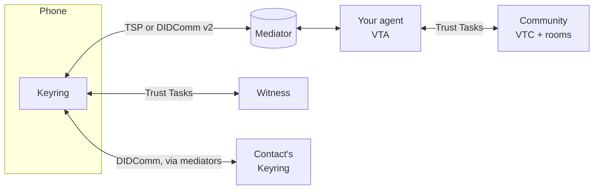

<p align="center">
  
</p>

<h1 align="center">Keyring</h1>

<p align="center">
  An open-source phone wallet for your own identity, your relationships, and the communities you belong to.
</p>

<p align="center">
  <a href="LICENSE"></a>
  
  
  
</p>

---

Keyring is a mobile wallet for iOS and Android. You keep your identity and your
credentials on your phone. You meet people and record those relationships as
signed credentials. You join communities, chat, and share in community rooms,
through an agent that you control.

Keyring was built at the [Applied Social Media Lab](https://asml.cyber.harvard.edu/)
of Harvard's [Berkman Klein Center for Internet & Society](https://cyber.harvard.edu/),
and its development continues at the [Applied Technology Lab](https://www.appliedtechnologylab.org)
at the Harvard John A. Paulson School of Engineering and Applied Sciences (SEAS).
It is one of the first mobile wallets for the
[OpenVTC](https://github.com/OpenVTC) / First Person Project ecosystem.

> **Beta.** Keyring is in active development and is not ready for production use.
> Testers get new builds every few days, and data or behaviour may change between
> builds. See [issues](https://github.com/berkmancenter/keyring-wallet/issues).

**Getting the app.** Keyring is available only as a test build. It has no
public store listing.

- **iPhone:** join the beta on [TestFlight](https://testflight.apple.com/join/NQYt25SQ).
- **Android:** join [Google Play open testing](https://play.google.com/store/apps/details?id=asml.bkc.harvard.wallet).

Both links are also on [openvtc.net](https://openvtc.net) as QR codes, to scan from a computer screen.

## Talk to us

Join the **Keyring testers** group on Signal: [signal.group invite](https://signal.group/#CjQKIEFrPntxzJWIqaymoPmBakVxfBcsiY8Hk4eVZzSZ44t8EhBTm3UCPt5SUSq6Z_H6H2eK). It's where
people testing Keyring report problems, ask questions and hear about new builds.

The group has the Keyring team's assistant, an automation account. Mention it to ask
how something in Keyring works, or to report a problem: it records every report and
request with a number so nothing gets lost, posts release notes, and tells you when a
fix ships. It answers from the release notes and earlier answers, and passes anything
else to the team. It doesn't make decisions or promise dates; the Keyring maintainers
read everything and decide.

You can also
[report a problem or ask for a feature](https://github.com/berkmancenter/keyring-wallet/issues/new/choose)
on GitHub.

**Just want to see it run?** Follow [`docs/DEMO_QUICKSTART.md`](docs/DEMO_QUICKSTART.md),
or run `yarn quickstart`. It takes you from an empty machine to two wallets
exchanging a credential.

## What you can do with Keyring

Everything below is in the builds testers use today, unless it says otherwise.

### Your identity

- **R-Cards.** Make a profile card with your name and a photo. Edit it later.
  Keep more than one profile and pick which one to use.
- **Your keys stay on your phone.** The wallet is locked by a PIN, with
  biometrics if you want them.

### People you know

- **Relationship credentials (VRCs).** Meet someone, scan their code, and each of
  you signs a credential that says you know each other. They are W3C Verifiable
  Credentials 2.0 with Data Integrity proofs.
- **Witnessed exchanges.** A witness service can confirm that an exchange
  happened, and issue a witness credential to both people. It never sees your
  private data.
- **Hardware attestation (optional).** On real phones, the exchange can be
  signed with a key in the Secure Enclave (iOS) or StrongBox (Android), after a
  biometric or passcode check.
- **In-person evidence (with a witness).** A witness at a venue can observe both
  phones over Bluetooth, on iPhone and Android, and record that the two people
  were together.
- **Contacts.** One entry per person, with how you know them and when you met.
  Merge two entries that are the same person, and confirm it with the other
  person's phone.

### Chat

- One-to-one chat with your contacts, end-to-end encrypted.
- Reactions, replies, an emoji picker, and photos sent inside the message.
- Drafts, delete for me, clear a chat, and a setting for how long chat stays on
  your phone.
- Disappearing messages, set per chat.
- All chats live in the **Messages** tab: one row per conversation, and a
  **New message** button to start one.
- *On the way:* swipe a chat to delete it (with Undo), and search.

### Your agent and your communities

Keyring works with a **Verifiable Trust Agent (VTA)**: a server-side agent that
holds your community identities and acts for you when your phone is asleep.

- **My Agent.** Link your phone to an agent by scanning a QR code or opening a
  link. Link more than one agent, switch between them, and unlink one.
- **Devices.** Add and name the other devices on your agent, and remove them.
- **Approvals.** When your agent needs you, the phone asks. It shows the
  reason before the check ("step-up"). You choose what your agent asks about.
- **Join communities.** See a community's ways in, and its directory statement,
  before you send anything. Join with the profile you choose. Leave when you want.
- **Vetting.** Ask a vetter to vouch for you, or vouch for someone as a vetter,
  one step per screen, with a match code checked on both phones. Where a
  community offers it, **private vetting** lets a vetter vouch without being
  named.
- **Community cards.** The cards a community gives you appear in your wallet as
  a stack of passes.
- **Sign in to a community's website.** Scan the site's QR code or open its link,
  then approve on your phone.

### Rooms

Rooms are a community's shared spaces. Keyring is a member of a room, through
your agent.

- See your rooms, and accept or hide room offers.
- Read a room's chat and post to it, in open rooms and in rooms where posts
  carry your name. New posts appear while the room is open, and older ones load
  as you scroll.
- See a room's files listed by name, in rooms where posts carry your name.
  *On the way:* opening, downloading and adding files (up to 25 MB).
- Read, write and edit titled notes.
- See a room's members. Give other members your own names for them, and see a
  member's community directory name where they've chosen to share it.
- Notices tell you about a new room offer, when you are let in, and when a post
  didn't send.
- After the phone locks, Keyring comes back to the room you had open.

### Community directory — *on the way*

Browse a community's members, see your own card, and tap a member to see theirs.
These screens are merged in the framework and not yet in the app. Today the app
uses the directory only to show names in rooms.

### Notifications

- If you allow it, your phone gets a wake-up when your agent needs an approval or
  a contact sends you a message. The notification has no message content. The
  phone writes it itself.

### Languages

- English, French and Brazilian Portuguese.

### Planned

These have plans in [`docs/plans/`](docs/plans/README.md) but are not in the app:
meeting someone over Bluetooth instead of a QR code, holding KERI credentials,
chat over DIDComm v2, and more.

## How Keyring fits the OpenVTC ecosystem

Keyring speaks the protocols of the [OpenVTC](https://github.com/OpenVTC) /
First Person Project stack:

- **VTA (Verifiable Trust Agent):** your server-side agent. It holds the keys for
  your community identities. Keyring is its phone: it links to it, answers its
  approvals, and acts through it.
- **VTC (Verifiable Trust Community):** a self-governing community that runs on
  its own agent. You join it, are vetted, and use its rooms.
- **Mediator:** a relay that holds encrypted messages until your phone picks them
  up.
- **TSP (Trust Spanning Protocol)** and **DIDComm:** the message envelopes.
  Keyring uses TSP or DIDComm v2 with agents and communities, choosing per peer,
  and DIDComm with your contacts.
- **[Trust Tasks](https://github.com/trustoverip/dtgwg-trust-tasks-tf):** the
  operations carried in those envelopes, such as proposing a relationship or
  asking a witness.



**Shown in Prague.** In October 2026, Keyring was part of LF Decentralized Trust's
[demonstration of the first open-source Verifiable Trust Community](https://www.linuxfoundation.org/blog/lf-decentralized-trust-demonstrates-the-first-open-source-verifiable-trust-community-in-prague)
at the Linux Plumbers Conference and Open Source Summit Europe in Prague. The demo
showed a community for an open-source project built on a decentralized trust graph:
verifiable relationship, membership and delegation credentials, governance written
as policy, and checks on pull requests. It is offered as an alternative to the
PGP/GPG web of trust that projects such as the Linux kernel use to vouch for their
maintainers: a relationship credential exchanged between two phones can stand in for
a key-signing. Keyring showed the phone side of it, working with OpenVTC.

The design work behind this lives in
[`docs/plans/openvtc-integration-plan.md`](docs/plans/openvtc-integration-plan.md).

## Repository layout

```
keyring-wallet/
├── app/                  # The Keyring app: screens, theme, languages, agent setup
│   ├── src/
│   ├── android/          # Android project
│   └── ios/              # iOS project (workspace AriesBifold.xcworkspace)
├── bifold/               # Git submodule: berkmancenter/keyring-bifold
│   └── packages/
│       ├── core/                       # UI, navigation, and the modules below
│       │   └── src/modules/            #   vrc, trust-tasks, chat, rooms, directory, ...
│       ├── trust-tasks/                # Trust Task plumbing shared by wallet and witness
│       ├── credo-tsp-adapter/          # TSP keys and envelopes on Askar
│       ├── react-native-attestation/   # Secure Enclave / StrongBox attestation
│       ├── react-native-locality-peripheral/  # Bluetooth role for in-person evidence
│       ├── vrc-contexts/               # JSON-LD contexts for relationship and witness credentials
│       ├── dtg-vocab/                  # Verifier accept-list for DTG predicates
│       ├── witness-server/             # The witness service (Node.js)
│       ├── mediator-server/            # A local DIDComm mediator for development
│       ├── vrc-reference/              # Reference implementation and conformance tests
│       ├── vrc-shared/                 # Server-side helpers (not for the app)
│       ├── react-hooks/  oca/  verifier/  remote-logs/
├── e2e/                  # Appium tests on emulators, simulators and phones; the release gate
├── deploy/               # Services Keyring runs: OTA update server, push gateway, short links
├── tsp-reference/        # Runnable reference steps behind the OpenVTC plan
├── scripts/              # Install helpers, demo, OTA and release tools
└── docs/                 # Guides, design notes and plans
```

`app/` is the only Yarn workspace. `@bifold/*` packages resolve to the submodule
through `portal:` links, so changes under `bifold/packages/` show up in the app
without a build step during development.

## Getting started

### Prerequisites

| Tool | Version | Notes |
|---|---|---|
| [Node.js](https://nodejs.org) | `>=20.19.2 <21` | [`.nvmrc`](.nvmrc) pins 20.19.2 |
| [Yarn](https://yarnpkg.com/) | 4.9.2 | `corepack enable` |
| [JDK](https://www.azul.com/downloads/?package=jdk#zulu) | 17 | Zulu recommended |
| [Android Studio](https://developer.android.com/studio) | Latest | Android SDK 36 |
| [Xcode](https://developer.apple.com/xcode/) | Latest | macOS only, for iOS |
| [Ruby](https://www.ruby-lang.org/) | 2.6.10 or newer | For CocoaPods |
| [Python](https://www.python.org/) | 3.11 | Build tooling |

`yarn doctor` checks your machine and changes nothing.

### Install

```sh
git clone --recurse-submodules https://github.com/berkmancenter/keyring-wallet.git
cd keyring-wallet
yarn install
```

`yarn install` also prepares the `bifold/` submodule.

### The quick way: run a demo

```sh
yarn demo:android    # Android emulator
yarn demo:ios        # iOS simulator (macOS)
```

This starts a local mediator, points the app at it, and builds and launches the
app. Leave the terminal open. The first build takes 5 to 10 minutes.
[`docs/DEMO_QUICKSTART.md`](docs/DEMO_QUICKSTART.md) covers the whole path and
what to do when something fails.

### By hand

The app needs a mediator. Start one in its own terminal first:

```sh
yarn mediator
```

It writes its invitation into `app/.env`. On an emulator or simulator you can skip
the public tunnel with `--endpoint http://10.0.2.2:3010` (Android) or
`--endpoint http://localhost:3010` (iOS). See
[`bifold/packages/mediator-server/README.md`](https://github.com/berkmancenter/keyring-bifold/blob/main/packages/mediator-server/README.md).

Then build the app:

```sh
cd app
yarn ios:setup && yarn ios   # iOS: CocoaPods, then build and launch
yarn android                 # Android
yarn start                   # Metro, if it does not start by itself
```

### Configuration

`app/.env` starts as a copy of [`app/.env.sample`](app/.env.sample), which
explains each value. Push notifications and over-the-air updates are off unless
you name a server for them. A local build talks only to the mediator you started.

### The witness server

The witness is its own Node.js service. See
[`bifold/packages/witness-server/README.md`](https://github.com/berkmancenter/keyring-bifold/blob/main/packages/witness-server/README.md).

### Building your own use case

[`app/src/demo-profiles/README.md`](app/src/demo-profiles/README.md) shows how to
add your own credential and exchange on top of Keyring.

## Testing

From the repo root:

```sh
yarn lint           # ESLint
yarn typecheck      # TypeScript
yarn test           # Jest, for the app
yarn prettier       # formatting check (yarn prettier:fix writes)
```

Each framework package has its own suite, for example
`cd bifold/packages/core && yarn test`.

End-to-end tests drive real builds with Appium. They need built apps first; see
[`e2e/README.md`](e2e/README.md).

```sh
yarn e2e:smoke          # one device: onboarding
yarn e2e:vrc            # two devices: Android emulator and iOS simulator
yarn e2e:vrc:devices    # two real phones: the only way to prove hardware attestation
yarn e2e:migration      # wallet storage upgrade
```

Emulators and simulators cannot do hardware attestation. On them the app falls
back to a plain exchange.

Every pull request runs lint, types and tests, builds test apps for both
platforms, and runs a short smoke test on them. Before each store build, the
maintainers run the full **release gate**: every core journey, on the exact
build that will ship. See [`docs/RELEASE_GATE.md`](docs/RELEASE_GATE.md) and
[`e2e/gate/README.md`](e2e/gate/README.md).

## Releases

- **Store builds.** Testers get numbered builds through TestFlight (iOS) and
  Google Play open testing (Android). There is no public store listing. Each one is built by GitHub Actions from a tagged commit
  (`staging-v0.2.0-<build>`).
- **Over-the-air updates.** Between store builds, a change that touches only the
  app's JavaScript can reach testers as a signed update, for example "276.3".
  [`scripts/release/tier.mjs`](scripts/release/tier.mjs) decides from the files a
  change touches whether it may go over the air or needs a store build. An update
  can go to the maintainers' own phones first, before everyone. Each one needs
  a maintainer's approval, is smoke-tested after it ships, and can be withdrawn. The update server is in
  [`deploy/keyring-ota/`](deploy/keyring-ota/README.md).

## Docs map

| Topic | Where |
|---|---|
| What changed in each release | [`CHANGELOG.md`](CHANGELOG.md) |
| Run the demo from scratch | [`docs/DEMO_QUICKSTART.md`](docs/DEMO_QUICKSTART.md) |
| Run a witnessed exchange demo | [`docs/DEMO_RUNBOOK_WITNESSED_EXCHANGE.md`](docs/DEMO_RUNBOOK_WITNESSED_EXCHANGE.md) |
| How hardware attestation works | [`docs/HARDWARE_ATTESTATION_FLOW.md`](docs/HARDWARE_ATTESTATION_FLOW.md) |
| Plans for upcoming work | [`docs/plans/README.md`](docs/plans/README.md) |
| OpenVTC, TSP and Trust Tasks | [`docs/plans/openvtc-integration-plan.md`](docs/plans/openvtc-integration-plan.md) |
| Rooms | [`docs/plans/openvtc-rooms-plan.md`](docs/plans/openvtc-rooms-plan.md) |
| Chat | [`docs/plans/rich-messaging-plan.md`](docs/plans/rich-messaging-plan.md) |
| Push notifications | [`docs/plans/push-notifications-plan.md`](docs/plans/push-notifications-plan.md) |
| Inviting people to a community | [`docs/COMMUNITY_ADMIN_INVITING.md`](docs/COMMUNITY_ADMIN_INVITING.md) |
| Links that open Keyring | [`docs/UNIVERSAL_LINKING_SETUP.md`](docs/UNIVERSAL_LINKING_SETUP.md) |
| The framework upgrade (React Native, Credo) | [`UPGRADE_PROGRESS.md`](UPGRADE_PROGRESS.md) |
| End-to-end tests | [`e2e/README.md`](e2e/README.md) |
| Release gate | [`docs/RELEASE_GATE.md`](docs/RELEASE_GATE.md) |
| Push gateway and mediator we deploy | [`deploy/keyring-messaging/README.md`](deploy/keyring-messaging/README.md) |
| Problems we found upstream | [`docs/UPSTREAM_ISSUES.md`](docs/UPSTREAM_ISSUES.md) |

## Contributing

We welcome issues and pull requests. Please read
[`CONTRIBUTING.md`](CONTRIBUTING.md) and our
[Code of Conduct](CODE_OF_CONDUCT.md) first.

- **Report a problem or ask for a feature** with the
  [issue forms](https://github.com/berkmancenter/keyring-wallet/issues/new/choose),
  or see [Talk to us](#talk-to-us).
- **Security problems:** report them
  [privately](https://github.com/berkmancenter/keyring-wallet/security/advisories/new),
  not in a public issue.
- **Commit messages** follow
  [Conventional Commits](https://www.conventionalcommits.org/) with a lower-case
  type: `feat`, `fix`, `docs`, `style`, `refactor`, `perf`, `test`, `chore`,
  `revert`. commitlint checks this.
- **Signed commits.** Every commit on `main`, in both repositories, must be
  signed (GPG or SSH) and verified by GitHub.
- **DCO sign-off.** Add a `Signed-off-by:` line with `git commit -s`. In the
  `bifold/` submodule it must be the last line of the message, and it names the
  commit's own author.
- **Framework changes** go to
  [keyring-bifold](https://github.com/berkmancenter/keyring-bifold) as their own
  pull request; the app then moves its submodule pin.

## License

Apache 2.0. See [LICENSE](LICENSE).

## Credits

Keyring builds on open-source work from others:

- [**Bifold Wallet**](https://github.com/openwallet-foundation/bifold-wallet), from
  the [OpenWallet Foundation](https://openwallet.foundation/): the wallet
  framework Keyring forks.
- [**BC Wallet Mobile**](https://github.com/bcgov/bc-wallet-mobile), from the
  Government of British Columbia: the app Keyring started from.
- [**Credo**](https://github.com/openwallet-foundation/credo-ts): the agent
  framework for DIDComm, credentials and DIDs.
- [**OpenVTC**](https://github.com/OpenVTC): the agents, communities, rooms and
  Trust Task libraries Keyring works with.

Keyring's own contributions to this ecosystem include peer-to-peer relationship
credential exchange, the witnessed exchange, a reusable hardware attestation
module for iOS and Android, a TSP envelope implementation that runs in React
Native, and work on the
[Decentralized Trust Graph credential specification](https://github.com/trustoverip/dtgwg-cred-spec)
and [Trust Tasks](https://github.com/trustoverip/dtgwg-trust-tasks-tf) at Trust
Over IP and Linux Foundation Decentralized Trust.

Contributors are listed in [CONTRIBUTORS.md](CONTRIBUTORS.md) and
[HISTORICAL_CONTRIBUTORS.md](HISTORICAL_CONTRIBUTORS.md).

## Links

- [Applied Technology Lab](https://www.appliedtechnologylab.org), Harvard SEAS
- [Applied Social Media Lab](https://asml.cyber.harvard.edu/)
- [Advanced Digital Identity Project](https://asml.cyber.harvard.edu/advanced-digital-identity/)
- [keyring-bifold](https://github.com/berkmancenter/keyring-bifold), the framework fork
