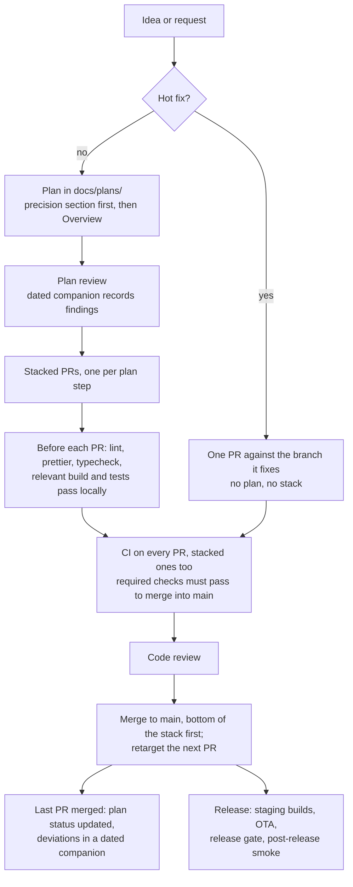

# How development works

The path a change takes, from an idea to testers' phones, for people and agents
alike. Each step links to the document that owns its rules; this page only puts
them in order.

*Every change goes through CI and review; only a hot fix skips the plan and
the stack.*

## 1. Idea → plan

Workstreams that need design start as a plan in [`plans/`](./plans/). Read
[`plans/CLAUDE.md`](./plans/CLAUDE.md) first: it sets the two-part structure
(a human Overview, then a numbered precision section, each opened by a marker
and a banner; the precision section is authoritative), the order of work, the
completeness checklist, and the Mermaid and mockup conventions (mockups are
generated from the app's theme by `scripts/plans/mockup-kit`, and reviewed as
the committed contact sheet, `mockups/sheet.png`, which `kit.ts sheet`
regenerates after any mockup or theme change). Start from
[`plans/PLAN_TEMPLATE.md`](./plans/PLAN_TEMPLATE.md). The Overview is written
with the `technical-plan-humanizer` skill
([`../.claude/skills/technical-plan-humanizer/SKILL.md`](../.claude/skills/technical-plan-humanizer/SKILL.md))
only after the precision section has been checked. How plans are proposed and
agreed is in [`plans/README.md`](./plans/README.md).

Before opening the PR, run the structure checker on the plan:
`node --experimental-strip-types scripts/plans/check-plans.ts` (Node 22.6+, or
`bun scripts/plans/check-plans.ts`). It checks plans already in the two-part
format and skips legacy ones; rules in [`plans/CLAUDE.md`](./plans/CLAUDE.md),
"Checking a plan's structure". The Plan structure workflow runs it on PRs that
touch `docs/plans/`. The PR that adds or substantively changes a plan links the
dated companion recording its completeness and correctness check.

Small, self-contained changes do not need a plan.

## 2. Plan → stacked PRs

A plan is implemented as a stack of PRs, one per step, in the plan's order,
each based on the previous PR's branch, each linking the plan section it
implements and its place in the stack. Before opening each PR, lint, format,
typecheck, the relevant build and its tests must pass locally; if they fail,
the PR is not opened. The PR template
([`../.github/pull_request_template.md`](../.github/pull_request_template.md))
carries the stack fields (`Stack: n of m. Base: <branch> (#N), at <sha8>`, the
plan section) and that checklist. Code Quality and Commit Requirements run on
every PR in the stack, not only on the one into `main`. Rules, the PR description format, and how to rebase and
retarget when a lower PR merges: [`plans/CLAUDE.md`](./plans/CLAUDE.md),
"Implementing a plan: stacked PRs".

On this shared machine, builds and test suites follow the heavy-operations
rules in `/srv/dev/CLAUDE.md` (memory and CPU check, `vartmp-tidy check`,
`nice -n 10`).

When the last PR of the stack merges, the plan is done only once its status
line says so and a dated companion records any deviations from it
([`plans/CLAUDE.md`](./plans/CLAUDE.md), "When the plan is done").

## 3. Commits

Conventional commits, cryptographically signed, with a `Signed-off-by:`
trailer; bifold commits have the trailer as the last line. Owned by the root
[`../CLAUDE.md`](../CLAUDE.md), "Commit conventions", and `/srv/dev/CLAUDE.md`,
"Git". A change to `bifold/packages/*` is a paired PR in `keyring-bifold`,
merged first, with the wallet PR bumping the pin
([`plans/release-flow-plan.md`](./plans/release-flow-plan.md) §5).

## 4. CI

What runs on a PR, on `main`, on a schedule and by hand, and which checks are
required: [`TESTING.md`](./TESTING.md) (the required-check list and runtimes
are in its "Volatile facts" section, with the commands to re-check them). The test tiers and their local
commands are there too.

## 5. Review

A person reviews each PR in the stack in order. Reviewer conventions for this
tree (testing requirements and coverage passes, tone of PR comments) are in
`/srv/dev/CLAUDE.md`, "Code review & PR comments".

## 6. Merge and release

Merge bottom-up; retarget the next PR to `main` (see step 2). From `main`, a
change reaches testers through staging store builds, OTA updates and the
release gate:

- [`plans/release-flow-plan.md`](./plans/release-flow-plan.md): branches,
  `staging`, tags, delivery channels.
- [`RELEASE_GATE.md`](./RELEASE_GATE.md) and
  [`../e2e/gate/README.md`](../e2e/gate/README.md): the per-change smoke and the
  full gate on frozen heads.
- [`TESTING.md`](./TESTING.md): post-release smoke and the OTA brake.

## Hot fixes

A hot fix is exempt from the plan and the stack: one PR against the branch it
fixes. It still needs green CI, review and the commit rules.
