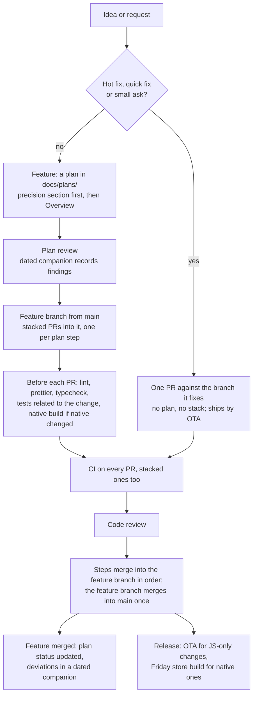

# How development works

The path a change takes, from an idea to testers' phones, for people and agents
alike. Each step links to the document that owns its rules; this page only puts
them in order.

**When this applies.** This workflow takes effect when the one-codebase fold
([`plans/single-codebase-plan.md`](./plans/single-codebase-plan.md)) has landed
on `main`, folding `keyring-bifold` into this repository. Until then the process
in place before it still applies, including paired PRs in `keyring-bifold`.

**Version 1.** This is a first version. We measure it as we use it and cut any
step that costs more than it catches; see
[Measuring this workflow](#measuring-this-workflow).

*Every change goes through CI and review; hot fixes, quick fixes and small asks
skip the plan and the stack.*

## 1. Idea → plan

**A plan is a feature.** Every feature starts as a plan in
[`plans/`](./plans/), and the plan is implemented as one feature branch. Read
[`plans/CLAUDE.md`](./plans/CLAUDE.md) first: it sets the two-part structure
(a human Overview, then a numbered precision section, each opened by a marker
and a banner; the precision section is authoritative), the order of work, the
completeness checklist, and the Mermaid and mockup conventions (mockups are
generated from the app's theme by `scripts/plans/mockup-kit`, and reviewed as
the committed contact sheet, `mockups/sheet.png`, which `kit.ts sheet`
regenerates after any mockup or theme change). Start from
[`plans/PLAN_TEMPLATE.md`](./plans/PLAN_TEMPLATE.md). The Overview is written
with the `technical-plan-humanizer` skill
([`../.claude/skills/technical-plan-humanizer/SKILL.md`](../.claude/skills/technical-plan-humanizer/SKILL.md))
only after the precision section has been checked. How plans are proposed and
agreed is in [`plans/README.md`](./plans/README.md).

Before opening the PR, run the structure checker on the plan:
`node --experimental-strip-types scripts/plans/check-plans.ts` (Node 22.6+, or
`bun scripts/plans/check-plans.ts`). It checks plans already in the two-part
format and skips legacy ones; rules in [`plans/CLAUDE.md`](./plans/CLAUDE.md),
"Checking a plan's structure". The Plan structure workflow runs it on PRs that
touch `docs/plans/`. The PR that adds or substantively changes a plan links the
dated companion recording its completeness and correctness check.

Hot fixes, quick fixes and small asks from testers through the Keyring feedback
channel do not need a plan; see [Hot fixes and quick fixes](#hot-fixes-and-quick-fixes).

## 2. Plan → stacked PRs

A plan is implemented on a **feature branch** cut from `main`
(`feat/<plan-name>`). Each step of the plan is one PR, stacked in the plan's
order: the first step's PR targets the feature branch, and each later one is
based on the previous step's branch. Each links the plan section it implements
and its place in the stack. Steps merge into the feature branch in order, and
when the last one has merged, the feature branch merges into `main` once, as
one reviewed PR. Before opening each PR, lint, format and typecheck must pass
locally, along with the tests related to the files it changes (not the whole
suite) and a native build if it touches native code; if they fail, the PR is
not opened. CI runs the broad checks. (A PR that changes only plans and their assets is
exempt from the app checks and runs the plan checker instead; see
[`plans/CLAUDE.md`](./plans/CLAUDE.md), "A plan-only PR runs no app tests
locally".) The PR template
([`../.github/pull_request_template.md`](../.github/pull_request_template.md))
carries the stack fields (`Stack: n of m. Base: <branch> (#N), at <sha8>`, the
plan section) and that checklist. Code Quality and Commit Requirements run on
every PR in the stack, not only on the one into `main`. Rules, the PR description format, and how to rebase and
retarget when a lower PR merges: [`plans/CLAUDE.md`](./plans/CLAUDE.md),
"Implementing a plan: stacked PRs".

Heavy local runs (whole suites, native builds) follow the rules of the machine
they run on; on a shared machine, run one heavy suite at a time with few
workers, and prefer CI for anything broad.

When the feature branch has merged into `main`, the plan is done only once its
status line says so and a dated companion records any deviations from it
([`plans/CLAUDE.md`](./plans/CLAUDE.md), "When the plan is done").

## 3. Commits

Conventional commits, cryptographically signed, with a `Signed-off-by:`
trailer. Owned by the root [`../CLAUDE.md`](../CLAUDE.md), "Commit
conventions". After the fold, `bifold/` is part of this repository, so a change
to `bifold/packages/*` goes in the same PR as the rest of the change; there is
no paired PR and no pin to bump.

## 4. CI

What runs on a PR, on `main`, on a schedule and by hand, and which checks are
required: [`TESTING.md`](./TESTING.md) (the required-check list and runtimes
are in its "Volatile facts" section, with the commands to re-check them). The test tiers and their local
commands are there too.

## 5. Review

A person reviews each PR in the stack in order, and then the feature branch's
PR into `main`.

## 6. Merge and release

Merge the stack into the feature branch bottom-up, then the feature branch into
`main` once (see step 2). From `main`, a change reaches testers through OTA
updates (JS-only changes, as `scripts/release/tier.mjs` grades them), the
weekly Friday store build (anything it grades `store`), and the release gate:

- [`plans/release-flow-plan.md`](./plans/release-flow-plan.md): branches,
  `staging`, tags, delivery channels.
- [`RELEASE_GATE.md`](./RELEASE_GATE.md) and
  [`../e2e/gate/README.md`](../e2e/gate/README.md): the per-change smoke and the
  full gate on frozen heads.
- [`TESTING.md`](./TESTING.md): post-release smoke and the OTA brake.

## Hot fixes and quick fixes

A **hot fix** (something broken for testers) and a **quick fix** (a small fix,
or a small ask from a tester through the Keyring feedback channel) need no plan
and no stack: one PR against the branch it fixes.

- **They ship over the air** when `scripts/release/tier.mjs` grades them `ota`
  or `ota-strict`. One it grades `store` (native code, migrations) waits for
  the next Friday store build.
- **They are exempt from heavy testing.** Write the minimal tests that prove the
  fix, with a control that fails without it, and run only those plus the checks
  `main` requires. No full local suite, no release gate run.
- They still need green required CI, review and the commit rules.

## Measuring this workflow

This is version 1. Once the fold has landed, and again after the first few
features have gone through it, we check:

- how long a stacked PR takes from opening to green, locally and in CI;
- which checks have caught real problems and which have only cost time;
- whether per-PR lint, build and test is still slow now that there is no
  submodule to install and build (the submodule was most of that cost before).

A check that has caught nothing and costs real time is cut or narrowed, and
this page and [`TESTING.md`](./TESTING.md) are updated in the same change.
