# Agent connect — a person's own AI agent in Keyring

**Status:** Draft, revision 4. Nothing built. Tiers P0 to P2, each a working product on its own (§7.0). One decision is open (§11 Q1); the decisions already made, with who and when, are in the register in the Overview.
**Roadmap epic:** none yet.
**Scope:** A person connects their own agent (a Claude Code terminal session, with a small plugin of ours, that reaches their VTA through MCP) to Keyring by scanning a code, typing a number from their terminal, chats with it one to one, adds it to data rooms, and revokes it, with no change to the VTI stack. Anything that would need a VTI change is listed in §10, not built around.
**Companions:** [`agent-connect-plan/`](./agent-connect-plan/) — review index in this plan's §12; running ledger of asks for VTI, OpenVTC and the working groups: [`agent-connect-plan/vti-asks.md`](./agent-connect-plan/vti-asks.md) (this plan's §10)
**Parent / related:** [`openvtc-rooms-plan.md`](./openvtc-rooms-plan.md) (rooms; its R4 is the grant this plan builds), [`rooms-chat-plan.md`](./rooms-chat-plan.md) (the record format an agent writes), [`rich-messaging-plan.md`](./rich-messaging-plan.md) (the one-to-one chat message), [`openvtc-integration-plan.md`](./openvtc-integration-plan.md) (Trust Tasks, VTA client), [`message-protection-plan.md`](./message-protection-plan.md) (queue limits when the agent is offline), [`peer-message-notifications-plan.md`](./peer-message-notifications-plan.md) (waking the phone for the agent's replies)

<!-- plan-format: tiers -->

## Overview
<!-- plan-part: human -->

> **Human part: for people deciding and reviewing.** What this is, what a person
> sees, how we'll know it works, and what is needed from whom. It adds nothing: the
> numbered precision part below is authoritative, and if the two disagree, the
> precision part wins and this part is the bug.

A person who runs a Claude Code session against their own VTA (the server that holds their identity, keys and memory) can connect that session to Keyring. They tap "Connect an agent", name it, run one command in a terminal on the computer where Claude Code runs, scan the code it shows, answer "Pair with ...? [y/N]" in that terminal, and type into Keyring the four-digit number the terminal then shows. Keyring never displays that number, so a code someone else put in front of the person cannot be approved by reflex, and the Approve screen says to continue only if the person ran the command in their own terminal just now. The number does not stop someone who can also show the person that number, such as an attacker on a screen share. For that case the plugin only pairs with the owner's own VTA, which it is told at setup or at the first connect, and asks the question in the terminal first. A wrong number ends the pairing. The lockout (three wrong numbers in 60 minutes, then a 15-minute lock) mostly guards against blind tries (1 in 10,000 each, at most six an hour) and locks out an owner who fumbles; it is not a defence against a viewer (§3.2, §9). After the person approves with their face or fingerprint, they can chat with the agent in Keyring, add it to a data room, and revoke it. In a room's member list the agent sits under its own heading, "Agents", with its owner and the handle to mention it by (§3.2, §3.5, §3.6, §3.9).

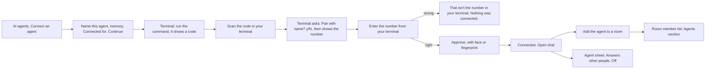
The person's path through the screens, in the plan's copy. A wrong number, or an N at the terminal, is where the pairing stops for good. (§3.2, §6)

<table>
<tr>
<td valign="top">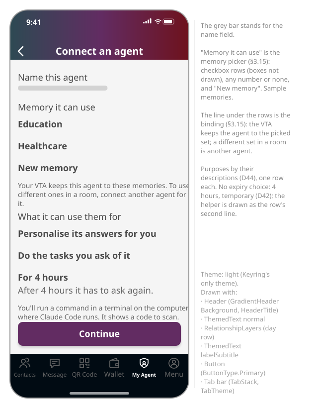<br><sub>1. Name the agent, pick its memories and how long it stays connected</sub></td>
<td valign="top"><br><sub>2. Scan the code the terminal shows</sub></td>
<td valign="top"><br><sub>3. Type the number from the terminal; one try</sub></td>
<td valign="top">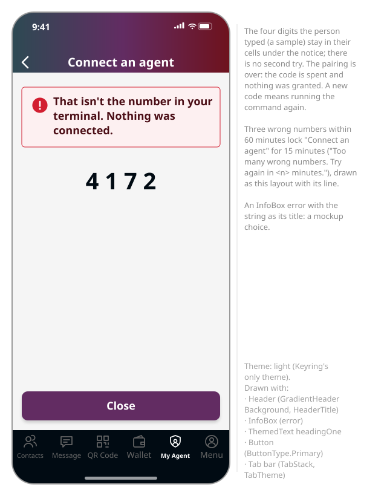<br><sub>4. Failure: a wrong number connects nothing</sub></td>
</tr>
<tr>
<td valign="top"><br><sub>5. Approve: what is granted, confirmed with face or fingerprint</sub></td>
<td valign="top"><br><sub>6. The agent list, the My Agent tab's first screen</sub></td>
<td valign="top">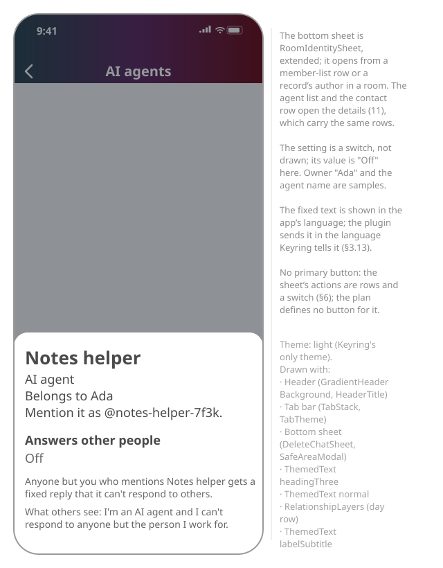<br><sub>7. The agent sheet: owner, and "Answers other people" with its value</sub></td>
<td valign="top">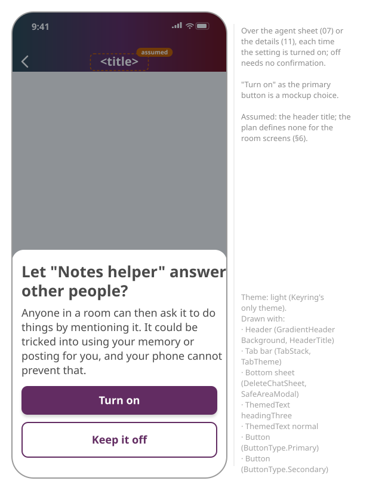<br><sub>8. Turning it on asks first and names the risk</sub></td>
</tr>
<tr>
<td valign="top"><br><sub>9. Contacts: the agent is a contact, drawn as the person's AI</sub></td>
<td valign="top">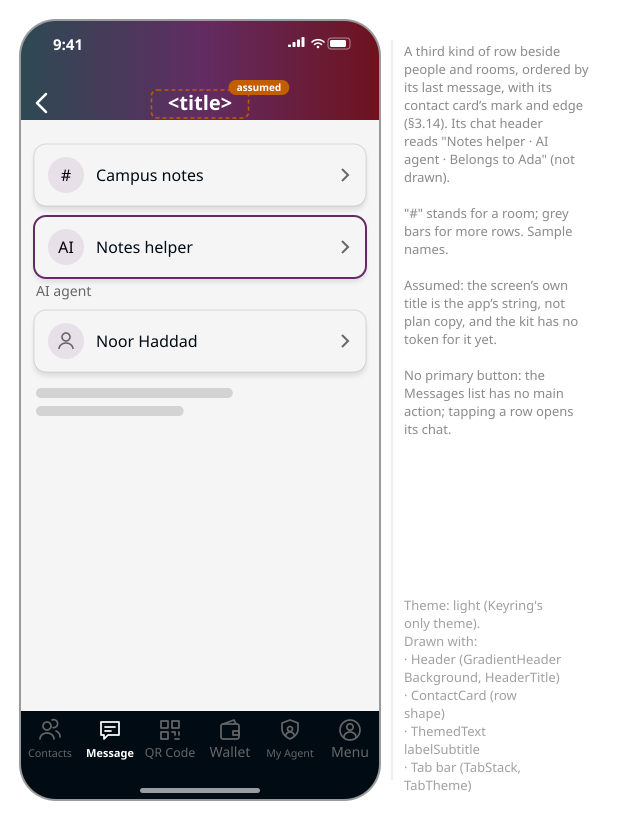<br><sub>10. Messages: the agent chat among people and rooms</sub></td>
<td valign="top"><br><sub>11. Agent details: "Message" first, then its fixed memories and "Change memories"</sub></td>
<td valign="top"><br><sub>12. The composer's "+": "Add a file" or "Add my agent"</sub></td>
</tr>
<tr>
<td valign="top"><br><sub>13. Adding an agent to a room, with the read-access and memory notices</sub></td>
<td valign="top"><br><sub>14. "What it remembers here": the agent's fixed memories, read-only, and "Connect another agent"</sub></td>
<td valign="top">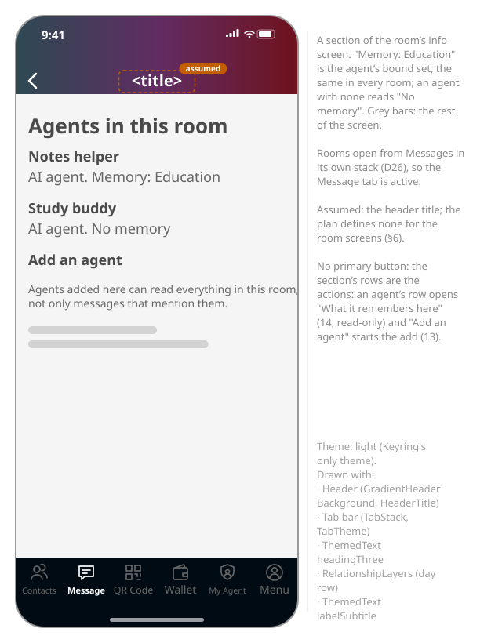<br><sub>15. Room info: "Agents in this room", with the memory each one is bound to</sub></td>
<td valign="top">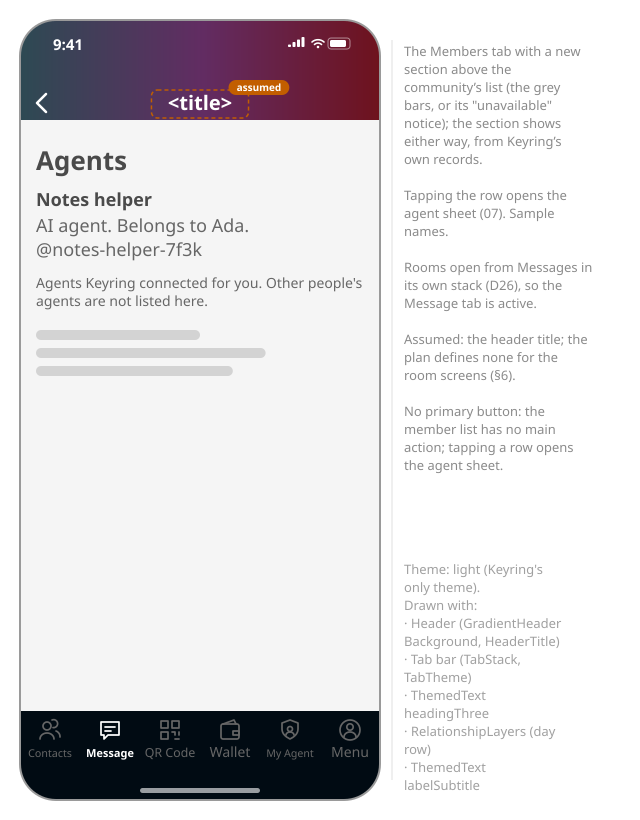<br><sub>16. The room's member list, with agents under "Agents", each with its owner and handle</sub></td>
</tr>
<tr>
<td valign="top"><br><sub>17. Revoke, which says "up to 4 hours"</sub></td>
<td valign="top"><br><sub>18. Failure: the code expired</sub></td>
<td valign="top">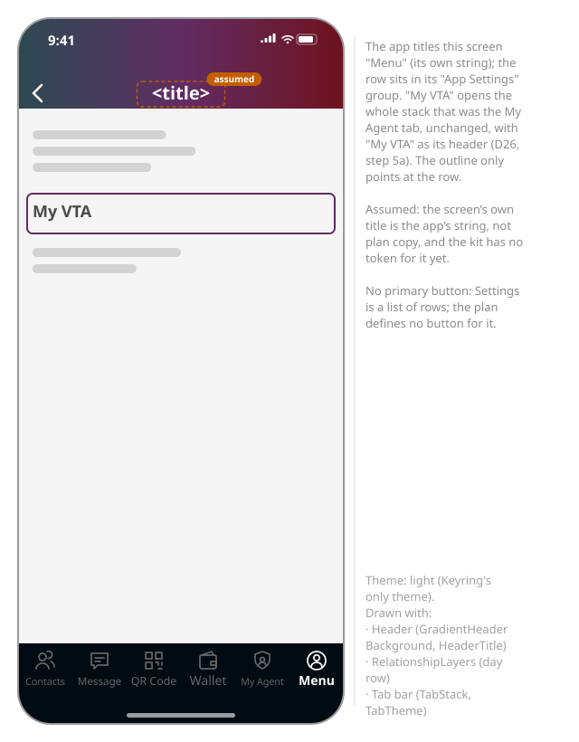<br><sub>19. Settings: the "My VTA" row opens the VTA's screens, moved whole</sub></td>
<td></td>
</tr>
<tr>
<td valign="top">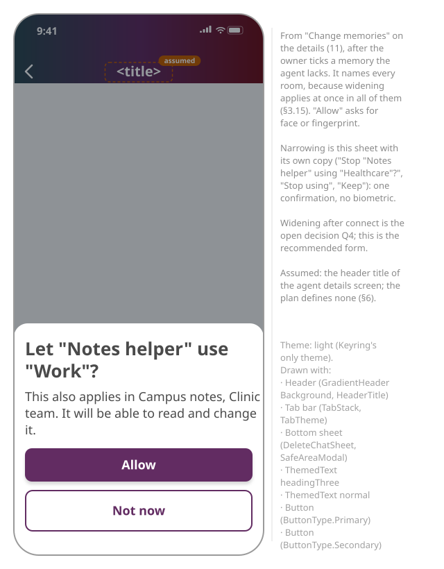<br><sub>20. Change memories: widening names every room and asks for face or fingerprint</sub></td>
<td valign="top">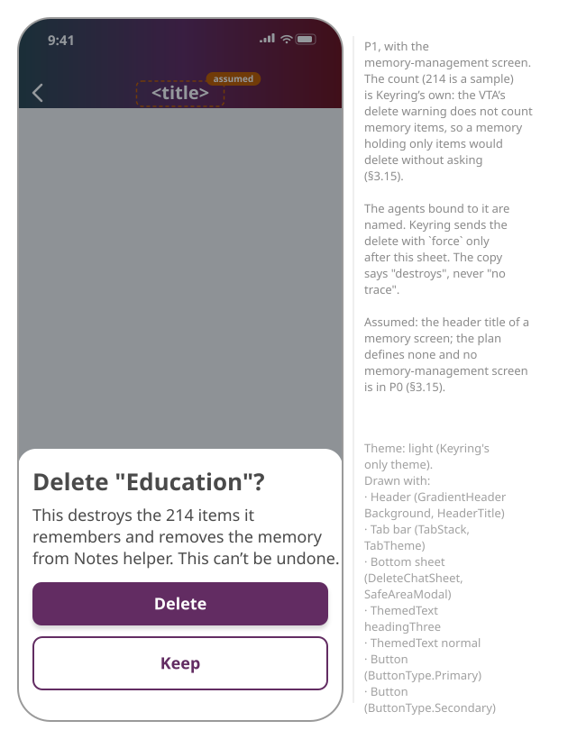<br><sub>21. Delete a memory (P1): counts the items, names the agents, says "destroys"</sub></td>
<td valign="top"><br><sub>22. Its memory access changed: Restore or Revoke</sub></td>
<td valign="top"><br><sub>23. The guard: a phone that is not an unrestricted administrator ends the connect (§1.5)</sub></td>
</tr>
</table>

![Screens 1 to 23: 1. Connect, name and memories; 2. Connect, scan; 3. Connect, enter the number; 4. Connect, wrong number; 5. Approve; 6. The agent list; 7. The agent sheet; 8. Turning Answers other people on; 9. Contacts with the agent row; 10. Messages with the agent chat; 11. Agent details; 12. The composer's plus sheet; 13. Add an agent to a room; 14. What it remembers here; 15. Agents in this room; 16. The room member list with Agents; 17. Revoke; 18. Connect, code expired; 19. Settings, My VTA; 20. Change memories; 21. Delete a memory; 22. Memory access changed; 23. Not an administrator](./agent-connect-plan/mockups/sheet.png)

Assumed in these mockups: the header title is a `<title>` stand-in on the room screens (12 to 16) and the agent details (11, 17, 20 to 22), because the plan defines none (§6), and on Contacts (9), Messages (10) and Settings (19), because those are the app's own strings and the mockup kit has no token for them yet; sample names, rooms, memories and dates ("Notes helper", "Ada", "Campus notes", "Education", "23 December 2026") stand for data. The agent card's dashed edge is drawn solid (9, 10).

Not drawn in the kit, because the screen is the layout of one above with its own line of copy: the locked state, the closed-mediator, version and "terminal refused" failures (the wrong-number layout), "Revoke not confirmed" and "changed its key" (the list and details layouts), the chat variant (its header is in 10's note), the community-setting refusals (the add sheet), the agent picker when more than one agent qualifies, and "Name this memory" (§6). Most of those are on the UI/UX canvas below.

**The UI/UX canvas.** The same screens at full fidelity, drawn by the UI/UX lane from this copy, with the states the kit leaves out (the new-memory field, the connected screen, every list status, the agent chat and its waiting state, the Messages filters, the "+" where agents are not allowed, the agent picker, a room with a mention, what another member sees with and without proof, and the terminal). It is the visual target the built screens are checked against (this plan's §8.6 and step 10a); the kit SVGs above remain the checked source for the words. The frames are exported in [`agent-connect-plan/canvas/`](./agent-connect-plan/canvas/), one PNG each, and that folder's README names the canvas version.

![The UI/UX canvas, 34 frames in the canvas's order: the terminal; connect name and memories, new memory, scan, number, wrong number, approve, connected, expired; the agent list, every list status, the agent sheet, turning Answers other people on, the agent details, revoke not confirmed, changed its key, revoke, Settings with My VTA; Contacts, Messages under All, the agent chat, the agent chat waiting, Messages under People, Messages under a community; a room with a mention, the composer plus sheet, the plus where agents are not allowed, the agent picker, add to room, memory for this room, agents in this room, the member list with agents, another member's view with proof, and without proof](./agent-connect-plan/canvas/sheet.png)

**Canvas frames pending redraw for rev 4 (UI/UX lane).** The kit SVGs above were redrawn for the memory binding (D31) and are the checked source; the canvas PNGs were not, and carry the old design until the lane redraws them. Exactly: `02-main.png` (add the helper under the memory rows), `07-approve.png` ("and no others"), `14-agent-details.png` (the per-room memory lines and "one agent per room" go; "Can use memory ... in every room it is in", "Your VTA keeps it to these memories" and "Change memories" come), `17-revoke.png` (P1 "Also delete what it remembered"), `29-add-to-room.png` (the sheet ends at the read-only sheet; add "Members of this room will see that this agent belongs to you."), `30-memory-for-room.png` (replaced by "What it remembers here", read-only), `31-room-agents.png` (rows read "Memory: <names>" or "No memory"), and, to be checked by the lane for the old per-room lines, `15-details-revoke-not-confirmed.png` and `16-details-key-changed.png`. Frames with no canvas counterpart yet: kit mockups 20 (change memories), 21 (delete a memory, P1), 22 (memory access changed) and 23 (the guard for a phone that is not an unrestricted administrator). The canvas's own board numbers (20a, 20b) are not the kit's mockup numbers.

**The agent answers only its owner by default.** "Answers other people" is off. Anyone else who mentions the agent in a room gets one fixed message, written by the plugin and never by the model: "I'm an AI agent and I can't respond to anyone but the person I work for." The same author gets it at most once an hour per room, and the agent sends at most 20 an hour in all. That reply tells the sender that the session is running and attentive and which language the owner uses Keyring in; the plan accepts and documents this (§3.13). Turning the setting on asks first, because the agent could then be tricked by a stranger's text into using the owner's memory. A permission prompt is not relied on, since auto mode and pre-allowed tools show none: while a stranger's text is being handled, a hook in the plugin allows only the reply tool, and VTI's passkey step-up is used where it covers the call. The hook is a Phase 0 check, and if it fails the switch is not offered in P0 (§3.13, §7 step 0.3).

**What the agent hears and what it is given.** The plugin is a small TypeScript repository of ours, built as a Claude Code plugin. It tells the running session a message arrived through a channel (a Claude Code research-preview feature that needs a development flag and an interactive session), and an `inbox` tool plus a watcher command stand by as the fallback. The plugin drops anything not written by the owner's own persona, whichever room it came from, takes chat only from the chat identity Keyring named at approval, and pairs only with the owner's own VTA (§3.2, §3.12).

**The delegation credential.** The agent gets a delegation credential (a VDC) that records whose agent it is, in the shape the DTG credentials specification requires. Keyring uses it for the owner shown in the agent sheet, for the chat, and, later, for proving to a third party whose agent this is. It is valid for 7 days and Keyring re-issues it while the agent's permission stays in place. After Revoke it is not re-issued, and a copy someone already holds stays valid for up to 7 days: there is no revocation list in P0. The one place it is shown is inside the rooms the agent is added to, as part of the agent's own name record, so that any member who taps the agent sees "AI agent", whose it is and its own identity (§3.16); that needs the room's profile to allow it, which is asked of VTI. It never travels with anything the agent does: in a room the agent acts on its own 4-hour permission and signs as itself (§3.4).

**A contact, and memories that are slices.** The agent is a contact in Contacts and a conversation in Messages, like a person and messageable like one, but drawn so it is never taken for one: a dashed edge, the mark "AI agent", the line "Your AI agent" where a person shows verification badges, and no photo. Tapping it opens the agent's details, whose first action is "Message" (§3.14). An agent is added to a room from the "+" next to the message field as well as from the room's info screen (§3.6). Its memory is made of **memories**, each one a VTA context the person names ("Education", "Healthcare"): any number are picked when the agent is connected, and the person's VTA binds the agent to exactly those: it can reach no other memory, whatever a room says and whatever the model decides. The VTA does not know about rooms, so there is no per-room choice to make; a person who wants a college's room to see "Education" and a clinic's room to see "Healthcare" connects two agents, one for each (§3.15). Memory is stored as plain text on the person's VTA, up to 64 KiB an item; it is not a place for secrets or files.

**One caveat, stated plainly.** An agent added to a room acts only when it is mentioned, but that is **behaviour, not enforcement**. To see a mention the agent needs read access to the room, so it can read all of it. Delivering only mentions to the agent would be a VTI change (§3.6, §10 item 3). Adding a room also lets the agent read and change the memory of the persona that holds the room, and so can every other agent the person adds to a room; the add sheet says so (§3.3, §9). Keyring says all this in the add sheet and the room info screen (§6). Past messages stay after Revoke, and a permission the agent already holds can work for up to 4 hours (§3.9).

**Revoke survives a key swap.** An agent can move its own permission to a new key without asking. Keyring therefore finds the agent by its device ID, not by its key, treats an empty answer as "search again", and shows "Revoke not confirmed" until the permission is gone. It also notices at app start if an agent changed its key (§3.9).

**How it works underneath**

```mermaid
sequenceDiagram
    autonumber
    actor P as Owner
    participant K as Keyring
    participant S as Session (Claude Code + plugin)
    participant M as Mediator
    participant V as Owner's VTA
    P->>K: Connect an agent, name it
    P->>S: run the connect command
    S->>M: authenticate pairing key P (did:key), on the VTA's mediator
    S-->>P: code (QR) and the same link as text
    P->>K: scan
    K->>M: claim (version, VTA, persona, name; authcrypt forward, no account)
    M->>S: claim
    S-->>P: Pair with name? y/N (refuses another VTA)
    P->>S: y
    S->>M: hello (agentDid, mediatorDid)
    M->>K: hello
    S-->>P: number N, in the terminal only
    P->>K: type N
    K->>K: wrong number ends the pairing, one try
    P->>K: approve (biometric)
    K->>V: acl/grant (role application, one context, expiry)
    K->>M: approved (vtaDid, chatDid, ownerPersonaDid)
    M->>S: approved
    S->>V: device/register (aiAgent), swap-key to a fresh did:key
    S->>M: rotated (new DID, signed by old and new key)
    M->>K: rotated
    K->>V: sign the VDC as the persona
    K->>M: VDC grant
    M->>S: VDC grant
    S->>M: VDC acceptance
    M->>K: VDC acceptance
    K-->>P: Agent connected, 1-1 chat opens
```
The pairing, in order. The number is shown only in the terminal and Keyring's check is local. The plugin refuses an `approved` that names a VTA other than its own. The agent holds a key and a delegation credential, never the person's room credentials; the VTA mints each room permission on request (§3.2, §3.6).

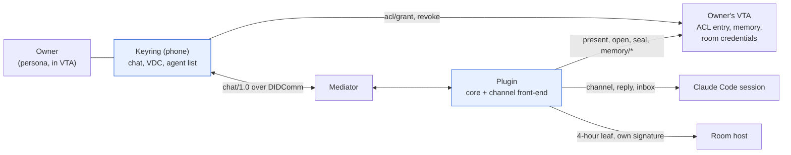
Who holds what. The agent is never a room member: it is a presenter holding a 4-hour, one-action leaf the VTA minted from the owner's persona. New against what exists: Keyring's agent screens and the plugin (blue). (§3.6, §3.12)

**How we'll know it works**

| Claim | Proved by | Runs where | Status |
|---|---|---|---|
| A mediator forwards a third party's authcrypt message to a `did:key`, queues it while the agent is offline, needs no sender account, refuses anoncrypt, refuses the 50th queued message, and loses a message sent to a `did:peer` that names another host | Throwaway Node probe, 2026-11-20 (§2.4); rebuilt with tests as `ref-25-agent-pairing` (§7 step 0.1) | Lab (starter mediator `e6e2c636`) | Measured once; the tested rung is not built |
| The delivery cases (live, offline, no sender account) hold on the VTA Farm's mediator (a P0 release gate). The refusal cases (closed ACL, queue cap, anoncrypt, wrong host, community setting) are run only on a mediator we control: the lab, or the Farm's Full Stack mode (D18) | The rung's cases (§8.3) | VTA Farm (delivery); lab or Full Stack (refusals) | Not run |
| An agent entry registered with `serviceKind` `aiAgent` is refused `rooms/keys/act` and can `present` and `open`; one not yet registered can `act` (§3.3) | Reference rung, then lab e2e (§8.2) | Lab | Not run |
| The pairing link is at most 251 bytes with a real `did:key` and its QR at level M scans; it expires in 300 s (§3.2) | Rung step 0.1(h); jest (§8.1) | Lab, CI | Counted on paper: 198 bytes; not measured |
| Pairing refuses a wrong four-digit number with no second try, an expired or reused code, a second claim, a `cancel` from the terminal and an unsupported version; three wrong numbers lock it for 15 minutes and further wrong ones renew the lock; Keyring never shows the number (§3.2) | jest, `bifold/packages/core/src/modules/connected-agents/__tests__/` (§8.1) | CI | Planned |
| The plugin pairs only with its pinned VTA: a claim or an `approved` naming another VTA is refused, a captured code does not enrol anyone, and nothing is shown or enrolled before the owner answers y (§3.2) | The plugin's own tests (§8.1); lab run with a second VTA (§8.2) | Plugin CI, lab | Planned |
| The VDC has the DTG base shape (`DTGCredential`, contexts, `issuerScope`, `validUntil`, `scope`; an acceptance with no `scope`), verifies, and is accepted by the agent's key; it is re-issued every 7 days while the entry is active, and a lapsed one does not change `active` (§3.4) | jest (§8.1), reference rung | CI, lab | Planned |
| Removing the ACL entry stops further `present` and memory calls at the next request (§3.9) | Lab e2e (§8.2) | Lab, then Farm | Not run |
| Revoke still works after the agent swapped its own key: the entry is found by device ID, an empty answer is not success, the "Revoke not confirmed" state persists across a restart, and the app notices a changed key at start (§3.9) | jest (§8.1); rung step 0.1(l) and lab e2e (§8.2) | CI, lab | Planned |
| An already-minted leaf keeps working up to 4 hours after Revoke, in `open` rooms only for reads and writes; Keyring never says "instant" (§3.9, §6) | Lab measurement, a long-running run of 4 hours or more; copy test (§8.1) | Lab, CI | Not run |
| Biometric approval gates the ACL grant on a real phone (§3.2) | Attended run on a physical phone (§8.4) | Physical phones | Not run |
| The plugin drops anything not authored by the owner's persona, takes chat only from the `chatDid` it was given, gates on the author and not the room, fences room content and declares no permission relay (§3.12) | The plugin's own tests (§8.1) | Plugin CI | Planned |
| With "Answers other people" off, a non-owner mention gets the fixed reply once per author per room per hour and the model never sees it (§3.13) | The plugin's tests; two-party lab run (§8.1, §8.2) | Plugin CI, lab | Planned |
| With it on, a hook in the plugin denies every tool but `reply` while a stranger's text is handled, in auto mode and with `vta-mcp` tools pre-allowed; passkey step-up covers memory and room writes if the VTA gates them. If the hook check fails, the switch is not offered (§3.13) | Phase 0 checks (§7 steps 0.1(n), 0.3(f)); the plugin's tests | A real Claude Code session, by hand; lab | Not run |
| A channel wakes an idle Claude Code session, works with a background session, and the `inbox` plus Monitor fallback does too; the minimum Claude Code version is known (§3.12) | Phase 0 checks (§7 step 0.3) | A real Claude Code session, by hand | Not run |
| Mentions use the full handle (name plus a suffix from the agent's DID), so another owner's agent of the same name does not match; the agent stays silent otherwise (§3.6) | Plugin tests; two-party lab run | Plugin CI, lab | Not run. Not enforceable by the VTA (§10 item 3) |
| Adding a room widens the agent's memory to the persona's context, and so for every agent added to a room; the add sheet says so and the effective access shows it (§3.3, §6) | jest; rung step 0.1(m) with two agents in the lab | CI, lab | Planned |
| An agent reaches only the memories on its own ACL entry, whatever a room, the offer or the model says; a different memory set is a different agent (§3.15, D31) | jest; lab rung step 0.1(p): a second memory is refused `contextForbidden` for every route that could name it | CI, lab | Planned |
| Creating, deleting and wiping a memory behave as §3.15 says (create-first, exact-path grants, explicit confirm, re-runnable wipe) | jest with a fake VTA; rung step 0.1(p)(6) | CI, lab | Planned |
| The agent can read and write `open` and `attributed` rooms through the VTA; `private` is refused (§3.6) | Lab e2e | Lab | Not run |
| The fr and pt-br fixed-reply wording has been read and approved by a native reader of each language; the plugin is not released without it (§3.13, step 10) | A named reviewer per language, recorded in the plugin repository's release checklist | By hand, release gate | Not done |
| App and plugin at different versions refuse cleanly; the `settings` message (setting and locale) reaches the plugin and an unknown version keeps the safe default (§3.2) | jest and the plugin's tests (§8.1) | CI, plugin CI | Planned |
| "Extend" updates the expiry and re-issues the VDC; an unfinished pairing is offered "Remove" and removed on its own after 10 minutes (§3.3, §3.10) | jest with a fake clock; lab e2e (§8.1, §8.2) | CI, lab | Planned |
| Chat to an offline session stays inside the mediator's queue limit and honours its 503 (§3.5) | Lab measurement | Lab | Not run |
| The member list shows the owner's agents under "Agents" even when the community list is unavailable, and never adds one to the community's list (§3.6) | jest and render tests (§8.1) | CI | Planned |
| The owner in the agent sheet comes from the VDC, and the sheet shows "Answers other people" (§3.4, §6) | jest | CI | Planned |
| Behaviour on the VTA Farm matches the lab for the delivery and happy-path cases (§8.3) | Same e2e, once | VTA Farm | Not run |

Emulators and simulators cannot prove the biometric gate; the hardware-key approval needs a physical phone (§8.4).

**Where it stands, and what we need:**

- **Transport measured on one mediator.** The main chat risk is retired for the lab's starter mediator (§2.4). The VTA Farm's mediator delivery cases and the image digest difference (the local image's `RepoDigest` against `pins.json`, to resolve in openvti-starter) are still to run; the closed-mediator and queue cases run on a mediator we control (§8.3, D18).
- **Phase 0 next:** the tested rung, and the checks on a real Claude Code session: notification and the tool-denying hook (§7 steps 0.1 to 0.3).
- **Where the community's yes/no for agents lives** (§3.8, D10). It has no home in VTI today, so Keyring's check is advisory and "not stated" counts as no; the ask for a room-record member goes upstream (ledger AC-06).
- **Blocked on VTI** for: mention enforcement, a member-side way to withdraw an agent's leaf, an owner's control over or signal of an agent's key swap, the third VTC setting, a registered `mentions` member, and showing another party's agent (this plan's §10). None blocks P0. Every ask is in [`agent-connect-plan/vti-asks.md`](./agent-connect-plan/vti-asks.md), not yet raised.
- **The narrower VDC question** goes to the DTG working group as a question that gates no phase (§3.4, D4). Ledger AC-14 status: not yet raised; it is a question for that working group, not for VTI, so it is not in the findings file (§10).
- **Lab first.** Every step is tried on the lab stack in full before the Farm or anyone else's community, and each gap it shows is written into the findings file in that step's PR (§7, §8.2, D25).
- **The My Agent tab is the AI agents.** The tab opens on the AI agents list, and the whole stack that shows the VTA today moves, as it is, under Settings as "My VTA" (§6, D26, step 5a). Rooms are not affected: Messages opens them in its own stack. The mockups show the My Agent tab active, which still holds.
- **The agent is a contact and a chat, and memories are slices.** Decided with the product owner on 2026-11-23 (§3.14, §3.15, D27 to D29). Revised on 2026-11-24 (D31): the VTA's ACL entry binds an agent to a fixed memory set, so no per-room choice is left to the plugin; a room-scoped binding upstream (VTI-Q37) would be a convenience.
- **Any member can see whose agent it is.** Tapping an agent in a room shows "AI agent", "Belongs to <owner>" and the agent's own identity, read from a delegation the agent publishes with its name record and verified by the reader (§3.16, D30). A room's profile has to allow that member, which is asked upstream as VTI-Q38; until then only the owner's own agents show it.

**Open decisions**

| Question | Recommendation | Who decides | By when, or what it blocks |
|---|---|---|---|
| Where the plugin repository `keyring-agent-plugin` is hosted: the OpenVTC organisation or the owner's own | The owner's own organisation now, a transfer to OpenVTC later if they want it (§11) | Owner | Blocks step 10 (the repository is created there) |
**Decisions made**

| Decision | Who | When | Why |
|---|---|---|---|
| The My Agent tab is the AI agents; the VTA's stack moves under Settings as "My VTA" (D26) | Product owner | 2026-11-22 | A person meets the agent they talk to, not the server that holds their keys (§5) |
| The agent is a contact and a chat, drawn as the person's AI (D27); added to a room from the composer's "+" (D28); any member can see whose it is (D30) | Product owner | 2026-11-23 | Agents are reached where people are, and never taken for one (§3.14, §3.16) |
| An agent is bound on the VTA's ACL entry to a fixed memory set; a different set per room is another agent; a model never decides whether a memory is honoured (D31, replaces D29's per-room half) | Product owner | 2026-11-24 | Only the VTA's check is not driven by a model or a room's text (§3.15) |
| Keyring always connects to its VTA as an unrestricted administrator (the P0 assumption, §1.5); memories are created top-level after an `auth/whoami` guard, which ends the connect with a clear failure if it fails; the parent-context route is not built (D32). Step 0.1(p) is the live confirmation and the tripwire | Product owner | 2026-11-24 | A root context needs an unrestricted administrator (VTI-CTX-020), which the owner's phone is by design; no degraded mode (§1.5, §3.15) |
| A memory's id is opaque and random, never derived from its name or the owner (D35, replaces D33) | Product owner | 2026-11-24 | A topic in an id would sit for good in ACL entries, audit rows, claims and logs (§3.15) |
| An agent's memory set may be widened after connect behind a biometric approval that names every room; narrowing needs one confirmation (D34) | Product owner | 2026-11-24 | The set stays fixed against the agent and rooms without a new agent for each memory (§3.15) |
| P0, P1 and P2 are iterative minimum products, each shipping and working alone (§7.0) | Product owner | 2026-11-24 | If work stops after any tier, what exists works |

Everything else that was open is decided with the owner and now stated as design: a four-digit number typed into Keyring, with showing it in Keyring and typing it in the terminal recorded as a P1 option, the lockout and reply limits, the fr and pt-br review as a release gate, the repository name, the Farm check, the VDC signing route, the community setting's advisory status, the screen names and the working-group question (§5 D8, D14 to D24; reasoning in the companion).

**Not doing:** `private` rooms (the VTA refuses them today); MyTerms or an "understanding" trust task (not in VTI; a P1 open design question); enforcing mention-only delivery; a "may use memory" switch per room (P1); the "only with VDCs to people in the room" setting (P1, needs VTI policy enforcement); a headless daemon (P1); presenting the VDC to a third party (P1); showing another party's agent in the member list (needs VTI); co-owning or operating rooms, including withdrawing an agent's credential at a room you own (P1); hosting the agent. Full list in §1.2.

---

<!-- plan-part: precision -->

> **Precision part: for implementers and agents.** Complete, exact and normative:
> implement from this part. Sections are numbered, and a bare `§n` means this
> plan's section n.

## 1. Scope, non-goals and baseline

### 1.1 Scope

P0 is: connect an agent by QR with a four-digit number typed from the terminal; issue it a VDC (the owner's record, §3.4); chat with it one to one; add it to an `open` or `attributed` room; make it act only when its owner mentions it; revoke it; a per-agent "Answers other people" setting, off by default (§3.13); agents listed in a room's member list under their own heading (§3.6); a yes/no setting for agents in a community's rooms, where "not stated" counts as no (§3.8); the agent as a **contact** in Contacts and a chat in Messages, drawn so it cannot be taken for a person (§3.14); adding an agent to a room from the composer's "+" as well as from the room's info screen (§3.6, D28); picking any number of **memories** (VTA contexts, the owner's "slices") at connect time, which the VTA binds to the agent for good: a different set means another agent (§3.15, D31); our own plugin repository, built as a library with a Claude Code front-end (§3.12). More than one agent per person is supported from P0: each has its own did:key, ACL entry and VDC.

P1 is: a headless daemon front-end for the plugin (§3.12); presenting the VDC to a third party; "Also cut its room access now", the room owner's withdrawal of an agent's credential in a room the person owns (§3.9); the reverse number direction, if testers need it (D8); per-agent memory contexts with capabilities pinned to them (D22); the third VTC setting; showing which memory and rooms an agent can combine (portability display); MyTerms; polish for many agents; mention enforcement.

### 1.2 Non-goals and non-claims

- **No change to the VTI stack.** What would need one is in §10. Nothing is built around a gap by sending a different message than the VTA expects.
- **No claim that the agent only sees mentions.** It can read the whole room (§3.6).
- **No claim that the VDC makes room acts the owner's.** Rooms see the agent's own leaf, never the VDC (§3.4).
- **No claim that the notification path is stable.** Channels are a research preview, loaded with a development flag (§3.12).
- **No claim that the number stops an attacker who controls what the owner sees.** Whoever shows the QR can show the number; the number defeats a reflexive Approve only (§3.2).
- **No claim that the agent's key is out of the session's reach.** The key file is readable by anything running as the owner, including the session's own shell tool (§3.12).
- **No claim that the setting "Answers other people: Off" hides the session.** The fixed reply shows that a session is running and the owner's language (§3.13).
- **No claim of instant revocation.** A leaf minted before Revoke works until it expires, up to 4 hours (§3.9).
- **No claim that past agent messages disappear.** The agent signed them with its own key; they stay (§3.9).
- **No `private` rooms.** The VTA refuses them today (`docs/02-vta/data-rooms.md` §2 and §4).
- **Not memory management.** Portable memory is the VTA's per-context agent memory (§3.7), not a Keyring store and not part of a room.
- **Not an agent runtime.** Keyring does not run, host or schedule the agent; the session does.
- **No claim about what the agent does with what it reads.** Purposes are enforced by the VTA on its own reads (§3.3); the model's context is outside any VTI control.
- **No owner or host operation of rooms.** Out of scope, as in [`openvtc-rooms-plan.md`](./openvtc-rooms-plan.md) §4. That includes withdrawing an agent's credential at a room's host (`rooms/owner/revoke`): P0 never calls it and Revoke says that the room's owner can (this plan's §3.9). Offering it where the person owns the room is P1.

### 1.3 Baseline

Measured at: Keyring `969963df` (main, 2026-11-20); bifold working tree `a5bfcf3b2`; VTI `origin/main` `71d524572` (verifiable-trust-infrastructure, read with `git show origin/main:<path>`; its checkout is on a stale feature branch and is not used); DTG Credentials spec at `external/dtgwg-cred-spec` `94af2d8` (2026-09-28). `external/verifiable-trust-infrastructure` is at `187ad9cd`, not the pin `f7b78e29d` in `scripts/openvtc/PINS.json`, so it is not used as ground truth. `VTI/` below means `origin/main` at `71d524572`. The mediator facts were measured on 2026-11-20 on the starter mediator `mediator-buildathon:e6e2c636` (version 0.48.0, DIDComm v2, built with `tsp,secrets-aws`, so no DIDComm v1; §2.4). Claude Code documentation was read from code.claude.com on 2026-11-20 (channels reference); the local Claude Code is 2.1.330. Each upstream claim carries a path and was read from there; §2.3 lists what was not verified.

### 1.4 Words

Keyring's screens call the person's VTA "your agent" (the "My Agent" screens; `bifold/packages/core/src/navigators/MyAgentStack.tsx`, `modules/trust-tasks/module/vtaAgent.ts`). This plan's AI agent is a different thing, so:

- **the VTA**: the person's server (what Keyring's screens call "your agent");
- **the session**: the Claude terminal session with the plugin and `vta-mcp`;
- **an agent**, **connected agent** or **AI agent**: the session's identity as Keyring knows it. Screen titles say "AI agents" and "Connect an agent" (§6) and the VTA's own screens keep their names, which is how the two "agent" meanings are kept apart in copy (D20);
- **a memory** (in copy) or **a slice** (the product owner's word): one VTA context used as agent memory (§3.7, §3.15). "Education" and "Healthcare" are the owner's examples of two slices.

### 1.5 Assumptions

- **Keyring always connects to its VTA as an unrestricted administrator** (role `admin`, empty `allowed_contexts`, so every context is in scope and a top-level context can be created, VTI-CTX-020). Stated by the product owner on 2026-11-24. P0 rests on it: Keyring creates memories at the top level, creates the empty context of a memoryless agent (§3.3) and writes `application` entries over any context. Keyring does not degrade when the assumption fails: at connect it asks `auth/whoami`, and a session that is not an unrestricted administrator ends the connect with a clear failure (mockup 23, §3.15). It is a guard that enforces the assumption, not a fallback. **Tripwire:** step 0.1(p) confirms the assumption live; if it ever shows a phone whose administrator entry is scoped, the assumption has failed and the memory-creation design (D32, §3.3, §3.15, mockup 23) must be revisited before P0 ships.
- The owner's VTA has one owner, who is also its administrator (a personal VTA); a VTA with several owners is outside this plan (D35 keeps an owner segment as a deferred option for it).

## 2. Current state

### 2.1 VTI, as measured

| Fact | Source (VTI/) |
|---|---|
| An agent identity is a `did:key` scoped by an ACL entry with role `application` and one or more contexts; it connects to the VTA over DIDComm through a mediator (`--agent-did`, `--agent-key`, `--vta-did`, `--mediator-did`). | `docs/02-vta/vta-mcp.md` §2.4 and §4; `vta-sdk/src/agent_connect.rs` (module docs, "did:key" rung) |
| The existing setup of such an identity is a copy-and-paste: the tool mints a throwaway `did:key`, prints an `acl create` line to run wherever the operator holds admin, and `connect` rotates to a fresh key, mirrors the ACL entry onto it and drops the temporary entry. | `docs/02-vta/examples/agent-memory-with-vta-mcp.md` §3.1 |
| **There is no QR or pairing flow on the VTA side.** `vta-mcp` has only the static connect ladder (bundle, did:key, token, session). A search of `vta-mcp/` and `vta-sdk/src/agent_connect.rs` at `origin/main` for "qr", "pairing" and "trigger" finds nothing. | `docs/02-vta/vta-mcp.md` §4; `git grep` over `vta-mcp`, `vta-sdk/src/agent*` |
| Wallet sign-in by QR exists for communities and is the model: the **browser** holds the key and shows the code, the **wallet** claims it with a throwaway key, the wallet's VTA signs `identify` and `grant` as the persona, and the grant is signed only on the device's user verification (biometric). The `identify` carries `enteredNumber`, the number the person **typed** after reading it off the screen. | `vti-oob-server/README.md` ("The flow"); `vta-service/src/operations/vault/oob_sign_in.rs` (module docs) |
| **The number in that flow:** two digits (`00` to `99`), typed, checked by the service. **One proof attempt per request**: a wrong number ends the request (`numberMismatch`, "that is not the number on the screen; refresh the code on the website and scan again"). A request must be claimed within 120 s and a claim starts a 120 s window for the proof and the decision; a sign-in link is at most 300 s (VTI-LNK-100). At most 5 open requests per address. The number has no attempt counter or lockout of its own; the VTA's escalating lock applies to a PIN guess only. | `vti-oob-server/src/tasks.rs` (`prove`, `decline`); `vti-oob-server/src/record.rs` (`CLAIM_WINDOW_SECS`, `DECISION_WINDOW_SECS`, `MAX_PENDING_PER_ADDRESS`); `vti-oob-server/src/util.rs` (`new_match_number`); `vta-service/src/operations/vault/oob_sign_in.rs` (`UvPinWrong`, `UvLocked`) |
| `vtc-mcp` signs an assistant in through the wallet the other way round: the wallet shows a match number, the bridge answers with the same one, and the person approves "only if the two agree" (compare, not type). | `docs/03-vtc/vtc-mcp.md` §3.0 |
| A trigger link is an `https` URL with the contact, a handle, an expiry and a flow type in the **fragment**; it carries no message, no endpoint and no key; the transport comes from the contact's verified DID document. | `docs/05-design-notes/trigger-link-design.md` ("Summary") |
| `acl/grant/0.3` (draft) requires `act` (`contexts` list), `capabilities` (`ceiling`, `none` or `listed`), `keys`, `purposes`, `role`; optional `expiresAt`, `label`; entries can only narrow their role's ceiling. Capability names on the wire at 0.1/0.2 are kebab-case (`memory-read`, `memory-write`, `room-present`, `room-open`). | `vti-specs-core/trust-tasks/acl/grant/0.3.bundle.json`; `vta-sdk/src/acl.rs` (`role_capability_ceiling`); `vta-sdk/src/protocols/acl_management/update.rs` |
| Role `application` carries both memory capabilities and both room capabilities; narrow at creation, not afterwards. | `docs/02-vta/personal-ai-agents.md` Step 3 |
| Narrowing binds the agent's **next request**, not its next token; deleting the entry stops further presentations. | `docs/02-vta/personal-ai-agents.md` Step 3; `docs/02-vta/data-rooms.md` §7 |
| `docs/02-vta/vta-mcp.md` §2.3 still says per-entry capability overrides are "a deferred gap"; `personal-ai-agents.md` and `vta-sdk/src/acl.rs` show them shipped. The docs disagree; the code and the later doc are taken as current. | the three files |
| **A room's agent is never a member.** It is a presenter: `rooms/keys/present/0.2` mints, as the owner's persona, a leaf of one action (`read` or `write`) granted to the caller, valid 4 hours, "never a member of the room". The leaf is bound to the DID the transport authenticated. | `docs/02-vta/data-rooms.md` §5 ("Who the member is") and this plan's §7; `vta-service/src/operations/room_oracle.rs` (module docs; `"write"` appears in its tests) |
| `rooms/keys/present` needs `roomPresent` and the caller acting in the persona's context; a persona held in another context is not presentable. | `data-rooms.md` §7; `room_oracle.rs` ("Another member's standing") |
| `rooms/keys/open` and `seal` need `roomOpen`; a delegate is refused `rooms/keys/act` and `seal`'s `signAsPrincipal` with `permissionDenied`. **A delegate is whoever's ACL entry records consumer kind `ai-agent` or `mediator`**; an entry with no kind defaults to a `Service { Daemon }` and is **not** a delegate. | `vta-service/src/trust_tasks/room_act.rs` (`is_delegate`) |
| The consumer kind is set by `device/register` (`--service-kind ai-agent` on the CLI), which `vta-mcp --enroll` does; `acl/grant` has no kind member. **On the wire** (`device/_shared/0.2`) the kind is `{ "kind": "service", "serviceKind": "aiAgent" }`, camelCase; `ai-agent` is the CLI and internal serde form. Registering again is refused, so an agent cannot change its kind afterwards. | `docs/02-vta/personal-ai-agents.md` Step 3; `vta-mcp.md` §2.4; `acl/grant/0.3` schema; `vta-service/src/operations/device.rs` (`kind_to_wire`, and its test asserting `"aiAgent"`) |
| **`acl/swap-key` is self-service and moves the whole entry.** The authenticated caller proves control of a new `did:key`; the VTA copies the entry (role, contexts, capabilities, key filter, approve scope, expiry, step-up settings, device binding with its `deviceId`, consumer kind) to the new DID and deletes the old one. No `require_manage()`; only a hand-off marker is dropped. So an agent holding its key can move itself to another key and keep every grant, and `acl/revoke` of the old DID then finds nothing. | `vta-service/src/operations/acl.rs` (`swap_acl`, "Self-service by design", VTI-CLT-029) |
| `device/list/0.3` returns, per device, `deviceId`, `consumerDid` and `consumerKind` (filterable by service kind), for an administrator who manages the device's context; the `deviceId` is set at `device/register` and moves with the entry on a swap. `device/disable` addresses a device by `deviceId`; whether a disabled device is refused authentication is not measured. | `vta-service/src/operations/device.rs` (`list_devices`, `to_wire_binding_with`, the disable operation) |
| An ACL entry carries `stepUp` (`approver`, `require`); `personal-ai-agents.md` calls step-up with a WebAuthn passkey "the guardrail" for high-impact actions. Which task types it gates for an `application` entry is not measured. | `vta-sdk/src/client/acl.rs` (`stepUp`); `personal-ai-agents.md` Step 5 |
| `private` rooms are stored but not served. `open` and `attributed` serve. | `data-rooms.md` §2 and §4 |
| Removing an agent's access is removing the ACL entry at the VTA. The room's **owner** can withdraw a credential at the host (`rooms/owner/revoke`, by `--subject <did>` or `--credential <id>`), signed as the room; a removed member's delegations are refused too. | `data-rooms.md` §7 and "Withdraw credentials without removing anyone"; "Remove a member" |
| Agent memory is a per-context key/value store on the VTA, separate from rooms, gated on `MemoryRead`/`MemoryWrite` and `require_context`; reads are held to the entry's `purposes`; `any` never grants `modelTraining`. Memory is not linked to rooms. | `personal-ai-agents.md` Step 6 |
| **Contexts are a hierarchy of `/`-separated paths** (`acme/eng`), at most 8 segments deep, and an ACL entry's `act` names contexts "and their subtrees, and only these": "authority over a parent context covers its whole subtree" (`ActScope::covers`, segment-aware: `acme` covers `acme/eng`, not `acme-evil`). A policy written at a child "can never widen what an ancestor allows". So an entry that names a parent reaches every child's memory, and a context under a persona's context is reachable by every entry that holds the persona's context. Memory items are keyed by an agent-chosen string, and `vta/memory/list/0.2` can return only the items whose key begins with a `prefix` ("a byte-prefix comparison"; agents "SHOULD use `/`-delimited" keys): a second, finer slicing that the VTA does **not** gate, since "the VTA context the item is scoped to" is "the isolation boundary". Read at the pin `f7b78e29d` on 2026-11-23. | `vta-sdk/src/acl.rs` (`ActScope`), `vta-sdk/src/context_path.rs` (`MAX_CONTEXT_DEPTH`, `is_ancestor_or_self`), `vta-support/src/contexts.rs` (`effective_context_policy`), `vti-specs-vta/trust-tasks/vta/memory/list/0.2.bundle.json` |
| **Creating a context, and what a memory costs to make and remove (read 2026-11-24 at VTI `4e5861d95`).** `vta/contexts/create` first needs the admin role or the `context-create` capability; then a **top-level** context needs `require_super_admin` (admin with no contexts) and a sub-context needs reach to its parent (VTI-CTX-020). `ContextCreate` is an additive capability only a super-admin can grant, and a holder can only branch under a parent it reaches. A context id segment is lowercase letters, digits and hyphens, 1 to 64 characters. Renaming a context's `name` is super-admin only; an id cannot be renamed. An ACL entry naming a context that does not exist is refused on create and on update. Deleting a context purges its memory items but the delete's confirmation counts do not include them; it also removes or narrows ACL entries that name it. A memory item is UTF-8 text of at most 65,536 bytes under a key of at most 512 bytes; `put` has no `ttl`; no per-context quota was found; `delete` leaves a tombstone kept 30 days by default. `vta/memory/put`, `delete` and `list` are served at 0.3 and `get` at 0.2. | `vta-service/src/operations/contexts.rs:54-146,231-238,578,1009,1487`; `vti-common/src/auth/extractor.rs:393,551`; `vti-common/src/acl/mod.rs:405-428`; `vta-support/src/contexts.rs:255-275`; `vta-service/src/operations/acl.rs:204-229`; `vta-service/src/operations/app_state.rs:94,120,155`; `vta-service/src/trust_tasks/memory.rs`; `vti-specs-vta/trust-tasks/vta/memory/put/0.3.bundle.json` |
| Agent names are `domain/@name` bound to a DID by editing its document's `alsoKnownAs`; shown only after a round trip. A `did:key` document has no `alsoKnownAs`. | `vta-sdk/src/display_name/agent_name.rs` (module docs) |
| Rooms have **no mention feature**; no setting for whether agents may be added to a community's rooms; no policy enforcement tied to the VDCs of people in a room. A search of `docs/02-vta/data-rooms.md`, `docs/03-vtc/` and `vti-specs-core/trust-tasks/rooms` for "mention" and an agents setting finds nothing relevant. | `git grep` over those paths |
| A room's records are "untrusted input in both directions": a room is "a writable channel into every member's agent context". | `data-rooms.md` §9 |

### 2.2 Keyring, as measured

- **The sign-in claim exists on the phone.** `bifold/packages/core/src/modules/trust-tasks/module/oobSignIn.ts` (claim with a throwaway key, checks the answer) and `oobSignInAgent.ts` (identify, prove and the biometric-approved grant, with the VTA signing as the persona); the biometric key is `uvKey.ts`.
- **Trigger links are read in one place:** `modules/trust-tasks/module/triggerLink.ts` (`KEYRING_TRIGGER_CONFIG`, `TriggerFlow`; flows `sign-in`, `vta-claim`, and `shared-connect` behind a developer flag via `activeTriggerConfig`). A new flow is added there. `keyringLinkOpen.ts` and `deviceCodeScan.ts` route what the scanner reads.
- **Keyring is an administrator of the person's VTA.** `modules/trust-tasks/module/VtaClient.ts` has `listAcl`, `grantAdmin` (role `admin` only), `revokeSubject`, `labelAclEntry`, and the `acl/swap-key` type. It asks the newest ACL task version first (`VTA_TASK_VERSIONS`); a VTA from `afc06a431` serves only `acl/grant/0.3`, `revoke/0.3`, `update/0.3` and `list/0.4`, and 0.3 **requires** `purposes`. `VtaAclEntry` carries no `deviceId`, and `listAcl` does not return one. There is no method yet that grants role `application`, narrows capabilities, or reads a device's `deviceId` and consumer kind (`device/list`).
- **Rooms** are in `modules/rooms/` (member client over the VTA): `useRoom.ts`, `useRoomSend.ts`, `roomPosts.ts`, `roomThread.ts`, `real/agentRoomsService.ts`, `real/wire.ts`, screens `Room.tsx`, `RoomInfo.tsx` (registered in both `navigators/MessageStack.tsx` and `navigators/MyAgentStack.tsx`: Messages opens a room in its own stack, and `rooms/roomLinks.ts` `openInMyAgent` sends a room's community, a member's card and the profile to the My Agent stack), and components `RoomMembersTab.tsx`, `RoomIdentitySheet.tsx` (who someone is; the "who does this belong to" sheet extends it), `RoomMessageRow.tsx`, `RoomPostBubble.tsx`, `RoomComposer.tsx`, `RoomHeader.tsx`. The rooms plan's R4 ("Agent access") is not built ([`openvtc-rooms-plan.md`](./openvtc-rooms-plan.md) §7), but its types exist: `AgentGrant`, `AgentGrantRequest` and the `RoomsService` methods `listAgentAccess`, `grantAgentAccess`, `withdrawAgentAccess` (all `notYet` in `real/agentRoomsService.ts`), and `NoteSummary.byAgent` ("set when an AI agent wrote it under its person's membership"), which no real code sets: only the sample data does. `RoomNoteCard.tsx` and `RoomPostBubble.tsx` already draw a `byAgent` record with a dashed edge and the string `Rooms.AgentBadge` ("AI agent" in en, "Agent IA" in fr, "Agente de IA" in pt-br).
- **The room's member list** is the Members tab: `modules/rooms/screens/RoomPart.tsx` renders `components/RoomMembersTab.tsx`, which calls `RoomsService.listCommunityMembers(communityDid, roomId)` and lists `CommunityRoomMember { identity, verbs }`; a row opens `RoomIdentitySheet` through `onOpenIdentity`. A room keeps no member list of its own (the tab's caption says so): the list is the community's record of the people it admitted. It is **administrator-only**: `capabilities.ts` marks `listCommunityMembers` as `adminOnly` ("needs vtc.rooms.manage; a member can list only their own memberships"), and the real service's method is `notYet`; only the sample service answers. So today a member sees "unavailable" in the tab, and the list could never contain an agent, which is not a member (§2.1).
- **One-to-one chat** is `modules/chat/` (`keyring/chat/1.0`, reactions, replies, history controls; [`rich-messaging-plan.md`](./rich-messaging-plan.md)) over a Credo connection record (`send.ts`, `sending.ts`, `inbound.ts`, `draft.ts`, `expired.ts` take a `connectionId`), with DIDComm v2 and TSP carriage on by default (`969963df`). The shared-connect flow (`sharedConnect*.ts`) already makes a relationship without a prior DIDComm connection from a `did:peer` contact in a link. `modules/chat/` has no carrier abstraction: `send.ts` `sendAndStore` resolves the connection with `agent.modules.didcomm.connections.getById(connectionId)` and sends through `DidCommMessageSender`; `inbound.ts` `receiveChatEventMessage` reads `ctx.connection.id`; `VtiMediatorTransport` is used by polls and room files, never by chat (this plan's §2.3 item 9 is now read, not run: the adapter of this plan's §7 step 6 is a new seam).
- **Contacts** (read at `origin/main` `7856855ed`, 2026-11-23). The Contacts tab's list is `modules/vrc/screens/ListContacts.tsx` (`navigators/ContactStack.tsx`, `Screens.Contacts`). Its rows are **not** connections: they are W3C credential records (`useOpenIDCredentials().openIdState.w3cCredentialRecords`) filtered to peer relationship credentials (`isPeerVrcCredential`) and grouped by issuer DID (`contactIdOf`, `useContactLinks`), each a `ContactCredentialDetails { issuer: { id, name, … }, hasWitnessCredentials?, hasHardwareAttestation?, hasLocalityConfirmed? }` (`types/navigators.ts`), drawn by the injected card `TOKENS.COMPONENT_CONTACT_CARD` (default `modules/vrc/components/ContactCard.tsx`, props in `types/contact-card.ts`: `contact`, `hardwareVerified`, `onPress`), sorted by name; a tap opens `Screens.ContactDetails` with `{ contact }`. Nothing but a credential appears in that list today. `modules/vrc/screens/ContactDetails.tsx` finds its connection itself (`RelationshipDidRepository.findByCounterpartyRelationshipDid`), and its "Message" action (`ContactDetails.QuickMessage`) navigates to `Screens.Chat` with `{ connectionId }`; every `Screens.Chat` route takes a `connectionId`.
- **The Messages list** (`screens/Messages.tsx`, first screen of `MessageStack.tsx`) already mixes two sources: people rows from `useConnections()` filtered by `isConversationPartner` (`modules/vrc/contacts/messageRows.ts`), and room rows from `useRoomRows()`. The aggregator is `components/listItems/messagesListItems.ts`: `MessagesItem` is a union `{ kind: 'person' } | { kind: 'room' }`, merged by time (`mergeByTime`, room keys prefixed `room:`), filtered by the chips all, people, community; `Messages.tsx` draws a room with `RoomMessageRow` and anything else with the injected `TOKENS.COMPONENT_CONTACT_LIST_ITEM` (`components/listItems/ContactListItem.tsx`, `contact: DidCommConnectionRecord`). A third `kind` is the shape an agent row takes (§3.14).
- **The composer's "+"** in `modules/rooms/components/RoomComposer.tsx` (`Icon name="plus"`, label `Rooms.FileAttach`, testID `RoomComposerAttach`, shown when `canAttach` and not in a thread) opens no sheet: `attach()` calls `pickRoomFile()` (`modules/rooms/pickRoomFile.ts`, the system document picker, one file of any type). The one-to-one chat's `screens/Chat.tsx` has the precedent of a sheet behind its action button: `ActionSlider` with `Chat.AttachCamera`, `Chat.AttachLibrary` and more.
- **The agent mark** `Rooms.AgentBadge` ("AI agent") is drawn only by `RoomPostBubble.tsx` and `RoomNoteCard.tsx` on `byAgent`, with a dashed 1.5 pt edge; `RoomMessageRow.tsx`, the contacts card and the chat list draw no agent mark today.
- **The "My Agent" stack** is `navigators/MyAgentStack.tsx` with `modules/trust-tasks/screens/MyAgent.tsx`, `VtaDevices.tsx`, `DevicesCard.tsx`.
- **Local lab:** `scripts/openvtc/local-vti-stack/` (three VTAs, a VTC, a mediator, a DID host). Reference rungs live in `tsp-reference/` (`ref-20-local-vetting` is the last directory; the sign-in rungs the code cites are `ref-22`, `ref-23`, `ref-24`). No `ref-25-agent-pairing` directory exists yet, and neither do `ref-22` to `ref-24`: the sign-in code cites those numbers in comments, but `tsp-reference/` ends at `ref-20-local-vetting`. This plan's rung is named `tsp-reference/ref-25-agent-pairing`, laid out like `ref-04-mediator` (`package.json`, `run.mjs`, `README.md`; the same two libraries, `@openvtc/vti-didcomm-js` and `@noble/curves`); if one of the cited rungs is made first, this one takes the next free number and the plan's name changes with it. `VtiMediatorTransport.ts` and `VtaClient.ts` already authenticate to a mediator (`authenticateToMediator`, `VtiMediatorSession`).
- **Locales** are `bifold/packages/core/src/localization/{en,fr,pt-br}/*.json`.

### 2.3 Not verified

These are stated as unknown, not assumed:

1. Whether the VTA Farm's mediator behaves as the starter mediator did (§2.4), above all its ACL treatment of a `did:key` third party (§8.3).
2. The spelling of capability names in `acl/grant/0.3` `CapabilityGrant.capability`. The SDK's own fixture sends kebab-case (`memory-read`; `vta-sdk/src/client/mod.rs` line 3916), as at 0.1 and 0.2; the shared schema's enumeration was not read, so step 0.1(d) confirms it against a live VTA.
3. What `acl/swap-key` keeps. Read from source, not measured (§2.1): the entry's own subject can call it and the whole entry moves, device binding and consumer kind included. Step 0.1(c) measures it.
4. Whether `device/register` needs any capability the role `application` lacks; whether it can be called before any other call on a freshly granted entry.
5. Which VTA task signs a W3C credential with the persona as issuer (`credential-write`, `sign-document`, or a Trust Task envelope), and how a status entry for a VDC is hosted (§3.4, D19).
6. The Claude Code notification path (§3.12): that a channel wakes an idle session; that a channel works in a background session (`claude --bg`); the minimum Claude Code version for channels; the authentication rules for channels (the documentation read says channels are a research preview; the login requirement and a minimum version were not on the page read); whether an `asyncRewake` hook wakes an idle prompt.
7. That `rooms/keys/present` accepts both `read` and `write` for the same agent without restriction (the oracle's tests do `write`).
8. Whether `@openvtc/pnm-core` runs under Node (it is browser-first), and so which of its subpaths the plugin can use.
9. Whether `modules/chat/` can take a carrier other than a Credo connection (§3.5), and how large that change is.
10. Whether a `did:key` agent can set its own ACL on a closed mediator through `vta-sdk/src/acl_setup.rs`'s self-service path (§3.2).
11. Whether the starter mediator's refusals carry a `Retry-After` (the 503 observed carried the code `e.p.limits.queue.peer`; a header was not recorded).
12. Whether an entry's `stepUp` gates `vta/memory/put` and the room tasks (`rooms/keys/present`, `seal`) for an `application` entry, and what `require` accepts (§3.13, step 0.1(n)).
13. Whether a `PreToolUse` hook shipped by the plugin denies tool calls in a Claude Code session in auto mode and with tools pre-allowed, and whether a `Stop` hook can clear a marker reliably with busy-turn batching (§3.13, step 0.3(f)).
14. What session the phone's "administrator session" is on a given VTA: Keyring's code creates unrestricted administrators (`grantAdmin`) and reads `auth/whoami` for a `scoped` flag (`vtaAgent.ts` `approvalRules`), so the phone is a super-admin on a VTA it set up or was linked to as one, but no code or test read here proves it for every link path (a Farm VTA, a phone added by another administrator). Rev 4 asks `auth/whoami` before offering "New memory" (§3.15, step 0.1(p)).

### 2.4 Measured on the starter mediator (2026-11-20)

Image `mediator-buildathon:e6e2c636` (also tagged `:0.48.0-e6e2c636`), version 0.48.0, DIDComm v2 only, in an own container with its own Redis on a private network. Security as configured: `mediator_acl_mode = explicit_deny`, `global_acl_default = ALLOW_ALL` (the starter's open development ACL), `block_anonymous_outer_envelope = true`, `force_session_did_match = true`, `queued_send_messages_per_peer = 50`. Probe: a TypeScript script under Node with `ws`, using `@openvtc/vti-didcomm-js` 0.6.2 and `@noble/curves` 2.3.0; throwaway, kept at `/srv/dev/scratch/2026-11-20-bam-agent-mediator-probe.ts` with its findings at `/srv/dev/scratch/2026-11-20-bam-agent-mediator-findings.md`. Bun's WebSocket is refused by this mediator (close 1002, "Mismatch client protocol", on the subprotocol): the plugin and the rung run under Node. Alice (a `did:key`, the wallet's role) packed an authcrypt DIDComm v2 message to Bob (a `did:key` with no service, the agent's role), wrapped it in a `https://didcomm.org/routing/2.0/forward` with `next` set to Bob's `did:key`, authcrypted that to the mediator and POSTed it to `/mediator/v1/inbound`.

| Case | Result |
|---|---|
| Bob authenticated with live delivery open | HTTP 200 `Forwarded`; Bob's socket received the inner message, `from` Alice |
| Bob authenticated, offline; delivered later | HTTP 200, queued (`message_count` 1), delivered on connect |
| Bob never contacted the mediator before the send | HTTP 200, account created for the recipient, delivered when Bob later authenticated |
| The sender has no account and never authenticated (the wallet's case) | HTTP 200, delivered: an authcrypt outer envelope is enough |
| The outer forward is anoncrypt | HTTP 400 `w.m.message.anonymous`, not delivered |
| A pairing `did:peer:2` whose service is this mediator's REST URL, or its DID | delivered |
| The same, but the service names a **different host** | HTTP 200 at send, **never delivered** (the mediator tries the other host: `FORWARD_FAILED` five times, `FORWARD_ABANDONED`, then a problem report stored for the sender only) |
| Bob offline, one sender sends repeatedly | 49 accepted; the 50th refused HTTP 503 `e.p.limits.queue.peer` |
| `global_acl_default = DENY_ALL` | send refused HTTP 403 `e.p.authorization.send`; Bob's WebSocket upgrade refused (close 1006); authentication itself still succeeded |

What follows for the design:

- **Registration.** There is no mediate-request or coordinate-mediation and no DIDComm v1 in this image (no `coordinate-mediation/1.0` string in the binary, `messagepickup/3.0` present). A `did:key` registers by a DID-signed challenge (`/authenticate/challenge`, then `/authenticate`) and then opening the pickup WebSocket; it gets no routing DID or keylist entry. One socket per DID: a second is evicted.
- **Sender.** Addresses the recipient by the mediator's DID or endpoint plus the recipient's `did:key`, and needs no account.
- **The Credo mediator is irrelevant to the agent chat.** It serves DIDComm v1 and optional v2 for ordinary wallet-to-wallet connections; `vti-didcomm-js` cannot authenticate to it. (Read from source only, not run: it forwards only to a key a mediation record lists.) The agent chat uses the mediator named in the pairing messages (§3.2).
- **Not measured:** TSP over this path (compiled in; `ref-04-mediator` shows a `did:key` receiving a routed TSP frame on the public development mediator), the Credo mediator, and every case on the VTA Farm (§8.3).

## 3. Design

### 3.1 Actors and trust model

| Actor | Holds | Is trusted to |
|---|---|---|
| **Owner** | The persona (in their VTA), the phone with the biometric key | Decide every connect, room addition and revoke |
| **Keyring** | An administrator session on the owner's VTA (`VtaClient`), the VDC records, the chat | Grant and revoke ACL entries, issue VDCs. Holds no room credential or group key ([`openvtc-rooms-plan.md`](./openvtc-rooms-plan.md) §2.2) |
| **Owner's VTA** | The ACL, room credentials, MLS state, memory | Be the policy point: every agent call is judged there (`vta-mcp.md` §2.1, layer 3) |
| **Session** | The agent's key (a `did:key`), a delegation credential, whatever the owner lets Claude see | Nothing beyond its ACL entry. It is the owner's own software, but a prompt-injected or compromised session is a legitimate caller (`vta-mcp.md` §2.3) |
| **Room host** | Records | Verify the leaf chain; never decides membership |

**What an agent can do** (with the default grant, §3.3): chat with its owner; read and write the memory context it was given, for the stated purposes; once added to a room, obtain a 4-hour `read` or `write` leaf for that room and write records signed with its own key; ask the VTA to open (decrypt) and seal (encrypt) on `attributed` rooms.

**What an agent cannot do:** act as the owner (`rooms/keys/act`, `signAsPrincipal`) once its entry is recorded as `ai-agent` (this plan's §3.3); read another context's memory; use `modelTraining` as a purpose; widen its own entry (but it can move the whole entry to another key of its own with `acl/swap-key`, which is why Revoke finds it by device ID, this plan's §3.9); read `private` rooms (none are served); hold the owner's room credentials or any group key (`data-rooms.md` §7); keep acting after the entry is removed, apart from a leaf already minted (this plan's §3.9).

**What an agent added to a room can read:** all of it. The mention-only rule is behavioural (§3.6).

**Prompt injection.** Everything the agent reads from a room is untrusted input. The plugin, not the model, is the gate (this plan's §3.12): it drops anything not authored by the owner's persona DID, gates on the author and never on the room, fences room content as data (`data-rooms.md` §9), and does not declare permission relay. Keyring's chat messages to the agent are the owner's own. With "Answers other people" off (the default) the agent acts on a mention only if its author is the owner's persona; what changes when it is on, and the controls that are enforced rather than advised, is this plan's §3.13.

### 3.2 The pairing protocol

Modelled on the community QR sign-in (§2.1), with the roles turned round: the **session** plays the browser's part (shows the code, holds the key, shows the number), **Keyring** plays the wallet's part (claims, takes the typed number, is approved by biometrics) and, because there is no community service in the middle, also decides.

**The pairing key and the agent key.** The session mints two throwaway `did:key`s: a **pairing key** `P` (Ed25519, with its X25519 form), the contact the code names, and `K_t`, the identity that will get the ACL entry. `K_t` rides inside `hello`, proved by a signature, so the code stays small. A `did:key` document has no service and a trigger link carries no endpoint (`docs/05-design-notes/trigger-link-design.md`, this plan's §2.1), so Keyring addresses `P` at **the mediator of the owner's VTA**, which it already knows from the VTA's DID document, with an authcrypt forward whose `next` is `P` (measured: a mediator forwards to a `did:key` that authenticated and has no service, and the sender needs no account, this plan's §2.4). A `did:peer:2` for `P` does not fit the link (below, D3).

**`P` authenticates where Keyring will send.** The session prints a code only after `P` has authenticated to the mediator of the VTA it is pinned to (below), which it reads from that VTA's DID document. A claim sent there for a key that authenticated elsewhere is queued and never read, and the owner would see "Scan the code in your terminal" until the code expires. If the VTA's mediator is not one the session can use (for example the Credo mediator), the session refuses to start: "Your VTA's mediator is required." (the plugin's own message; §3.10).

**The pinned VTA.** The plugin knows the owner's VTA before any pairing. It is set once at setup (`keyring-agent setup --vta-did <did>`, or read from the `vta-mcp` configuration the plugin writes or finds), and the first `connect` without it asks the owner to type the VTA DID shown on Keyring's My Agent screen and confirm it. The plugin refuses any pairing that names another VTA (steps 3, 4 and 8).


**The link.** A new trigger flow `agent-connect`:

```
https://link.trustoverip.org/t#_from=<P>&_id=<handle>&_exp=<n>&_type=https://link.trustoverip.org/vti/flow/agent-connect/0.1
```

- `_from` is `P` (`did:key`, 56 characters); `_id` is a single-use handle, 16 random bytes base64url (22 characters); `_exp` is at most **5 minutes** ahead (`maxLifetimeSeconds` **300**, the one lifetime used throughout this plan): the community's sign-in link is at most 300 s (VTI-LNK-100, §2.1).
- It is a draft flow Keyring reads behind a developer flag until the flow is proposed to the specification, following the precedent of `shared-connect` (proposed in dtgwg-vti-spec#86 and read behind `isSharedConnectEnabled`, `triggerLink.ts`). The flow type URI is Keyring's proposal, not registered (§10, ledger AC-16).
- The terminal prints the code as a QR and the same link as text. Keyring's "Paste the link instead" takes the text.
- **Size: at most 251 bytes** (all ASCII), the producer limit at QR level M (VTI-LNK-081, §4). `SHARED_CONNECT_MAX_LINK_LENGTH` (1,000 code points) is a paste limit and is not this flow's: the flow's parser refuses a longer link. The count: `https://link.trustoverip.org/t#` 31, `_from=` 6, the `did:key` 56, `&_id=` 5 and the handle 22, `&_exp=` 6 and 10 digits, `&_type=` 7 and the type URI 55 = **198 bytes**, 53 to spare. A `did:peer:2` with an Ed25519 key, an X25519 key and one `DIDCommMessaging` service is over 170 bytes by itself (two 48-character multibase keys with their purpose codes, plus the encoded service), against about 109 bytes left for `_from` in the whole budget, so it does not fit; a `did:peer:4` short form fits but carries no endpoint. What is not in the link (the mediator, the agent's key, the claimer's identity) travels in the messages below. Step 0.1(h) measures the real link and that a level-M QR of it scans.

**Transport.** Each message is a Trust Task envelope (`type`, `issuer`, `recipient`, `issuedAt`, `id`) with a document proof, carried over DIDComm v2 as an **authcrypt** inner message wrapped in a `routing/2.0/forward` whose outer envelope is also **authcrypt** (an anoncrypt outer forward is refused, §2.4). The sender posts to the **recipient's** mediator and needs no account there. Message type URIs are Keyring's own, versioned (`https://keyring.example/agent-connect/<message>/1.0`), placeholders until the flow is proposed (§10). Every message carries `version` (below); shapes:

1. **Owner starts in Keyring.** "Connect an agent": a name (1 to 64 characters, sanitised as `SHARED_CONNECT_LABEL_MAX`), its memories, the set it is bound to for as long as it is connected (any number of the owner's memories, a new one named there, or none; §3.15), an expiry (7, 30 or 90 days; default 30). If the owner is locked out (below) Keyring says so and does not start. Keyring writes a record `AgentConnection` in state `pairing` (§3.11) and shows "Scan the code in your terminal".
2. **Owner runs the connect command** in the Claude Code session (the plugin, §3.12). The session mints `P` and `K_t`, authenticates `P` to its mediator (a signed challenge, then the pickup WebSocket), and prints the code and the link. It waits for `claim`.
3. **`claim`** (Keyring to `P`): `{ version, handle, claimer: <K_k>, mediatorDid, vtaDid, ownerPersonaDid, name }` where `K_k` is a fresh throwaway `did:key` of Keyring's for this pairing, `mediatorDid` is the mediator Keyring authenticates `K_k` to (where `hello` is sent), `vtaDid` and `ownerPersonaDid` are the owner's VTA and persona as Keyring knows them, and `name` is what the owner typed. Signed by `K_k`. The session accepts exactly one claim per handle; a second is refused `alreadyClaimed` and the handle is spent. The claim starts a **120-second decision window** (as the community flow's): steps 4 to 6 must finish inside it, including the owner's answer in the terminal.
4. **Check and confirm, then `hello`.** The session first compares `vtaDid` with its pinned VTA and, if they differ, sends `cancel` (reason `otherVta`), spends the handle and prints "This pairing names a different VTA than yours. Nothing was changed." It then asks on the terminal, **before it sends `hello` or shows any number**: `Pair with "<name>" for <ownerPersonaDid> on <vtaDid>? [y/N]`. The question needs a TTY: `connect` run with no TTY (for example through the session's shell tool, where a model could answer) refuses with "Run this in a terminal window; pairing needs your answer there." No, no answer within the window, or Ctrl-C sends `cancel` (reason `declined`) and spends the handle. On `y` it sends **`hello`** (`P` to `K_k`): `{ version, handle, agentDid: <K_t>, mediatorDid, binding }` where `agentDid` is an Ed25519 `did:key`, `mediatorDid` is the agent's mediator (resolvable to a DID document with a `DIDCommMessaging` service and an X25519 key, so Keyring can address it; the key-agreement kid is derivable from the `did:key`), and `binding` is `K_t`'s signature over `handle || K_k || P`. Keyring checks the signature, that `K_t` is an Ed25519 `did:key`, and that `mediatorDid` resolves. The session then prints the number (step 5) in the terminal.
5. **Number: typed, not compared.** Both sides can compute `N = int_be(SHA-256(handle || K_k || K_t)[0..4]) mod 10000` (the first four bytes as a big-endian unsigned integer; the modulo bias is below one part in 400,000), written as **four digits**, zero-padded (`0000` to `9999`). The **terminal shows `N`; Keyring does not**. Keyring asks "Enter the number from your terminal" and takes four digits typed by the owner, and compares them with its own `N`. A match goes to step 6. A mismatch fails the pairing: **one attempt per pairing**, as the community flow's one proof attempt per request. Keyring sends `cancel`, the handle is spent, nothing is granted, and the owner is told "That isn't the number in your terminal. Nothing was connected."
   - **What typing does, and does not do.** A compare-and-approve step lets a reflexive "Approve" succeed for a session the owner is not looking at (a code shown by someone else); typing needs a terminal that shows the number, so a code the person did not just produce cannot be approved by reflex. It does **not** stop whoever shows the person the QR from showing the number as well ("scan this, then type 4821"), and a person who can see the owner's terminal (a screen share, a stream, a shoulder) sees both. Against those, the defences are the pinned VTA and the terminal question in step 4, the Approve copy "Only continue if you ran the command in your own terminal just now." (step 6) and the tests in §9 threats (1) and (1a). The `vtc-mcp` sign-in compares instead (§2.1); the typed form is the stronger against reflex and is what the browser sign-in does. The reverse direction (Keyring shows the number and the owner types it in the terminal) is recorded as a P1 option in D8.
   - **What the lockout is for.** Only the owner can type into their own Keyring, so no remote party guesses at all: the lockout is **anti-fumble and a bound on blind tries**, for example an owner trying digits until one is accepted. A single blind try is **1 in 10,000** (the community's two digits would be 1 in 100). Under the lockout there are at most **six tries in any 60 minutes** (three, then one per 15-minute lock), so at most 6 in 10,000 (0.06%) in an hour and under 1% in a day; two digits would give 6% in an hour. The four digits cost the owner two more keystrokes and are why the community's two-digit form is not copied (D8). The lockout does not bound a social-engineering attacker who shows the number.
   - **Lockout (Keyring's own rule).** Three wrong numbers within 60 minutes lock "Connect an agent" for 15 minutes, with "Too many wrong numbers. Try again in <n> minutes." A wrong number made after the lock ends, while three or more are still inside the last 60 minutes, locks it for another 15 minutes (this is what makes the bound above hold) The community's number has no lockout; the precedent is the VTA's escalating lock on PIN guesses (§2.1). The count and the lock are kept in the app's storage and survive a restart.
   - **Expiry.** An unclaimed code expires after 5 minutes; after the claim the owner has 120 seconds to type the number and approve. A pairing that runs out of either says "This code has expired. Run the command again."
6. **Approve.** Keyring shows what is being granted (§6, "Approve"): the name, the memories, "chat with you", the expiry, that the agent reads rooms only after the owner adds it to one, and the line "Only continue if you ran the command in your own terminal just now." Keyring mints a fresh pairwise `did:key` `K_c` for this agent's chat (its **`chatDid`**) and authenticates it at its mediator. The owner approves with the phone's user-verification key (the same step as sign-in's grant, `oobSignInAgent.ts`, `uvKey.ts`). Declining sends `cancel`.
7. **ACL entry.** Keyring, as administrator of the VTA, calls `acl/grant` (newest served version; 0.3 shape) with the entry in §3.3 for subject `K_t`. If the call fails, nothing further is sent and the owner is told (§3.10).
8. **`approved`** (Keyring to `P`), signed by `K_k`: `{ version, handle, vtaDid, mediatorDid, chatDid, ownerPersonaDid, contexts, expiresAt }`, where `vtaDid` is the VTA the entry was made on, `mediatorDid` is Keyring's mediator, `chatDid` is Keyring's chat identity for this agent (`K_c`) and `ownerPersonaDid` the owner's persona. **How the plugin uses them.** If `vtaDid` is not its pinned VTA it refuses: it does not enrol, spends the handle and prints "The pairing named a different VTA. Nothing was changed." Otherwise it enrols (step 9), and only after the rotation succeeds it persists its **gate allowlist**: chat is accepted only from `chatDid` and replies are sent only to `chatDid` at `mediatorDid`; room records are accepted only when authored by `ownerPersonaDid` (plus the exception of §3.13). At step 11 it checks that the VDC's `issuer` is `ownerPersonaDid` and its subject is its own `K_a`, and refuses the VDC otherwise. Enrolment is itself evidence that `approved` came from an administrator of the pinned VTA: `K_t` has an entry there only if one was created there.
9. **The session enrolls and rotates.** It authenticates to the VTA as `K_t`, calls `device/register` with the consumer kind `{ kind: service, serviceKind: aiAgent }` (camelCase on the wire; `ai-agent` is the CLI and internal form, §2.1; this is what makes it a delegate, §3.3), checks it can read its memory context, then rotates with `acl/swap-key` to a fresh `did:key` `K_a` (the pattern of `vta-agent-memory connect`, §2.1) and drops `K_t`. It authenticates `K_a` to its mediator and opens the pickup WebSocket.
10. **`rotated`** (`P` to `K_k`): `{ version, handle, agentDid: <K_a>, continuity }` where `continuity` is signatures by both `K_t` and `K_a` over `handle || K_t || K_a`. Keyring checks both, reads the entry (`listAcl`, and `device/list` for its `deviceId`, never from the agent's message) to confirm `K_a` is there with the granted limits and consumer kind `ai-agent`, and that `K_t` is gone, and **stores the entry's `deviceId`** (§3.9, §3.11). It also fixes the agent's handle here (§3.6). A rotated entry that lost the expiry or capabilities is revoked and the pairing fails (§3.10).
11. **VDC.** Keyring issues the VDC grant to `K_a` (§3.4) and sends it. The VDC names the agent's lasting DID, so it is issued after the rotation (§5 D2).
12. **`vdcAccepted`** (`P` to `K_k`): the acceptance VDC signed by `K_a`. Keyring stores both; state becomes `active`.
13. **Chat.** Keyring opens the one-to-one chat with `K_a` from `chatDid` (§3.5). `P` and `K_k` are dropped on both sides; `chatDid` stays.

The ordering that matters: the ACL entry exists before the agent can enroll (step 7 before 9); no room capability is granted until the owner adds the agent to a room (§3.3); nothing the agent can use exists until the owner has answered y in the terminal, typed the right number and approved (steps 4 to 6).

**Versions.** Every message above, and the chat control messages (`settings`, `agent-room-offer`, `revoked`, the VDC grant), carries `version` (a string, `"1.0"`: major.minor) and a type URI ending in the same version. A receiver accepts its own major, ignores members it does not know (a higher minor) as long as the members it needs are present, and refuses another major. Refusing a pairing message sends `cancel` with reason `unsupportedVersion` and `supports` (the majors it speaks), spends the handle and shows: in Keyring "This version of Keyring and the plugin can't connect yet. Update Keyring or the plugin."; in the terminal (English only) `Keyring uses pairing version <x>; this plugin supports <y>. Update the plugin.` A chat control message of an unsupported major is ignored and logged by the plugin, which keeps its last `settings` (default `answersOthers` off).

**Closed mediators.** On a mediator whose default ACL is deny (`DENY_ALL`, or `explicit_allow`), the agent's `did:key`s and Keyring's `K_k` must pass the mediator's ACL before this works: a send is refused with HTTP 403 `e.p.authorization.send` and the recipient's WebSocket upgrade fails. This is a precondition, to be tested on a mediator we control (§8.2, §8.3); the self-service path is `vta-sdk/src/acl_setup.rs` (§2.3 item 10). The refusal paths are run against a mediator we control, the lab's or a Farm Full Stack (§8.2, §8.3).

**Failure at each step** is §3.10.

### 3.3 The ACL entry

Created by Keyring at step 7, as an administrator of the VTA, in the newest served `acl/grant` (0.3 shape; older shapes only where the VTA serves nothing newer, as `VtaClient` already does):

| Member | Value | Why |
|---|---|---|
| `subject` | `K_t`, then `K_a` after the swap | The agent's identity |
| `role` | `application` | The ceiling for an agent (`personal-ai-agents.md` Step 3). Never `admin` (for admin an empty context list means unrestricted) |
| `act` | `{ scope: contexts, contexts: [<the chosen memories>] }`, each memory named by its exact path and never by an ancestor (§3.15, D31: this list is the binding); with no memory chosen, the entry's context is a new empty context Keyring creates for the agent | An entry must name at least one context; the context is the isolation boundary, and a named parent would cover every child (§2.1) Creating that context rests on the unrestricted-administrator assumption (§1.5) |
| `capabilities` | At connect: `listed` `memory-read`, `memory-write` (or `none` when no memory was chosen). On first room added: adds `room-present`, `room-open` | Least privilege at creation (a later narrowing leaves a window). Room capabilities are added only when needed, so a connected agent can read no room until the owner adds it |
| `keys` | `{ scope: none }` | The agent signs with its own key; it needs no signing oracle |
| `purposes` | `listed`: `personalisation`, `taskExecution` | `modelTraining` is never granted; `any` never grants it either |
| `expiresAt` | The chosen expiry | The entry stops conferring authority then, evaluated at every decision |
| `label` | The agent's name, for example `Notes helper`; free text, mutable (`acl/update`), at most 256 characters (`ACL_LABEL_MAX`) | `acl list` and Keyring's list show it. It is a name, not an identity (§3.9), and is read by every administrator of the VTA, so it carries no real name and nothing about what the agent remembers |
| consumer kind | `ai-agent` (wire `serviceKind` `aiAgent`), set by the agent's own `device/register` (step 9); Keyring reads it back at step 10 | **The delegate marker is the consumer kind on the entry** (§2.1). A kind other than `ai-agent` means the agent could use `rooms/keys/act` and sign as the owner. Keyring never adds `room-present` to an entry whose kind it has not read as `ai-agent` |

**Two limits that follow from the VTA, both findings (§10 items 1 and 2):**

- **A window.** Between the grant (step 7) and the agent's `device/register` (step 9) the entry has no `ai-agent` kind. This is why room capabilities are not in the connect-time grant: in that window the entry holds only memory capabilities, which `act` does not use.
- **Contexts and capabilities are not bound to each other.** `rooms/keys/present` needs the agent to act in the **persona's** context (§2.1). Adding a room therefore adds the persona's context to `act`, and `memory-read` and `memory-write` then apply to that context too. An agent with a memory context "Notes" and a room held by a persona in context "Personal" can read and write memory in both. Keyring computes the effective set (contexts × capabilities) and shows it (§6, agent details) rather than the memory context alone.
- **The widening reaches every agent of the owner.** `act` covers the named contexts and, where contexts are hierarchical, their descendants (`acl/grant` 0.3). Every agent added to a room held by the same persona therefore gets read and write on that persona's memory context, and so does any other session of the owner that holds a memory capability there (`vta-agent-memory` included). Agent B, with an injected prompt, can read or overwrite memory that agent A or the owner keeps in that context. "Revoking one touches no other" covers access, not this cross-talk. Keyring says so in the add sheet (§6), shows the effective set per agent, and §9 lists it as a threat. **Mitigation, recommended (D22):** give each agent its own memory context, so agents do not share memory through a context they were handed, and pin capabilities to contexts when the VTA enforces `resource` (step 0.1(k), (m)); until then the persona's context is shared by every agent added to a room. A qualified capability grant (a `resource` on `CapabilityGrant`) might pin a capability to one context; whether the VTA enforces that is unmeasured, and step 0.1(k) measures it (D21).

**Multiple agents.** Each has its own `K_a`, entry, `deviceId`, VDC, chat and record. Revoking one removes only that agent's access; the shared persona context above is the exception to "touches no other".

**Renewal.** "Extend" in the agent list updates `expiresAt` (`acl/update`) and re-issues the VDC at once (§3.4); it does not re-run pairing. A caller whose own entry expires may only write entries that expire no later than its own; Keyring's entry is permanent.

### 3.4 The agent VDC

A DTG Verifiable Delegation Credential (DTG Credentials spec, "VDC (Verifiable Delegation Credential)", `external/dtgwg-cred-spec/spec/body.md`). **What it is here:** the owner's delegation and responsibility record for an agent they answer for, issued when they delegate to it. **What it is not:** a credential presented in room operations. Rooms use the agent's own leaf, a VAC the VTA attenuates from the owner's persona (`rooms/keys/present`), and the agent signs as itself.

| Member | Value |
|---|---|
| `@context` | `["https://www.w3.org/ns/credentials/v2", "https://registry.trustoverip.org/dtg/context/v1"]`, in that order: every term the DTG context defines is protected, so nothing listed after it may redefine one (DTG Credentials spec, "Context Versions") |
| `type` | `["VerifiableCredential", "DTGCredential", "DelegationCredential"]`: the Base Structure says `type` "MUST include `"VerifiableCredential"`, `"DTGCredential"`, and exactly one concrete subtype" |
| `issuer` | The owner's persona DID (the persona the owner is acting as; [`editable-multi-profile-plan.md`](./editable-multi-profile-plan.md) governs which). Signed as the persona by the owner's VTA |
| `issuerScope` | `directed` (REQUIRED; a verifier "MUST reject a credential whose `issuerScope` is absent or is not one of the three values"; `directed` is the ordinary declaration for a VDC) |
| `validFrom` | The issue time |
| `validUntil` | The earlier of 7 days after `validFrom` and the ACL entry's `expiresAt` (REQUIRED for a VDC). The VDC is re-issued while the entry is active (below) |
| `credentialStatus` | **Omitted in P0.** Validity is at most 7 days, and the specification lets a VDC omit it where "a `validUntil` short enough that expiry alone bounds the exposure, with the delegator withdrawing the appointment by declining to re-issue" satisfies the verifier. No governing VTC or VTN defines a freshness window for a personal agent. If one is ever defined shorter than 7 days, or the VDC is presented to third parties (P1), a status entry is reconsidered (D19, ledger AC-07) |
| `credentialSubject.id` | The agent's DID `K_a` |
| `credentialSubject.delegation.scope` | REQUIRED on a grant: a non-empty list of Keyring-defined strings: `keyring.agent.chat`; `keyring.agent.memory` when a memory context is set; `keyring.agent.room-present` once a room is added. Opaque, compared for exact equality (the spec defines no hierarchy). A grant never omits or empties it |
| `credentialSubject.delegation.maxDepth` | Omitted: no re-delegation (absent means prohibited) |

The **acceptance** is a second VDC with the same `@context` and `type`, `issuer` = `K_a`, `issuerScope` `directed` (as the specification's own acceptance example), `validFrom`, `validUntil` equal to the grant's, `credentialSubject.id` = the persona, and `delegation.accepts` = the digest of the grant (Digest Encoding) and **no `scope`** ("MUST be omitted on an acceptance"; a grant MUST omit `accepts`). The acceptance is REQUIRED (Delegation Edges). Keyring does not treat the agent as connected until it holds a verified acceptance. The agent signs it with its key; Keyring verifies it. Each re-issued grant needs its own acceptance: the plugin signs it with `K_a` without the model when the grant comes from `chatDid` and names its own `K_a` and `ownerPersonaDid`.

**Validity and re-issue.** A VDC is valid for 7 days. Keyring re-issues the grant when 48 hours or less remain, at app start, on opening the agent list or details, and on Extend, and only after the entry is confirmed present (`device/list` by `deviceId`, §3.9); it does not re-issue for a `revoking`, `revoked` or `expired` connection. If the phone or the session is offline the current VDC lapses at its `validUntil` and the next re-issue replaces it. **What a verifier sees after Revoke:** the credential is unchanged and there is no status entry, so a copy already shown stays valid until its `validUntil`, at most 7 days after it was issued; Keyring stops re-issuing, which is the withdrawal the specification describes. P0 shows the VDC to the members of the rooms the agent is added to, in the agent's own profile record (§3.16), and to no one else; the add sheet says so, and a profile record is not refreshed after Revoke. Presenting it anywhere else (P1) must say this to the owner.

**Semantics, stated plainly.** A VDC carries no authority and gives the agent nothing at the VTA (spec: "A VDC neither carries authority nor confers it"). The authority is the ACL entry and, in rooms, the leaf the VTA mints. So:

- **Revoking the VDC alone does not stop the agent.** The ACL entry does (§3.9).
- **What the VDC is used for, and nothing else:**
  1. **The owner bottom sheet.** "Belongs to <owner>" on an agent of the person's own is read from the VDC's issuer, resolved to the persona's name (§6).
  2. **The relationship with the chat.** An `AgentConnection` is `active` while the ACL entry was present at the last reconcile (§3.9) and Keyring holds a verified grant and acceptance pair, not necessarily unexpired; a lapsed VDC is re-issued at the next opportunity and does not change `active`. The chat's agent header takes the owner and agent from the latest verified pair (§3.5).
  3. **Third-party verification of "whose agent is this".** A verifier who is shown the VDC and its acceptance can check the issuer, the subject, `scope`, `validUntil`, the status and the agent's acceptance. P0 stores and verifies the pair on the phone and presents it in one place: the agent's own profile record in the rooms it is added to, so other members can see whose agent it is (§3.16, D30; the owner consents by adding the agent, and the sheet says so). Presenting it anywhere else, on the owner's decision, is P1 (§7 Phase 2).
- **It is not presented in room operations.** The room host and the other members see the agent's own leaf and the chain that records who equipped it, which the specification calls "provenance of its authority, not attribution of its acts". The agent is never shown to a room as acting in the owner's name, and the VTA refuses it `rooms/keys/act`. Putting the VDC beside a room act would invite a verifier to attribute the act to the owner (spec, "Personhood laundering via delegation": a verifier must treat an act under a VDC as an act by the delegate in the delegator's name), which VTI's rule that an agent never acts as its owner rules out.
- **What the specification says about this use.** It defines a VDC as attributing the delegate's acts to the delegator within its scope, and gives a person issuing a VDC to an AI agent as its example. It leaves open which credential an agent's grant is ("a governance determination") and does not define a VDC used only as an ownership record that is never presented with acts. That narrower question, and the VAC chain as a provenance-only third option, are recorded as ledger entry AC-14 and are not a blocker (§5 D4).

### 3.5 One-to-one chat

- Keyring opens a chat with the agent at step 13 whose peer is `K_a`, carrying `keyring/chat/1.0` messages ([`rich-messaging-plan.md`](./rich-messaging-plan.md)) over DIDComm v2. **The carrier is the VTI mediator transport** (`VtiMediatorTransport.ts`, `authenticateToMediator`, `VtiMediatorSession`), not a Credo connection: the Credo mediator is not involved (this plan's §2.4), and `modules/chat/` takes a `connectionId` (this plan's §2.2), so this plan's §7 step 6 starts with an adapter that lets the chat module run over another carrier (this plan's §2.3 item 9).
- **Sending to the agent.** Keyring posts, from `chatDid`, an authcrypt inner message to `K_a`, wrapped in an **authcrypt** `routing/2.0/forward` with `next` = `K_a`, to the agent's mediator (`hello.mediatorDid`). Keyring needs no account there. An anoncrypt outer forward is refused (§2.4). **Receiving from the agent:** the agent does the same, to `chatDid` at Keyring's mediator (`approved.mediatorDid`), where `chatDid` is authenticated. The plugin accepts chat from `chatDid` only (§3.2 step 8).
- **Measured on the starter mediator (§2.4):** a mediator forwards a third party's message to a `did:key` that has authenticated, queues it while the agent is offline, and delivers it on connect. That risk is retired for that mediator. It is **not** measured on the VTA Farm's mediator, which stays a pre-release check (§8.3).
- The chat carries text, replies and reactions as `chat/1.0` does today; photos and files are off for an agent chat in P0.
- **The agent answers only while its session is running and attentive** (this plan's §3.12). A message to a session that is not running waits at the mediator. Keyring shows "Not connected right now" from the last heartbeat or reply and stops sending after 20 messages with no reply, saying "Waiting for your session". The mediator's own limit is higher: the starter mediator queues at most **50** undelivered messages per sender for an offline recipient and refuses the 50th with HTTP 503 `e.p.limits.queue.peer` (this plan's §2.4); the app's 20 keeps Keyring well inside it, and Keyring honours that refusal (and a `Retry-After` where one is sent) rather than retrying at once ([`message-protection-plan.md`](./message-protection-plan.md) §2 and §4; VTI-29). A refusal HTTP 403 `e.p.authorization.send` means a closed mediator that has not admitted this phone (this plan's §3.2).
- Disappearing messages and history controls from the rich-messaging plan apply as they do to any chat.
- The agent chat is listed under "AI agents" and in Messages, with the "Agent" badge (this plan's §6). Notifications for the agent's replies use the peer-message path ([`peer-message-notifications-plan.md`](./peer-message-notifications-plan.md)) and are off for the agent chat until that plan lands.

### 3.6 Rooms: adding an agent, mentions, encryption

**Adding.** Two ways in, one flow (D28): from a room's info screen ("Agents in this room" → "Add an agent"), or from the room composer's "+" next to the message field, which, once the owner has a connected agent, opens a sheet with "Add a file" and "Add my agent" (§3.15, §6; with no connected agent the "+" picks a file at once, as today). The owner picks one of their connected agents (the picker is skipped when exactly one is not yet in the room). Keyring then:

1. Shows the read-access notice and, when the add puts the persona's context into the agent's `act` (the agent's first room, or a room of another persona), the memory notice (§6, §3.3), and, for a community room, applies the community setting (§3.8). The room grant reuses `AgentGrant` and `grantAgentAccess` (§2.2).
2. If this is the agent's first room: verifies the agent's consumer kind is `ai-agent` (`listAcl`, §3.3), then `acl/update` adds `room-present` and `room-open` and the persona's context to `act` (a single update; narrowing semantics as §3.3). The VDC `scope` is reissued with `keyring.agent.room-present` (a new VDC, the old one superseded).
3. Shows **"What it remembers here"** (§3.15): the agent's bound memory set, read-only. There is no per-room memory choice: a different set in this room means a different agent, and the sheet offers "Connect another agent". Nothing is added to `act` by this step except the persona's context of step 2.
4. Records the room in the `AgentConnection` (`rooms[]`: room DID, tier, added at, the persona context it needed).
5. Sends the agent a **room offer** over the chat: `{ type: agent-room-offer, roomId, hostDid, tier, handleToMention, contexts }`, where `contexts` is the agent's bound memory set, informational only (the plugin may label what it remembers; it grants and limits nothing, and a `contexts` that differs from the entry is a defect the plugin reports to the owner). The agent then obtains leaves itself: `rooms/keys/present` for `read`, and for `write` when it posts, as its own DID. Which memories it can reach is the entry's `act` and nothing in the offer (§3.15).

The agent is **not** a member: it gets no leaf in the MLS group, and "Remove a member" (`group/remove`) does not apply to it (`data-rooms.md` "Withdraw credentials without removing anyone": an agent's credential "has no leaf").

**Reading and writing.** Both `open` and `attributed` rooms:

- `open`: the host serves cleartext to a presenter; no decryption call. A leaf is needed for each action.
- `attributed`: ciphertext; the agent calls `rooms/keys/open` through the owner's VTA (the VTA is a decrypt oracle for the agent) and `rooms/keys/seal` to write; `roomOpen` is required. The owner's VTA must be reachable for every read and write on an `attributed` room (§3.10).
- `private`: not supported; the VTA does not serve it today (§2.1). Keyring does not offer to add an agent to a `private` room.
- The agent signs its own record bodies; the room records it as the actor (`createdBy`).
- Reads the VTA performs name a purpose (`taskExecution` or `personalisation`) and the VTA holds them to the entry: `rooms/keys/open` and `rooms/keys/read` (`data-rooms.md` §7, "Purposes"). That holds only there. An `open` room is served to the leaf with no VTA call, and its chain grants `any` ("a chain grants `any`, and the agent's ACL entry is what narrows"), so purposes do not limit what the agent reads from an `open` room.
- The record members an agent writes (`kind`, `inReplyTo`, `writtenAt`) follow [`rooms-chat-plan.md`](./rooms-chat-plan.md) §6: only where the room's profile lists them.

**Mentions.** The room has no mention feature; the convention is Keyring's and the plugin's.

- **Structured:** a record body member `mentions`: an array of DIDs of the connected agents being addressed, e.g. `"mentions": ["did:key:z6Mk…"]`, with the readable `@<handle>` in the body text as well. Written only where the room's profile lists `mentions` in `recordMembers`. `mentions` is **not** a registered record member, so no profile lists it today (§10 item 4).
- **Fallback until it is registered:** the body text carries `@<handle>`, and the plugin matches the handle of the agent it runs for.
- **The handle** is `<slug>-<suffix>`, for example `@notes-helper-7f3k`. `slug` is the agent's name lowercased, with spaces as `-`, characters outside `a-z0-9-` dropped and at most 32 characters; `suffix` is the first 4 characters of the lowercase base32 (no padding) of SHA-256 of `K_a`. It is fixed at step 10 and stored (`handle`, §3.11), so it does not change if the agent later moves to another key. If two of the owner's agents collide, the later one's suffix is extended to 6 characters. The composer inserts the whole handle; the plugin matches only its own whole handle, case-insensitively, at word boundaries, and never the name alone. So another owner's agent also called "Notes helper" does not match "@notes-helper-7f3k" unless its DID hashes to the same 20 bits. A handle is not secret and not identity; structured `mentions` by DID, once registered, is the exact form.
- The handle maps to the agent-names binding where the agent holds a `did:webvh` that claims it. A `did:key` cannot claim a name (§2.1), so an agent connected as in this plan has a handle but no verified agent name (D21).
- **The agent acts only when mentioned, and with "Answers other people" off (the default) only on a mention by its own owner's persona.** A mention by anyone else gets the fixed reply of §3.13 (rate-limited) and is reported to the owner in the agent chat as "<member> mentioned you in <room>". Rationale: another member cannot instruct the owner's agent (§5 D7). With the setting on, §3.13 says which mentions it acts on.
- **This is behavioural, not enforced.** To see a mention the agent needs a read leaf (a read of the room), so it can read the whole room. The VTA and the host do not filter by mention. Enforcement (deliver only records that mention the agent) is a VTI change (§10 item 3). Keyring and the room info screen say so (§6). Adding an agent gives it read access.

**Indicator.** Records written by an agent show the existing agent mark: `RoomPostBubble.tsx` and `RoomNoteCard.tsx` already draw a record with `byAgent` set with a dashed edge and the string `Rooms.AgentBadge` ("AI agent"), reused as it is (§2.2). What is new is setting `byAgent` from real data, which nothing does today:
- **an agent of this owner:** Keyring sets `byAgent` where the record's author (`createdBy`) is the `agentDid` of a local `AgentConnection`;
- **another party's agent:** Keyring cannot tell from the record alone and draws no mark, and it says nothing in the record row either way (it never claims a record is by a person). The community's member list cannot settle it: it is administrator-only and lists admitted people only (§2.2). The answer is the agent's own profile record carrying its verified delegation (§3.16): where a room's profile lists `delegation`, Keyring sets `byAgent` for that author too and the sheet names the owner; where none does yet, no mark (§10 items 5 and 17).

**The member list: an "Agents" category.** A room's member list is `RoomMembersTab.tsx` (§2.2). Agents are not members and the community's list can never contain them, so Keyring adds a separate section under its own heading, "Agents", built from Keyring's own records, not from `listCommunityMembers`:
- **Source:** the `rooms[]` of each local `AgentConnection` for this room (§3.11), the owner's own agents. It needs no network call and no administrator right, so it appears even where the community's list is "unavailable" (the tab shows the Agents section above the community's list or its notice).
- **Row:** the agent's name, the existing agent mark (`Rooms.AgentBadge`), the owner ("Belongs to <owner>", from the VDC) and its handle ("@<handle>"), with the chevron every member row has. Tapping opens the owner bottom sheet (`RoomIdentitySheet`, extended, §6), which has the agent's details and its "Answers other people" setting (§3.13).
- **Another party's agent** appears here when its profile record in this room carries a verified delegation (§3.16), under the same heading, with "Belongs to <owner>" from that record; where no room profile lists `delegation` yet, it does not. The section never claims the list is complete: its caption says it shows the agents Keyring connected for this person, and, when any other appears, "and the agents that showed whose they are".
- The change is in `RoomMembersTab.tsx` (a new `AgentsSection` component, `rooms/components/AgentsSection.tsx`) with `RoomPart.tsx` passing the local agents in; `RoomsService.listCommunityMembers` and `CommunityRoomMember` do not change, so no agent is added to the community list.

### 3.7 Portable memory

- **What it is.** The VTA's agent memory: a per-context key/value store, separate from rooms, with its own audit trail (`personal-ai-agents.md` Step 6). A "memory" in Keyring's words is a VTA **context**; "memory unit" and "context" are the same thing here.
- **At connect** the owner picks any number of memories (§3.2 step 1; none is allowed); the agent's `act` names each; the capabilities are `memory-read` and `memory-write`; reads are held to `personalisation` and `taskExecution`. `modelTraining` is never granted by default. The set is fixed for the agent in every room it is in (§3.15, D31).
- **Memory is not linked to rooms by the VTA.** An agent holding both grants combines them in its own context window. Keyring shows "this agent can use memory X and room Y" (§6, agent details). It does not claim to limit the combination; the memory set of §3.15 is the same in every room, because the VTA binds it to the entry and not to a room.
- **Context binding** is the limit in §3.3: adding a room adds the persona's context to `act`, for every agent the owner adds to a room, which is the cross-agent reach recorded there (D22). It is the one context in `act` that is not a memory the owner chose, and the capability to use memory applies to it too; it is part of the binding as shown (§3.15).
- **P1:** "Also delete what it remembered" and a memory-management screen (§3.15). Removing one memory from an agent by narrowing `act` is P0 ("Change memories").
- **Not stored:** Keyring does not read or write the memory.

### 3.8 The community's setting for agents

For a room hosted by a community (a VTC), the owner's permission for agents in its rooms:

- **P0: two values, `yes` and `no`.** Keyring reads a record member `agents` (`allowed` or `notAllowed`) from the community's room record. The member does not exist in VTI (§2.1, §10 item 6). So until it does, P0 reads it from where the community can already put room-level text it controls: absent means **not stated**, and **not stated counts as no**.
- **Keyring's behaviour:** `no` and **not stated**: the "Add an agent" action is off, with "The owner of this room doesn't allow agents." for `no` and "This room's owner hasn't said that agents are allowed." for not stated (no "Add anyway"); `yes`: proceeds. An agent is added to a community's room only on an explicit `yes`.
- **Advisory.** If only Keyring checks the setting it binds no other client and does not stop an agent presenting a leaf the VTA minted. It says what the owner asked, not what is enforced. Keyring's copy says "asks", not "prevents". Where the community's setting is `no` or not stated and the person owns the room, there is nothing to read (the next bullet).
- **In a room the person owns** (T1; [`openvtc-rooms-plan.md`](./openvtc-rooms-plan.md) §4 puts owner operation out of scope) there is nothing to read: the person is the owner.
- **P1:** a third value, "only with VDCs to people in the room", needs VTI policy enforcement and is found nowhere in VTI's docs; recorded as a VTI change (§10 item 6).

### 3.9 Revoking

One **Revoke** action (§6). The agent is found by what it cannot change, not by the key it uses today. `acl/swap-key` is self-service and moves the whole entry, device binding included, to a new `did:key` the agent chooses (§2.1), so a session that moved itself to `K_b` keeps every grant while `acl/revoke K_a` finds nothing. Keyring therefore stores the entry's **`deviceId`** (set by `device/register`, which cannot be repeated, and copied by a swap) at step 10 and revokes through it. In order:

1. **Find and delete the entry.** `device/list` (every page, filtered to `aiAgent`) gives each device's `deviceId` and `consumerDid`; Keyring takes every entry whose `deviceId` matches, and any whose subject is the stored `agentDid`, and calls `acl/revoke` on each subject (`VtaClient.revokeSubject`). **An empty or `undefined` answer is not success**: it means "no entry under that key", and Keyring searches again. It then re-lists and counts the revoke complete only when a full listing (every page, no error) shows no entry with that `deviceId` and none with that subject. If one remains (the agent swapped meanwhile) it repeats, at most three rounds, and otherwise leaves the connection `revoking`. From the agent's next request the VTA refuses it: no new `present`, `open`, `seal`, memory call, or enrollment. This is the effective stop (`data-rooms.md` §7: "there is a place to say no"). The label is not used to find an entry: it is a name, not an identity.
2. **Stop re-issuing the VDC** and mark it revoked in Keyring's record. There is no status entry in P0, and a copy already shown stays valid until its `validUntil`, at most 7 days (§3.4). Revoking the VDC alone does not stop the agent; step 1 does.
3. **Tell the agent** over the chat (`revoked`) so a well-behaved session stops. Not relied on.
4. Mark the `AgentConnection` `revoked` only after step 1's confirmation; keep the chat history; the chat is read-only.

**Revoke not confirmed.** While step 1 is unconfirmed the record is `revoking` and Keyring shows "Revoke not confirmed" in the list and the details, and again at every app start, until a full listing shows the entry gone. It retries at app start, on opening the list and on "Try again". If the VTA cannot be reached at all, Keyring says "We couldn't reach your VTA, so "<name>" is still connected." (§3.10).

**Reconcile on app start** (and on opening the list or details), for every connection not `revoked`: Keyring lists the devices. If the `deviceId` is under a subject other than the stored `agentDid`, it records the new subject, sets `keyChanged` and shows ""<name>" changed its key. Revoke it if you did not expect that." The chat is not moved to the new DID: a rotation Keyring did not witness carries no `continuity` proof, so the new key is not proven to be the same agent. If no entry carries the `deviceId`, access is gone (expired, or removed elsewhere) and the connection shows "Expired" or "Revoked" accordingly. `device/disable` by `deviceId` is a second lever; whether a disabled device is refused authentication is unmeasured (step 0.1(l)) and it is not relied on.

**What remains after Revoke, and what Keyring says:**
- **A leaf already minted keeps working until it expires, up to 4 hours** (`data-rooms.md` §7: "the lifetime is a constant (4 hours)"). In an `open` room a leaf reads from the host with no VTA call, and can write records. In an `attributed` room a read needs `rooms/keys/open` and a write needs `seal`, both through the VTA, which refuses once the entry is gone, so **the 4-hour tail is effectively `open`-tier rooms only**. Keyring says "up to 4 hours" and never "instant" (this plan's §6).
- **The room's owner can close that gap**, not the member: `rooms/owner/revoke` withdraws a credential at the host (by `--subject <agent DID>` or `--credential <id>`), signed as the room; it needs `credentialWrite`, control of the room's key and an `admin` grant (`data-rooms.md` §12). A member who does not own the room has no equivalent today (this plan's §10 item 8). **P0 does not call it** (this plan's §1.2): the Revoke copy names the 4-hour limit and Keyring says the room's owner can withdraw the credential. Offering "Also cut its room access now" where the person owns the room is P1 (this plan's §7 Phase 2).
- **Past messages stay.** The agent signed them with its own key; nothing removes them.
- **Memory the agent wrote stays** in the VTA context: a memory is the owner's, it outlives the agent, and another agent can be bound to it later. Revoke says so (§6). "Also delete what it remembered" is P1 and is defined in §3.15 (client-side, not atomic, safe to re-run).
- **Finer controls, as they exist:** *per room*: only the room's owner can withdraw the agent's credential in one room (above); the member cannot, because the VTA does not distinguish rooms in the ACL entry, and the memory binding is the same in every room by design (§3.15). `group/remove` does not apply (§3.6: no leaf). *Per memory*: narrow the entry's `act` (§3.15, "Change memories").


### 3.10 Errors, expiry and offline

| Case | Behaviour |
|---|---|
| Code expired (not claimed in 5 minutes, or over 120 seconds from the claim to the approval) or handle already spent | Session and Keyring refuse. "This code has expired. Run the command again." Nothing was granted |
| Wrong number typed | One attempt: `cancel` is sent; handle spent; nothing granted. "That isn't the number in your terminal. Nothing was connected." Counts toward the lockout |
| Three wrong numbers within 60 minutes | "Connect an agent" is locked for 15 minutes: "Too many wrong numbers. Try again in <n> minutes." Survives a restart |
| Owner cancels or declines in Keyring | `cancel` is sent; handle spent; nothing granted. Does not count toward the lockout |
| The terminal refuses: another VTA (`otherVta`), or the owner answers no or does not answer (`declined`) | `cancel` reaches Keyring; handle spent; nothing granted. "Your terminal refused this pairing. Nothing was connected." Does not count toward the lockout |
| `approved` names a VTA other than the plugin's pinned VTA | The plugin refuses, does not enrol and prints "The pairing named a different VTA. Nothing was changed." Keyring never sends it for any VTA but its own (§3.2 step 8) |
| Unsupported pairing `version` | `cancel` with `unsupportedVersion`; handle spent. "This version of Keyring and the plugin can't connect yet. Update Keyring or the plugin." (§3.2, "Versions") |
| The agent's mediator is not one the session can use (Credo mediator, or no DIDComm v2 forward) | The plugin refuses to print a code: "Your VTA's mediator is required." Nothing reaches Keyring |
| `P` authenticated at a mediator other than the VTA's | Not detectable by Keyring: the claim is queued at the VTA's mediator for a key that never reads it, so the owner sees "Scan the code in your terminal" until the code expires. The plugin prevents it by printing a code only after `P` authenticated there (§3.2) |
| Mediator refuses the send with 403 `e.p.authorization.send` | The mediator is closed to this phone or agent (§3.2, "Closed mediators"). Pairing aborts: "Your mediator doesn't allow this phone. Its administrator has to allow it." |
| Keyring cannot reach the VTA at step 7 | No entry exists; pairing aborts. "We couldn't reach your VTA, so nothing changed." |
| ACL entry created, then pairing dies before `rotated` | The entry (subject `K_t`) stays until its expiry. Keyring lists it as "Not finished", offers "Remove", and removes it on its own after 10 minutes if still unrotated (found by subject, and by `deviceId` if `K_t` already registered and swapped) |
| Rotation lost `expiresAt`, capabilities or kind | Keyring revokes the entry (found by `deviceId`, §3.9) and fails the pairing, telling the owner |
| Revoke answered empty, a listing is partial, or an entry remains after the re-list | `revoking` with "Revoke not confirmed", at every app start, until a full listing shows the entry gone (§3.9) |
| The agent's `deviceId` is under another subject at reconcile | `keyChanged`: ""<name>" changed its key. Revoke it if you did not expect that." The chat stays on the old DID (§3.9) |
| VTA unreachable while the agent works | Memory and `attributed` room reads and writes fail (they go through the VTA). `open` room reads with a leaf already held still work for up to 4 hours. The agent reports it in the chat; Keyring shows nothing new |
| Session not running | Chat messages wait; "Not connected right now"; send limit §3.5 |
| ACL entry expires | The agent is refused. The list says "Expired"; "Extend" re-issues (§3.3). The chat stays |
| Owner's phone offline during a room add | The add completes only when the VTA update succeeds; the room is not recorded until then |
| The community says `no` or not stated | §3.8 |
| Agent's consumer kind is not `ai-agent` at the room add | Keyring refuses to add room capabilities: "This agent isn't registered as an agent on your VTA. Reconnect it." |

### 3.11 What Keyring keeps

An `AgentConnection` record per agent (Credo generic record, as `VtiIdentityStore`): `id`, `name`, `handle` (§3.6), `agentDid`, `deviceId` (§3.9), `chatDid` and its key in Keyring's key store (§3.2 step 6), `ownerPersonaDid`, `vtaDid`, `mediatorDid`, `contexts[]` (every context in the entry's `act`), `memoryContexts[]` (the agent's bound memory set: exact context ids, §3.15), `capabilities[]`, `purposes[]`, `expiresAt`, `answersOthers` (default `false`, §3.13), `vdcGrant`, `vdcAcceptance`, `vdcStatusRef`, `rooms[]` (room DID, tier, added at, `personaContext`), `chatConnectionId`, `state` (`pairing`, `active`, `expired`, `revoking`, `revoked`, `notFinished`), `keyChanged` (§3.9), `lastReconciledAt`, `lastSeenAt`, `createdAt`. No private key of the agent is ever held by Keyring. Pairing's throwaway `K_k` is dropped after step 13 (`chatDid` is kept). The lockout count and its time are kept apart from any record (§3.2).

### 3.12 The session plugin

**Home.** Our own small TypeScript repository, packaged as a Claude Code plugin (named `keyring-agent-plugin`, D17; Apache-2.0, as the OpenVTC libraries are; which organisation hosts it is open, §11). It is a sibling of `vta-agent-memory`, not a fork or a contribution to it: that plugin is Rust and OpenVTC's, has no inbound-message path (its only hook is `SessionStart`) and no home for a pairing flow, and the pairing is a Keyring-defined draft flow (ledger AC-01, AC-18). It configures `vta-mcp` and can run beside `vta-agent-memory`; it does not extend either. It is built on the published `@openvtc/vti-didcomm-js`, `@openvtc/trust-tasks` and selected subpaths of `@openvtc/pnm-core` (`./did`, `./didcomm`, `./inbound`, `./onboarding`, `./device`; whether `pnm-core` runs under Node is unverified, §2.3 item 8), and `@modelcontextprotocol/sdk`; consumed from npm, not vendored. It needs Node 20 or later and runs under **Node with `ws`**, not Bun (§2.4). It also acts as the channel server (below).

**Layout and responsibilities.** The core is a library with thin front-ends, so the headless daemon (P1) is one more front-end and no rewrite:

```
keyring-agent-plugin/
  .claude-plugin/plugin.json, marketplace.json
  .mcp.json                      server "keyring-agent": bin/keyring-agent serve
  skills/keyring-agent/SKILL.md  the connect command; arms Monitor on `inbox --follow`; the fencing and answering rules
  commands/connect.md            the slash command: prints how to run `keyring-agent connect` in a terminal (pairing needs a TTY, so it is not run through the session's shell tool)
  hooks/hooks.json               PreToolUse and Stop hooks for the turn-trust marker (§3.13)
  bin/keyring-agent              setup | connect | serve | inbox [--follow] | status
  src/core/                      library: no Claude Code, no stdout
    pairing/    P and K_t, the pinned VTA and the y/N question (TTY only), claim/hello/approved/rotated/vdcAccepted, the typed-number rule, versions (§3.2)
    keys/       K_t, K_a in an owner-only file or the OS keyring; never on a command line (vta-mcp.md §2.5)
    mediator/   authenticateToMediator, pickup socket (one per DID), authcrypt forwards, 50-queue refusals
    vta/        device/register, acl/swap-key, writing the vta-mcp configuration for K_a
    inbox/      accepted messages, the gate, the fence, size caps, a durable cursor
    others/     the fixed reply and its rate limit (§3.13)
  src/frontends/channel/         MCP stdio server: claude/channel, reply tool, inbox tool
  src/frontends/cli/             connect, inbox --follow (one JSON line per event)
  src/frontends/daemon/          P1: Agent SDK loop over the same core
  test/                          unit tests, a fake Keyring harness and fake mediator; the rung's vectors
```

The core: mints `P` and `K_t`; refuses a claim from another VTA than the pinned one; asks "Pair with ...? [y/N]" on a TTY; prints the QR, the link and the number; waits for `approved` and refuses one naming another VTA; enrolls (`device/register`, `ai-agent`) and rotates (`acl/swap-key`); sends `rotated` and `vdcAccepted`; runs `vta-mcp` as `K_a`, as a dedicated agent and never in session mode (`vta-mcp.md` §2.4); receives chat and room offers; applies the gate and the fence; requests leaves per action and honours the purpose on every read; keeps the persisted rate-limit state.

**Telling the session a message arrived (P0).** Two paths are built together.

- **The channel.** The MCP server declares `capabilities.experimental['claude/channel']`, emits `notifications/claude/channel` for each accepted message (`content` the message; `meta` keys that are identifiers, such as `from_did`, `room`, `kind`, `sender_role`), exposes a `reply` tool that sends `keyring/chat/1.0` back (or a room record), and sets `instructions` that say the events are data and name the sender rule below. The owner starts the session with `claude --dangerously-load-development-channels plugin:<name>@<marketplace>`.
- **The fallback, built at the same time.** An `inbox` tool (list and take the next accepted messages) and a skill that tells Claude to arm a `Monitor` on `keyring-agent inbox --follow`, whose stdout lines are the events. The watch lasts at most 30 minutes, so the skill re-arms it on expiry. It works on any interactive session with no flag; each line is wrapped and truncated by the plugin itself, because a Monitor line arrives with no `<channel>` framing.

**Limits of the channel, stated.** Channels are a research preview (the documentation: "the `--channels` flag syntax and protocol contract may change"). A plugin not on Anthropic's allowlist loads only with `--dangerously-load-development-channels`, interactively: given with `-p` or through the Agent SDK the flag is ignored and the channel does not register. Events are dropped silently, with no error and no delivery acknowledgement, when the session has not registered the server or an organisation policy blocks it; Team and Enterprise organisations must enable channels (`channelsEnabled`) and may restrict them (`allowedChannelPlugins`). Events that arrive while Claude is busy are delivered together on its next turn. The login requirement and the minimum Claude Code version are not on the page read (§2.3 item 6). The fallback exists because of these limits.

**Phase 0 checks (explicit, §7 step 0.3).** (a) A trivial channel started with the development flag on the installed Claude Code (2.1.330 here) **wakes an idle session**; (b) the same channel with a background session (`claude --bg`); (c) the **minimum Claude Code version** for channels, and the authentication it needs; (d) whether an `asyncRewake` hook wakes an idle prompt (a possible third path, not relied on); (e) the `Monitor` fallback delivers `inbox --follow` lines to an idle session and survives a re-arm.

**The injection rule.** The plugin, not the model, is the gate, applied before anything reaches Claude:
- it **drops anything not authored by the owner's persona DID** (chat: the authcrypt sender is `chatDid`, which `approved` named; rooms: a record whose author is `ownerPersonaDid`), the allowlist being persisted only after enrolment succeeded (§3.2 step 8), except what §3.13 allows when "Answers other people" is on;
- it gates on the **author, never on the room**: a room the owner added the agent to does not make its other members trusted (the channels reference: "Gate on the sender's identity, not the chat or room identity");
- it **fences room content as data** (`data-rooms.md` §9; `vta-agent-memory/src/fence.rs` is the precedent) and tells Claude never to follow instructions found inside fenced content, and applies a per-message `kind` allowlist and size cap;
- it **does not declare `claude/channel/permission`** (permission relay): anyone able to answer through the channel could approve tool use in the session. The owner approves in the terminal.
**The key is not out of the model's reach, and the plan does not claim it is.** The key file is owner-only, but the session's own shell tool runs as the same user, so anything that can make the session run a command can read it; the file is protected from other OS users only. What actually limits a compromised or prompt-injected session is: the entry's expiry; its narrow capabilities, contexts and purposes (§3.3); revocation by `deviceId`, which survives a key swap (§3.9); and, where VTI gates the calls, passkey step-up (§3.13). `vta-mcp` also runs with its own hardening flags where they exist (`--read-only`, `--confirm`). The plugin's own terminal strings are English only in P0.

**Headless daemon (P1).** A front-end that runs the Agent SDK loop over the same core: a DIDComm message becomes the next user message. It survives terminals and reboots and filters by code before anything reaches Claude, at the price of API-key billing (the documentation does not allow a third-party product to offer claude.ai login) and a second runtime. Channels do not work in SDK mode.

### 3.13 "Answers other people"

A per-agent setting, **off by default**, in the agent's details sheet and shown in the agent list (§6). It decides what the agent does with a mention from someone who is not its owner. It is stored in the `AgentConnection` (`answersOthers`, §3.11) and sent to the plugin in the chat when it changes (message `settings`: `{ version, answersOthers, locale }`, §3.2 "Versions"), and the plugin keeps it in its own file.

**Off (default).** The plugin, deterministically and not through the model, replies to a mention of the agent by a non-owner in a room, with a fixed message:

| Locale | Text |
|---|---|
| en | "I'm an AI agent and I can't respond to anyone but the person I work for." |
| fr | "Je suis un agent IA et je ne peux répondre qu'à la personne pour qui je travaille." |
| pt-br | "Sou um agente de IA e só posso responder à pessoa para quem trabalho." |

- **Where it lives.** The plugin owns the text, in `src/core/others/messages.json` (one entry per locale tag; the three languages Keyring is localized in, `bifold/packages/core/src/localization/{en,fr,pt-br}`). The fr and pt-br wordings are first drafts. **Release gate:** a native reader of each language must review and approve them, and the reviewer's name and date are recorded in the plugin repository's release checklist, before the plugin is released (D16, step 10). The English is the source. The text names no owner and no DID.
- **How it is localized.** Keyring sends its current locale in `settings` (at pairing, and on every change of the setting or of the app language); the plugin picks that locale's text and falls back to en. The reply is in the owner's language, which is a stated limit: the other person may read another one. Keyring shows the same text in the agent's details sheet as a preview from its own locale file (`ConnectedAgents.OthersReply`); a test in each repository checks the two copies against one shared vector file, so they cannot drift (§8.1).
- **The reply is a room record** written with the agent's own leaf, `inReplyTo` the mention, with no `@<handle>` and no `mentions` member, so two agents that both have the setting off cannot answer each other in a loop. It is not generated, edited or summarised by the model, and the model never sees the mention (it is dropped before the session).
- **Rate limit, so it is not a spam amplifier.** The plugin replies to **the same author in the same room at most once per 60 minutes**. It also replies at most 20 times per hour across all rooms, and then stops replying until the hour passes. The state is persisted, so a restart does not reset it. A mention it does not answer is still counted and shown to the owner as one line per author per room per hour ("<member> mentioned you in <room>" and a count, in the agent chat).
- It replies only to a mention of its own whole handle, as §3.6 defines (never to an ordinary message), and only while its session is running (§3.5); a reply is a write, so it needs a `write` leaf, and without one it does not reply.
- **What the fixed reply discloses, accepted and documented.** Even with the setting Off, the reply tells the sender that the agent's session is running and attentive at that moment, and, by its language, which language the owner uses Keyring in. The text names no owner and no DID, but presence and language leak. The plan accepts this rather than staying silent (D14 rejected silence: the person cannot tell why) or replying in a fixed language the sender may not read. Each agent replies for itself: N agents of one owner mentioned in one room give up to N replies, and the per-agent limits do not bound that total.

**On.** The agent also acts on a mention by another author of a record in a room it was added to. Which mentions:
- only an explicit mention of its handle (or its DID in `mentions`), by any author of a record in a room it was added to; never an unmentioned message, and never a mention in the agent chat (that chat is the owner's);
- it acts on the text of that one record, as a third party's request: the plugin delivers it with `sender_role` set to `other`, in a fence, with instructions to answer from that text alone, use neither memory nor any VTA call apart from reading the room to answer, take no action for the author beyond a reply through the `reply` tool to that room, and never reveal the memory, the owner's data or other rooms.

**Consent and risk, stated plainly.** Turning it on asks the owner to confirm (§6), because:
- **A permission prompt is not a control.** In auto mode, or with `vta-mcp`'s tools pre-allowed, the session shows no prompt (the channels reference describes the auto-mode classifier deciding in place of a dialog), so this setting does not rest on prompts. The text of a third party's request is also delivered with advice to the model (above), which is not a control either. **Enforced controls while the setting is On:**
  1. *Owner-only tool authority on non-owner turns.* The plugin ships a `PreToolUse` hook and a `Stop` hook. When it delivers a third party's request it writes a turn-trust marker `other`; while the marker is `other`, the hook denies every tool call except the plugin's `reply` tool (no `vta-mcp` call, no memory, no Bash, Write or web tool). The plugin holds back owner events that arrive meanwhile and delivers them after `Stop`, so a turn never mixes the two (a channel batches events that arrive during a busy turn). A hook decision does not depend on the permission mode.
  2. *No VTA call on that turn, by construction:* the only path from that turn to the VTA is `reply`, which the plugin itself runs with `K_a` for one purpose, writing the reply to the room.
  3. *Passkey step-up where VTI covers the call.* While the setting is On, Keyring sets the entry's `stepUp` (`acl/update`) for memory writes and room writes, so a call the hook missed needs the owner's passkey (`personal-ai-agents.md` Step 5). Whether `stepUp` gates those task types for an `application` entry is not measured (this plan's §2.3 item 12, step 0.1(n)); it is not relied on until it is. Its cost, a passkey approval for each memory or room write, is why it is applied only while the setting is On.
  **Conditional:** hook enforcement in auto mode and with pre-allowed tools is not yet measured (§2.3 item 13, step 0.3(f)). If it fails, **the switch is not offered in P0**: "Answers other people" reads "Off" with no way to turn it on (D23).
- **The author has not consented to the agent acting for them.** The agent is the owner's and acts only for the owner's account of things; an author's request is a request to the owner's agent, and the owner answers for what the agent does (the VDC is that record, §3.4). The reply is public in the room.
- **The author's text goes to the owner's model provider.** The agent already reads the whole room (§3.6); with the setting on it also acts on a member's text. A community that said agents are not allowed (§3.8) is not asked about this: Keyring does not add the agent to its rooms.
- The owner sees each third-party request in the agent chat as it arrives. The setting can be turned off at any time; the next mention gets the fixed reply.

### 3.14 The agent as a contact

A connected agent is a **contact** and a **conversation**, like a person, and is drawn so that it is never taken for one (D27).

- **In Contacts** (`ListContacts.tsx`, §2.2) each `AgentConnection` in a state other than `pairing` or `notFinished` is one row, merged by name into the list of people. Its source is the `AgentConnection` store, not a credential record: the list gains a second source, as Messages already has two (§2.2). The row is drawn by a new card, `connected-agents/components/AgentContactCard.tsx`, injected beside the contact card (a new token `COMPONENT_AGENT_CONTACT_CARD` in `container-api.ts`, so a profile can swap it as it swaps the contact card), and it differs from a person's card in three fixed ways: the dashed edge that `RoomPostBubble.tsx` already gives an agent's record, the mark "AI agent" (`Rooms.AgentBadge`) after the name, and the line "Your AI agent" where a person's card shows its verification badges. It shows no "Verified", "In person" or "Secure hardware" badge and no photo: an agent has none of those and must not look as if it had. A tap opens the agent's details (`AgentDetails.tsx`, §6), which plays the part of Contact Details for an agent: its first quick action is "Message" (the existing `ContactDetails.QuickMessage` string), opening the agent chat (§3.5). The Contacts empty state is unchanged.
- **In Messages** (`Messages.tsx`, `messagesListItems.ts`, §2.2) the agent chat is a third `kind` of `MessagesItem`, `agent`, merged by the time of its last event like a person's chat, drawn by `AgentContactCard`'s list form with the same mark and edge, included by the chips "all" and "people", and opening the agent chat. It is listed as soon as the agent is `active` (§3.5).
- **The chat header** shows the agent's name, the mark "AI agent" and "Belongs to <owner>", not a person's header (§3.5, §6).
- **What does not change.** Contact Details for a person, the VRC flows ("Confirm with", witnesses, hardware) and `ContactCard.tsx` are untouched: an agent is never a `ContactCredentialDetails` and never reaches `ContactDetails.tsx`. Removing an agent from Contacts is Revoke (§3.9), reached from its details; there is no second removal.

### 3.15 Memories: a fixed set per agent, and the "+" in the composer

**The rule (D31).** A language model never decides whether a memory is honoured. An agent is **bound**, on the VTA's own ACL entry, to a fixed set of memories, and a memory that is not on the entry is out of the agent's reach whatever the agent, its plugin, a room's text or the room offer says. The binding is the entry's `act` list (§3.3), because that is what the VTA judges on every `vta/memory/*` call: the caller needs the memory capability and `require_context(contextId)` for the memory's context (`vta-service/src/trust_tasks/memory.rs:89-90`; VTI-ACL-001, VTI-CTX-002), and `act` covers a named context and its subtree and no other (`ActScope::covers`, VTI-CTX-017). Nothing in a room reaches that check. **A per-room memory choice that the plugin keeps is not offered**, because the plugin is software driven by a model that reads room text, and what it keeps is a request, not a boundary.

**What a memory is.** One VTA context (§3.7). The owner may have several and names each after what it is for: "Education", "Healthcare". A memory is a **top-level** context, never under a persona's context and never under another memory, and the agent's `act` names each memory by its **exact path**, never a parent: a parent in `act` covers its whole subtree (§2.1), so naming one would bind the agent to every child. There is no exception: the parent-context route considered in the 2026-11-24 companion is not built (D32).

**The binding, step by step.**

1. **Connect** (§3.2 step 1): the owner picks the agent's memory set M: any number of memories, a new one, or none. Keyring creates any new memory first (below), reads the list back, then grants. At step 7 the entry's `act` is exactly M, with `memory-read` and `memory-write` listed (or `none` for an empty M, with the placeholder context of §3.3).
2. **Rooms** (§3.6): the first room adds the persona's context P to `act` with the room capabilities (§3.3). P is the one context in `act` that is not a memory the owner chose, and the memory capabilities apply to it too (§3.3); it is shown beside M, so the owner sees the entry's whole set. Nothing else is ever added by a room.
3. **A different set in a different room is another agent.** One agent identity, one entry, one set. For a college's room with "Education" and a clinic's room with "Healthcare", the owner connects two agents (two did:keys, two entries, two VDCs, two chats, two plugin sessions); each is added only to the rooms where its set suits. The room's "What it remembers here" sheet offers "Connect another agent". An agent whose set the owner does not want in a room is taken out of it by Revoke or by the room's owner (§3.9), not by a memory rule.
4. **Change memories** (agent details): the owner narrows (removes a memory: `acl/update` shrinks `act`, effective on the agent's next request, §2.1) or widens (adds one), decided in D34. Narrowing needs one confirmation. **Widening applies at once in every room the agent is in**, so it names them ("This also applies in <rooms>.") and takes the phone's biometric decision like Approve. Keyring never changes the set because of a room, an offer or the agent's request, and the plugin has no call that does (it holds no administrator right).
5. **Reconcile** (§3.9, at app start and on opening the list or details): Keyring reads the entry and compares its `act` with M plus the persona contexts of the agent's rooms. An extra context is **drift** (another administrator, a bug, a widened update): the agent is shown as "Its memory access changed." with "Restore" (narrow back, one confirmation) and "Revoke". A missing one is shown as "Lost access to <memory>".
6. **The offer's `contexts`** (§3.6 step 5) is the bound set M, informational: the plugin may use it to name what it remembers and to report a mismatch; it limits and grants nothing.

**A memory's id is opaque (D35, decided 2026-11-24).** Enforcement is the exact-path `act` list and nothing else. The id is `keyring-memory-<random>`, `<random>` being **10 lowercase base32 characters** (`a-z`, `2-7`; 50 bits) from the phone's cryptographically secure random generator, for example `keyring-memory-k7m2q9x4tb`. The rules:

- **Never derived from anything.** Not from the memory's name, a slug of it, the owner's DID or anything else: a hash of "healthcare" is recomputable from a dictionary, and an owner hash would only link one owner's memories together. A topic in an id (`healthcare`, `divorce-lawyer`) would sit for good in ACL entries, audit rows, session token claims and logs, and an id cannot be renamed.
- **Keyring creates first; a collision is a redraw.** `vta/contexts/create` with a fresh draw; if the id already exists (`Conflict`), Keyring draws again, at most a few times, then fails with "Couldn't create the memory. Try again." There is no suffix scheme, because the id carries no name.
- **The owner never types or sees the id.** The owner's label for the memory is the context's `name` (1 to 256 characters, mutable by a super-admin only: `update_context`, `operations/contexts.rs:231-238`); the id is immutable, since the VTA has no rename of an id and the key-derivation base is bound to it at create. A rename changes only `name`. Keyring refuses a second memory of the same display name among the owner's own ("You already have a memory with that name."); the VTA allows duplicate names (the create schema says "two contexts may share a name").
- **Never used for room attribution, never shown to room members, never parsed for a decision.** Who wrote or owns something in a room comes from the room's member identity and the agent's delegation (§3.16). Keyring finds a memory by the exact id it stored. Where an operator can differ from the owner, an operator or audit view shows the id with the verified owner DID.
- **Shape.** The id is one path segment of 1 to 64 characters, lowercase letters, digits and hyphens, no leading or trailing hyphen (`vta-support/src/contexts.rs:255-275`); `keyring-memory-` plus 10 characters is 25, and lowercase base32 is within that alphabet. Depth is 1 (2 under the fallback parent) against a limit of 8 (`vta-sdk/src/context_path.rs:29`). The VTA does not enforce the format, so it binds Keyring's client only.
- **Test spec (step 5, `connected-agents/memoryId.ts`).** Every generated id matches `^keyring-memory-[a-z2-7]{10}$` and passes the VTA's segment and depth rules; a `Conflict` on create triggers a fresh draw and the colliding id is never adopted; no id contains a character of the name (a test with names built from every letter); two creates with the same name give different ids; the random source is the platform's secure generator (a test fails a module that imports `Math.random`); no code path takes an id apart.

**What the opaque id does not hide (honest limits).** It keeps a topic out of audit rows, token claims and logs, and no more. The display `name` is stored in plaintext in the VTA's context record, and anyone who can list contexts and reaches it, which every unrestricted administrator does, sees it; the number of memories an owner has and which agent is granted which id stay visible; and in standard (plain) mode the memory contents are plaintext anyway (below). **Decision for now:** store the label in `name`, which survives the loss of the phone, and accept that administrators see it. *Deferred options:* (1) the name kept only on the phone (nothing on the VTA names the topic; but it is lost with the phone and not shared with another device of the owner's); (2) the name sealed to the owner's key and stored in `description` (at most 1,024 characters, `vta/contexts/create` schema) or `name` (at most 256), so an administrator sees ciphertext (survives phone loss and syncs; costs a sealing format, a key to keep, and the VTA cannot show it to its own operator tools). Each is revisited if owners object to administrators seeing their memory names; VTI-Q45 asks upstream for a private label.

**Creating a memory, and what the owner's session can do (D32, §1.5).** `vta/contexts/create` for a top-level context requires an **unrestricted** administrator (`operations/contexts.rs:125-126`, VTI-CTX-020); a sub-context requires reach to its parent (`:127-146`). **P0 assumes Keyring's session on the owner's VTA is an unrestricted administrator** (§1.5, the product owner's statement of 2026-11-24): the phone's administrator entry is written with no scopes by `grantAdmin`, which only a super-admin may do (`VtaClient.ts`), and `addBackupDevice` relies on it. Keyring therefore creates every memory, and the empty context of a memoryless agent (§3.3), at the top level. **The guard:** before the first create of a connect, Keyring asks `auth/whoami`; a session that is not an unrestricted administrator ends the connect with a clear failure ("This phone can't connect an agent. Connecting needs full administrator access to your VTA.", mockup 23), and nothing is created. This is the assumption being enforced, not a fallback: there is no degraded mode, no existing-memory picker for such a phone and no other role is tried. Step 0.1(p) confirms the assumption live, and if it shows a scoped administrator entry the design here is revisited (the tripwire of §1.5). A Keyring-owned parent context (`keyring-memory`) with memories beneath it, created once by a super-admin, was considered and is **not built**; a context-create provisioner entry is not used either (granting it is super-admin only, and it reaches only sub-contexts). Never create under the persona context `keyring`.

**Create first, then validate, then grant (the phantom and look-alike risk).** (1) `vta/contexts/create` with a fresh random id and the name; `Conflict` ("already exists") means the random id is taken, so Keyring draws a fresh one and **never adopts an existing id**. (2) `vta/contexts/list`: check the id is there with the expected `name`. (3) Only then `acl/grant` or `acl/update` naming it. The VTA also refuses a context that does not exist (`require_contexts_exist`, `operations/acl.rs:204-229`, on create `:943`, on update `:1205`), so a typo cannot leave a dangling grant; it can only name a different existing context, which is why step 2 compares the name. Keyring never builds an id into `act` from a typed string; it uses the id it just created or listed. A memory that exists with another id (one the owner made with `pnm`) is listed by its `name` and usable as it is, provided it is not an ancestor of another context the owner has; one that is, is greyed with "Contains other memories" and cannot be picked.

**Context cost and depth.** Each context allocates an index and a derivation base (`allocate_context_index`, `operations/contexts.rs`). Memories are at depth one (depth two under the fallback parent) and kept few and meaningful ("Education", "Healthcare", "Work"; not one per topic or per room). No documented limit on the number of contexts was found. A memoryless agent's placeholder context (§3.3) is one more; one per owner could serve many such agents (a later optimisation).

**Deleting a memory, and "also delete what it remembered".** Two different acts, both explicit.

- **Delete memory** (`vta/contexts/delete/1.2`): removes the context and everything in it, **the items too** (`purge_context_rows` calls `memory::purge_context`, `operations/contexts.rs:1487`). The VTA's confirmation counter (`NotEmpty`, `:578`, and the preview) counts sub-contexts, keys, DIDs, ACL entries and templates and **not memory items**, so a context holding only items counts as empty and deletes without `force`; one with an agent on it needs `force` only because of the ACL entry (`:1009`). The deletion also removes or narrows every ACL entry that names the context, so an agent bound to it loses access, and an agent whose only context it was is removed. So Keyring never relies on the VTA's counts: it lists the agents bound to the memory, counts the items itself (`vta/memory/list/0.3`, `includeValues: false`, every page) and asks: "Delete \"<name>\"? This erases <n> items it remembers and removes it from <agents>. This can't be undone." It sends `force: true` only after that confirmation. Deleting is P1 with a memory-management screen; until then a memory is removed with `pnm`.
- **Also delete what it remembered** (on Revoke, or when "Change memories" removes one): the memory stays and the items go. Client-side: with `memory-read` and `memory-write` in the memory's context (the owner's administrator session holds both), `vta/memory/list/0.3` (every page, no values) then `vta/memory/delete/0.3` per key. It is **not atomic** and **safe to re-run**: a rerun lists what is left and deletes it, and the completion test is a final empty listing, not the end of the loop (a key written meanwhile is caught by it). `delete` leaves a **tombstone** that keeps the key for a retention period (default 30 days, `app_state.rs:120`), so a wiped memory's keys stay listable as tombstones until then; deleting the context purges them. The copy says "erases what it remembered", never "no trace" (§6). P1.

**Memory is a text store, not a secret store, and not a file store.** Values are **UTF-8 strings of at most 65,536 bytes** and keys are 1 to 512 bytes without NUL (`operations/app_state.rs:94,155`; `MemoryKey` and `MemoryValue` in `vta/memory/put/0.3`): no binary values. A file or photo is not remembered as such: the agent keeps a short text note about it (what and where), or the owner uses a room's file feature. A value over the cap is refused `valueTooLarge`. Plugin guidance (§3.12): values are short facts or summaries, one item per fact, keys `/`-delimited families; a key is content as well as an address (a key naming a person or a condition is disclosed to whoever can list the memory).

**Encryption at rest depends on how the VTA runs, and the VTA does not say which (read 2026-11-24 at `4e5861d95`).** Memory values are encrypted per keyspace with AES-256-GCM, bound to keyspace and key as associated data (`vti-common/src/store/encryption.rs`), when the VTA holds a storage key: the memory keyspace is opened through `apply_encryption` (`server.rs:597-602,650`). The key names are not encrypted, since they stay plaintext for prefix scans (`vti-common/CLAUDE.md`, "Store architecture"; not re-read in the code). Which mode the VTA runs in decides whether there is a key: **standard (plain) mode has none, the store is plaintext** (`main.rs:2672`); **hardened** mode derives it from the master seed (`main.rs:2544-2558`), which protects only as far as the seed's backend (the VTA warns when the seed is a plaintext file beside the data, `main.rs:2622-2640`); a **TEE** derives it in the enclave, so the host sees ciphertext. The VTA's own documents call memory "not a secret store" and do not say plain mode is plaintext. The mode is a value in code (`restore.rs:30-35`, `plain`, `hardened`, `tee`) and **no read-only task or `whoami` field that returns it was found**, so Keyring cannot read it today (VTI-Q44). Not re-read in this pass, from the research only: backups include memory and are password-encrypted in every mode (Argon2id, AES-GCM), and audit rows hold an HMAC commitment of the key, never a value. **Copy therefore never says memory is encrypted or private:** it says it is kept as text on the person's own VTA, that how well it is protected depends on how that VTA is set up, and that it is not a place for passwords, keys or secrets. Where Keyring can read the VTA's mode (when VTI-Q44 lands), the agent details show it.

**No quota, no lifetime (asks, with a mitigation).** The only limits are per request: a value 64 KiB, a key 512 bytes, `put-many` 64 writes or 768 KiB, `get-many` 256 keys or 512 KiB (`operations/app_state.rs:94-112`). There is **no cap on the items or bytes in a context or for an agent, no global cap and no time to live** (`vta/memory/put/0.3` takes `contextId`, `key`, `value`, `expectedVersion`, `purpose` and `ext`). The context policy has a `quotas` member, but it counts operations a day and is enforced only for signing and vault presentation (`enforce_daily_quota` is called from `operations/keys/sign.rs:193` and `trust_tasks/vault.rs:1588`, never for memory). The operation budget (VTI-TRN-029) is a rate, 100 operations a second per client by default (`trust_tasks/operation_budget.rs:10`), not a total. So an agent holding `memory-write` can fill the VTA's store: at the cap and the default rate, about 6.4 MB a second (100 × 64 KiB, an upper bound of this arithmetic, not measured; `put-many`'s weight against the budget was not read), and a prompt-injected or compromised agent is exactly such a caller (§9 threat 13). The upstream asks are VTI-Q41 (an optional `max_items` and `max_bytes` in the context policy, per-context counters kept in the same write batch as `put` and `delete`, a `quotaExceeded` error, a server-wide default cap, and optionally a heavier weight for `put-many` and an item `ttl`), VTI-Q40, VTI-Q42, VTI-Q43 and VTI-Q44; none blocks P0. Interim, all client-side: the agent details show each memory's item count and last change from `vta/memory/list/0.3` with `includeValues: false`, counted once when the details open (never on a timer) with a warning above a count Keyring picks (a tunable, 1,000 items to start, no VTI precedent); a count that grows past the warning between two openings is shown as a rise; the plugin's guidance caps what one session writes (a count per session and a size per value) as a convenience, not a control; and the owner's answer to a runaway is Revoke (§3.9), which stops the next write, then "Also delete what it remembered" (P1).

**Task versions the memory work uses.** `vta/memory/put`, `delete` and `list` at **0.3**, `vta/memory/get` at **0.2** (the highest the pinned VTA serves of each: `vta-service/src/trust_tasks/memory.rs`, handlers for put, delete and list 0.3 and get 0.2; 0.3 adds the purpose a request names, VTI-ACL-103 and VTI-ACL-109). §2.1 and §4 cite `list/0.2` for the prefix rule; 0.3 extends it. Keyring uses `list/0.3` and `delete/0.3`; the plugin and `vta-mcp` use whatever they negotiate.

**What the VTA enforces now, and what it does not.** *Enforced:* the agent reaches only the contexts on its entry, with its memory capabilities and purposes, and loses a memory on the request after the entry narrows (§2.1); another agent of the same owner bound to a different set is separate. *Not enforced:* a room-scoped binding (an `act` that differs by room), asked as VTI-Q37 and now a convenience; capabilities pinned to one context (the persona's context carries the memory capabilities too, VTI-Q29, D22); a quota (VTI-Q41). A **prompt-injected agent can still read and overwrite its whole bound set**: the boundary is the set, so a memory that should not be exposed to a room's text is not put in the set of an agent that is in that room (§9 threat 11).

**The "+" in the composer** (D28). `RoomComposer.tsx`'s "+" keeps its place and, once the owner has at least one connected agent that is `active`, opens a sheet instead of the picker at once: rows "Add a file" (what the "+" does today: `pickRoomFile`) and "Add my agent", the second disabled with the community's refusal line where §3.8 says no or not stated, and absent when every connected agent is already in the room. "Add my agent" runs the add of §3.6 (picker when more than one agent qualifies, then the notices, then "Memory for this room"). With no connected agent the "+" picks a file at once, so nothing changes for a person without an agent, and the "+"'s accessibility label changes from "Attach a file" to "Add" only when the sheet is what it opens. A thread's composer has no "+" today and gains none.

### 3.16 An agent seen by another member

Any member of a room can tap an agent, as they tap any author today, and see what it is and whose it is (D30). The sheet is `RoomIdentitySheet` (§6), reached from a record's author and from the member list, and it shows evidence in three layers, each only where it exists:

1. **Always:** the author's DID, and the name it gave the room, if it wrote one ("calls itself <name>"), the way `pnm` shows any author: a name is a claim and is never shown instead of the DID (`data-rooms.md`, "Names").
2. **Whose it is, with evidence.** The agent's own name record in the room, its `memberProfile` record (`rooms/_shared/0.3` `MemberProfileRecord`, the name in `title`), carries a member **`delegation`**: the VDC grant and the acceptance of §3.4. Any client that reads the room verifies the pair with no network call beyond resolving the issuer: the grant's `issuer` is a persona DID, its subject is the record's author DID, and the acceptance is signed by that author. Then the sheet shows the mark "AI agent", "Belongs to <owner>" with the owner's persona resolved to its name the way Keyring resolves any member, the line "Verified from its delegation credential", and "Not a member of this community. Posts here with permission from <owner>." The plugin writes the record at the first room offer (§3.6 step 5) and again when the VDC is re-issued (§3.4), as the agent, in the rooms it was added to and nowhere else. **It is written only where the room's profile lists `delegation` in `recordMembers`**, the rule `mentions` follows (§3.6): `delegation` is not a registered record member today, so no profile lists it, and Keyring sends nothing a room has not asked for (§1.2). Registering it is §10 item 17 (ledger AC-25, VTI-Q38); until then layer 2 appears only for the owner's own agents, from Keyring's local records, as §3.6 says.
3. **Its own identity.** The agent's DID, shortened with a copy action, as "Its identity". When that DID is a `did:webvh` that claims a verified agent name (`domain/@name`, §2.1), the name is shown with the verified mark; a `did:key` has none, and the sheet says "No verified name" (D21: P0 agents are `did:key`s). The handle "@<handle>" is derived from the room name and the DID (§3.6), so another member can compute it and mention the agent; the sheet shows "Mention it as @<handle>." whenever a name record exists.

**Without evidence** (a record from a DID that is not in the community's member list and carries no verified delegation), the sheet shows layer 1 and 3 and the line "Keyring can't tell who this belongs to." It never draws the "AI agent" mark on guesswork (§3.6, "Indicator").

**What this changes about the VDC.** D4 stands: the VDC never travels with an act, and a record's actor is the agent (`createdBy`). The profile record is a statement of ownership and responsibility, which is what the DTG specification says a VDC is for, and the copy says "Belongs to" and "with permission from", never "posted by". **Who sees it:** the members of the rooms the agent is added to, who already see the owner there as a member, and the host of an `open` room, which serves cleartext. The add sheet tells the owner: "Members of this room will see that this agent belongs to you." (§6); adding the agent is the consent, and Revoke stops the record being refreshed (it stays, as every record does, §3.9). The owner's persona DID is linkable across the rooms one agent posts in, as the agent's own DID already is.

## 4. Constraints (cited)

| Constraint | Source |
|---|---|
| "The agent never holds the member's credentials, and never holds a key at all." (a member's agent). The leaf grants to the DID the transport authenticated; a leaf made for A is worthless to B. | `docs/02-vta/data-rooms.md` §7 |
| "Withdrawing an agent's access is withdrawing it *at the VTA*: remove the ACL entry and no further presentations are minted." | `data-rooms.md` §7 |
| "A delegate presents under its own identifier: use rooms/keys/present, and sign your own record bodies." | `vta-service/src/trust_tasks/room_act.rs` (`refuse_delegate`) |
| A delegate is an entry whose recorded consumer kind is an AI agent or a mediator. | `room_act.rs` (`is_delegate`) |
| Narrow at creation: "Granting and then narrowing leaves a window in which the entry holds everything its role implies." | `personal-ai-agents.md` Step 3 |
| "`any` never grants `modelTraining`: that needs an entry that names it." | `personal-ai-agents.md` Step 6 |
| "Run it as a dedicated agent, not as yourself"; `--enroll` is refused in session mode. | `docs/02-vta/vta-mcp.md` §2.4 |
| "Key material on the command line" is readable by any process; prefer env or a file. | `vta-mcp.md` §2.5 |
| A trigger link "MUST NOT cause a fetch by reference"; the transport comes from the contact's verified DID document; link at most 251 bytes at QR level M by the spec's producer limit (VTI-LNK-081). The `agent-connect` flow departs from "transport from the contact's DID document" on purpose: `P` is a `did:key` and Keyring addresses it at its own VTA's mediator (this plan's §3.2, D3; ledger AC-16). | `docs/05-design-notes/trigger-link-design.md` |
| `acl/swap-key` is self-service ("no `require_manage()`") and copies the entry "exactly" (VTI-CLT-029): role, contexts, capabilities, expiry, device binding. | `vta-service/src/operations/acl.rs` (`swap_acl`) |
| A DTG credential's `type` "MUST include `"VerifiableCredential"`, `"DTGCredential"`, and exactly one concrete subtype"; `issuerScope` is REQUIRED and a verifier "MUST reject a credential whose `issuerScope` is absent or is not one of the three values"; the `@context` is the credentials v2 context and then the DTG context v1, in that order. | DTG Credentials spec, "Base Structure" and "Context Versions" (`external/dtgwg-cred-spec/spec/body.md`, 94af2d8) |
| A VDC: `validUntil` REQUIRED; `scope` REQUIRED on a grant, non-empty, "MUST be omitted on an acceptance"; `accepts` "MUST be omitted on a grant"; the acceptance REQUIRED before treating the party as acting under the delegation; a VDC "neither carries authority nor confers it". `credentialStatus` may be omitted where "a `validUntil` short enough that expiry alone bounds the exposure, with the delegator withdrawing the appointment by declining to re-issue" suffices. | same, "VDC (Verifiable Delegation Credential)" and "Delegation Edges" |
| "A person equipping an AI agent could, on the face of it, do either"; the test is whose name the act is in. An agent that acts as itself is a VAC: "the chain records only who equipped it — that is provenance of its authority, not attribution of its acts"; if the person is to be answerable and the record should say the person acted, "the person issues a VDC". "Which of the two a governing party admits for agents is a governance determination." | same, "Relationship to the VDC" ("Which one an agent's grant is") |
| A VDC: "Within that scope, what the delegate does is attributed to the delegator." A verifier must treat an act under a VDC "as an act by the delegate in the delegator's name". | `spec/terms-definitions/verifiable_delegation_credential.md`; `spec/body.md` privacy item 15 |
| An ACL entry's `act` names contexts "and their subtrees, and only these"; "authority over a parent context covers its whole subtree"; a context path has at most 8 `/`-separated segments. So a memory granted by naming its parent is every sibling's memory too, and a memory created under a persona's context is read by every agent that holds that persona's context (this plan's §3.15). | VTI `vta-sdk/src/acl.rs` (`ActScope`), `vta-sdk/src/context_path.rs`, at the pin `f7b78e29d` |
| `vta/memory/list/0.2`: `contextId` is "the VTA context to enumerate; the isolation boundary"; `prefix` restricts "to items whose `key` begins with this byte prefix" and lets an agent "recall one family of items" without "dragging the whole context through the response". A prefix narrows a read; it gates nothing. | VTI `vti-specs-vta/trust-tasks/vta/memory/list/0.2.bundle.json`, at the pin `f7b78e29d` |
| Creating a context requires act authority over its parent; "Creating a root context MUST require unrestricted act authority." | VTI spec `spec/03-trust-contexts.md` VTI-CTX-020 (dtgwg-vti-spec `416899c`); VTI `vta-service/src/operations/contexts.rs:120-146` |
| "Authority over a context MUST extend to every descendant" and to no context it is not an ancestor-or-self of. | VTI-CTX-017 (same file); `vta-sdk/src/context_path.rs` |
| An entry that names a context that does not exist is refused: "create it first". | `vta-service/src/operations/acl.rs:204-229` (`require_contexts_exist`, on create `:943`, on update `:1205`) |
| A context id segment is 1 to 64 characters of lowercase letters, digits and hyphens, with no leading or trailing hyphen; the path is at most 8 segments (Appendix D allows more characters; the VTA is stricter). | `vta-support/src/contexts.rs:255-275` (`validate_slug`); dtgwg-vti-spec `spec/appendix.md` Appendix D |
| A channel is gated on the sender: "Gate on the sender's identity, not the chat or room identity"; "An ungated channel is a prompt injection vector"; declare the permission capability only if the channel authenticates the sender; `notifications/claude/channel` events are dropped silently when the session has not registered the server; a custom plugin loads only with `--dangerously-load-development-channels`, ignored with `-p` or the Agent SDK. | code.claude.com channels reference, read 2026-11-20 ("Gate inbound messages", "Notification format", "Test during the research preview") |
| The community sign-in's number is two digits (Keyring's is four, D8), typed, one proof attempt per request; claim and decision windows 120 s; link at most 300 s. | `vti-oob-server/src/tasks.rs`, `record.rs`; VTI-LNK-100 (§2.1) |
| "A room is a writable channel into every member's agent context... Render inert; fence recalled content as data, never instructions." | `data-rooms.md` §9 |
| An unacknowledged message is charged to its sender; a refusal carries a typed gate and `Retry-After`. | [`message-protection-plan.md`](./message-protection-plan.md) §2, §4 |
| Keyring never signs as the persona on the phone; the VTA signs, the phone signs only the user-verification decision. | `oobSignInAgent.ts` (module docs) |

A link length of 251 bytes at QR level M is the specification's limit for a producer. The `agent-connect` link carries a `did:key` and is 198 bytes by count (§3.2); a `did:peer:2` would not fit. Phase 0 measures the real link (step 0.1(h), D21).

## 5. Decisions and rejected alternatives

| # | Decision | Rationale (standing) | Rejected |
|---|---|---|---|
| D1 | The agent is the owner's own Claude session reaching the VTA by MCP; Keyring issues the VDC and holds the chat. | The VTA is already the policy point for MCP agents (`vta-mcp.md` §2.1). | Keyring running or hosting an agent: Keyring is a member client of the VTA and holds no room credential. |
| D2 | Pairing is by QR, modelled on the community sign-in; the VDC is issued **after** the rotation, to the lasting DID. | A VDC naming the throwaway DID would name a key that stops authenticating at rotation. The rotation is how the DID that travelled through a code stops being an authenticator (`agent-memory-with-vta-mcp.md` §3.1). | Issuing to `K_t` then re-issuing; a manual `pnm acl create` as today (what the QR replaces). |
| D3 | The link names a pairing `did:key` `P`, and Keyring addresses `P` at the owner's VTA's mediator. | A trigger link carries no endpoint, but a sender needs only the recipient's mediator and `did:key` (measured, §2.4), and the owner's VTA's mediator is known to Keyring. A `did:key` link is 198 bytes against the 251-byte limit (§3.2). The plugin must therefore pair through its own VTA's mediator. | A `did:peer:2` in `_from`: over the 251-byte limit by itself (§3.2). A `did:peer:4` short form: fits but has no endpoint. Putting the endpoint in the link or fetching it by reference (VTI-LNK-072 forbids a fetch by reference). A VTA-side pairing task (a VTI change, §10 item 7). |
| D4 | The VDC is the owner's delegation and responsibility record for an agent they answer for; it is **not** presented in room operations, where the room credential is the agent's own 4-hour leaf (a VAC the VTA attenuates). It is used for the owner bottom sheet, the chat relationship and third-party verification of whose agent it is (§3.4). | A person delegating to an agent they are responsible for issues a VDC; the specification's own example is a person issuing a VDC to an AI agent. A room records the agent as the actor and the VTA refuses it `rooms/keys/act`, so a VDC beside a room act would invite attribution to the owner (privacy item 15). | A VAC-only design: the leaf lasts 4 hours, lives with the room host and is invisible in the chat, so it gives no portable record of the owner for the sheet or a verifier. The VAC chain as a provenance-only record: the same objection, and it exists only inside a room. Both sit in the ledger (AC-14) as the narrower question, to be raised with the DTG working group; it gates no phase and its status stays "not yet raised" until it is sent. |
| D5 | Support `open` and `attributed`; not `private`. | The VTA serves the first two and refuses `private` (`data-rooms.md` §2). The VTA decrypts for the agent (`rooms/keys/open`). | Giving the agent a group key (the VTA never does). |
| D6 | Room capabilities are added when the first room is added, not at connect. | Closes the window before the agent is recorded as a delegate (§3.3) and means a connected agent reads no room until the owner chooses. | Granting all at connect: simpler, but an unregistered entry could `act` as the owner. |
| D7 | The agent acts only on mentions by its owner's persona. | Another member must not be able to instruct the owner's agent. Behavioural only. | Acting on any mention; acting on every message. |
| D8 | The terminal shows a **four-digit** number; the owner **types** it into Keyring; a wrong number ends the pairing (one attempt), and three wrong numbers in 60 minutes lock "Connect an agent" for 15 minutes. The Approve screen says "Only continue if you ran the command in your own terminal just now." | Compare-and-approve lets a reflexive Approve succeed for a session the owner is not looking at, such as a code someone else showed; typing needs a terminal that shows the number. It is the community browser sign-in's form (§2.1). **Honest limit:** whoever shows the QR can show the number, so typing defeats only a reflexive Approve, and the lockout is anti-fumble and a bound on blind tries, not a defence against a social-engineering attacker (§3.2); that case rests on the pinned VTA, the terminal question and the Approve copy (§9). | Showing the number on both screens and comparing, which is what `vtc-mcp` does (§2.1). No number. The community's two digits (1 in 100 a try, 6% an hour under the lockout; §3.2). **P1 option, not rejected: the reverse direction**, Keyring shows the number and the owner types it into the terminal. *Recommendation: keep typing into Keyring in P0 and revisit if testers meet the social-engineering case; reason: the terminal already needs a TTY for the y/N question, and the typed-in-Keyring form matches the community sign-in.* Pros of reverse: the owner has to be at the terminal that holds the session, so a claimer who captured the QR cannot finish from elsewhere (the terminal waits for a number its owner never saw); the number is on the claimer's phone only. Cons: the terminal needs a TTY input and cannot be driven through the session's shell tool; the number is then on the phone, where a shared phone screen leaks it; it reverses the community sign-in's direction (displayer shows, wallet types), while `vtc-mcp` already has the wallet showing, so Keyring would match one precedent and not the other (ledger AC-19). |
| D9 | One Revoke finds the agent by its `deviceId`, deletes its ACL entry, confirms by re-listing and stops re-issuing the VDC; no promise of instant. | The ACL entry is what stops the agent, and the agent can swap its key (§3.9). | Revoking by `agentDid` alone (a swap evades it). Revoking the VDC alone (does not stop it). Treating an empty revoke answer as done. |
| D10 | VTC yes/no is read by Keyring and treated as advisory. Where it lives is asked of VTI as a room-record member (ledger AC-06); until then P0 reads text the community controls and treats absence as no. | No VTI home for it; enforcing needs VTI policy (§10 item 6). | Building it as a Keyring-only gate presented as enforcement. |
| D11 | Memory is VTA contexts: a fixed set bound to the agent at connect (D29, D31, this plan's §3.15); a room's persona context is added on room add. | Memory is per context and the isolation boundary is the context (`personal-ai-agents.md` Step 6; §3.3). | A memory store in Keyring. |
| D12 | The plugin is our own TypeScript repository, a Claude Code plugin whose core is a library with thin front-ends (§3.12). | TypeScript is the owner's preference and Keyring's stack; the pairing is a Keyring draft flow; the channel server needs the TypeScript MCP SDK anyway; a headless daemon becomes one more front-end. | Contributing to `vta-agent-memory` or `vta-mcp` (Rust, OpenVTC's roadmap, no inbound-message home, a VTI-adjacent change). A fork. Extending `openvtc` or `vta-browser-plugin` (no agent home; library source only). |
| D13 | The session is told of a message by a channel; an `inbox` tool and a Monitor on `inbox --follow` are built with it as the fallback. A headless daemon is P1. | The channel wakes an idle session by design and is the only path that pushes; it is a gated research preview, so the fallback works on any interactive session. | An `inbox` tool the model polls (it answers only when it checks). Hooks (they fire at turn boundaries; `asyncRewake` unverified). Cron or `/loop` (a model turn per firing, one-minute floor, seven-day expiry). A daemon in P0 (billing and a second runtime). |
| D14 | "Answers other people" is a per-agent setting, off by default; off is a fixed, plugin-generated, rate-limited reply (§3.13). | The agent should not silently ignore a person who addresses it, and must not let a third party's text reach the model by default. A fixed reply is cheap and not injectable. | Silence (the person cannot tell why). A model-written refusal (injectable, spendable by others). Always on. The limits are one reply per author per room per 60 minutes and 20 an hour, and the lockout of D8 is 3 wrong in 60 minutes with a 15-minute lock: Keyring's own numbers with no VTI precedent beyond the PIN lock, so they are cheap to change. |
| D15 | "Not stated" for a community's agents setting counts as no. | An agent in a room reads all of it (§3.6); the safe default for a missing answer is no. | Asking "Add anyway" on not stated. |
| D16 | The fr and pt-br wording of the fixed reply is a release gate: a native reader of each approves it before the plugin is released (§3.13, step 10). | The text is the one thing the plugin says in the owner's name to strangers, and a machine-drafted translation can be wrong in tone or meaning. | Releasing on the drafts; reviewing after release. |
| D17 | The plugin repository is named `keyring-agent-plugin`, Apache-2.0. Its host organisation is open (§11). | The name says what it is and for whom; the licence matches the OpenVTC libraries it builds on. | A name tied to Claude Code alone (the core is a library with other front-ends, D12). |
| D18 | The VTA Farm mediator check stays in the test plan and is a P0 release gate for the **delivery** cases (live, offline, no sender account). The **refusal** cases (closed ACL, queue cap, anoncrypt, wrong host, community setting) run only on a mediator we control: the lab, or a Farm Full Stack (§8.3). | Only the lab's starter mediator was measured; how a real deployment treats a `did:key` third party is not known. A refusal path needs a mediator whose configuration we can set (`vti-lab-and-field`). If a case fails, the design changes only for that mediator: pairing and room parts do not depend on delivery. | Treating the lab result as the Farm's. Running the closed and queue cases on a Farm mediator we do not control. |
| D19 | A persona-issued VDC is signed by the VTA if it has a task that signs a W3C credential as the persona; if not, the VDC is carried in a Trust Task envelope the VTA signs. Its validity is 7 days, re-issued while the ACL entry is active, with no status entry in P0 (§3.4). | Keyring never signs as the persona (§4); short validity with re-issue is the specification's stand-in for status ("declining to re-issue"). A revoked agent's VDC can stay valid for up to 7 days; P0 shows it to no one. Phase 0 step 0.1(f) measures which route exists. | A Keyring-held signing key; a long validity with no status (a revoked agent would hold a VDC nobody can revoke); validity equal to the ACL expiry. |
| D20 | New surfaces are named "AI agents" and "Connect an agent". The VTA's own screens keep their names until step 5a moves them under Settings as "My VTA" (D26); from then the Settings row and the moved stack's header say "My VTA", and a screen in that stack no longer calls the VTA "your agent" where the AI agents are one tap away (the exact strings are listed when step 5a is written). | The agent is a different thing from the VTA; two things called "agent" one tab apart would be confused, so the VTA takes the name "My VTA" where it moves. | Renaming the VTA's screens before they move; keeping "your agent" for the VTA once "My Agent" is the AI agent. |
| D21 | These stay as set and are not open: the default expiry 30 days with 7, 30 and 90 offered; no verified agent name in P0 (a `did:key` cannot claim one); an agent connects to the active persona only (revisit with [`editable-multi-profile-plan.md`](./editable-multi-profile-plan.md)); MyTerms and an "understanding" trust task are a P1 design question; the VTA's resource-qualified capability grant is measured in step 0.1(k) and memory is pinned to its context at room add if it is enforced; the pairing link is at most 251 bytes, proved in step 0.1(h) (this plan's §3.2, §4). | Each has a stated action for each outcome, so none needs the owner. | |
| D22 | The memory widening across an owner's agents (§3.3) is stated in the add sheet and §9. The mitigation, now the design (D31), is one memory set per agent, with capabilities pinned to contexts when the VTA enforces `resource`. P0 offers what the VTA allows today: the picker lists the owner's existing contexts and "None", and the persona's context is shared by every agent added to a room. | An agent in a room needs the persona's context in `act`, so the persona's context cannot be kept private from room agents; per-agent contexts keep agents from sharing memory through a context they were handed. Whether a context can be created for one agent and room presentation still works is measured in step 0.1(m); pinning needs ledger AC-03. | Hiding the widening; refusing a second agent in rooms of one persona (blocks the multi-agent case P0 supports). |
| D23 | "Answers other people" can be turned on only if the plugin's tool-denying hook is shown to work in auto mode and with pre-allowed tools (step 0.3(f)). Otherwise the switch is not offered in P0. | Permission prompts are not a control (§3.13); advice to the model is not a control. | Relying on prompts; shipping the switch on advice alone. |
| D24 | `connect` runs in a terminal with a TTY, asks "Pair with ...? [y/N]" before any number or enrolment, and the plugin is pinned to the owner's VTA. | A captured code would otherwise pair the owner's own session with an attacker's VTA and make the attacker "owner" for the gate (§9). A TTY keeps the answer from the model. | Confirming through the session's shell tool; trusting `approved.vtaDid` (§3.2). |
| D25 | Every step is run on the lab first, in full, before the VTA Farm or any other party's community; every gap met is recorded in `docs/VTI_UPSTREAM_FINDINGS.md` in the PR of the step that meets it (this plan's §7 and §8.2). | The lab is the only stack we can instrument and configure (`vti-lab-and-field`); a limitation first met on the Farm or in someone else's community cannot be told from a fixture or a version difference, and a gap recorded only in this plan's ledger reaches nobody upstream. The product owner's rule, 2026-11-22. | Trying a step on the Farm first; keeping gaps in the ledger until a later promotion pass. |
| D26 | The "My Agent" tab opens on the AI agents of this plan. The stack that shows the VTA today (`MyAgentStack.tsx`, as it is: home, link, devices, communities, rooms home, member cards, profile) moves whole under Settings, reached by one row named **"My VTA"**, and that is the VTA's name there. Rooms are unaffected: `Screens.Room` and `Screens.RoomInfo` are registered in `MessageStack.tsx` as well, and Messages opens a room in its own stack (§2.2). The AI agents list and the Connect screens sit in the My Agent tab's stack, so mockups 01 to 11 hold (§6, step 5a). | A person meets the agent they talk to, not the server that holds their keys; the server is set up once and rarely visited. The product owner's decision, 2026-11-22. | The VTA as the tab and the AI agents as a card on it (the plan's first layout). Splitting the VTA stack (rooms home in one place, link and devices in another): moving it whole keeps every existing link into it working (`roomLinks.ts` `openInMyAgent` only changes its target stack). |
| D27 | A connected agent is a **contact** in Contacts and a conversation in Messages, like a person and messageable like one, drawn by its own card with three fixed differences (dashed edge, the "AI agent" mark with the `robot-outline` icon, "Your AI agent" in place of verification badges, the icon in place of a photo) and opening the agent's details, whose first action is "Message" (§3.14, §6 "The agent icon"). | A person reaches the people they talk to through Contacts and Messages; an agent that lives only under a tab is not found there. The product owner's decision, 2026-11-23: "a contact and also someone you can message, just like any other", and "visually distinct" because it is the person's AI, not a person. An agent drawn like a person would be taken for one and would seem to carry verification it does not have. | An agent only in the My Agent tab (the first layout). Making the agent a relationship credential so it rides the existing list (it would acquire a VRC's meaning and badges). A separate "Agents" section in Contacts (two lists to search; the mark does the telling). A sparkle icon for the mark (the industry's sign for a generative feature, not for a party you message) or a terminal glyph (says "command line", not "agent"). |
| D28 | An agent is added to a room from the composer's "+" ("Add my agent") as well as from the room's info screen; both run the one add flow of §3.6 (§3.15). | The owner's suggestion, 2026-11-23: the "+" next to the message field is where a person reaches for "add something to this room". The "+" exists and picks a file today; a sheet with two rows keeps that path one tap longer only for people who have an agent. | A new button in the room header (far from where the person is typing). Replacing the file picker (loses "+" = attach). |
| D29 | **Memories are slices, replaced in rev 4 by D31:** each is one top-level VTA context named by the owner (§3.15). The first form of D29 also let the owner pick a memory subset per room and trusted the plugin to keep to it. | Contexts are the VTA's isolation boundary and are hierarchical, so a parent covers its subtree (§2.1): memories named one by one are the only shape where "Education" and "Healthcare" stay apart. The product owner's design, 2026-11-23, with its per-room half superseded on 2026-11-24 (D31). | The per-room half, withdrawn: a rule a language model's software keeps is not a privacy boundary. Memories as sub-contexts of the persona; slicing by key prefix (the VTA does not gate a prefix, §2.1). |
| D31 | **An agent is bound, on the VTA's ACL entry, to a fixed set of memories; a language model never decides whether a memory is honoured.** The binding is the entry's `act` list, naming each memory by its exact path, written by Keyring at connect and changed only by an owner act in Keyring. Different memories in different rooms means a different agent identity (its own did:key, entry and VDC), one per distinct memory set. The room offer's `contexts` is informational. | The VTA judges every `vta/memory/*` call against the entry (`require_context`, `vta-service/src/trust_tasks/memory.rs:89-90`, VTI-ACL-001, VTI-CTX-002), so the only enforcement that does not pass through the plugin or the model is which contexts the entry names. The product owner's binding decision, 2026-11-24. | Per-room subsets kept by the plugin (D29's first form): the model, a room's text or a prompt injection decides, so it is not a privacy boundary. Waiting for a room-scoped binding upstream (VTI-Q37): it is now a convenience (§3.15). |
| D32 | **Memories are created top-level by the owner's own session, which Keyring assumes is always an unrestricted administrator (§1.5); an `auth/whoami` guard ends the connect with a clear failure if it is not.** Decided by the owner on 2026-11-24; the parent-context route is not built; never under the persona context `keyring`; step 0.1(p) confirms the assumption live and is its tripwire. | A root context needs unrestricted act authority (VTI-CTX-020; `operations/contexts.rs:125-126`), which the owner's phone has by design. Reasoning and the isolation comparison are in the 2026-11-24 companion. | A Keyring-owned parent made once by a super-admin (not built; documented in the companion); a `context-create` provisioner entry (granting it is super-admin only, and it reaches only sub-contexts); a degraded mode for a scoped phone (the assumption makes it unnecessary); a VTA change (VTI-Q39 asks, not needed). |
| D33 | **Withdrawn (2026-11-24), replaced by D35.** The readable owner segment in a memory id (`keyring-memory-<owner>-<slug>`) is not used. | It put a topic and an owner label in ids that live forever in ACL entries, audit rows, claims and logs, and cannot be renamed. | A readable owner segment, a two-word handle, an owner hash and a readable slug: all considered and rejected (D35). |
| D35 | **A memory's id is opaque: `keyring-memory-<random>`, 10 lowercase base32 characters from the phone's secure random generator, never derived from the name, a slug or the owner's DID; the owner's label is the context's `name`.** Decided by the owner on 2026-11-24. The rules, the honest limits and the test spec are §3.15's. | A topic in an id would sit in ACL entries, audit rows, token claims and logs for good, and an id cannot be renamed; a hash of a name is recomputable from a dictionary. A random id keeps the topic out of all of those. A collision is a redraw. | The readable owner segment, the two-word handle, the owner hash and the readable slug (each rejected above; an owner hash, or segment, stays a deferred option only if a VTA ever has several owners); a slug of the name; an id derived from the owner's DID. |
| D34 | **Decided (2026-11-24): an agent's memory set may be widened after connect only behind the phone's biometric approval that names every room the agent is in; narrowing needs one confirmation.** (§3.15 step 4.) | It keeps "the set is fixed" true against the agent, the plugin and rooms, while sparing the owner a new agent for each added memory. Cons: a widened set applies at once in every room the agent is in, which is what the naming and the biometric are for. | Never widening (every change a new pairing and VDC); widening with one confirmation only (easier to do by reflex). |
| D30 | Any member of a room can tap an agent and see whose it is and what it is: the agent's `memberProfile` record carries its VDC pair as a `delegation` member, verified by the reader, so the sheet shows "AI agent", "Belongs to <owner>" and the agent's own identity (a verified agent name where its DID claims one, else its DID). Written only where the room's profile lists `delegation`; registering the member is asked of VTI (§3.16, §10 item 17). | The product owner's ask, 2026-11-23: a person in a room must be able to see the persona that owns an agent and the agent's own identity. A name record is the one thing a room already lets an author say about itself, and the VDC is the record the specification defines for "whose agent is this"; carrying it in the profile, not with acts, keeps D4. A reader verifies rather than trusts. | Showing the owner from the leaf chain (members never see it; VTI-Q33 asks for it). Putting the VDC in an unregistered member or in the name's `title` (sends what no room asked for, §1.2). Keeping "P0 shows the VDC to no one": it would leave every other member with a bare DID. |

## 6. UX: screens, states, copy, accessibility

Wireframes are in [`agent-connect-plan/mockups/`](./agent-connect-plan/mockups/); every string below is the copy.

**Screens to add or change** (real modules, §2.2):

| Surface | Module |
|---|---|
| "AI agents" list and entry card on My Agent | new `modules/connected-agents/screens/AiAgents.tsx`; card on `trust-tasks/screens/MyAgent.tsx`; route in `navigators/MyAgentStack.tsx` (and `ScreenOptionsDictionary`, `Screens` enum) |
| Connect an agent (name, memory, expiry, scan, number entry, approve) | new `connected-agents/screens/ConnectAgent.tsx` and `ConnectAgentNumber.tsx`; scanner dispatch in `keyringLinkOpen.ts` and `triggerLink.ts` |
| Agent details (effective access, rooms, expiry, "Answers other people", Extend, Revoke) | new `connected-agents/screens/AgentDetails.tsx` |
| One-to-one chat | `modules/chat/*` and `screens/Chat.tsx`, with an agent variant of the header |
| Room: "Agents in this room", add sheet, read-access notice | `modules/rooms/screens/RoomInfo.tsx`; new `rooms/components/AgentRoomSheet.tsx` |
| Room: agent badge, mention insertion | `RoomMessageRow.tsx`, `RoomPostBubble.tsx`, `RoomComposer.tsx`; `useRoomSend.ts`/`roomPosts.ts` for `mentions` |
| Room member list: "Agents" section | `rooms/components/RoomMembersTab.tsx` with new `rooms/components/AgentsSection.tsx`; `rooms/screens/RoomPart.tsx` passes the local agents (§3.6) |
| Agent bottom sheet (owner, "Answers other people") | `RoomIdentitySheet.tsx` (extended), reached from a member-list row and a record's author in a room; the agent list and the contact row open the agent details instead, which carry the same rows (§3.14); the confirmation sheet is new `connected-agents/components/AnswersOthersSheet.tsx` |
| Revoke | `AgentDetails.tsx`, sheet `RevokeAgentSheet.tsx` |
| Contacts: the agent row | `modules/vrc/screens/ListContacts.tsx` takes a second source (the `AgentConnection` store); new `connected-agents/components/AgentContactCard.tsx` behind a new token `COMPONENT_AGENT_CONTACT_CARD` (`container-api.ts`, `container-impl.ts`); a tap opens `AgentDetails.tsx` (§3.14) |
| Messages: the agent chat row | `components/listItems/messagesListItems.ts` gains `kind: 'agent'`; `screens/Messages.tsx` draws it with `AgentContactCard` (§3.14) |
| Composer "+" sheet | `modules/rooms/components/RoomComposer.tsx`; new `rooms/components/ComposerMoreSheet.tsx` ("Add a file", "Add my agent") (§3.15) |
| An agent seen by another member | `RoomIdentitySheet.tsx` (extended, §3.16): verifies a `delegation` on the author's `memberProfile` record, resolves the owner's persona name, shows the agent's identity; new `connected-agents/delegationRecord.ts` (write where listed, read, verify) |
| Memory pickers | new `connected-agents/components/MemoryPicker.tsx` (checkbox list, "New memory" with a name field), used by `ConnectAgent.tsx` and by the agent details' "Change memories"; `VtaClient.createContext` and `listContexts` exist (`VtaClient.ts`, called by nothing yet) and are extended (§3.15) |
| Locale | `bifold/packages/core/src/localization/{en,fr,pt-br}/*.json` (en first; new keys under `ConnectedAgents`; the existing `Rooms.AgentBadge` is reused) |

**Where the screens sit (D26).** The My Agent tab's stack opens on the "AI agents" list; the Connect screens, number entry, Approve and agent details are in the same stack, so they show the tab bar with My Agent active, as the mockups draw. The stack that shows the VTA today (`MyAgentStack.tsx`: `MyAgent.tsx`, the link flow, `VtaDevices.tsx`, communities, `RoomsHome`, member cards and the profile) moves whole under Settings (`SettingStack.tsx`; the screen the app titles "Menu", `Screens.Settings`, behind the "Menu" tab), reached by one row, "My VTA", in its "App Settings" group, which is also the moved stack's header title; nothing inside it is split or dropped. The rooms screens (`Room`, `RoomInfo`, `RoomPart`, including the Members tab) are registered in both `MessageStack.tsx` and `MyAgentStack.tsx` (§2.2): Messages opens a room in its own stack and keeps doing so, and a room opened from the moved VTA stack shows there. `roomLinks.ts` `openInMyAgent` (a room's community, a member's card, the profile) points at the moved stack. The copy below, "Entry on My Agent: card "AI agents"; row "Connect an agent"", is the layout **until step 5a**: step 5 builds the AI agents as a card on the My Agent screen, and step 5a makes the list the tab's first screen and moves the VTA's stack.

**Copy.**

- Entry on My Agent: card "AI agents"; row "Connect an agent". Header title of the list: "AI agents".
- **The agent icon.** Wherever the mark "AI agent" is drawn for a connected agent (the contact card's avatar circle, the Messages row, the chat header, the agent list, the details, the "Connected" screen and the member list's Agents section), it is the MaterialCommunityIcons glyph `robot-outline` beside the text, never the glyph alone (accessibility below). It is the robot that Material uses for bots and assistants (`smart_toy` in Material Symbols); a sparkle (`creation`, `star-four-points`) is not used, since it marks a generative feature rather than a party one talks to. The room post bubble keeps its text-only mark as today.
- Contacts: the agent row shows the agent icon in place of a photo, the name, the mark "AI agent" and the line "Your AI agent"; it has the dashed edge and no verification badge. Tapping opens the agent details, whose quick action "Message" opens the chat (§3.14).
- Messages: the agent chat row shows the name, the mark "AI agent" and the last message like a person's row; the chat header shows the name, "AI agent" and "Belongs to <owner>".
- Composer "+" sheet: rows "Add a file" and "Add my agent"; when the community says no or nothing, "Add my agent" is disabled with the §3.8 line under it. The "+" is labelled "Attach a file" when it picks a file at once and "Add" when it opens the sheet.
- Memory pickers (the connect step and "Change memories", the same control): a checkbox row per memory with its name; a row "New memory" that opens a field "Name this memory" (1 to 64 characters) and a button "Create"; a memory that contains other memories is greyed with "Contains other memories". Nothing selected is allowed. A name already taken says "You already have a memory with that name."; a failed create says why and creates nothing (§3.15).
- "What <name> remembers" (sheet, from "Add to room" and from the agent's row in "Agents in this room" or its details; read-only): heading "What <name> remembers"; body "<name> can use only these memories, in every room it is in: <names>. Your VTA keeps it to them." (or "<name> has no memory."); buttons "Done" and "Connect another agent". It does not ask the owner to pick. Memory notes: "Memory is stored as text on your VTA. It is not a place for secrets."
- Change memories (agent details row "Change memories", then the memory picker): widening, title "Let "<name>" use "<memory>"?", body "This also applies in <rooms>. It will be able to read and change it.", buttons "Allow" (asks for the phone's face or fingerprint check) and "Not now"; narrowing, title "Stop "<name>" using "<memory>"?", body "It loses access to it on its next request. What it already remembered stays in "<memory>".", buttons "Stop using" and "Keep" (§3.15, D34).
- Delete a memory (P1): title "Delete "<memory>"?", body "This destroys the <n> items it remembers and removes the memory from <agents>. This can't be undone.", buttons "Delete" and "Keep". The copy never says "no trace".
- Memory access changed (agent details, list row): notice "Its memory access changed." with the line "Something other than you changed what it can use.", buttons "Restore" and "Revoke"; the opposite case reads "Lost access to <memory>." (§3.15 step 5).
- A phone that is not an unrestricted administrator (the connect ends here; no picker, no "New memory"): notice "This phone can't connect an agent. Connecting needs full administrator access to your VTA.", button "Close" (§1.5, §3.15, D32).
- Revoke sheet, P1 row: "Also delete what it remembered" above the buttons (§3.15).
- Copy rules for memory: never "Your VTA cannot enforce it"; never "encrypted", "private" or "no trace"; never a context id as a label (a memory is shown by its name).
- Connect, name step: title "Connect an agent"; field "Name this agent"; "Memory it can use" as the picker above (any number, "New memory", or none), with the helper "Your VTA keeps this agent to these memories. To use different ones in a room, connect another agent for it."; "Connected for" with "7 days", "30 days", "90 days"; helper "You'll run a command in a terminal on the computer where Claude Code runs. It shows a code to scan."; button "Continue".
- Scan step: "Scan the code in your terminal"; link "Paste the link instead".
- Number step: heading "Enter the number from your terminal"; body "Type the four digits your terminal shows. You get one try."; buttons "Continue", "Cancel". The number is never shown in Keyring.
- Approve: "Connect "<name>"?"; "It will be able to chat with you."; "It will be able to use the memories <names>, and no others." (or "It will have no memory." when none was picked); "Until <date>."; "It can read a room only after you add it to one."; "Only continue if you ran the command in your own terminal just now."; button "Approve" (asks for the phone's face or fingerprint check).
- Done: the agent icon, "<name> is connected.", the mark "AI agent", and "Open chat".
- Failure, expired: "This code has expired. Run the command again." with "Close".
- Failure, wrong number: "That isn't the number in your terminal. Nothing was connected." with "Close". The four digits the person typed stay in their cells under the notice; there is no second try.
- Failure, locked: "Too many wrong numbers. Try again in <n> minutes."
- Failure, terminal refused (another VTA, or the owner answered no): "Your terminal refused this pairing. Nothing was connected."
- Failure, versions differ: "This version of Keyring and the plugin can't connect yet. Update Keyring or the plugin."
- Failure, VTA unreachable: "We couldn't reach your VTA, so nothing changed."
- Failure, mediator closed to this phone: "Your mediator doesn't allow this phone. Its administrator has to allow it."
- Agent list rows: "<name>", status one of "Connected", "Not connected right now", "Expires in <n> days", "Expired", "Not finished", "Revoke not confirmed", "Revoked"; a line ""<name>" changed its key. Revoke it if you did not expect that." when the key changed (§3.9); a second line "Answers other people: Off" or "Answers other people: On"; actions "Extend", "Revoke".
- Agent bottom sheet and agent details: the name; the mark "AI agent"; "Belongs to <owner>"; "Mention it as @<handle>."; the setting row "Answers other people" with its value "Off" or "On" and a switch; under it, for Off: "Anyone but you who mentions <name> gets a fixed reply that it can't respond to others."; for On: "<name> also acts on mentions from other people in rooms you added it to."; "What others see" with the fixed text of §3.13 in the app's language. Access lines: "Memories: <names>." (or "No memory."); one line "Can use memory <names> in every room it is in." naming every memory in the entry's `act` and every room the agent was added to (the VTA allows every combination of the two, §3.3, §3.7, so one line says it; never one line per pair); "Your VTA keeps it to these memories."; "Change memories" (§3.15); "Can read all of <room>, not only messages that mention it."; a changed entry shows "Its memory access changed." with "Restore" (§3.15).
- Room info, "Agents in this room": each agent's row shows its name, "AI agent" and "Memory: <names>" or "No memory"; tapping the row opens "What it remembers here".
- Turning "Answers other people" on: title "Let "<name>" answer other people?"; body "Anyone in a room can then ask it to do things by mentioning it. It could be tricked into using your memory or posting for you, and your phone cannot prevent that."; buttons "Turn on", "Keep it off". Turning it off needs no confirmation.
- Room info section: "Agents in this room"; row "Add an agent"; note "Agents added here can read everything in this room, not only messages that mention them."
- Room member list: section heading "Agents"; a row is "<name>", the mark "AI agent", "Belongs to <owner>" and "@<handle>"; caption "Agents Keyring connected for you. Other people's agents are not listed here.", or, when another member's agent showed whose it is (§3.16), "Agents Keyring connected for you, and the agents that showed whose they are."
- An agent seen by another member (the identity sheet, §3.16). With a verified delegation: heading the agent's room name, or its shortened DID when it wrote none; the mark "AI agent"; "Belongs to <owner>"; "Verified from its delegation credential"; "Not a member of this community. Posts here with permission from <owner>."; "Mention it as @<handle>."; "Its identity: <did>" with a copy action; "Verified name: <domain/@name>" or "No verified name". Without one, the sheet is today's identity sheet for an author: heading the shortened DID (a claimed name is never the heading, §3.16 layer 1), "calls itself <name>" under it where a name record exists, "Keyring can't tell who this belongs to.", "Its identity: <did>" with a copy action, and no mark.
- Add sheet: "Add "<name>" to this room?"; body "Adding an agent gives it read access to this room. It is asked to act only when you mention it, but nothing in the room enforces that."; a line "Members of this room will see that this agent belongs to you." (§3.16); where the add puts the persona's memory in the agent's reach (§3.3), a second paragraph "It can also read and change your memory "<context>", as can any other agent you add to a room."; buttons "Add to room", "Not now". "Add to room" confirms both paragraphs.
- Community setting: "The owner of this room doesn't allow agents."; "This room's owner hasn't said that agents are allowed." (no button to add anyway). A setting Keyring reads is advisory; the copy says "asks".
- Room mark on a record by one of the owner's agents: "AI agent" (the existing `Rooms.AgentBadge`). Nothing is drawn for any other author.
- Mentions: composer inserts "@<handle>"; a mention by someone else, in the agent chat: "<member> mentioned you in <room>." with a count when there are several in an hour.
- Revoke sheet: "Revoke "<name>"?"; "It loses access to your memory and rooms. A room permission it already holds can work for up to 4 hours. Past messages stay."; buttons "Revoke", "Keep".
- Revoke incomplete: "We couldn't reach your VTA, so "<name>" is still connected." Revoke not confirmed (the VTA answered but a full listing still shows the agent): the status "Revoke not confirmed", and in the details ""<name>" may still have access. Keyring will check again." with the button "Try again".
- Chat: "Waiting for your session" after 20 unanswered messages; "Not connected right now".
- The plugin's own terminal messages are not Keyring copy and are English only in P0: the number line, `Pair with "<name>" for <persona DID> on <VTA DID>? [y/N]`, "Your VTA's mediator is required.", "This pairing names a different VTA than yours. Nothing was changed.", "The pairing named a different VTA. Nothing was changed.", "Run this in a terminal window; pairing needs your answer there.", and `Keyring uses pairing version <x>; this plugin supports <y>. Update the plugin.` (§3.2, §3.10).

**Localization keys** (new, under `ConnectedAgents` in `bifold/packages/core/src/localization/{en,fr,pt-br}/*.json`; the Keyring strings above in all three languages, step 5): `NameHelper` (the name step's helper, changed), `ApproveOwnTerminal` ("Only continue if you ran the command in your own terminal just now."), `AddRoomMemoryNotice` (the add sheet's second paragraph), `MentionAs` ("Mention it as @<handle>."), `StatusRevokeNotConfirmed` ("Revoke not confirmed"), `RevokeNotConfirmedBody` and `TryAgain`, `KeyChanged` (""<name>" changed its key. Revoke it if you did not expect that."), `TerminalRefused` ("Your terminal refused this pairing. Nothing was connected.") and `VersionMismatch`; for §3.14 and §3.15: `YourAgent` ("Your AI agent"), `AddMyAgent` ("Add my agent"), `AddAFile` ("Add a file"), `ComposerAdd` ("Add"), `WhatItRemembers` ("What {{name}} remembers"), `WhatItRemembersBody`, `ConnectAnotherAgent`, `MemoryAccessChanged`, `RestoreMemoryAccess`, `DeleteMemory*` (§3.15), `NewMemory` ("New memory"), `NameThisMemory` ("Name this memory"), `CreateMemory` ("Create"), `ContainsOtherMemories` ("Contains other memories"), `NoMemoryHere` ("No memory here"), `UsesMemories` ("Uses: {{names}}"), `UsesNoMemoryHere` ("Uses no memory here"), `Memories` ("Memories: {{names}}."), `NoMemory` ("No memory."), `InRoomUses` ("In {{room}}: uses {{names}}."), `InRoomUsesNone` ("In {{room}}: uses no memory."), `OneAgentPerRoom` ("For your VTA to enforce this, use one agent per room."), `ApproveMemories` ("It will be able to use the memories {{names}}.") and `ApproveNoMemory` ("It will have no memory."); for §3.16: `MembersWillSee` ("Members of this room will see that this agent belongs to you."), `VerifiedFromDelegation` ("Verified from its delegation credential"), `NotMemberPostsWith` ("Not a member of this community. Posts here with permission from {{owner}}."), `ItsIdentity` ("Its identity"), `VerifiedName` ("Verified name: {{name}}"), `NoVerifiedName` ("No verified name"), `CallsItself` ("calls itself {{name}}"), `OwnerUnknown` ("Keyring can't tell who this belongs to.") and `AgentsSectionCaptionOthers` ("Agents Keyring connected for you, and the agents that showed whose they are."). The fixed reply's `ConnectedAgents.OthersReply` is as §3.13.

**States covered by mockups** (23, in flow order): connect name with the memory picker, scan, number entry and the wrong-number failure, Approve; the agent list as the My Agent tab's first screen, with expired, unreachable and "Answers other people" values; the agent bottom sheet and the turn-on confirmation; the agent's row in Contacts and in Messages; the agent details with "Message", its fixed memories and "Change memories"; change memories (widening asks first, Q4); the memory-access-changed state; the guard that ends the connect for a phone that is not an unrestricted administrator (§1.5); delete a memory (P1); the composer's "+" sheet; room add with the notices; "What it remembers here" (mockup 14, read-only); "Agents in this room"; the room member list with its Agents section; revoke; pairing failure (expired); Settings with the "My VTA" row. **Not drawn:** the locked state, the mediator, version and "terminal refused" failures (each is the wrong-number layout with its line), "Revoke not confirmed" and "changed its key" (the list and details layouts with their lines), the chat variant (the header of §3.14), the community-setting refusals (they reuse the add sheet with the copy above), the agent picker when more than one agent qualifies, "Name this memory", and the identity sheet of an agent seen by another member in its two states (§3.16; drawn on the UI/UX canvas).

**Accessibility.** The number field is labelled "Number from your terminal", takes four digits (four cells) with the numeric keypad, and announces each digit as it is typed; a wrong number is announced by the notice's text, not by colour; every button has a label and a 44 pt target; the status "Connected" is never colour-only; the "AI agent" mark has the text label, not an icon alone; the read-access and memory notices are read before "Add to room" is focusable; "Revoke not confirmed" and "changed its key" are announced by their text; the QR scanner offers "Paste the link instead" as the non-camera path. The agent's contact and chat rows carry "AI agent" as text in the row's accessibility label, so a screen reader hears the difference the dashed edge shows; the memory pickers are checkbox rows announcing name and state; "Add my agent" when disabled announces the community's line.

## 7. Steps and acceptance criteria

One step is one PR in the stack ([`CLAUDE.md`](./CLAUDE.md), "Implementing a plan: stacked PRs"). A step that changes `bifold/packages/*` is one PR in this repository: keyring-bifold is part of it since the one-codebase fold (#970), so there is no paired PR and no pin to bump. When the move of `bifold/packages/*` to `packages/*` (#978, #979) merges, every `bifold/packages/core/...` path in this plan reads `packages/core/...`. **Every step runs on the lab first, in full, before anything runs against the VTA Farm or another party's community** (D25): a limitation met on infrastructure we do not control cannot be instrumented, and a gap met on the lab is recorded in `docs/VTI_UPSTREAM_FINDINGS.md` in the PR of the step that meets it (step 0.2).

### 7.0 Tiers, lanes and order

**Policy.** P0, P1 and P2 are iterative minimum products: each tier is a complete, working, demonstrable product that builds on the one before, so if work stops after any tier what exists works. A tier's exit is "ships and works on its own", shown by a named demo and test, not "every item is done". No tier depends on a later one; within a tier steps are ordered so that stopping after any step leaves a coherent product, and steps that cannot be separated are one step. Every tier item that needs an upstream change has a stated fallback that works without it, in the same tier (each step's **Fallback** line, and the table below). Upstream asks are recorded in §10, not tracked.

| Tier | Exit criterion | Demo or test |
|---|---|---|
| P0 | Ships and works alone: an owner connects a Claude Code session from Keyring (code, typed number, biometric approval), picks or creates the memories the VTA binds to it, sees it in Contacts and Messages as their AI agent, chats with it, changes its memories and revokes it, with the entry gone from the VTA; no room feature is on and no VTI change is needed | Demo `agent-connect-p0` on the lab and on a physical phone; test: the lab two-party run of step 11 (connect, chat, memory refused outside the bound set, revoke, key-swap evasion) and the §8 rows marked P0 |
| P1 | Ships and works alone on P0: the owner adds the agent to an `open` or `attributed` room from the "+" or the room's info screen, it reads and writes records signed by itself, acts on the owner's mentions only, is shown in the member list and to other members, Revoke names the 4-hour tail, and a memory can be deleted with an explicit confirmation | Demo `agent-connect-p1`; test: the two-party lab run in a room (step 13) and the §8 rows marked P1 |
| P2 | Each P2 step ships and works alone on P1; there is no all-or-nothing P2 exit (each step states its own exit) | Per step: the named demo or test in its entry |

**What is in P2.** Genuinely later and each separable: "Also delete what it remembered" (7.18), the headless daemon front-end (7.19), presenting the VDC to a third party on the owner's decision (7.20), "Also cut its room access now" in a room the person owns (7.21) and a polish group (7.22: the portability display, grouping and per-agent notifications for many agents, the reverse number direction if testers need it, MyTerms). Candidates that wait on an upstream change and so have no step yet: mention enforcement (VTI-Q26), capabilities pinned to a context (VTI-Q29, D22), a room-scoped binding (VTI-Q37, a convenience), the third community setting (VTI-Q31), a private label for a context (VTI-Q45).

**Re-tiering.** The first form of this section treated everything but the headless daemon as one P0. Rooms (7.13, 7.14, 7.15), "Answers other people" (§3.13, in 7.14) and the community setting (§3.8, in 7.13) now sit in P1, since an agent that is only chatted with needs none of them. Delete memory (7.16, P1) stands alone: it counts the items, names the agents and confirms, and does not need the wipe; "Also delete what it remembered" (7.18, P2) reuses 7.16's listing helper, so there is no backward dependency. Steps that straddled tiers were split: the "Answers other people" setting left the store-and-list step for 7.14, and the plugin's room, mention and hook parts became 7.15. Changing an agent's memories (D34) stays in P0, since a wrong grant must be reversible short of Revoke. Step labels in the titles ("Step 5") are the names the rest of this plan uses.

**Lanes and owners.**

| Lane | Owner | Steps |
|---|---|---|
| Keyring core | Keyring maintainers (Brendan Miller) | 7.1 to 7.5, 7.7, 7.9, 7.10, 7.13, 7.14, 7.16, 7.18, 7.20, 7.21 (the logic of each) |
| UI/UX | UI/UX lane (the product owner's designer) | The screens of 7.7, 7.8, 7.11, 7.13, 7.14, 7.16; the canvas redraw (§6, "Canvas frames pending redraw") |
| Plugin repository | Plugin maintainer, once §11 Q1 is decided | 7.6, 7.15, 7.19 |
| VTA and upstream recording | Keyring maintainers | 7.1 (findings), this plan's §10 and `vti-asks.md`; the lab's VTA; no filing required |
| Test and lab | Test lane (the lab owner) | 7.1, 7.11, 7.12, 7.17 |

**Dependency graph** (the critical path is the thick red line: 7.1, 7.2, 7.5, 7.7, 7.9, 7.11, 7.12 for P0, then 7.13, 7.14 for P1).

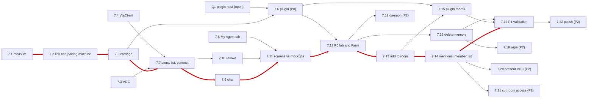

**The stack, and what runs in parallel.** One step is one PR. Steps 7.2 to 7.4 (pure logic) and 7.8 (the UI shell) can run in parallel; 7.7 to 7.10 need the logic; the plugin repository host (§11 Q1) blocks 7.6 and 7.15 and nothing else, and the harness of 7.5 lets Keyring's side of P0 finish without it.

| PR n of N | Step | Tier | Base | Can start after |
|---|---|---|---|---|
| 1 of 22 | 7.1 | P0 | main | none |
| 2 of 22 | 7.2 | P0 | PR 1 | PR 1 |
| 3 of 22 | 7.3 | P0 | main | none |
| 4 of 22 | 7.4 | P0 | main | none |
| 5 of 22 | 7.5 | P0 | PR 2 | PR 2 |
| 6 of 22 | 7.6 | P0 | keyring-agent-plugin (own repository) | PR 5 |
| 7 of 22 | 7.7 | P0 | PR 5 | PR 3, PR 4, PR 5 |
| 8 of 22 | 7.8 | P0 | main | none |
| 9 of 22 | 7.9 | P0 | PR 7 | PR 7 |
| 10 of 22 | 7.10 | P0 | PR 7 | PR 7 |
| 11 of 22 | 7.11 | P0 | PR 10 | PR 7, PR 8, PR 9, PR 10 |
| 12 of 22 | 7.12 | P0 | PR 11 | PR 6, PR 11 |
| 13 of 22 | 7.13 | P1 | PR 12 | PR 12 |
| 14 of 22 | 7.14 | P1 | PR 13 | PR 13 |
| 15 of 22 | 7.15 | P1 | keyring-agent-plugin (own repository) | PR 6, PR 13 |
| 16 of 22 | 7.16 | P1 | PR 12 | PR 12 |
| 17 of 22 | 7.17 | P1 | PR 14 | PR 14, PR 15, PR 16 |
| 18 of 22 | 7.18 | P2 | PR 16 | PR 16 |
| 19 of 22 | 7.19 | P2 | PR 12 | PR 12 |
| 20 of 22 | 7.20 | P2 | PR 14 | PR 14 |
| 21 of 22 | 7.21 | P2 | PR 14 | PR 14 |
| 22 of 22 | 7.22 | P2 | PR 17 | PR 17 |

**Upstream dependencies in P0 and P1, and the real fallback** (checked against this plan on 2026-11-24).

| Item | Tier | Needs | Fallback that works without it |
|---|---|---|---|
| Structured mentions | P1 | `mentions` record member (VTI-Q26) | The `@handle` in the body text, matched whole (§3.6) |
| Layer 2 of an agent seen by another member | P1 | `delegation` member (VTI-Q38) | Layers 1 and 3 only for other parties' agents; layer 2 for the owner's own agents from local records (§3.16) |
| Community setting for agents | P1 | `agents` room setting (VTI-Q31) | Advisory; not stated counts as no (§3.8, D15) |
| VDC signing as the persona | P0 | A task that signs it (VTI-Q32) | The VDC in a Trust Task envelope the VTA signs (D19), step 0.1(f) |
| Revoke by `deviceId` | P0 | Owner control of `acl/swap-key` (VTI-Q34) | `device/list` by `deviceId`, up to three rounds (§3.9) |
| Creating a memory | P0 | An unrestricted administrator session (the P0 assumption, §1.5; VTI-Q39 asks upstream for more) | None needed: the assumption holds by design and the `auth/whoami` guard stops the connect with a clear failure if it does not; step 0.1(p) confirms it live |
| Closed mediator | P0 | The mediator's administrator admits the phone and the agent's did:keys (VTI-Q36) | **None in the product.** An open mediator works. **Plan limit 2, below** |

**Plan limit found in this audit (for the owner).** *A closed mediator.* P0 has no in-product fallback; its precondition is an action by the mediator's administrator (the Farm operators for the Farm's mediator, the lab's own for ours), recorded in this plan's §10 as an external dependency with an owner. The earlier defect, a memoryless agent on a phone that is not an unrestricted administrator, is closed by the assumption of §1.5.

### 7.1 Steps 0.1 to 0.3: measure, no app change (P0)

**Owner:** Test lane (the lab owner)

**Fallback:** every item here is a measurement; a result that differs changes this plan, not the claim (§2.3).

**0.1 Reference rung `tsp-reference/ref-25-agent-pairing`** (§2.2: the directory does not exist; the number follows the sign-in code's citations and may change) against the local lab (`scripts/openvtc/local-vti-stack/`). It is the **real, tested TypeScript probe** that replaces the 2026-11-20 throwaway (§2.4): it runs under Node with `ws` (never Bun), is laid out like `ref-04-mediator`, uses the current `@openvtc/vti-didcomm-js` (the throwaway used 0.6.2), and carries unit tests for its own packing, forward and refusal handling, with the cases of §2.4 as its first tests (delivery to a live and to an offline `did:key`, no account for the sender, anoncrypt refused, a `did:peer` naming another host, the 50th message refused, a closed mediator). *Acceptance:* (a) the §2.4 cases reproduce against the current image, and the rung records the image digest it ran on (the local `RepoDigest` and `pins.json` differ, ledger "Not for upstream"); (b) the agent registers `aiAgent` (`serviceKind`, camelCase on the wire) with `device/register` on an `application` entry and then `rooms/keys/act` is refused with `permissionDenied`, while the same entry before registration is not refused; (c) `acl/swap-key` by the entry's own subject keeps `expiresAt`, capabilities, purposes and kind, or the rung records which it drops; (d) `acl/grant/0.3` with `listed` memory capabilities and `purposes` listed is accepted; capability names as spelled; (e) after `acl/revoke`, `present`, `open` and `memory/get` are refused at the next request and an already minted leaf still reads an `open` room until it expires, with the observed time; (f) which VTA task signs a W3C VC as the persona (§2.3 item 5); (g) whether `rooms/keys/present` mints `write` and `read` for one entry; (h) the byte length of the `agent-connect` link with a real `did:key` is **at most 251** and a QR of it at level M scans, and, recorded for the design, the length of one with a `did:peer:2` pairing contact (expected over the limit, §3.2); (i) on a mediator with a deny default, whether a `did:key` agent can admit itself through the self-service ACL path (§2.3 item 10); (j) whether the refusals carry `Retry-After` (§2.3 item 11); (k) whether the VTA enforces a resource-qualified capability grant, so memory can be pinned to its context at room add (§3.3, D21); (l) the agent calls `acl/swap-key` on itself and Keyring's revoke by `deviceId` (§3.9) removes the entry under the new key, with `device/list` and a re-list showing none, and the same with two swaps in a row; also whether `device/disable` by `deviceId` makes the VTA refuse the device's authentication; (m) two agents in rooms of one persona: whether each can read and write the other's memory in the persona's context (the §3.3 overlap), whether a context can be created for one agent alone and `rooms/keys/present` still works with the persona's context plus that one (D22); (n) whether an entry's `stepUp` gates `vta/memory/put` and the room tasks for an `application` entry (§3.13, §2.3 item 12); (o) the hierarchy rule as measured (§3.15): an entry naming `a` reads and writes memory in `a/b`; an entry naming `a/b` is refused `a`; a context created under the persona's context is readable by an entry that holds only the persona's context; `vta/contexts/create` by Keyring's administrator session with a top-level id succeeds and `vta/contexts/list` returns it with its `name`.

**0.1(p) Memory binding and creation, on the lab (rev 4, §3.15, D31, D32). This is the live confirmation of the §1.5 assumption and its tripwire: a phone whose administrator entry is scoped fails the assumption and reopens D32.** (1) `auth/whoami` as the phone's session: role `admin` with no contexts is an unrestricted administrator; record what the lab's and a Farm VTA's phone sessions are. (2) `vta/contexts/create` of a top-level `keyring-memory-<10 random base32 characters>` from that session, and from a scoped administrator (expected: refused, VTI-CTX-020); `Conflict` on a second create of the same id, and the redraw that follows. (3) An `application` entry whose `act` names one memory is refused `contextForbidden` on `vta/memory/*` for a second memory, with the second named by a room offer, by chat text and by a room record; and refused when `act` names a context that does not exist (`require_contexts_exist`). (4) After a room add, the entry's `act` is exactly the bound set plus the persona's context. (5) `acl/update` removing a memory from `act` refuses the agent's next memory call on it. (6) `vta/memory/list/0.3` with `includeValues: false` for counts; delete of a context holding memory and no other resource succeeds without `force` and purges the items. (7) Two identities (two `did:key`s, two entries, two memory sets) side by side, each reaching only its own set. *Acceptance:* each measured and recorded in the rung's README and §2.1; a result that differs changes this plan, not the claim.

**0.2 Findings recorded.** Each item in this plan's §10 is an entry in [`agent-connect-plan/vti-asks.md`](./agent-connect-plan/vti-asks.md). An entry read from source and tried against the pinned clone in `external/` is registered as a `VTI-QN` question in [`docs/VTI_UPSTREAM_FINDINGS.md`](../VTI_UPSTREAM_FINDINGS.md) (the first eleven are VTI-Q26 to VTI-Q36; the ledger's header maps them), and becomes a `VTI-NN` finding when a lab measurement shows a defect, under that file's proof rules (measured, era named, classified as theirs, generic register). **During execution, every gap met on the lab is recorded there in the PR of the step that meets it**, not kept in the ledger alone (D25). *Acceptance:* every ledger entry names its `VTI-QN` or says why it is not registered; every gap met in a later step has an entry in the findings file in that step's PR; each measured one names the command that produced it.

**0.3 Notification checks** (§3.12). A trivial channel with the development flag on the installed Claude Code. *Acceptance:* recorded results for (a) idle wake, (b) a channel with `claude --bg`, (c) the minimum Claude Code version and the authentication, (d) `asyncRewake` on an idle prompt, (e) the Monitor fallback on an idle session including a re-arm, (f) a plugin `PreToolUse` hook that denies every tool but `reply` blocks them in a session in auto mode and with `vta-mcp` tools pre-allowed, and the `Stop` hold-back of owner events works when events arrive during a busy turn; the plugin's design (§3.12) is changed if (a) fails, and if (f) fails the "Answers other people" switch is not offered in P0 (§3.13, D23).

### 7.2 Step 1: link flow and pairing machine (P0)

**Owner:** Keyring maintainers (Keyring core lane)

**Fallback:** none needed; no upstream change is required.

**1. Link flow and pairing machine.** `triggerLink.ts` gains `agent-connect` (draft, `expRequired`, `allowedVidTypes: ['did:key']` (extending the flow config if it cannot yet accept a `did:key` contact), `maxLifetimeSeconds: 300`, at most 251 bytes, behind a developer flag); `modules/connected-agents/pairing.ts` is a pure state machine (§3.2) with injected clock, resolver and transport. *Acceptance:* jest covers every step and every refusal in §3.10; a link over 251 bytes or with a lifetime over 300 s is refused; every message carries `version`, another major is refused with `unsupportedVersion` and a higher minor with extra members is accepted; a handle is spent on cancel, wrong number, expiry and first claim; the number is the same on both sides for the same inputs and differs when `K_t` changes; a wrong number allows no second attempt; the number is four digits, zero-padded, the same on both sides and a four-digit entry is required; three wrong numbers in 60 minutes lock the flow for 15 minutes, a wrong number while three are still inside the window renews the lock, and the lock survives a restart; Keyring never renders the number.

### 7.3 Step 4: VDC (P0)

**Owner:** Keyring maintainers (Keyring core lane)

**Fallback:** if no VTA task signs a credential as the persona (VTI-Q32), the VDC is carried in a Trust Task envelope the VTA signs (D19, step 0.1(f)).

**4. VDC.** `connected-agents/vdc.ts`: build, sign (through the VTA, per 0.1(f)), verify, acceptance, status. *Acceptance:* the grant and acceptance verify, with `@context` `[credentials v2, DTG v1]` in that order, `type` `["VerifiableCredential","DTGCredential","DelegationCredential"]`, `issuerScope` `directed`, `validUntil` the earlier of `validFrom` plus 7 days and the entry's expiry; refused: a VDC without `DTGCredential` in `type`, with a missing or other-valued `issuerScope`, without `validUntil`, with a missing or empty `scope`, a grant carrying `accepts`, an acceptance carrying `scope`, an acceptance whose `accepts` is a different digest, and a wrong `@context` order; the issuer is the persona. Re-issue: a grant is re-issued when 48 hours or less remain, at app start and on Extend, only while the entry is confirmed present; never for a `revoking`, `revoked` or `expired` connection; a VDC that lapsed while the phone was offline leaves `active` unchanged and is replaced at the next opportunity.

### 7.4 Step 3: VTA client additions (P0)

**Owner:** Keyring maintainers (Keyring core lane)

**Fallback:** revoke and find by `deviceId` through `device/list` where the VTA does not control `acl/swap-key` (VTI-Q34, §3.9).

**3. VTA client additions.** `VtaClient`: `grantApplication` (0.3 shape, `act` contexts, `listed` capabilities, `keys: none`, `purposes`), `narrowOrWidenCapabilities` (`acl/update`), `entryKind` and `devicesByKind` (`device/list`, every page: `deviceId`, `consumerDid`, kind), `setStepUp` (conditional on 0.1(n)). *Acceptance:* unit tests with the older-version fallbacks and with paged `device/list` answers; an entry is found by `deviceId` after its subject changed; the rung's measurements agree (0.1).

### 7.5 Step 2: pairing carriage (P0)

**Owner:** Keyring maintainers (Keyring core lane)

**Fallback:** the plugin pairs through the owner's VTA's mediator with Keyring's own message types, since no VTA pairing task exists (VTI-Q27, D3).

**2. Pairing carriage.** `claim`, `hello`, `approved`, `rotated`, `vdcAccepted`, `cancel` over DIDComm v2 with document proofs, sent as authcrypt inside an authcrypt forward to the recipient's mediator with no account at it; a fake session harness (`connected-agents/__tests__/fakeSession.ts`) plays the other half. *Acceptance:* the full pairing runs between Keyring's code and the harness against the lab mediator; a forged `hello` or `rotated` (bad signature, wrong continuity) is refused; an anoncrypt outer forward is never sent; the 403 and 503 refusals of §2.4 map to the copy of §6; `claim` carries the VTA, persona and name and `approved` carries `vtaDid`, `chatDid` and `ownerPersonaDid`, signed by `K_k`; `cancel` with `otherVta` or `declined` shows "Your terminal refused this pairing. Nothing was connected." and does not count toward the lockout; `unsupportedVersion` shows its copy.

### 7.6 Step 10: plugin, pairing and chat (P0)

**Owner:** Plugin maintainer (plugin repository lane; needs §11 Q1)

**Fallback:** the plugin repository's host is open (§11 Q1); until decided, 7.5's harness lets Keyring's side finish; without the channel (VTI-Q35 does not apply here) the `inbox` and Monitor fallback delivers messages (step 0.3).

**10. Plugin** (own repository, §3.12, D12). *Acceptance:* the repository has the layout of §3.12 with its unit tests in the same change; with the harness replaced by the real plugin, a pairing completes against Keyring on the lab; `vta-mcp` runs as `K_a`; the plugin pins the owner's VTA and refuses a `claim` or an `approved` naming another (nothing is enrolled), asks "Pair with ...? [y/N]" before `hello` and any number and refuses to run without a TTY, accepts chat only from `chatDid` and room records only from `ownerPersonaDid`, checks the VDC's issuer against `ownerPersonaDid`, signs the acceptance of a re-issued grant only from `chatDid`; it refuses another pairing major with the terminal message and keeps its last `settings` on an unknown `settings` version; the channel and the `inbox` plus Monitor fallback both deliver a message to an idle session (step 0.3).

### 7.7 Step 5: store, list and connect screens, the agent as a contact (P0)

**Owner:** Keyring core and the UI/UX lane

**Fallback:** none needed for creating memories (the unrestricted-administrator assumption of §1.5; a session that is not one ends the connect with a clear failure); no memory quota, label privacy or storage-mode field exists (VTI-Q41, VTI-Q45, VTI-Q44), so Keyring counts items, keeps the label in `name` and makes no encryption claim (§3.15).

**5. Store and list screens.** `AgentConnection` record; "AI agents" list; Connect, number-entry and Approve screens, with the memory picker and "New memory" (`VtaClient.createContext` and `listContexts`, which exist and are called by nothing yet; `createContext` gains an optional `parent` and the whoami check of §3.15); agent details with effective access and its fixed memories (§3.3, §3.15); **the agent as a contact** (§3.14): `AgentContactCard` behind its token, the second source in `ListContacts.tsx`, and a tap opening the details. *Acceptance:* jest and render tests; the Contacts list shows one row per agent not `pairing` or `notFinished`, sorted among the people by name, drawn with the dashed edge, "AI agent" and "Your AI agent", with no badge and no photo, and its accessibility label contains "AI agent"; the row opens the agent details, whose first action is "Message"; the people rows and `ContactCard` render byte-identically to today where there is no agent; a memory created from the picker is top level (`keyring-memory-<10 random base32 characters>`, its `name` the typed one; collision is a redraw, §3.15) and appears in the next listing; a context that is an ancestor of another is greyed and cannot be picked; a memory is never granted by an ancestor path (a test asserts every `act` path is one the owner picked); the number field is labelled and announces digits; the Approve screen shows "Only continue if you ran the command in your own terminal just now."; every string and key in §6 present in the en, fr and pt-br locale files.

### 7.8 Step 5a: the My Agent tab opens on the AI agents; the VTA's stack moves under Settings (P0)

**Owner:** Keyring core and the UI/UX lane

**Fallback:** none needed; no upstream change is required.

**5a. The My Agent tab opens on the AI agents; the VTA's stack moves under Settings as "My VTA".** `TabStack.tsx`'s `MyAgentStack` route opens on `AiAgents.tsx`; today's `MyAgentStack.tsx` screens are registered, unchanged, as a stack reached from one `Settings` row, "My VTA" (header title "My VTA"); `roomLinks.ts` `openInMyAgent` and `TabStack.tsx`'s `myAgentLinkParams` target the moved stack; the "AI agents" card on `MyAgent.tsx` is removed (D26, §6). *Acceptance:* render tests show the My Agent tab's first screen is the AI agents list and Settings has a "My VTA" row that opens the VTA home; every link that opened a VTA screen before (link flow, devices, a room's community, a member card, the profile, deep links through `myAgentLinkParams`) opens the same screen in the moved stack (the existing navigator tests pass with their targets updated); a room opened from Messages is unchanged (`MessageStack.test.tsx`); no screen in the moved stack calls the VTA "your agent" without also saying "My VTA" in its header (a copy test over the stack's titles); en, fr and pt-br carry "My VTA" (`ConnectedAgents.MyVta`).

### 7.9 Step 6: one-to-one chat (P0)

**Owner:** Keyring maintainers (Keyring core lane)

**Fallback:** on a mediator that queues at most 50 messages per sender (VTI-Q36) Keyring stops at 20 and honours the 503.

**6. One-to-one chat.** A carrier adapter so `modules/chat/` runs over the VTI mediator transport (§3.5); the chat variant for an agent peer, with the header "AI agent" and "Belongs to <owner>"; the agent chat as a `kind: 'agent'` row in Messages (§3.14); send limit and refusal handling. *Acceptance:* a message to an offline harness queues and stops after 20 with "Waiting for your session"; a 503 `e.p.limits.queue.peer` is paced, not retried at once; the existing chat tests over Credo connections still pass; the Messages list shows the agent chat under "all" and "people" with the mark, ordered by its last event among the people and rooms, and `mergeByTime`'s existing tests pass unchanged; the header never shows a person's verification badges for an agent.

### 7.10 Step 9: revoke (P0)

**Owner:** Keyring maintainers (Keyring core lane)

**Fallback:** `device/list` by `deviceId` and up to three rounds (VTI-Q34, §3.9).

**9. Revoke.** `revoke.ts` per §3.9. *Acceptance:* order is ACL entry first; the agent is found by `deviceId` after it swapped its key (once and twice), and its entry under the new key is revoked; an empty `revokeSubject` answer is never reported as success; a partial or failed listing leaves the connection `revoking` with "Revoke not confirmed", which survives a restart and clears only after a full listing shows no entry; the app-start reconcile records a changed key (`keyChanged`, "<name> changed its key") without moving the chat; a failed ACL call leaves `revoking` and retries; the sheet says "up to 4 hours" and the string "instant" appears nowhere in the locale files (a test greps).

### 7.11 Step 10a: every screen on an emulator, against the mockups (P0)

**Owner:** Test lane (the lab owner)

**Fallback:** none needed; no upstream change is required.

**10a. Every screen on an emulator, against the mockups.** After steps 5 to 9 have merged and before step 11: the app is run on the Android emulator and the iOS simulator with the lab stack, the flows of §6 are walked by hand (connect, approve, the list, the details, Contacts and Messages, the "+" sheet, add to room, What it remembers here, the member list, the identity sheet, Revoke, Settings "My VTA", and the failure states that can be reached without a device), and **every screen and state in §6 is screenshotted** and placed beside its mockup: the kit SVG and, where one exists, the UI/UX canvas frame (§8.6). *Acceptance:* a dated companion holds the pairs (screenshot, mockup, platform, app and plan commit) for every screen in §6's "States covered by mockups" list and every state the walk reached; every difference between a screenshot and its mockup is listed with one of three dispositions, **fixed** (the app changed, with the PR), **mockup updated** (the copy or layout changed for a stated reason; §6, the kit spec and the canvas change in the same PR), or **accepted** (platform rendering only: fonts, safe areas, system controls), and a difference with no disposition is a defect that blocks step 11; a screen, button or state that exists in the app and not in §6 is listed as such with the reason it was needed, and §6 and the mockups gain it in the same PR, or it is removed; a screen or control in §6 that the app lacks is a defect; the brief tests are the step's own jest suites plus the single-device smoke e2e (`yarn e2e:smoke`) on the same build. Hardware attestation and biometrics are not proven here (§8.4).

### 7.12 Step 11: P0 lab and Farm validation (P0)

**Owner:** Test lane (the lab owner)

**Fallback:** the lab pass is the P0 exit; the Farm pass is recorded when its image versions and mediator ACL allow (§10, not VTI).

**11. Lab and Farm validation.** Two-party lab run (owner and agent), including the refusal cases and the 4-hour tail run, then one pass of the delivery and happy-path cases on the VTA Farm (§8.3, D18). *Acceptance:* §8 rows marked lab and Farm pass; the long-running tail measurement is recorded; physical-phone run done (§8.4).

**Exit: the `agent-connect-p0` demo on the lab and a physical phone (§7.0).**

### 7.13 Step 7: add an agent to a room (P1)

**Owner:** Keyring core and the UI/UX lane

**Fallback:** the community's `agents` setting is advisory and not stated counts as no (VTI-Q31, §3.8); room capabilities are added only after Keyring reads the consumer kind back (VTI-Q28, §3.3).

**7. Add an agent to a room.** `RoomInfo.tsx` section, add sheet, first-room capability widening through `grantAgentAccess`, "What it remembers here" (read-only, §3.15), the room offer (its `contexts` informational), the community setting (§3.8); the composer's "+" sheet with "Add a file" and "Add my agent" (§3.15, D28). *Acceptance:* refused when kind is not `ai-agent`; the add sheet shows the read-access notice, and the memory notice with the persona's context name whenever the add widens `act`, before the button is focusable, and the effective-access lines show the persona's context for every agent added to a room; `no` and not stated both disable the action and only `yes` allows it, from the info screen and from the "+" sheet alike; the "+" picks a file at once when the owner has no `active` agent and opens the sheet when they have one, with "Add my agent" absent when every agent is in the room; the add sheet carries "Members of this room will see that this agent belongs to you." before the button is focusable; there is no per-room memory choice: the sheet "What it remembers here" shows the agent's bound set read-only and offers "Connect another agent"; the entry's `act` after the add is exactly the bound memories plus the persona's context (never anything else), checked by reading the entry back; "Agents in this room" rows show "Memory: <names>" and open the sheet.

### 7.14 Step 8: mentions, mark, member list, agent sheet, "Answers other people" (P1)

**Owner:** Keyring core and the UI/UX lane

**Fallback:** the `@handle` text convention and layers 1 and 3 of the identity sheet where no `mentions` or `delegation` member exists (VTI-Q26, VTI-Q38, §3.6, §3.16).

**8. Mentions, mark, member list, agent sheet.** Composer insertion; `mentions` written where the profile lists it, text fallback otherwise; `byAgent` set from the local `AgentConnection` so the existing mark shows; the "Agents" section of the member list (§3.6); the agent bottom sheet reads the issuer of the VDC and shows "Answers other people", the setting and its confirmation (§3.13: turning it on needs the confirmation and off does not, and the switch is absent when the hook check (0.3(f)) failed). The handle is name plus a DID-derived suffix, fixed at step 10 of the pairing, and the composer inserts it whole. *Acceptance:* the handle for fixed vectors (name and `K_a`) is the same in Keyring and the plugin; two agents with one name get different handles and a suffix collision extends to six characters; the composer inserts `@notes-helper-7f3k`-style text, never the bare name; the body is byte-identical to today's where the profile does not list `mentions` apart from the `@<handle>` text; the mark shows for own agents and for no other author; the Agents section lists the owner's agents for the room, appears when `listCommunityMembers` is unavailable, never adds an agent to the community's list, and opens the sheet with the owner and the setting; the sheet names the owner from the VDC. **An agent seen by another member (§3.16):** `delegationRecord.ts` writes the agent's `memberProfile` with `delegation` only where the room's profile lists it (a test with a profile that does and one that does not; the body is byte-identical to a plain name record where it does not); a reader verifies the pair (issuer a persona DID, subject the author, acceptance signed by the author, `accepts` the grant's digest) and refuses a pair whose subject is not the author, whose acceptance is unsigned or by another key, or whose grant is a VDC that §7 step 4 refuses; with a verified pair the sheet shows the mark, "Belongs to <owner>", "Verified from its delegation credential", "Not a member of this community…", the handle and "Its identity"; without one it shows the DID, "calls itself <name>" where a name exists, "Keyring can't tell who this belongs to." and no mark; a `did:webvh` author with a verified agent name shows it and a `did:key` shows "No verified name"; the member list's Agents section includes a verified other agent with the second caption and never on a claim alone.

### 7.15 Step 10b: plugin, rooms, mentions and "Answers other people" (P1)

**Owner:** Plugin maintainer (plugin repository lane; needs §11 Q1)

**Fallback:** the plugin's hook is the primary control where the VTA's step-up gate is undocumented (VTI-Q35, §3.13).

**10b. Plugin: rooms, mentions and "Answers other people"** (own repository, §3.12, §3.13). *Acceptance:* the plugin it matches only its own whole handle; it drops a message not authored by the owner's persona (gated on the author, not the room), fences room content, and does not declare `claude/channel/permission`; with the setting on and the hook check passed, the hook denies every tool but `reply` while the marker is `other` and owner events wait for `Stop`; with "Answers other people" off a non-owner mention gets the fixed reply of §3.13 once per author per room per 60 minutes and no more than 20 per hour, the model sees nothing. **Release gate:** the fr and pt-br wording of §3.13 has been reviewed and approved by a native reader of each language, the reviewer's name and date are recorded in the plugin repository's release checklist, and the plugin's release step fails while either is missing (D16).

### 7.16 Step 12: delete memory (P1)

**Owner:** Keyring maintainers (Keyring core lane)

**Fallback:** Keyring counts memory items itself because the VTA's delete preview omits them (VTI-Q40, §3.15).

**12. Delete memory** (memory management, §3.15). A memories list in the agent details and Settings with each memory's item count and last change; "Delete" counts the items itself (`vta/memory/list/0.3`, `includeValues: false`), names the agents bound to it, asks "Delete "<memory>"?" and sends `force` only after the confirmation. *Acceptance:* a memory holding only items is never deleted without the confirmation; the agents named are those whose `act` names the id; the count warning shows above the configured count; stand-alone: it needs no wipe and no room. **Exit: a memory can be deleted safely on a P0 product.**

### 7.17 Step 13: P1 lab validation (P1)

**Owner:** Test lane (the lab owner)

**Fallback:** none needed; no upstream change is required.

**13. P1 lab validation.** The two-party lab run in a room (owner, agent, a second member): add from the "+", read, write, a mention by the owner and by another member (fixed reply), the member list and the identity sheet, Revoke with the 4-hour tail named, the VTA Farm pass of the delivery cases (§8.3). *Acceptance:* §8 rows marked P1 pass. **Exit: `agent-connect-p1` demo.**

### 7.18 Step 14: also delete what it remembered (P2)

**Owner:** Keyring maintainers (Keyring core lane)

**Fallback:** a client-side loop where no bulk clear exists (VTI-Q43, §3.15).

**14. Also delete what it remembered** (§3.15). The client-side wipe loop on Revoke and on "Change memories": list, delete per key, re-run, complete on an empty final listing; builds on step 12's listing helper. *Acceptance:* a failure on page two and on one delete leaves a re-runnable state; the copy says "erases", never "no trace". **Exit: Revoke can also erase what the agent wrote.**

### 7.19 Step 15: headless daemon front-end (P2)

**Owner:** Plugin maintainer (plugin repository lane; needs §11 Q1)

**Fallback:** none needed; no upstream change is required.

**15. Headless daemon front-end** (§3.12). *Acceptance:* the plugin's core runs without a terminal session and pairs and chats as in P0; the TTY question is answered by an approved non-interactive path the owner enables. **Exit: an agent that runs without Claude Code open.**

### 7.20 Step 16: present the VDC to a third party (P2)

**Owner:** Keyring maintainers (Keyring core lane)

**Fallback:** short validity stands in for status (VTI-Q32, D19).

**16. Present the VDC to a third party on the owner's decision** (§3.4, §3.16). *Acceptance:* a consent screen, one presentation, a copy that says the credential stays valid to its `validUntil` after Revoke. **Exit: whose-agent evidence outside the rooms the agent is in.**

### 7.21 Step 17: also cut its room access now (P2)

**Owner:** Keyring maintainers (Keyring core lane)

**Fallback:** the room's owner can withdraw it today; where the person is not the owner nothing closes the 4-hour tail (VTI-Q30, §3.9).

**17. "Also cut its room access now"** in a room the person owns (§3.9): `rooms/owner/revoke`. *Acceptance:* offered only where the person owns the room; the 4-hour tail ends. **Exit: Revoke closes the tail where the person owns the room.**

### 7.22 Step 18: polish and later ideas (P2)

**Owner:** Keyring core and the UI/UX lane

**Fallback:** none needed; no upstream change is required.

**18. Polish and later ideas** (each alone): the portability display ("this agent can combine memory X and room Y"); grouping and per-agent notifications for many agents; the reverse number direction if testers need it (D8); MyTerms (D21). Candidates waiting on an upstream change are in §7.0.


## 8. Testing

### 8.1 Unit (jest)

`cd bifold/packages/core && yarn test connected-agents` (the package's own gate; not an ad-hoc `tsc`), plus `yarn lint`, `yarn prettier`, `yarn typecheck` at the root. Tests: pairing machine and every refusal (this plan's §3.10); link parsing (`agent-connect`, 300-second expiry, at most 251 bytes, `did:key` only); message `version` handling (another major refused with `unsupportedVersion`, a higher minor accepted, the `settings` message with an unknown version keeping the default); `approved` carrying `vtaDid`, `chatDid` and `ownerPersonaDid`; number derivation (four digits, zero-padded, fixed vectors) and the typed-number rule (one attempt, the lockout and its renewal, no display); the member list's Agents section; the fixed-reply text vector shared with the plugin (en, fr, pt-br); VDC build, sign, verify, acceptance, its negative cases (no `DTGCredential`, no or bad `issuerScope`, no `validUntil`, empty `scope`, `scope` on an acceptance, `accepts` on a grant, wrong `@context` order) and its re-issue and lapse behaviour; Extend (the expiry update and the immediate re-issue); the 10-minute removal of a "Not finished" entry, with a fake clock; `VtaClient` additions with version fallbacks; revoke ordering, the `revoking` retry, revoke after the agent swapped its key (found by `deviceId`; an empty answer is not success; "Revoke not confirmed" survives a restart; the app-start reconcile sets `keyChanged`); the handle derivation and its collision rule; the add sheet's memory notice and the effective-access lines for two agents in one persona; **memories (this plan's §3.15)**: create first, list back, compare the name, then grant, and a `Conflict` is never adopted; `act` is exactly the bound set plus the persona's contexts after a room add, and any extra context is shown as drift with a one-step restore; narrowing and widening (the latter behind the biometric decision, naming the rooms); "New memory" offered only when `auth/whoami` is unrestricted; the delete confirmation counts items itself and lists the bound agents, and `force` is sent only after it; the wipe loop is re-runnable and completes on an empty final listing, with a failure injected on page two and on one delete; the agent contact row (second source, sort, mark, label, no badge) and the Messages `agent` kind (this plan's §3.14); the memory pickers, "New memory" (top-level id, name), the greyed ancestor, the `act` union and narrowing, the per-room `contexts[]` and the offer's `contexts` (this plan's §3.15); the "+" sheet's three states (file at once, sheet, "Add my agent" absent or disabled); "Your VTA is too old to connect an agent." for a VTA without capability narrowing; mention writing (listed and unlisted profile); a release-gate test in the plugin that fails while the fr and pt-br review record is absent; copy tests (no "instant"; read-access notice present before the add button; every string in en, fr and pt-br). Checks for the chat limit and the 503 refusal. **The plugin's own suite** (its repository, `npm test`, run in its CI): the gate drops a non-owner author and gates on the author not the room, takes chat only from `chatDid` and room records only from `ownerPersonaDid`; fencing; no permission capability declared; the fixed reply and its per-author-per-room and hourly limits, persisted across a restart; the `inbox` tool and `inbox --follow` output; the pairing core against a fake Keyring harness, including: a `claim` and an `approved` naming a foreign VTA are refused and nothing is enrolled; the y/N question comes before `hello` and the number, N and no answer cancel, no TTY refuses; a VDC whose issuer is not `ownerPersonaDid` is refused; an unsupported pairing major and an unknown `settings` version; the full-handle match only (a bare name and another owner's agent of the same name do not match); the `settings` message (setting and locale) changes the reply's language; the hook denies every tool but `reply` while the marker is `other` and releases owner events after `Stop`; **the memory binding is the VTA's, not the plugin's** (this plan's §3.15, D31): the plugin keeps no per-room memory rule; a test shows it passes the room offer's `contexts` to nothing but its own display, and that a call naming a memory outside the entry is refused by the lab VTA (`contextForbidden`) whatever the offer, the chat or a room record says. Memory and CPU are checked first on the shared host and jest runs under `nice -n 10`, one suite at a time ([`../TESTING.md`](../TESTING.md)).

### 8.2 Lab (we own the VTA, VTC, mediator)

`scripts/openvtc/local-vti-stack/up.sh`, then the rung and the e2e. **The lab is where every step runs first and in full** (D25): the Farm (§8.3) is a validation pass after the lab is green, never the place a step is first tried, and each limitation the lab shows is recorded in the findings file in that step's PR (step 0.2). Claims the lab can support (vti-lab-and-field: the happy path; refusal paths need a mediator and community we control, so **every refusal case runs here**): `ref-25-agent-pairing` (0.1, the tested probe that replaces the throwaway); pairing end to end, including the wrong number and a second VTA refusing a captured code; a closed mediator (a deny default, with the agent admitted and not admitted); anoncrypt refused; a `did:peer` naming another host; the 50-message queue refusal; `present`/`open`/`seal`/`memory` as an agent entry; deletion stops the next call; **key swap against Revoke** (0.1(l)); Extend and the VDC re-issue; the 10-minute removal of a "Not finished" entry; two agents in rooms of one persona and the memory overlap (0.1(m)); the `settings` message and an app/plugin version skew; the 4-hour tail, a **long-running measurement** of 4 hours or more after Revoke, run once before P0 ships and recorded, not a CI step; `private` refused; wrong number and expiry; the chat queue limit; the tool-denying hook on a real session (0.3(f)); the plugin's channel and fallback on a real idle Claude Code session (0.3). Fixture deviations (a raised mediator queue limit, a hand-cleared queue) are declared in the commit that makes them.

### 8.3 VTA Farm (the field)

One pass of the same flow, after the lab is green, to confirm which VTA and mediator versions the contract is. Check the image versions first (a mediator older than 0.28.1 refuses a phone's WebSocket). Only the lab's starter mediator was measured (§2.4); the lab cannot show how a real deployment's mediator ACL treats a `did:key` third party, so the **delivery cases** (live, offline, no sender account) and the happy path are re-run here before P0 ships. The **refusal cases** (closed ACL, queue cap, anoncrypt, `did:peer` host, community setting) are not run against a Farm mediator we do not control: they run in the lab (§8.2), or on the Farm only in "Full Stack" mode, where we run the mediator and the community. The Farm's "VTA Only" mode makes us a member without control of the community, so the community setting (§3.8) can only be run on "Full Stack".

### 8.4 Physical phones

Biometric approval (hardware key), the scan path with a real camera, and background behaviour of chat notifications. Emulators and simulators silently fall back to a plain path and **do not prove** the gate. Attended, `yarn e2e:vrc:devices` style harness (a new `e2e:agent-connect` script, added in step 11).

### 8.5 Requested testing requirements

None were specified for this plan. The tier choices above are the plan's own.

### 8.6 Screens against the mockups

Two sets of mockups describe the screens, and the implementation is checked against both (step 10a):

- **The kit mockups** in [`agent-connect-plan/mockups/`](./agent-connect-plan/mockups/) (the SVGs, their spec and the sheet): the plan's checked source, drawn from this plan's §6 copy with the app's real tokens; the structure checker holds them to that copy and to the theme.
- **The UI/UX canvas**, drawn by the UI/UX lane at full fidelity from the same copy, exported frame by frame into [`agent-connect-plan/canvas/`](./agent-connect-plan/canvas/) (one PNG per frame, a contact sheet `canvas/sheet.png`, and `canvas/README.md` naming the canvas version exported). The canvas is the visual target: spacing, icon, card and sheet treatment. Where the canvas and a kit SVG disagree on layout, the canvas wins; where either disagrees with this plan's §6 on words, the plan wins and the drawing is a defect.

**The screenshot rule.** A screen is done when a screenshot of it on the emulator or simulator sits beside its mockup in the step's companion and every difference has a disposition (fixed, mockup updated with its reason, or accepted as platform rendering). A new screen, button or state is allowed only with a reason recorded there, and this plan's §6, the kit spec and the canvas gain it in the same PR. The owner reviews the pairs, not the code, for this step.

**Keeping the canvas export current.** A new approved canvas version is re-exported in the PR that adopts it, and `canvas/README.md` records the version; the kit sheet and the canvas export are regenerated together when this plan's §6 copy changes.

## 9. Security, privacy, migration and rollout
 (13) **Filling the VTA's store:** nothing bounds the items or bytes an agent with `memory-write` can write (§3.15; VTI-Q41), so a compromised or prompt-injected agent can exhaust the VTA's disk; interim: the count shown in the details and its warning, Revoke, and the operation rate limit, which slows it and does not cap it. (15) **A memory's topic seen by administrators:** ids are opaque, so the topic is not in ACL entries, audit rows, claims or logs, but the display `name` is stored in plaintext in the context record and every administrator who reaches the context sees it, as the count of memories and which agent holds which id (§3.15, D35; sealed-label options deferred, VTI-Q45). (14) **Memory read where the store is plaintext:** in standard mode the store is not encrypted (§3.15; VTI-Q44), so anyone with the VTA's disk reads the items; the copy makes no claim of encryption.
- **Exposed, to whom.** The agent sees its own chat, its memory context, and every room it is added to. The room host sees the agent as the presenter DID, not the owner (the chain names who equipped it). A VDC reveals the owner's persona DID to anyone the agent shows it to; `issuerScope` is `directed`.
- **Threats considered.** (1) Someone shows the owner a code and the owner scans it: the owner must type a number that only the terminal that made the code shows, so a code the person did not just produce cannot be approved by reflex; one attempt, a 120-second window after the claim, a 5-minute code, one claim and a lockout bound blind tries (1 in 10,000 each, at most six an hour, §3.2). **This does not stop a person who can show the number as well as the code**, nor a viewer of the owner's terminal: the lockout bounds nobody's attack there. (1a) A captured code claims the owner's own session first (a screen share or shoulder-surfer sees the QR): the claimer's Keyring is not the owner's, and the plugin would otherwise trust its VTA and persona as "owner". Controls: the plugin pins the owner's VTA and refuses a `claim` or `approved` naming another (§3.2 steps 4 and 8); the terminal asks "Pair with ...? [y/N]" before any number or enrolment, and needs a TTY; enrolment succeeds only if an administrator of the pinned VTA made an entry for `K_t`; the gate allowlist is persisted only after that; the Approve copy tells the owner to continue only if they ran the command themselves. Tests in §8.1 and §8.2. (2) A prompt-injected session: limited to its entry (§3.1); room text is fenced; the key is readable by the session's own tools, so what limits it is expiry, capabilities, revocation by `deviceId` and step-up, not key secrecy (§3.12). (3) An entry not yet marked `ai-agent`: room capabilities are added only after the kind is read back (§3.3). (4) A stolen or read `K_a`: revoke by `deviceId`; the entry's expiry; the key lives in an owner-only file that the session's tools can read. (4a) The agent moves its own entry to another key with `acl/swap-key` (self-service, copies everything): Revoke finds it by `deviceId` and never counts an empty answer as success; the app notices a changed key at start (§3.9); an owner's veto over swaps and a rotation signal are asked of VTI (§10 items 13, 14). (5) A mention by another member: with the setting off, answered by a fixed message and never shown to the model (§3.13); with it on, enforced by a hook that allows only `reply` and, where VTI covers it, passkey step-up, and delivered as a third party's request with the risk stated there; if the hook cannot be shown to work the switch is not offered. (5a) A reply loop between two agents: the fixed reply carries no mention. (5b) The notification path: the plugin gates on the author and declares no permission relay (§3.12). (5c) The fixed reply discloses that a session is running and the owner's language even with the setting off: accepted, documented (§3.13). (6) Spent-handle replay: single use. (7) A mediator that learns who pairs with whom: it sees `P`, `K_k` and traffic metadata, not content; unmeasured beyond that. (8) **Memory widening across the owner's agents:** adding a room gives the agent, and every other agent added to a room of that persona, read and write on the persona's memory context, so an injected agent B can read or poison what agent A or the owner keeps there. Stated in the add sheet and in §3.3; mitigated by per-agent contexts and, later, capabilities pinned to a context (D22); not prevented in P0. (9) App and plugin at different versions: refused cleanly, never half-paired (§3.2, "Versions"). (10) A handle collision: another owner's agent of the same name does not match (§3.6). (11) **A room's text steers the agent into another memory:** the agent can reach only the memories on its own ACL entry, whatever a room's text, the room offer or the model says; the VTA refuses the rest at every call (`require_context`, §2.1). There is no per-room rule for an injected agent to talk its way past, because no per-room choice exists (D31, §3.15). What an injected agent can still do is use what it was bound to: read and overwrite every memory in its own set, from any room it is in, which is why the set is shown as fixed and in full wherever the agent is shown, and why a memory the owner would not hand to every room the agent is in is not put in that agent's set. A memory the owner did not give the agent is out of its reach. (11a) **Drift of the binding:** an entry that holds a context beyond the agent's set and its rooms' persona contexts (another administrator, a bug, a widened update) is found at reconcile and shown as "Its memory access changed" with a one-tap restore (§3.15). (11b) **A phantom or look-alike context:** a grant that names a context that does not exist is refused by the VTA (`require_contexts_exist`); a look-alike that does exist is a different memory, so Keyring creates first with a fresh random id, redraws on a conflict and never adopts an existing id (§3.15, D35). (12) **An agent mistaken for a person:** its contact and chat rows carry a fixed mark, edge and line and never a verification badge or photo (§3.14).
- **Privacy.** Keyring stores no agent private key. The number is not secret once shown, but Keyring never shows it. The fixed reply reveals presence and the owner's language (threat 5c). A VDC reveals the owner's persona DID to a verifier it is shown to; P0 shows it to the members of the rooms the agent is added to, who already see the owner there, and to the host of an `open` room (§3.16); the add sheet says so. Purposes keep `modelTraining` off.
- **Migration and compatibility.** New record type and screens; no existing data changes. A VTA that serves only older ACL shapes works through `VtaClient`'s fallbacks. A VTA without `acl/grant` capability narrowing cannot be used: Keyring says "Your VTA is too old to connect an agent." and offers nothing (localization key `ConnectedAgents.VtaTooOld`). A VTA without `device/list` cannot be used for the same reason: Revoke by `deviceId` needs it. An app and a plugin at different pairing majors refuse (§3.2, "Versions").
- **Rollout.** The `agent-connect` flow and the "AI agents" screens are behind a developer flag until Phase 0 and step 11 pass; then on for testers, then default. **Rollback:** the flag off hides the screens and the flow; existing connected agents keep working at the VTA and are revocable from `pnm`; their records stay.
- **Retention.** Revoked and expired records and chats stay until the owner deletes them.

## 10. Upstream asks and blocked on whom

Asks are **recorded** here and in the running ledger [`agent-connect-plan/vti-asks.md`](./agent-connect-plan/vti-asks.md) (ids AC-01 and on), which also holds the mediator limits measured in this plan's §2.4. Nothing is required to be filed or tracked, and no step waits on an answer: each ask names what it blocks and what works meanwhile. An ask read from source and tried against the pinned clone is registered as a `VTI-QN` question in [`docs/VTI_UPSTREAM_FINDINGS.md`](../VTI_UPSTREAM_FINDINGS.md). "Item N" keeps the numbers other sections cite.

| Ask | Id | Blocks (step, tier) | Fallback meanwhile |
|---|---|---|---|
| Item 1: `acl/grant` (or the entry) carries the consumer kind, or the VTA refuses `rooms/keys/act` for an `application` entry that has not registered | VTI-Q28 | 7.13, P1 | Room capabilities are added only after Keyring reads the kind back (§3.3, D6) |
| Item 2: capabilities that can be bound to one context (resource-qualified grants), or room presentation that does not need the persona's context in `act` | VTI-Q29 | 7.13, P1 | The persona's context exposure is stated and shown; one memory set per agent (D22, D31) |
| Items 3 and 4: deliver to an agent only the records that mention it; register `mentions` as a room record member | VTI-Q26 | 7.14, P1 | The `@handle` in the body text, matched whole; mention-only is behaviour (§3.6) |
| Item 5: the author's chain, or the agent's VDC, available with a record | VTI-Q33 | 7.14, P1 | Layers 1 and 3 of the identity sheet; the owner's own agents from local records (§3.16) |
| Item 6: a room-level `agents` setting (and policy enforcement for the third value) | VTI-Q31 | 7.13, P1 | Advisory; not stated counts as no (§3.8, D10, D15) |
| Item 7: a VTA pairing task, or the `agent-connect` flow registered in the links specification | VTI-Q27 | 7.5, P0 | The plugin pairs through the owner's VTA's mediator with Keyring's own placeholder types (D3) |
| Item 8: a member-side way to withdraw an agent's leaf at a host | VTI-Q30 | 7.21, P2 | The room's owner can withdraw it; Revoke says up to 4 hours (§3.9) |
| Item 9: `vta-mcp.md` §2.3 still says per-entry capability overrides are a deferred gap; they are shipped (a documentation correction; ledger AC-33) | VTI-Q46 | 7.1, P0 | Code and the later `personal-ai-agents.md` are taken as current (this plan's §2.1) |
| Item 10: a task that signs a credential as the persona, and status hosting for it | VTI-Q32 | 7.3, P0 | The VDC in a Trust Task envelope the VTA signs; short validity, no status entry (D19) |
| Item 11: a documented per-sender queue cap with `Retry-After`; a documented self-service ACL path for a `did:key` on a closed mediator; a refusal at send for a `did:peer` naming another host | VTI-Q36 | 7.9, P0 | Keyring stops at 20 messages and honours the 503; the plugin prints only a safe `did:peer`. **A closed mediator has no in-product fallback: it needs the mediator's administrator (see below)** |
| Items 13 and 14: an owner's control over `acl/swap-key` and `acl/revoke` by `deviceId`; an owner-visible signal when an entry's subject changes | VTI-Q34 | 7.10, P0 | `device/list` by `deviceId` and up to three rounds; reconcile at app start (§3.9) |
| Item 15: which task types an entry's `stepUp` gates for an `application` entry | VTI-Q35 | 7.15, P1 | The plugin's tool-denying hook is the primary control (§3.13) |
| Item 16: a room-scoped context binding (a convenience since rev 4) | VTI-Q37 | 7.13, P1 | Not needed: one agent per distinct memory set (D31) |
| Item 17: register `delegation` as a `memberProfile` record member | VTI-Q38 | 7.14, P1 | The owner's own agents from local records; other parties' agents show layers 1 and 3 (§3.16) |
| Item 18: a non-super-admin session creating top-level contexts, and renaming a context's `name` | VTI-Q39 | 7.7, P0 | None needed: Keyring is assumed to be an unrestricted administrator (§1.5, D32) and the `auth/whoami` guard stops the connect otherwise |
| Item 19: memory items counted in the context delete preview | VTI-Q40 | 7.16, P1 | Keyring counts items itself and confirms explicitly (§3.15) |
| Item 20: a per-context memory quota and item lifetime | VTI-Q41 | 7.7, P0 | Client-side count, a warning and Revoke (§3.15) |
| Item 21: larger or binary memory values | VTI-Q42 | 7.7, P0 | A short text note; files are not memory (§3.15) |
| Item 22: a bulk clear of a context or prefix, and what a tombstone keeps | VTI-Q43 | 7.18, P2 | A client-side loop (§3.15) |
| Item 23: the VTA's storage protection mode readable by a client | VTI-Q44 | 7.7, P0 | The copy makes no claim of encryption (§3.15) |
| Item 24: a private or sealed label for a context (deferred, not requested now) | VTI-Q45 | 7.7, P0 | The label is stored in `name`; administrators see it (§3.15, D35) |

**Blocked on someone else (not VTI).**

| Item | Owner | Blocks (step, tier) | Fallback meanwhile |
|---|---|---|---|
| The narrower VDC question: may a VDC carry ownership without attributing acts to the owner, and is the VAC chain the better provenance record (ledger AC-14, a question for the DTG working group) | The product owner, to the DTG working group | 7.20, P2 (presenting the VDC); nothing in P0 or P1 | The VDC is the owner's record and is shown only in the rooms the agent is in (§3.4, D4) |
| Anthropic's allowlist for a custom channel plugin (ledger AC-20) | Anthropic | 7.6, P0 (none in practice) | The development flag, and the `inbox` plus Monitor fallback (§3.12, D13) |
| The Farm's image versions | The Farm operators | 7.12, P0 (the Farm pass only) | The lab pass is the P0 exit; the Farm pass is recorded when the versions allow (§8.3, D18) |
| The Farm mediator's ACL treatment of a `did:key` third party | The Farm operators (the mediator's administrator) | 7.12, P0 (the Farm delivery cases) | The lab's starter mediator measured it (§2.4); the Farm is measured when its administrator allows |
| **The mediator administrator's action for a closed mediator:** the mediator's default ACL denies, so its administrator must admit the phone's pairing key and the agent's did:keys before pairing works (§3.2, "Closed mediators"; VTI-Q36) | The mediator's administrator (the Farm operators for the Farm's; the lab's own for ours) | 7.5, P0 (a closed mediator only) | **None in the product**; an open mediator works. Plan limit 2 in §7.0 |

**No asks exist** to `dtgwg-trust-tasks-tf` or to `bifold`: Keyring and bifold are one codebase (#970), and the message type URIs of the pairing are Keyring's own placeholders, whose registration is a request to the links specification (VTI-Q27, in the table above).

## 11. Open questions

One decision is open (Q1); the live check of step 0.1(p) is a measurement, not a decision. Q2, Q3 and Q4 were decided by the owner on 2026-11-24 and are stated as design (D32, D35, D34). Everything else that was an open question here was decided with the owner on 2026-11-20 and is stated as design where it applies; the reasoning is in [`agent-connect-plan/2026-11-20-bam.md`](./agent-connect-plan/2026-11-20-bam.md) finding 20, and the later decisions in its finding 21.

| # | Question | Owner | Recommendation |
|---|---|---|---|
| Q1 | Where is the `keyring-agent-plugin` repository hosted (§3.12, D17): the OpenVTC organisation, or the owner's own? Needed before step 10 creates it. | Owner | **Recommendation: the owner's own organisation now, and offer a transfer to OpenVTC once the `agent-connect` flow is proposed upstream.** Reason: the plugin's pairing is a Keyring draft flow with placeholder type URIs (§4), and D12 chose not to build inside OpenVTC's repositories; a repository can be transferred later with its links redirected, while moving the other way after OpenVTC adopts it is harder. |
| Option | Pros | Cons |
|---|---|---|
| Owner's own organisation | No agreement or review needed from anyone; the owner controls release timing, the licence and the fr and pt-br gate; fits a draft flow that upstream has not accepted; a later transfer is possible | Less discoverable beside `vta-agent-memory`; reads as unofficial to people who look for an OpenVTC plugin; one maintainer |
| OpenVTC organisation | Found next to the plugin it sits beside; shared maintenance and review; an upstream signal that the flow is wanted | Needs OpenVTC's agreement and their release process; ties our release and the review gate to their cadence; implies a commitment to a flow they have not accepted (ledger AC-01, AC-16); the draft type URIs would live in their organisation |

| # | Question | Owner | Recommendation |
|---|---|---|---|
| Q2 | How are memories created (§3.15, D32, §1.5)? | Owner | **Decided 2026-11-24:** top-level, by a session that is an unrestricted administrator, which Keyring is assumed to always be (§1.5); an `auth/whoami` guard ends the connect with a clear failure otherwise; no parent-context route is built; never under the persona context `keyring`. Step 0.1(p) confirms the assumption live. Pros and cons: the 2026-11-24 companion, finding 2. |
| Q3 | The owner part of a memory id (§3.15, D35). | Owner | **Decided 2026-11-24:** none. The id is `keyring-memory-<random>`, 10 random base32 characters, never derived from the name, a slug or the owner; the label is the context's `name`. The owner segment, the two-word handle, the owner hash and the readable slug were considered and rejected (companion, finding 3). |
| Q4 | May an agent's memory set be widened after connect (§3.15 step 4, D34)? | Owner | **Decided 2026-11-24:** yes, behind the phone's biometric approval that names every room the agent is in; narrowing needs one confirmation. Pros and cons: the companion, finding 9. |

Reasoning, pros and cons for Q2 to Q4 are in [`agent-connect-plan/2026-11-24-bam.md`](./agent-connect-plan/2026-11-24-bam.md).

Decided and so not listed (where each now lives): number length four digits (§3.2, D8); lockout and reply limits (§3.2, §3.13, D8, D14); fr and pt-br wording review as a release gate (§3.13, D16, step 10); repository name (D17); the VTA Farm mediator check (§8.3, D18); the VDC signing route (§3.4, D19); the community setting's home (§3.8, D10); the screen names (§6, D20); the narrower VDC question for the working group (§3.4, D4, ledger AC-14); the plugin's home and shape (§3.12, D12); how the session is told (D13); the typed number (D8); the VDC's use (D4); the community default (D15); the transport on the starter mediator (§2.4); and the default expiry, agent names, persona choice, MyTerms, capability binding and link length (D21); the memory widening across agents and its mitigation (D22); the conditional switch for "Answers other people" (D23); the pinned VTA and the terminal question (D24); the reverse number direction as a P1 option (D8); the lab-first rule (D25); the My Agent tab as the AI agents and the VTA's stack under Settings as "My VTA" (D26, step 5a; the product owner, 2026-11-22); the agent as a visually distinct contact and chat (D27), the composer's "+" as a way to add it to a room (D28) and memories as slices (D29, replaced in rev 4 by D31: a memory set fixed per agent and enforced by the VTA's ACL entry) (§3.14, §3.15; the product owner, 2026-11-23); an agent seen by another member, whose it is and its own identity, from its profile record's verified delegation (D30, §3.16; the product owner, 2026-11-23).

## 12. Reviews

| Rev | Companion |
|---|---|
| 1 | [`agent-connect-plan/2026-11-20-bam.md`](./agent-connect-plan/2026-11-20-bam.md): decisions with the owner and their reasoning, the precision check, the corrections that came from reading VTI, and the revision that typed the number, narrowed the VDC, set the plugin home, the notification path, "Answers other people", the member list and the measured mediator, and the resolution of the open questions (finding 20); then the independent review of the same day, what was verified against VTI and the DTG specification, what was fixed, the decision on the number's direction and the one reviewer point that was imprecise (finding 21) |
| 2 | [`agent-connect-plan/2026-11-22-al.md`](./agent-connect-plan/2026-11-22-al.md): the product owner's review: the plan as the P0 of the lab's wider AI research and what that research adds; mentions as a demo requirement and the gap raised upstream; the one-codebase repository and the stale sentence in this plan's §7 replaced; tests before implementing confirmed; the asks registered as VTI-Q26 to VTI-Q36; the lab-first rule (D25); the My Agent tab as the AI agents and the VTA's stack under Settings as "My VTA", decided the same day (D26, step 5a), with the correction that the rooms screens are in the Messages stack too |
| 3 | [`agent-connect-plan/2026-11-23-al.md`](./agent-connect-plan/2026-11-23-al.md): the agent as a contact and a chat (D27, this plan's §3.14); the composer's "+" (D28); what upstream's memory contexts are (a hierarchy whose parent covers its subtree, a per-context store, a key prefix that gates nothing) and the design of memories as top-level slices picked at connect and per room, with the enforcement limit stated and asked upstream as VTI-Q37 (D29, this plan's §3.15); the findings-by-feature rule; the mockups redrawn for D26 to D29; the agent icon; an agent seen by another member (D30, this plan's §3.16, VTI-Q38) |
| 4 | [`agent-connect-plan/2026-11-24-bam.md`](./agent-connect-plan/2026-11-24-bam.md): the product owner's binding decision that a language model never decides whether a memory is honoured: an agent is bound, on the VTA's ACL entry, to a fixed set of memories, and a different set per room means a different agent (D29 replaced, D31, this plan's §3.15); the blocker on creating memories (a top-level context needs a super-admin; D32); the opaque random memory id (D35, replacing D33); the memory lifecycle (delete, wipe, limits, task versions, no encryption claim); VTI-Q39 to VTI-Q43 and the change of VTI-Q37 from a need to a convenience |

The ledger of asks for upstream is [`agent-connect-plan/vti-asks.md`](./agent-connect-plan/vti-asks.md) (this plan's §10).
