# Agent connect — a person's own AI agent in Keyring

**Status:** Draft, revision 6. Nothing built. Tiers P0 to P2, each a working product on its own and each with an HCP increment behind flags (§7.0, D43). Six questions are open (§11 Q5, Q7, Q9, Q10, Q11 and Q12); §11 Q8 is decided as an ask of VTI (four digits for `deviceEnrol`, AC-36), and §11 Q6 holds the questions for the `vta-agent-memory` maintainers; the decisions already made, with who and when, are in the register in the Overview.
**Roadmap epic:** none yet.
**Scope:** A person connects their own AI agent (an agent host reaching their VTA through MCP and a small plugin of ours; the first host is a Claude Code terminal session, and the contract is host- and model-neutral, §3.18) to Keyring by scanning a code, typing a number from their terminal, chats with it one to one, adds it to data rooms, and revokes it, with no change to the VTI stack outside the HCP increments, which are behind flags and off by default (this plan's §1.2). Anything that would need a VTI change is listed in §10, not built around.
**Companions:** [`agent-connect-plan/`](./agent-connect-plan/) — review index in this plan's §12; running ledger of asks for VTI, OpenVTC and the working groups: [`agent-connect-plan/vti-asks.md`](./agent-connect-plan/vti-asks.md) (this plan's §10)
**Parent / related:** [`openvtc-rooms-plan.md`](./openvtc-rooms-plan.md) (rooms; its R4 is the grant this plan builds), [`rooms-chat-plan.md`](./rooms-chat-plan.md) (the record format an agent writes), [`rich-messaging-plan.md`](./rich-messaging-plan.md) (the one-to-one chat message), [`openvtc-integration-plan.md`](./openvtc-integration-plan.md) (Trust Tasks, VTA client), [`message-protection-plan.md`](./message-protection-plan.md) (queue limits when the agent is offline), [`peer-message-notifications-plan.md`](./peer-message-notifications-plan.md) (waking the phone for the agent's replies)

<!-- plan-format: tiers -->

## Overview
<!-- plan-part: human -->

> **Human part: for people deciding and reviewing.** What this is, what a person
> sees, how we'll know it works, and what is needed from whom. It adds nothing: the
> numbered precision part below is authoritative, and if the two disagree, the
> precision part wins and this part is the bug.

A person who runs a Claude Code session against their own VTA (the server that holds their identity, keys and memory) can connect that session to Keyring. They tap "Connect an agent", name it, run one command in a terminal on the computer where Claude Code runs, scan the code it shows, and type into Keyring the number the terminal then shows. This is VTI's own QR approval (`auth/oob`, the ceremony behind the community sign-in) with the person's VTA in the service's place: the VTA checks the number and, when the person approves, creates the agent's permission itself (D48). Keyring never displays that number, so a code someone else put in front of the person cannot be approved by reflex, and the Approve screen says to continue only if the person ran the command in their own terminal just now. The number does not stop someone who can also show the person that number, such as an attacker on a screen share. For that case the plugin only enrols at the owner's own VTA, which it is told at setup or at the first connect, only an administrator of that VTA can approve, and Keyring shows where the request came from. The `deviceEnrol` purpose is reserved by VTI but not yet specified; until it is, P0 pairs by a fallback with no number, a known weakness (§3.2). A wrong number ends the pairing. The lockout (three wrong numbers in 60 minutes, then a 15-minute lock) mostly guards against blind tries (1 in 10,000 each, at most six an hour) and locks out an owner who fumbles; it is not a defence against a viewer (§3.2, §9). After the person approves with their face or fingerprint, they can chat with the agent in Keyring, add it to a data room, and revoke it. In a room's member list the agent sits under its own heading, "Agents", with its owner and the handle to mention it by (§3.2, §3.5, §3.6, §3.9).

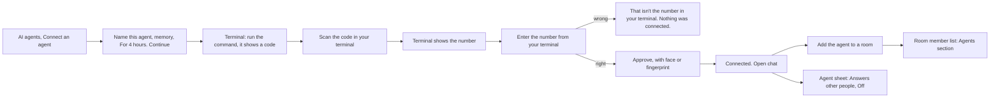
The person's path through the screens, in the plan's copy. A wrong number, or an N at the terminal, is where the pairing stops for good. (§3.2, §6)

<table>
<tr>
<td valign="top"><br><sub>1. Name the agent, pick its memories; what it can use them for, and "For 4 hours"</sub></td>
<td valign="top">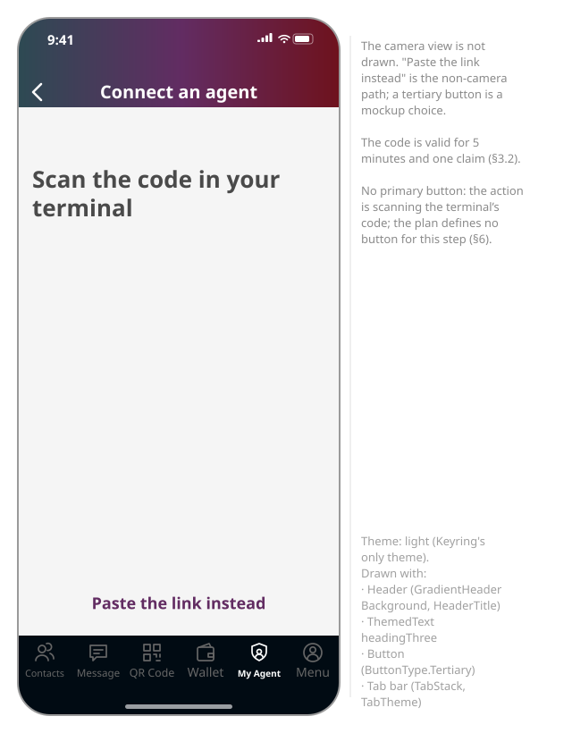<br><sub>2. Scan the code the terminal shows</sub></td>
<td valign="top">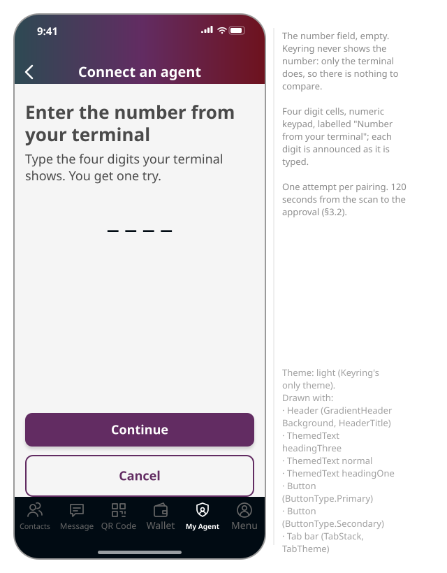<br><sub>3. Type the number from the terminal; one try</sub></td>
<td valign="top"><br><sub>4. Failure: a wrong number connects nothing</sub></td>
</tr>
<tr>
<td valign="top">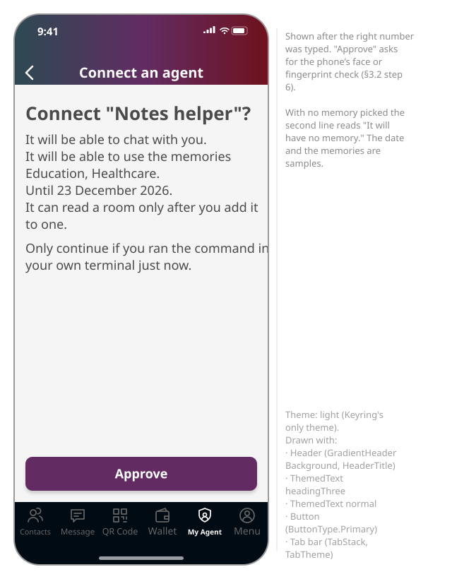<br><sub>5. Approve: HCP's checklist, "For 4 hours", confirmed with face or fingerprint</sub></td>
<td valign="top">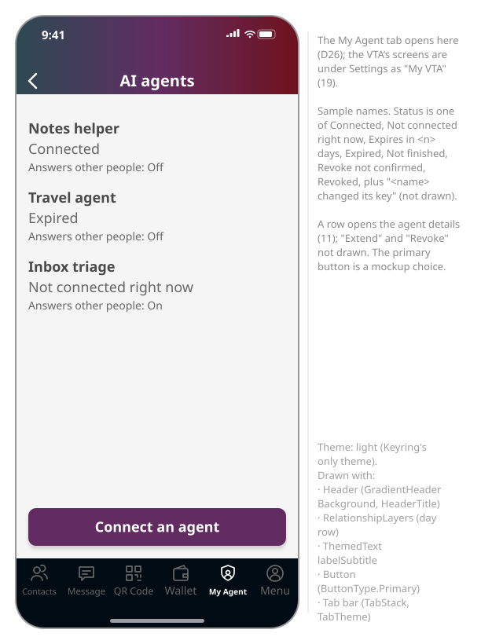<br><sub>6. The agent list, the My Agent tab's first screen (P1 lines marked in notes)</sub></td>
<td valign="top"><br><sub>7. (P1) The agent sheet: owner, and "Answers other people" with its value</sub></td>
<td valign="top"><br><sub>8. (P1) Turning it on asks first and names the risk</sub></td>
</tr>
<tr>
<td valign="top">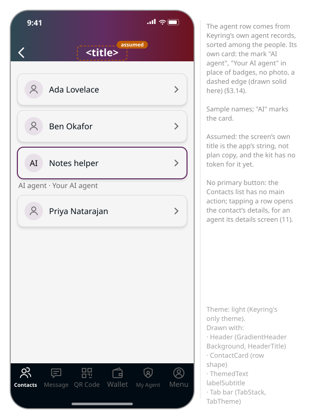<br><sub>9. Contacts: the agent is a contact, drawn as the person's AI</sub></td>
<td valign="top"><br><sub>10. Messages: the agent chat among people and rooms</sub></td>
<td valign="top">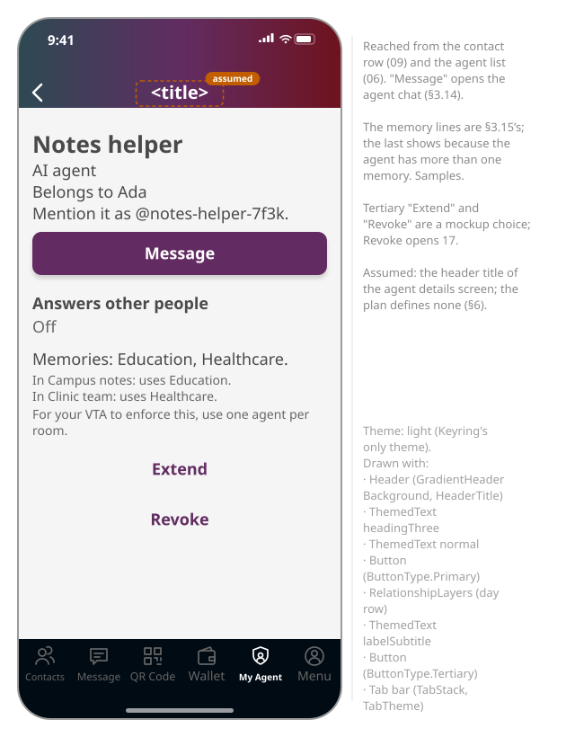<br><sub>11. Agent details: "Message" first, then its fixed memories and "Change memories" (P1 lines marked in notes)</sub></td>
<td valign="top">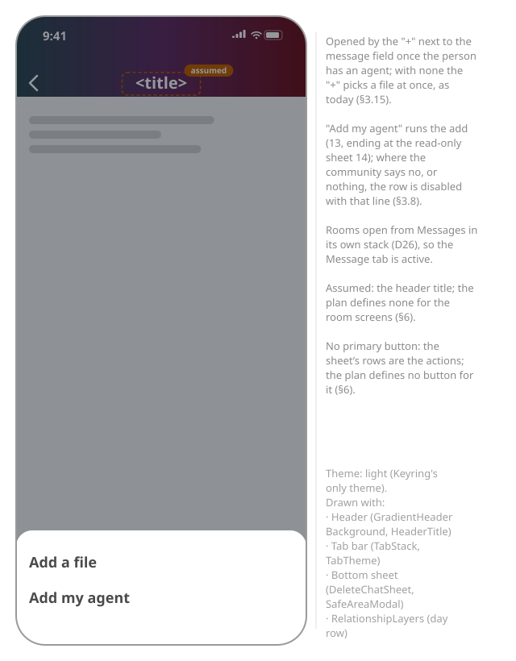<br><sub>12. (P1) The composer's "+": "Add a file" or "Add my agent"</sub></td>
</tr>
<tr>
<td valign="top">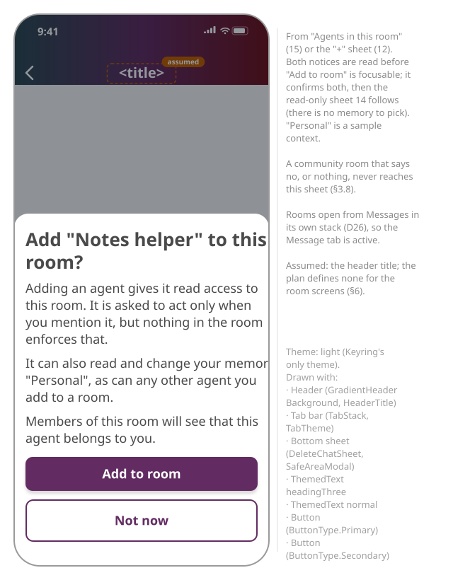<br><sub>13. (P1) Adding an agent to a room, with the read-access and memory notices</sub></td>
<td valign="top">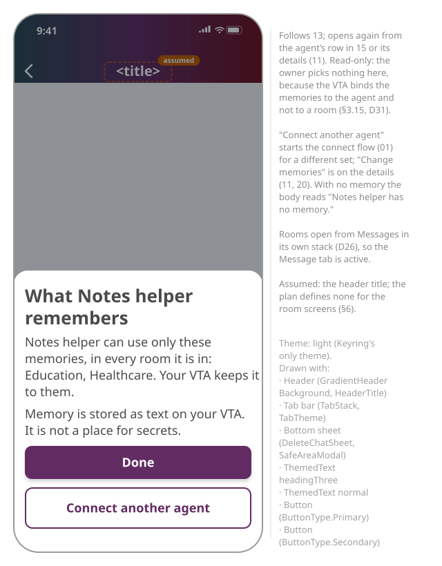<br><sub>14. (P1) "What it remembers here": the agent's fixed memories, read-only, and "Connect another agent"</sub></td>
<td valign="top"><br><sub>15. (P1) Room info: "Agents in this room", with the memory each one is bound to</sub></td>
<td valign="top"><br><sub>16. (P1) The room's member list, with agents under "Agents", each with its owner and handle</sub></td>
</tr>
<tr>
<td valign="top">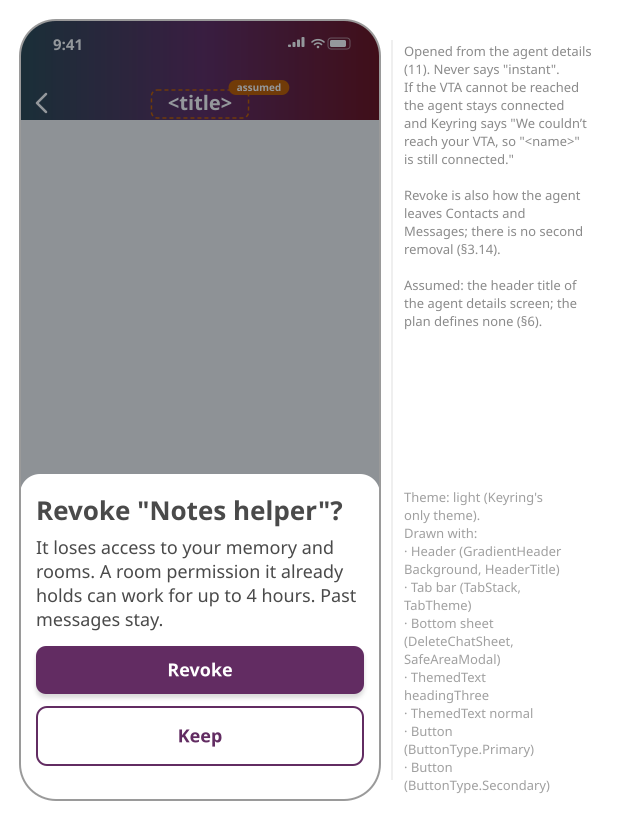<br><sub>17. Revoke, which says "up to 4 hours" (P1 lines marked in notes)</sub></td>
<td valign="top">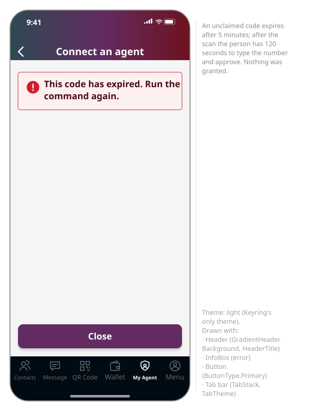<br><sub>18. Failure: the code expired</sub></td>
<td valign="top"><br><sub>19. Settings: the "My VTA" row opens the VTA's screens, moved whole</sub></td>
<td></td>
</tr>
<tr>
<td valign="top"><br><sub>20. Change memories: widening names every room and asks for face or fingerprint (P1 lines marked in notes)</sub></td>
<td valign="top"><br><sub>21. Delete a memory (P1): counts the items, names the agents, says "destroys"</sub></td>
<td valign="top">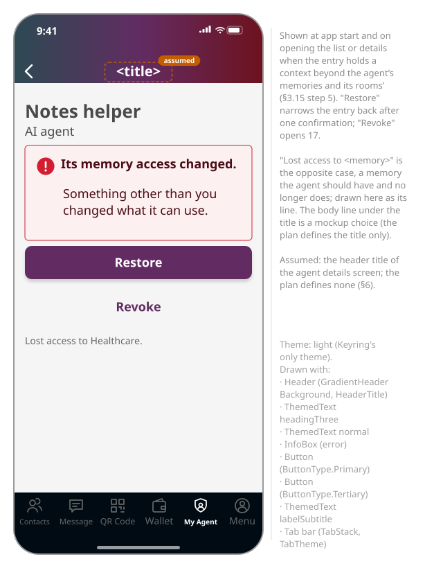<br><sub>22. Its memory access changed: Restore or Revoke</sub></td>
<td valign="top">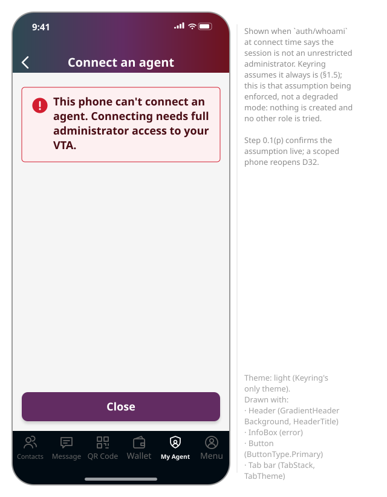<br><sub>23. The guard: a phone that is not an unrestricted administrator ends the connect (§1.5)</sub></td>
</tr>
<tr>
<td valign="top">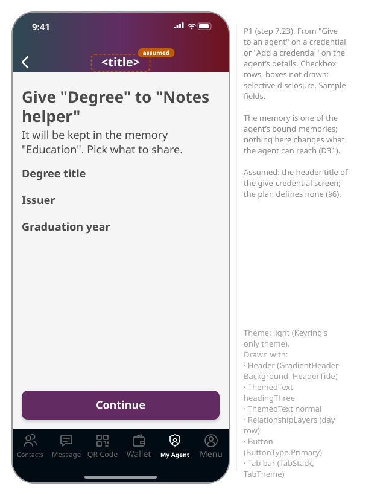<br><sub>24. (P1) Give a credential to an agent: pick the fields</sub></td>
<td valign="top">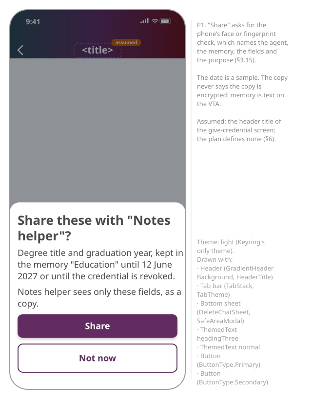<br><sub>25. (P1) Approve: names the agent, the memory, the fields</sub></td>
<td valign="top">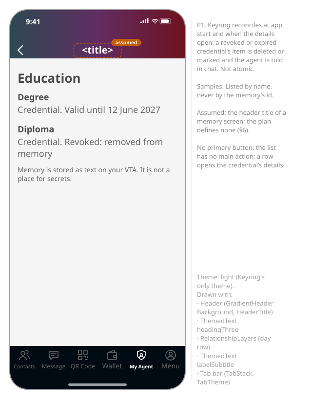<br><sub>26. (P1) A memory with credentials, valid and revoked</sub></td>
<td valign="top">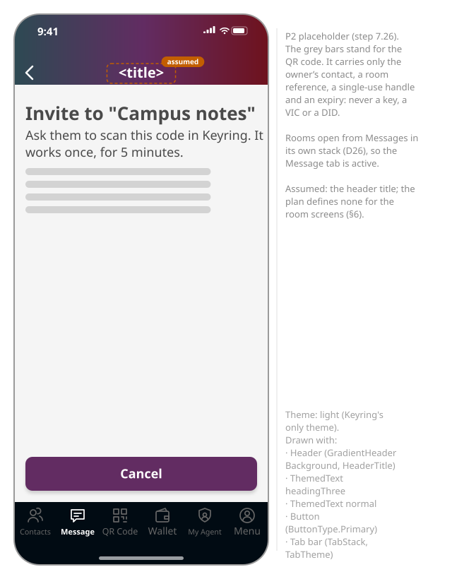<br><sub>27. (P2 placeholder) Invite someone to a room by code</sub></td>
</tr>
<tr>
<td valign="top">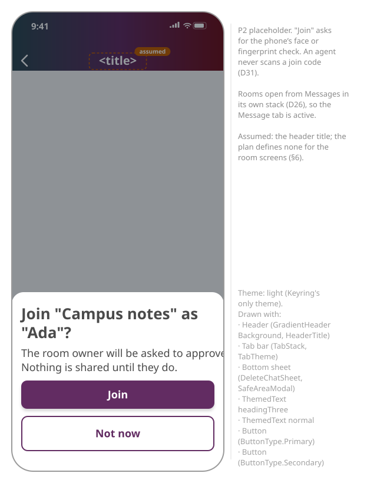<br><sub>28. (P2 placeholder) The joiner approves</sub></td>
<td></td>
<td></td>
<td></td>
</tr>
</table>

![Screens 1 to 28: 1. Connect, name and memories; 2. Connect, scan; 3. Connect, enter the number; 4. Connect, wrong number; 5. Approve; 6. The agent list; 7. The agent sheet; 8. Turning Answers other people on; 9. Contacts with the agent row; 10. Messages with the agent chat; 11. Agent details; 12. The composer's plus sheet; 13. Add an agent to a room; 14. What it remembers here; 15. Agents in this room; 16. The room member list with Agents; 17. Revoke; 18. Connect, code expired; 19. Settings, My VTA; 20. Change memories; 21. Delete a memory; 22. Memory access changed; 23. Not an administrator; 24. Give a credential; 25. Approve sharing a credential; 26. A memory with credentials; 27. Invite to a room by code; 28. Join by scanning](./agent-connect-plan/mockups/sheet.png)

Assumed in these mockups: the header title is a `<title>` stand-in on the room screens (12 to 16) and the agent details (11, 17, 20 to 22), because the plan defines none (§6), and on Contacts (9), Messages (10) and Settings (19), because those are the app's own strings and the mockup kit has no token for them yet; sample names, rooms, memories and dates ("Notes helper", "Ada", "Campus notes", "Education", "23 December 2026") stand for data. The agent card's dashed edge is drawn solid (9, 10).

Not drawn in the kit, because the screen is the layout of one above with its own line of copy: the locked state, the closed-mediator, version and "terminal refused" failures (the wrong-number layout), "Revoke not confirmed" and "changed its key" (the list and details layouts), the chat variant (its header is in 10's note), the community-setting refusals (the add sheet), the agent picker when more than one agent qualifies, and "Name this memory" (§6). Most of those are on the UI/UX canvas below.

**The UI/UX canvas.** The same screens at full fidelity, drawn by the UI/UX lane from this copy, with the states the kit leaves out (the new-memory field, the connected screen, every list status, the agent chat and its waiting state, the Messages filters, the "+" where agents are not allowed, the agent picker, a room with a mention, what another member sees with and without proof, and the terminal). **It is the design the screens are built to (D41)**, and the target the built screens are checked against (this plan's §8.6 and step 10a); the kit SVGs above remain the checked source for the words, and only that. The credential screens (kit 24 to 26) are drawn on the canvas too (frames 24a to 26b there). The frames are exported in [`agent-connect-plan/canvas/`](./agent-connect-plan/canvas/), one PNG each, and that folder's README names the canvas version.

![The UI/UX canvas at version 43, 56 frames in the canvas's order: the terminal; connect name and memories, new memory, scan, number, wrong number, approve, connected, keep it connected, expired, not an administrator; the agent list, every list status, the agent sheet, turning Answers other people on, the agent details, revoke not confirmed, changed its key, revoke, Settings with My VTA; change memories, stop using a memory, delete a memory, memory access changed; Contacts, Messages under All, the agent chat, the agent chat waiting, Messages under People, Messages under a community; a room with a mention, the composer plus sheet, the plus where agents are not allowed, the agent picker, add to room, memory for this room, agents in this room, the member list with agents, another member's view with proof, and without proof; a credential's Give to an agent, choosing the agent and its memory, Add a credential, what to share and what it is for, approve sharing, what a memory holds, the agent chat line for a revoked credential; and two frames marked proposed for the P2 ask-each-time design, the agent asking in its chat and the phone sharing straight with the verifier; and six frames for the HCP lane behind its flag: approve with HCP's checklist, new memory, the agent list, what it saw, revoke, and the states after revoke; and, proposed, how much each memory holds](./agent-connect-plan/canvas/sheet.png)

**The canvas and the memory binding (D31).** The canvas, exported at version 43, draws the memory binding: the helper under the memory rows (`02-main.png`), "and no others" (`07-approve.png`), the details with "Can use memory ... in every room it is in", "Your VTA keeps it to these memories", "Change memories" and "Add a credential" (`16-agent-details.png`, with its two other states `17-` and `18-`), the P2 "Also delete what it remembered" (`19-revoke.png`), the read-only "What <agent> remembers" (`36-memory-for-room.png`) and "Memory: <names>" rows (`37-room-agents.png`). Kit mockups 20 to 23 have canvas frames, titled K20 to K23 on the canvas so they do not clash with its 20a and 20b: `21-change-memories.png`, `22-stop-memory.png`, `23-delete-memory.png` (P1), `24-memory-access-changed.png` and `11-not-administrator.png`. The credential screens (kit 24 to 26) are `41-` to `47-`. Frames `48-` and `49-`, marked "proposed" on the canvas, draw "ask each time": the agent asks in its chat and the phone presents straight to the verifier. That is the named P2 design of §3.15 (D47), not a P1 screen, and its words are not in §6.

**The canvas, the grant model (D42) and the HCP lane.** The canvas is the design (D41), and the kit's 01, 05 and 06 carry the same words. Base path: `02-main.png` ("What it can use them for" with the two purposes as rows, and "For 4 hours" with its helper), `07-approve.png` (HCP's checklist in the order of this plan's §6), `08-connected.png` ("Connected until <time>.", "Open chat", "Keep it connected"), `09-keep-connected.png` (the sheet; not offered until step 7.28 shows `acl/update` can remove an expiry), `12-agent-list.png` and `13-agent-list-states.png` ("Connected until <time>" with Extend, which opens Approve again; a persistent agent shows "Connected" with Revoke only), and `16-agent-details.png` (the status, and "Keep it connected" while temporary). HCP lane, behind the flag (the companion's finding 6 copy and its work item C8, drawn on the canvas, not as kit mockups): `50-hcp-approve.png`, `51-hcp-new-memory.png`, `52-hcp-agent-list.png`, `53-hcp-what-it-saw.png` (P1), `54-hcp-revoke.png` and `55-hcp-revoke-states.png`. On these frames New memory opens from the agent's details, under "What <name> remembers"; the after-revoke lines are a status line on the agent's details and on its list row; and a "What it saw" row reads "Read your <category> to <purpose description>" (this plan's §6, "HCP lane screens"; decided by Brendan on 2026-11-25, for Alberto's review). How the canvas reached this state is in the companions ([`2026-11-25-bam-3.md`](./agent-connect-plan/2026-11-25-bam-3.md), finding 5).

**The agent answers only its owner by default.** "Answers other people" is off. Anyone else who mentions the agent in a room gets one fixed message, written by the plugin and never by the model: "I'm an AI agent and I can't respond to anyone but the person I work for." The same author gets it at most once an hour per room, and the agent sends at most 20 an hour in all. That reply tells the sender that the session is running and attentive and which language the owner uses Keyring in; the plan accepts and documents this (§3.13). Turning the setting on asks first, because the agent could then be tricked by a stranger's text into using the owner's memory. A permission prompt is not relied on, since auto mode and pre-allowed tools show none: while a stranger's text is being handled, a hook in the plugin allows only the reply tool. VTI's step-up cannot add the owner's approval, because it only ever lets a caller approve its own session; the VTA's consent flow could, and it is used only once it is measured (§3.13, D46). The hook is a Phase 0 check, and if it fails the switch is not offered in P1 (§3.13, §7 step 0.3).

**What the agent hears and what it is given.** The plugin is OpenVTC's `vta-agent-memory`, already a Claude Code plugin, which we extend with its maintainers so that it pairs with a wallet and hears messages; until a change is merged upstream we build and test against a fork branch (D45). It tells the running session a message arrived through a channel (a Claude Code research-preview feature that needs a development flag and an interactive session), and an `inbox` tool plus a watcher command stand by as the fallback. A session running in the background hears the owner through that fallback only, because the channel does not start there (measured, §3.12). The plugin drops anything not written by the owner's own persona, whichever room it came from, takes chat only from the chat identity Keyring named at approval, and pairs only with the owner's own VTA (§3.2, §3.12).

**The delegation credential.** The agent gets a delegation credential (a VDC) that records whose agent it is, in the shape the DTG credentials specification requires. Keyring uses it for the owner shown in the agent sheet, for the chat, and, later, for proving to a third party whose agent this is. It is valid for 7 days and Keyring re-issues it while the agent's permission stays in place. After Revoke it is not re-issued, and a copy someone already holds stays valid for up to 7 days: there is no revocation list in P0. The one place it is shown is inside the rooms the agent is added to, as part of the agent's own name record, so that any member who taps the agent sees "AI agent", whose it is and its own identity (§3.16); that needs the room's profile to allow it, which is asked of VTI. It never travels with anything the agent does: in a room the agent acts on its own 4-hour permission and signs as itself (§3.4).

**A contact, and memories that are slices.** The agent is a contact in Contacts and a conversation in Messages, like a person and messageable like one, but drawn so it is never taken for one: a dashed edge, the mark "AI agent", the line "Your AI agent" where a person shows verification badges, and no photo. Tapping it opens the agent's details, whose first action is "Message" (§3.14). An agent is added to a room from the "+" next to the message field as well as from the room's info screen (§3.6). Its memory is made of **memories**, each one a VTA context the person names ("Education", "Healthcare"): any number are picked when the agent is connected, and the person's VTA binds the agent to exactly those: it can reach no other memory, whatever a room says and whatever the model decides. The VTA does not know about rooms, so there is no per-room choice to make; a person who wants a college's room to see "Education" and a clinic's room to see "Healthcare" connects two agents, one for each (§3.15). Memory is kept as text on the person's VTA, up to 64 KiB an item; it is not a place for secrets or files.

**One caveat, stated plainly.** An agent added to a room acts only when it is mentioned, but that is **behaviour, not enforcement**. To see a mention the agent needs read access to the room, so it can read all of it. Delivering only mentions to the agent would be a VTI change (§3.6, §10 item 3). Adding a room also lets the agent read and change the memory of the persona that holds the room, and so can every other agent the person adds to a room; the add sheet says so (§3.3, §9). Keyring says all this in the add sheet and the room info screen (§6). Past messages stay after Revoke, and a permission the agent already holds can work for up to 4 hours (§3.9).

**Revoke survives a key swap.** An agent can move its own permission to a new key without asking. Keyring therefore finds the agent by its device ID, not by its key, treats an empty answer as "search again", and shows "Revoke not confirmed" until the permission is gone. It also notices at app start if an agent changed its key (§3.9).

**How it works underneath**

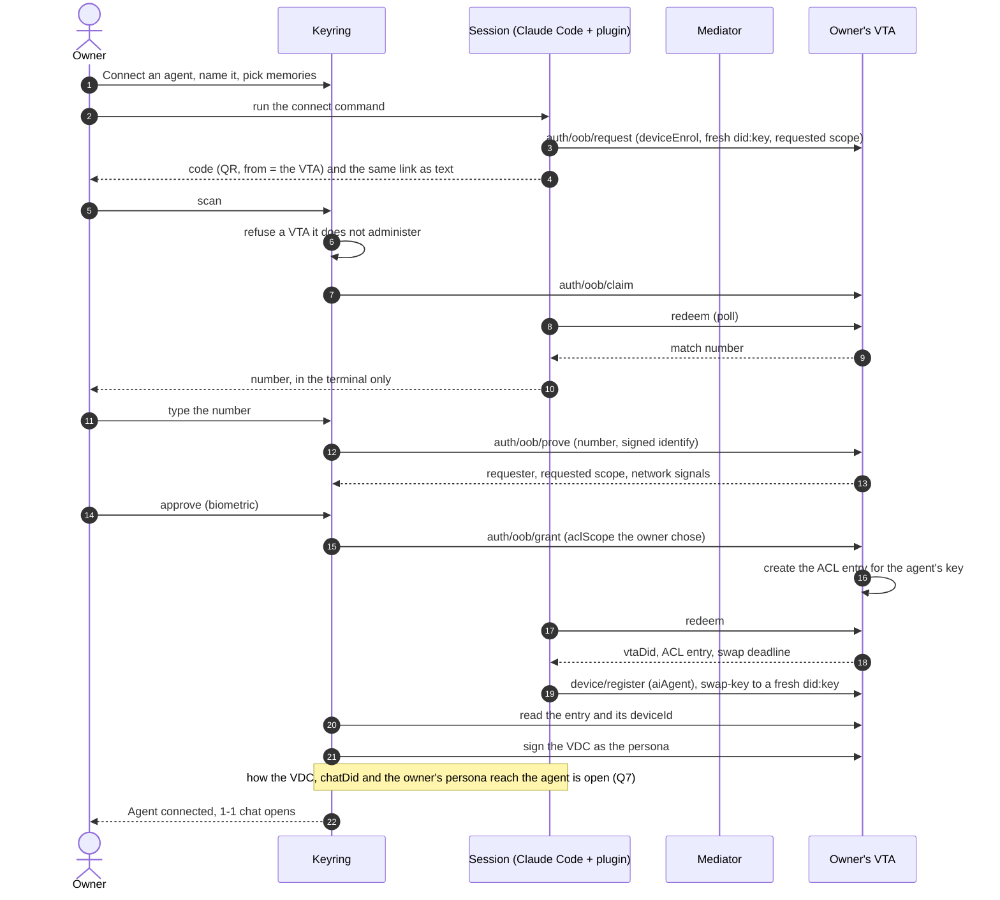
The pairing, in order: VTI's `auth/oob` ceremony with the purpose `deviceEnrol`, the owner's VTA as the service (D48). The number is shown only in the terminal and the VTA checks it; the VTA, not Keyring, creates the agent's permission, and the agent enrols only at its own VTA. Until VTI serves `deviceEnrol`, P0 uses a fallback with no number (§3.2). The agent holds a key and a delegation credential, never the person's room credentials; the VTA mints each room permission on request (§3.2, §3.6).

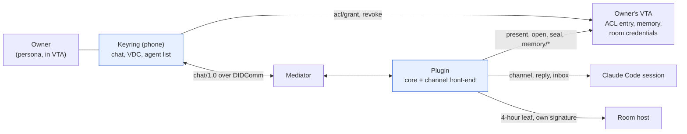
Who holds what. The agent is never a room member: it is a presenter holding a 4-hour, one-action leaf the VTA minted from the owner's persona. New against what exists: Keyring's agent screens and the plugin (blue). (§3.6, §3.12)

**How we'll know it works**

| Claim | Proved by | Runs where | Status |
|---|---|---|---|
| **[P0]** A mediator forwards an authcrypt message to a `did:key` that has authenticated there, queues it while the agent is offline, refuses a recipient that has never authenticated, refuses anoncrypt, refuses the 51st queued message with a `Retry-After`, and does not deliver a message sent to a `did:peer` that names another host | `ref-25-agent-pairing` (§7 step 0.1): 44 offline tests and 21 recorded cases (§2.4) | Lab (the mailbox's mediator, v0.53.0 at `f6ed8159a`, open configuration, on loopback) | Measured 2026-11-26; every case repeats |
| **[P0]** The delivery, self-grant and refusal cases of §2.4 hold on a lab mediator **configured like the wallet mailbox** (`explicit_deny` and the exact default bits, queue and rate limits, §2.5): live and offline delivery from a sender that is an account, a sender with no session refused, a recipient that never authenticated refused, anoncrypt refused, a `did:peer` naming another host, the 51st message refused, a new `did:key` self-grants with `account/update` and sends, and one with no self-grant is refused (a P0 gate, step 0.1(q)). The mailbox host and the Farm's mediator are **recorded validations**, done when their operators allow and not part of this row's pass (D18) | The rung's cases (§8.3) | Lab configured as the mailbox (gate); mailbox host and Farm (validation, after approval) | Lab: measured 2026-11-26, 21 cases, every one repeats (§2.4). Mailbox host and Farm: not run |
| **[P1]** An agent entry registered with `serviceKind` `aiAgent` is refused `rooms/keys/act` and can `present` and `open`; one not yet registered can `act` (§3.3) | Reference rung, then lab e2e (§8.2) | Lab | Not run |
| **[P0]** The pairing link (the VTA's DID in `_from`; in the fallback, the agent's `did:key` and requested scope) is at most 251 bytes and its QR at level M scans; it expires in 300 s (§3.2) | Rung step 0.1(h); jest (§8.1) | Lab, CI | Measured 2026-11-26 in the rung: 183 bytes with the lab VTA's own DID (73 bytes), 192 bytes with a `did:webvh` VTA of 84 bytes, 143 bytes the longest VTA DID that fits; the fallback 170 bytes, 182 with the widest scope; each code decodes. The jest test and the 300 s expiry are not built |
| **[P0]** Pairing (`auth/oob` `deviceEnrol`, D48) refuses a wrong number with no second try, an expired or reused code, a second claim and a link from a VTA Keyring does not administer; the VTA refuses a grant wider than the requested scope; three wrong numbers lock it for 15 minutes and further wrong ones renew the lock; Keyring never shows the number (§3.2) | jest, `packages/core/src/modules/connected-agents/__tests__/` (§8.1) | CI | Planned |
| **[P0]** The plugin pairs only with its pinned VTA: it opens its request only there, refuses a `redeem` naming another VTA, and a captured code does not enrol anyone unless an administrator of that VTA approves (§3.2) | The plugin's own tests (§8.1); lab run with a second VTA (§8.2) | Plugin CI, lab | Planned |
| **[P0]** The VDC has the DTG base shape (`DTGCredential`, contexts, `issuerScope`, `validUntil`, `scope`; an acceptance with no `scope`), verifies, and is accepted by the agent's key; it is re-issued every 7 days while the entry is active, and a lapsed one does not change `active` (§3.4) | jest (§8.1), reference rung | CI, lab | Rung, lab: measured 2026-11-26. The VTA signs the grant as the persona with `keys/sign-document/0.1` and it verifies; an acceptance signed by the agent's key verifies (step 0.1(f)). jest: planned |
| **[P0]** Removing the ACL entry stops further memory calls and any new enrolment at the next request (§3.9); `present` and `open` in a room are P1 (7.17) | Lab e2e (§8.2) | Lab, then Farm | Not run |
| **[P0]** Revoke still works after the agent swapped its own key: the entry is found by device ID, an empty answer is not success, the "Revoke not confirmed" state persists across a restart, and the app notices a changed key at start (§3.9) | jest (§8.1); rung step 0.1(l) and lab e2e (§8.2) | CI, lab | Planned |
| **[P1]** An already-minted leaf keeps working up to 4 hours after Revoke, in `open` rooms only for reads and writes; Keyring never says "instant" (§3.9, §6) | Lab measurement, a long-running run of 4 hours or more; copy test (§8.1) | Lab, CI | Not run |
| **[P0]** Biometric approval gates the ACL grant on a real phone (§3.2) | Attended run on a physical phone (§8.4) | Physical phones | Not run |
| **[P0 and P1]** The plugin drops anything not authored by the owner's persona, takes chat only from the `chatDid` it was given, gates on the author and not the room, fences room content and declares no permission relay (§3.12) | The plugin's own tests (§8.1) | Plugin CI | Planned |
| **[P1]** With "Answers other people" off, a non-owner mention gets the fixed reply once per author per room per hour and the model never sees it (§3.13) | The plugin's tests; two-party lab run (§8.1, §8.2) | Plugin CI, lab | Planned |
| **[P1]** With it on, a hook in the plugin denies every tool but `reply` while a stranger's text is handled, in auto mode and with `vta-mcp` tools pre-allowed; the owner's approval through the VTA's consent flow is not relied on until measured (D46). If the hook check fails, the switch is not offered (§3.13) | Phase 0 checks (§7 steps 0.1(n), 0.3(f)); the plugin's tests | A real Claude Code session, by hand; lab | The hook: measured 2026-11-26 in auto mode with tools pre-allowed (0.3(f)). The consent flow (0.1(n)): not run |
| **[P0]** A channel wakes an idle interactive Claude Code session; a background session hears the owner through the `inbox` plus Monitor fallback, which works in both; channels need Claude Code 2.1.80 or later (§3.12) | Phase 0 checks (§7 step 0.3) | A real Claude Code session, by hand | Measured 2026-11-26 on 2.1.332: a development channel does not register in a background session |
| **[P1]** Mentions use the full handle (name plus a suffix from the agent's DID), so another owner's agent of the same name does not match; the agent stays silent otherwise (§3.6) | Plugin tests; two-party lab run | Plugin CI, lab | Not run. Not enforceable by the VTA (§10 item 3) |
| **[P1]** Adding a room widens the agent's memory to the persona's context, and so for every agent added to a room; the add sheet says so and the effective access shows it (§3.3, §6) | jest; rung step 0.1(m) with two agents in the lab | CI, lab | Planned |
| **[P0]** An agent reaches only the memories on its own ACL entry, whatever a room, the offer or the model says; a different memory set is a different agent (§3.15, D31) | jest; lab rung step 0.1(p): a second memory is refused `contextForbidden` for every route that could name it | CI, lab | Planned |
| **[P0, P1 and P2]** Creating, deleting and wiping a memory behave as §3.15 says (create-first, exact-path grants, explicit confirm, re-runnable wipe) | jest with a fake VTA; rung step 0.1(p)(6) | CI, lab | Planned |
| **[P1]** The agent can read and write `open` and `attributed` rooms through the VTA; `private` is refused (§3.6) | Lab e2e | Lab | Not run |
| **[P1]** The fr and pt-br fixed-reply wording has been read and approved by a native reader of each language; the plugin is not released without it (§3.13, step 10b, 7.15) | A named reviewer per language, recorded in the plugin's release checklist (`vta-agent-memory`'s, or our fork branch's until §11 Q6 (e) settles it) | By hand, release gate | Not done |
| **[P0]** App and plugin at different versions refuse cleanly; the `settings` message (setting and locale) reaches the plugin and an unknown version keeps the safe default (§3.2) | jest and the plugin's tests (§8.1) | CI, plugin CI | Planned |
| **[P0]** "Extend" updates the expiry and re-issues the VDC; an unfinished pairing is offered "Remove" and removed on its own after 10 minutes (§3.3, §3.10) | jest with a fake clock; lab e2e (§8.1, §8.2) | CI, lab | Planned |
| **[P0]** The plugin core implements the host contract and imports no vendor library (§3.18) | A test greps the core's imports (§8.1) | Plugin CI | Planned |
| **[P1]** A credential given to an agent's memory carries only the consented fields, leaves `act` unchanged and is removed when revoked (§3.15) | jest; lab (§8.1, §8.2) | CI, lab | Planned |
| **[P1]** A second agent host passes the conformance suite the first host passes (§3.18) | The suite on both hosts (§8.2) | Plugin CI, lab | Planned |
| **[P0]** A new agent is temporary for 4 hours; staying connected is a separate act after connecting, never pre-selected; "Extend" re-asks (§3.3, §6, D42) | jest; lab expiry run (step 7.28) | CI, lab | Planned |
| **[P0 HCP]** The demo `agent-connect-p0-hcp`: approve with HCP's checklist, an answer from context, a person-declared memory used, revoke told and the next request refused; with the flags off P0 is unchanged (D43) | VTI integration tests, CLI tests and jest, then the demo script on the lab and a physical phone (step 7.27) | CI, lab, physical phone | Not run |
| **[P1 HCP]** Onward sharing elected and reported, "What my agent saw", "Answers on" applied by the plugin, Delete memory withdrawing entries, HTTP parity (D43) | jest and plugin tests; lab run (step 7.29) | CI, plugin CI, lab | Planned |
| **[P2 HCP]** Governance, hard delete and the First-Party conformance run, each on its own (D43) | jest; HCP's conformance run on the lab or Farm (step 7.30) | CI, lab | Planned |
| **[P0]** Chat to an offline session stays inside the mediator's queue limit and honours its 503 (§3.5) | Lab measurement | Lab | Not run |
| **[P1]** The member list shows the owner's agents under "Agents" even when the community list is unavailable, and never adds one to the community's list (§3.6) | jest and render tests (§8.1) | CI | Planned |
| **[P1]** The owner in the agent sheet comes from the VDC, and the sheet shows "Answers other people" (§3.4, §6) | jest | CI | Planned |
| **[Recorded validation, not a P0 row]** Behaviour on the VTA Farm (and the mailbox host) matches the lab for the delivery and happy-path cases (§8.3), done when their operators allow | Same e2e, once | VTA Farm | Not run |

Emulators and simulators cannot prove the biometric gate; the hardware-key approval needs a physical phone (§8.4).

**Where it stands, and what we need:**

- **Transport measured on the lab, on the mailbox's own mediator version.** The main chat risk is retired for the lab mediator, in the open configuration and in the wallet mailbox's (§2.4). The mailbox host itself and the VTA Farm's mediator delivery cases are still to run; the closed-mediator and queue cases run on a mediator we control (§8.3, D18).
- **Phase 0 next:** the tested rung, and the checks on a real Claude Code session: notification and the tool-denying hook (§7 steps 0.1 to 0.3).
- **Where the community's yes/no for agents lives** (§3.8, D10). It has no home in VTI today, so Keyring's check is advisory and "not stated" counts as no; the ask for a room-record member goes upstream (ledger AC-06).
- **Blocked on VTI** for: mention enforcement, a member-side way to withdraw an agent's leaf, an owner's control over or signal of an agent's key swap, the third VTC setting, a registered `mentions` member, and showing another party's agent (this plan's §10). None blocks P0. Every ask is in [`agent-connect-plan/vti-asks.md`](./agent-connect-plan/vti-asks.md), not yet raised.
- **The narrower VDC question** goes to the DTG working group as a question that gates no phase (§3.4, D4). Ledger AC-14 status: not yet raised; it is a question for that working group, not for VTI, so it is not in the findings file (§10).
- **Lab first.** Every step is tried on the lab stack in full before the Farm or anyone else's community, and each gap it shows is written into the findings file in that step's PR (§7, §8.2, D25).
- **The My Agent tab is the AI agents.** The tab opens on the AI agents list, and the whole stack that shows the VTA today moves, as it is, under Settings as "My VTA" (§6, D26, step 5a). Rooms are not affected: Messages opens them in its own stack. The mockups show the My Agent tab active, which still holds.
- **The agent is a contact and a chat, and memories are slices.** Decided with Alberto on 2026-11-23 (§3.14, §3.15, D27 to D29). Revised on 2026-11-24 (D31): the VTA's ACL entry binds an agent to a fixed memory set, so no per-room choice is left to the plugin; a room-scoped binding upstream (VTI-Q37) would be a convenience.
- **HCP inside each tier.** P0, P1 and P2 each gain an HCP increment behind flags; the first is a one-week demo with the VTI plan's V0, and P0's normal connect takes HCP's 4-hour grant model too (§1.1, D42, D43, steps 7.27 to 7.30).
- **Any member can see whose agent it is.** Tapping an agent in a room shows "AI agent", "Belongs to <owner>" and the agent's own identity, read from a delegation the agent publishes with its name record and verified by the reader (§3.16, D30). A room's profile has to allow that member, which is asked upstream as VTI-Q38; until then only the owner's own agents show it.

**Open decisions**

| Question | Recommendation | Who decides | By when, or what it blocks |
|---|---|---|---|
| Where the plugin lives | **Decided 2026-11-25 (D45):** in OpenVTC's `vta-agent-memory`, extended with its maintainers; a fork branch of it is built and tested against while an upstream merge lags | Brendan (decided) | Blocks nothing: a slow upstream review delays the merge, not our tests |
| How `vta-agent-memory`'s one-context enrolment fits an agent bound to a fixed set of memories Keyring creates, with Keyring as the granter, and the other fit questions (§11 Q6) | No recommendation yet: these are the maintainers' design to agree | The `vta-agent-memory` maintainers, with Brendan | The upstream merge of 7.6; not P0's tests, which run on the fork branch |
| Which mediator each side of an agent connect uses in production, and how a wake-up for an agent's message reaches a phone (§2.5, §11 Q5) | No recommendation yet: the repositories read do not show it | Owner | Blocks only the wake-up answer of steps 0.1 and 0.3; agent-chat notifications are off in P0 (§3.5), so no P0 step waits on it |
| What happens at C10 to the two memory stores, the HCP lane's `vta-hcp` entries and the plan's `vta/memory/*` memories, which do not see each other: migrate, keep apart, or HCP as the memory store (§1.1, §11 Q9) | No recommendation yet: each option's cost is in §11 Q9 | Brendan | Blocks C10 in step 7.29, not P0 or the demo |
| How the HCP lane's own `grants/request` pairing fits D48's `auth/oob` `deviceEnrol` when C12 merges the connect paths (§11 Q10) | No recommendation yet: the demo pairing is for the demo only, so only C12 waits on it | Brendan, with VTI | Blocks C12 in step 7.29, not the demo |
| Whether one agent identity may hold both an entry in the VTA's access list, which rooms and memory need, and an HCP grant, which VTI's design gives only to a client with no entry (§11 Q11) | Two identities until VTI defines one that holds both; Revoke ends the grant first, then the entry, and Keyring stores the grant's id | Brendan, with VTI | Blocks C12 in step 7.29, not the demo |
| Where the agent's side keeps the HCP access token out of the model and resubmits a held grant request, which the VTA's client library does not do today (§11 Q12) | In the agent-side code the lane already adds, below the model: it holds the token and the request's thread and gives the model only results | Brendan, with the `vta-agent-memory` maintainers | The lane's CLI in step 7.27 already needs it; blocks the plugin carrying `hcp/*` in step 7.29 |

**Decisions made**

| Decision | Who | When | Why |
|---|---|---|---|
| The My Agent tab is the AI agents; the VTA's stack moves under Settings as "My VTA" (D26) | Alberto | 2026-11-22 | A person meets the agent they talk to, not the server that holds their keys (§5) |
| The agent is a contact and a chat, drawn as the person's AI (D27); added to a room from the composer's "+" (D28); any member can see whose it is (D30) | Alberto | 2026-11-23 | Agents are reached where people are, and never taken for one (§3.14, §3.16) |
| An agent is bound on the VTA's ACL entry to a fixed memory set; a different set per room is another agent; a model never decides whether a memory is honoured (D31, replaces D29's per-room half) | Brendan | 2026-11-24 | Only the VTA's check is not driven by a model or a room's text (§3.15) |
| Keyring always connects to its VTA as an unrestricted administrator (the P0 assumption, §1.5); memories are created top-level after an `auth/whoami` guard, which ends the connect with a clear failure if it fails; the parent-context route is not built (D32). Step 0.1(p) is the live confirmation and the tripwire | Brendan | 2026-11-24 | A root context needs an unrestricted administrator (VTI-CTX-020), which the owner's phone is by design; no degraded mode (§1.5, §3.15) |
| A memory's id is opaque and random, never derived from its name or the owner (D35, replaces D33) | Brendan | 2026-11-24 | A topic in an id would sit for good in ACL entries, audit rows, claims and logs (§3.15) |
| An agent's memory set may be widened after connect behind a biometric approval that names every room; narrowing needs one confirmation (D34) | Brendan | 2026-11-24 | The set stays fixed against the agent and rooms without a new agent for each memory (§3.15) |
| The plugin is OpenVTC's `vta-agent-memory`, extended with its maintainers, not a new repository; a fork branch while an upstream merge lags; pairing is VTI's `auth/oob` with the purpose `deviceEnrol` (D48), not messages of our own (D45, replaces D39 and D40 and D12's home) | Brendan | 2026-11-25 | Keyring and VTI are one suite: nearly everything the plugin does is wanted beyond Keyring, and only Keyring's screens and phone-side handling are Keyring's own |
| A credential reaches an agent's memory only through Keyring with the biometric approval (D36); joining a room by scan is a P2 placeholder (D37); the design is host- and model-neutral and evidenced (D38) | Brendan | 2026-11-24 | One repository to release and review; the VTA binds the memory, not the model (§3.15, §3.17, §3.18) |
| The UI/UX canvas is the design the screens are built to; the kit mockups (01 to 28) check the words only. The credential screens are drawn on the canvas (frames 41 to 47 at canvas version 40), so the kit's 24 to 26 are the words only (D41) | Alberto | 2026-11-25 | The canvas is drawn at the app's own quality; the kit is generated for the structure checker |
| The owner's approval of an agent's act goes through the VTA's consent flow (`requireConsent` with the owner's Keyring in the approver set), not step-up, which is only ever self-approval; VTI pushes the request and Keyring already answers it, but which tasks are held and who writes the rule are open, so not relied on (D46, replaces the delegated-approver paragraph of 2026-11-25) | Brendan, with Alberto agreeing | 2026-11-25 | Read at `f7b78e29d`: a delegated step-up was removed upstream, and someone-else-approves is the consent flow's job (§3.13) |
| A credential is still copied into the agent's memory in P1; "ask each time", where the phone presents straight to the verifier and the agent gets only shared or declined, is a named P2 design with stated prerequisites (D47) | Brendan, on Alberto's proposal | 2026-11-25 | Keyring does not register OpenID4VC today and no verifier exists to test against; the P2 design keeps the agent from holding a copy (§3.15) |
| Pairing is VTI's `auth/oob` ceremony with the purpose `deviceEnrol`, the owner's VTA as the service, which creates the agent's entry with the scope Keyring chose; a fallback with no number until VTI serves it (D48, replaces D3, narrows D8 and D24) | Brendan | 2026-11-25 | The ceremony and its protections already exist in VTI, the agent talks only to its own VTA, and no Keyring-defined channel or keys are needed (§3.2) |
| The plan asks VTI for a four-digit number in `deviceEnrol` (§11 Q8, D8, ledger AC-36); the terminal's y/N question stays removed (D24) | Brendan | 2026-11-25 | An agent's entry lasts up to 90 days, so the blind-try bound matters more than in a sign-in, and HCP's `grants/request` already uses four digits; only an administrator of the agent's pinned VTA can approve, so the y/N question guarded nothing the VTA does not (§3.2, §9) |
| P0, P1 and P2 are iterative minimum products, each shipping and working alone (§7.0); re-tiered on Brendan's instruction of 2026-11-24: the P0 gate covers P0 cases and screens only, the 4-hour tail run is P1, the Farm and mailbox passes are recorded validations done when their operators allow (the lab pass is the P0 exit), and earlier prose labels (rooms, mentions, "Answers other people", the community setting, "Also delete what it remembered", the daemon, presenting the VDC, "Also cut its room access now") follow §7.0 | Brendan | 2026-11-24 | If work stops after any tier, what exists works |
| An HCP lane: the Human Context Protocol provider in the VTA behind a cargo feature `hcp`, and its Keyring screens behind a flag, both off by default (§1.2) | Brendan | 2026-11-25 | Shows the plan's grants, memories and revoke as HCP operations without changing P0 to P2 |
| HCP slots into P0, P1 and P2 as one runnable increment per tier behind those flags; the demo is P0's first increment, `agent-connect-p0-hcp`; "What my agent saw" and "Answers on" are P1 (D43, steps 7.27 to 7.30) | Brendan | 2026-11-25 | If work stops after any tier, what exists works, with or without HCP (§7.0) |
| HCP's grant model on the base path for P0 to P2 (Q-H2): temporary for 4 hours by default, persistent as a separate act never pre-selected, the checklist on the Approve screen; replaces D21's 7, 30 or 90 days (D42, step 7.28) | Brendan | 2026-11-25 | One approval model, as HCP 6.1.4 requires (§3.3, §6) |
| Purpose IRIs proposed to the Trust Over IP DTG registry, with a domain of our own only as a fallback; filing needs Brendan's yes (D44) | Brendan | 2026-11-25 | HCP needs purposes as absolute URIs (§5) |
| The HCP lane's other questions: it stays in this plan until the demo; the agent-side code lives in OpenVTC's `vta-agent-memory`, behind the same flag (Q-H4, brought in line with D45 on 2026-11-25); the demo pairing is for the demo only; HCP's HTTP parity comes right after the demo; the editor questions go with the working demo; agents build all four tracks and the human-only work is Brendan's and Alberto's (§7.0, step 7.27) | Brendan | 2026-11-25 | Keeps the demo week's scope and puts the rest in P1 and P2 (D43) |

Everything else that was open is decided with Brendan and now stated as design: a number typed into Keyring (four digits, asked of VTI for `deviceEnrol`; two if the specification keeps its two, §11 Q8), with showing it in Keyring and typing it in the terminal recorded as a P2 option (step 7.22), the lockout and reply limits, the fr and pt-br review as a release gate, the plugin's home (D45), the Farm check, the VDC signing route, the community setting's advisory status, the screen names and the working-group question (§5 D8, D14 to D24; reasoning in the companion).

**Not doing:** `private` rooms (the VTA refuses them today); MyTerms or an "understanding" trust task (not in VTI; a P2 open design question); enforcing mention-only delivery; a per-room memory choice (withdrawn, D31); the "only with VDCs to people in the room" setting (a P2 candidate, needs VTI policy enforcement); a headless daemon (P2, step 7.19); presenting the VDC to a third party (P2, step 7.20); showing another party's agent in the member list (needs VTI); co-owning or operating rooms, including withdrawing an agent's credential at a room you own (P1); hosting the agent. Full list in §1.2.

---

<!-- plan-part: precision -->

> **Precision part: for implementers and agents.** Complete, exact and normative:
> implement from this part. Sections are numbered, and a bare `§n` means this
> plan's section n.

## 1. Scope, non-goals and baseline

### 1.1 Scope

P0 is (§7.0): connect an agent by QR through VTI's `auth/oob` `deviceEnrol`, with a number typed from the terminal (a fallback without one until VTI serves it, §3.2); issue it a VDC (the owner's record, §3.4); chat with it one to one; the agent as a **contact** in Contacts and a chat in Messages, drawn so it cannot be taken for a person (§3.14); picking any number of **memories** (VTA contexts, the owner's "slices") at connect time, which the VTA binds to the agent for good: a different set means another agent, changeable only by the owner (§3.15, D31, D34); revoke; the plugin, built into OpenVTC's `vta-agent-memory` as a library with a Claude Code front-end (§3.12, D45). More than one agent per person is supported from P0: each has its own did:key, ACL entry and VDC. P0 has no room feature.

P1 is (§7.0): everything that needs a room or a memory screen: adding an agent to an `open` or `attributed` room from the composer's "+" or the room's info screen (§3.6, D28); making it act only when its owner mentions it; a per-agent "Answers other people" setting, off by default (§3.13); agents listed in a room's member list under their own heading and shown to other members (§3.6, §3.16); a yes/no setting for agents in a community's rooms, where "not stated" counts as no (§3.8); the plugin's room, mention and hook parts; Delete memory with its confirmation and the memories list (§3.15); and the long-running 4-hour tail measurement of Revoke (§3.9).

P2 is (§7.0): "Also delete what it remembered" (§3.15, step 7.18); the headless daemon front-end (§3.12, 7.19); presenting the VDC to a third party on the owner's decision (§3.4, 7.20); "Also cut its room access now" where the person owns the room (§3.9, 7.21); and the polish group (7.22): the reverse number direction if testers need it (D8), MyTerms, showing which memory and rooms an agent can combine (portability display), polish for many agents. Waiting on an upstream change, with no step yet: mention enforcement, the third community setting, capabilities pinned to a context (D22).

**The HCP increment of each tier** (D43; behind the VTI cargo feature `hcp` and the Keyring flag, both off by default). P0's is the demo `agent-connect-p0-hcp`: an agent CLI (the HCP lane's agent-side code, which lives in OpenVTC's `vta-agent-memory` behind the same `hcp` flag, as the plugin does, D45) connects by QR and a typed number, the person approves a temporary 4-hour grant with HCP's checklist, the agent answers from the person's context, the person adds a memory it then uses, and revoke reaches the agent as a notice and as a refused request (step 7.27); P0 also takes HCP's grant model on its base connect path (step 7.28, D42). P1's carries "What my agent saw", "Answers on" as a directive, memories, rooms with onward sharing and one merged connect path on HCP (step 7.29). P2's carries HCP governance, hard delete and the First-Party conformance run, each separable (step 7.30).

**Two memory stores, kept apart until P1.** The HCP lane's entries (the `vta-hcp` keyspace) and this plan's memories (`vta/memory/*`, §3.7, §3.15) are separate stores: the HCP-lane agent does not see P0 memories, and the P0 agent does not see HCP entries. What happens at C10, memories on HCP in step 7.29 (migrate one into the other, keep them apart, or make HCP the memory store), is open (§11 Q9).

### 1.2 Non-goals and non-claims

- **No change to the VTI stack.** What would need one is in this plan's §10. Nothing is built around a gap by sending a different message than the VTA expects. The one exception is the HCP increments inside each tier (this plan's §1.1, D43): the Human Context Protocol provider built into the VTA behind a cargo feature `hcp`, off by default, and its Keyring screens behind a flag, off by default. **What changes with both flags off is the grant model of D42, and only that:** a new agent is temporary for 4 hours, and staying connected is a separate act, where D21 had 7, 30 or 90 days. D42 is the base path's own design and is behind no flag. Everything else in P0 to P2 is the same with the flags off as without the HCP increments. What the increments change, and where, is in [`agent-connect-plan/2026-11-25-bam.md`](./agent-connect-plan/2026-11-25-bam.md), findings 2 and 11; steps 7.27 to 7.30 build them.
- **No claim that the agent only sees mentions.** It can read the whole room (§3.6).
- **No claim that the VDC makes room acts the owner's.** Rooms see the agent's own leaf, never the VDC (§3.4).
- **No claim that the notification path is stable.** Channels are a research preview, loaded with a development flag (§3.12).
- **No claim that the number stops an attacker who controls what the owner sees.** Whoever shows the QR can show the number; the number defeats a reflexive Approve only (§3.2).
- **No claim that the agent's key is out of the session's reach.** The key file is readable by anything running as the owner, including the session's own shell tool (§3.12).
- **No claim that the setting "Answers other people: Off" hides the session.** The fixed reply shows that a session is running and the owner's language (§3.13).
- **No claim of instant revocation.** A leaf minted before Revoke works until it expires, up to 4 hours (§3.9).
- **No claim that past agent messages disappear.** The agent signed them with its own key; they stay (§3.9).
- **No `private` rooms.** The VTA refuses them today (`docs/02-vta/data-rooms.md` §2 and §4).
- **Not memory management.** Portable memory is the VTA's per-context agent memory (§3.7), not a Keyring store and not part of a room.
- **Not an agent runtime.** Keyring does not run, host or schedule the agent; the session does.
- **No claim about what the agent does with what it reads.** Purposes are enforced by the VTA on its own reads (§3.3); the model's context is outside any VTI control.
- **No owner or host operation of rooms.** Out of scope, as in [`openvtc-rooms-plan.md`](./openvtc-rooms-plan.md) §4. That includes withdrawing an agent's credential at a room's host (`rooms/owner/revoke`): P0 never calls it and Revoke says that the room's owner can (this plan's §3.9). Offering it where the person owns the room is P2 (step 7.21).

### 1.3 Baseline

Measured at: Keyring `969963df` (main, 2026-11-20); bifold working tree `a5bfcf3b2`; VTI `origin/main` `71d524572` (verifiable-trust-infrastructure, read with `git show origin/main:<path>`; its checkout is on a stale feature branch and is not used); DTG Credentials spec at `external/dtgwg-cred-spec` `94af2d8` (2026-09-28). `external/verifiable-trust-infrastructure` is at `187ad9cd`, not the pin `f7b78e29d` in `scripts/openvtc/PINS.json`, so it is not used as ground truth. `VTI/` below means `origin/main` at `71d524572`. The mediator facts are measured on `affinidi-messaging-mediator` v0.53.0 at `f6ed8159a` (2026-11-26, §2.4). **Which VTA each fact holds from:** the VTI pin in `scripts/openvtc/PINS.json`, `f7b78e29d`, is vta 0.79.0 of 2026-11-09, and it is older than every commit this plan's VTA facts were read at (`afc06a431` of 11-10, `3ee07a12` of 11-15, `71d524572` of 11-19, `4e5861d95` of 11-24, which is vta 0.87.0). A sentence here that says "read at `f7b78e29d`" was read at that commit and is true of it; every other VTA fact holds from the commit it names, not at the pin. A VTA built at the pin serves `acl/grant` 0.2 and `vta/memory/put` 0.2, and agent connect as this plan describes it does not run on it (§2.6). Claude Code documentation was read from code.claude.com on 2026-11-20 (channels reference); the local Claude Code is 2.1.330. Each upstream claim carries a path and was read from there; §2.3 lists what was not verified.

### 1.4 Words

Keyring's screens call the person's VTA "your agent" (the "My Agent" screens; `packages/core/src/navigators/MyAgentStack.tsx`, `modules/trust-tasks/module/vtaAgent.ts`). This plan's AI agent is a different thing, so:

- **the VTA**: the person's server (what Keyring's screens call "your agent");
- **the session**: the Claude terminal session with the plugin (`vta-agent-memory`, extended, §3.12);
- **an agent**, **connected agent** or **AI agent**: the session's identity as Keyring knows it. Screen titles say "AI agents" and "Connect an agent" (§6) and the VTA's own screens keep their names, which is how the two "agent" meanings are kept apart in copy (D20);
- **a memory** (in copy) or **a slice** (Alberto's word): one VTA context used as agent memory (§3.7, §3.15). "Education" and "Healthcare" are the owner's examples of two slices.

### 1.5 Assumptions

- **Keyring always connects to its VTA as an unrestricted administrator** (role `admin`, empty `allowed_contexts`, so every context is in scope and a top-level context can be created, VTI-CTX-020). Stated by Brendan on 2026-11-24. P0 rests on it: Keyring creates memories at the top level, creates the empty context of a memoryless agent (§3.3) and writes `application` entries over any context. Keyring does not degrade when the assumption fails: at connect it asks `auth/whoami`, and a session that is not an unrestricted administrator ends the connect with a clear failure (mockup 23, §3.15). It is a guard that enforces the assumption, not a fallback. **Tripwire:** step 0.1(p) confirms the assumption live; if it ever shows a phone whose administrator entry is scoped, the assumption has failed and the memory-creation design (D32, §3.3, §3.15, mockup 23) must be revisited before P0 ships.
- The owner's VTA has one owner, who is also its administrator (a personal VTA); a VTA with several owners is outside this plan (D35 keeps an owner segment as a deferred option for it).

## 2. Current state

### 2.1 VTI, as measured

| Fact | Source (VTI/) |
|---|---|
| An agent identity is a `did:key` scoped by an ACL entry with role `application` and one or more contexts; it connects to the VTA over DIDComm through a mediator (`--agent-did`, `--agent-key`, `--vta-did`, `--mediator-did`). | `docs/02-vta/vta-mcp.md` §2.4 and §4; `vta-sdk/src/agent_connect.rs` (module docs, "did:key" rung) |
| The existing setup of such an identity is a copy-and-paste: the tool mints a throwaway `did:key`, prints an `acl create` line to run wherever the operator holds admin, and `connect` rotates to a fresh key, mirrors the ACL entry onto it and drops the temporary entry. | `docs/02-vta/examples/agent-memory-with-vta-mcp.md` §3.1 |
| **There is no QR or pairing flow on the VTA side.** `vta-mcp` has only the static connect ladder (bundle, did:key, token, session). A search of `vta-mcp/` and `vta-sdk/src/agent_connect.rs` at `origin/main` for "qr", "pairing" and "trigger" finds nothing. | `docs/02-vta/vta-mcp.md` §4; `git grep` over `vta-mcp`, `vta-sdk/src/agent*` |
| Wallet sign-in by QR exists for communities and is the model: the **browser** holds the key and shows the code, the **wallet** claims it with a throwaway key, the wallet's VTA signs `identify` and `grant` as the persona, and the grant is signed only on the device's user verification (biometric). The `identify` carries `enteredNumber`, the number the person **typed** after reading it off the screen. | `vti-oob-server/README.md` ("The flow"); `vta-service/src/operations/vault/oob_sign_in.rs` (module docs) |
| **The number in that flow:** two digits (`00` to `99`), typed, checked by the service. **One proof attempt per request**: a wrong number ends the request (`numberMismatch`, "that is not the number on the screen; refresh the code on the website and scan again"). A request must be claimed within 120 s and a claim starts a 120 s window for the proof and the decision; a sign-in link is at most 300 s (VTI-LNK-100). At most 5 open requests per address. The number has no attempt counter or lockout of its own; the VTA's escalating lock applies to a PIN guess only. | `vti-oob-server/src/tasks.rs` (`prove`, `decline`); `vti-oob-server/src/record.rs` (`CLAIM_WINDOW_SECS`, `DECISION_WINDOW_SECS`, `MAX_PENDING_PER_ADDRESS`); `vti-oob-server/src/util.rs` (`new_match_number`); `vta-service/src/operations/vault/oob_sign_in.rs` (`UvPinWrong`, `UvLocked`) |
| `vtc-mcp` signs an assistant in through the wallet the other way round: the wallet shows a match number, the bridge answers with the same one, and the person approves "only if the two agree" (compare, not type). | `docs/03-vtc/vtc-mcp.md` §3.0 |
| A trigger link is an `https` URL with the contact, a handle, an expiry and a flow type in the **fragment**; it carries no message, no endpoint and no key; the transport comes from the contact's verified DID document. | `docs/05-design-notes/trigger-link-design.md` ("Summary") |
| `acl/grant/0.3` (draft) requires `act` (`contexts` list), `capabilities` (`ceiling`, `none` or `listed`), `keys`, `purposes`, `role`; optional `expiresAt`, `label`; entries can only narrow their role's ceiling. Capability names on the wire at 0.1/0.2 are kebab-case (`memory-read`, `memory-write`, `room-present`, `room-open`). | `vti-specs-core/trust-tasks/acl/grant/0.3.bundle.json`; `vta-sdk/src/acl.rs` (`role_capability_ceiling`); `vta-sdk/src/protocols/acl_management/update.rs` |
| Role `application` carries both memory capabilities and both room capabilities; narrow at creation, not afterwards. | `docs/02-vta/personal-ai-agents.md` Step 3 |
| Narrowing binds the agent's **next request**, not its next token; deleting the entry stops further presentations. | `docs/02-vta/personal-ai-agents.md` Step 3; `docs/02-vta/data-rooms.md` §7 |
| `docs/02-vta/vta-mcp.md` §2.3 still says per-entry capability overrides are "a deferred gap"; `personal-ai-agents.md` and `vta-sdk/src/acl.rs` show them shipped. The docs disagree; the code and the later doc are taken as current. | the three files |
| **A room's agent is never a member.** It is a presenter: `rooms/keys/present/0.2` mints, as the owner's persona, a leaf of one action (`read` or `write`) granted to the caller, valid 4 hours, "never a member of the room". The leaf is bound to the DID the transport authenticated. | `docs/02-vta/data-rooms.md` §5 ("Who the member is") and this plan's §7; `vta-service/src/operations/room_oracle.rs` (module docs; `"write"` appears in its tests) |
| `rooms/keys/present` needs `roomPresent` and the caller acting in the persona's context; a persona held in another context is not presentable. | `data-rooms.md` §7; `room_oracle.rs` ("Another member's standing") |
| `rooms/keys/open` and `seal` need `roomOpen`; a delegate is refused `rooms/keys/act` and `seal`'s `signAsPrincipal` with `permissionDenied`. **A delegate is whoever's ACL entry records consumer kind `ai-agent` or `mediator`**; an entry with no kind defaults to a `Service { Daemon }` and is **not** a delegate. | `vta-service/src/trust_tasks/room_act.rs` (`is_delegate`) |
| The consumer kind is set by `device/register` (`--service-kind ai-agent` on the CLI), which `vta-mcp --enroll` does; `acl/grant` has no kind member. **On the wire** (`device/_shared/0.2`) the kind is `{ "kind": "service", "serviceKind": "aiAgent" }`, camelCase; `ai-agent` is the CLI and internal serde form. Registering again is refused, so an agent cannot change its kind afterwards. | `docs/02-vta/personal-ai-agents.md` Step 3; `vta-mcp.md` §2.4; `acl/grant/0.3` schema; `vta-service/src/operations/device.rs` (`kind_to_wire`, and its test asserting `"aiAgent"`) |
| **`acl/swap-key` is self-service and moves the whole entry.** The authenticated caller proves control of a new `did:key`; the VTA copies the entry (role, contexts, capabilities, key filter, approve scope, expiry, step-up settings, device binding with its `deviceId`, consumer kind) to the new DID and deletes the old one. No `require_manage()`; only a hand-off marker is dropped. So an agent holding its key can move itself to another key and keep every grant, and `acl/revoke` of the old DID then finds nothing. | `vta-service/src/operations/acl.rs` (`swap_acl`, "Self-service by design", VTI-CLT-029) |
| `device/list/0.3` returns, per device, `deviceId`, `consumerDid` and `consumerKind` (filterable by service kind), for an administrator who manages the device's context; the `deviceId` is set at `device/register` and moves with the entry on a swap. `device/disable` addresses a device by `deviceId`; a disabled device's next sign-in is refused (`permissionDenied`, measured at 0.84.0 and 0.87.0, step 0.1(l)); its entry stays listed. | `vta-service/src/operations/device.rs` (`list_devices`, `to_wire_binding_with`, the disable operation) |
| An ACL entry carries `stepUp` (`approver`, `require`); `personal-ai-agents.md` calls step-up with a WebAuthn passkey "the guardrail" for high-impact actions. **Read at `f7b78e29d` (2026-11-25): step-up is only ever self-approval, and the entry's `stepUp` fields gate nothing at runtime.** The ACL operations store `step_up_approver` and `step_up_require`, and nothing reads them to gate a call. A step-up starts only from `initiate_self_step_up` (from the policy gate) or the disclosure step-up, and both name the caller as the approver. `maybe_push_step_up` returns early when the recipient is the caller. Upstream's own comment says the delegated step-up was removed: "Someone-else-approves is the consent flow's job (`requireConsent` + an approver set)". A policy rule returns `requireConsent`, and it is enforced only when `config.policy.enforcement` is on. | `vta-sdk/src/client/acl.rs` (`stepUp`); `personal-ai-agents.md` Step 5; `vta-service/src/operations/acl.rs:28-31,1112-1116`; `trust_tasks/policy_gate.rs:1-16,250`; `trust_tasks/persona.rs:3110`; `trust_tasks/step_up.rs:1127,1276-1282` |
| `private` rooms are stored but not served. `open` and `attributed` serve. | `data-rooms.md` §2 and §4 |
| Removing an agent's access is removing the ACL entry at the VTA. The room's **owner** can withdraw a credential at the host (`rooms/owner/revoke`, by `--subject <did>` or `--credential <id>`), signed as the room; a removed member's delegations are refused too. | `data-rooms.md` §7 and "Withdraw credentials without removing anyone"; "Remove a member" |
| Agent memory is a per-context key/value store on the VTA, separate from rooms, gated on `MemoryRead`/`MemoryWrite` and `require_context`; reads are held to the entry's `purposes`; `any` never grants `modelTraining`. Memory is not linked to rooms. | `personal-ai-agents.md` Step 6 |
| **Contexts are a hierarchy of `/`-separated paths** (`acme/eng`), at most 8 segments deep, and an ACL entry's `act` names contexts "and their subtrees, and only these": "authority over a parent context covers its whole subtree" (`ActScope::covers`, segment-aware: `acme` covers `acme/eng`, not `acme-evil`). A policy written at a child "can never widen what an ancestor allows". So an entry that names a parent reaches every child's memory, and a context under a persona's context is reachable by every entry that holds the persona's context. Memory items are keyed by an agent-chosen string, and `vta/memory/list/0.2` can return only the items whose key begins with a `prefix` ("a byte-prefix comparison"; agents "SHOULD use `/`-delimited" keys): a second, finer slicing that the VTA does **not** gate, since "the VTA context the item is scoped to" is "the isolation boundary". Read at the pin `f7b78e29d` on 2026-11-23. | `vta-sdk/src/acl.rs` (`ActScope`), `vta-sdk/src/context_path.rs` (`MAX_CONTEXT_DEPTH`, `is_ancestor_or_self`), `vta-support/src/contexts.rs` (`effective_context_policy`), `vti-specs-vta/trust-tasks/vta/memory/list/0.2.bundle.json` |
| **Creating a context, and what a memory costs to make and remove (read 2026-11-24 at VTI `4e5861d95`).** `vta/contexts/create` first needs the admin role or the `context-create` capability; then a **top-level** context needs `require_super_admin` (admin with no contexts) and a sub-context needs reach to its parent (VTI-CTX-020). `ContextCreate` is an additive capability only a super-admin can grant, and a holder can only branch under a parent it reaches. A context id segment is lowercase letters, digits and hyphens, 1 to 64 characters. Renaming a context's `name` is super-admin only; an id cannot be renamed. An ACL entry naming a context that does not exist is refused on create and on update. Deleting a context purges its memory items but the delete's confirmation counts do not include them; it also removes or narrows ACL entries that name it. A memory item is UTF-8 text of at most 65,536 bytes under a key of at most 512 bytes; `put` has no `ttl`; no per-context quota was found; `delete` leaves a tombstone kept 30 days by default. `vta/memory/put`, `delete` and `list` are served at 0.3 and `get` at 0.2. | `vta-service/src/operations/contexts.rs:54-146,231-238,578,1009,1487`; `vti-common/src/auth/extractor.rs:393,551`; `vti-common/src/acl/mod.rs:405-428`; `vta-support/src/contexts.rs:255-275`; `vta-service/src/operations/acl.rs:204-229`; `vta-service/src/operations/app_state.rs:94,120,155`; `vta-service/src/trust_tasks/memory.rs`; `vti-specs-vta/trust-tasks/vta/memory/put/0.3.bundle.json` |
| Agent names are `domain/@name` bound to a DID by editing its document's `alsoKnownAs`; shown only after a round trip. A `did:key` document has no `alsoKnownAs`. | `vta-sdk/src/display_name/agent_name.rs` (module docs) |
| Rooms have **no mention feature**; no setting for whether agents may be added to a community's rooms; no policy enforcement tied to the VDCs of people in a room. A search of `docs/02-vta/data-rooms.md`, `docs/03-vtc/` and `vti-specs-core/trust-tasks/rooms` for "mention" and an agents setting finds nothing relevant. | `git grep` over those paths |
| A room's records are "untrusted input in both directions": a room is "a writable channel into every member's agent context". | `data-rooms.md` §9 |

### 2.2 Keyring, as measured

- **The sign-in claim exists on the phone.** `packages/core/src/modules/trust-tasks/module/oobSignIn.ts` (claim with a throwaway key, checks the answer) and `oobSignInAgent.ts` (identify, prove and the biometric-approved grant, with the VTA signing as the persona); the biometric key is `uvKey.ts`.
- **Trigger links are read in one place:** `modules/trust-tasks/module/triggerLink.ts` (`KEYRING_TRIGGER_CONFIG`, `TriggerFlow`; flows `sign-in`, `vta-claim`, and `shared-connect` behind a developer flag via `activeTriggerConfig`). A new flow is added there. `keyringLinkOpen.ts` and `deviceCodeScan.ts` route what the scanner reads.
- **Keyring is an administrator of the person's VTA.** `modules/trust-tasks/module/VtaClient.ts` has `listAcl`, `grantAdmin` (role `admin` only), `revokeSubject`, `labelAclEntry`, and the `acl/swap-key` type. It asks the newest ACL task version first (`VTA_TASK_VERSIONS`); a VTA from `afc06a431` serves only `acl/grant/0.3`, `revoke/0.3`, `update/0.3` and `list/0.4`, and 0.3 **requires** `purposes`. `VtaAclEntry` carries no `deviceId`, and `listAcl` does not return one. There is no method yet that grants role `application`, narrows capabilities, or reads a device's `deviceId` and consumer kind (`device/list`).
- **Rooms** are in `modules/rooms/` (member client over the VTA): `useRoom.ts`, `useRoomSend.ts`, `roomPosts.ts`, `roomThread.ts`, `real/agentRoomsService.ts`, `real/wire.ts`, screens `Room.tsx`, `RoomInfo.tsx` (registered in both `navigators/MessageStack.tsx` and `navigators/MyAgentStack.tsx`: Messages opens a room in its own stack, and `rooms/roomLinks.ts` `openInMyAgent` sends a room's community, a member's card and the profile to the My Agent stack), and components `RoomMembersTab.tsx`, `RoomIdentitySheet.tsx` (who someone is; the "who does this belong to" sheet extends it), `RoomMessageRow.tsx`, `RoomPostBubble.tsx`, `RoomComposer.tsx`, `RoomHeader.tsx`. The rooms plan's R4 ("Agent access") is not built ([`openvtc-rooms-plan.md`](./openvtc-rooms-plan.md) §7), but its types exist: `AgentGrant`, `AgentGrantRequest` and the `RoomsService` methods `listAgentAccess`, `grantAgentAccess`, `withdrawAgentAccess` (all `notYet` in `real/agentRoomsService.ts`), and `NoteSummary.byAgent` ("set when an AI agent wrote it under its person's membership"), which no real code sets: only the sample data does. `RoomNoteCard.tsx` and `RoomPostBubble.tsx` already draw a `byAgent` record with a dashed edge and the string `Rooms.AgentBadge` ("AI agent" in en, "Agent IA" in fr, "Agente de IA" in pt-br).
- **The room's member list** is the Members tab: `modules/rooms/screens/RoomPart.tsx` renders `components/RoomMembersTab.tsx`, which calls `RoomsService.listCommunityMembers(communityDid, roomId)` and lists `CommunityRoomMember { identity, verbs }`; a row opens `RoomIdentitySheet` through `onOpenIdentity`. A room keeps no member list of its own (the tab's caption says so): the list is the community's record of the people it admitted. It is **administrator-only**: `capabilities.ts` marks `listCommunityMembers` as `adminOnly` ("needs vtc.rooms.manage; a member can list only their own memberships"), and the real service's method is `notYet`; only the sample service answers. So today a member sees "unavailable" in the tab, and the list could never contain an agent, which is not a member (§2.1).
- **One-to-one chat** is `modules/chat/` (`keyring/chat/1.0`, reactions, replies, history controls; [`rich-messaging-plan.md`](./rich-messaging-plan.md)) over a Credo connection record (`send.ts`, `sending.ts`, `inbound.ts`, `draft.ts`, `expired.ts` take a `connectionId`), with DIDComm v2 and TSP carriage on by default (`969963df`). The shared-connect flow (`sharedConnect*.ts`) already makes a relationship without a prior DIDComm connection from a `did:peer` contact in a link. `modules/chat/` has no carrier abstraction: `send.ts` `sendAndStore` resolves the connection with `agent.modules.didcomm.connections.getById(connectionId)` and sends through `DidCommMessageSender`; `inbound.ts` `receiveChatEventMessage` reads `ctx.connection.id`; `VtiMediatorTransport` is used by polls and room files, never by chat (this plan's §2.3 item 9 is now read, not run: the adapter of this plan's §7 step 6 is a new seam).
- **Contacts** (read at `origin/main` `7856855ed`, 2026-11-23). The Contacts tab's list is `modules/vrc/screens/ListContacts.tsx` (`navigators/ContactStack.tsx`, `Screens.Contacts`). Its rows are **not** connections: they are W3C credential records (`useOpenIDCredentials().openIdState.w3cCredentialRecords`) filtered to peer relationship credentials (`isPeerVrcCredential`) and grouped by issuer DID (`contactIdOf`, `useContactLinks`), each a `ContactCredentialDetails { issuer: { id, name, … }, hasWitnessCredentials?, hasHardwareAttestation?, hasLocalityConfirmed? }` (`types/navigators.ts`), drawn by the injected card `TOKENS.COMPONENT_CONTACT_CARD` (default `modules/vrc/components/ContactCard.tsx`, props in `types/contact-card.ts`: `contact`, `hardwareVerified`, `onPress`), sorted by name; a tap opens `Screens.ContactDetails` with `{ contact }`. Nothing but a credential appears in that list today. `modules/vrc/screens/ContactDetails.tsx` finds its connection itself (`RelationshipDidRepository.findByCounterpartyRelationshipDid`), and its "Message" action (`ContactDetails.QuickMessage`) navigates to `Screens.Chat` with `{ connectionId }`; every `Screens.Chat` route takes a `connectionId`.
- **The Messages list** (`screens/Messages.tsx`, first screen of `MessageStack.tsx`) already mixes two sources: people rows from `useConnections()` filtered by `isConversationPartner` (`modules/vrc/contacts/messageRows.ts`), and room rows from `useRoomRows()`. The aggregator is `components/listItems/messagesListItems.ts`: `MessagesItem` is a union `{ kind: 'person' } | { kind: 'room' }`, merged by time (`mergeByTime`, room keys prefixed `room:`), filtered by the chips all, people, community; `Messages.tsx` draws a room with `RoomMessageRow` and anything else with the injected `TOKENS.COMPONENT_CONTACT_LIST_ITEM` (`components/listItems/ContactListItem.tsx`, `contact: DidCommConnectionRecord`). A third `kind` is the shape an agent row takes (§3.14).
- **The composer's "+"** in `modules/rooms/components/RoomComposer.tsx` (`Icon name="plus"`, label `Rooms.FileAttach`, testID `RoomComposerAttach`, shown when `canAttach` and not in a thread) opens no sheet: `attach()` calls `pickRoomFile()` (`modules/rooms/pickRoomFile.ts`, the system document picker, one file of any type). The one-to-one chat's `screens/Chat.tsx` has the precedent of a sheet behind its action button: `ActionSlider` with `Chat.AttachCamera`, `Chat.AttachLibrary` and more.
- **The agent mark** `Rooms.AgentBadge` ("AI agent") is drawn only by `RoomPostBubble.tsx` and `RoomNoteCard.tsx` on `byAgent`, with a dashed 1.5 pt edge; `RoomMessageRow.tsx`, the contacts card and the chat list draw no agent mark today.
- **The "My Agent" stack** is `navigators/MyAgentStack.tsx` with `modules/trust-tasks/screens/MyAgent.tsx`, `VtaDevices.tsx`, `DevicesCard.tsx`.
- **Local lab:** `scripts/openvtc/local-vti-stack/` (three VTAs, a VTC, a mediator, a DID host). Reference rungs live in `tsp-reference/` (`ref-20-local-vetting` is the last directory; the sign-in rungs the code cites are `ref-22`, `ref-23`, `ref-24`). `ref-22` to `ref-24` do not exist: the sign-in code cites those numbers in comments. This plan's rung is `tsp-reference/ref-25-agent-pairing`, laid out like `ref-04-mediator` (`package.json`, `run.mjs`, `README.md`; the same two libraries, `@openvtc/vti-didcomm-js` and `@noble/curves`), with its own tests and a `lab/` script that starts the mailbox's pinned mediator on loopback; its mediator half is built (this plan's §2.4) and its VTA half is not. `VtiMediatorTransport.ts` and `VtaClient.ts` already authenticate to a mediator (`authenticateToMediator`, `VtiMediatorSession`).
- **Locales** are `packages/core/src/localization/{en,fr,pt-br}/*.json`.

### 2.3 Not verified

These are stated as unknown, not assumed:

1. Whether the VTA Farm's mediator (`mediator.ic3.dev`, §2.5) behaves as the lab mediator does (§2.4), above all its ACL treatment of a `did:key` third party (§8.3), and whether the wallet mailbox's host behaves as its configuration does on the lab (measured there, §2.4; the host is not).
2. Which purpose names a VTA enforces. The spelling of capability names is measured: `acl/grant/0.3` takes kebab-case (`memory-read`) and refuses camelCase (`malformedRequest`); `purposes` is required; a purpose name nobody defined is accepted when it is well formed (step 0.1(d), this plan's §2.6).
3. Nothing about what `acl/swap-key` keeps: it is measured. Called by the entry's own subject with a `linkProof` (a compact EdDSA JWT signed by the new key; without it, `acl:link_proof_required`), it moves the role, contexts, capabilities, purposes, `expiresAt`, label and the device with its `deviceId` and kind; the old key is no longer listed (step 0.1(c)).
4. Nothing about `device/register` on a fresh entry: it is measured. An `application` entry registers as `aiAgent` with no other call first, and a second register is refused (`device/register:alreadyRegistered`); `rooms/keys/act` is then refused `permissionDenied` (step 0.1(b)).
5. How a status entry for a VDC is hosted (§3.4, D19). Which VTA task signs a W3C credential with the persona as issuer is measured: `keys/sign-document/0.1`, with the persona's signing key (`signingKeyId`, the persona's `#key-0`). It returns the credential unchanged with an `eddsa-jcs-2022` proof under `assertionMethod`, which verifies with the key in the persona's DID document. It signs only as the DID the credential's `issuer` names, and an agent's `application` entry is refused it (`permissionDenied`). `vta/credentials/issue/0.2` is not the task: its issuer is the VTA's own DID (step 0.1(f), this plan's §2.6).
6. What is left of the Claude Code notification path (§3.12): whether a channel can be served by a Rust MCP server such as `vta-agent-memory`'s (D45, §11 Q6); it must answer the MCP handshake with a revision before `2026-07-28`, or Claude Code does not register it as a channel (the MCP documentation). Channels with a Console API key, in a Team or Enterprise organisation, and on versions other than 2.1.332 are not run. The rest is measured (step 0.3, on 2.1.332 with a claude.ai login): a channel wakes an idle session; a development channel does not register in a background session (`claude --bg`, or `/background`); channels need Claude Code 2.1.80 or later (2.1.128 for a Console API key) and Anthropic authentication (the changelog and the channels documentation); an `asyncRewake` hook wakes an idle prompt, once per hook run.
7. That `rooms/keys/present` accepts both `read` and `write` for the same agent without restriction (the oracle's tests do `write`).
8. Whether `@openvtc/pnm-core` runs under Node (it is browser-first). The plugin no longer depends on it, since it is Rust in `vta-agent-memory` (D45); it matters only to TypeScript code on Keyring's side or in the rung.
9. Whether `modules/chat/` can take a carrier other than a Credo connection (§3.5), and how large that change is.
10. How a mediator behaves where `SEND_FORWARDED_CHANGE` is absent from its default; and, for a closed mediator, whether `vta-sdk/src/acl_setup.rs`'s self-service path works (§3.2). That a `did:key` switches its own `SEND_FORWARDED` on with `account/update` on the mailbox's default is measured on the lab (§2.4).
11. Whether a refusal on the socket (a problem report) says when to retry. On REST it is measured: the queue refusal (503 `e.p.limits.queue.peer`) carries `Retry-After: 30`, and no other refusal carries the header (§2.4).
12. Whether the VTA's consent flow can hold an `application` entry's `vta/memory/put` and room tasks (`rooms/keys/present`, `seal`) for the owner's approval. That covers which task types those writes are held under and who writes a `requireConsent` rule naming an approver set that holds the owner's Keyring (policy rules are the operator's, and apply only when `[policy] enforcement` is on, off by default). The push (`task-consent/request/0.1`) and Keyring's answer (`task-consent/decision/0.2`, behind `confirmOwner`) are read in the source, not run end to end (§3.13 item 3, step 0.1(n); §10 item 15, VTI-Q35). The entry's `stepUp` is not the route: it gates nothing at runtime (§2.1).
13. Whether a `PreToolUse` hook shipped by the plugin denies tool calls in `bypassPermissions` mode, and in a subagent. In auto mode with tools pre-allowed it is measured: it denies every tool but the plugin's `reply`, a pre-allowed memory tool and `ToolSearch` included, and a `Stop` hook clears the marker so that an owner event held meanwhile goes out as a turn of its own (§3.13, step 0.3(f)).
14. What session the phone's "administrator session" is on a given VTA: Keyring's code creates unrestricted administrators (`grantAdmin`) and reads `auth/whoami` for a `scoped` flag (`vtaAgent.ts` `approvalRules`), so the phone is a super-admin on a VTA it set up or was linked to as one, but no code or test read here proves it for every link path (a Farm VTA, a phone added by another administrator). Rev 4 asks `auth/whoami` at connect time as a guard that ends the connect if the session is not an unrestricted administrator (this plan's §1.5, §3.15, step 0.1(p)).

### 2.4 Measured on the lab mediator

The mediator is the wallet mailbox's own: `affinidi-messaging-mediator` v0.53.0 at `f6ed8159a`, the commit production is pinned to (§2.5), built from the pinned clone and run on loopback with its own Redis, DIDComm v2. The probe is the rung `tsp-reference/ref-25-agent-pairing` (step 0.1), under Node with `ws`, `@openvtc/vti-didcomm-js` 0.16.1 and `@noble/curves`; Bun's WebSocket is refused by this mediator family (close 1002, "Mismatch client protocol", on the subprotocol), so the plugin and the rung run under Node. Measured 2026-11-26; each case is recorded in the rung's `fixtures/` and repeats. **Standing:** this is a recorded lab measurement, made by one lane on a debug build from source on loopback, with the deviations the rung's README declares; no CI job runs the rung, and anyone can repeat it from the pinned clone with the rung's `lab/mediator.sh`. Every conclusion in this section holds for the build it names. A sender packs an authcrypt DIDComm v2 message to the recipient (a `did:key` with no service, the agent's role), wraps it in a `https://didcomm.org/routing/2.0/forward` with `next` set to the recipient's `did:key`, authcrypts that to the mediator and POSTs it to `/mediator/v1/inbound`.

Two configurations, and two kinds of sender in each. **Open:** `mediator_acl_mode = explicit_deny`, `global_acl_default = ALLOW_ALL`, `block_anonymous_outer_envelope = true`, `force_session_did_match = true`, `queued_send_messages_per_peer = 50`, `external_forwarding = true`. **Mailbox:** every setting of the production mailbox that is not about where it runs (§2.5), read from `mailbox.toml` by the rung. **A sender with no session** never authenticated and only POSTs. **A sender that is an account** authenticated, switched its own `SEND_FORWARDED` on, and sends with its session token.

| Case | Open, no session | Open, account | Mailbox, no session | Mailbox, account |
|---|---|---|---|---|
| The recipient is authenticated with live delivery open | HTTP 200 `Forwarded`; the recipient's socket receives the inner message, from the sender | the same | **HTTP 401 "Missing credentials"** | HTTP 200, delivered |
| The recipient has an account and is offline; it connects later | HTTP 200, queued, delivered on connect | the same | HTTP 401 | HTTP 200, delivered on connect |
| The recipient has never contacted the mediator | **HTTP 403 `e.p.delivery.refused`**, not delivered | the same | HTTP 401 | **HTTP 403 `e.p.delivery.refused`** |
| The outer forward is anoncrypt | HTTP 400 `w.m.message.anonymous`, not delivered | the same | HTTP 401 | HTTP 400 `w.m.message.anonymous` |
| A `did:peer:2` recipient whose service is this mediator's REST URL, or its DID | delivered | delivered | HTTP 401 | delivered |
| The same, but the service names a **different host** | HTTP 200 at send, not delivered in 8 s (the mediator tries the other host) | the same | HTTP 401 | HTTP 200, **delivered here** (`external_forwarding` is off, and the recipient holds an account here) |
| The recipient is offline, one sender sends repeatedly | 50 accepted; the 51st refused HTTP 503 `e.p.limits.queue.peer` with `Retry-After: 30` | the same | HTTP 401 | 50 accepted; the 51st refused the same way |
| A new account sends before it switches `SEND_FORWARDED` on, then after | HTTP 200 both times | | | **HTTP 403 `e.p.authorization.send_forwarded`**; the `account/update` answer shows `sendForwarded` on; then HTTP 200, delivered |
| `global_acl_default = DENY_ALL` | a send with a session is refused HTTP 403 `e.p.authorization.send` and one with none HTTP 401; the WebSocket upgrade is refused (close 1006); authentication itself still succeeds | | | |

What follows for the design:

- **Registration.** There is no mediate-request or coordinate-mediation and no DIDComm v1 in this mediator family. A `did:key` registers by a DID-signed challenge (`/authenticate/challenge`, then `/authenticate`) and then opening the pickup WebSocket; it gets no routing DID or keylist entry. One socket per DID: a second is evicted. A `did:key` the mediator has never seen authenticates and opens its socket in both configurations.
- **A forward never makes an account.** A recipient gets its account by authenticating, and until it has, a send to it is refused 403 `e.p.delivery.refused` with no `Retry-After`; the mediator tells the sender only that it was refused. So each side authenticates at the mediator before the other sends to it, and a first send that meets this refusal is retried (§3.5). This is the mediator's documented behaviour since 0.52.0, a breaking change of that release: before it, a forward registered the recipient with the default ACL and the message was delivered later, which is what a mediator at 0.48.0 does. Nothing in this design may rely on a forward creating the recipient's account.
- **Sender.** Addresses the recipient by the mediator's DID or endpoint plus the recipient's `did:key`. On an open mediator it needs no account and no session. **On the mailbox's configuration it needs a session:** a send with no session is refused 401 before the message is read, because that mediator is not set up as a relay. A sender there authenticates and makes the self-grant (§2.5) first.
- **The queue.** One sender may have 50 messages waiting for one recipient; the next is refused 503 with `Retry-After: 30`. No other refusal carries the header.
- **The Credo mediator is irrelevant to the agent chat.** It serves DIDComm v1 and optional v2 for ordinary wallet-to-wallet connections; `vti-didcomm-js` cannot authenticate to it. (Read from source only, not run: it forwards only to a key a mediation record lists.) The agent chat uses the agent's mediator (§3.5).
- **Not measured:** TSP over this path (compiled in; `ref-04-mediator` shows a `did:key` receiving a routed TSP frame on the public development mediator), the Credo mediator, the mailbox's rate limits (set, and the cases stay below them), the production mailbox host, and every case on the VTA Farm (§8.3).

### 2.5 The mediators in play (read from pinned configuration, not measured live)

Three mediators matter. The first is measured, in the open configuration and in the mailbox's (§2.4). The other two rows are **read, not run, on 2026-11-24**; nothing here was tried against a live host.

| Mediator | Used for | Configuration | Source |
|---|---|---|---|
| **The lab mediator** (`affinidi-messaging-mediator` v0.53.0 at `f6ed8159a`, built from the pinned clone, on loopback) | Every case of §2.4 and the rung of step 0.1 | Open (`explicit_deny` with `global_acl_default = ALLOW_ALL`), or the mailbox's settings read from `mailbox.toml`; **measured** in both | §2.4 |
| **The wallet mailbox** (production, GCP; Affinidi `messaging-mediator` v0.53.0, host `mediator-v2.asml.berkmancenter.org`) | Keyring's production mediator for phones | **Open sign-up**: `mediator_acl_mode = "explicit_deny"`, any DID may authenticate and is auto-registered; `global_acl_default = "DENY_ALL,LOCAL,SEND_MESSAGES,RECEIVE_MESSAGES,RECEIVE_FORWARDED,ANON_RECEIVE,SEND_FORWARDED_CHANGE,MODE_EXPLICIT_DENY"` | `keyring-wallet` `deploy/keyring-messaging/mailbox/mailbox.toml` at `a9dae0ac` lines 79-81 and 122; pinned by `keyring-push-gateway-infra/infra/environments/prod/terraform.tfvars` lines 93 (`mailbox_enabled = true`), 97 (host), 101 (`mailbox_package_ref = a9dae0ac…`), 103-105 (v0.53.0, commit `f6ed8159…`) |
| **The push gateway's bundled mediator** (`keyring-mediator.asml.berkmancenter.org`, Affinidi v0.33.1) | The push-gateway path only | **Closed**: `explicit_allow`, only the gateway has an account, Caddy answers 403 to a public login; a lab test refused an unknown DID | `keyring-push-gateway-infra` `infra/environments/prod/terraform.tfvars:16`, `docs/architecture.md:30-32`, `docs/gateway-operator-guide.md:39`. **Agent identities are never pointed at it** |

What else the pinned mailbox configuration says (`mailbox.toml` at `a9dae0ac`): `block_anonymous_outer_envelope = "true"` (line 142, so an anoncrypt outer forward is refused, as measured on the lab); `force_session_did_match = "true"` (line 144, so each identity authenticates with its own `did:key`; the one-websocket-per-DID rule of this plan's §2.4 is unaffected); `queued_send_messages_per_peer = "50"` (line 194; soft 2000 and hard 10000 sends and soft 200 and hard 1000 receives, lines 195-199); rate limits per IP 100 with burst 50 (lines 209-210) and per DID 20 a second with burst 10 (lines 215-216, "measured in the lab at v0.53.0" by that file's own comment); `external_forwarding = "false"` (line 230). The operations document says "Open sign-up. Phones sign in on the public `/mediator/v1/authenticate`; Caddy does not fence it" (`keyring-push-gateway-infra/docs/operations.md:339`). That repository's wallet README reports, as a lab claim, that fresh DIDs sign in with no administrator step and that `explicit_allow` gives 403 `authentication.blocked`; **neither was tested on the live host.**

**The self-grant.** `SEND_FORWARDED_CHANGE` in the default is load-bearing (`mailbox.toml:90-97`): the account may switch its own `SEND_FORWARDED` on, which the phone does with `account/update`. Without that bit the mediator answers `authorization.acl.not_self_manageable` and the mailbox opens receive-only, so every send is refused. So **every new `did:key` that will send through the mailbox has to call `account/update` once, after it authenticates and before its first send**: Keyring's chat key `K_c` and the agent's `K_a` (pairing itself sends nothing through a mediator, §3.2). Whether the Farm's mediator behaves the same is unknown.

**Which "Farm" is meant.** The VTA Farm's shared mediator is a different host again: `mediator.ic3.dev`, version 0.28.23 when last read (`docs/VTI_UPSTREAM_FINDINGS.md`, "The Farm mediator is 0.28.23", 2026-09-22). It is neither the wallet mailbox nor the gateway's mediator. Whether it is still that, and which mediator an owner's VTA names in its DID document in production, is not established here (this plan's §11 Q5). Where this plan says "the Farm's mediator" it means that one.

**Not established:** the wake-up path for an agent's message. The gateway's mediator is closed and the mailbox has `external_forwarding = "false"`, so how a push wake-up for an agent message reaches a phone, and whether anything crosses between the two mediators, is not shown by these files; steps 0.1 and 0.3 settle it (§11 Q5).

### 2.6 Which VTA versions agent connect runs on (measured)

Asked of three lab VTAs on 2026-11-26 by the rung (`vta-serves.mjs`, `vta-run.mjs`; each a debug build on localhost over the HTTPS binding, [`2026-11-26-al.md`](./agent-connect-plan/2026-11-26-al.md) finding 7). A VTA that is asked for a version it does not serve answers `unsupportedVersion` and lists the versions it serves.

| | vta 0.79.0 at `f7b78e29d` (the pin in `PINS.json`) | vta 0.84.0 at `97fda9813` (the tag the Farm's gate VTAs run) | vta 0.87.0 at `4e5861d95` (this plan's read) |
|---|---|---|---|
| `acl/grant`, `acl/revoke`, `acl/update` | 0.2 | 0.3 | 0.3 |
| `acl/list` | 0.3 | 0.4 | 0.4 |
| `vta/memory/put`, `list`, `delete` | 0.1, 0.2 | 0.1 to 0.3 | 0.1 to 0.3 |
| `vta/memory/get` | 0.1 | 0.1, 0.2 | 0.1, 0.2 |
| `vta/contexts/delete` | 1.1 | 1.2 | 1.2 |
| `acl/swap-key` 0.1, `device/register` 0.2, `device/list` 0.3, `device/disable` 0.1, `vta/contexts/create` 1.0, `rooms/keys/present` 0.2, `rooms/keys/act` 0.8 to 0.12, `keys/sign-document` 0.1, `vta/webvh/dids/create` 1.2 | the same on all three | | |
| `auth/oob/*` | not served by a VTA on any of the three (ledger AC-36) | | |
| The rung's 14 cases (step 0.1) | none can run | recorded, each repeats | recorded, each repeats, the same as 0.84.0 on every case |

- **Agent connect needs a VTA at 0.84.0 or later.** A VTA serves one version of each `acl` task, so an entry with `purposes`, which `acl/grant` 0.3 requires and 0.2 does not carry, cannot be made on 0.79.0.
- **Keyring says so to a person on an older VTA, before anything is created.** The check sits with the `auth/whoami` guard of §3.15, at the start of a connect: Keyring asks for the newest `acl/list` it speaks (`VTA_TASK_VERSIONS`, §2.2), and an `unsupportedVersion` answer whose served versions stop below 0.4 ends the connect with the "Your agent needs an update" state the sign-in flow already has. No version string is parsed: the VTA's own list of served versions is the test.

## 3. Design

### 3.1 Actors and trust model

| Actor | Holds | Is trusted to |
|---|---|---|
| **Owner** | The persona (in their VTA), the phone with the biometric key | Decide every connect, room addition and revoke |
| **Keyring** | An administrator session on the owner's VTA (`VtaClient`), the VDC records, the chat | Grant and revoke ACL entries, issue VDCs. Holds no room credential or group key ([`openvtc-rooms-plan.md`](./openvtc-rooms-plan.md) §2.2) |
| **Owner's VTA** | The ACL, room credentials, MLS state, memory | Be the policy point: every agent call is judged there (`vta-mcp.md` §2.1, layer 3) |
| **Session** | The agent's key (a `did:key`), a delegation credential, whatever the owner lets Claude see | Nothing beyond its ACL entry. It is the owner's own software, but a prompt-injected or compromised session is a legitimate caller (`vta-mcp.md` §2.3) |
| **Room host** | Records | Verify the leaf chain; never decides membership |

**What an agent can do** (with the default grant, §3.3): chat with its owner; read and write the memory context it was given, for the stated purposes; once added to a room, obtain a 4-hour `read` or `write` leaf for that room and write records signed with its own key; ask the VTA to open (decrypt) and seal (encrypt) on `attributed` rooms.

**What an agent cannot do:** act as the owner (`rooms/keys/act`, `signAsPrincipal`) once its entry is recorded as `ai-agent` (this plan's §3.3); read another context's memory; use `modelTraining` as a purpose; widen its own entry (but it can move the whole entry to another key of its own with `acl/swap-key`, which is why Revoke finds it by device ID, this plan's §3.9); read `private` rooms (none are served); hold the owner's room credentials or any group key (`data-rooms.md` §7); keep acting after the entry is removed, apart from a leaf already minted (this plan's §3.9).

**What an agent added to a room can read:** all of it. The mention-only rule is behavioural (§3.6).

**Prompt injection.** Everything the agent reads from a room is untrusted input. The plugin, not the model, is the gate (this plan's §3.12): it drops anything not authored by the owner's persona DID, gates on the author and never on the room, fences room content as data (`data-rooms.md` §9), and does not declare permission relay. Keyring's chat messages to the agent are the owner's own. With "Answers other people" off (the default) the agent acts on a mention only if its author is the owner's persona; what changes when it is on, and the controls that are enforced rather than advised, is this plan's §3.13.

### 3.2 The pairing protocol

**Pairing is VTI's `auth/oob` ceremony with the purpose `deviceEnrol` (D48).** The purpose is VTI's: it is reserved in `auth/oob/_shared/0.1` (`CONVENTIONS.md:51`, "`deviceEnrol` | reserved"; the registry read at `feat/hcp-phase1`), and VTI owns both the specification (every commit under `specs/auth/oob` is Glenn Gore's) and the implementation (`vti-oob-server`). The roles of the community QR sign-in (this plan's §2.1) are kept, with a different service:

| `auth/oob` role | In agent connect | Holds |
|---|---|---|
| **Service** | The **owner's VTA**, hosting `vti-oob-server` | The request's state, the match number, the policy decision; it creates the ACL entry |
| **Starter** | The agent's session (the plugin, §3.12) | A fresh throwaway `did:key` `K_t`, the key the entry is made for |
| **Approver** | Keyring, an administrator of that VTA | The owner's choice of name, memories and expiry; the phone's user-verification key |

On approval the **VTA itself** creates the ACL entry for `K_t` with the scope Keyring chose; `redeem` returns that entry to the agent; the agent then registers and rotates (`device/register` with `serviceKind` `aiAgent`, then `acl/swap-key`), as `vta-agent-memory connect` does (this plan's §2.1). The agent talks only to its own VTA, and Keyring only to the VTA it administers: **pairing uses no mediator and no message between the agent and Keyring.** There is no pairing key, no Keyring-side claimer identity of the plan's own and no mediator self-grant for pairing (the claim's lock key is the specification's own throwaway key). `redeem` returns the entry that was created, not a `device/register`: that task is the device's own signed request and requires the device to be in the ACL already (`device/register/0.2/spec.md:96,106`).

**Conditional: this needs a specification change VTI has not accepted** (ledger AC-36). `deviceEnrol` is reserved, not specified: `vti-oob-server` serves only `login` (`vti-oob-server/src/tasks.rs:439`, VTI `3ee07a12`), and a new purpose needs new versions of every task that names `Purpose` (`oob.schema.json:13`). The change proposed is: `auth/oob/_shared` 0.2 (`Purpose` gains `deviceEnrol`; a rule 5.1 exception lets `K_t` persist as an ACL subject until it is swapped, while rule 3 still holds), `request` 0.3 (optional `requestedScope` and `consumerKind`), `claim` 0.3 (a version bump for the new `Purpose`), `prove`, `respond` and `grant` 0.4 (the grant carries `aclScope`: contexts, purposes, capabilities, `expiresAt`, label and consumer kind chosen by the wallet; the service checks it against `requestedScope`, so the wallet picks and the VTA enforces the ceiling; the grant's signer must be an administrator of that VTA, meaning a DID that could write the same entry by `acl/grant` 0.3; a `keys` scope of `all` is refused for `deviceEnrol`) and `redeem` 0.3 (an `Enrolment` result `{ vtaDid, aclEntry, mustSwapBy }` beside `Session`). It is filed as a draft pull request, [trustoverip/dtgwg-trust-tasks-tf #1386](https://github.com/trustoverip/dtgwg-trust-tasks-tf/pull/1386), with the four-digit number as its ask A12; carrying contacts (`ownerDid`, `chatDid`, `mediatorDid`) in `redeem` is deferred to a follow-up, so §11 Q7(a) stays open. Until VTI serves it, P0 pairs by the **fallback** below.

**The pinned VTA.** The plugin knows the owner's VTA before any pairing. It is set once at setup (the VTA DID that `vta-agent-memory`'s configuration already records from `init --vta-did` or `setup`, `src/enrol.rs`, `src/config.rs`), and the first pairing without it asks the owner to type the VTA DID shown on Keyring's My Agent screen and confirm it. The plugin opens its request only at that VTA, so an entry it redeems can only have been made there.

**The link.** The `auth/oob` trigger link with `_from` set to the VTA's DID (the community sign-in's flow, §2.1, with the VTA in the service's place), `_id` the request's handle and `_exp` the request's claim deadline, at most **5 minutes** ahead (`maxLifetimeSeconds` **300**, the one lifetime used throughout this plan; VTI-LNK-100, §2.1). The terminal prints it as a QR and as text; Keyring's "Paste the link instead" takes the text. **Keyring refuses a link whose `_from` is not a VTA it administers**, with "This code is for a VTA you don't manage. Nothing was connected." The link's size depends on the length of the VTA's DID, which is not a `did:key`: the 251-byte producer limit at QR level M (VTI-LNK-081, §4) leaves 143 bytes for it. A `did:webvh` VTA of 84 bytes gives a link of 192 bytes; a `did:peer:2` does not fit (step 0.1(h), measured).

**Transport.** Every message is an `auth/oob` Trust Task at the versions above, sent to the owner's VTA over its Trust Task transport: by the agent through the dispatcher it already uses (`AgentConnect`, §3.12), and by Keyring as its other VTA calls (`VtaClient`). The shapes are the specification's, not this plan's.

1. **Owner starts in Keyring.** "Connect an agent": a name (1 to 64 characters, sanitised as `SHARED_CONNECT_LABEL_MAX`), its memories, the set it is bound to for as long as it is connected (any number of the owner's memories, a new one named there, or none; §3.15), and what it may use them for (the purposes, §3.3); the grant is temporary, for 4 hours (D42: persistence is a separate act after connect, never chosen here). If the owner is locked out (below) Keyring says so and does not start. Keyring writes a record `AgentConnection` in state `pairing` (§3.11) and shows "Scan the code in your terminal".
2. **Owner runs the connect command** in the agent session (the plugin, §3.12). The session mints `K_t` (Ed25519 `did:key`) and sends `auth/oob/request` 0.3 to its pinned VTA with purpose `deviceEnrol`, `consumerKind` `aiAgent`, a `requester` display name and its `requestedScope` (the plugin's ceiling: the purposes and capabilities of §3.3 and the longest expiry, 90 days). It prints the code and the link, then polls `redeem`, which tells it when the request is claimed and gives it the match number.
3. **Claim.** Keyring scans, checks `_from` (above) and sends `auth/oob/claim` 0.3 under the specification's throwaway lock key. The VTA moves the request to `claimed` in one compare-and-set, chooses the match number and starts the **decision window** (the specification's, as for `login`); only one claim succeeds. Keyring gets step 1 of the disclosure ladder: the VTA, the purpose and the deadline.
4. **Check.** Keyring checks that the VTA named in step 1 is the one its session administers, and stops with "This code is for a VTA you don't manage. Nothing was connected." otherwise. There is no question in the terminal: the agent only ever redeems from its pinned VTA, and only an administrator of that VTA can approve (D24, as narrowed by D48).
5. **Number: typed, not compared.** The terminal shows the match number it got from `redeem`; Keyring does not. Keyring asks "Enter the number from your terminal" and sends the typed digits in `auth/oob/prove` 0.4 with a signed `auth/oob/identify` from the owner's administrator DID; the VTA compares, answers with step 2 of the ladder (the `requester` and the `requestedScope`, and the `Requester` and `SameNetwork` signals), and a mismatch declines the request (`auth/oob/prove:numberMismatch`): **one attempt per pairing**, and the owner is told "That isn't the number in your terminal. Nothing was connected."
   - **The number is the specification's: two digits**, chosen by the service at claim and shown only to the starter (`MatchNumber`, `oob.schema.json`, `^[0-9]{2}$`). **The plan asks for four digits for `deviceEnrol`** (decided by Brendan, §11 Q8, ledger AC-36): HCP's `grants/request` already uses a four-digit number. Until the specification carries four, the number is its two digits, and §6's four-digit copy is conditional on that.
   - **What typing does, and does not do.** Typing needs a terminal that shows the number, so a code the person did not just produce cannot be approved by reflex. It does **not** stop whoever shows the person the QR from showing the number as well ("scan this, then type 42"), and a person who can see the owner's terminal (a screen share, a stream, a shoulder) sees both. That residual is the same for every pairing design (§9 threats (1), (1a)): an attacker's agent can open a request at the owner's VTA, whose DID is public, and relay both. Against it are the `SameNetwork` and `Requester` signals Keyring shows on Approve, the agent's pinned VTA, and the Approve copy "Only continue if you ran the command in your own terminal just now."
   - **Lockout (Keyring's own rule).** Three wrong numbers within 60 minutes lock "Connect an agent" for 15 minutes, with "Too many wrong numbers. Try again in <n> minutes." A wrong number made after the lock ends, while three or more are still inside the last 60 minutes, locks it for another 15 minutes. Only the owner can type into their own Keyring, so the lockout is **anti-fumble and a bound on blind tries**: at most six in any 60 minutes, which with two digits is at most 6 in 100 in an hour (with four digits it would be 6 in 10,000). The count and the lock are kept in the app's storage and survive a restart.
   - **Expiry.** An unclaimed code expires after 5 minutes, a claimed one at the end of the decision window. Either says "This code has expired. Run the command again."
6. **Approve.** Keyring shows what is being granted (§6, "Approve"), which is the HCP checklist on the base path (D42): the name, who runs it, the memories and what it may do with them, the purposes by their descriptions, "chat with you", that it is temporary and until when (4 hours), that approving is not signing in, (from P1, when rooms exist) that the agent reads rooms only after the owner adds it to one, the `requester` the agent gave and the signals of step 5, and the line "Only continue if you ran the command in your own terminal just now." The owner approves with the phone's user-verification key (the same step as sign-in's grant, `oobSignInAgent.ts`, `uvKey.ts`), and Keyring sends `auth/oob/grant` 0.4 carrying `aclScope`: the memories as `act` contexts, the capabilities, purposes and expiry of §3.3, the name as `label` and the consumer kind `aiAgent`. Declining sends the specification's decline.
7. **ACL entry.** The **VTA** checks the grant against `requestedScope` and that its signer administers it, and creates the entry of §3.3 for subject `K_t`. If it refuses, nothing exists and the owner is told (§3.10).
8. **Redeem.** The session's next `redeem` returns `{ vtaDid, aclEntry, mustSwapBy }`. If `vtaDid` is not its pinned VTA it refuses and prints "The pairing named a different VTA. Nothing was changed." (it cannot happen while the request was sent to the pinned VTA, and is checked anyway).
9. **The session enrolls and rotates.** It authenticates to the VTA as `K_t`, calls `device/register` with the consumer kind `{ kind: service, serviceKind: aiAgent }` (camelCase on the wire; `ai-agent` is the CLI and internal form, §2.1; this is what makes it a delegate, §3.3), checks it can read its memory context, then rotates with `acl/swap-key` to a fresh `did:key` `K_a` (the pattern of `vta-agent-memory connect`, §2.1) and drops `K_t`, before `mustSwapBy`. It authenticates `K_a` to its mediator and opens the pickup WebSocket (for chat, §3.5).
10. **Keyring confirms the entry.** Keyring reads the entry from the VTA (`listAcl`, and `device/list` for its `deviceId`, never from the agent): that it exists with the granted limits and consumer kind `ai-agent`, and, once rotated, under `K_a` with `K_t` gone; it **stores the entry's `deviceId`** (§3.9, §3.11) and fixes the agent's handle (§3.6). A rotated entry that lost the expiry or capabilities is revoked and the pairing fails (§3.10). How Keyring learns that the rotation happened, without a message from the agent, is §11 Q7 (a re-list; VTI-Q34).
11. **VDC.** Keyring issues the VDC grant to `K_a` (§3.4). The VDC names the agent's lasting DID, so it is issued after the rotation (§5 D2). **Open:** it was carried on the pairing channel, which is gone; how it reaches `K_a` (over the chat, step 13, or another route) is §11 Q7.
12. **`vdcAccepted`**: the acceptance VDC signed by `K_a`, carried as step 11's grant is (§11 Q7). Keyring stores both; state becomes `active`.
13. **Chat.** Keyring opens the one-to-one chat with `K_a` from a fresh pairwise `did:key` `K_c` (its **`chatDid`**, §3.5), authenticated at Keyring's mediator. The plugin's **gate allowlist** is: chat accepted only from `chatDid` and replies sent only to `chatDid` at Keyring's mediator; room records accepted only when authored by `ownerPersonaDid` (plus the exception of §3.13); a VDC accepted only if its `issuer` is `ownerPersonaDid` and its subject is `K_a`. **Open:** these values arrived in the removed `approved` message; how `chatDid`, Keyring's mediator and `ownerPersonaDid` now reach the agent, and from whom it may trust them (a `redeem` `ext` member written by the VTA from the grant, or a first message from Keyring), is §11 Q7. The chat channel itself, the agent as a contact and its inbound messages are a separate feature (§3.5, §3.14) and are not changed by this section.

The ordering that matters: the ACL entry exists only after the owner has typed the right number and approved (steps 5 to 7), and is made by the VTA, not by Keyring; no room capability is granted until the owner adds the agent to a room (§3.3).

**The P0 fallback, until VTI serves `deviceEnrol`.** The agent shows a QR of its `did:key` `K_t` and its requested scope (a draft trigger flow `agent-connect`, `_from=<K_t>`, read behind a developer flag as `shared-connect` was; its type URI is Keyring's proposal, ledger AC-16; the scope travels in a flow member `_scope`, capabilities one letter each and purposes by name, and the link is 170 bytes without it and 182 with the widest scope, of 251: step 0.1(h), measured). The owner chooses the name, memories and expiry in Keyring (step 1), approves with the user-verification key, and Keyring, as an administrator, calls `acl/grant` 0.3 with the entry of §3.3 for `K_t` (a VTA that serves no 0.3 is refused and never stepped down to, §7.4). The agent retries `connect` until it can authenticate as `K_t`, then runs step 9; Keyring runs step 10. **Known weakness:** there is no number match and no `SameNetwork` or `Requester` signal, so nothing ties the code to the terminal the owner is at; a code relayed from an attacker's session is granted on one tap. The Approve copy and the pinned VTA (the agent only enrolls at its own VTA) are the only defences, and the fallback is a lab and demo path: it is replaced as soon as the VTA serves `deviceEnrol`. Steps 11 to 13 are as above, with the same open question.

**Versions.** The pairing tasks are versioned by the specification (above). The chat control messages (`settings`, `agent-room-offer`, `revoked`, the VDC grant) carry `version` (a string, `"1.0"`: major.minor) and a type URI ending in the same version. A receiver accepts its own major, ignores members it does not know (a higher minor) as long as the members it needs are present, and refuses another major. A VTA that does not serve the `auth/oob` versions Keyring needs makes Keyring use the fallback and say nothing more; a chat control message of an unsupported major is ignored and logged by the plugin, which keeps its last `settings` (default `answersOthers` off), and Keyring shows "This version of Keyring and the plugin can't connect yet. Update Keyring or the plugin." when the agent's message is one it cannot read.

**Chat identities on the wallet mailbox: the self-grant.** Pairing sends nothing through a mediator. The chat does (§3.5): on a mediator whose default carries `SEND_FORWARDED_CHANGE` and not `SEND_FORWARDED` (the production wallet mailbox, §2.5), every new `did:key` that will send calls `account/update` once to switch `SEND_FORWARDED` on, after it authenticates and before its first send: Keyring's `K_c` before step 13, and the agent's `K_a` before its first reply when its mediator is the mailbox. Each identity authenticates with its own `did:key` (`force_session_did_match`), so no identity does it for another. **Failure path:** a refusal (`authorization.acl.not_self_manageable` on the self-grant, `mailbox.toml:95-96`; or, on a send made without the self-grant, HTTP 403 `e.p.authorization.send_forwarded`, measured, §2.4) leaves the chat unable to send, with the closed-mediator copy below, and the plugin prints its own English line ("Your mediator doesn't let this key send. Its administrator has to allow it."). `account/update` is a signed `messaging/account/update/0.1` Trust Task sent to the mediator on the account's own socket, with `acl.sendForwarded: true` and the account named by the SHA-256 of its DID; the answer shows the bit on (the rung's `grantSelfForwarding`, step 0.1(q)). **Order:** a forward never makes an account (§2.4), so each identity has also authenticated at its mediator before anything is sent to it: `K_a` before Keyring's first message, and `K_c` before the agent's first reply.

**Closed mediators.** On a mediator whose default ACL is deny and that offers **no** self-grant (a deployment that sets `explicit_allow`, or drops `SEND_FORWARDED_CHANGE`), the chat identities must pass the mediator's ACL before the chat works: a send is refused with HTTP 403 `e.p.authorization.send` and the recipient's WebSocket upgrade fails. **This does not apply to the production wallet mailbox, which is open to new `did:key`s** (§2.5); it applies only if its administrator closes it (flipping `mailbox.toml:81` to `explicit_allow`) or on another deployment with a closed mediator, and it is a documented external dependency with an owner in this plan's §10, not a product fallback. The refusal paths are run against a mediator we control, the lab's or a Farm Full Stack (§8.2, §8.3).

**Failure at each step** is §3.10.

### 3.3 The ACL entry

Created at step 7 by the **VTA** from the `aclScope` of the grant Keyring signs as its administrator (D48); in the P0 fallback, by Keyring itself with `acl/grant` 0.3 (a VTA that serves no 0.3 is refused and never stepped down to: 0.1 and 0.2 cannot state purposes, §7.4). Either way it has these members:

| Member | Value | Why |
|---|---|---|
| `subject` | `K_t`, then `K_a` after the swap | The agent's identity |
| `role` | `application` | The ceiling for an agent (`personal-ai-agents.md` Step 3). Never `admin` (for admin an empty context list means unrestricted) |
| `act` | `{ scope: contexts, contexts: [<the chosen memories>] }`, each memory named by its exact path and never by an ancestor (§3.15, D31: this list is the binding); with no memory chosen, the entry's context is a new empty context Keyring creates for the agent | An entry must name at least one context; the context is the isolation boundary, and a named parent would cover every child (§2.1). Creating that context rests on the unrestricted-administrator assumption (§1.5) |
| `capabilities` | At connect: `listed` `memory-read`, `memory-write` (or `none` when no memory was chosen). On first room added: adds `room-present`, `room-open` | Least privilege at creation (a later narrowing leaves a window). Room capabilities are added only when needed, so a connected agent can read no room until the owner adds it |
| `keys` | `{ scope: none }` | The agent signs with its own key; it needs no signing oracle |
| `purposes` | `listed`: `personalisation`, `taskExecution` | `modelTraining` is never granted; `any` never grants it either |
| `expiresAt` | 4 hours after the approval: the agent is **temporary** by default (D42). Absent once the owner keeps it connected, the separate act below | The entry stops conferring authority then, evaluated at every decision. A temporary grant is the default and persistence is never pre-selected (HCP 2.0-draft-3 6.1.4, quoted at D42) |
| `label` | The agent's name, for example `Notes helper`; free text, mutable (`acl/update`), at most 256 characters (`ACL_LABEL_MAX`) | `acl list` and Keyring's list show it. It is a name, not an identity (§3.9), and is read by every administrator of the VTA, so it carries no real name and nothing about what the agent remembers |
| consumer kind | `ai-agent` (wire `serviceKind` `aiAgent`), set by the agent's own `device/register` (step 9); Keyring reads it back at step 10 | **The delegate marker is the consumer kind on the entry** (§2.1). A kind other than `ai-agent` means the agent could use `rooms/keys/act` and sign as the owner. Keyring never adds `room-present` to an entry whose kind it has not read as `ai-agent` |

**Two limits that follow from the VTA, both findings (§10 items 1 and 2):**

- **A window.** Between the entry's creation (step 7) and the agent's `device/register` (step 9) the entry has no `ai-agent` kind. The `deviceEnrol` grant carries the consumer kind, so VTI could close the window by refusing any other kind at `device/register` for an entry it created (proposed with ledger AC-36, not required). This is why room capabilities are not in the connect-time grant: in that window the entry holds only memory capabilities, which `act` does not use.
- **Contexts and capabilities are not bound to each other.** `rooms/keys/present` needs the agent to act in the **persona's** context (§2.1). Adding a room therefore adds the persona's context to `act`, and `memory-read` and `memory-write` then apply to that context too. An agent with a memory context "Notes" and a room held by a persona in context "Personal" can read and write memory in both. Keyring computes the effective set (contexts × capabilities) and shows it (§6, agent details) rather than the memory context alone.
- **The widening reaches every agent of the owner.** `act` covers the named contexts and, where contexts are hierarchical, their descendants (`acl/grant` 0.3). Every agent added to a room held by the same persona therefore gets read and write on that persona's memory context, and so does any other session of the owner that holds a memory capability there (`vta-agent-memory` included). Agent B, with an injected prompt, can read or overwrite memory that agent A or the owner keeps in that context. "Revoking one touches no other" covers access, not this cross-talk. Keyring says so in the add sheet (§6), shows the effective set per agent, and §9 lists it as a threat. **Mitigation, recommended (D22):** give each agent its own memory context, so agents do not share memory through a context they were handed, and pin capabilities to contexts when the VTA enforces `resource` (step 0.1(k), (m)); until then the persona's context is shared by every agent added to a room. A qualified capability grant (a `resource` on `CapabilityGrant`) might pin a capability to one context; whether the VTA enforces that is unmeasured, and step 0.1(k) measures it (D21).

**Multiple agents.** Each has its own `K_a`, entry, `deviceId`, VDC, chat and record. Revoking one removes only that agent's access; the shared persona context above is the exception to "touches no other".

**Renewal and persistence (D42).** "Extend" on a temporary agent opens the Approve screen again (§6) and, after the phone's biometric approval, sets `expiresAt` to 4 hours from then (`acl/update`) and re-issues the VDC at once (§3.4); it does not re-run pairing. **Keep it connected** is a separate act, offered only after the agent is connected (on the Done screen and in the agent details, never on the Approve screen and never pre-selected): a sheet says what it means (§6), and after the biometric Keyring removes the entry's `expiresAt` with `acl/update` and records the election (§3.11). *Conditional:* whether `acl/update` can remove an expiry is not verified (§2.3); step 7.28 measures it first, and until it can, the act is not offered. The purposes stay `personalisation` and `taskExecution` on the entry; Keyring shows each by its description, mapped one to one to its proposed DTG registry IRI (D44). A caller whose own entry expires may only write entries that expire no later than its own; Keyring's entry is permanent.

### 3.4 The agent VDC

A DTG Verifiable Delegation Credential (DTG Credentials spec, "VDC (Verifiable Delegation Credential)", `external/dtgwg-cred-spec/spec/body.md`). **What it is here:** the owner's delegation and responsibility record for an agent they answer for, issued when they delegate to it. **What it is not:** a credential presented in room operations. Rooms use the agent's own leaf, a VAC the VTA attenuates from the owner's persona (`rooms/keys/present`), and the agent signs as itself.

| Member | Value |
|---|---|
| `@context` | `["https://www.w3.org/ns/credentials/v2", "https://registry.trustoverip.org/dtg/context/v1"]`, in that order: every term the DTG context defines is protected, so nothing listed after it may redefine one (DTG Credentials spec, "Context Versions") |
| `type` | `["VerifiableCredential", "DTGCredential", "DelegationCredential"]`: the Base Structure says `type` "MUST include `"VerifiableCredential"`, `"DTGCredential"`, and exactly one concrete subtype" |
| `issuer` | The owner's persona DID (the persona the owner is acting as; [`editable-multi-profile-plan.md`](./editable-multi-profile-plan.md) governs which). Signed as the persona by the owner's VTA: Keyring sends the unsigned credential in `keys/sign-document/0.1` with the persona's `signingKeyId`, and the VTA returns it unchanged with an `eddsa-jcs-2022` proof under `assertionMethod` by the persona's `#key-0` (measured, step 0.1(f)) |
| `issuerScope` | `directed` (REQUIRED; a verifier "MUST reject a credential whose `issuerScope` is absent or is not one of the three values"; `directed` is the ordinary declaration for a VDC) |
| `validFrom` | The issue time |
| `validUntil` | The earlier of 7 days after `validFrom` and the ACL entry's `expiresAt` (REQUIRED for a VDC). The VDC is re-issued while the entry is active (below) |
| `credentialStatus` | **Omitted in P0.** Validity is at most 7 days, and the specification lets a VDC omit it where "a `validUntil` short enough that expiry alone bounds the exposure, with the delegator withdrawing the appointment by declining to re-issue" satisfies the verifier. No governing VTC or VTN defines a freshness window for a personal agent. If one is ever defined shorter than 7 days, or the VDC is presented to third parties (P2, step 7.20), a status entry is reconsidered (D19, ledger AC-07) |
| `credentialSubject.id` | The agent's DID `K_a` |
| `credentialSubject.delegation.scope` | REQUIRED on a grant: a non-empty list of Keyring-defined strings: `keyring.agent.chat`; `keyring.agent.memory` when a memory context is set; `keyring.agent.room-present` once a room is added. Opaque, compared for exact equality (the spec defines no hierarchy). A grant never omits or empties it |
| `credentialSubject.delegation.maxDepth` | Omitted: no re-delegation (absent means prohibited) |

The **acceptance** is a second VDC with the same `@context` and `type`, `issuer` = `K_a`, `issuerScope` `directed` (as the specification's own acceptance example), `validFrom`, `validUntil` equal to the grant's, `credentialSubject.id` = the persona, and `delegation.accepts` = the digest of the grant (Digest Encoding) and **no `scope`** ("MUST be omitted on an acceptance"; a grant MUST omit `accepts`). The acceptance is REQUIRED (Delegation Edges). Keyring does not treat the agent as connected until it holds a verified acceptance. The agent signs it with its key; Keyring verifies it. Each re-issued grant needs its own acceptance: the plugin signs it with `K_a` without the model when the grant comes from `chatDid` and names its own `K_a` and `ownerPersonaDid`.

**Validity and re-issue.** A VDC is valid for 7 days. Keyring re-issues the grant when 48 hours or less remain, at app start, on opening the agent list or details, and on Extend, and only after the entry is confirmed present (`device/list` by `deviceId`, §3.9); it does not re-issue for a `revoking`, `revoked` or `expired` connection. If the phone or the session is offline the current VDC lapses at its `validUntil` and the next re-issue replaces it. **What a verifier sees after Revoke:** the credential is unchanged and there is no status entry, so a copy already shown stays valid until its `validUntil`, at most 7 days after it was issued; Keyring stops re-issuing, which is the withdrawal the specification describes. P1 shows the VDC to the members of the rooms the agent is added to, in the agent's own profile record (§3.16), and to no one else; the add sheet says so, and a profile record is not refreshed after Revoke. Presenting it anywhere else (P2, step 7.20) must say this to the owner.

**Semantics, stated plainly.** A VDC carries no authority and gives the agent nothing at the VTA (spec: "A VDC neither carries authority nor confers it"). The authority is the ACL entry and, in rooms, the leaf the VTA mints. So:

- **Revoking the VDC alone does not stop the agent.** The ACL entry does (§3.9).
- **What the VDC is used for, and nothing else:**
  1. **The owner bottom sheet.** "Belongs to <owner>" on an agent of the person's own is read from the VDC's issuer, resolved to the persona's name (§6).
  2. **The relationship with the chat.** An `AgentConnection` is `active` while the ACL entry was present at the last reconcile (§3.9) and Keyring holds a verified grant and acceptance pair, not necessarily unexpired; a lapsed VDC is re-issued at the next opportunity and does not change `active`. The chat's agent header takes the owner and agent from the latest verified pair (§3.5).
  3. **Third-party verification of "whose agent is this".** A verifier who is shown the VDC and its acceptance can check the issuer, the subject, `scope`, `validUntil`, the status and the agent's acceptance. P0 stores and verifies the pair on the phone; P1 presents it in one place: the agent's own profile record in the rooms it is added to, so other members can see whose agent it is (§3.16, D30; the owner consents by adding the agent, and the sheet says so). Presenting it anywhere else, on the owner's decision, is P2 (step 7.20, §7.0).
- **It is not presented in room operations.** The room host and the other members see the agent's own leaf and the chain that records who equipped it, which the specification calls "provenance of its authority, not attribution of its acts". The agent is never shown to a room as acting in the owner's name, and the VTA refuses it `rooms/keys/act`. Putting the VDC beside a room act would invite a verifier to attribute the act to the owner (spec, "Personhood laundering via delegation": a verifier must treat an act under a VDC as an act by the delegate in the delegator's name), which VTI's rule that an agent never acts as its owner rules out.
- **What the specification says about this use.** It defines a VDC as attributing the delegate's acts to the delegator within its scope, and gives a person issuing a VDC to an AI agent as its example. It leaves open which credential an agent's grant is ("a governance determination") and does not define a VDC used only as an ownership record that is never presented with acts. That narrower question, and the VAC chain as a provenance-only third option, are recorded as ledger entry AC-14 and are not a blocker (§5 D4).

### 3.5 One-to-one chat

- Keyring opens a chat with the agent at step 13 whose peer is `K_a`, carrying `keyring/chat/1.0` messages ([`rich-messaging-plan.md`](./rich-messaging-plan.md)) over DIDComm v2. **The carrier is the VTI mediator transport** (`VtiMediatorTransport.ts`, `authenticateToMediator`, `VtiMediatorSession`), not a Credo connection: the Credo mediator is not involved (this plan's §2.4), and `modules/chat/` takes a `connectionId` (this plan's §2.2), so this plan's §7 step 6 starts with an adapter that lets the chat module run over another carrier (this plan's §2.3 item 9).
- **Sending to the agent.** Keyring posts, from `chatDid`, an authcrypt inner message to `K_a`, wrapped in an **authcrypt** `routing/2.0/forward` with `next` = `K_a`, to the agent's mediator (how Keyring learns it, now that pairing carries no `hello`, is this plan's §11 Q7). **In P0 the agent always uses the owner's own mediator**, so `chatDid`, which already holds an account and the self-grant there (this plan's §3.2), is the only identity of Keyring's that signs in anywhere, and it never signs in at a mediator the owner does not control. That choice answers a measured fact: on a mediator configured as the wallet mailbox is, a send with no session is refused 401 (this plan's §2.4), so a sender needs a session where it sends; on an open mediator it needs none. An agent on another mediator, where Keyring would hold an account on a host the owner does not control, or an open mediator for the agent chat, are the alternatives, and they are revisited in P1. (The decision reached this plan by relay on 2026-11-26 and awaits the plan owner's own confirmation, [`2026-11-26-al.md`](./agent-connect-plan/2026-11-26-al.md) finding 4.) `K_a` has authenticated there first: until it has, the send is refused 403 `e.p.delivery.refused`, and Keyring retries it. An anoncrypt outer forward is refused (this plan's §2.4). **Receiving from the agent:** the agent does the same, to `chatDid` at Keyring's mediator (`approved.mediatorDid`), where `chatDid` is authenticated. The plugin accepts chat from `chatDid` only (this plan's §3.2 step 8).
- **Measured on the lab mediator (§2.4):** a mediator forwards a third party's message to a `did:key` that has authenticated, queues it while the agent is offline, and delivers it on connect. That risk is retired for that mediator. It is **not** measured on the VTA Farm's mediator, which stays a pre-release check (§8.3).
- The chat carries text, replies and reactions as `chat/1.0` does today; photos and files are off for an agent chat in P0.
- **The agent answers only while its session is running and attentive** (this plan's §3.12). A message to a session that is not running waits at the mediator. Keyring shows "Not connected right now" from the last heartbeat or reply and stops sending after 20 messages with no reply, saying "Waiting for your session". The mediator's own limit is higher: the starter mediator queues at most **50** undelivered messages per sender for an offline recipient and refuses the 51st with HTTP 503 `e.p.limits.queue.peer` and `Retry-After: 30` (this plan's §2.4); the app's 20 keeps Keyring well inside it, and Keyring honours that refusal (and a `Retry-After` where one is sent) rather than retrying at once ([`message-protection-plan.md`](./message-protection-plan.md) §2 and §4; VTI-29). A refusal HTTP 403 `e.p.authorization.send` means a closed mediator that has not admitted this phone (this plan's §3.2).
- Disappearing messages and history controls from the rich-messaging plan apply as they do to any chat.
- The agent chat is listed under "AI agents" and in Messages, with the "Agent" badge (this plan's §6). Notifications for the agent's replies use the peer-message path ([`peer-message-notifications-plan.md`](./peer-message-notifications-plan.md)) and are off for the agent chat until that plan lands.

### 3.6 Rooms: adding an agent, mentions, encryption

**Adding.** Two ways in, one flow (D28): from a room's info screen ("Agents in this room" → "Add an agent"), or from the room composer's "+" next to the message field, which, once the owner has a connected agent, opens a sheet with "Add a file" and "Add my agent" (§3.15, §6; with no connected agent the "+" picks a file at once, as today). The owner picks one of their connected agents (the picker is skipped when exactly one is not yet in the room). Keyring then:

1. Shows the read-access notice and, when the add puts the persona's context into the agent's `act` (the agent's first room, or a room of another persona), the memory notice (§6, §3.3), and, for a community room, applies the community setting (§3.8). The room grant reuses `AgentGrant` and `grantAgentAccess` (§2.2).
2. If this is the agent's first room: verifies the agent's consumer kind is `ai-agent` (`listAcl`, §3.3), then `acl/update` adds `room-present` and `room-open` and the persona's context to `act` (a single update; narrowing semantics as §3.3). The VDC `scope` is reissued with `keyring.agent.room-present` (a new VDC, the old one superseded).
3. Shows **"What it remembers here"** (§3.15): the agent's bound memory set, read-only. There is no per-room memory choice: a different set in this room means a different agent, and the sheet offers "Connect another agent". Nothing is added to `act` by this step except the persona's context of step 2.
4. Records the room in the `AgentConnection` (`rooms[]`: room DID, tier, added at, the persona context it needed).
5. Sends the agent a **room offer** over the chat: `{ type: agent-room-offer, roomId, hostDid, tier, handleToMention, contexts }`, where `contexts` is the agent's bound memory set, informational only (the plugin may label what it remembers; it grants and limits nothing, and a `contexts` that differs from the entry is a defect the plugin reports to the owner). The agent then obtains leaves itself: `rooms/keys/present` for `read`, and for `write` when it posts, as its own DID. Which memories it can reach is the entry's `act` and nothing in the offer (§3.15).

The agent is **not** a member: it gets no leaf in the MLS group, and "Remove a member" (`group/remove`) does not apply to it (`data-rooms.md` "Withdraw credentials without removing anyone": an agent's credential "has no leaf").

**Reading and writing.** Both `open` and `attributed` rooms:

- `open`: the host serves cleartext to a presenter; no decryption call. A leaf is needed for each action.
- `attributed`: ciphertext; the agent calls `rooms/keys/open` through the owner's VTA (the VTA is a decrypt oracle for the agent) and `rooms/keys/seal` to write; `roomOpen` is required. The owner's VTA must be reachable for every read and write on an `attributed` room (§3.10).
- `private`: not supported; the VTA does not serve it today (§2.1). Keyring does not offer to add an agent to a `private` room.
- The agent signs its own record bodies; the room records it as the actor (`createdBy`).
- Reads the VTA performs name a purpose (`taskExecution` or `personalisation`) and the VTA holds them to the entry: `rooms/keys/open` and `rooms/keys/read` (`data-rooms.md` §7, "Purposes"). That holds only there. An `open` room is served to the leaf with no VTA call, and its chain grants `any` ("a chain grants `any`, and the agent's ACL entry is what narrows"), so purposes do not limit what the agent reads from an `open` room.
- The record members an agent writes (`kind`, `inReplyTo`, `writtenAt`) follow [`rooms-chat-plan.md`](./rooms-chat-plan.md) §6: only where the room's profile lists them.

**Mentions.** The room has no mention feature; the convention is Keyring's and the plugin's.

- **Structured:** a record body member `mentions`: an array of DIDs of the connected agents being addressed, e.g. `"mentions": ["did:key:z6Mk…"]`, with the readable `@<handle>` in the body text as well. Written only where the room's profile lists `mentions` in `recordMembers`. `mentions` is **not** a registered record member, so no profile lists it today (§10 item 4).
- **Fallback until it is registered:** the body text carries `@<handle>`, and the plugin matches the handle of the agent it runs for.
- **The handle** is `<slug>-<suffix>`, for example `@notes-helper-7f3k`. `slug` is the agent's name lowercased, with spaces as `-`, characters outside `a-z0-9-` dropped and at most 32 characters; `suffix` is the first 4 characters of the lowercase base32 (no padding) of SHA-256 of `K_a`. It is fixed at step 10 and stored (`handle`, §3.11), so it does not change if the agent later moves to another key. If two of the owner's agents collide, the later one's suffix is extended to 6 characters. The composer inserts the whole handle; the plugin matches only its own whole handle, case-insensitively, at word boundaries, and never the name alone. So another owner's agent also called "Notes helper" does not match "@notes-helper-7f3k" unless its DID hashes to the same 20 bits. A handle is not secret and not identity; structured `mentions` by DID, once registered, is the exact form.
- The handle maps to the agent-names binding where the agent holds a `did:webvh` that claims it. A `did:key` cannot claim a name (§2.1), so an agent connected as in this plan has a handle but no verified agent name (D21).
- **The agent acts only when mentioned, and with "Answers other people" off (the default) only on a mention by its own owner's persona.** A mention by anyone else gets the fixed reply of §3.13 (rate-limited) and is reported to the owner in the agent chat as "<member> mentioned you in <room>". Rationale: another member cannot instruct the owner's agent (§5 D7). With the setting on, §3.13 says which mentions it acts on.
- **This is behavioural, not enforced.** To see a mention the agent needs a read leaf (a read of the room), so it can read the whole room. The VTA and the host do not filter by mention. Enforcement (deliver only records that mention the agent) is a VTI change (§10 item 3). Keyring and the room info screen say so (§6). Adding an agent gives it read access.

**Indicator.** Records written by an agent show the existing agent mark: `RoomPostBubble.tsx` and `RoomNoteCard.tsx` already draw a record with `byAgent` set with a dashed edge and the string `Rooms.AgentBadge` ("AI agent"), reused as it is (§2.2). What is new is setting `byAgent` from real data, which nothing does today:
- **an agent of this owner:** Keyring sets `byAgent` where the record's author (`createdBy`) is the `agentDid` of a local `AgentConnection`;
- **another party's agent:** Keyring cannot tell from the record alone and draws no mark, and it says nothing in the record row either way (it never claims a record is by a person). The community's member list cannot settle it: it is administrator-only and lists admitted people only (§2.2). The answer is the agent's own profile record carrying its verified delegation (§3.16): where a room's profile lists `delegation`, Keyring sets `byAgent` for that author too and the sheet names the owner; where none does yet, no mark (§10 items 5 and 17).

**The member list: an "Agents" category.** A room's member list is `RoomMembersTab.tsx` (§2.2). Agents are not members and the community's list can never contain them, so Keyring adds a separate section under its own heading, "Agents", built from Keyring's own records, not from `listCommunityMembers`:
- **Source:** the `rooms[]` of each local `AgentConnection` for this room (§3.11), the owner's own agents. It needs no network call and no administrator right, so it appears even where the community's list is "unavailable" (the tab shows the Agents section above the community's list or its notice).
- **Row:** the agent's name, the existing agent mark (`Rooms.AgentBadge`), the owner ("Belongs to <owner>", from the VDC) and its handle ("@<handle>"), with the chevron every member row has. Tapping opens the owner bottom sheet (`RoomIdentitySheet`, extended, §6), which has the agent's details and its "Answers other people" setting (§3.13).
- **Another party's agent** appears here when its profile record in this room carries a verified delegation (§3.16), under the same heading, with "Belongs to <owner>" from that record; where no room profile lists `delegation` yet, it does not. The section never claims the list is complete: its caption says it shows the agents Keyring connected for this person, and, when any other appears, "and the agents that showed whose they are".
- The change is in `RoomMembersTab.tsx` (a new `AgentsSection` component, `rooms/components/AgentsSection.tsx`) with `RoomPart.tsx` passing the local agents in; `RoomsService.listCommunityMembers` and `CommunityRoomMember` do not change, so no agent is added to the community list.

### 3.7 Portable memory

- **What it is.** The VTA's agent memory: a per-context key/value store, separate from rooms, with its own audit trail (`personal-ai-agents.md` Step 6). A "memory" in Keyring's words is a VTA **context**; "memory unit" and "context" are the same thing here.
- **At connect** the owner picks any number of memories (§3.2 step 1; none is allowed); the agent's `act` names each; the capabilities are `memory-read` and `memory-write`; reads are held to `personalisation` and `taskExecution`. `modelTraining` is never granted by default. The set is fixed for the agent in every room it is in (§3.15, D31).
- **Memory is not linked to rooms by the VTA.** An agent holding both grants combines them in its own context window. Keyring shows "this agent can use memory X and room Y" (§6, agent details). It does not claim to limit the combination; the memory set of §3.15 is the same in every room, because the VTA binds it to the entry and not to a room.
- **Context binding** is the limit in §3.3: adding a room adds the persona's context to `act`, for every agent the owner adds to a room, which is the cross-agent reach recorded there (D22). It is the one context in `act` that is not a memory the owner chose, and the capability to use memory applies to it too; it is part of the binding as shown (§3.15).
- **P1:** Delete memory and a memory-management screen (step 7.16); **P2:** "Also delete what it remembered" (step 7.18) (§3.15). Removing one memory from an agent by narrowing `act` is P0 ("Change memories").
- **Not stored:** Keyring does not read or write the memory.

### 3.8 The community's setting for agents

For a room hosted by a community (a VTC), the owner's permission for agents in its rooms:

- **P1: two values, `yes` and `no`.** Keyring reads a record member `agents` (`allowed` or `notAllowed`) from the community's room record. The member does not exist in VTI (§2.1, §10 item 6). So until it does, P1 reads it from where the community can already put room-level text it controls: absent means **not stated**, and **not stated counts as no**.
- **Keyring's behaviour:** `no` and **not stated**: the "Add an agent" action is off, with "The owner of this room doesn't allow agents." for `no` and "This room's owner hasn't said that agents are allowed." for not stated (no "Add anyway"); `yes`: proceeds. An agent is added to a community's room only on an explicit `yes`.
- **Advisory.** If only Keyring checks the setting it binds no other client and does not stop an agent presenting a leaf the VTA minted. It says what the owner asked, not what is enforced. Keyring's copy says "asks", not "prevents". Where the community's setting is `no` or not stated and the person owns the room, there is nothing to read (the next bullet).
- **In a room the person owns** (T1; [`openvtc-rooms-plan.md`](./openvtc-rooms-plan.md) §4 puts owner operation out of scope) there is nothing to read: the person is the owner.
- **P2, waiting on VTI-Q31:** a third value, "only with VDCs to people in the room", needs VTI policy enforcement and is found nowhere in VTI's docs; recorded as a VTI change (§10 item 6).

### 3.9 Revoking

One **Revoke** action (§6). The agent is found by what it cannot change, not by the key it uses today. `acl/swap-key` is self-service and moves the whole entry, device binding included, to a new `did:key` the agent chooses (§2.1), so a session that moved itself to `K_b` keeps every grant while `acl/revoke K_a` finds nothing. Keyring therefore stores the entry's **`deviceId`** (set by `device/register`, which cannot be repeated, and copied by a swap) at step 10 and revokes through it. In order:

1. **Find and delete the entry.** `device/list` (every page, filtered to `aiAgent`) gives each device's `deviceId` and `consumerDid`; Keyring takes every entry whose `deviceId` matches, and any whose subject is the stored `agentDid`, and calls `acl/revoke` on each subject (`VtaClient.revokeSubject`). **An empty or `undefined` answer is not success**: it means "no entry under that key", and Keyring searches again. It then re-lists and counts the revoke complete only when a full listing (every page, no error) shows no entry with that `deviceId` and none with that subject. If one remains (the agent swapped meanwhile) it repeats, at most three rounds, and otherwise leaves the connection `revoking`. From the agent's next request the VTA refuses it: no new `present`, `open`, `seal`, memory call, or enrollment. This is the effective stop (`data-rooms.md` §7: "there is a place to say no"). The label is not used to find an entry: it is a name, not an identity.
2. **Stop re-issuing the VDC** and mark it revoked in Keyring's record. There is no status entry in P0, and a copy already shown stays valid until its `validUntil`, at most 7 days (§3.4). Revoking the VDC alone does not stop the agent; step 1 does.
3. **Tell the agent** over the chat (`revoked`) so a well-behaved session stops. Not relied on.
4. Mark the `AgentConnection` `revoked` only after step 1's confirmation; keep the chat history; the chat is read-only.

**Revoke not confirmed.** While step 1 is unconfirmed the record is `revoking` and Keyring shows "Revoke not confirmed" in the list and the details, and again at every app start, until a full listing shows the entry gone. It retries at app start, on opening the list and on "Try again". If the VTA cannot be reached at all, Keyring says "We couldn't reach your VTA, so "<name>" is still connected." (§3.10).

**Reconcile on app start** (and on opening the list or details), for every connection not `revoked`: Keyring lists the devices. If the `deviceId` is under a subject other than the stored `agentDid`, it records the new subject, sets `keyChanged` and shows ""<name>" changed its key. Revoke it if you did not expect that." The chat is not moved to the new DID: a rotation Keyring did not witness carries no `continuity` proof, so the new key is not proven to be the same agent. If no entry carries the `deviceId`, access is gone (expired, or removed elsewhere) and the connection shows "Expired" or "Revoked" accordingly. `device/disable` by `deviceId` is a second lever; whether a disabled device is refused authentication is unmeasured (step 0.1(l)) and it is not relied on.

**What remains after Revoke, and what Keyring says:**
- **A leaf already minted keeps working until it expires, up to 4 hours** (`data-rooms.md` §7: "the lifetime is a constant (4 hours)"). In an `open` room a leaf reads from the host with no VTA call, and can write records. In an `attributed` room a read needs `rooms/keys/open` and a write needs `seal`, both through the VTA, which refuses once the entry is gone, so **the 4-hour tail is effectively `open`-tier rooms only**. Keyring says "up to 4 hours" and never "instant" (this plan's §6).
- **The room's owner can close that gap**, not the member: `rooms/owner/revoke` withdraws a credential at the host (by `--subject <agent DID>` or `--credential <id>`), signed as the room; it needs `credentialWrite`, control of the room's key and an `admin` grant (`data-rooms.md` §12). A member who does not own the room has no equivalent today (this plan's §10 item 8). **P0 does not call it** (this plan's §1.2): the Revoke copy names the 4-hour limit and Keyring says the room's owner can withdraw the credential. Offering "Also cut its room access now" where the person owns the room is P2 (step 7.21).
- **Past messages stay.** The agent signed them with its own key; nothing removes them.
- **Memory the agent wrote stays** in the VTA context: a memory is the owner's, it outlives the agent, and another agent can be bound to it later. Revoke says so (§6). "Also delete what it remembered" is P2 (step 7.18) and is defined in §3.15 (client-side, not atomic, safe to re-run).
- **Finer controls, as they exist:** *per room*: only the room's owner can withdraw the agent's credential in one room (above); the member cannot, because the VTA does not distinguish rooms in the ACL entry, and the memory binding is the same in every room by design (§3.15). `group/remove` does not apply (§3.6: no leaf). *Per memory*: narrow the entry's `act` (§3.15, "Change memories").


### 3.10 Errors, expiry and offline

| Case | Behaviour |
|---|---|
| Code expired (not claimed in 5 minutes, or the `auth/oob` decision window over before the grant) or handle already spent | The VTA refuses; the session and Keyring say so. "This code has expired. Run the command again." Nothing was granted |
| Wrong number typed | One attempt: the VTA declines the request (`auth/oob/prove:numberMismatch`); nothing granted. "That isn't the number in your terminal. Nothing was connected." Counts toward the lockout |
| Three wrong numbers within 60 minutes | "Connect an agent" is locked for 15 minutes: "Too many wrong numbers. Try again in <n> minutes." Survives a restart |
| Owner cancels or declines in Keyring | Keyring sends the specification's decline; the request ends; nothing granted. Does not count toward the lockout |
| The link's `_from`, or the VTA named at claim, is not a VTA Keyring administers | Keyring does not claim (or stops after the claim): "This code is for a VTA you don't manage. Nothing was connected." Does not count toward the lockout |
| `redeem` names a VTA other than the plugin's pinned VTA | The plugin refuses, does not enrol and prints "The pairing named a different VTA. Nothing was changed." It cannot happen while the request went to the pinned VTA (§3.2 step 8) |
| The VTA does not serve `auth/oob` `deviceEnrol` at the versions of §3.2 | Keyring and the plugin use the P0 fallback (§3.2); nothing is shown to the owner about it |
| The VTA refuses the grant (wider than the requested scope, or a signer that does not administer it) | No entry exists. "We couldn't reach your VTA, so nothing changed." (a precise message is §11 Q7's to settle with the specification) |
| Mediator refuses the send with 403 `e.p.authorization.send` (a deny default) or 403 `e.p.authorization.send_forwarded` (no self-grant, §2.4), or the self-grant (`account/update`) is refused with `authorization.acl.not_self_manageable` | The mediator is closed to this phone or agent, or does not offer the self-grant (§3.2, "Enrolment on the wallet mailbox" and "Closed mediators"). The chat cannot send (pairing does not use a mediator): "Your mediator doesn't allow this phone. Its administrator has to allow it." Not expected on the production wallet mailbox |
| Keyring cannot reach the VTA at step 6 or 7 (in the fallback, at its `acl/grant`) | No entry exists; pairing aborts. "We couldn't reach your VTA, so nothing changed." |
| ACL entry created, then pairing dies before the rotation (step 9) | The entry (subject `K_t`) stays until its expiry. Keyring lists it as "Not finished", offers "Remove", and removes it on its own after 10 minutes if still unrotated (found by subject, and by `deviceId` if `K_t` already registered and swapped) |
| Rotation lost `expiresAt`, capabilities or kind | Keyring revokes the entry (found by `deviceId`, §3.9) and fails the pairing, telling the owner |
| Revoke answered empty, a listing is partial, or an entry remains after the re-list | `revoking` with "Revoke not confirmed", at every app start, until a full listing shows the entry gone (§3.9) |
| The agent's `deviceId` is under another subject at reconcile | `keyChanged`: ""<name>" changed its key. Revoke it if you did not expect that." The chat stays on the old DID (§3.9) |
| VTA unreachable while the agent works | Memory and `attributed` room reads and writes fail (they go through the VTA). `open` room reads with a leaf already held still work for up to 4 hours. The agent reports it in the chat; Keyring shows nothing new |
| Session not running | Chat messages wait; "Not connected right now"; send limit §3.5 |
| ACL entry expires | The agent is refused. The list says "Expired"; "Extend" re-issues (§3.3). The chat stays |
| Owner's phone offline during a room add | The add completes only when the VTA update succeeds; the room is not recorded until then |
| The community says `no` or not stated | §3.8 |
| Agent's consumer kind is not `ai-agent` at the room add | Keyring refuses to add room capabilities: "This agent isn't registered as an agent on your VTA. Reconnect it." |

### 3.11 What Keyring keeps

An `AgentConnection` record per agent (Credo generic record, as `VtiIdentityStore`): `id`, `name`, `handle` (§3.6), `agentDid`, `deviceId` (§3.9), `chatDid` and its key in Keyring's key store (§3.2 step 13), `ownerPersonaDid`, `vtaDid`, `mediatorDid`, `contexts[]` (every context in the entry's `act`), `memoryContexts[]` (the agent's bound memory set: exact context ids, §3.15), `capabilities[]`, `purposes[]`, `expiresAt`, `grantType` (`temporary` or `persistent`, D42) and `persistentElectedAt`, `answersOthers` (default `false`, §3.13), `vdcGrant`, `vdcAcceptance`, `vdcStatusRef`, `rooms[]` (room DID, tier, added at, `personaContext`), `chatConnectionId`, `state` (`pairing`, `active`, `expired`, `revoking`, `revoked`, `notFinished`), `keyChanged` (§3.9), `lastReconciledAt`, `lastSeenAt`, `createdAt`. No private key of the agent is ever held by Keyring. The `auth/oob` claim's throwaway lock key is the specification's and lives only as long as the request (`chatDid` is kept). The lockout count and its time are kept apart from any record (§3.2).

### 3.12 The session plugin

**Home.** OpenVTC's `vta-agent-memory` (`OpenVTC/vta-agent-memory`, Apache-2.0, Rust; read at `80047d95619ed504f2d7793f00c5501f1ed4f5dd`), extended to support Keyring and other wallets, working with its maintainers (D45; decided, §11 Q1). While a change waits for an upstream merge, the plugin is built and tested from a fork branch of `vta-agent-memory`, and upstreamed as we go. It is already a Claude Code plugin: `.claude-plugin/plugin.json` (version 0.8.2) and `marketplace.json`, an MCP server (`.mcp.json`, nine memory tools in `src/server.rs`), the skill `skills/agent-memory`, the commands `/remember`, `/recall`, `/forget` and `/memories`, and one `SessionStart` hook (`hooks/hooks.json`). Its README gives the install address, which settles the pattern this plan had marked unverified (not run here): `claude plugin marketplace add OpenVTC/vta-agent-memory`, then `claude plugin install vta-agent-memory@vta-agent-memory`. It already reaches the VTA through `vta_sdk::agent_connect::AgentConnect` (`src/setup.rs`, `src/main.rs`), enrols an agent with a throwaway `did:key` that rotates on first connect and proves itself with `vta/memory/list/0.3` before writing its configuration (`src/enrol.rs`), recalls from the data rooms the user belongs to with author proofs verified (`src/rooms.rs`), signs its records (`src/authorship.rs`, `src/provenance.rs`) and fences content (`src/fence.rs`). It has no phone or wallet pairing, no inbound-message channel and no sender gate; those are what this plan adds to it. **The plugin side is Rust**, in `vta-agent-memory`'s codebase and on its dependencies (`vta-sdk` 0.94, `vti-secrets` 0.43 with `onboarding`, `Cargo.toml`); Keyring stays TypeScript. **Open (§11 Q6), not resolved here:** whether its Rust MCP server can be the Claude Code channel server (the channel was designed against the TypeScript MCP SDK, and a channel server must not negotiate MCP revision `2026-07-28`, §2.3 item 6); whether `vta-sdk` gives a `did:key` client the mediator authentication, pickup socket and authcrypt forward the chat needs (§2.4 measured these from TypeScript); and how its one-context enrolment fits an agent bound to a set of memories Keyring creates (§3.15). The subcommand, server and file names below are working names, to be agreed with the maintainers.

**Layout and responsibilities.** The core is a library with thin front-ends, so the headless daemon (P2) is one more front-end and no rewrite:

```
vta-agent-memory/                what this plan adds, beside what exists (src/server.rs, enrol.rs, rooms.rs, fence.rs, ...)
  .claude-plugin/plugin.json, marketplace.json    existing; the install address above
  .mcp.json                      existing server "vta-memory": bin/vta-agent-memory serve; gains the channel, reply and inbox tools (or a second server; §11 Q6)
  skills/agent-memory/SKILL.md   existing; gains: arms Monitor on `inbox --follow`; the fencing and answering rules
  commands/pair.md               new: prints how to run `vta-agent-memory pair` in a terminal (it shows the QR and the number; the approval is the owner's, on the phone)
  hooks/hooks.json               existing SessionStart; gains PreToolUse and Stop hooks for the turn-trust marker (§3.13)
  bin/vta-agent-memory           existing init | connect | setup | serve ...; gains pair | inbox [--follow] | status
  src/ (new modules, a library: no Claude Code, no stdout)
    pairing     K_t, the pinned VTA, auth/oob request and redeem (deviceEnrol), the P0 fallback, versions (§3.2)
    keys        K_t, K_a in an owner-only file or the OS keyring; never on a command line (vta-mcp.md §2.5)
    mediator    authenticate to the mediator, pickup socket (one per DID), authcrypt forwards, 50-queue refusals
    vta         device/register, acl/swap-key, writing the configuration for K_a
    inbox       accepted messages, the gate, the fence (extending fence.rs), size caps, a durable cursor
    others      the fixed reply and its rate limit (§3.13)
  front-ends    channel (MCP stdio: claude/channel, reply tool, inbox tool); cli (pair, inbox --follow, one JSON line per event); daemon (P2)
  tests/        unit tests, a fake Keyring harness and fake mediator; the rung's vectors
```

The core: mints `K_t`; sends `auth/oob/request` (`deviceEnrol`) only to the pinned VTA; prints the QR, the link and the number it gets from `redeem`; refuses a `redeem` naming another VTA; enrolls (`device/register`, `ai-agent`) and rotates (`acl/swap-key`); accepts the VDC and sends `vdcAccepted` (how, this plan's §11 Q7); calls the VTA as `K_a` through `vta-agent-memory`'s own `AgentConnect` client, as a dedicated agent and never in session mode (`vta-mcp.md` §2.4); receives chat and room offers; applies the gate and the fence; requests leaves per action and honours the purpose on every read; keeps the persisted rate-limit state.

**Telling the session a message arrived (P0).** Two paths are built together.

- **The channel.** The MCP server declares `capabilities.experimental['claude/channel']`, emits `notifications/claude/channel` for each accepted message (`content` the message; `meta` keys that are identifiers, such as `from_did`, `room`, `kind`, `sender_role`), exposes a `reply` tool that sends `keyring/chat/1.0` back (or a room record), and sets `instructions` that say the events are data and name the sender rule below. The `reply` tool carries `_meta["anthropic/alwaysLoad"]: true`: a server's tools are otherwise deferred behind `ToolSearch`, which the hook of §3.13 denies on a third party's turn (measured, step 0.3(a) and (f)). The server answers the MCP handshake with a revision before `2026-07-28`; one that negotiates `2026-07-28` is not registered as a channel (the MCP documentation). The owner starts the session, interactively, with `claude --dangerously-load-development-channels plugin:<name>@<marketplace>`; a development channel does not register in a background session (below).
- **The fallback, built at the same time.** An `inbox` tool (list and take the next accepted messages) and a skill that tells Claude to arm a `Monitor` on `vta-agent-memory inbox --follow`, whose stdout lines are the events. A watch lasts 5 minutes unless `timeout_ms` says otherwise, and at most 30, so the skill asks for 1800000 and re-arms the watch on each expiry notice. `inbox --follow` resumes from the inbox's durable cursor, never from the end of the stream: a line written in the second or two between the expiry and the re-arm would otherwise be missed (measured, step 0.3(e)). It works on any interactive session with no flag, and in a background session, where the channel does not register (measured). Each line is wrapped and truncated by the plugin itself, because a Monitor line arrives as a generic `<task-notification>` event with no `<channel>` framing.

**Limits of the channel, stated.** Channels are a research preview (the documentation: "the `--channels` flag syntax and protocol contract may change"). A plugin not on Anthropic's allowlist loads only with `--dangerously-load-development-channels`, interactively: given with `-p` or through the Agent SDK the flag is ignored and the channel does not register. Events are dropped silently, with no error and no delivery acknowledgement, when the session has not registered the server or an organisation policy blocks it; Team and Enterprise organisations must enable channels (`channelsEnabled`) and may restrict them (`allowedChannelPlugins`). Events that arrive while Claude is busy are delivered together on its next turn. Channels need Claude Code 2.1.80 or later (2.1.128 for a Console API key) and Anthropic authentication, a claude.ai login or a Console API key. They are not available on Amazon Bedrock, Google Cloud's Agent Platform or Microsoft Foundry, and Pro, Max and Ultra users without an organisation skip the organisation checks (the changelog and the channels documentation; measured on 2.1.332 with a claude.ai login, step 0.3(c)). **A development channel does not register in a background session**, whether started with `claude --bg` or moved there with `/background`: the flag needs its confirmation prompt, which a background session never shows, and the background job does not carry the flag (measured, step 0.3(b)). So a background session hears the owner through the fallback only. The fallback exists because of these limits.

**Phase 0 checks (explicit, §7 step 0.3).** (a) A trivial channel started with the development flag on the installed Claude Code (2.1.332, measured 2026-11-26) **wakes an idle session**; (b) the same channel with a background session (`claude --bg`); (c) the **minimum Claude Code version** for channels, and the authentication it needs; (d) whether an `asyncRewake` hook wakes an idle prompt (a possible third path, not relied on); (e) the `Monitor` fallback delivers `inbox --follow` lines to an idle session and survives a re-arm.

**Phase 0 results** ([`agent-connect-plan/2026-11-26-al-4.md`](./agent-connect-plan/2026-11-26-al-4.md)): (a) yes; (b) no, so a background session uses the fallback; (c) as stated above; (d) yes, once per hook run, not relied on; (e) yes, in an interactive and in a background session.

**The injection rule.** The plugin, not the model, is the gate, applied before anything reaches Claude:
- it **drops anything not authored by the owner's persona DID** (chat: the authcrypt sender is `chatDid`, however it reaches the agent (§11 Q7); rooms: a record whose author is `ownerPersonaDid`), the allowlist being persisted only after enrolment succeeded (§3.2 step 8), except what §3.13 allows when "Answers other people" is on;
- it gates on the **author, never on the room**: a room the owner added the agent to does not make its other members trusted (the channels reference: "Gate on the sender's identity, not the chat or room identity");
- it **fences room content as data** (`data-rooms.md` §9; it extends `vta-agent-memory`'s own fence, `src/fence.rs`) and tells Claude never to follow instructions found inside fenced content, and applies a per-message `kind` allowlist and size cap;
- it **does not declare `claude/channel/permission`** (permission relay): anyone able to answer through the channel could approve tool use in the session. The owner approves in the terminal.
**The key is not out of the model's reach, and the plan does not claim it is.** The key file is owner-only, but the session's own shell tool runs as the same user, so anything that can make the session run a command can read it; the file is protected from other OS users only. What actually limits a compromised or prompt-injected session is: the entry's expiry; its narrow capabilities, contexts and purposes (§3.3); revocation by `deviceId`, which survives a key swap (§3.9); and, once it is measured, the owner's approval through the VTA's consent flow (§3.13, D46). Where `vta-mcp` runs beside the plugin, it runs with its own hardening flags where they exist (`--read-only`, `--confirm`). The plugin's own terminal strings are English only in P0.

**Headless daemon (P2, step 7.19).** A front-end that runs the Agent SDK loop over the same core (the Agent SDK is not a Rust library, so how a Rust core is driven by it is open, §11 Q6): a DIDComm message becomes the next user message. It survives terminals and reboots and filters by code before anything reaches Claude, at the price of API-key billing (the documentation does not allow a third-party product to offer claude.ai login) and a second runtime. Channels do not work in SDK mode.

### 3.13 "Answers other people"

A per-agent setting, **off by default**, in the agent's details sheet and shown in the agent list (§6). It decides what the agent does with a mention from someone who is not its owner. It is stored in the `AgentConnection` (`answersOthers`, §3.11) and sent to the plugin in the chat when it changes (message `settings`: `{ version, answersOthers, locale }`, §3.2 "Versions"), and the plugin keeps it in its own file.

**Off (default).** The plugin, deterministically and not through the model, replies to a mention of the agent by a non-owner in a room, with a fixed message:

| Locale | Text |
|---|---|
| en | "I'm an AI agent and I can't respond to anyone but the person I work for." |
| fr | "Je suis un agent IA et je ne peux répondre qu'à la personne pour qui je travaille." |
| pt-br | "Sou um agente de IA e só posso responder à pessoa para quem trabalho." |

- **Where it lives.** The plugin owns the text, in `src/core/others/messages.json` (one entry per locale tag; the three languages Keyring is localized in, `packages/core/src/localization/{en,fr,pt-br}`). The fr and pt-br wordings are first drafts. **Release gate:** a native reader of each language must review and approve them, and the reviewer's name and date are recorded in the plugin's release checklist (`vta-agent-memory`'s, or our fork branch's until §11 Q6 (e) settles where the gate lives; D45), before the plugin is released (D16, step 10b, 7.15). The English is the source. The text names no owner and no DID.
- **How it is localized.** Keyring sends its current locale in `settings` (at pairing, and on every change of the setting or of the app language); the plugin picks that locale's text and falls back to en. The reply is in the owner's language, which is a stated limit: the other person may read another one. Keyring shows the same text in the agent's details sheet as a preview from its own locale file (`ConnectedAgents.OthersReply`); a test in each repository checks the two copies against one shared vector file, so they cannot drift (§8.1).
- **The reply is a room record** written with the agent's own leaf, `inReplyTo` the mention, with no `@<handle>` and no `mentions` member, so two agents that both have the setting off cannot answer each other in a loop. It is not generated, edited or summarised by the model, and the model never sees the mention (it is dropped before the session).
- **Rate limit, so it is not a spam amplifier.** The plugin replies to **the same author in the same room at most once per 60 minutes**. It also replies at most 20 times per hour across all rooms, and then stops replying until the hour passes. The state is persisted, so a restart does not reset it. A mention it does not answer is still counted and shown to the owner as one line per author per room per hour ("<member> mentioned you in <room>" and a count, in the agent chat).
- It replies only to a mention of its own whole handle, as §3.6 defines (never to an ordinary message), and only while its session is running (§3.5); a reply is a write, so it needs a `write` leaf, and without one it does not reply.
- **What the fixed reply discloses, accepted and documented.** Even with the setting Off, the reply tells the sender that the agent's session is running and attentive at that moment, and, by its language, which language the owner uses Keyring in. The text names no owner and no DID, but presence and language leak. The plan accepts this rather than staying silent (D14 rejected silence: the person cannot tell why) or replying in a fixed language the sender may not read. Each agent replies for itself: N agents of one owner mentioned in one room give up to N replies, and the per-agent limits do not bound that total.

**On.** The agent also acts on a mention by another author of a record in a room it was added to. Which mentions:
- only an explicit mention of its handle (or its DID in `mentions`), by any author of a record in a room it was added to; never an unmentioned message, and never a mention in the agent chat (that chat is the owner's);
- it acts on the text of that one record, as a third party's request: the plugin delivers it with `sender_role` set to `other`, in a fence, with instructions to answer from that text alone, use neither memory nor any VTA call apart from reading the room to answer, take no action for the author beyond a reply through the `reply` tool to that room, and never reveal the memory, the owner's data or other rooms.

**Consent and risk, stated plainly.** Turning it on asks the owner to confirm (§6), because:
- **A permission prompt is not a control.** In auto mode, or with `vta-mcp`'s tools pre-allowed, the session shows no prompt (the channels reference describes the auto-mode classifier deciding in place of a dialog), so this setting does not rest on prompts. The text of a third party's request is also delivered with advice to the model (above), which is not a control either. **Enforced controls while the setting is On:**
  1. *Owner-only tool authority on non-owner turns.* The plugin ships a `PreToolUse` hook and a `Stop` hook. When it delivers a third party's request it writes a turn-trust marker `other`; while the marker is `other`, the hook denies every tool call except the plugin's `reply` tool (no `vta-mcp` call, no memory, no Bash, Write or web tool). The plugin holds back owner events that arrive meanwhile and delivers them after `Stop`, so a turn never mixes the two (a channel batches events that arrive during a busy turn). A hook decision does not depend on the permission mode (measured in auto mode with tools pre-allowed; `bypassPermissions` not run, §2.3 item 13). The hook also denies `ToolSearch`, so `reply` is always loaded (§3.12).
  2. *No VTA call on that turn, by construction:* the only path from that turn to the VTA is `reply`, which the plugin itself runs with `K_a` for one purpose, writing the reply to the room.
  3. *The owner's approval through the VTA's consent flow (D46).* VTI's step-up cannot put the owner in the loop for an agent's call. At the pin `f7b78e29d` it is only ever self-approval, and the entry's `stepUp` fields gate nothing (this plan's §2.1). Keyring also refuses an approve-request whose subject is not itself (`packages/core/src/modules/trust-tasks/module/stepUp.ts:173` on `main` at `627a829fb`, `notForThisPhone`). The VTA's route for someone else to approve is its consent flow, and **both halves of it exist**. *VTI* (read at `3ee07a12`; unchanged at `f7b78e29d` but for delivery evidence and the mediator wake): a policy rule's `Disposition::RequireConsent` raises a pending in `consent_gate` (`vta-service/src/trust_tasks/policy_gate.rs:277`, `:376`; held 900 s, `:43`); the VTA signs one `https://trusttasks.org/spec/task-consent/request/0.1` per approver (`consent_request.rs:58`) and, only for a newly raised pending, pushes it through its push engine (`policy_gate.rs:700`; TSP, then DIDComm, then REST, through the approver's mediator; `deliver_by` 300 s, `consent_request.rs:31`; `step_up.rs:1048` `push_to_device`), and then rings once (`step_up.rs:1193`); with no route nothing is sent and the request travels only in the reject's relay copy. The approver answers with `task-consent/decision/0.2`, whose proof must be for `assertionMethod` (`vta-service/src/trust_tasks/received.rs:196`, `:227`; `task_consent.rs:118` `handle_decision`); at the threshold the VTA mints a single-use grant (600 s) and tells the requester with `task-consent/granted/0.1`, and the requester resubmits. Delivery receipts and the mediator wake exist only from VTI `3ee07a12`, and the wake likely needs mediator 0.52, while the starter's mediator pin is 0.48 (`e6e2c636`), so on the starter stack the phone probably collects the request on its next connection (inferred, not run). *Keyring* (on `main` at `c65701c91`): it keeps an unsolicited `task-consent/request/0.1` from its own VTA (`keepManagerMessage`, `packages/core/src/modules/trust-tasks/module/vtaAgent.ts:571-590`) and answers it in `decide` (`vtaAgent.ts:3987-4019`): Approve first asks for face, fingerprint or passcode (`confirmOwner`, `vtaAgent.ts:4003`), then sends the decision through `VtaClient.decideConsent` (0.2 first, 0.1 on a refusal), signed for `assertionMethod`; the screens are `VtaRequests.tsx:81` and `MyAgent.tsx:193` (`packages/core/src/modules/trust-tasks/screens/`). The design is that, while the setting is On, memory writes and room writes by the agent's entry fall under a `requireConsent` rule whose approver set holds the owner's Keyring, so a call the hook missed waits for the owner's approval on the phone. **Still open (VTI-Q35; this plan's §10 item 15), so not relied on until step 0.1(n) runs it:** which task types an `application` entry's memory and room writes are held under; who writes the `requireConsent` rule (policy rules are the operator's, and apply only when `[policy] enforcement` is on, which is off by default, `vta-config/src/lib.rs:211-216`); and whether a given VTA has enforcement on. Until then items 1 and 2 are the controls, and the switch rests on the hook check below. Keyring builds no `stepUp` client (no `VtaClient.setStepUp`).
  **Measured (step 0.3(f)):** in auto mode with tools pre-allowed, the hook denied `Bash`, `Write`, `ToolSearch` and a pre-allowed memory tool, and let `reply` through, while the model was told the text was the owner's. The `Stop` hook's hold-back delivered an owner event that arrived meanwhile as a turn of its own. So D23's condition is met and the switch is offered in P1. `bypassPermissions` and a subagent's calls are not measured (§2.3 item 13). Had the check failed, **the switch would not be offered in P1**: "Answers other people" would read "Off" with no way to turn it on (D23).
- **The author has not consented to the agent acting for them.** The agent is the owner's and acts only for the owner's account of things; an author's request is a request to the owner's agent, and the owner answers for what the agent does (the VDC is that record, §3.4). The reply is public in the room.
- **The author's text goes to the owner's model provider.** The agent already reads the whole room (§3.6); with the setting on it also acts on a member's text. A community that said agents are not allowed (§3.8) is not asked about this: Keyring does not add the agent to its rooms.
- The owner sees each third-party request in the agent chat as it arrives. The setting can be turned off at any time; the next mention gets the fixed reply.

### 3.14 The agent as a contact

A connected agent is a **contact** and a **conversation**, like a person, and is drawn so that it is never taken for one (D27).

- **In Contacts** (`ListContacts.tsx`, §2.2) each `AgentConnection` in a state other than `pairing` or `notFinished` is one row, merged by name into the list of people. Its source is the `AgentConnection` store, not a credential record: the list gains a second source, as Messages already has two (§2.2). The row is drawn by a new card, `connected-agents/components/AgentContactCard.tsx`, injected beside the contact card (a new token `COMPONENT_AGENT_CONTACT_CARD` in `container-api.ts`, so a profile can swap it as it swaps the contact card), and it differs from a person's card in three fixed ways: the dashed edge that `RoomPostBubble.tsx` already gives an agent's record, the mark "AI agent" (`Rooms.AgentBadge`) after the name, and the line "Your AI agent" where a person's card shows its verification badges. It shows no "Verified", "In person" or "Secure hardware" badge and no photo: an agent has none of those and must not look as if it had. A tap opens the agent's details (`AgentDetails.tsx`, §6), which plays the part of Contact Details for an agent: its first quick action is "Message" (the existing `ContactDetails.QuickMessage` string), opening the agent chat (§3.5). The Contacts empty state is unchanged.
- **In Messages** (`Messages.tsx`, `messagesListItems.ts`, §2.2) the agent chat is a third `kind` of `MessagesItem`, `agent`, merged by the time of its last event like a person's chat, drawn by `AgentContactCard`'s list form with the same mark and edge, included by the chips "all" and "people", and opening the agent chat. It is listed as soon as the agent is `active` (§3.5).
- **The chat header** shows the agent's name, the mark "AI agent" and "Belongs to <owner>", not a person's header (§3.5, §6).
- **What does not change.** Contact Details for a person, the VRC flows ("Confirm with", witnesses, hardware) and `ContactCard.tsx` are untouched: an agent is never a `ContactCredentialDetails` and never reaches `ContactDetails.tsx`. Removing an agent from Contacts is Revoke (§3.9), reached from its details; there is no second removal.

### 3.15 Memories: a fixed set per agent, and the "+" in the composer

**The rule (D31).** A language model never decides whether a memory is honoured. An agent is **bound**, on the VTA's own ACL entry, to a fixed set of memories, and a memory that is not on the entry is out of the agent's reach whatever the agent, its plugin, a room's text or the room offer says. The binding is the entry's `act` list (§3.3), because that is what the VTA judges on every `vta/memory/*` call: the caller needs the memory capability and `require_context(contextId)` for the memory's context (`vta-service/src/trust_tasks/memory.rs:89-90`; VTI-ACL-001, VTI-CTX-002), and `act` covers a named context and its subtree and no other (`ActScope::covers`, VTI-CTX-017). Nothing in a room reaches that check. **A per-room memory choice that the plugin keeps is not offered**, because the plugin is software driven by a model that reads room text, and what it keeps is a request, not a boundary.

**What a memory is.** One VTA context (§3.7). The owner may have several and names each after what it is for: "Education", "Healthcare". A memory is a **top-level** context, never under a persona's context and never under another memory, and the agent's `act` names each memory by its **exact path**, never a parent: a parent in `act` covers its whole subtree (§2.1), so naming one would bind the agent to every child. There is no exception: the parent-context route considered in the 2026-11-24 companion is not built (D32).

**The binding, step by step.**

1. **Connect** (§3.2 step 1): the owner picks the agent's memory set M: any number of memories, a new one, or none. Keyring creates any new memory first (below), reads the list back, then grants. At step 7 the entry's `act` is exactly M, with `memory-read` and `memory-write` listed (or `none` for an empty M, with the placeholder context of §3.3).
2. **Rooms** (§3.6): the first room adds the persona's context P to `act` with the room capabilities (§3.3). P is the one context in `act` that is not a memory the owner chose, and the memory capabilities apply to it too (§3.3); it is shown beside M, so the owner sees the entry's whole set. Nothing else is ever added by a room.
3. **A different set in a different room is another agent.** One agent identity, one entry, one set. For a college's room with "Education" and a clinic's room with "Healthcare", the owner connects two agents (two did:keys, two entries, two VDCs, two chats, two plugin sessions); each is added only to the rooms where its set suits. The room's "What it remembers here" sheet offers "Connect another agent". An agent whose set the owner does not want in a room is taken out of it by Revoke or by the room's owner (§3.9), not by a memory rule.
4. **Change memories** (agent details): the owner narrows (removes a memory: `acl/revoke` 0.3 narrows `act` with `{kind: "act"}`, since `acl/update` 0.3 refuses a narrower `act`; effective on the agent's next request, §2.1) or widens (adds one), decided in D34. Narrowing needs one confirmation. **Widening applies at once in every room the agent is in**, so it names them ("This also applies in <rooms>.") and takes the phone's biometric decision like Approve. Keyring never changes the set because of a room, an offer or the agent's request, and the plugin has no call that does (it holds no administrator right).
5. **Reconcile** (§3.9, at app start and on opening the list or details): Keyring reads the entry and compares its `act` with M plus the persona contexts of the agent's rooms. An extra context is **drift** (another administrator, a bug, a widened update): the agent is shown as "Its memory access changed." with "Restore" (narrow back, one confirmation) and "Revoke". A missing one is shown as "Lost access to <memory>".
6. **The offer's `contexts`** (§3.6 step 5) is the bound set M, informational: the plugin may use it to name what it remembers and to report a mismatch; it limits and grants nothing.

**A memory's id is opaque (D35, decided 2026-11-24).** Enforcement is the exact-path `act` list and nothing else. The id is `keyring-memory-<random>`, `<random>` being **10 lowercase base32 characters** (`a-z`, `2-7`; 50 bits) from the phone's cryptographically secure random generator, for example `keyring-memory-k7m2q9x4tb`. The rules:

- **Never derived from anything.** Not from the memory's name, a slug of it, the owner's DID or anything else: a hash of "healthcare" is recomputable from a dictionary, and an owner hash would only link one owner's memories together. A topic in an id (`healthcare`, `divorce-lawyer`) would sit for good in ACL entries, audit rows, session token claims and logs, and an id cannot be renamed.
- **Keyring creates first; a collision is a redraw.** `vta/contexts/create` with a fresh draw; if the id already exists (`Conflict`), Keyring draws again, at most a few times, then fails with "Couldn't create the memory. Try again." There is no suffix scheme, because the id carries no name.
- **The owner never types or sees the id.** The owner's label for the memory is the context's `name` (1 to 256 characters, mutable by a super-admin only: `update_context`, `operations/contexts.rs:231-238`); the id is immutable, since the VTA has no rename of an id and the key-derivation base is bound to it at create. A rename changes only `name`. Keyring refuses a second memory of the same display name among the owner's own ("You already have a memory with that name."); the VTA allows duplicate names (the create schema says "two contexts may share a name").
- **Never used for room attribution, never shown to room members, never parsed for a decision.** Who wrote or owns something in a room comes from the room's member identity and the agent's delegation (§3.16). Keyring finds a memory by the exact id it stored. Where an operator can differ from the owner, an operator or audit view shows the id with the verified owner DID.
- **Shape.** The id is one path segment of 1 to 64 characters, lowercase letters, digits and hyphens, no leading or trailing hyphen (`vta-support/src/contexts.rs:255-275`); `keyring-memory-` plus 10 characters is 25, and lowercase base32 is within that alphabet. Depth is 1 against a limit of 8 (`vta-sdk/src/context_path.rs:29`). The VTA does not enforce the format, so it binds Keyring's client only.
- **Test spec (step 5, `connected-agents/memoryId.ts`).** Every generated id matches `^keyring-memory-[a-z2-7]{10}$` and passes the VTA's segment and depth rules; a `Conflict` on create triggers a fresh draw and the colliding id is never adopted; no id contains a character of the name (a test with names built from every letter); two creates with the same name give different ids; the random source is the platform's secure generator (a test fails a module that imports `Math.random`); no code path takes an id apart.

**What the opaque id does not hide (honest limits).** It keeps a topic out of audit rows, token claims and logs, and no more. The display `name` is stored in plaintext in the VTA's context record, and anyone who can list contexts and reaches it, which every unrestricted administrator does, sees it; the number of memories an owner has and which agent is granted which id stay visible; and in standard (plain) mode the memory contents are plaintext anyway (below). **Decision for now:** store the label in `name`, which survives the loss of the phone, and accept that administrators see it. *Deferred options:* (1) the name kept only on the phone (nothing on the VTA names the topic; but it is lost with the phone and not shared with another device of the owner's); (2) the name sealed to the owner's key and stored in `description` (at most 1,024 characters, `vta/contexts/create` schema) or `name` (at most 256), so an administrator sees ciphertext (survives phone loss and syncs; costs a sealing format, a key to keep, and the VTA cannot show it to its own operator tools). Each is revisited if owners object to administrators seeing their memory names; VTI-Q45 asks upstream for a private label.

**Creating a memory, and what the owner's session can do (D32, §1.5).** `vta/contexts/create` for a top-level context requires an **unrestricted** administrator (`operations/contexts.rs:125-126`, VTI-CTX-020); a sub-context requires reach to its parent (`:127-146`). **P0 assumes Keyring's session on the owner's VTA is an unrestricted administrator** (§1.5, Brendan's statement of 2026-11-24): the phone's administrator entry is written with no scopes by `grantAdmin`, which only a super-admin may do (`VtaClient.ts`), and `addBackupDevice` relies on it. Keyring therefore creates every memory, and the empty context of a memoryless agent (§3.3), at the top level. **The guard:** before the first create of a connect, Keyring asks `auth/whoami`; a session that is not an unrestricted administrator ends the connect with a clear failure ("This phone can't connect an agent. Connecting needs full administrator access to your VTA.", mockup 23), and nothing is created. This is the assumption being enforced, not a fallback: there is no degraded mode, no existing-memory picker for such a phone and no other role is tried. Step 0.1(p) confirms the assumption live, and if it shows a scoped administrator entry the design here is revisited (the tripwire of §1.5). A Keyring-owned parent context (`keyring-memory`) with memories beneath it, created once by a super-admin, was considered and is **not built**; a context-create provisioner entry is not used either (granting it is super-admin only, and it reaches only sub-contexts). Never create under the persona context `keyring`.

**Create first, then validate, then grant (the phantom and look-alike risk).** (1) `vta/contexts/create` with a fresh random id and the name; `Conflict` ("already exists") means the random id is taken, so Keyring draws a fresh one and **never adopts an existing id**. (2) `vta/contexts/list`: check the id is there with the expected `name`. (3) Only then `acl/grant` or `acl/update` naming it. The VTA also refuses a context that does not exist (`require_contexts_exist`, `operations/acl.rs:204-229`, on create `:943`, on update `:1205`), so a typo cannot leave a dangling grant; it can only name a different existing context, which is why step 2 compares the name. Keyring never builds an id into `act` from a typed string; it uses the id it just created or listed. A memory that exists with another id (one the owner made with `pnm`) is listed by its `name` and usable as it is, provided it is not an ancestor of another context the owner has; one that is, is greyed with "Contains other memories" and cannot be picked.

**Context cost and depth.** Each context allocates an index and a derivation base (`allocate_context_index`, `operations/contexts.rs`). Memories are at depth one and kept few and meaningful ("Education", "Healthcare", "Work"; not one per topic or per room). No documented limit on the number of contexts was found. A memoryless agent's placeholder context (§3.3) is one more; one per owner could serve many such agents (a later optimisation).

**Deleting a memory, and "also delete what it remembered".** Two different acts, both explicit.

- **Delete memory** (`vta/contexts/delete/1.2`): removes the context and everything in it, **the items too** (`purge_context_rows` calls `memory::purge_context`, `operations/contexts.rs:1487`). The VTA's confirmation counter (`NotEmpty`, `:578`, and the preview) counts sub-contexts, keys, DIDs, ACL entries and templates and **not memory items**, so a context holding only items counts as empty and deletes without `force`; one with an agent on it needs `force` only because of the ACL entry (`:1009`). The deletion also removes or narrows every ACL entry that names the context, so an agent bound to it loses access, and an agent whose only context it was is removed. So Keyring never relies on the VTA's counts: it lists the agents bound to the memory, counts the items itself (`vta/memory/list/0.3`, `includeValues: false`, every page) and asks: "Delete \"<name>\"? This erases <n> items it remembers and removes it from <agents>. This can't be undone." It sends `force: true` only after that confirmation. Deleting is P1 with a memory-management screen; until then a memory is removed with `pnm`.
- **Also delete what it remembered** (on Revoke, or when "Change memories" removes one): the memory stays and the items go. Client-side: with `memory-read` and `memory-write` in the memory's context (the owner's administrator session holds both), `vta/memory/list/0.3` (every page, no values) then `vta/memory/delete/0.3` per key. It is **not atomic** and **safe to re-run**: a rerun lists what is left and deletes it, and the completion test is a final empty listing, not the end of the loop (a key written meanwhile is caught by it). `delete` leaves a **tombstone** that keeps the key for a retention period (default 30 days, `app_state.rs:120`), so a wiped memory's keys stay listable as tombstones until then; deleting the context purges them. The copy says "erases what it remembered", never "no trace" (§6). P2 (step 7.18).

**Credential values (P1, D36).** A credential held by Keyring or its VTA vault can be given to an agent's memory with the owner in the loop. **What exists:** a memory value is UTF-8 text of at most 64 KiB (`operations/app_state.rs:94`, `ValueMeasure::Utf8Text` at `:558-575`); no blob type was found in `vta/memory/*` at `4e5861d95`, nor on re-checking at the pin `f7b78e29d` on 2026-11-25 (`MAX_VALUE_BYTES = 65_536`; Alberto confirmed the maintainers' "blob" type is not there; §10 item 25). The credential vault is separate: a format-agnostic opaque body, SD-JWT-VC, mdoc and others, encrypted at rest by the same keyspace wrapper as memory and so plaintext in standard mode (`vta-vault/src/model.rs:1-40,195-200`, `server.rs:618`). `vault/credentials/present/0.1` takes `{id, audience, nonce, claims, purpose}` and returns `{presentation, disclosed}` (`trust_tasks/cred_vault.rs:492-540`); it needs the `CredentialPresent` capability and a signed consent record, discloses exactly the consented claims, always carries a key-binding JWT and never presents a revoked credential (`vta-vault/src/present.rs:1-40`).

**The flow (step 7.23).** (1) The owner starts in Keyring: "Give to an agent" on a credential, or "Add a credential" on the agent's details. (2) Keyring shows the agent, the memory it will be kept in (by name, one of the agent's bound memories; D31 is untouched because Keyring writes into a memory already on the entry and never changes `act`), the fields to disclose (selective disclosure) and the purpose, then asks the phone's biometric decision naming all of that. (3) Keyring, as the unrestricted administrator (§1.5), creates the consent record if a wire task exists for it and calls `vault/credentials/present` with the agent as the audience. (4) Keyring writes the result with `vta/memory/put/0.3` under the key `credential/<id>` as a JSON text envelope: the compact presentation, the disclosed claims, `validUntil`, the source credential id and its status reference; over 64 KiB it stores the disclosed claims only. (5) The agent reads it like any memory, under the purposes on its entry (`personalisation`, `taskExecution`; never `modelTraining`).

**Rules.** The agent sees only the presented form, as a copy; it never holds the vault capability, so a pointer would be useless to it. The presentation is bound to its audience and nonce, so it is not shared into rooms (memory is not linked to rooms, §3.7). **Revocation and expiry:** the vault refreshes status (`vta-vault/src/status.rs:621`) but nothing touches memory; Keyring reconciles at app start and when the details open, deletes or marks the item ("Revoked: removed from memory") and tells the agent in chat; it is not atomic. **Privacy:** the envelope is as protected as any memory item (§3.15, "Encryption at rest"); the copy never says it is encrypted. **Same-tier fallback:** the text envelope above works with the existing type; the maintainers' typed credential value type (VTI-Q47) would add typed verification and status awareness and is not a dependency. **Not verified (recorded checks 0.1(r), (s), P1-gating, not P0):** whether a wire task creates the consent record, and whether Keyring's session holds `CredentialPresent`. A revocation sweep and a typed value are P2 candidates.

**"Ask each time" (a named P2 design, D47).** In this form the agent never holds a copy. When the agent needs a credential it asks in its chat. The owner picks on the phone, the phone presents straight to the verifier, and the agent is told only "shared" or "declined". Copying into memory stays the P1 design. The UI/UX canvas draws this form in frames `48-ask-each-time-chat.png` and `49-ask-each-time-share.png`, marked "proposed" (Alberto, 2026-11-25), and those frames are the P2 design's drawing. **Risk:** the agent becomes a source of verifier requests, so a prompt-injected agent can put a verifier of an attacker's choosing in front of the owner. The phone must therefore show who the verifier is, verified, before the owner picks anything. **Prerequisites** (checked on `main` at `627a829fb` on 2026-11-25; none is met today):
1. **OpenID4VC in Keyring's agent.** The app builds its agent with `getBCAgentModules` (`app/src/hooks/useBCAgentSetup.ts:264`, `app/src/utils/bc-agent-modules.ts`), which registers no `openid4vc`, `dcql` or `x509` module. Those are only in bifold's `getAgentModules` (`packages/core/src/utils/agent.ts:164-168`), which the app does not use. The spike saw the same live (`docs/spikes/credential-exchange-query-e2e-findings.md:129-159`). Register them and find out why they were left out.
2. **A Trust Task for a presentation request sent by the agent,** on the existing pattern (`registerTrustTask` with `createApprovalRequestHandler`, `packages/core/src/modules/trust-tasks/genericApproval.ts`), that routes the request into the OpenID4VP screens (`Screens.OpenIDConnection` with `openIDPresentationUri`).
3. **The verifier's identity on screen.** Today the screen shows only the `response_uri` hostname (`packages/core/src/modules/openid/resolverProof.tsx:132-134`). It must show the verified `client_id` and its scheme, and warn when they are not verified. x509 schemes need trust anchors.
4. **Per-field choice.** Neither the OpenID4VP flow nor the DIDComm proof flow lets the owner choose fields; both only swap which credential answers. That is needed if "the owner picks the fields" stands.
5. **Something to test against.** No OpenID4VP verifier or e2e test exists.
6. **Formats.** AnonCreds cannot go over OpenID4VP, and VRCs as `ldp_vc` over it are untested.

**A lead, not verified:** `credential-exchange/query` (`packages/core/src/modules/trust-tasks/ceremony.ts`) already presents W3C and VRC credentials to the DIDComm requester after consent. It might give a narrower version, for DIDComm verifiers only, sooner than prerequisites 1 to 3.

**Memory is a text store, not a secret store, and not a file store.** Values are **UTF-8 strings of at most 65,536 bytes** and keys are 1 to 512 bytes without NUL (`operations/app_state.rs:94,155`; `MemoryKey` and `MemoryValue` in `vta/memory/put/0.3`): no binary values. A file or photo is not remembered as such: the agent keeps a short text note about it (what and where), or the owner uses a room's file feature. A value over the cap is refused `valueTooLarge`. Plugin guidance (§3.12): values are short facts or summaries, one item per fact, keys `/`-delimited families; a key is content as well as an address (a key naming a person or a condition is disclosed to whoever can list the memory).

**Encryption at rest depends on how the VTA runs, and the VTA does not say which (read 2026-11-24 at `4e5861d95`).** Memory values are encrypted per keyspace with AES-256-GCM, bound to keyspace and key as associated data (`vti-common/src/store/encryption.rs`), when the VTA holds a storage key: the memory keyspace is opened through `apply_encryption` (`server.rs:597-602,650`). The key names are not encrypted, since they stay plaintext for prefix scans (`vti-common/CLAUDE.md`, "Store architecture"; not re-read in the code). Which mode the VTA runs in decides whether there is a key: **standard (plain) mode has none, the store is plaintext** (`main.rs:2672`); **hardened** mode derives it from the master seed (`main.rs:2544-2558`), which protects only as far as the seed's backend (the VTA warns when the seed is a plaintext file beside the data, `main.rs:2622-2640`); a **TEE** derives it in the enclave, so the host sees ciphertext. The VTA's own documents call memory "not a secret store" and do not say plain mode is plaintext. The mode is a value in code (`restore.rs:30-35`, `plain`, `hardened`, `tee`) and **no read-only task or `whoami` field that returns it was found**, so Keyring cannot read it today (VTI-Q44). Not re-read in this pass, from the research only: backups include memory and are password-encrypted in every mode (Argon2id, AES-GCM), and audit rows hold an HMAC commitment of the key, never a value. **Copy therefore never says memory is encrypted or private:** it says it is kept as text on the person's own VTA, that how well it is protected depends on how that VTA is set up, and that it is not a place for passwords, keys or secrets. Where Keyring can read the VTA's mode (when VTI-Q44 lands), the agent details show it.

**No quota, no lifetime (asks, with a mitigation).** The only limits are per request: a value 64 KiB, a key 512 bytes, `put-many` 64 writes or 768 KiB, `get-many` 256 keys or 512 KiB (`operations/app_state.rs:94-112`). There is **no cap on the items or bytes in a context or for an agent, no global cap and no time to live** (`vta/memory/put/0.3` takes `contextId`, `key`, `value`, `expectedVersion`, `purpose` and `ext`). The context policy has a `quotas` member, but it counts operations a day and is enforced only for signing and vault presentation (`enforce_daily_quota` is called from `operations/keys/sign.rs:193` and `trust_tasks/vault.rs:1588`, never for memory). The operation budget (VTI-TRN-029) is a rate, 100 operations a second per client by default (`trust_tasks/operation_budget.rs:10`), not a total. So an agent holding `memory-write` can fill the VTA's store: at the cap and the default rate, about 6.4 MB a second (100 × 64 KiB, an upper bound of this arithmetic, not measured; `put-many`'s weight against the budget was not read), and a prompt-injected or compromised agent is exactly such a caller (§9 threat 13). The upstream asks are VTI-Q41 (an optional `max_items` and `max_bytes` in the context policy, per-context counters kept in the same write batch as `put` and `delete`, a `quotaExceeded` error, a server-wide default cap, and optionally a heavier weight for `put-many` and an item `ttl`), VTI-Q40, VTI-Q42, VTI-Q43 and VTI-Q44; none blocks P0. Interim, all client-side: the agent details show each memory's item count and last change from `vta/memory/list/0.3` with `includeValues: false`, counted once when the details open (never on a timer) with a warning above a count Keyring picks (a tunable, 1,000 items to start, no VTI precedent); a count that grows past the warning between two openings is shown as a rise; the plugin's guidance caps what one session writes (a count per session and a size per value) as a convenience, not a control; and the owner's answer to a runaway is Revoke (§3.9), which stops the next write, then "Also delete what it remembered" (P2, step 7.18).

**Task versions the memory work uses.** `vta/memory/put`, `delete` and `list` at **0.3**, `vta/memory/get` at **0.2** (the highest the pinned VTA serves of each; it also serves 0.1 and 0.2 of put, delete and list and 0.1 of get, which the plugin and `vta-mcp` may still use: `vta-service/src/trust_tasks/memory.rs`, handlers for put, delete and list 0.3 and get 0.2; 0.3 adds the purpose a request names, VTI-ACL-103 and VTI-ACL-109). §2.1 and §4 cite `list/0.2` for the prefix rule; 0.3 extends it. Keyring uses `list/0.3` and `delete/0.3`; the plugin and `vta-mcp` use whatever they negotiate.

**What the VTA enforces now, and what it does not.** *Enforced:* the agent reaches only the contexts on its entry, with its memory capabilities and purposes, and loses a memory on the request after the entry narrows (§2.1); another agent of the same owner bound to a different set is separate. *Not enforced:* a room-scoped binding (an `act` that differs by room), asked as VTI-Q37 and now a convenience; capabilities pinned to one context (the persona's context carries the memory capabilities too, VTI-Q29, D22); a quota (VTI-Q41). A **prompt-injected agent can still read and overwrite its whole bound set**: the boundary is the set, so a memory that should not be exposed to a room's text is not put in the set of an agent that is in that room (§9 threat 11).

**The "+" in the composer** (D28). `RoomComposer.tsx`'s "+" keeps its place and, once the owner has at least one connected agent that is `active`, opens a sheet instead of the picker at once: rows "Add a file" (what the "+" does today: `pickRoomFile`) and "Add my agent", the second disabled with the community's refusal line where §3.8 says no or not stated, and absent when every connected agent is already in the room. "Add my agent" runs the add of §3.6 (picker when more than one agent qualifies, then the notices, then the read-only "What it remembers here"). With no connected agent the "+" picks a file at once, so nothing changes for a person without an agent, and the "+"'s accessibility label changes from "Attach a file" to "Add" only when the sheet is what it opens. A thread's composer has no "+" today and gains none.

### 3.16 An agent seen by another member

Any member of a room can tap an agent, as they tap any author today, and see what it is and whose it is (D30). The sheet is `RoomIdentitySheet` (§6), reached from a record's author and from the member list, and it shows evidence in three layers, each only where it exists:

1. **Always:** the author's DID, and the name it gave the room, if it wrote one ("calls itself <name>"), the way `pnm` shows any author: a name is a claim and is never shown instead of the DID (`data-rooms.md`, "Names").
2. **Whose it is, with evidence.** The agent's own name record in the room, its `memberProfile` record (`rooms/_shared/0.3` `MemberProfileRecord`, the name in `title`), carries a member **`delegation`**: the VDC grant and the acceptance of §3.4. Any client that reads the room verifies the pair with no network call beyond resolving the issuer: the grant's `issuer` is a persona DID, its subject is the record's author DID, and the acceptance is signed by that author. Then the sheet shows the mark "AI agent", "Belongs to <owner>" with the owner's persona resolved to its name the way Keyring resolves any member, the line "Verified from its delegation credential", and "Not a member of this community. Posts here with permission from <owner>." The plugin writes the record at the first room offer (§3.6 step 5) and again when the VDC is re-issued (§3.4), as the agent, in the rooms it was added to and nowhere else. **It is written only where the room's profile lists `delegation` in `recordMembers`**, the rule `mentions` follows (§3.6): `delegation` is not a registered record member today, so no profile lists it, and Keyring sends nothing a room has not asked for (§1.2). Registering it is §10 item 17 (ledger AC-25, VTI-Q38); until then layer 2 appears only for the owner's own agents, from Keyring's local records, as §3.6 says.
3. **Its own identity.** The agent's DID, shortened with a copy action, as "Its identity". When that DID is a `did:webvh` that claims a verified agent name (`domain/@name`, §2.1), the name is shown with the verified mark; a `did:key` has none, and the sheet says "No verified name" (D21: P0 agents are `did:key`s). The handle "@<handle>" is derived from the room name and the DID (§3.6), so another member can compute it and mention the agent; the sheet shows "Mention it as @<handle>." whenever a name record exists.

**Without evidence** (a record from a DID that is not in the community's member list and carries no verified delegation), the sheet shows layer 1 and 3 and the line "Keyring can't tell who this belongs to." It never draws the "AI agent" mark on guesswork (§3.6, "Indicator").

**What this changes about the VDC.** D4 stands: the VDC never travels with an act, and a record's actor is the agent (`createdBy`). The profile record is a statement of ownership and responsibility, which is what the DTG specification says a VDC is for, and the copy says "Belongs to" and "with permission from", never "posted by". **Who sees it:** the members of the rooms the agent is added to, who already see the owner there as a member, and the host of an `open` room, which serves cleartext. The add sheet tells the owner: "Members of this room will see that this agent belongs to you." (§6); adding the agent is the consent, and Revoke stops the record being refreshed (it stays, as every record does, §3.9). The owner's persona DID is linkable across the rooms one agent posts in, as the agent's own DID already is.

### 3.17 Joining a room by scanning a code (P2 placeholder, D37)

**Status.** A placeholder for P2 (step 7.26). The VTA has no join request: admission is push-shaped (the owner's VTA mints a VIC naming the joiner's persona, the joiner's VTA mints a KeyPackage against it, the owner's VTA adds the leaf and sends a Welcome; `docs/02-vta/data-rooms.md:588-640`), and `docs/05-design-notes/data-rooms-joining.md:11-25,122-131` is a proposal that says not to write the spec yet. A community offer exists for community rooms (`vtc/rooms/offers/{list,accept}`, [`openvtc-rooms-plan.md`](./openvtc-rooms-plan.md) lines 84, 117, 143). Keyring already reads trigger links and scans codes (`triggerLink.ts` lines 64, 97-99, 123, 141; `keyringLinkOpen.ts`; `deviceCodeScan.ts`; the trigger-link design: at most 251 bytes at QR level M, never a fetch by reference, a QR is not private, `docs/05-design-notes/trigger-link-design.md:16-22,91,95,116`).

**The design.** A new draft trigger flow `room-join`, built like `agent-connect` (§3.2). The owner of a room shows a code; the joiner scans it. **The payload carries only:** the owner's contact (as `_from`, resolved from its DID document, never a fetched URL), a room reference, a single-use handle and an expiry of at most 300 seconds. **It must not carry:** a VIC, a key package, any key or epoch material, the joiner's DID, a member list, anything about the room's content, or anything about an agent or its memory. One claim per handle; a second is refused.

**The order.** The joiner scans, then Keyring sends a join request, then the owner approves. Only then does the joiner become a member: of the room's community first, for a community room, and then of the room. After that the joiner reads the room (an `open` room) or posts, as the room's rules allow. A person who is not yet a member sees nothing of the room before the owner approves, not even its records in an `open` room. After scanning and confirming, the joiner sees a waiting state that names the room and the persona and shows none of the room's content (§6). If the owner declines, or the request expires, the joiner is told and nothing was shared.

**The exchange.** (1) The joiner's Keyring asks the biometric approval ("Join <room> as <persona>?"), then sends its persona DID to the owner in a Keyring-defined message over the mediator, authenticated by the persona's key (the owner authenticates the joiner by that proof; the joiner authenticates the room by resolving the owner's DID document). (2) The owner approves with the biometric and the owner's VTA issues the VIC (`rooms/owner/invite`) naming that persona. (3) From here the existing flow runs unchanged (key package, group add, Welcome). For a community room the code names the community and the existing `vtc/rooms/offers` path is used. **Same-tier fallback:** the Keyring-defined message in step 1 and the existing VIC flow work with no upstream change; the upstream ask `rooms/join/request` (VTI-Q48) would replace the message.

**D31.** An agent never scans a join code and a join gives it nothing: a person joining a room is separate from adding an agent (7.13), and a join code names no memory.

### 3.18 The host contract: model- and platform-neutral (D38)

**What is already neutral.** The binding that keeps an agent to its memory is the VTA's ACL entry (D31, §3.15), so it holds for any model. Pairing, chat and the agent's room acts run over DIDComm and Trust Tasks (§3.2, §3.5, §3.6); the agent's reach into the VTA is MCP (`vta-agent-memory`'s server, and `vta-mcp` where used; an open protocol, §3.1). **What is host-specific:** how a message wakes the session (the Claude Code channel, D13) and the tool-denying hook (§3.13), both in the plugin's front-end (§3.12).

**Where it lives.** `HostContract` is in the plugin's core inside `vta-agent-memory` (D45), so another wallet or agent host implements against OpenVTC's code, not against a Keyring repository.

**The contract (P0, in the plugin core).** One documented interface, `HostContract`, that every front-end implements: deliver an inbound event to the host's model (text, sender role: owner or other), send a reply (`reply`), expose the inbox (`inbox` and `inbox --follow`), apply the sender gate (only the owner's chat DID and the owner's persona authors are acted on; §3.12), and deny tools while a stranger's text is handled where the host can (the hook is optional per host; a host that cannot deny tools must leave "Answers other people" off, D23). The core imports no vendor library or crate (Claude, Anthropic, OpenAI or other); a test greps the core's imports and fails on one.

**Evidence of neutrality (acceptance for the claim).** The P0 exit demo passes unchanged on a second host by swapping only the front-end: a **conformance suite** (pairing, chat in and out, a non-owner message dropped, a memory refused outside the bound set, revoke refused on the next call) is run on each host. P0 has the Claude Code front-end and the contract; P1 adds a second host, a generic MCP client with inbox polling (7.24); P2 adds provider adapters on the headless daemon and a matrix of at least three host or model combinations (7.25). **Out of the claim:** the quality of a model's answers, and the host-specific tool-denying hook.

## 4. Constraints (cited)

| Constraint | Source |
|---|---|
| "The agent never holds the member's credentials, and never holds a key at all." (a member's agent). The leaf grants to the DID the transport authenticated; a leaf made for A is worthless to B. | `docs/02-vta/data-rooms.md` §7 |
| "Withdrawing an agent's access is withdrawing it *at the VTA*: remove the ACL entry and no further presentations are minted." | `data-rooms.md` §7 |
| "A delegate presents under its own identifier: use rooms/keys/present, and sign your own record bodies." | `vta-service/src/trust_tasks/room_act.rs` (`refuse_delegate`) |
| A delegate is an entry whose recorded consumer kind is an AI agent or a mediator. | `room_act.rs` (`is_delegate`) |
| Narrow at creation: "Granting and then narrowing leaves a window in which the entry holds everything its role implies." | `personal-ai-agents.md` Step 3 |
| "`any` never grants `modelTraining`: that needs an entry that names it." | `personal-ai-agents.md` Step 6 |
| "Run it as a dedicated agent, not as yourself"; `--enroll` is refused in session mode. | `docs/02-vta/vta-mcp.md` §2.4 |
| "Key material on the command line" is readable by any process; prefer env or a file. | `vta-mcp.md` §2.5 |
| A trigger link "MUST NOT cause a fetch by reference"; the transport comes from the contact's verified DID document; link at most 251 bytes at QR level M by the spec's producer limit (VTI-LNK-081). Pairing uses the `auth/oob` link, whose `_from` is the owner's VTA (this plan's §3.2, D48). Only the P0 fallback's draft `agent-connect` flow names a `did:key` (the agent's), and nothing is sent to it: the owner's Keyring grants on the VTA instead (ledger AC-16). | `docs/05-design-notes/trigger-link-design.md` |
| `acl/swap-key` is self-service ("no `require_manage()`") and copies the entry "exactly" (VTI-CLT-029): role, contexts, capabilities, expiry, device binding. | `vta-service/src/operations/acl.rs` (`swap_acl`) |
| A DTG credential's `type` "MUST include `"VerifiableCredential"`, `"DTGCredential"`, and exactly one concrete subtype"; `issuerScope` is REQUIRED and a verifier "MUST reject a credential whose `issuerScope` is absent or is not one of the three values"; the `@context` is the credentials v2 context and then the DTG context v1, in that order. | DTG Credentials spec, "Base Structure" and "Context Versions" (`external/dtgwg-cred-spec/spec/body.md`, 94af2d8) |
| A VDC: `validUntil` REQUIRED; `scope` REQUIRED on a grant, non-empty, "MUST be omitted on an acceptance"; `accepts` "MUST be omitted on a grant"; the acceptance REQUIRED before treating the party as acting under the delegation; a VDC "neither carries authority nor confers it". `credentialStatus` may be omitted where "a `validUntil` short enough that expiry alone bounds the exposure, with the delegator withdrawing the appointment by declining to re-issue" suffices. | same, "VDC (Verifiable Delegation Credential)" and "Delegation Edges" |
| "A person equipping an AI agent could, on the face of it, do either"; the test is whose name the act is in. An agent that acts as itself is a VAC: "the chain records only who equipped it — that is provenance of its authority, not attribution of its acts"; if the person is to be answerable and the record should say the person acted, "the person issues a VDC". "Which of the two a governing party admits for agents is a governance determination." | same, "Relationship to the VDC" ("Which one an agent's grant is") |
| A VDC: "Within that scope, what the delegate does is attributed to the delegator." A verifier must treat an act under a VDC "as an act by the delegate in the delegator's name". | `spec/terms-definitions/verifiable_delegation_credential.md`; `spec/body.md` privacy item 15 |
| An ACL entry's `act` names contexts "and their subtrees, and only these"; "authority over a parent context covers its whole subtree"; a context path has at most 8 `/`-separated segments. So a memory granted by naming its parent is every sibling's memory too, and a memory created under a persona's context is read by every agent that holds that persona's context (this plan's §3.15). | VTI `vta-sdk/src/acl.rs` (`ActScope`), `vta-sdk/src/context_path.rs`, at the pin `f7b78e29d` |
| `vta/memory/list/0.2`: `contextId` is "the VTA context to enumerate; the isolation boundary"; `prefix` restricts "to items whose `key` begins with this byte prefix" and lets an agent "recall one family of items" without "dragging the whole context through the response". A prefix narrows a read; it gates nothing. | VTI `vti-specs-vta/trust-tasks/vta/memory/list/0.2.bundle.json`, at the pin `f7b78e29d` |
| Creating a context requires act authority over its parent; "Creating a root context MUST require unrestricted act authority." | VTI spec `spec/03-trust-contexts.md` VTI-CTX-020 (dtgwg-vti-spec `416899c`); VTI `vta-service/src/operations/contexts.rs:120-146` |
| "Authority over a context MUST extend to every descendant" and to no context it is not an ancestor-or-self of. | VTI-CTX-017 (same file); `vta-sdk/src/context_path.rs` |
| An entry that names a context that does not exist is refused: "create it first". | `vta-service/src/operations/acl.rs:204-229` (`require_contexts_exist`, on create `:943`, on update `:1205`) |
| A context id segment is 1 to 64 characters of lowercase letters, digits and hyphens, with no leading or trailing hyphen; the path is at most 8 segments (Appendix D allows more characters; the VTA is stricter). | `vta-support/src/contexts.rs:255-275` (`validate_slug`); dtgwg-vti-spec `spec/appendix.md` Appendix D |
| A channel is gated on the sender: "Gate on the sender's identity, not the chat or room identity"; "An ungated channel is a prompt injection vector"; declare the permission capability only if the channel authenticates the sender; `notifications/claude/channel` events are dropped silently when the session has not registered the server; a custom plugin loads only with `--dangerously-load-development-channels`, ignored with `-p` or the Agent SDK. | code.claude.com channels reference, read 2026-11-20 ("Gate inbound messages", "Notification format", "Test during the research preview") |
| The community sign-in's number is two digits (Keyring's is the specification's: two, and four only if VTI accepts the ask, D8, §11 Q8), typed, one proof attempt per request; claim and decision windows 120 s; link at most 300 s. | `vti-oob-server/src/tasks.rs`, `record.rs`; VTI-LNK-100 (§2.1) |
| "A room is a writable channel into every member's agent context... Render inert; fence recalled content as data, never instructions." | `data-rooms.md` §9 |
| An unacknowledged message is charged to its sender; a refusal carries a typed gate and `Retry-After`. | [`message-protection-plan.md`](./message-protection-plan.md) §2, §4 |
| Keyring never signs as the persona on the phone; the VTA signs, the phone signs only the user-verification decision. | `oobSignInAgent.ts` (module docs) |

A link length of 251 bytes at QR level M is the specification's limit for a producer. The `auth/oob` link carries the VTA's DID, whose length decides the size (§3.2); the fallback's `agent-connect` link carries a `did:key` and the requested scope. Phase 0 measures the real link (step 0.1(h), D21).

## 5. Decisions and rejected alternatives

| # | Decision | Rationale (standing) | Rejected |
|---|---|---|---|
| D1 | The agent is the owner's own Claude session reaching the VTA by MCP; Keyring issues the VDC and holds the chat. | The VTA is already the policy point for MCP agents (`vta-mcp.md` §2.1). | Keyring running or hosting an agent: Keyring is a member client of the VTA and holds no room credential. |
| D2 | Pairing is by QR, modelled on the community sign-in; the VDC is issued **after** the rotation, to the lasting DID. | A VDC naming the throwaway DID would name a key that stops authenticating at rotation. The rotation is how the DID that travelled through a code stops being an authenticator (`agent-memory-with-vta-mcp.md` §3.1). | Issuing to `K_t` then re-issuing; a manual `pnm acl create` as today (what the QR replaces). |
| D3 | **Superseded (2026-11-25) by D48:** pairing is VTI's `auth/oob` with the owner's VTA as the service, and no message travels between the agent and Keyring. The link names a pairing `did:key` `P`, and Keyring addresses `P` at the owner's VTA's mediator. | A trigger link carries no endpoint, but a sender needs only the recipient's mediator and `did:key` (measured, §2.4), and the owner's VTA's mediator is known to Keyring. A `did:key` link is 198 bytes against the 251-byte limit (§3.2). The plugin must therefore pair through its own VTA's mediator. | A `did:peer:2` in `_from`: over the 251-byte limit by itself (§3.2). A `did:peer:4` short form: fits but has no endpoint. Putting the endpoint in the link or fetching it by reference (VTI-LNK-072 forbids a fetch by reference). A VTA-side pairing task (a VTI change, §10 item 7). |
| D4 | The VDC is the owner's delegation and responsibility record for an agent they answer for; it is **not** presented in room operations, where the room credential is the agent's own 4-hour leaf (a VAC the VTA attenuates). It is used for the owner bottom sheet, the chat relationship and third-party verification of whose agent it is (§3.4). | A person delegating to an agent they are responsible for issues a VDC; the specification's own example is a person issuing a VDC to an AI agent. A room records the agent as the actor and the VTA refuses it `rooms/keys/act`, so a VDC beside a room act would invite attribution to the owner (privacy item 15). | A VAC-only design: the leaf lasts 4 hours, lives with the room host and is invisible in the chat, so it gives no portable record of the owner for the sheet or a verifier. The VAC chain as a provenance-only record: the same objection, and it exists only inside a room. Both sit in the ledger (AC-14) as the narrower question, to be raised with the DTG working group; it gates no phase and its status stays "not yet raised" until it is sent. |
| D5 | Support `open` and `attributed`; not `private`. | The VTA serves the first two and refuses `private` (`data-rooms.md` §2). The VTA decrypts for the agent (`rooms/keys/open`). | Giving the agent a group key (the VTA never does). |
| D6 | Room capabilities are added when the first room is added, not at connect. | Closes the window before the agent is recorded as a delegate (§3.3) and means a connected agent reads no room until the owner chooses. | Granting all at connect: simpler, but an unregistered entry could `act` as the owner. |
| D7 | The agent acts only on mentions by its owner's persona. | Another member must not be able to instruct the owner's agent. Behavioural only. | Acting on any mention; acting on every message. |
| D8 | **The number's length is the `auth/oob` specification's (D48); the plan asks VTI for four digits in `deviceEnrol` (§11 Q8, AC-36, decided by Brendan on 2026-11-25), and it is two while the specification keeps two; the rest stands.** The terminal shows a number of the specification's length (two today; four if VTI accepts AC-36, §11 Q8); the owner **types** it into Keyring; a wrong number ends the pairing (one attempt), and three wrong numbers in 60 minutes lock "Connect an agent" for 15 minutes. The Approve screen says "Only continue if you ran the command in your own terminal just now." | Compare-and-approve lets a reflexive Approve succeed for a session the owner is not looking at, such as a code someone else showed; typing needs a terminal that shows the number. It is the community browser sign-in's form (§2.1). **Honest limit:** whoever shows the QR can show the number, so typing defeats only a reflexive Approve, and the lockout is anti-fumble and a bound on blind tries, not a defence against a social-engineering attacker (§3.2); that case rests on the pinned VTA (only its administrator can approve, D24) and the Approve copy (§9). | Showing the number on both screens and comparing, which is what `vtc-mcp` does (§2.1). No number. The community's two digits (1 in 100 a try, 6% an hour under the lockout; §3.2). **P2 option, not rejected: the reverse direction**, Keyring shows the number and the owner types it into the terminal. *Recommendation: keep typing into Keyring in P0 and revisit if testers meet the social-engineering case; reason: the typed-in-Keyring form matches the community sign-in, and the terminal needs no TTY input (D24 removed the y/N question).* Pros of reverse: the owner has to be at the terminal that holds the session, so a claimer who captured the QR cannot finish from elsewhere (the terminal waits for a number its owner never saw); the number is on the claimer's phone only. Cons: the terminal needs a TTY input and cannot be driven through the session's shell tool; the number is then on the phone, where a shared phone screen leaks it; it reverses the community sign-in's direction (displayer shows, wallet types), while `vtc-mcp` already has the wallet showing, so Keyring would match one precedent and not the other (ledger AC-19). |
| D9 | One Revoke finds the agent by its `deviceId`, deletes its ACL entry, confirms by re-listing and stops re-issuing the VDC; no promise of instant. | The ACL entry is what stops the agent, and the agent can swap its key (§3.9). | Revoking by `agentDid` alone (a swap evades it). Revoking the VDC alone (does not stop it). Treating an empty revoke answer as done. |
| D10 | VTC yes/no is read by Keyring and treated as advisory. Where it lives is asked of VTI as a room-record member (ledger AC-06); until then P1 reads text the community controls and treats absence as no. | No VTI home for it; enforcing needs VTI policy (§10 item 6). | Building it as a Keyring-only gate presented as enforcement. |
| D11 | Memory is VTA contexts: a fixed set bound to the agent at connect (D29, D31, this plan's §3.15); a room's persona context is added on room add. | Memory is per context and the isolation boundary is the context (`personal-ai-agents.md` Step 6; §3.3). | A memory store in Keyring. |
| D12 | **Superseded (2026-11-25) by D45 for its home and language; the core-and-front-ends shape stands (§3.12).** The plugin is our own TypeScript repository, a Claude Code plugin whose core is a library with thin front-ends (§3.12). | TypeScript is the owner's preference and Keyring's stack; the pairing is a Keyring draft flow; the channel server needs the TypeScript MCP SDK anyway; a headless daemon becomes one more front-end. | Contributing to `vta-agent-memory` or `vta-mcp` (Rust, OpenVTC's roadmap, no inbound-message home, a VTI-adjacent change). A fork. Extending `openvtc` or `vta-browser-plugin` (no agent home; library source only). |
| D13 | The session is told of a message by a channel; an `inbox` tool and a Monitor on `inbox --follow` are built with it as the fallback, which is also the only path in a background session, where a development channel does not register (step 0.3(b)). A headless daemon is P2 (step 7.19). | The channel wakes an idle session by design and is the only path that pushes; it is a gated research preview, so the fallback works on any interactive session. | An `inbox` tool the model polls (it answers only when it checks). Hooks (they fire at turn boundaries; an `asyncRewake` hook wakes an idle session, once per hook run, step 0.3(d)). Cron or `/loop` (a model turn per firing, one-minute floor, seven-day expiry). A daemon in P0 (billing and a second runtime). |
| D14 | "Answers other people" is a per-agent setting, off by default; off is a fixed, plugin-generated, rate-limited reply (§3.13). | The agent should not silently ignore a person who addresses it, and must not let a third party's text reach the model by default. A fixed reply is cheap and not injectable. | Silence (the person cannot tell why). A model-written refusal (injectable, spendable by others). Always on. The limits are one reply per author per room per 60 minutes and 20 an hour, and the lockout of D8 is 3 wrong in 60 minutes with a 15-minute lock: Keyring's own numbers with no VTI precedent beyond the PIN lock, so they are cheap to change. |
| D15 | "Not stated" for a community's agents setting counts as no. | An agent in a room reads all of it (§3.6); the safe default for a missing answer is no. | Asking "Add anyway" on not stated. |
| D16 | The fr and pt-br wording of the fixed reply is a release gate: a native reader of each approves it before the plugin is released (§3.13, step 10b, 7.15). | The text is the one thing the plugin says in the owner's name to strangers, and a machine-drafted translation can be wrong in tone or meaning. | Releasing on the drafts; reviewing after release. |
| D17 | **Superseded (2026-11-25) by D45:** no repository of ours is created, so no name is needed. The plugin repository is named `vti-agent-connect` (a host-neutral name; this plan's first name for it was `keyring-agent-plugin`), Apache-2.0; it is a new repository under `berkmancenter` (D39). | The name says what it is and for whom, without a vendor or the wallet in it; the licence matches the VTI and OpenVTC repositories (`verifiable-trust-infrastructure/LICENSE`, `Cargo.toml:130`; `keyring-wallet/external/openvtc/LICENSE`, `vti-didcomm-js/LICENSE`, `package.json:118`). | A name tied to Claude Code alone (the core is a library with other front-ends, D12); a name tied to the wallet. |
| D18 | The delivery cases (live, offline, a sender that is an account) are a P0 release gate on a lab mediator **configured like the production wallet mailbox** (step 0.1(q)); the validation passes on the mailbox host itself and on the Farm are **recorded validations done when their operators allow, never a P0 exit condition** (P0 has no outside-party dependency, decided by Brendan's instruction of 2026-11-24, except that the plugin may depend on changes to `vta-agent-memory`, whose fallback is a fork branch we build and test against, D45); the **refusal** cases (closed ACL, queue cap, anoncrypt, wrong host, community setting) run only on a mediator we control: the lab, or a Farm Full Stack (§8.3). | The lab mediator is measured in the open configuration and in the mailbox's (§2.4); the mailbox host itself is read from config and not measured. A refusal path needs a mediator whose configuration we can set (`vti-lab-and-field`). If a case fails, the design changes only for that mediator: pairing and room parts do not depend on delivery. | Treating the lab's open result as the mailbox's or the Farm's. Running the closed and queue cases on a mediator we do not control. Any live action by us on the mailbox host before its operators approve. |
| D19 | A persona-issued VDC is signed by the VTA, as the persona, with `keys/sign-document/0.1`. Its validity is 7 days, re-issued while the ACL entry is active, with no status entry in P0 (this plan's §3.4). | Keyring never signs as the persona (this plan's §4); short validity with re-issue is the specification's stand-in for status ("declining to re-issue"). A revoked agent's VDC can stay valid for up to 7 days; P0 shows it to no one and P1 shows it only in the agent's profile record in rooms. The task is measured (step 0.1(f), [`2026-11-26-al.md`](./agent-connect-plan/2026-11-26-al.md) finding 8): it signs the credential as sent, only as the DID its `issuer` names, and refuses an agent's entry. | A Keyring-held signing key; the VDC in a Trust Task envelope the VTA signs (not needed: a task signs the credential itself); `vta/credentials/issue` (its issuer is the VTA's own DID, and it adds neither `DTGCredential` nor `issuerScope`); a long validity with no status (a revoked agent would hold a VDC nobody can revoke); validity equal to the ACL expiry. |
| D20 | New surfaces are named "AI agents" and "Connect an agent". The VTA's own screens keep their names until step 5a moves them under Settings as "My VTA" (D26); from then the Settings row and the moved stack's header say "My VTA", and a screen in that stack no longer calls the VTA "your agent" where the AI agents are one tap away (the exact strings are listed when step 5a is written). | The agent is a different thing from the VTA; two things called "agent" one tab apart would be confused, so the VTA takes the name "My VTA" where it moves. | Renaming the VTA's screens before they move; keeping "your agent" for the VTA once "My Agent" is the AI agent. |
| D21 | These stay as set and are not open: the expiry, as D42 sets it (temporary for 4 hours by default, persistent as a separate act; this replaces a 30-day default with 7, 30 and 90 offered, which D42 rejects); no verified agent name in P0 (a `did:key` cannot claim one); an agent connects to the active persona only (revisit with [`editable-multi-profile-plan.md`](./editable-multi-profile-plan.md)); MyTerms and an "understanding" trust task are a P2 design question (step 7.22); the VTA's resource-qualified capability grant is measured in step 0.1(k) and memory is pinned to its context at room add if it is enforced; the pairing link is at most 251 bytes, proved in step 0.1(h) (this plan's §3.2, §4). | Each has a stated action for each outcome, so none needs the owner. | |
| D22 | The memory widening across an owner's agents (§3.3) is stated in the add sheet and §9. The mitigation, now the design (D31), is one memory set per agent, with capabilities pinned to contexts when the VTA enforces `resource`. P0 offers what the VTA allows today: the picker lists the owner's memories and "New memory", and the persona's context is shared by every agent added to a room. | An agent in a room needs the persona's context in `act`, so the persona's context cannot be kept private from room agents; per-agent contexts keep agents from sharing memory through a context they were handed. Whether a context can be created for one agent and room presentation still works is measured in step 0.1(m); pinning needs ledger AC-03. | Hiding the widening; refusing a second agent in rooms of one persona (blocks the multi-agent case P0 supports). |
| D23 | "Answers other people" can be turned on only if the plugin's tool-denying hook is shown to work in auto mode and with pre-allowed tools (step 0.3(f)). Otherwise the switch is not offered in P1. Met for auto mode with pre-allowed tools (step 0.3(f), measured 2026-11-26); `bypassPermissions` not run. | Permission prompts are not a control (§3.13); advice to the model is not a control. | Relying on prompts; shipping the switch on advice alone. |
| D24 | **Narrowed (2026-11-25) by D48, and the narrowing confirmed by Brendan the same day: the pin stands; the terminal question and the TTY rule are removed,** because the agent sends its request only to its pinned VTA and only an administrator of that VTA can approve it, so a captured code cannot make another VTA's administrator the agent's owner; the number match is the person's check at the terminal; and in the P0 fallback a stranger's wallet still cannot grant on the owner's VTA. `connect` runs in a terminal with a TTY, asks "Pair with ...? [y/N]" before any number or enrolment, and the plugin is pinned to the owner's VTA. | A captured code would otherwise pair the owner's own session with an attacker's VTA and make the attacker "owner" for the gate (§9). A TTY keeps the answer from the model. | Confirming through the session's shell tool; trusting `approved.vtaDid` (§3.2). |
| D25 | Every step is run on the lab first, in full, before the VTA Farm or any other party's community; every gap met is recorded in `docs/VTI_UPSTREAM_FINDINGS.md` in the PR of the step that meets it (this plan's §7 and §8.2). | The lab is the only stack we can instrument and configure (`vti-lab-and-field`); a limitation first met on the Farm or in someone else's community cannot be told from a fixture or a version difference, and a gap recorded only in this plan's ledger reaches nobody upstream. Alberto's rule, 2026-11-22. | Trying a step on the Farm first; keeping gaps in the ledger until a later promotion pass. |
| D26 | The "My Agent" tab opens on the AI agents of this plan. The stack that shows the VTA today (`MyAgentStack.tsx`, as it is: home, link, devices, communities, rooms home, member cards, profile) moves whole under Settings, reached by one row named **"My VTA"**, and that is the VTA's name there. Rooms are unaffected: `Screens.Room` and `Screens.RoomInfo` are registered in `MessageStack.tsx` as well, and Messages opens a room in its own stack (§2.2). The AI agents list and the Connect screens sit in the My Agent tab's stack, so mockups 01 to 11 hold (§6, step 5a). | A person meets the agent they talk to, not the server that holds their keys; the server is set up once and rarely visited. Alberto's decision, 2026-11-22. | The VTA as the tab and the AI agents as a card on it (the plan's first layout). Splitting the VTA stack (rooms home in one place, link and devices in another): moving it whole keeps every existing link into it working (`roomLinks.ts` `openInMyAgent` only changes its target stack). |
| D27 | A connected agent is a **contact** in Contacts and a conversation in Messages, like a person and messageable like one, drawn by its own card with three fixed differences (dashed edge, the "AI agent" mark with the `robot-outline` icon, "Your AI agent" in place of verification badges, the icon in place of a photo) and opening the agent's details, whose first action is "Message" (§3.14, §6 "The agent icon"). | A person reaches the people they talk to through Contacts and Messages; an agent that lives only under a tab is not found there. Alberto's decision, 2026-11-23: "a contact and also someone you can message, just like any other", and "visually distinct" because it is the person's AI, not a person. An agent drawn like a person would be taken for one and would seem to carry verification it does not have. | An agent only in the My Agent tab (the first layout). Making the agent a relationship credential so it rides the existing list (it would acquire a VRC's meaning and badges). A separate "Agents" section in Contacts (two lists to search; the mark does the telling). A sparkle icon for the mark (the industry's sign for a generative feature, not for a party you message) or a terminal glyph (says "command line", not "agent"). |
| D28 | An agent is added to a room from the composer's "+" ("Add my agent") as well as from the room's info screen; both run the one add flow of §3.6 (§3.15). | The owner's suggestion, 2026-11-23: the "+" next to the message field is where a person reaches for "add something to this room". The "+" exists and picks a file today; a sheet with two rows keeps that path one tap longer only for people who have an agent. | A new button in the room header (far from where the person is typing). Replacing the file picker (loses "+" = attach). |
| D29 | **Memories are slices, replaced in rev 4 by D31:** each is one top-level VTA context named by the owner (§3.15). The first form of D29 also let the owner pick a memory subset per room and trusted the plugin to keep to it. | Contexts are the VTA's isolation boundary and are hierarchical, so a parent covers its subtree (§2.1): memories named one by one are the only shape where "Education" and "Healthcare" stay apart. Alberto's design, 2026-11-23, with its per-room half superseded on 2026-11-24 (D31). | The per-room half, withdrawn: a rule a language model's software keeps is not a privacy boundary. Memories as sub-contexts of the persona; slicing by key prefix (the VTA does not gate a prefix, §2.1). |
| D30 | Any member of a room can tap an agent and see whose it is and what it is: the agent's `memberProfile` record carries its VDC pair as a `delegation` member, verified by the reader, so the sheet shows "AI agent", "Belongs to <owner>" and the agent's own identity (a verified agent name where its DID claims one, else its DID). Written only where the room's profile lists `delegation`; registering the member is asked of VTI (§3.16, §10 item 17). | Alberto's ask, 2026-11-23: a person in a room must be able to see the persona that owns an agent and the agent's own identity. A name record is the one thing a room already lets an author say about itself, and the VDC is the record the specification defines for "whose agent is this"; carrying it in the profile, not with acts, keeps D4. A reader verifies rather than trusts. | Showing the owner from the leaf chain (members never see it; VTI-Q33 asks for it). Putting the VDC in an unregistered member or in the name's `title` (sends what no room asked for, §1.2). Keeping "no one sees the VDC": it would leave every other member with a bare DID. |
| D31 | **An agent is bound, on the VTA's ACL entry, to a fixed set of memories; a language model never decides whether a memory is honoured.** The binding is the entry's `act` list, naming each memory by its exact path, written by Keyring at connect and changed only by an owner act in Keyring. Different memories in different rooms means a different agent identity (its own did:key, entry and VDC), one per distinct memory set. The room offer's `contexts` is informational. | The VTA judges every `vta/memory/*` call against the entry (`require_context`, `vta-service/src/trust_tasks/memory.rs:89-90`, VTI-ACL-001, VTI-CTX-002), so the only enforcement that does not pass through the plugin or the model is which contexts the entry names. Brendan's binding decision, 2026-11-24. | Per-room subsets kept by the plugin (D29's first form): the model, a room's text or a prompt injection decides, so it is not a privacy boundary. Waiting for a room-scoped binding upstream (VTI-Q37): it is now a convenience (§3.15). |
| D32 | **Memories are created top-level by the owner's own session, which Keyring assumes is always an unrestricted administrator (§1.5); an `auth/whoami` guard ends the connect with a clear failure if it is not.** Decided by Brendan on 2026-11-24; the parent-context route is not built; never under the persona context `keyring`; step 0.1(p) confirms the assumption live and is its tripwire. | A root context needs unrestricted act authority (VTI-CTX-020; `operations/contexts.rs:125-126`), which the owner's phone has by design. Reasoning and the isolation comparison are in the 2026-11-24 companion. | A Keyring-owned parent made once by a super-admin (not built; documented in the companion); a `context-create` provisioner entry (granting it is super-admin only, and it reaches only sub-contexts); a degraded mode for a scoped phone (the assumption makes it unnecessary); a VTA change (VTI-Q39 asks, not needed). |
| D33 | **Withdrawn (2026-11-24), replaced by D35.** The readable owner segment in a memory id (`keyring-memory-<owner>-<slug>`) is not used. | It put a topic and an owner label in ids that live forever in ACL entries, audit rows, claims and logs, and cannot be renamed. | A readable owner segment, a two-word handle, an owner hash and a readable slug: all considered and rejected (D35). |
| D36 | **A credential reaches an agent's memory only through Keyring, with the owner's biometric approval naming the memory, the fields and the purpose; it is a copy in a JSON text envelope in the existing memory type, written by Keyring, never a pointer the agent can follow; the maintainers' typed credential value type is an upstream ask, not a dependency (P1, step 7.23).** | The agent holds no vault capability and the VTA's presentation is selective, consented and key-bound (`present.rs:1-40`); D31 stays intact because Keyring writes into a memory already on the entry. | A pointer the agent follows (it has no vault access); the agent writing the memory; waiting for the typed value (VTI-Q47); "ask each time" in P1 (kept as the P2 design D47). |
| D37 | **Joining a room by scanning a code is a P2 placeholder (a draft `room-join` trigger flow, this plan's §3.17, step 7.26); the code carries only the owner's contact, a room reference, a single-use handle and an expiry of at most 300 seconds; an agent never scans. The order is scan, join request, owner's approval, membership (of the community first, for a community room), then reading or posting as the room allows; until the approval the joiner sees a waiting state and nothing of the room (added 2026-11-25).** | The VTA has no join request and recommends waiting (`data-rooms-joining.md:122-131`); the trigger-link rules fix the payload limits. | A VIC or a key package in the code (a bearer artifact and a size breach); a Keyring-only join in P0 or P1 (it needs rooms and a spec). |
| D38 | **The design is host- and model-neutral: the plugin core implements a documented `HostContract`, imports no vendor library (a test fails on one), and is evidenced by a conformance suite on a second host (P1) and a host and model matrix (P2).** | The binding that keeps an agent to its memory is the VTA's (D31); only the plugin's front-end is host-specific (§3.18). | Claiming neutrality without a second host; making the core depend on one vendor. |
| D39 | **Superseded (2026-11-25) by D45.** **The plugin lives in a new, separate repository `berkmancenter/vti-agent-connect`, under our own organisation (the same as keyring-wallet), Apache-2.0, with DCO sign-off and signed commits as those repositories require; a later transfer (for example to OpenVTC) only if Alberto prefers, which a GitHub transfer allows without losing history. Decided by Brendan on 2026-11-24; the repository is not created by this plan.** | One place for a host-neutral plugin, released and reviewed on its own cadence (the fr and pt-br gate, D16), with no agreement needed from anyone; Apache-2.0 is what the VTI repository (`LICENSE`, `Cargo.toml:130`), OpenVTC (`external/openvtc/LICENSE`, `Cargo.toml:16`) and `vti-didcomm-js` use; `keyring-wallet` requires a DCO sign-off (`CONTRIBUTING.md:17`) and the VTI repository has `.github/dco.yml`. No `NOTICE` file exists in those repositories (only in `affinidi-tdk-rs`), so one is added only if third-party Apache-2.0 code is bundled. | A subdirectory of keyring-wallet (withdrawn by Brendan); the OpenVTC organisation now (an agreement and a process we do not control); a wallet-named repository. |
| D40 | **Superseded (2026-11-25) by D45:** the plugin is `vta-agent-memory`, which reaches the VTA through its own `AgentConnect` client; whether room writes and `device/register` are added to it or called through `vta-mcp` beside it is this plan's §11 Q6. **The plugin reuses `vta-mcp` for every operation on the VTA and adds only what `vta-mcp` does not have: the pairing, the channel and `inbox`, and the sender gate.** `vta-mcp` already exposes `vta_call` (any Trust Task by URI) and `vta_list_operations`, typed convenience tools, a per-operation guard (`--read-only`, allow and deny globs such as `vta/memory/*`, confirm levels) and a redacted call record (`vta-mcp/src/server.rs:1-30,1093`; `docs/02-vta/vta-mcp.md:29-33,90`; `vta-mcp/src/main.rs:152`), so memory, room `present`, `open` and `seal`, and `device/register` need no wrapper. **Same-tier fallback:** where `vta-mcp` cannot be configured for the agent's identity, the plugin calls the VTA through the TypeScript SDK directly. | Wrapping would duplicate a guard and a call surface the VTA team maintains; the binding that matters is the VTA's ACL entry (D31), not a tool list. | Wrapping or re-implementing `vta-mcp`; a plugin with its own VTA client as the default. |
| D41 | **The UI/UX lane's canvas is the design the screens are built to and checked against, for every screen it draws, the kit SVGs included; the kit mockups (`agent-connect-plan/mockups/`, 01 to 28) are kept as the checked source for the words (§6) and nothing more. The credential screens (§3.15, step 7.23) are drawn on the canvas too (canvas version 39, 2026-11-25), so the kit's 24 to 26 are the words only, and a screen built from the kit's drawing of them is not done.** Decided by Alberto on 2026-11-25. | The canvas is drawn at the app's own quality from the app's tokens and components; the kit is generated so the structure checker can hold the drawings to §6. | The kit mockups as the visual target (they are not drawn to the app's quality), or two targets that disagree. |
| D42 | **The HCP grant model on the base path (Q-H2, decided by Brendan on 2026-11-25), behind no flag.** An agent is **temporary** by default: its ACL entry's `expiresAt` is 4 hours after the approval, shown as "For 4 hours, until <time>.". **Persistent** ("Keep it connected") is a separate act after the agent is connected, never on the Approve screen and never pre-selected, preceded by a sheet that says it lasts until revoked, confirmed with the biometric; Keyring then removes `expiresAt` and records `grantType` and its time (§3.3, §3.11). "Extend" re-asks through the Approve screen for another 4 hours. The Approve screen shows HCP's checklist as it applies here: who runs the agent, the memories and the actions on them, the purposes by their descriptions, temporary and until when, and that approving is not signing in (§6). Replaces D21's expiry part. Built in step 7.28. | HCP 2.0-draft-3 6.1.4: "Temporary is the default. Persistent access requires explicit, affirmative action by the Authorizing Principal at authorization time." Its conformance requirement: "A single act MUST NOT both authorize access and elect persistence."; "Persistence MUST NOT be pre-selected by any means, including a pre-set control, a pre-filled value, or a default the person must act to decline."; "Before the act, the Authorizing Principal MUST be told what persistent access means: that it survives the current interaction and remains in effect until they revoke it." HCP 2.0-draft-3 6.1.3 sets the temporary default at 4 hours, at most 24 hours, and "Persistent grants have no fixed expiry and remain active until revoked". 6.1.6 lists what the person is told before the approving act. One approval model for the base path and the HCP increments means no rework when C12 merges them (step 7.29). The base path claims no HCP conformance: it has no `grant.issued` event, so the record is Keyring's. | A 7, 30 or 90-day choice with 30 pre-set (it pre-selects a long grant, which 6.1.4 forbids for persistence and which a temporary grant's 24-hour maximum does not allow); persistence as a checkbox on the Approve screen (one act would both authorize and elect); "It can keep what it reads for up to <n> minutes" on the base path (the VTA's memory has no use-until, and §1.2 makes no claim about what the agent does with what it reads). |
| D43 | **HCP slots into P0, P1 and P2 as one runnable increment per tier, behind the VTI cargo feature `hcp` and the Keyring flag, both off by default; with both off, each tier is exactly as before.** P0's increment is the demo `agent-connect-p0-hcp` with the VTI plan's V0 (step 7.27); P1's needs V1 (step 7.29); P2's needs V2, each sub-item separable (step 7.30). An increment carries the HCP form of what its tier already does, plus the minimum HCP needs for that to be true; no existing step changes tier. Decided by Brendan on 2026-11-25. | It keeps the tier policy of §7.0: if work stops after any tier, what exists works, with or without HCP. "What my agent saw" and "Answers on" sit in P1 with "Answers other people" (7.14), which no P0 definition contains. The two connect paths coexist behind the flag until P1 merges them. | Running HCP as a lane beside P0 (it left no tier owning the HCP work after the demo); keeping "What my agent saw" and "Answers on" in the demo (they belong to P1); moving the person-declared memory create to P1 (P0 already creates memories). |
| D44 | **Purpose IRIs are proposed to the Trust Over IP DTG registry** (`trustoverip/dtgwg-vsc-registry`, served at `registry.trustoverip.org/dtg`) as `https://registry.trustoverip.org/dtg/purpose/<name>/<n>`, status draft and proposed, aligned with the `purposes` term of the DTG credentials context v2, one entry for each of `personalisation` and `taskExecution`, mapped one to one to the VTA purposes; `modelTraining` gets none and is never requested. The directive action's IRI (P1, "Answers on") is `<directive-action-iri>`: its registry home is under assessment, an editor question. `vocab.asml.berkmancenter.org` is kept only as a named fallback. Filing the registry proposal needs Brendan's yes; the demo uses the proposed draft IRIs and switches by configuration if review renames them. Decided by Brendan on 2026-11-25. | HCP 2.0-draft-3 6.1.5.2: "A purpose is a code, an absolute URI, with a description the person can read. This specification registers no purpose codes." A shared registry gives the codes a home that outlives this project, beside the credential vocabulary they align with. | Bare VTA tokens as purposes (6.1.5.2 needs an absolute URI); a domain of our own as the first home (kept only as a fallback); waiting for the registry's review before the demo (the IRIs switch by configuration). |
| D45 | **The plugin is not a new repository: we extend OpenVTC's `vta-agent-memory` (`OpenVTC/vta-agent-memory`, Apache-2.0, Rust; read at `80047d95`) to pair with Keyring and other wallets, hear inbound messages and gate senders, working with the VTI maintainers. If an upstream merge lags, we build and test P0 against a fork branch of `vta-agent-memory` and upstream as we go, so a slow review delays the merge, not our tests. Pairing is VTI's `auth/oob` ceremony with the purpose `deviceEnrol` (D48), which any wallet that administers a VTA can implement. The plugin side is Rust in `vta-agent-memory`'s codebase; Keyring stays TypeScript. Decided by Brendan on 2026-11-25; supersedes D12's home and language, D17, D39 and D40.** (§3.12, §3.18.) | Keyring and VTI are one suite of tools, and nearly everything the plugin does is wanted beyond Keyring: approving an agent's grant from a phone (OpenVTC has its own `vta-mobile-agent-ios`), an agent reachable by inbound messages in chat and data rooms, the sender gate and the fence. Only Keyring's screens and phone-side handling are Keyring's own. `vta-agent-memory` is already a Claude Code plugin with an install address, connects through `vta_sdk::agent_connect::AgentConnect`, enrols an agent by a throwaway `did:key` it rotates, recalls from data rooms with author proofs verified, signs its records and fences content (§3.12); it lacks exactly the pairing, the inbound channel and the sender gate. How its one-context enrolment fits this plan's memory set is open for its maintainers (§11 Q6). | A new repository of ours, `berkmancenter/vti-agent-connect` (D39): it would duplicate an install path, a VTA client, enrolment, room recall and the fence OpenVTC already ships, and put a suite-wide capability under one wallet's organisation. A TypeScript plugin beside `vta-agent-memory` (D12): two plugins and two VTA clients on one session for one VTA. Wrapping `vta-mcp` (D40). A Keyring-only pairing draft, which other wallets could not implement; pairing messages of our own proposed to the Trust Tasks working group (replaced by D48). |
| D46 | **The owner's approval of an agent's act goes through the VTA's consent flow (`requireConsent` with the owner's Keyring in the approver set), never through step-up. The mechanism is confirmed on both sides: VTI pushes `task-consent/request/0.1` to the approver set and takes `task-consent/decision/0.2` signed for `assertionMethod`, and Keyring already keeps such a request from its own VTA and answers it behind `confirmOwner`. Which tasks an agent's writes are held under, who writes the rule and whether enforcement is on are open (VTI-Q35), so it is not relied on until step 0.1(n) runs it, and the plugin's hook stays the primary control (§3.13 item 3).** Decided by Brendan on 2026-11-25, with Alberto agreeing; replaces the passkey step-up and the delegated-approver paragraph of 2026-11-25. | At the pin `f7b78e29d` step-up is only ever self-approval, the entry's `stepUp` fields gate nothing at runtime, and upstream's comment names the consent flow as the way for someone else to approve (§2.1). Keyring refuses an approve-request whose subject is not itself. The consent push, decision and grant are in VTI (`policy_gate.rs`, `consent_request.rs`, `task_consent.rs`, at `3ee07a12`) and the approver side in Keyring (`vtaAgent.ts` `keepManagerMessage`, `decide`) (§3.13 item 3). | A passkey step-up on the agent's entry (it would be the agent approving itself); the owner's Keyring as a delegated step-up approver (removed upstream); a new approval mechanism of Keyring's own. |
| D47 | **A credential is given to an agent as a copy in its memory in P1 (D36). "Ask each time", where the agent asks in its chat, the owner picks on the phone, the phone presents straight to the verifier and the agent gets only "shared" or "declined", is a named P2 design with the prerequisites of §3.15. The UI/UX canvas frames 48 and 49 (canvas version 40) are its drawing.** Decided by Brendan on 2026-11-25, answering Alberto's proposal to weigh it for P1. | It removes the copy to revoke or leak, but none of its prerequisites holds today: Keyring registers no OpenID4VC module, no Trust Task brings an agent's request to the OpenID4VP screens, the verifier is shown by hostname only, no flow offers per-field choice, and nothing exists to test against. It also makes the agent a source of verifier requests, which the phone must answer by showing a verified verifier. | "Ask each time" as the P1 design; dropping it. |
| D48 | **Pairing is VTI's `auth/oob` ceremony with the purpose `deviceEnrol`: the owner's VTA is the service, the agent's session the starter with a fresh `did:key`, Keyring (an administrator of that VTA) the approver with the number and user verification; on approval the VTA itself creates the ACL entry with the scope Keyring chose, `redeem` returns it, and the agent registers (`aiAgent`) and rotates as `vta-agent-memory connect` does. Until VTI serves `deviceEnrol`, P0 pairs by a fallback: a QR of the agent's `did:key` and requested scope, an `acl/grant` by Keyring, and the agent retrying connect, with no number and no relay signals. Decided by Brendan on 2026-11-25; supersedes D3 and the pairing part of D45, narrows D24 and D8.** (§3.2, ledger AC-36.) | The ceremony (claim, number, decision window, decline, disclosure ladder, `Requester` and `SameNetwork` signals, the trigger link) already exists in VTI and its sign-in, and `deviceEnrol` is reserved for exactly this (the `auth/oob` shared conventions 0.1, line 51); VTI owns the specification and the implementation. The agent talks only to its VTA, so no mediator channel, pairing key, claimer key or self-grant is needed for pairing, and the policy point stays in the VTA, which enforces the wallet's scope against the agent's requested ceiling. **Honest limits:** the specification change is not accepted (the draft is local, not filed), the VTA gains a public unauthenticated `request` surface that needs rate limits, the number is two digits until the specification carries the four the plan asks for (§11 Q8), and a relay by an attacker's agent at the owner's public VTA DID remains, as in every option (§9). | Pairing messages of our own over the mediators (the former §3.2: re-specifies the same ceremony, needs a peer-to-peer channel and three throwaway keys, and every wallet implements a second ceremony). Keyring's `acl/grant` after a QR as the design (kept only as the P0 fallback: no number, no relay signals, and a window before the `aiAgent` kind, §3.3). HCP grants (bearer access tokens). `provision/integration` (the VTA mints the agent's private key and there is no approval ceremony). |
| D34 | **Decided (2026-11-24): an agent's memory set may be widened after connect only behind the phone's biometric approval that names every room the agent is in; narrowing needs one confirmation.** (§3.15 step 4.) | It keeps "the set is fixed" true against the agent, the plugin and rooms, while sparing the owner a new agent for each added memory. Cons: a widened set applies at once in every room the agent is in, which is what the naming and the biometric are for. | Never widening (every change a new pairing and VDC); widening with one confirmation only (easier to do by reflex). |
| D35 | **A memory's id is opaque: `keyring-memory-<random>`, 10 lowercase base32 characters from the phone's secure random generator, never derived from the name, a slug or the owner's DID; the owner's label is the context's `name`.** Decided by Brendan on 2026-11-24. The rules, the honest limits and the test spec are §3.15's. | A topic in an id would sit in ACL entries, audit rows, token claims and logs for good, and an id cannot be renamed; a hash of a name is recomputable from a dictionary. A random id keeps the topic out of all of those. A collision is a redraw. | The readable owner segment, the two-word handle, the owner hash and the readable slug (each rejected above; an owner hash, or segment, stays a deferred option only if a VTA ever has several owners); a slug of the name; an id derived from the owner's DID. |

## 6. UX: screens, states, copy, accessibility

Wireframes are in [`agent-connect-plan/mockups/`](./agent-connect-plan/mockups/); every string below is the copy.

**Screens to add or change** (real modules, §2.2):

| Surface | Module |
|---|---|
| "AI agents" list and entry card on My Agent | new `modules/connected-agents/screens/AiAgents.tsx`; card on `trust-tasks/screens/MyAgent.tsx`; route in `navigators/MyAgentStack.tsx` (and `ScreenOptionsDictionary`, `Screens` enum) |
| Connect an agent (name, memory, expiry, scan, number entry, approve) | new `connected-agents/screens/ConnectAgent.tsx` and `ConnectAgentNumber.tsx`; scanner dispatch in `keyringLinkOpen.ts` and `triggerLink.ts` |
| Agent details (effective access, rooms, expiry, "Answers other people", Extend, Revoke) | new `connected-agents/screens/AgentDetails.tsx` |
| One-to-one chat | `modules/chat/*` and `screens/Chat.tsx`, with an agent variant of the header |
| Room: "Agents in this room", add sheet, read-access notice | `modules/rooms/screens/RoomInfo.tsx`; new `rooms/components/AgentRoomSheet.tsx` |
| Room: agent badge, mention insertion | `RoomMessageRow.tsx`, `RoomPostBubble.tsx`, `RoomComposer.tsx`; `useRoomSend.ts`/`roomPosts.ts` for `mentions` |
| Room member list: "Agents" section | `rooms/components/RoomMembersTab.tsx` with new `rooms/components/AgentsSection.tsx`; `rooms/screens/RoomPart.tsx` passes the local agents (§3.6) |
| Agent bottom sheet (owner, "Answers other people") | `RoomIdentitySheet.tsx` (extended), reached from a member-list row and a record's author in a room; the agent list and the contact row open the agent details instead, which carry the same rows (§3.14); the confirmation sheet is new `connected-agents/components/AnswersOthersSheet.tsx` |
| Revoke | `AgentDetails.tsx`, sheet `RevokeAgentSheet.tsx` |
| Contacts: the agent row | `modules/vrc/screens/ListContacts.tsx` takes a second source (the `AgentConnection` store); new `connected-agents/components/AgentContactCard.tsx` behind a new token `COMPONENT_AGENT_CONTACT_CARD` (`container-api.ts`, `container-impl.ts`); a tap opens `AgentDetails.tsx` (§3.14) |
| Messages: the agent chat row | `components/listItems/messagesListItems.ts` gains `kind: 'agent'`; `screens/Messages.tsx` draws it with `AgentContactCard` (§3.14) |
| Composer "+" sheet | `modules/rooms/components/RoomComposer.tsx`; new `rooms/components/ComposerMoreSheet.tsx` ("Add a file", "Add my agent") (§3.15) |
| An agent seen by another member | `RoomIdentitySheet.tsx` (extended, §3.16): verifies a `delegation` on the author's `memberProfile` record, resolves the owner's persona name, shows the agent's identity; new `connected-agents/delegationRecord.ts` (write where listed, read, verify) |
| Memory pickers | new `connected-agents/components/MemoryPicker.tsx` (checkbox list, "New memory" with a name field), used by `ConnectAgent.tsx` and by the agent details' "Change memories"; `VtaClient.createContext` and `listContexts` exist (`VtaClient.ts`, called by nothing yet) and are extended (§3.15) |
| Locale | `packages/core/src/localization/{en,fr,pt-br}/*.json` (en first; new keys under `ConnectedAgents`; the existing `Rooms.AgentBadge` is reused) |

**Where the screens sit (D26).** The My Agent tab's stack opens on the "AI agents" list; the Connect screens, number entry, Approve and agent details are in the same stack, so they show the tab bar with My Agent active, as the mockups draw. The stack that shows the VTA today (`MyAgentStack.tsx`: `MyAgent.tsx`, the link flow, `VtaDevices.tsx`, communities, `RoomsHome`, member cards and the profile) moves whole under Settings (`SettingStack.tsx`; the screen the app titles "Menu", `Screens.Settings`, behind the "Menu" tab), reached by one row, "My VTA", in its "App Settings" group, which is also the moved stack's header title; nothing inside it is split or dropped. The rooms screens (`Room`, `RoomInfo`, `RoomPart`, including the Members tab) are registered in both `MessageStack.tsx` and `MyAgentStack.tsx` (§2.2): Messages opens a room in its own stack and keeps doing so, and a room opened from the moved VTA stack shows there. `roomLinks.ts` `openInMyAgent` (a room's community, a member's card, the profile) points at the moved stack. The copy below, "Entry on My Agent: card "AI agents"; row "Connect an agent"", is the layout **until step 5a**: step 5 builds the AI agents as a card on the My Agent screen, and step 5a makes the list the tab's first screen and moves the VTA's stack.

**Copy.**

- Entry on My Agent: card "AI agents"; row "Connect an agent". Header title of the list: "AI agents".
- **The agent icon.** Wherever the mark "AI agent" is drawn for a connected agent (the contact card's avatar circle, the Messages row, the chat header, the agent list, the details, the "Connected" screen and the member list's Agents section), it is the MaterialCommunityIcons glyph `robot-outline` beside the text, never the glyph alone (accessibility below). It is the robot that Material uses for bots and assistants (`smart_toy` in Material Symbols); a sparkle (`creation`, `star-four-points`) is not used, since it marks a generative feature rather than a party one talks to. The room post bubble keeps its text-only mark as today.
- Contacts: the agent row shows the agent icon in place of a photo, the name, the mark "AI agent" and the line "Your AI agent"; it has the dashed edge and no verification badge. Tapping opens the agent details, whose quick action "Message" opens the chat (§3.14).
- Messages: the agent chat row shows the name, the mark "AI agent" and the last message like a person's row; the chat header shows the name, "AI agent" and "Belongs to <owner>".
- Composer "+" sheet: rows "Add a file" and "Add my agent"; when the community says no or nothing, "Add my agent" is disabled with the §3.8 line under it. The "+" is labelled "Attach a file" when it picks a file at once and "Add" when it opens the sheet.
- Memory pickers (the connect step and "Change memories", the same control): a checkbox row per memory with its name; a row "New memory" that opens a field "Name this memory" (1 to 64 characters) and a button "Create"; a memory that contains other memories is greyed with "Contains other memories". Nothing selected is allowed. A name already taken says "You already have a memory with that name."; a failed create says why and creates nothing (§3.15).
- "What <name> remembers" (sheet, from "Add to room" and from the agent's row in "Agents in this room" or its details; read-only): heading "What <name> remembers"; body "<name> can use only these memories, in every room it is in: <names>. Your VTA keeps it to them." (or "<name> has no memory."); buttons "Done" and "Connect another agent". It does not ask the owner to pick. Memory notes: "Memory is stored as text on your VTA. It is not a place for secrets."
- Change memories (agent details row "Change memories", then the memory picker): widening, title "Let "<name>" use "<memory>"?", body "This also applies in <rooms>. It will be able to read and change it." (the rooms sentence is the P1 form; P0, with no rooms, omits it), buttons "Allow" (asks for the phone's face or fingerprint check) and "Not now"; narrowing, title "Stop "<name>" using "<memory>"?", body "It loses access to it on its next request. What it already remembered stays in "<memory>".", buttons "Stop using" and "Keep" (§3.15, D34).
- Delete a memory (P1): title "Delete "<memory>"?", body "This destroys the <n> items it remembers and removes the memory from <agents>. This can't be undone.", buttons "Delete" and "Keep". The copy never says "no trace".
- Memory access changed (agent details, list row): notice "Its memory access changed." with the line "Something other than you changed what it can use.", buttons "Restore" and "Revoke"; the opposite case reads "Lost access to <memory>." (§3.15 step 5).
- A phone that is not an unrestricted administrator (the connect ends here; no picker, no "New memory"): notice "This phone can't connect an agent. Connecting needs full administrator access to your VTA.", button "Close" (§1.5, §3.15, D32).
- Revoke sheet, P2 row (step 7.18): "Also delete what it remembered" above the buttons (§3.15).
- Give a credential (P1, step 7.23): title "Give "<credential>" to "<agent>"", body "It will be kept in the memory "<memory>". Pick what to share.", the field rows, button "Continue"; approval sheet "Share these with "<agent>"?", body "<fields>, for "<purpose>", kept in the memory "<memory>" until <date> or until the credential is revoked." (the one approval body; it always carries the purpose) and "<agent> sees only these fields, as a copy.", buttons "Share" (asks for the phone's face or fingerprint check) and "Not now"; a credential item reads "Credential. Valid until <date>" or "Credential. Revoked: removed from memory".
  - **Wording added 2026-11-25 (Alberto), for review: the four parts of this flow the copy above did not cover, drawn as stand-ins on the canvas (D41).**
  - *Choosing the agent and its memory* (from a credential's "Give to an agent"): title "Give "<credential>" to an agent"; a section "Agent" with one row per connected agent; then a section "Keep it in" with one row per memory of the agent chosen and the helper "<agent> can use only the memories you gave it."; button "Next". An agent with no memory is shown but cannot be picked, with "<agent> has no memory yet. Add one in its details first."
  - *Adding a credential from the agent's details* ("Add a credential"): title "Add a credential"; body "Pick a credential to give to "<agent>"."; one row per credential in the wallet; button "Next". With none: "You have no credentials to give."
  - *The purpose*, on the "Give" screen under the field rows: label "What it's for"; a short line the owner types, with the hint "For example: applying for a course"; "Continue" stays off until it is filled. The purpose is shown in the approval body above; there is no second body.
  - *What a memory holds* (tapping a memory in "What <name> remembers"): title "<memory>"; a section "Credentials" with the credential items as worded above, newest first; below it "Other things it remembers: <n>" (a count only, never the items); with no credentials the section reads "No credentials in this memory."
  - *Telling the agent a credential was revoked* (in the agent's chat, sent by Keyring and marked so): "Keyring: "<credential>" was revoked, so it has been removed from the memory "<memory>". Stop using what it said."
- Join a room by scanning (P2 placeholder, step 7.26): "Invite to "<room>"", "Ask them to scan this code in Keyring. It works once, for 5 minutes.", "Cancel"; on the joiner's phone "Join "<room>" as "<persona>"?", "The room owner will be asked to approve. Nothing is shared until they do.", "Join" (face or fingerprint check) and "Not now". Then, until the owner approves, the waiting state: title "Waiting for the owner"; body "You asked to join "<room>" as "<persona>". You'll see the room once its owner lets you in."; button "Cancel request". Nothing of the room is shown. If the owner declines or the request expires: "The owner didn't let you in. Nothing was shared." (Wording added 2026-11-25, for review; not drawn in the kit or on the canvas yet.)
- Copy rules for memory: never "Your VTA cannot enforce it"; never "encrypted", "private" or "no trace"; never a context id as a label (a memory is shown by its name).
- Connect, name step: title "Connect an agent"; field "Name this agent"; "Memory it can use" as the picker above (any number, "New memory", or none), with the helper "Your VTA keeps this agent to these memories. To use different ones in a room, connect another agent for it."; "What it can use them for", one row per purpose with its description, "Personalize its answers for you" (`personalisation`) and "Do the tasks you ask of it" (`taskExecution`) (D44); a row "For 4 hours" with the helper "After 4 hours it has to ask again." (D42; there is no expiry choice); helper "You'll run a command in a terminal on the computer where Claude Code runs. It shows a code to scan."; button "Continue".
- Scan step: "Scan the code in your terminal"; link "Paste the link instead".
- Number step: heading "Enter the number from your terminal"; body "Type the four digits your terminal shows. You get one try."; buttons "Continue", "Cancel". The number is never shown in Keyring. **Conditional on VTI accepting the four-digit ask (§11 Q8, ledger AC-36):** "four digits" and the four cells hold once the `deviceEnrol` specification carries a four-digit number, which the plan asks for; while it keeps the two-digit `MatchNumber` the body reads "Type the two digits your terminal shows. You get one try." with two cells, and mockups 03 and 04 are redrawn only if VTI declines. The canvas, from version 43, draws the two-digit form (`05-number.png`, `06-wrong-number.png`); the cell count is `MATCH_NUMBER_DIGITS`. The fallback has no number step at all.
- Approve (HCP's checklist as it applies to the base path, D42): "Connect "<name>"?"; "Run by you, from your own terminal."; "It will be able to chat with you."; "It will be able to read and change the memories <names>, and no others." (or "It will have no memory." when none was picked); "It can use them for:" followed by one row per purpose with its description (omitted with no memory); "For 4 hours, until <time>."; "It can read a room only after you add it to one." (the P1 form; P0, with no rooms, omits this sentence); "Approving gives access. It is not signing in."; "Only continue if you ran the command in your own terminal just now."; button "Approve" (asks for the phone's face or fingerprint check). Nothing on this screen elects persistence. Two of §3.2 step 5's signals show when the service gives them: the requester, worded as its own claim, "It calls itself "<requester>". Keyring can't check that."; and the network, "The terminal is on the same network as this phone." when it is, or, when it is not, the warning "The terminal is not on this phone's network. If you didn't just scan your own screen, stop here." above "Only continue if …"; nothing when the service does not say. The screen calls the phone's face or fingerprint check and only then approves; its render test shows Approve never proceeds without it.
- Connecting (after Approve, until the entry is confirmed, at most 10 minutes): "Connecting "<name>"…", announced as busy; no Cancel, and leaving the screen cancels nothing. If it does not finish, the agent is listed "Not finished".
- Done: the agent icon, "<name> is connected.", the mark "AI agent", "Connected until <time>.", the main action "Open chat", and a secondary button "Keep it connected" (step 7.28). Until the chat exists (step 7.9) the main action is "See details", which opens the agent details, and the details' "Message" is not shown.
- Keep it connected (a sheet, from Done or the agent details, offered only while the agent is temporary; step 7.28, D42): title "Keep "<name>" connected until you revoke it?"; body "It stays connected after these 4 hours, until you revoke it. Nothing ends it on its own."; buttons "Keep connected" (asks for the phone's face or fingerprint check) and "Not now". Never pre-selected; "Not now" leaves the agent temporary.
- Failure, expired: "This code has expired. Run the command again." with "Close".
- Failure, wrong number: "That isn't the number in your terminal. Nothing was connected." with "Close". The digits the person typed stay in their cells under the notice; there is no second try.
- Failure, locked: "Too many wrong numbers. Try again in <n> minutes."
- Failure, a VTA Keyring does not administer (the link's `_from`, or the VTA named at claim): "This code is for a VTA you don't manage. Nothing was connected." with "Close".
- Failure, versions differ: "This version of Keyring and the plugin can't connect yet. Update Keyring or the plugin."
- Failure, VTA unreachable: "We couldn't reach your VTA, so nothing changed."
- Failure, the code already used: "This code was already used. Run the command again." with "Close". Not a code for connecting an agent: "This isn't a code for connecting an agent." with "Close". The VTA refused the grant: "Your VTA refused this connection. Nothing was connected." The agent's new key lost the approved limits (§3.2 step 10): "The agent's new key didn't keep the limits you approved, so it isn't connected." with "Close". Its handle could not be made unique (§3.6): "Couldn't give this agent a name to mention. Try again." Anything else: "Something went wrong. Nothing was connected."
- A VTA older than agent connect needs (§2.6), before anything is created: "Your VTA is too old to connect an agent. Its administrator has to update it." with "Close".
- Memories: creating one fails, "Couldn't create the memory. Try again." (§3.15); a name already used, "You already have a memory with that name."
- Failure, mediator closed to this phone: "Your mediator doesn't allow this phone. Its administrator has to allow it."
- Agent list rows: "<name>", status one of "Connected" (a persistent agent), "Connected until <time>" (a temporary one), "Not connected right now", "Expired", "Not finished", "Revoke not confirmed", "Revoked"; a line ""<name>" changed its key. Revoke it if you did not expect that." when the key changed (§3.9); a second line "Answers other people: Off" or "Answers other people: On"; actions "Extend" (a temporary agent that has not expired: opens the Approve screen again for another 4 hours), "Revoke" (shown from step 7.10). A "Not finished" row has the line "It didn't finish connecting." and "Remove", with no confirmation. An "Expired" row has "Connect again" (a new pairing with the name filled in, which replaces this row when it connects) and "Remove", and no "Extend".
- Agent bottom sheet and agent details: the name; the mark "AI agent"; "Belongs to <owner>"; "Mention it as @<handle>."; the setting row "Answers other people" with its value "Off" or "On" and a switch; under it, for Off: "Anyone but you who mentions <name> gets a fixed reply that it can't respond to others."; for On: "<name> also acts on mentions from other people in rooms you added it to."; "What others see" with the fixed text of §3.13 in the app's language. Access lines: "Memories: <names>." (or "No memory."); one line "Can use memory <names> in every room it is in." naming every memory in the entry's `act` and every room the agent was added to (the VTA allows every combination of the two, §3.3, §3.7, so one line says it; never one line per pair); "Your VTA keeps it to these memories."; "Change memories" (§3.15); "Can read all of <room>, not only messages that mention it."; a changed entry shows "Its memory access changed." with "Restore" (§3.15). The header title is the agent's name. Under each memory: "<n> items, changed <date>" ("changed <date>" only where the VTA gives it); "Up <n> since you last looked." when the count rose since the details were last opened; above §3.15's count (`<limit>`, 1,000 items to start), the warning ""<memory>" holds more than <limit> items. If you didn't expect that, revoke the agent."; a count that fails, "Couldn't count its items." A chosen memory the entry does not hold yet (§7.5, a one-context grant): "Doesn't have "<memory>" yet." with "Try again"; a failed retry keeps the line.
- Room info, "Agents in this room": each agent's row shows its name, "AI agent" and "Memory: <names>" or "No memory"; tapping the row opens "What it remembers here".
- Turning "Answers other people" on: title "Let "<name>" answer other people?"; body "Anyone in a room can then ask it to do things by mentioning it. It could be tricked into using your memory or posting for you, and your phone cannot prevent that."; buttons "Turn on", "Keep it off". Turning it off needs no confirmation.
- Room info section: "Agents in this room"; row "Add an agent"; note "Agents added here can read everything in this room, not only messages that mention them."
- Room member list: section heading "Agents"; a row is "<name>", the mark "AI agent", "Belongs to <owner>" and "@<handle>"; caption "Agents Keyring connected for you. Other people's agents are not listed here.", or, when another member's agent showed whose it is (§3.16), "Agents Keyring connected for you, and the agents that showed whose they are."
- An agent seen by another member (the identity sheet, §3.16). With a verified delegation: heading the agent's room name, or its shortened DID when it wrote none; the mark "AI agent"; "Belongs to <owner>"; "Verified from its delegation credential"; "Not a member of this community. Posts here with permission from <owner>."; "Mention it as @<handle>."; "Its identity: <did>" with a copy action; "Verified name: <domain/@name>" or "No verified name". Without one, the sheet is today's identity sheet for an author: heading the shortened DID (a claimed name is never the heading, §3.16 layer 1), "calls itself <name>" under it where a name record exists, "Keyring can't tell who this belongs to.", "Its identity: <did>" with a copy action, and no mark.
- Add sheet: "Add "<name>" to this room?"; body "Adding an agent gives it read access to this room. It is asked to act only when you mention it, but nothing in the room enforces that."; a line "Members of this room will see that this agent belongs to you." (§3.16); where the add puts the persona's memory in the agent's reach (§3.3), a second paragraph "It can also read and change your memory "<context>", as can any other agent you add to a room."; buttons "Add to room", "Not now". "Add to room" confirms both paragraphs.
- Community setting: "The owner of this room doesn't allow agents."; "This room's owner hasn't said that agents are allowed." (no button to add anyway). A setting Keyring reads is advisory; the copy says "asks".
- Room mark on a record by one of the owner's agents: "AI agent" (the existing `Rooms.AgentBadge`). Nothing is drawn for any other author.
- Mentions: composer inserts "@<handle>"; a mention by someone else, in the agent chat: "<member> mentioned you in <room>." with a count when there are several in an hour.
- Revoke sheet: "Revoke "<name>"?"; "It loses access to your memory and rooms. A room permission it already holds can work for up to 4 hours. Past messages stay."; buttons "Revoke", "Keep".
- Revoke incomplete: "We couldn't reach your VTA, so "<name>" is still connected." Revoke not confirmed (the VTA answered but a full listing still shows the agent): the status "Revoke not confirmed", and in the details ""<name>" may still have access. Keyring will check again." with the button "Try again".
- Chat: "Waiting for your session" after 20 unanswered messages; "Not connected right now".
- The plugin's own terminal messages are not Keyring copy and are English only in P0: the number line, "The pairing named a different VTA. Nothing was changed.", and "Your mediator doesn't let this key send. Its administrator has to allow it." (§3.2, §3.10).
- HCP lane screens, behind the flag (the copy is the companion's finding 6; canvas frames `50-` to `55-`). Three placements the canvas drew as the lane's reading were decided by Brendan on 2026-11-25, **for Alberto's review**:
  - *New memory* opens from the agent's details, under "What <name> remembers" (`51-hcp-new-memory.png`).
  - *After Revoke*, "Revoked. Telling "<name>"…" and then "Revoked. "<name>" was told at <time>." show as a status line on the agent's details and on its row in the agents list (`54-hcp-revoke.png`, `55-hcp-revoke-states.png`).
  - *A "What it saw" row* (P1, `53-hcp-what-it-saw.png`) reads "Read your <category> to <purpose description>", with the purpose description from the checklist above, lower-cased: for example "Read your food preferences to personalise its answers for you". **Needed:** plain-language labels for HCP categories ("food preferences" is an example, not a defined label); none exist yet, and until they do a row cannot be written for a real category.

**Localization keys** (new, under `ConnectedAgents` in `packages/core/src/localization/{en,fr,pt-br}/*.json`; the Keyring strings above in all three languages, step 5): `NameHelper` (the name step's helper, changed), `ApproveOwnTerminal` ("Only continue if you ran the command in your own terminal just now."), `AddRoomMemoryNotice` (the add sheet's second paragraph), `MentionAs` ("Mention it as @<handle>."), `StatusRevokeNotConfirmed` ("Revoke not confirmed"), `RevokeNotConfirmedBody` and `TryAgain`, `KeyChanged` (""<name>" changed its key. Revoke it if you did not expect that."), `TerminalRefused` ("Your terminal refused this pairing. Nothing was connected.") and `VersionMismatch`; for §3.14 and §3.15: `YourAgent` ("Your AI agent"), `AddMyAgent` ("Add my agent"), `AddAFile` ("Add a file"), `ComposerAdd` ("Add"), `WhatItRemembers` ("What {{name}} remembers"), `WhatItRemembersBody`, `ConnectAnotherAgent`, `MemoryAccessChanged`, `RestoreMemoryAccess`, `DeleteMemory*` (§3.15), `NewMemory` ("New memory"), `NameThisMemory` ("Name this memory"), `CreateMemory` ("Create"), `ContainsOtherMemories` ("Contains other memories"), `Memories` ("Memories: {{names}}."), `NoMemory` ("No memory."), `ApproveMemories` ("It will be able to use the memories {{names}}, and no others."), `AgentMemory` ("Memory: {{names}}"), `AgentNoMemory` ("No memory"), `CanUseInEveryRoom` ("Can use memory {{names}} in every room it is in."), `VtaKeepsItToThese` ("Your VTA keeps it to these memories."), `ChangeMemories` ("Change memories"), `NotAnAdministrator` ("This phone can't connect an agent. Connecting needs full administrator access to your VTA.") and `ApproveNoMemory` ("It will have no memory."); for D42 and D44: `ApproveMemories` changes to "It will be able to read and change the memories {{names}}, and no others.", there is no key for an expiry choice, and new are `PurposesTitle` ("What it can use them for"), `PurposePersonalisation` ("Personalize its answers for you"), `PurposeTaskExecution` ("Do the tasks you ask of it"), `ForFourHours` ("For 4 hours"), `ForFourHoursHelper` ("After 4 hours it has to ask again."), `ApproveRunBy` ("Run by you, from your own terminal."), `ApprovePurposes` ("It can use them for:"), `ApproveUntil` ("For 4 hours, until {{time}}."), `ApproveNotSignIn` ("Approving gives access. It is not signing in."), `ConnectedUntil` ("Connected until {{time}}"), `KeepConnected` ("Keep it connected"), `KeepConnectedTitle`, `KeepConnectedBody` and `KeepConnectedConfirm` ("Keep connected"); for §3.16: `MembersWillSee` ("Members of this room will see that this agent belongs to you."), `VerifiedFromDelegation` ("Verified from its delegation credential"), `NotMemberPostsWith` ("Not a member of this community. Posts here with permission from {{owner}}."), `ItsIdentity` ("Its identity"), `VerifiedName` ("Verified name: {{name}}"), `NoVerifiedName` ("No verified name"), `CallsItself` ("calls itself {{name}}"), `OwnerUnknown` ("Keyring can't tell who this belongs to.") and `AgentsSectionCaptionOthers` ("Agents Keyring connected for you, and the agents that showed whose they are."). The fixed reply's `ConnectedAgents.OthersReply` is as §3.13. For step 7.7's screens (added 2026-11-26): `MemoryCreateFailed` ("Couldn't create the memory. Try again."), `MemoryNameTaken` ("You already have a memory with that name."), `NotFinishedLine` ("It didn't finish connecting."), `Remove`, `ConnectAgain` ("Connect again"), `SeeDetails` ("See details"), `Connecting` ("Connecting "{{name}}"…"), `ApproveRequester` ("It calls itself "{{requester}}". Keyring can't check that."), `ApproveSameNetwork`, `ApproveOtherNetwork`, `FailSpent`, `FailNotAPairingCode`, `FailGrantRefused`, `FailRotationLostLimits`, `FailHandleCollision`, `FailGeneric`, `VtaTooOld`, `MemoryCount_one` and `MemoryCount_other` ("{{count}} items, changed {{date}}"), `MemoryCountNoDate` ("{{count}} items"), `MemoryCountRose` ("Up {{count}} since you last looked."), `MemoryCountWarning`, `MemoryCountFailed` ("Couldn't count its items."), `PendingMemory` ("Doesn't have "{{memory}}" yet.") and `MemoryHeldForApproval` ("Your VTA asks for approval before a memory is made, so this one wasn't made."), each with the text in the copy above.

**States covered by mockups** (28, in flow order): connect name with the memory picker, scan, number entry and the wrong-number failure, Approve; the agent list as the My Agent tab's first screen, with expired, unreachable and "Answers other people" values; the agent bottom sheet and the turn-on confirmation; the agent's row in Contacts and in Messages; the agent details with "Message", its fixed memories and "Change memories"; change memories (widening asks first, Q4); the memory-access-changed state; the guard that ends the connect for a phone that is not an unrestricted administrator (§1.5); delete a memory (P1); the composer's "+" sheet; room add with the notices; "What it remembers here" (mockup 14, read-only); "Agents in this room"; the room member list with its Agents section; revoke; pairing failure (expired); Settings with the "My VTA" row. **Not drawn:** the locked state, the mediator, version and "terminal refused" failures (each is the wrong-number layout with its line), "Revoke not confirmed" and "changed its key" (the list and details layouts with their lines), the chat variant (the header of §3.14), the community-setting refusals (they reuse the add sheet with the copy above), the agent picker when more than one agent qualifies, "Name this memory", and the identity sheet of an agent seen by another member in its two states (§3.16; drawn on the UI/UX canvas).

**Screens by tier.** **P0:** mockups 01 to 05, 06 and 11 (each **without the "Answers other people" line and, in 11, without "Mention it as @<handle>"**, which appear with step 7.14), 09, 10, 17 (without the P2 row), 18, 19, 20, 22 and 23; the connect, number, approve, list, details, Contacts and Messages screens and the failure states. **P1:** the "Answers other people" line of 06 and 11, "Mention it as" of 11, 07 and 08 (the agent sheet and "Answers other people"), 12, 13, 14, 15, 16, 21 (delete a memory) and the identity sheet of an agent seen by another member (§3.16). **P1 (credentials):** 24, 25 and 26. **P2:** the "Also delete what it remembered" row of 17, the placeholder screens 27 and 28 (join by scanning, 7.26) and the screens of the other P2 steps when they are scheduled. A P1 screen is not walked or required by the P0 gate (step 7.11).

**The no-room form (P0 has no rooms).** Mockups 11, 17 and 20 name rooms. In P0 the sentences that name them are omitted: 11 reads "Can use memory <names>." without "in every room it is in"; 17 reads "It loses access to your memory. Past messages stay." without the room-permission sentence; 20 omits "This also applies in <rooms>." and its biometric approval still applies. The room-naming forms above are the P1 forms (steps 7.13 and 7.14).

**Accessibility.** The number field is labelled "Number from your terminal", takes the number's digits (two cells while the specification keeps its two-digit `MatchNumber`; four once VTI accepts the four-digit ask, §11 Q8) with the numeric keypad, and announces each digit as it is typed; a wrong number is announced by the notice's text, not by colour; every button has a label and a 44 pt target; the status "Connected" is never colour-only; the "AI agent" mark has the text label, not an icon alone; the read-access and memory notices are read before "Add to room" is focusable; "Revoke not confirmed" and "changed its key" are announced by their text; the QR scanner offers "Paste the link instead" as the non-camera path. The agent's contact and chat rows carry "AI agent" as text in the row's accessibility label, so a screen reader hears the difference the dashed edge shows; the memory pickers are checkbox rows announcing name and state; "Add my agent" when disabled announces the community's line.

## 7. Steps and acceptance criteria

"Phase 0" is the measurement phase (step 7.1); "P0" is the first product tier. One step is one PR in the stack ([`CLAUDE.md`](./CLAUDE.md), "Implementing a plan: stacked PRs"). A step that changes `packages/*` is one PR in this repository: the framework's packages are part of it since the one-codebase fold (#970), at `packages/*` since its second phase (#981), so there is no paired PR and no pin to bump. **Every step runs on the lab first, in full, before anything runs against the VTA Farm or another party's community** (D25): a limitation met on infrastructure we do not control cannot be instrumented, and a gap met on the lab is recorded in `docs/VTI_UPSTREAM_FINDINGS.md` in the PR of the step that meets it (step 0.2).

### 7.0 Tiers, lanes and order

**Policy.** P0, P1 and P2 are iterative minimum products: each tier is a complete, working, demonstrable product that builds on the one before, so if work stops after any tier what exists works. A tier's exit is "ships and works on its own", shown by a named demo and test, not "every item is done". No tier depends on a later one; within a tier steps are ordered so that stopping after any step leaves a coherent product, and steps that cannot be separated are one step. Every tier item that needs an upstream change has a stated fallback that works without it, in the same tier (each step's **Fallback** line, and the table below). Upstream asks are recorded in §10, not tracked. **The plugin is the exception to "no outside party":** it is built as changes to OpenVTC's `vta-agent-memory` (D45), so P0 may depend on them; the fallback is a fork branch of `vta-agent-memory` that we build and test against, so a slow upstream review delays the merge, not our tests.

| Tier | Exit criterion | Demo or test |
|---|---|---|
| P0 | Ships and works alone: an owner connects a Claude Code session from Keyring (code, typed number, biometric approval), picks or creates the memories the VTA binds to it, sees it in Contacts and Messages as their AI agent, chats with it, changes its memories and revokes it, with the entry gone from the VTA, shown as the refusal of its memory reads at the next request and of any new sign-in or enrolment (measured, step 0.1(l) and (e); its memory writes on a session opened before the revoke are under measurement) (the minted-leaf case and its 4-hour tail need a room and are P1); no room feature is on, no VTI change is needed (the plugin's changes to `vta-agent-memory` run from a fork branch where not yet merged, D45), and the rung's delivery and self-grant cases pass on a lab mediator configured like the wallet mailbox (step 0.1(q)); connecting uses the HCP grant model (temporary for 4 hours, persistent as a separate act, D42, step 7.28). **HCP increment (D43):** the demo runs with the flags on, and with them off P0 is unchanged (step 7.27) | Demo `agent-connect-p0` on the lab and on a physical phone; test: the lab two-party run of step 11 (connect, chat, memory refused outside the bound set, revoke, key-swap evasion) and the rows marked P0 in the Overview's "How we'll know it works" table. HCP: demo `agent-connect-p0-hcp`, plus the flags-off run unchanged |
| P1 | Ships and works alone on P0: the owner adds the agent to an `open` or `attributed` room from the "+" or the room's info screen, it reads and writes records signed by itself, acts on the owner's mentions only, is shown in the member list and to other members, a memory can be deleted with an explicit confirmation, a credential can be given to an agent's memory with the owner's approval (7.23), a second agent host passes the same conformance suite (7.24), and, what P1 adds to Revoke, a minted leaf is measured until it expires after Revoke (the 4-hour tail run). **HCP increment (D43, step 7.29):** "What my agent saw", "Answers on" as a directive, memories, rooms with onward sharing and one merged connect path on HCP | Demo `agent-connect-p1`, with HCP rows; test: the two-party lab run in a room (step 13) and the rows marked P1 in the Overview's "How we'll know it works" table |
| P2 | Each P2 step ships and works alone on P1 and states its own exit; there is no all-or-nothing P2 exit: if work stops after any one P2 step, what exists works | Per step: demo or test `agent-connect-p2-wipe` (7.18), `-daemon` (7.19), `-vdc-presentation` (7.20), `-cut-room-access` (7.21), `-polish` (7.22), named in each entry; HCP, per sub-item of step 7.30: `agent-connect-p2-hcp-governance`, `agent-connect-p2-wipe` (HCP hard delete), `agent-connect-p2-first-party` |

**What is in P2.** Genuinely later and each separable: "Also delete what it remembered" (7.18), the headless daemon front-end (7.19), presenting the VDC to a third party on the owner's decision (7.20), "Also cut its room access now" in a room the person owns (7.21) a host and model matrix on the daemon (7.25), joining a room by scanning a code (7.26, a placeholder), the "ask each time" design for credentials (§3.15, D47: a named design with prerequisites, not yet a step) and a polish group (7.22: the portability display, grouping and per-agent notifications for many agents, the reverse number direction if testers need it, MyTerms), and P2's HCP increment (7.30: governance screens, hard delete, the plugin over HCP's HTTP Binding and the First-Party conformance run, each separable). Candidates that wait on an upstream change and so have no step yet: mention enforcement (VTI-Q26), capabilities pinned to a context (VTI-Q29, D22), a room-scoped binding (VTI-Q37, a convenience), the third community setting (VTI-Q31), a private label for a context (VTI-Q45).

**Re-tiering.** The first form of this section treated everything but the headless daemon as one P0. Rooms (7.13, 7.14, 7.15), "Answers other people" (§3.13, in 7.14) and the community setting (§3.8, in 7.13) now sit in P1, since an agent that is only chatted with needs none of them. Delete memory (7.16, P1) stands alone: it counts the items, names the agents and confirms, and does not need the wipe; "Also delete what it remembered" (7.18, P2) reuses 7.16's listing helper, so there is no backward dependency. Steps that straddled tiers were split: the "Answers other people" setting left the store-and-list step for 7.14, and the plugin's room, mention and hook parts became 7.15. Changing an agent's memories (D34) stays in P0, since a wrong grant must be reversible short of Revoke. On Brendan's instruction of 2026-11-24 the P0 gate is limited to P0 cases and screens, the long-running 4-hour tail run moves to P1 (7.17), and the prose tier labels of §1.1, §3.4, §3.9, §3.12 and D13 follow this section. Step labels in the titles ("Step 5") are the names the rest of this plan uses.

**Lanes and owners.**

| Lane | Owner | Steps |
|---|---|---|
| Keyring core | Keyring maintainers (Brendan Miller) | 7.2 to 7.5, 7.7 to 7.10, 7.13, 7.14, 7.16, 7.18, 7.20 to 7.23, 7.26 (the logic of each) |
| UI/UX | UI/UX lane (the designer Brendan and Alberto share) | The screens of 7.7, 7.8, 7.11, 7.13, 7.14, 7.16, 7.23, 7.26; the canvas (D41; redrawn for rev 6 at canvas version 40, §6) |
| Plugin (`OpenVTC/vta-agent-memory`, extended; a fork branch while a merge lags, D45) | Plugin maintainer, with the `vta-agent-memory` maintainers reviewing upstream | 7.6, 7.15, 7.19, 7.24, 7.25 |
| VTA and upstream recording | Keyring maintainers | 7.1 (findings), this plan's §10 and `vti-asks.md`; the lab's VTA; no filing required |
| Test and lab | Test lane (the lab owner) | 7.1, 7.11, 7.12, 7.17, 7.24 (the conformance suite) |
| HCP increments (D43) | Agents build the Keyring, CLI and plugin (in `vta-agent-memory`, behind the `hcp` flag, D45), VTI and environment tracks; human-only work (phones, builds, rehearsals, outward actions) by Brendan and Alberto | 7.27 to 7.30; 7.28's screens with the UI/UX lane |

**Dependency graph** (7.8 follows 7.7 and joins at 7.11; 7.5 also needs 7.3 and 7.4 for its acl/grant and VDC steps; the critical path is the thick red line: 7.1, 7.2, 7.5, 7.7, 7.9, 7.11, 7.12 for P0, then 7.13, 7.14 and 7.17 for P1).

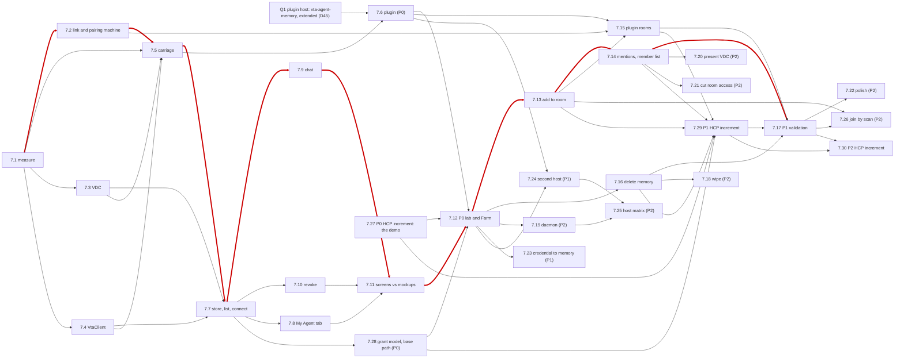

**The stack, and what runs in parallel.** One step is one PR. The stack sits on the feature branch `feat/agent-connect`, cut from `main`: a PR with no PR below it is based on that branch, each PR merges into it on review, and one PR at the end merges it into `main` ([`CLAUDE.md`](./CLAUDE.md), "Implementing a plan: stacked PRs"). Steps 7.2 to 7.4 (pure logic, each after the measurements of 7.1) can run in parallel; 7.7 needs them; 7.8 (the My Agent tab) follows 7.7, which builds the AI agents list it opens on, and 7.9 and 7.10 need 7.7; the plugin's home is decided (OpenVTC's `vta-agent-memory`, extended, D45), so no step waits on this plan's §11 Q1; the plugin steps are pull requests to `vta-agent-memory`, built and tested on a fork branch while a merge lags, so this plan's §11 Q6 and the upstream review gate the merge, not the stack.

| PR n of N | Step | Tier | Base | Can start after |
|---|---|---|---|---|
| 1 of 30 | 7.1 | P0 | `feat/agent-connect` | none |
| 2 of 30 | 7.2 | P0 | PR 1 | PR 1 |
| 3 of 30 | 7.3 | P0 | PR 1 | PR 1 |
| 4 of 30 | 7.4 | P0 | PR 1 | PR 1 |
| 5 of 30 | 7.5 | P0 | PR 2 | PR 2, PR 3, PR 4 |
| 6 of 30 | 7.6 | P0 | OpenVTC/vta-agent-memory (a fork branch until merged) | PR 5 |
| 7 of 30 | 7.7 | P0 | PR 5 | PR 3, PR 4, PR 5 |
| 8 of 30 | 7.8 | P0 | PR 7 | PR 7 |
| 9 of 30 | 7.9 | P0 | PR 7 | PR 7 |
| 10 of 30 | 7.10 | P0 | PR 7 | PR 7 |
| 11 of 30 | 7.11 | P0 | PR 10 | PR 7, PR 8, PR 9, PR 10 |
| 12 of 30 | 7.12 | P0 | PR 11 | PR 6, PR 11, PR 27, PR 28 |
| 13 of 30 | 7.13 | P1 | PR 12 | PR 12 |
| 14 of 30 | 7.14 | P1 | PR 13 | PR 13 |
| 15 of 30 | 7.15 | P1 | OpenVTC/vta-agent-memory (a fork branch until merged) | PR 2, PR 6, PR 13 |
| 16 of 30 | 7.16 | P1 | PR 12 | PR 12 |
| 17 of 30 | 7.17 | P1 | PR 14 | PR 14, PR 15, PR 16, PR 29 |
| 18 of 30 | 7.18 | P2 | PR 16 | PR 16 |
| 19 of 30 | 7.19 | P2 | PR 12 | PR 12 |
| 20 of 30 | 7.20 | P2 | PR 14 | PR 14 |
| 21 of 30 | 7.21 | P2 | PR 14 | PR 14 |
| 22 of 30 | 7.22 | P2 | PR 17 | PR 17 |
| 23 of 30 | 7.23 | P1 | PR 12 | PR 12 |
| 24 of 30 | 7.24 | P1 | OpenVTC/vta-agent-memory (a fork branch until merged) | PR 6, PR 12 |
| 25 of 30 | 7.25 | P2 | OpenVTC/vta-agent-memory (a fork branch until merged) | PR 19, PR 24 |
| 26 of 30 | 7.26 | P2 | PR 17 | PR 13, PR 17 |
| 27 of 30 | 7.27 | P0 | `feat/agent-connect` | none |
| 28 of 30 | 7.28 | P0 | PR 7 | PR 7 |
| 29 of 30 | 7.29 | P1 | PR 28 | PR 13, PR 14, PR 15, PR 16, PR 27, PR 28 |
| 30 of 30 | 7.30 | P2 | PR 29 | PR 17, PR 29 |

**Upstream dependencies in P0 and P1, and the real fallback** (checked against this plan on 2026-11-24).

| Item | Tier | Needs | Fallback that works without it |
|---|---|---|---|
| Structured mentions | P1 | `mentions` record member (VTI-Q26) | The `@handle` in the body text, matched whole (§3.6) |
| Layer 2 of an agent seen by another member | P1 | `delegation` member (VTI-Q38) | Layers 1 and 3 only for other parties' agents; layer 2 for the owner's own agents from local records (§3.16) |
| Community setting for agents | P1 | `agents` room setting (VTI-Q31) | Advisory; not stated counts as no (§3.8, D15) |
| VDC signing as the persona | P0 | Nothing more: `keys/sign-document/0.1` signs it on a VTA at 0.84.0 or later (step 0.1(f), VTI-Q32 answered) | None needed |
| Revoke by `deviceId` | P0 | Owner control of `acl/swap-key` (VTI-Q34) | `device/list` by `deviceId`, up to three rounds (§3.9) |
| The plugin's changes to `vta-agent-memory`: the starter side of `auth/oob` `deviceEnrol` (and the fallback), the channel and inbox, the sender gate | P0 | Review and merge by its maintainers (ledger AC-37; fit questions §11 Q6, AC-38); `deviceEnrol` itself by VTI (AC-36) | A fork branch of `vta-agent-memory` that we build and test against; upstreamed as merged (D45) |
| Creating a memory | P0 | An unrestricted administrator session (the P0 assumption, §1.5; VTI-Q39 asks upstream for more) | None needed: the assumption holds by design and the `auth/whoami` guard stops the connect with a clear failure if it does not; step 0.1(p) confirms it live |
| Closed mediator | P0 | The mediator's administrator admits the phone and the agent's did:keys (VTI-Q36) | **None in the product**, and **not applicable to the production wallet mailbox**, which is open to new did:keys (§2.5). Applies only if its administrator closes it or on another closed deployment. the closed-mediator note below |

**Closed mediator (an external dependency, not a defect).** P0 has no in-product fallback for a closed mediator; its precondition is an action by that mediator's administrator, recorded in this plan's §10 as an external dependency with an owner. It **does not apply to the production wallet mailbox**, which is open to new `did:key`s (§2.5); it applies only if the mailbox's administrator closes it (a one-line change, `mailbox.toml:81`) or on another deployment with a closed mediator. A memoryless agent on a phone that is not an unrestricted administrator is closed by the assumption of §1.5.

### 7.1 Steps 0.1 to 0.3: measure, no app change (P0)

**Owner:** Test lane (the lab owner)

**Fallback:** every item here is a measurement; a result that differs changes this plan, not the claim (§2.3).

**0.1 Reference rung `tsp-reference/ref-25-agent-pairing`** (its mediator half exists, §2.4; the number follows the sign-in code's citations) against the local lab: the mediator cases on the mailbox's pinned mediator on loopback (the rung's `lab/mediator.sh`), the VTA cases on a lab VTA on localhost (the rung's `lab/vta.sh`) built at the commit this plan's facts were read at, `4e5861d95`, and at the tag the Farm's gate VTAs run, with what the pinned commit serves recorded beside them (§2.6). It is the **real, tested TypeScript probe** that replaces the 2026-11-20 throwaway (§2.4): it runs under Node with `ws` (never Bun), is laid out like `ref-04-mediator`, uses the current `@openvtc/vti-didcomm-js` (the throwaway used 0.6.2), and carries unit tests for its own packing, forward and refusal handling, with the cases of §2.4 as its first tests (delivery to a live and to an offline `did:key`, a sender with and without a session, a recipient that never authenticated, anoncrypt refused, a `did:peer` naming another host, the queue limit, a deny-all mediator). *Acceptance:* (a) the §2.4 cases are recorded against the mediator the mailbox is pinned to and repeat on a second run, and the rung records what it ran on: an image's digest (the local `RepoDigest` and `pins.json` differ, ledger "Not for upstream"), or for a build from source the commit, the version and the binary's SHA-256; (b) the agent registers `aiAgent` (`serviceKind`, camelCase on the wire) with `device/register` on an `application` entry and then `rooms/keys/act` is refused with `permissionDenied`, while the same entry before registration is not refused; (c) `acl/swap-key` by the entry's own subject keeps `expiresAt`, capabilities, purposes and kind, or the rung records which it drops; (d) `acl/grant/0.3` with `listed` memory capabilities and `purposes` listed is accepted; capability names as spelled; (e) after `acl/revoke`, `present`, `open` and `memory/get` are refused at the next request and an already minted leaf still reads an `open` room until it expires, with the observed time; (f) which VTA task signs a W3C VC as the persona (§2.3 item 5); (g) whether `rooms/keys/present` mints `write` and `read` for one entry; (h) the byte length of the `auth/oob` link with the lab VTA's real DID in `_from`, and of the fallback's `agent-connect` link with a real `did:key` and the requested scope, is **at most 251** and a QR of each at level M scans (§3.2); (i) on a mediator with a deny default, whether a `did:key` agent can admit itself through the self-service ACL path (§2.3 item 10); (j) whether the refusals carry `Retry-After` (§2.3 item 11); (k) whether the VTA enforces a resource-qualified capability grant, so memory can be pinned to its context at room add (§3.3, D21); (l) the agent calls `acl/swap-key` on itself and Keyring's revoke by `deviceId` (§3.9) removes the entry under the new key, with `device/list` and a re-list showing none, and the same with two swaps in a row; also whether `device/disable` by `deviceId` makes the VTA refuse the device's authentication; (m) two agents in rooms of one persona: whether each can read and write the other's memory in the persona's context (the §3.3 overlap), whether a context can be created for one agent alone and `rooms/keys/present` still works with the persona's context plus that one (D22); (n) whether a `requireConsent` policy rule whose approver set holds the owner's Keyring holds an `application` entry's `vta/memory/put` and room tasks for the owner's approval, who can write that rule, and whether and in what format the consent request reaches Keyring (§3.13 item 3, §2.3 item 12; the entry's `stepUp` gates nothing, §2.1); (o) the hierarchy rule as measured (§3.15): an entry naming `a` reads and writes memory in `a/b`; an entry naming `a/b` is refused `a`; a context created under the persona's context is readable by an entry that holds only the persona's context; `vta/contexts/create` by Keyring's administrator session with a top-level id succeeds and `vta/contexts/list` returns it with its `name`.

**0.1(p) Memory binding and creation, on the lab (rev 4, §3.15, D31, D32). This is the live confirmation of the §1.5 assumption and its tripwire: a phone whose administrator entry is scoped fails the assumption and reopens D32.** (1) `auth/whoami` as the phone's session: role `admin` with no contexts is an unrestricted administrator; record what the lab's phone session is (a Farm VTA's is a recorded validation, done when its operators allow). (2) `vta/contexts/create` of a top-level `keyring-memory-<10 random base32 characters>` from that session, and from a scoped administrator (expected: refused, VTI-CTX-020); a second create of the same id refused (`taskFailed` with "conflict" in its message, measured; there is no code of its own), and the redraw that follows. (3) An `application` entry whose `act` names one memory is refused `contextForbidden` on `vta/memory/*` for a second memory, with the second named by chat text (P0), and by a room offer and by a room record (P1); and refused when `act` names a context that does not exist (`require_contexts_exist`). (4) (P1) After a room add, the entry's `act` is exactly the bound set plus the persona's context. (5) Removing a memory from an entry: `acl/update` never narrows `act` (`acl/update:narrowingNotPermitted`, measured), so Keyring sends `acl/revoke` 0.3 with `{ kind: "act", act }`, where `act` is what remains; a session the agent opens afterwards is refused the removed memory (measured). What a session opened before the change may still do is under measurement and is not stated here yet. (6) `vta/memory/list/0.3` with `includeValues: false` for counts; delete of a context holding memory and no other resource succeeds without `force` and purges the items (measured); a context that an ACL entry names is refused `vta/contexts/delete:notEmpty` without `force`, and with it the context goes together with an entry that named only it (measured), so Keyring removes the memory from each agent first or sends `force` after the confirmation of step 7.16. (7) Two identities (two `did:key`s, two entries, two memory sets) side by side, each reaching only its own set. *Acceptance:* each measured and recorded in the rung's README and §2.1; a result that differs changes this plan, not the claim.
**0.1(q) The rung re-run under the wallet mailbox's configuration: a P0 gate.** Re-run `tsp-reference/ref-25-agent-pairing` against a lab mediator configured like the production mailbox (§2.5): `explicit_deny` with exactly `global_acl_default = DENY_ALL,LOCAL,SEND_MESSAGES,RECEIVE_MESSAGES,RECEIVE_FORWARDED,ANON_RECEIVE,SEND_FORWARDED_CHANGE,MODE_EXPLICIT_DENY`, `block_anonymous_outer_envelope`, `force_session_did_match`, `queued_send_messages_per_peer = 50` and its soft and hard limits, and the per-IP and per-DID rate limits, set on the local lab (on the mailbox host itself only after its operators approve; no live action by us). *Acceptance:* the §2.4 cases are recorded under that configuration and repeat (live and offline delivery to a `did:key` from a sender that is an account, a sender with no session, a recipient that never authenticated, anoncrypt refused, a `did:peer` naming another host, the queue limit and its `Retry-After`); a new `did:key` calls `account/update` and then sends (the self-grant); **a new `did:key` with no self-grant is refused** (the failure path of §3.2); each identity authenticates with its own `did:key` and a second socket per DID is evicted; a fresh `did:key` can authenticate (the assertion for the drift risk of §10); the wake-up question (§11 Q5) has an answer or a recorded "not shown". P0 does not ship until this passes.

**0.1(r) and (s): the credential-to-memory checks (recorded; they gate P1 step 7.23, not P0).** (r) Whether a wire task creates the consent record that `vault/credentials/present/0.1` requires (`vta-vault/src/consent.rs` is a library module), and how Keyring would call it. (s) Whether Keyring's administrator session holds `CredentialPresent` and what `vault/credentials/present/0.1` returns for a held SD-JWT-VC on the lab. *Acceptance:* each is measured on the lab and recorded in the rung's README; if (r) shows no wire task, 7.23 reports it and uses the fallback of §3.15.
**0.2 Findings recorded.** Each item in this plan's §10 is an entry in [`agent-connect-plan/vti-asks.md`](./agent-connect-plan/vti-asks.md). An entry read from source and tried against the pinned clone in `external/` is registered as a `VTI-QN` question in [`docs/VTI_UPSTREAM_FINDINGS.md`](../VTI_UPSTREAM_FINDINGS.md) (the first eleven are VTI-Q26 to VTI-Q36; the ledger's header maps them), and becomes a `VTI-NN` finding when a lab measurement shows a defect, under that file's proof rules (measured, era named, classified as theirs, generic register). **During execution, every gap met on the lab is recorded there in the PR of the step that meets it**, not kept in the ledger alone (D25). *Acceptance:* every ledger entry names its `VTI-QN` or says why it is not registered; every gap met in a later step has an entry in the findings file in that step's PR; each measured one names the command that produced it.

**0.3 Notification checks** (§3.12). A trivial channel with the development flag on the installed Claude Code. *Acceptance:* recorded results for (a) idle wake, (b) a channel with `claude --bg`, (c) the minimum Claude Code version and the authentication, (d) `asyncRewake` on an idle prompt, (e) the Monitor fallback on an idle session including a re-arm, (f) a plugin `PreToolUse` hook that denies every tool but `reply` blocks them in a session in auto mode and with `vta-mcp` tools pre-allowed, and the `Stop` hold-back of owner events works when events arrive during a busy turn; the plugin's design (§3.12) is changed if (a) fails, and if (f) fails the "Answers other people" switch is not offered in P1 (§3.13, D23, step 7.14).

**0.3 recorded 2026-11-26** ([`agent-connect-plan/2026-11-26-al-4.md`](./agent-connect-plan/2026-11-26-al-4.md); the probes in `tsp-reference/ref-25-agent-pairing/notify/`): (a), (c), (d), (e) and (f) as this plan's §3.12 and §3.13 state; (b) does not register, so this plan's §3.12 sends a background session through the fallback; the `bypassPermissions` run of (f) is not done.

**Gating of the measurements.** Phase 0 means these measurement steps (7.1, steps 0.1 to 0.3); P0 is the first product tier. These gate **P0**: 0.1(a) to (d), (f), (h), (l), (o), (q), the P0 parts of (p) (its items 1, 2, 3 by chat text, 5, 6 and 7), the memory-call part of (e), and 0.3(a) to (c) and (e). These only decide P1 steps (7.13 to 7.15) and are measured early but not required for the P0 exit: 0.1(g), (k), (m), (n), (r), (s), the P1 parts of (p) (its items 3 by room offer and room record, and 4), the `present`/`open` and minted-leaf part of (e), and 0.3(f). These are **recorded, not gating**, because nothing in P0 relies on them: 0.1(i) (a self-service ACL path on a closed mediator, which has no P0 fallback), (j) (`Retry-After` is honoured where sent), and 0.3(d) (`asyncRewake`; the `inbox` and Monitor fallback does not need it).

### 7.2 Step 1: link flow and pairing machine (P0)

**Owner:** Keyring maintainers (Keyring core lane)

**Fallback:** none needed; no upstream change is required.

**1. Link flow and pairing machine.** The pairing machine also derives and stores the agent's handle at step 10 of the pairing (`connected-agents/handle.ts`, §3.6): name plus a DID-derived suffix; *acceptance for it:* the handle for fixed vectors (name and `K_a`) is the same on every run and is shared as a vectors file with the plugin (`connected-agents/vectors/handle.json`, generated by an implementation independent of both, its `derivation` member stating the rules of §3.6 as read; 7.15 tests its matching of the same vectors); two agents with one name get different handles and a suffix collision extends to six characters; what follows when the six-character handle is also taken is open (§3.6) and is not part of this acceptance. `triggerLink.ts` gains `agent-connect`, the P0 fallback's link (draft, `expRequired`, `allowedVidTypes: ['did:key']`, `maxLifetimeSeconds: 300`, at most 251 bytes, behind a developer flag, off); the VTA's own `auth/oob` link (the sign-in flow, `_from` the VTA's DID) is not held to 251 bytes until step 0.1(h) measures its length. `modules/connected-agents/pairing.ts` is a pure state machine (§3.2) with injected clock, resolver and transport. *Acceptance:* jest covers steps 1 to 10 of §3.2 and the fallback, and these rows of §3.10: code expired or request spent; wrong number; three wrong numbers; owner cancels or declines; a VTA Keyring does not administer, at the link or at the claim; the VTA not serving `deviceEnrol`; the VTA refusing the grant; the VTA unreachable at steps 6 and 7; the entry not finished; a rotation that lost its expiry, capabilities or kind. The plugin's refusal of a `redeem` naming another VTA is §7.6's (Step 10, the plugin), and the mediator's 403 and a refused self-grant are §7.9's (Step 6, the chat): pairing sends nothing through a mediator (D48). A fallback link over 251 bytes or with a lifetime over 300 s is refused. Keyring sends the `auth/oob` tasks at the versions of §3.2; a VTA that serves none of them refuses the claim, and Keyring stops with nothing granted (the `version` member and its rule for majors and minors are the chat control messages', §7.9, Step 6). Keyring never claims a request id it has already claimed, cancelled, seen fail on a wrong number or seen expire. The number: Keyring takes exactly `MATCH_NUMBER_DIGITS` digits, one constant: two, the specification's `MatchNumber`, as §3.2 step 5, D8 and §11 Q8 have it; four only if VTI accepts the ask for four (AC-36, ask A12), and then that constant is the only change. An entry of any other length is not sent and uses no attempt; a wrong number allows no second attempt; three wrong numbers in 60 minutes lock the flow for 15 minutes, a wrong number while three are still inside the window renews the lock, and the lock survives a restart; cancel, decline and a VTA Keyring does not administer do not count. Keyring never computes, holds or renders the number: it sends the typed digits unchanged in `prove`, and no state holds anything the VTA answers beyond the disclosure Approve shows. That the starter and the VTA compare one number, chosen afresh for each request, is the VTA's (§3.2 step 3), measured on the lab, not in Keyring.

### 7.3 Step 4: VDC (P0)

**Owner:** Keyring maintainers (Keyring core lane)

**Fallback:** none needed. `keys/sign-document/0.1` signs the credential as the persona (D19, step 0.1(f)), so the VDC is never carried in a Trust Task envelope.

**4. VDC.** `connected-agents/vdc.ts`: build, sign (through the VTA with `keys/sign-document/0.1` and the persona's `signingKeyId`, 0.1(f)), verify, acceptance, status. *Acceptance:* the grant and acceptance verify: every member rule below is checked on the credential, and its proof (a `DataIntegrityProof`, `eddsa-jcs-2022`, `assertionMethod`, as `keys/sign-document/0.1` makes it, 0.1(f)) under the issuer's key; jest checks the signer's requests and answers against `keys/sign-document/0.1`'s schema, and the proof through an injected verifier, since the real one resolves the issuer's DID through the agent and is wired in step 7.7; with `@context` `[credentials v2, DTG v1]` in that order, `type` `["VerifiableCredential","DTGCredential","DelegationCredential"]`, `issuerScope` `directed`, `validUntil` the earlier of `validFrom` plus 7 days and the entry's expiry; refused: a VDC without `DTGCredential` in `type`, with a missing or other-valued `issuerScope`, without `validUntil`, with a missing or empty `scope`, a grant carrying `accepts`, an acceptance carrying `scope`, an acceptance whose `accepts` is a different digest, and a wrong `@context` order; the grant's issuer is the connection's `ownerPersonaDid` and its subject `K_a`, and the acceptance's issuer is `K_a` and its subject that persona. Re-issue is a policy over a connection and the clock: a grant is re-issued when 48 hours or less remain, only while the entry is confirmed present; never for a `revoking`, `revoked` or `expired` connection; a VDC that lapsed while the phone was offline leaves `active` unchanged and is replaced at the next opportunity. When the policy is asked (at app start, on opening the agent list or details, and on Extend, §3.4) is step 7.7's.

### 7.4 Step 3: VTA client additions (P0)

**Owner:** Keyring maintainers (Keyring core lane)

**Fallback:** revoke and find by `deviceId` through `device/list` where the VTA does not control `acl/swap-key` (VTI-Q34, §3.9).

**3. VTA client additions.** `VtaClient`: `grantApplication` (`acl/grant` 0.3: `role` `application`, `act` contexts, `listed` capabilities, `keys: none`, `purposes`), `narrowOrWidenCapabilities` (capabilities, and `act` widened, with `acl/update` 0.3; `act` narrowed with `acl/revoke` 0.3 `{kind: "act"}`, since `acl/update` 0.3 refuses a narrower `act` with `narrowingNotPermitted`; a change that does both narrows first), `entryKind` and `devicesByKind` (`device/list`, every page: `deviceId`, `consumerDid`, kind); no `setStepUp` (the entry's `stepUp` gates nothing, §3.13 item 3); a consent-flow client, if 0.1(n) supports one, is P1 and is built in 7.14, not here. *Acceptance:* unit tests: the access-list writes are sent at 0.3 only, and a VTA that serves no 0.3 is refused with a clear error and never stepped down to (0.1 and 0.2 cannot state purposes, and 0.1 not listed capabilities either, so a step down would write an entry that grants every purpose but `modelTraining`); `device/list` is read at 0.3, else 0.2, every page of either, and a listing counts as complete only when its last page says nothing remains; each payload validates against the specification's schemas at the pin; an entry is found by `deviceId` after its subject changed; the rung's measurements 0.1(b), (c), (d) and (l) agree.

### 7.5 Step 2: pairing carriage (P0)

**Owner:** Keyring maintainers (Keyring core lane)

**Fallback:** until a VTA serves `auth/oob` with the purpose `deviceEnrol` (ledger AC-36), Keyring pairs by §3.2's P0 fallback: it scans the agent's `did:key` and, as the VTA's administrator, writes the entry with `acl/grant` 0.3. Pairing sends nothing through a mediator (D48).

**2. Pairing carriage.** Keyring's approver side of `auth/oob` with the purpose `deviceEnrol` (D48): the link check, `claim` 0.3, `prove` 0.4 carrying `identify` 0.2 whose `issuer` is the phone's administrator DID (the DID on the VTA's ACL as its administrator, signed on the phone with its own key for `authentication`), `grant` 0.4 with `aclScope` (signed the same way for `assertionMethod`, after the phone's user verification), and the decline through `respond` 0.4, at the versions of trustoverip/dtgwg-trust-tasks-tf #1386 (a draft, read at the commit the fixtures record); it builds on sign-in's `oobSignInAgent.ts`. And the P0 fallback: scan the agent's `did:key`, then `acl/grant` 0.3 (step 7.4). *Acceptance:* the `deviceEnrol` path runs in jest against a fake `auth/oob` service behind one seam, its requests and answers checked against the draft's own schemas, every one of them and every test named as draft; nothing in this step is proven against a real `auth/oob` service, and the step says so. The fallback's Keyring side (the grant for `K_t`, then the entry read back from the VTA by subject and `deviceId`, step 7.4) runs in jest against fakes held to the `acl` and `device/list` schemas, and then on the lab against a VTA at the version the Farm runs, with step 7.1's rung playing the agent (`K_t` authenticates, `device/register`, `acl/swap-key`), run by the test lane. Once a VTA serves `deviceEnrol`, the full ceremony runs on the lab; that is not part of this step's exit. A link whose `_from` is not a VTA Keyring administers is refused with its copy and is not claimed; a wrong number is declined with no second try and counts toward the lockout; the number's length is §7.2's (two until VTI accepts the ask for four, §11 Q8), and the fake service accepts it although the draft's `MatchNumber` asks four for `deviceEnrol`, a stated difference from the draft; on both paths the entry ends at exactly the owner's choice (memories as `act` contexts, the capabilities, purposes and expiry of §3.3, the name, consumer kind `aiAgent`), and it never holds a context the owner did not choose. The fallback's `acl/grant` 0.3 writes every chosen memory at once. The draft's `aclScope` carries exactly one context, so on the `deviceEnrol` path with more than one memory chosen the grant names the first, and the rest are added with one `acl/update` 0.3 once the entry is confirmed (§7.4). That widening is computed from the entry as read back from the VTA, never from the set intended, so it is safe to re-send. If it fails, the pairing still completes: the agent is connected with the memories its entry holds, its details say which chosen memories it does not yet have, with "Try again", and Keyring retries at the next reconcile. That retry finishes the widening the owner already approved for this pairing at Approve, bounded to exactly that set; it is not a "Change memories" widening (§7.7, D34), which gates a new choice behind the biometric. It adds only memories still in the owner's current choice for this agent, so a memory the owner has removed since is never re-added; a VTA that serves neither path fails with "We couldn't reach your VTA, so nothing changed.". The chat's own mediator cases (the self-grant of `K_c`, the 403 and 503 refusals of §2.4 mapped to the copy of §6, no anoncrypt outer forward) and the cases of step 0.1(q) are tested with the chat (§7.9, Step 6).

### 7.6 Step 10: plugin, pairing and chat (P0)

**Owner:** Plugin maintainer (plugin lane), with the `vta-agent-memory` maintainers reviewing upstream

**Fallback:** a fork branch of `vta-agent-memory` that we build and test against while an upstream merge lags (D45; the harness of 7.5 lets Keyring's side finish regardless); the `inbox` and Monitor fallback delivers messages where the channel is unavailable (step 0.3).

**10. Plugin** (changes to `OpenVTC/vta-agent-memory`, §3.12, D45). *Acceptance:* the changes add the parts of §3.12's layout to `vta-agent-memory`, with their unit tests in the same change, and its existing tests still pass; with the harness replaced by the real plugin, a pairing completes against Keyring's pairing code through the harness of 7.5 on the lab (against the finished Keyring app it is exercised in 7.12); the plugin calls the VTA as `K_a`; the plugin pins the owner's VTA, sends its `auth/oob/request` (`deviceEnrol`, or the fallback's code) only there and refuses a `redeem` naming another (nothing is enrolled), accepts chat only from `chatDid`, checks the VDC's issuer against `ownerPersonaDid`, signs the acceptance of a re-issued grant only from `chatDid`; it keeps its last `settings` on an unknown `settings` version; the channel and the `inbox` plus Monitor fallback both deliver a message to an idle session (step 0.3). The plugin's `K_a` self-grants before its first send on the mailbox, and a refused self-grant prints its line (§3.2). **Upstream (D45):** the changes are proposed to `OpenVTC/vta-agent-memory` as pull requests under its licence (Apache-2.0) and contribution rules; until merged, the step is done when a fork branch builds, passes its tests and completes the pairing above; the plugin layout and install address are `vta-agent-memory`'s own (§3.12); the plugin adds only the starter side of `auth/oob` `deviceEnrol` (and the fallback), the channel and the inbox, and the sender gate to what `vta-agent-memory` has (D45), and the fit questions of §11 Q6 are recorded in the pull request. **The host contract (D38, §3.18):** the core implements the documented `HostContract` and imports no vendor library, and a test greps the core's imports and fails on one; the Claude Code front-end is the first implementation.

### 7.7 Step 5: store, list and connect screens, the agent as a contact (P0)

**Owner:** Keyring core and the UI/UX lane

**Who builds what:** the logic (the `AgentConnection` record, the `VtaClient` calls, the memory guard and the contact source) is a Keyring core PR; the screens (connect, number entry, Approve, the list, the details, the contact card) are a UI/UX lane PR built on it.

**Fallback:** none needed for creating memories (the unrestricted-administrator assumption of §1.5; a session that is not one ends the connect with a clear failure); no memory quota, label privacy or storage-mode field exists (VTI-Q41, VTI-Q45, VTI-Q44), so Keyring counts items, keeps the label in `name` and makes no encryption claim (§3.15).

**5. Store and list screens.** `AgentConnection` record; "AI agents" list; Connect, number-entry and Approve screens, with the memory picker and "New memory" (`VtaClient.createContext` and `listContexts`, which exist and are called by nothing yet; `createContext` gains the `auth/whoami` guard of §3.15 and no `parent`: the parent-context route is a documented, unbuilt fallback, D32); agent details with effective access and its fixed memories (§3.3, §3.15); **the agent as a contact** (§3.14): `AgentContactCard` behind its token, the second source in `ListContacts.tsx`, and a tap opening the details. *Acceptance:* jest and render tests; **memories (P0, §3.15):** "Change memories" narrows with one confirmation, through `acl/revoke` 0.3 `{kind: "act"}` (§3.15 item 4, §7.4), never to no memory (removing the last one is refused, and the owner can revoke instead), and widens only behind the phone's biometric decision that names every room the agent is in (mockup 20, D34), and the entry's `act` is read back after each; a context on the entry beyond the bound set and the rooms' persona contexts is shown as "Its memory access changed." with "Restore" and "Revoke" (mockup 22), and a missing one as "Lost access to <memory>."; a memory create (and a memoryless agent's own context) is sent without waiting for consent, so one an approval rule holds fails with "Your VTA asks for approval before a memory is made, so this one wasn't made." rather than wait on this phone's own approval; the `auth/whoami` guard ends the connect with the failure of mockup 23 when the session is not an unrestricted administrator and nothing is created (§1.5); the agent details show each bound memory's item count and last change (`vta/memory/list/0.3`, `includeValues: false`, counted once when the details open, never on a timer) with a warning above §3.15's tunable count, 1,000 items to start (`MEMORY_COUNT_WARNING`), and "Up <n> since you last looked." when it rose since the last opening; the last change is shown only where `vta/memory/list/0.3` gives one, which is not yet measured (§3.15; the memories list of 7.16 reuses this count); the Contacts list shows one row per agent whose status is "Connected", "Connected until", "Not connected right now" or "Revoke not confirmed" (an "Expired", "Revoked" or "Not finished" agent, and one still pairing, is listed only under "AI agents"), sorted among the people by name, drawn with the dashed edge, "AI agent" and "Your AI agent", with no badge and no photo, and its accessibility label contains "AI agent"; the row opens the agent details; **"Extend"** (in the list and the details, for a temporary agent that has not expired) re-asks through the Approve screen and the biometric, sets `expiresAt` 4 hours ahead with `acl/update` 0.3, and issues and stores a new VDC at once through `issueVdc` (its delivery to the agent is §11 Q7(b)'s, with the chat, §7.9) (the persistent act is step 7.28); an expired agent is offered "Connect again" (a new pairing with its name filled in, which replaces its record when it connects) and "Remove" (the entry revoked if the VTA still lists it, with step 7.10's removal of its entries, and the record dropped once a full listing no longer shows it; before step 7.10 is on the branch, Remove of a listed entry is refused; a record with no `deviceId` is dropped only once its entry's recorded expiry has passed, since by key alone an entry that rotated is not listed), never "Extend", since the VTA deletes an expired entry at its next sweep and `acl/update` then answers `notFound`, and an unfinished pairing is listed "Not finished", offered "Remove" (no confirmation) and removed on its own after 10 minutes (found by subject, and by `deviceId` if `K_t` already registered and swapped) (§3.3, §3.10; built here, in the list step, with 7.3's and 7.4's code); the people rows and `ContactCard` render byte-identically to today where there is no agent; a memory created from the picker is top level (`keyring-memory-<10 random base32 characters>`, its `name` the typed one; collision is a redraw, §3.15) and appears in the next listing; a context that is an ancestor of another is greyed and cannot be picked; a memory is never granted by an ancestor path (a test asserts every `act` path is one the owner picked); the number field is labelled and announces digits; the Approve screen shows "Only continue if you ran the command in your own terminal just now."; every string and key in §6 present in the en, fr and pt-br locale files. The VDC is signed through `issueVdc` (§7.3, Step 4), never by calling a signer directly: `issueVdc` refuses a signed credential whose claims differ from what was sent, by a digest over every claim, and a direct call skips that check. **The VDC policy is asked** (§3.4, §7.3) at app start, on opening the agent list or the details, and on Extend, and nowhere else. **A chosen memory the entry does not hold yet** (§7.5, a one-context grant) is shown in the details with "Try again", which finishes that pairing's widening bounded to the approved set and never re-adds a memory the owner has removed since; Keyring also retries it at those same points. **The driver** (`connected-agents/`) wires the pairing machine of §7.2 to the carriage of §7.5 with the real ports: the VTA's `TrustTaskHTTPS` endpoint (as sign-in posts), the agent's KMS for the administrator's signature, `verifyDocumentProof` for the VTA's answers, and `VtaClient` for the access list; the lockout and the spent request ids persist in the app's storage; while a pairing waits for the agent's registration and rotation, Keyring re-lists the entry on a timer until it is confirmed or the pairing is "Not finished" (§11 Q7(c): re-list). **A connection's record is keyed by the agent's first key** (`id`), which never changes, and `agentDid` is its current key, which step 7.10's reconcile records (§3.9): 7.7 looks records up by `id`, addresses the VTA by `agentDid`, finds a leftover's record by either key, and writes a record only under the store's one lock per record, with any keep-or-write decision taken inside it (`update`, `upsert`), since 7.10's reconcile writes the same records. **Until the chat carries the VDC pair (step 7.9),** a pairing whose entry is confirmed with the approved limits and whose grant is issued and stored is `active`; from 7.9, §3.4's rule that `active` needs a verified acceptance applies in full. **Before any build turns the developer flag on,** Revoke (step 7.10) is in it: until then the Revoke actions are not shown, and a build with the flag on and without step 7.10 is not released to anyone. **Release conditions, together, enforced by a check** (a test in `connected-agents` fails while the developer flag can be set before both steps are wired; the plan owner requires it, relayed): no released build has the developer flag on before steps 7.9 (the chat carries the VDC pair) and 7.10 (Revoke) are both in it. That the flag's default is off is held by a test (`agentConnectFlag.test.ts`). **The connect starts** with the `auth/whoami` guard and the VTA version check of §2.6, before the picker; the persona that issues the VDC is the owner's only persona when there is one, and with more than one the connect asks which (one row, "Acting as", above the memories), until the multi-profile plan decides it (§3.4); and with no memory chosen Keyring creates the empty context of §3.3's `act` row. The copy for the states §6 adds on 2026-11-26 (Connecting, the Approve signals, the failures, the memory counts, Remove, Connect again, See details) is in every language file with its key.

### 7.8 Step 5a: the My Agent tab opens on the AI agents; the VTA's stack moves under Settings (P0)

**Owner:** Keyring core and the UI/UX lane

**Who builds what:** the navigation change (`TabStack.tsx`, the moved stack, the link targets) is a Keyring core PR; the AI agents list as the tab's first screen and the "My VTA" row are a UI/UX lane PR.

**Fallback:** none needed; no upstream change is required.

**5a. The My Agent tab opens on the AI agents; the VTA's stack moves under Settings as "My VTA".** `TabStack.tsx`'s `MyAgentStack` route opens on `AiAgents.tsx`; today's `MyAgentStack.tsx` screens are registered, unchanged, as a stack reached from one `Settings` row, "My VTA" (header title "My VTA"); `roomLinks.ts` `openInMyAgent` and `TabStack.tsx`'s `myAgentLinkParams` target the moved stack; the "AI agents" card on `MyAgent.tsx` is removed (D26, §6). *Acceptance:* render tests show the My Agent tab's first screen is the AI agents list and Settings has a "My VTA" row that opens the VTA home; every link that opened a VTA screen before (link flow, devices, a room's community, a member card, the profile, deep links through `myAgentLinkParams`) opens the same screen in the moved stack (the existing navigator tests pass with their targets updated); a room opened from Messages is unchanged (`MessageStack.test.tsx`); no screen in the moved stack calls the VTA "your agent" without also saying "My VTA" in its header (a copy test over the stack's titles); en, fr and pt-br carry "My VTA" (`ConnectedAgents.MyVta`).

### 7.9 Step 6: one-to-one chat (P0)

**Owner:** Keyring maintainers (Keyring core lane)

**Fallback:** on a mediator that queues at most 50 messages per sender (VTI-Q36) Keyring stops at 20 and honours the 503.

**6. One-to-one chat.** A carrier adapter so `modules/chat/` runs over the VTI mediator transport (§3.5); the chat variant for an agent peer, with the header "AI agent" and "Belongs to <owner>"; the agent chat as a `kind: 'agent'` row in Messages (§3.14); send limit and refusal handling. *Acceptance:* the agent details' first action "Message" and the Done screen's "Open chat" open the agent chat; a message to an offline harness queues and stops after 20 with "Waiting for your session"; a 503 `e.p.limits.queue.peer` is paced, not retried at once; the existing chat tests over Credo connections still pass; the Messages list shows the agent chat under "all" and "people" with the mark, ordered by its last event among the people and rooms, and `mergeByTime`'s existing tests pass unchanged; the header never shows a person's verification badges for an agent. The chat also carries the mediator cases that pairing no longer exercises (D48): `K_c` (and the agent's `K_a` on the mailbox) self-grants with `account/update` before its first send, a refused self-grant shows the closed-mediator copy, the 403 and 503 refusals of §2.4 map to the copy of §6, an anoncrypt outer forward is never sent, and the cases of step 0.1(q) pass against the chat code. Every chat control message (`settings`, `agent-room-offer`, `revoked`, the VDC grant) carries `version` (§3.2, "Versions"): Keyring accepts its own major, and a higher minor whose extra members it ignores while the members it needs are present; it does not act on another major and shows "This version of Keyring and the plugin can't connect yet. Update Keyring or the plugin." (the plugin's side of the rule is §7.6's, Step 10).

### 7.10 Step 9: revoke (P0)

**Owner:** Keyring maintainers (Keyring core lane)

**Fallback:** `device/list` by `deviceId` and up to three rounds (VTI-Q34, §3.9).

**9. Revoke.** `revoke.ts` per §3.9. *Acceptance:* order is ACL entry first; the agent is found by `deviceId` after it swapped its key (once and twice), and its entry under the new key is revoked; an empty `revokeSubject` answer is never reported as success; a partial or failed listing leaves the connection `revoking` with "Revoke not confirmed", which survives a restart and clears only after a full listing shows no entry; the app-start reconcile records a changed key (`keyChanged`, "<name> changed its key") without moving the chat; a failed ACL call leaves `revoking` and retries; the sheet says "up to 4 hours" and the string "instant" appears nowhere in the locale files (a test greps).

### 7.11 Step 10a: every screen on an emulator, against the mockups (P0)

**Owner:** Test lane (the lab owner)

**Fallback:** none needed; no upstream change is required.

**10a. Every screen on an emulator, against the mockups.** After steps 5, 5a, 6 and 9 (7.7 to 7.10) have merged and before step 11: the app is run on the Android emulator and the iOS simulator with the lab stack, the **P0** flows of §6 are walked by hand (connect, approve, the list, the details with "Change memories", the memory-access-changed state, the not-an-administrator guard, Contacts and Messages, Revoke, Settings "My VTA", and the failure states that can be reached without a device), and **every P0 screen and state in §6 is screenshotted** (the P1 screens are walked in step 13; §6 lists which screens are P0, P1 and P2) and placed beside its mockup: the kit SVG and, where one exists, the UI/UX canvas frame (§8.6). *Acceptance:* a dated companion holds the pairs (screenshot, mockup, platform, app and plan commit) for every P0 screen in §6's "Screens by tier" list and every state the walk reached; every difference between a screenshot and its mockup is listed with one of three dispositions, **fixed** (the app changed, with the PR), **mockup updated** (the copy or layout changed for a stated reason; §6, the kit spec and the canvas change in the same PR), or **accepted** (platform rendering only: fonts, safe areas, system controls), and a difference with no disposition is a defect that blocks step 11; a screen, button or state that exists in the app and not in §6 is listed as such with the reason it was needed, and §6 and the mockups gain it in the same PR, or it is removed; a screen or control in §6 that the app lacks is a defect; the brief tests are the step's own jest suites plus the single-device smoke e2e (`yarn e2e:smoke`) on the same build. Hardware attestation and biometrics are not proven here (§8.4).

### 7.12 Step 11: P0 lab and Farm validation (P0)

**Owner:** Test lane (the lab owner)

**Fallback:** the lab pass is the P0 exit; the Farm pass is recorded when its image versions and mediator ACL allow (§10, not VTI).

**11. Lab and Farm validation.** Two-party lab run (owner and agent), P0 cases only (no room, no mention, no "Answers other people"): connect, chat, a memory call refused outside the bound set, Revoke (the next `vta/memory/*` call and any new enrolment by the agent are refused once the entry is gone, found by `deviceId` after a key swap) and the refusal cases of the mediator, then, as a recorded validation done when its operators allow (never a P0 exit condition, D18), one pass of the delivery and happy-path cases of P0 on the VTA Farm (§8.3). *Acceptance:* the rows marked P0 in the Overview's "How we'll know it works" table pass; physical-phone run done (§8.4); **HCP rows (D43):** the demo script of step 7.27 passes on the lab with the flags on, and with the flags off the P0 run above is unchanged; the base path's grant model of step 7.28 passes. The minted-leaf case and its 4-hour tail need a room and are measured in P1 (step 13, 7.17); P0 does not require them. The delivery cases are re-run on a lab mediator configured like the wallet mailbox (step 0.1(q)) before anything else; the mailbox host itself and the Farm's mediator (`mediator.ic3.dev`, §2.5) are validation targets for the delivery cases only, and only after their operators approve (the operators of `keyring-push-gateway-infra` for the mailbox; the Farm operators for the Farm's), with no live action by us before that.

**Exit: the `agent-connect-p0` demo on the lab and a physical phone (§7.0).**

### 7.13 Step 7: add an agent to a room (P1)

**Owner:** Keyring core and the UI/UX lane

**Who builds what:** the logic (the kind check, `grantAgentAccess`, the room offer, the community setting) is a Keyring core PR; the screens (the `RoomInfo.tsx` section, the add sheet, "What it remembers here", the composer's "+" sheet) are a UI/UX lane PR.

**Fallback:** the community's `agents` setting is advisory and not stated counts as no (VTI-Q31, §3.8); room capabilities are added only after Keyring reads the consumer kind back (VTI-Q28, §3.3).

**7. Add an agent to a room.** `RoomInfo.tsx` section, add sheet, first-room capability widening through `grantAgentAccess`, "What it remembers here" (read-only, §3.15), the room offer (its `contexts` informational), the community setting (§3.8); the composer's "+" sheet with "Add a file" and "Add my agent" (§3.15, D28). *Acceptance:* refused when kind is not `ai-agent`; the add sheet shows the read-access notice, and the memory notice with the persona's context name whenever the add widens `act`, before the button is focusable, and the effective-access lines show the persona's context for every agent added to a room; `no` and not stated both disable the action and only `yes` allows it, from the info screen and from the "+" sheet alike; the "+" picks a file at once when the owner has no `active` agent and opens the sheet when they have one, with "Add my agent" absent when every agent is in the room; the add sheet carries "Members of this room will see that this agent belongs to you." before the button is focusable; there is no per-room memory choice: the sheet "What it remembers here" shows the agent's bound set read-only and offers "Connect another agent"; the entry's `act` after the add is exactly the bound memories plus the persona's context (never anything else), checked by reading the entry back; "Agents in this room" rows show "Memory: <names>" and open the sheet.

### 7.14 Step 8: mentions, mark, member list, agent sheet, "Answers other people" (P1)

**Owner:** Keyring core and the UI/UX lane

**Who builds what:** the logic (`mentions`, `byAgent`, the handle, `delegationRecord.ts`, the setting and its `settings` message) is a Keyring core PR; the screens (the composer insert, the mark, the "Agents" section, the agent sheet, the identity sheet, the turn-on confirmation) are a UI/UX lane PR.

**Fallback:** the `@handle` text convention and layers 1 and 3 of the identity sheet where no `mentions` or `delegation` member exists (VTI-Q26, VTI-Q38, §3.6, §3.16).

**8. Mentions, mark, member list, agent sheet.** (No `VtaClient.setStepUp`: the entry's `stepUp` gates nothing, D46. If 0.1(n) shows the consent flow can hold the agent's writes for the owner's approval, Keyring's answer to that consent request is built here; it stays out of P0.) Composer insertion; `mentions` written where the profile lists it, text fallback otherwise; `byAgent` set from the local `AgentConnection` so the existing mark shows; the "Agents" section of the member list (§3.6); the agent bottom sheet reads the issuer of the VDC and shows "Answers other people", the setting and its confirmation (§3.13: turning it on needs the confirmation and off does not, and the switch is absent when the hook check (0.3(f)) failed). The handle (§3.6) is derived in 7.2 and the composer inserts it whole. *Acceptance:* the composer inserts `@notes-helper-7f3k`-style text, never the bare name; the body is byte-identical to today's where the profile does not list `mentions` apart from the `@<handle>` text; the mark shows for own agents and for no other author; the Agents section lists the owner's agents for the room, appears when `listCommunityMembers` is unavailable, never adds an agent to the community's list, and opens the sheet with the owner and the setting; the sheet names the owner from the VDC. **An agent seen by another member (§3.16):** `delegationRecord.ts` **reads and verifies** a `memberProfile`'s `delegation` (the plugin, which holds the agent's key, writes the record: 7.15; Keyring never signs as the agent); a reader verifies the pair (issuer a persona DID, subject the author, acceptance signed by the author, `accepts` the grant's digest) and refuses a pair whose subject is not the author, whose acceptance is unsigned or by another key, or whose grant is a VDC that §7 step 4 refuses; with a verified pair the sheet shows the mark, "Belongs to <owner>", "Verified from its delegation credential", "Not a member of this community…", the handle and "Its identity"; without one it shows the DID, "calls itself <name>" where a name exists, "Keyring can't tell who this belongs to." and no mark; a `did:webvh` author with a verified agent name shows it and a `did:key` shows "No verified name"; the member list's Agents section includes a verified other agent with the second caption and never on a claim alone.

### 7.15 Step 10b: plugin, rooms, mentions and "Answers other people" (P1)

**Owner:** Plugin maintainer (plugin lane)

**Fallback:** a fork branch of `vta-agent-memory` while a merge lags (D45); the plugin's hook is the primary control while the owner's approval through the VTA's consent flow is unmeasured (VTI-Q35, §3.13 item 3, D46).

**10b. Plugin: rooms, mentions and "Answers other people"** (`vta-agent-memory`, extended, §3.12, §3.13). *Acceptance:* the plugin accepts room records only from `ownerPersonaDid` (moved here from step 10); it **writes the agent's `memberProfile` record with `delegation` at the first room offer and when the VDC is re-issued, only where the room's profile lists `delegation`** (a test with a profile that does and one that does not; the body is byte-identical to a plain name record where it does not; §3.16); it matches only its own whole handle; it drops a message not authored by the owner's persona (gated on the author, not the room), fences room content, and does not declare `claude/channel/permission`; with the setting on and the hook check passed, the hook denies every tool but `reply` while the marker is `other` and owner events wait for `Stop`; with "Answers other people" off a non-owner mention gets the fixed reply of §3.13 once per author per room per 60 minutes and no more than 20 per hour, the model sees nothing. **Release gate:** the fr and pt-br wording of §3.13 has been reviewed and approved by a native reader of each language, the reviewer's name and date are recorded in the plugin's release checklist (`vta-agent-memory`'s, or our fork branch's until §11 Q6 settles where the gate lives), and the plugin's release step fails while either is missing (D16).

### 7.16 Step 12: delete memory (P1)

**Owner:** Keyring core and the UI/UX lane

**Who builds what:** the logic (counting items, finding the bound agents, the forced delete) is a Keyring core PR; the screens (the memories list and the delete confirmation) are a UI/UX lane PR.

**Fallback:** Keyring counts memory items itself because the VTA's delete preview omits them (VTI-Q40, §3.15).

**12. Delete memory** (memory management, §3.15). A memories list in the agent details and Settings with each memory's item count and last change; "Delete" counts the items itself (`vta/memory/list/0.3`, `includeValues: false`), names the agents bound to it, asks "Delete "<memory>"?" and sends `force` only after the confirmation. *Acceptance:* a memory holding only items is never deleted without the confirmation; the agents named are those whose `act` names the id; the count warning shows above the configured count; stand-alone: it needs no wipe and no room. **Exit: a memory can be deleted safely on a P0 product.**

### 7.17 Step 13: P1 lab validation (P1)

**Owner:** Test lane (the lab owner)

**Fallback:** lab only: the Farm and mailbox passes are recorded validations done when their operators allow (§10); P1's exit is the lab run.

**13. P1 lab validation.** The two-party lab run in a room (owner, agent, a second member): add from the "+", read, write, a mention by the owner and by another member (fixed reply), the member list and the identity sheet, Revoke with the 4-hour tail named, **the long-running run of 4 hours or more that measures a minted leaf until it expires after Revoke (moved here from P0)**, the screens of §6 marked P1 walked and screenshotted as step 10a does, the VTA Farm pass of the delivery cases in rooms (§8.3). *Acceptance:* the rows marked P1 in the Overview's "How we'll know it works" table pass; the tail measurement is recorded; **HCP rows (D43, step 7.29):** an agent added to a room with onward sharing elected, a share reported and visible in "What my agent saw", the "Answers on" directive applied by the plugin, Delete memory withdrawing entries, and the same operation over HTTP parity returning the same result; with the flags off, the P1 run is unchanged. **Exit: `agent-connect-p1` demo.**

### 7.18 Step 14: also delete what it remembered (P2)

**Owner:** Keyring maintainers (Keyring core lane)

**Fallback:** a client-side loop where no bulk clear exists (VTI-Q43, §3.15).

**14. Also delete what it remembered** (§3.15). The client-side wipe loop on Revoke and on "Change memories": list, delete per key, re-run, complete on an empty final listing; builds on step 12's listing helper. *Acceptance:* a failure on page two and on one delete leaves a re-runnable state; the copy says "erases", never "no trace". **Exit: Revoke can also erase what the agent wrote. Test: `agent-connect-p2-wipe`, the failure-injection suite above.**

### 7.19 Step 15: headless daemon front-end (P2)

**Owner:** Plugin maintainer (plugin lane)

**Fallback:** a fork branch of `vta-agent-memory` while a merge lags (D45); how a Rust core is driven by the Agent SDK is open (§11 Q6).

**15. Headless daemon front-end** (§3.12). *Acceptance:* the plugin's core runs without a terminal session and pairs and chats as in P0; the code and the number are shown through a path the owner enables (the approval stays on the phone). **Exit: an agent that runs without Claude Code open. Demo: `agent-connect-p2-daemon`, a pairing and a chat on a headless host.**

### 7.20 Step 16: present the VDC to a third party (P2)

**Owner:** Keyring maintainers (Keyring core lane)

**Fallback:** short validity stands in for status (VTI-Q32, D19).

**16. Present the VDC to a third party on the owner's decision** (§3.4, §3.16). *Acceptance:* a consent screen, one presentation, a copy that says the credential stays valid to its `validUntil` after Revoke. **Exit: whose-agent evidence outside the rooms the agent is in. Demo: `agent-connect-p2-vdc-presentation`, one consented presentation and its verification.**

### 7.21 Step 17: also cut its room access now (P2)

**Owner:** Keyring maintainers (Keyring core lane)

**Fallback:** the room's owner can withdraw it today; where the person is not the owner nothing closes the 4-hour tail (VTI-Q30, §3.9).

**17. "Also cut its room access now"** in a room the person owns (§3.9): `rooms/owner/revoke`. *Acceptance:* offered only where the person owns the room; the 4-hour tail ends. **Exit: Revoke closes the tail where the person owns the room. Test: `agent-connect-p2-cut-room-access` on the lab, the leaf refused after the call.**

### 7.22 Step 18: polish and later ideas (P2)

**Owner:** Keyring core and the UI/UX lane

**Fallback:** none needed; no upstream change is required.

**18. Polish and later ideas** (each alone): the portability display ("this agent can combine memory X and room Y"); grouping and per-agent notifications for many agents; the reverse number direction if testers need it (D8); MyTerms (D21). Candidates waiting on an upstream change are in §7.0. "Ask each time" for credentials is a named design with its own prerequisites (§3.15, D47), not part of this group. *Acceptance:* each listed idea ships alone with its own jest or render test and a one-line demo; none is required by another. **Exit: any one of them, shipped alone on P1, works. Demo or test: `agent-connect-p2-polish`, the named idea's test.**


### 7.23 Step 19: give a credential to an agent's memory (P1)

**Owner:** Keyring core and the UI/UX lane

**Who builds what:** the logic (the presentation, the envelope, the reconcile) is a Keyring core PR; the screens (canvas frames 41 to 47) are a UI/UX lane PR.

**Fallback:** the maintainers' typed credential value type (VTI-Q47) is not required: Keyring writes a JSON text envelope into the existing memory type under `credential/<id>` (§3.15); if no wire task creates the consent record (step 0.1(r)), the step reports it and the owner gives the credential by the fields the VTA can present.

**19. Give a credential to an agent's memory** (§3.15, D36). "Give to an agent" on a credential and "Add a credential" on the agent's details: pick the agent, the memory (one of its bound memories), the fields and the purpose; the phone's biometric decision names all of them; Keyring calls `vault/credentials/present/0.1` with the agent as the audience, writes the envelope with `vta/memory/put/0.3`, and reconciles revoked or expired credentials at app start and when the details open. *Acceptance:* the agent's `act` is unchanged before and after (read back); only the consented fields appear in the envelope; a presentation over 64 KiB stores the disclosed claims only; a revoked credential's item is deleted or marked and the agent is told in chat; the agent cannot read a memory outside its set; the copy never says encrypted; the screens match canvas frames 41 to 47 (design) and kit mockups 24 to 26 (words, D41). **Exit: the owner can give an agent a credential and it can use it, on a P0 product. Demo `agent-connect-p1-credential`.**

### 7.24 Step 20: a second agent host passes the conformance suite (P1)

**Owner:** Plugin maintainer, with the test lane

**Fallback:** a fork branch of `vta-agent-memory` while a merge lags (the host contract is in the plugin, D38, D45).

**20. Second host.** A second front-end on the host contract (§3.18): a generic MCP client with inbox polling. A conformance suite (pairing, chat in and out, a non-owner message dropped, a memory refused outside the bound set, revoke refused on the next call) runs on both hosts. *Acceptance:* the P0 exit demo passes unchanged on the second host by swapping only the front-end; the core still imports no vendor library. **Exit: two hosts pass the suite. Test `agent-connect-p1-conformance`.**

### 7.25 Step 21: provider and host matrix on the daemon (P2)

**Owner:** Plugin maintainer

**Fallback:** a fork branch of `vta-agent-memory` while a merge lags (D45).

**21. Matrix.** Provider adapters on the headless daemon (7.19) and a matrix of at least three host or model combinations passing the 7.24 suite. *Acceptance:* the suite passes on each combination; the combinations and versions tested are recorded. **Exit: the model-agnostic claim is evidenced on three combinations. Test `agent-connect-p2-matrix`.**

### 7.26 Step 22: join a room by scanning a code, a placeholder (P2)

**Owner:** Keyring core and the UI/UX lane

**Who builds what:** the logic (the `room-join` flow, the join message, the VIC hand-off) is a Keyring core PR; the screens (the invite code, the join confirmation, the waiting state) are a UI/UX lane PR.

**Fallback:** the Keyring-defined join message and the existing VIC flow work without `rooms/join/request` (VTI-Q48); a community room uses `vtc/rooms/offers` (§3.17).

**22. Room-join trigger flow** (§3.17, D37). A draft flow `room-join`: the owner shows a code, the joiner scans it; payload only the owner's contact, a room reference, a single-use handle and an expiry of at most 300 seconds; both sides approve with the biometric; the owner's VTA issues the VIC and the existing flow runs. *Acceptance:* a link carrying a key, a VIC, the joiner's DID or an agent's memory is refused; a second claim is refused; an expired code is refused; an agent cannot start it; mockups 27 and 28. **Exit: a person can join a room by scanning, on a P1 product. Demo `agent-connect-p2-room-join`.**

### 7.27 Step 23: the P0 HCP increment, the demo (P0)

**Owner:** the HCP increments lane: agents build tracks A (VTI), B (the agent CLI, in OpenVTC's `vta-agent-memory` behind the `hcp` flag, on the fork branch of D45 while a merge lags), C (Keyring, behind the flag) and D (the demo environment); Brendan and Alberto do the human-only work (phones, device builds, rehearsals).

**Fallback:** with the flags off nothing in P0 changes, so P0's exit does not wait on a failed demo; if the phone cannot be reached, the demo is the lab run with Keyring open in the foreground, which is the only path it relies on.

**23. P0 HCP increment** (D43; the design, work packages, copy and script are in [`agent-connect-plan/2026-11-25-bam.md`](./agent-connect-plan/2026-11-25-bam.md), findings 6, 7, 11 and 12). Work packages: X0 to X5 (Lane 0, X5 the DTG registry proposal, D44), A1 to A6, A8, A9, B1 to B4, B6, C0 to C3, C6, C7 (P0 part), C8, D1 to D4. The agent CLI requests a grant over TSP (its own `grants/request` pairing, for the demo only; how it relates to D48's `auth/oob` `deviceEnrol` is this plan's §11 Q10); the VTA holds it and asks Keyring as task-consent approver, with HCP's checklist as the request's effects; the person types the number and approves with the biometric; the grant is temporary for 4 hours with purposes from the proposed DTG registry IRIs; the agent answers from `entries/query`; the person adds a `person-declared` memory with `entries/create` (an HCP entry in `vta-hcp`, which the P0 agent does not see, and the HCP agent does not see P0's memories; this plan's §1.1, and this plan's §11 Q9); revoke is immediate, the notice is retried until acknowledged, and Keyring shows "Telling…" and "was told at <time>" from its poll of `disclosures/summary`. *Acceptance:* the demo script (the companion's finding 6, steps 1 to 4 and 7) passes on the lab and a physical phone, with Keyring in the foreground at approval; the companion's automated tiers A9 (VTI integration tests, including the negatives: another VID's token, a revoked grant, a wrong purpose, a REST attempt, revoke under the rate limit), B6 (CLI tests, including a duplicate notice) and C7's P0 part (jest for C1, C2, C3 and C6) are green; with both flags off, P0's own run (step 7.12) is unchanged. No HCP conformance claim is made. **Exit: demo `agent-connect-p0-hcp`.**

### 7.28 Step 24: the HCP grant model on the base path (P0)

**Owner:** Keyring core, with the UI/UX lane for the screens.

**Fallback:** if `acl/update` cannot remove an entry's expiry, "Keep it connected" is not offered and every agent stays temporary, renewed by "Extend"; that is a complete product.

**24. Grant model, base path** (D42, work package C9). The Connect and Approve copy of §6 (purposes by their descriptions, "For 4 hours", the checklist lines), "Extend" as a re-approval for 4 hours, the "Keep it connected" act and sheet, `grantType` and `persistentElectedAt` on the record (§3.3, §3.11); mockups 01 and 05. First, measure on the lab whether `acl/update` removes `expiresAt` (§3.3, conditional). *Acceptance:* jest: a new agent's entry carries `expiresAt` 4 hours after the approval and the Approve screen shows "For 4 hours, until <time>." and every checklist line of §6; nothing on the Approve screen elects persistence, and no control, value or default pre-selects it; "Keep it connected" is reachable only after the agent is connected, shows the sheet's text before the act, needs the biometric, and after it the entry has no `expiresAt` (or, under the fallback, the act is absent); "Not now" leaves the agent temporary; "Extend" needs the Approve screen and the biometric; a temporary agent past its expiry is "Expired" and refused at its next memory call (lab); the strings and keys of §6 for D42 and D44 are in the en, fr and pt-br files. **Exit: P0 connects with the grant model; part of the `agent-connect-p0` demo.**

### 7.29 Step 25: the P1 HCP increment (P1)

**Owner:** the HCP increments lane (agents), with the plugin maintainer for B5 and B7 to B9; human-only work by Brendan and Alberto.

**Fallback:** with the flags off nothing in P1 changes; the HCP rows of 7.17 are then not run, and P1's exit stands on its own rows.

**25. P1 HCP increment** (D43; companion finding 11). It needs the VTI plan's V1 (A7, H0 with A10 HTTP parity first, H1). Work packages: C4 "What my agent saw", C5 "Answers on" (`directives/set`, with 7.14), C7's P1 part, C10 memories on HCP (`entries/get`, Delete memory 7.16 by `entries/withdraw`, edit by `entries/revise`; whether P0's memories move into `vta-hcp`, stay apart, or HCP becomes the memory store is §11 Q9), C11 rooms with onward sharing (7.13, elected as a separate act when the agent is added to a room), C12 the two connect paths merged (the HCP grant over §3.2's pairing, which is now `auth/oob` `deviceEnrol` (D48), replacing the demo pairing; how the two fit is §11 Q10; the persistent act on the HCP path), C13; plugin B5, B7 (the plugin as Context Client, in `vta-agent-memory` behind the `hcp` flag, D45), B8 (`shares/report`, the directive applied in the hook, 7.15), B9; D5. *Acceptance:* C13, B9 and C7's P1 part are green; on the lab: an agent added to a room with onward sharing elected, a share reported and shown in "What my agent saw", the "Answers on" directive applied by the plugin in code, Delete memory withdrawing entries, and the same operation over HTTP parity returning the same result; onward sharing is never pre-selected and is a separate act from persistence; after C12 there is one connect path, and with the flags off P1 is unchanged. **Exit: the HCP rows of `agent-connect-p1` (step 7.17).**

### 7.30 Step 26: the P2 HCP increment (P2)

**Owner:** the HCP increments lane (agents); conformance sign-off and the claim's paperwork by Brendan and Alberto.

**Fallback:** each sub-item ships alone; if one stops, the others and P1 work. Without the First-Party claim, the deployment stays an HCP-aligned pilot with no `conformsTo` claim.

**26. P2 HCP increment** (D43; companion finding 11), each sub-item separable and needing the VTI plan's V2 (H2): C14 governance screens (the grant list by `grants/list`, MyTerms 7.22 as `rules/*`, export); C15 "Also delete what it remembered" (7.18) by `entries/hard-delete`; C16 jest; B10 the plugin over HCP's HTTP Binding for the First-Party run; D6 the First-Party deployment and the conformance-run environment. *Acceptance, per sub-item:* governance: C16 green and the grant list, rules and export round-trip on the lab, demo `agent-connect-p2-hcp-governance`; hard delete: the memory's entries are gone after "Also delete what it remembered" and a later `entries/get` finds none, demo `agent-connect-p2-wipe`; First-Party: HCP's conformance run passes against the lab or Farm instance and the claim is published on that instance only, demo `agent-connect-p2-first-party`. **Exit: per sub-item, as above.**

## 8. Testing

### 8.1 Unit (jest)

`cd packages/core && yarn test connected-agents` (the package's own gate; not an ad-hoc `tsc`), plus `yarn lint`, `yarn prettier`, `yarn typecheck` at the root. Tests: pairing machine and every refusal (this plan's §3.10); link parsing (the `auth/oob` link with a VTA `_from`, refused when Keyring does not administer that VTA; the fallback's `agent-connect` link with a `did:key`; 300-second expiry, at most 251 bytes); the `auth/oob` `deviceEnrol` approver side against a fake service (`claim`, `prove` with the typed number, `grant` whose `aclScope` is exactly the owner's choice, the decline, `numberMismatch`); chat control message `version` handling (a higher minor accepted, another major ignored, the `settings` message with an unknown version keeping the default); the typed-number rule (one attempt, the lockout and its renewal, no display); the member list's Agents section; the fixed-reply text vector shared with the plugin (en, fr, pt-br); VDC build, sign, verify, acceptance, its negative cases (no `DTGCredential`, no or bad `issuerScope`, no `validUntil`, empty `scope`, `scope` on an acceptance, `accepts` on a grant, wrong `@context` order) and its re-issue and lapse behaviour; Extend (the expiry update and the immediate re-issue); the 10-minute removal of a "Not finished" entry, with a fake clock; `VtaClient` additions with version fallbacks; revoke ordering, the `revoking` retry, revoke after the agent swapped its key (found by `deviceId`; an empty answer is not success; "Revoke not confirmed" survives a restart; the app-start reconcile sets `keyChanged`); the handle derivation and its collision rule; the add sheet's memory notice and the effective-access lines for two agents in one persona; **memories (this plan's §3.15)**: create first, list back, compare the name, then grant, and a `Conflict` is never adopted; `act` is exactly the bound set plus the persona's contexts after a room add, and any extra context is shown as drift with a one-step restore; narrowing and widening (the latter behind the biometric decision, naming the rooms); the `auth/whoami` guard ends the connect with a clear failure (mockup 23) when the session is not an unrestricted administrator, and nothing is created; the delete confirmation counts items itself and lists the bound agents, and `force` is sent only after it; the wipe loop is re-runnable and completes on an empty final listing, with a failure injected on page two and on one delete; the agent contact row (second source, sort, mark, label, no badge) and the Messages `agent` kind (this plan's §3.14); the memory pickers, "New memory" (top-level id, name), the greyed ancestor, the `act` union and narrowing, the offer's `contexts`, informational (this plan's §3.15); the "+" sheet's three states (file at once, sheet, "Add my agent" absent or disabled); "Your VTA is too old to connect an agent." for a VTA without capability narrowing; mention writing (listed and unlisted profile); a release-gate test in the plugin that fails while the fr and pt-br review record is absent; copy tests (no "instant"; read-access notice present before the add button; every string in en, fr and pt-br). Checks for the chat limit and the 503 refusal. **The plugin's own suite** (its repository, `npm test`, run in its CI): the gate drops a non-owner author and gates on the author not the room, takes chat only from `chatDid` and room records only from `ownerPersonaDid`; fencing; no permission capability declared; the fixed reply and its per-author-per-room and hourly limits, persisted across a restart; the `inbox` tool and `inbox --follow` output; the pairing core against a fake `auth/oob` service, including: the request goes only to the pinned VTA, a `redeem` naming a foreign VTA is refused and nothing is enrolled, the rotation happens before `mustSwapBy`; a VDC whose issuer is not `ownerPersonaDid` is refused; an unknown `settings` version; the full-handle match only (a bare name and another owner's agent of the same name do not match); the `settings` message (setting and locale) changes the reply's language; the hook denies every tool but `reply` while the marker is `other` and releases owner events after `Stop`; **the memory binding is the VTA's, not the plugin's** (this plan's §3.15, D31): the plugin keeps no per-room memory rule; a test shows it passes the room offer's `contexts` to nothing but its own display, and that a call naming a memory outside the entry is refused by the lab VTA (`contextForbidden`) whatever the offer, the chat or a room record says. Memory and CPU are checked first on the shared host and jest runs under `nice -n 10`, one suite at a time ([`../TESTING.md`](../TESTING.md)).

### 8.2 Lab (we own the VTA, VTC, mediator)

`scripts/openvtc/local-vti-stack/up.sh`, then the rung and the e2e. **The lab is where every step runs first and in full** (D25): the Farm (§8.3) is a validation pass after the lab is green, never the place a step is first tried, and each limitation the lab shows is recorded in the findings file in that step's PR (step 0.2). Claims the lab can support (vti-lab-and-field: the happy path; refusal paths need a mediator and community we control, so **every refusal case runs here**): `ref-25-agent-pairing` (0.1, the tested probe that replaces the throwaway); pairing end to end, including the wrong number and a second VTA refusing a captured code; a closed mediator (a deny default, with the agent admitted and not admitted); anoncrypt refused; a `did:peer` naming another host; the 50-message queue refusal; `present`/`open`/`seal`/`memory` as an agent entry; deletion stops the next call; **key swap against Revoke** (0.1(l)); Extend and the VDC re-issue; the 10-minute removal of a "Not finished" entry; two agents in rooms of one persona and the memory overlap (0.1(m)); the `settings` message and an app/plugin version skew; the 4-hour tail, a **long-running measurement** of 4 hours or more after Revoke, run once in P1 (step 7.17) and recorded, not a CI step; `private` refused; wrong number and expiry; the chat queue limit; the tool-denying hook on a real session (0.3(f)); the plugin's channel and fallback on a real idle Claude Code session (0.3). Fixture deviations (a raised mediator queue limit, a hand-cleared queue) are declared in the commit that makes them. The lab's mediator is also run **configured like the wallet mailbox** (§2.5, step 0.1(q)) for every delivery and self-grant case, so a result is never read from the open starter configuration alone.

**P0 and P1 in the lab.** P0's e2e covers connect, chat, a memory refused outside the bound set, Revoke measured as the next-request refusal (memory calls and new enrolment, found by `deviceId` after a key swap) and the mediator cases of step 0.1(q); rooms, mentions, "Answers other people", the identity sheet and the 4-hour tail run are P1 (step 7.17).

### 8.3 VTA Farm (the field)

One pass of the same flow, after the lab is green, to confirm which VTA and mediator versions the contract is. Check the image versions first (a mediator older than 0.28.1 refuses a phone's WebSocket). The lab mediator is measured in the open configuration and in the wallet mailbox's (§2.4, step 0.1(q)); the mailbox host and the Farm's mediator are validated only after their operators approve and with no live action by us before that; the lab cannot show how a real deployment's mediator ACL treats a `did:key` third party, so the **delivery cases** (live, offline, a sender that is an account) and the happy path are re-run here as a **recorded validation, done when its operators allow**: P0 does not wait for it (the lab pass, configured like the wallet mailbox, is the P0 exit, step 0.1(q)). The **refusal cases** (closed ACL, queue cap, anoncrypt, `did:peer` host, community setting) are not run against a Farm mediator we do not control: they run in the lab (§8.2), or on the Farm only in "Full Stack" mode, where we run the mediator and the community. The Farm's "VTA Only" mode makes us a member without control of the community, so the community setting (§3.8) can only be run on "Full Stack".

### 8.4 Physical phones

Biometric approval (hardware key), the scan path with a real camera, and background behaviour of chat notifications. Emulators and simulators silently fall back to a plain path and **do not prove** the gate. Attended, `yarn e2e:vrc:devices` style harness (a new `e2e:agent-connect` script, added in step 11).

### 8.5 Requested testing requirements

None were specified for this plan. The tier choices above are the plan's own.

### 8.6 Screens against the mockups

Two sets of mockups describe the screens, and the implementation is checked against both (step 10a):

- **The kit mockups** in [`agent-connect-plan/mockups/`](./agent-connect-plan/mockups/) (the SVGs, their spec and the sheet): the checked source for the words only (D41), drawn from this plan's §6 copy. The structure checker checks that each one was drawn by the kit and is on the contact sheet; their layout is not the design.
- **The UI/UX canvas**, drawn by the UI/UX lane at full fidelity from the same copy, exported frame by frame into [`agent-connect-plan/canvas/`](./agent-connect-plan/canvas/) (one PNG per frame, a contact sheet `canvas/sheet.png`, and `canvas/README.md` naming the canvas version exported). **The canvas is the design the screens are built to (D41)**: layout, spacing, icon, card and sheet treatment. Where the canvas and a kit SVG disagree on anything but words, the canvas wins; where either disagrees with this plan's §6 on words, the plan wins and the drawing is a defect. A screen the canvas does not draw yet is not built from the kit's drawing: its step waits for the canvas frame.

**The screenshot rule.** A screen is done when a screenshot of it on the emulator or simulator sits beside its mockup in the step's companion and every difference has a disposition (fixed, mockup updated with its reason, or accepted as platform rendering). A new screen, button or state is allowed only with a reason recorded there, and this plan's §6, the kit spec and the canvas gain it in the same PR. The owner reviews the pairs, not the code, for this step.

**Keeping the canvas export current.** A new approved canvas version is re-exported in the PR that adopts it, and `canvas/README.md` records the version; the kit sheet and the canvas export are regenerated together when this plan's §6 copy changes.

## 9. Security, privacy, migration and rollout
- **Exposed, to whom.** The agent sees its own chat, its memory context, and every room it is added to. The room host sees the agent as the presenter DID, not the owner (the chain names who equipped it). A VDC reveals the owner's persona DID to anyone the agent shows it to; `issuerScope` is `directed`.
- **Threats considered.** (1) Someone shows the owner a code and the owner scans it: the owner must type a number that only the terminal that made the code shows, checked by the VTA, so a code the person did not just produce cannot be approved by reflex; one attempt, the `auth/oob` decision window, a 5-minute code, one claim and Keyring's lockout bound blind tries (with the specification's two digits, 1 in 100 each and at most six an hour; with the four the plan asks for, 1 in 10,000; §3.2, §11 Q8). **This does not stop a person who can show the number as well as the code**, nor a viewer of the owner's terminal: an attacker's agent can open a request at the owner's public VTA DID and relay both, in this and every other pairing design. Against it: the `Requester` and `SameNetwork` signals shown on Approve, and the Approve copy. **In the P0 fallback there is no number and no signal**, so a relayed code is granted on one tap; the fallback is a lab and demo path (§3.2). (1a) A captured code is claimed by someone else's Keyring: it cannot approve, because only an administrator of the agent's pinned VTA can, and the agent sends its request only to that VTA and refuses a `redeem` naming another (§3.2 steps 2 and 8); the gate allowlist is persisted only after enrolment; the Approve copy tells the owner to continue only if they ran the command themselves. Where the agent's allowlist values (`chatDid`, `ownerPersonaDid`) come from and how they are authenticated is §11 Q7. Tests in §8.1 and §8.2. (2) A prompt-injected session: limited to its entry (§3.1); room text is fenced; the key is readable by the session's own tools, so what limits it is expiry, capabilities, revocation by `deviceId` and, once measured, the owner's consent (§3.13), not key secrecy (§3.12). (3) An entry not yet marked `ai-agent`: room capabilities are added only after the kind is read back (§3.3). (4) A stolen or read `K_a`: revoke by `deviceId`; the entry's expiry; the key lives in an owner-only file that the session's tools can read. (4a) The agent moves its own entry to another key with `acl/swap-key` (self-service, copies everything): Revoke finds it by `deviceId` and never counts an empty answer as success; the app notices a changed key at start (§3.9); an owner's veto over swaps and a rotation signal are asked of VTI (§10 items 13, 14). (5) A mention by another member: with the setting off, answered by a fixed message and never shown to the model (§3.13); with it on, enforced by a hook that allows only `reply` and, once measured, the owner's approval through the VTA's consent flow (D46), and delivered as a third party's request with the risk stated there; if the hook cannot be shown to work the switch is not offered. (5a) A reply loop between two agents: the fixed reply carries no mention. (5b) The notification path: the plugin gates on the author and declares no permission relay (§3.12). (5c) The fixed reply discloses that a session is running and the owner's language even with the setting off: accepted, documented (§3.13). (6) Spent-handle replay: single use. (7) A mediator that learns who pairs with whom: it sees `P`, `K_k` and traffic metadata, not content; unmeasured beyond that. (8) **Memory widening across the owner's agents:** adding a room gives the agent, and every other agent added to a room of that persona, read and write on the persona's memory context, so an injected agent B can read or poison what agent A or the owner keeps there. Stated in the add sheet and in §3.3; mitigated by per-agent contexts and, later, capabilities pinned to a context (D22); not prevented in P0. (9) App and plugin at different versions: refused cleanly, never half-paired (§3.2, "Versions"). (10) A handle collision: another owner's agent of the same name does not match (§3.6). (11) **A room's text steers the agent into another memory:** the agent can reach only the memories on its own ACL entry, whatever a room's text, the room offer or the model says; the VTA refuses the rest at every call (`require_context`, §2.1). There is no per-room rule for an injected agent to talk its way past, because no per-room choice exists (D31, §3.15). What an injected agent can still do is use what it was bound to: read and overwrite every memory in its own set, from any room it is in, which is why the set is shown as fixed and in full wherever the agent is shown, and why a memory the owner would not hand to every room the agent is in is not put in that agent's set. A memory the owner did not give the agent is out of its reach. (11a) **Drift of the binding:** an entry that holds a context beyond the agent's set and its rooms' persona contexts (another administrator, a bug, a widened update) is found at reconcile and shown as "Its memory access changed" with a one-tap restore (§3.15). (11b) **A phantom or look-alike context:** a grant that names a context that does not exist is refused by the VTA (`require_contexts_exist`); a look-alike that does exist is a different memory, so Keyring creates first with a fresh random id, redraws on a conflict and never adopts an existing id (§3.15, D35). (12) **An agent mistaken for a person:** its contact and chat rows carry a fixed mark, edge and line and never a verification badge or photo (§3.14). (13) **Filling the VTA's store:** nothing bounds the items or bytes an agent with `memory-write` can write (§3.15; VTI-Q41), so a compromised or prompt-injected agent can exhaust the VTA's disk; interim: the count shown in the details and its warning, Revoke, and the operation rate limit, which slows it and does not cap it. (14) **Memory read where the store is plaintext:** in standard mode the store is not encrypted (§3.15; VTI-Q44), so anyone with the VTA's disk reads the items; the copy makes no claim of encryption. (15) **A memory's topic seen by administrators:** ids are opaque, so the topic is not in ACL entries, audit rows, claims or logs, but the display `name` is stored in plaintext in the context record and every administrator who reaches the context sees it, as the count of memories and which agent holds which id (§3.15, D35; sealed-label options deferred, VTI-Q45).
- **Privacy.** Keyring stores no agent private key. The number is not secret once shown, but Keyring never shows it. The fixed reply reveals presence and the owner's language (threat 5c). A VDC reveals the owner's persona DID to a verifier it is shown to; P1 shows it to the members of the rooms the agent is added to, who already see the owner there, and to the host of an `open` room (§3.16); the add sheet says so. Purposes keep `modelTraining` off.
- **Migration and compatibility.** New record type and screens; no existing data changes. A VTA that serves only older ACL shapes works through `VtaClient`'s fallbacks. A VTA without `acl/grant` capability narrowing cannot be used: Keyring says "Your VTA is too old to connect an agent." and offers nothing (localization key `ConnectedAgents.VtaTooOld`). A VTA without `device/list` cannot be used for the same reason: Revoke by `deviceId` needs it. An app and a plugin at different pairing majors refuse (§3.2, "Versions").
- **Rollout.** The `agent-connect` flow and the "AI agents" screens are behind a developer flag until Phase 0 and step 11 pass; then on for testers, then default. **Rollback:** the flag off hides the screens and the flow; existing connected agents keep working at the VTA and are revocable from `pnm`; their records stay.
- **Retention.** Revoked and expired records and chats stay until the owner deletes them.

## 10. Upstream asks and blocked on whom

Asks are **recorded** here and in the running ledger [`agent-connect-plan/vti-asks.md`](./agent-connect-plan/vti-asks.md) (ids AC-01 and on), which also holds the mediator limits measured in this plan's §2.4. Nothing is required to be filed or tracked, and no step waits on an answer: each ask names what it blocks and what works meanwhile. An ask read from source and tried against the pinned clone is registered as a `VTI-QN` question in [`docs/VTI_UPSTREAM_FINDINGS.md`](../VTI_UPSTREAM_FINDINGS.md). "Item N" keeps the numbers other sections cite; item 12 (the narrower VDC question, ledger AC-14) is in the not-VTI table below.

| Ask | Id | Blocks (step, tier) | Fallback meanwhile |
|---|---|---|---|
| Item 1: `acl/grant` (or the entry) carries the consumer kind, or the VTA refuses `rooms/keys/act` for an `application` entry that has not registered | VTI-Q28 | 7.13, P1 | Room capabilities are added only after Keyring reads the kind back (§3.3, D6) |
| Item 2: capabilities that can be bound to one context (resource-qualified grants), or room presentation that does not need the persona's context in `act` | VTI-Q29 | 7.13, P1 | The persona's context exposure is stated and shown; one memory set per agent (D22, D31) |
| Items 3 and 4: deliver to an agent only the records that mention it; register `mentions` as a room record member | VTI-Q26 | 7.14, P1 | The `@handle` in the body text, matched whole; mention-only is behaviour (§3.6) |
| Item 5: the author's chain, or the agent's VDC, available with a record | VTI-Q33 | 7.14, P1 | Layers 1 and 3 of the identity sheet; the owner's own agents from local records (§3.16) |
| Item 6: a room-level `agents` setting (and policy enforcement for the third value) | VTI-Q31 | 7.13, P1 | Advisory; not stated counts as no (§3.8, D10, D15) |
| Item 7: a VTA pairing task, or the `agent-connect` flow registered in the links specification | VTI-Q27 | 7.5, P0 | The plugin pairs through the owner's VTA's mediator with Keyring's own placeholder types (D3) |
| Item 8: a member-side way to withdraw an agent's leaf at a host | VTI-Q30 | 7.21, P2 | The room's owner can withdraw it; Revoke says up to 4 hours (§3.9) |
| Item 9: `vta-mcp.md` §2.3 still says per-entry capability overrides are a deferred gap; they are shipped (a documentation correction; ledger AC-33) | VTI-Q46 | 7.1, P0 | Code and the later `personal-ai-agents.md` are taken as current (this plan's §2.1) |
| Item 10: status hosting for a credential a persona issues (the signing task is answered: `keys/sign-document/0.1`, step 0.1(f)) | VTI-Q32 | Nothing in P0; reconsidered with 7.20, P2 | Short validity, no status entry (D19) |
| Item 11: a documented self-service ACL path for a `did:key` on a closed mediator; a refusal at send for a `did:peer` naming another host (the per-sender queue cap and its `Retry-After` are documented and measured at v0.53.0, §2.4, so that part is answered) | VTI-Q36 | 7.9, P0 | Keyring stops at 20 messages and honours the 503 and its `Retry-After`; the plugin prints only a safe `did:peer`. **A closed mediator has no in-product fallback and needs its administrator (see below); it does not apply to the open production wallet mailbox (§2.5)** |
| Items 13 and 14: an owner's control over `acl/swap-key` and `acl/revoke` by `deviceId`; an owner-visible signal when an entry's subject changes | VTI-Q34 | 7.10, P0 | `device/list` by `deviceId` and up to three rounds; reconcile at app start (§3.9) |
| Item 15: how an owner's wallet approves an agent's act. The entry's `stepUp` gates nothing at runtime and step-up is only self-approval (re-read at `f7b78e29d`, 2026-11-25), so the route is the consent flow, whose push (`task-consent/request/0.1`, from VTI `3ee07a12` with delivery receipts and the mediator wake) and decision (`task-consent/decision/0.2`) exist and which Keyring already answers; open: which task types an `application` entry's memory and room writes are held under, whether an owner (not only the operator) can write the `requireConsent` rule with the wallet in the approver set, and whether enforcement is on (ledger AC-23, reframed) | VTI-Q35 | 7.14, 7.15, P1 | The plugin's tool-denying hook is the primary control (§3.13, D46) |
| Item 16: a room-scoped context binding (a convenience since rev 4) | VTI-Q37 | 7.13, P1 | Not needed: one agent per distinct memory set (D31) |
| Item 17: register `delegation` as a `memberProfile` record member | VTI-Q38 | 7.14, P1 | The owner's own agents from local records; other parties' agents show layers 1 and 3 (§3.16) |
| Item 18: a non-super-admin session creating top-level contexts, and renaming a context's `name` | VTI-Q39 | 7.7, P0 | None needed: Keyring is assumed to be an unrestricted administrator (§1.5, D32) and the `auth/whoami` guard stops the connect otherwise |
| Item 19: memory items counted in the context delete preview | VTI-Q40 | 7.16, P1 | Keyring counts items itself and confirms explicitly (§3.15) |
| Item 20: a per-context memory quota and item lifetime | VTI-Q41 | 7.7, P0 | Client-side count, a warning and Revoke (§3.15) |
| Item 21: larger or binary memory values | VTI-Q42 | 7.7, P0 | A short text note; files are not memory (§3.15) |
| Item 22: a bulk clear of a context or prefix, and what a tombstone keeps | VTI-Q43 | 7.18, P2 | A client-side loop (§3.15) |
| Item 23: the VTA's storage protection mode readable by a client | VTI-Q44 | 7.7, P0 | The copy makes no claim of encryption (§3.15) |
| Item 24: a private or sealed label for a context (deferred, not requested now) | VTI-Q45 | 7.7, P0 | The label is stored in `name`; administrators see it (§3.15, D35) |
| Item 25: a typed credential value type for `vta/memory/*`, beside text (a larger cap, typed verification, status awareness); the maintainers' "blob" type was not found at `4e5861d95`, nor on re-checking at `f7b78e29d` on 2026-11-25 (the value is still UTF-8 text, 64 KiB; ledger AC-34), so the ask stands as written | VTI-Q47 | 7.23, P1 | A JSON text envelope in the existing memory type under `credential/<id>` (§3.15, D36) |
| Item 26: `rooms/join/request`, a join request a person's wallet can send (ledger AC-35; `data-rooms-joining.md:122-131` recommends waiting) | VTI-Q48 | 7.26, P2 | The Keyring-defined join message and the existing VIC flow; a community room uses `vtc/rooms/offers` (this plan's §3.17, D37) |

**Blocked on someone else (not VTI).**

| Item | Owner | Blocks (step, tier) | Fallback meanwhile |
|---|---|---|---|
| The narrower VDC question: may a VDC carry ownership without attributing acts to the owner, and is the VAC chain the better provenance record (ledger AC-14, a question for the DTG working group) | Brendan, to the DTG working group | 7.20, P2 (presenting the VDC); nothing in P0 or P1 | The VDC is the owner's record and is shown only in the rooms the agent is in (§3.4, D4) |
| The plugin's changes to `vta-agent-memory`: the inbound channel and `inbox`, the sender gate, the host contract, and the starter side of `auth/oob` `deviceEnrol` once VTI specifies it (ledger AC-37) | The `vta-agent-memory` maintainers (OpenVTC) | 7.6, P0; 7.15, 7.24, P1; 7.19, 7.25, P2 | A fork branch of `vta-agent-memory` that we build and test against; a slow review delays the merge, not our tests (D45) |
| The fit of `vta-agent-memory`'s enrolment to this plan: one context per agent that it creates itself, against a fixed set of memories the redeemed entry names (the granter is settled by D48: the VTA creates the entry from Keyring's grant); and the questions of §11 Q6 (ledger AC-38) | The `vta-agent-memory` maintainers, with Brendan | The upstream merge of 7.6 (P0) | The fork branch carries this plan's design until the maintainers' answer (D45) |
| `auth/oob` extended with the purpose `deviceEnrol` (`_shared` 0.2, `request` 0.3, `claim` 0.3, `prove`, `respond` and `grant` 0.4, `redeem` 0.3), served by the VTA as an `OobHost`, with a four-digit number (§11 Q8) (ledger AC-36; filed as the draft [trustoverip/dtgwg-trust-tasks-tf #1386](https://github.com/trustoverip/dtgwg-trust-tasks-tf/pull/1386); answers VTI-Q27) | VTI (Glenn Gore owns `auth/oob` and `vti-oob-server`), proposed by Brendan | The number match and relay signals in P0 (D48) | The P0 fallback of §3.2: a QR of the agent's `did:key`, `acl/grant` by Keyring, no number and no relay signals |
| Anthropic's allowlist for a custom channel plugin (ledger AC-20) | Anthropic | 7.6, P0 (none in practice) | The development flag, and the `inbox` plus Monitor fallback (§3.12, D13) |
| The Farm's image versions | The Farm operators | 7.12, P0 (the Farm pass only) | The lab pass is the P0 exit; the Farm pass is recorded when the versions allow (§8.3, D18) |
| The Farm mediator's (`mediator.ic3.dev`) ACL treatment of a `did:key` third party | The Farm operators (the mediator's administrator) | 7.12, P0 (the Farm delivery cases) | The lab mediator configured like the wallet mailbox measures it (step 0.1(q)); the Farm is measured when its administrator allows |
| **A closed mediator:** the mediator's default ACL denies and offers no self-grant, so its administrator must admit the phone's pairing key and the agent's did:keys before pairing works (§3.2, "Closed mediators"; VTI-Q36). **Not the production wallet mailbox, which is open (§2.5)**; it applies if that mailbox's administrator closes it (`mailbox.toml:81`) or on another deployment | The mediator's administrator: for the wallet mailbox, the operators of `keyring-push-gateway-infra` (it deploys the pinned package); the Farm operators for the Farm's; ours for the lab's | 7.5, P0 (a closed mediator only) | **None in the product**; an open mediator works. the closed-mediator note in §7.0 |

**Recorded operational risks (not asks; nothing is filed).** These concern the production wallet mailbox (§2.5), read from config and not measured live.

| Risk | Owner | Blocks (step, tier) | Mitigation meanwhile |
|---|---|---|---|
| The open setting is one config line (`mailbox.toml:81`) in a package pinned by commit; live drift is unchecked | The operators of `keyring-push-gateway-infra` | 7.12, P0 | Step 0.1(q) asserts that a fresh `did:key` can authenticate and self-grant, and the P0 lab and the mailbox validation pass repeat the assertion; a flip to `explicit_allow` shows as the closed-mediator abort (§3.2) |
| Open sign-up lets anyone mint unlimited DIDs, so the per-DID rate limit (20 a second, burst 10) does not bound a flood and only the per-IP limit (100, burst 50) does; agent connect adds traffic to a shared production mediator | The operators of `keyring-push-gateway-infra` | 7.9, P0 | Keyring paces on a 429 and a 503, stops at 20 unanswered messages (§3.5), and never opens a second socket per DID; the traffic added per agent is recorded in step 0.1(q) |
| The wake-up path for an agent's message: the gateway's mediator is closed and the mailbox has `external_forwarding = false`, so how a wake-up reaches a phone, and whether anything crosses between the two mediators, is not established | Keyring maintainers (step 0.1, 0.3) | 7.9, P0 | Agent chat notifications are off until the peer-message path lands (§3.5); the phone sees the reply on its next connection. **Open question, §11 Q5** |
| One production host: its outage stops delivery | The operators of `keyring-push-gateway-infra` | 7.12, P0 | Messages queue at the sender up to the cap and Keyring says "Not connected right now" (§3.5) |
| The v0.53.0 WebSocket behaviour (the older "a mediator older than 0.28.1 refuses a phone's WebSocket" note) is not separately verified | Test lane | 7.1, P0 | Step 0.1(q) opens the pickup WebSocket as a phone would, on a lab mediator at the same version |

**No asks exist** to `bifold`: Keyring and bifold are one codebase (#970). Pairing has no ask of the Trust Tasks working group of its own: it is VTI's `auth/oob` with the purpose `deviceEnrol` (AC-36, in the table above), and only the P0 fallback's draft `agent-connect` flow is a request to the links specification (VTI-Q27, in the table above).

## 11. Open questions

Q5, Q7, Q9, Q10, Q11 and Q12 are open (Q7 arises from D48, pairing through `auth/oob`; Q9 and Q10 from the HCP lane meeting D45 and D48; Q11 and Q12 from the review of the `hcp/*` suite, [`agent-connect-plan/2026-11-25-al.md`](./agent-connect-plan/2026-11-25-al.md)), Q8 is decided as an ask of VTI and stays listed until VTI answers, and Q6 holds the questions for the `vta-agent-memory` maintainers that D45 raises; the live check of step 0.1(p) is a measurement, not a decision. The HCP questions of the 2026-11-25 companion are all decided and stated as design (D42 to D44). Q2, Q3 and Q4 were decided by Brendan on 2026-11-24 and are stated as design (D32, D35, D34). Everything else that was an open question here was decided with Brendan on 2026-11-20 and is stated as design where it applies; the reasoning is in [`agent-connect-plan/2026-11-20-bam.md`](./agent-connect-plan/2026-11-20-bam.md) finding 20, and the later decisions in its finding 21.

| # | Question | Owner | Recommendation |
|---|---|---|---|
| Q1 | Where is the plugin hosted (§3.12, D12, D17)? | Brendan | **Decided 2026-11-25 (D45):** in OpenVTC's `vta-agent-memory`, extended to support Keyring and other wallets with its maintainers; a fork branch is built and tested against while an upstream merge lags; the pairing messages are proposed as a Trust Task specification. `HostContract` lives in the plugin's core there (§3.18). It supersedes D39 (a new repository of ours, `berkmancenter/vti-agent-connect`); the options considered are below. |
Options considered for Q1 (the decision is D45: extend `vta-agent-memory`; D39's choice, our own organisation and a new repository, is superseded):

| Option | Pros | Cons |
|---|---|---|
| Owner's own organisation | No agreement or review needed from anyone; the owner controls release timing, the licence and the fr and pt-br gate; fits a draft flow that upstream has not accepted; a later transfer is possible | Less discoverable beside `vta-agent-memory`; reads as unofficial to people who look for an OpenVTC plugin; one maintainer |
| Extend OpenVTC's `vta-agent-memory` (chosen, D45) | One plugin for the suite: its install address, VTA client, enrolment, room recall, signed records and fence already exist (§3.12); what the plugin adds is wanted beyond Keyring (phone approval, inbound messages, the sender gate); other wallets get it too | Rust, not Keyring's TypeScript; depends on the maintainers' review and release (a fork branch covers the gap); its one-context enrolment must be fitted to this plan's memory set (§11 Q6); where the fr and pt-br gate (D16) lives is open |
| OpenVTC organisation | Found next to the plugin it sits beside; shared maintenance and review; an upstream signal that the flow is wanted | Needs OpenVTC's agreement and their release process; ties our release and the review gate to their cadence; implies a commitment to a flow they have not accepted (ledger AC-01, AC-16); the draft type URIs would live in their organisation |

| # | Question | Owner | Recommendation |
|---|---|---|---|
| Q2 | How are memories created (§3.15, D32, §1.5)? | Brendan | **Decided 2026-11-24:** top-level, by a session that is an unrestricted administrator, which Keyring is assumed to always be (§1.5); an `auth/whoami` guard ends the connect with a clear failure otherwise; no parent-context route is built; never under the persona context `keyring`. Step 0.1(p) confirms the assumption live. Pros and cons: the 2026-11-24 companion, finding 2. |
| Q3 | The owner part of a memory id (§3.15, D35). | Brendan | **Decided 2026-11-24:** none. The id is `keyring-memory-<random>`, 10 random base32 characters, never derived from the name, a slug or the owner; the label is the context's `name`. The owner segment, the two-word handle, the owner hash and the readable slug were considered and rejected (companion, finding 3). |
| Q4 | May an agent's memory set be widened after connect (§3.15 step 4, D34)? | Brendan | **Decided 2026-11-24:** yes, behind the phone's biometric approval that names every room the agent is in; narrowing needs one confirmation. Pros and cons: the companion, finding 9. |
| Q5 | Which mediator does each side of an agent connect use in production, and how does a wake-up for an agent's message reach a phone? The plan's agent side is "the mediator of the owner's VTA" (D3, which no longer applies to pairing, D48, and remains the chat's working assumption) and Keyring's side is its own mediator (`mediatorDid`); the wallet mailbox is Keyring's production mediator (§2.5), the gateway's bundled mediator is closed and for the push path only, the Farm's is a third host | Brendan | **No recommendation yet:** the repositories read do not show which mediator an owner's VTA names in production or how a wake-up crosses between the two mediators (the mailbox has `external_forwarding = false`). Step 0.1 and 0.3 settle it; the owner confirms the production mediator for each side. |
| Q6 | Questions for the `vta-agent-memory` maintainers that extending it raises (D45; ledger AC-37, AC-38). (a) It grants **one** context per agent and creates that context itself (`init` prints `pnm contexts create` and `pnm acl create --role application --contexts <one> --purposes personalisation`; `setup` makes the grant through a local `pnm` login; its configuration holds one `context_id`, `src/enrol.rs`, `src/config.rs`), while this plan binds an agent to a fixed **set** of top-level memories that Keyring creates (D31, D32, D35) and that the redeemed entry names (D48): can its configuration and tools hold a set, and which memory a save goes to? (b) Under D48 the VTA creates the entry from Keyring's `deviceEnrol` grant and `redeem` hands it over, in place of the `pnm acl create` step: does the starter side of `deviceEnrol` sit beside `init`, `connect` and `setup` as another enrolment path, and does its rotation (`vti_secrets` `IntegrationOnboarding`) fit the plan's `device/register` with `aiAgent` and `acl/swap-key` (§3.2; no `device/register` call was found in the files read)? (c) Can its Rust MCP server be the Claude Code channel server (it must answer the handshake with an MCP revision before `2026-07-28`, or Claude Code does not register it as a channel; step 0.3), and does `vta-sdk` give a `did:key` client the mediator pickup and authcrypt forwards the chat needs (§3.5, §3.12, §2.3 item 6)? (d) Are room writes and `device/register` added to it, or called through `vta-mcp` beside it? (e) Where does the fr and pt-br release gate (D16) live in its release? (f) How is a Rust core driven by the Agent SDK for the P2 daemon (7.19)? | The `vta-agent-memory` maintainers, with Brendan | **No recommendation yet:** each is the maintainers' design to agree. None blocks P0's tests, which run on a fork branch carrying this plan's design (D45); the answers decide the upstream merge of 7.6. |
| Q7 | With pairing moved to `auth/oob` (D48), the pairing channel between the agent and Keyring is gone. (a) How do `chatDid`, Keyring's mediator and `ownerPersonaDid`, the agent's gate allowlist (§3.2 step 13, §3.12), reach the agent, and the agent's mediator reach Keyring (§3.5), and how does it authenticate them: a `redeem` `ext` member the VTA writes from Keyring's grant (authenticated by the VTA), or a first chat message from Keyring (authenticated by what)? (b) How do the VDC grant and its acceptance travel (§3.2 steps 11 and 12, §3.4): over the chat once (a) is settled, or another route? (c) How does Keyring learn that the agent has registered and rotated (step 10) without a message from it: a re-list on a timer, the VTA's notice, or the chat's first message (VTI-Q34)? (d) Which refusal codes does the VTA give for a grant outside `requestedScope`, so §3.10 can name them? The chat channel itself, the agent as a contact and its inbound messages (§3.5, §3.14, §3.6) are a separate feature and are not decided by D48. | Brendan, with VTI for (a) and (d) | **No recommendation yet.** The filed draft (#1386) defers carrying these in `redeem`: its response is not signed by the VTA, so the `redeem` route for (a) needs a VTA-signed `redeem` first. Otherwise: each depended on the removed `approved` and `rotated` messages, and the design review that led to D48 leaves (a) open ("a `redeem` `ext` field, or a later message"). (a) and (b) block the gate and the VDC in P0's pairing; (c) and (d) do not block P0, which can re-list. |
| Q8 | The `auth/oob` match number is two digits (`MatchNumber`, `^[0-9]{2}$`), against the four this plan chose for a lasting grant (D8). Ask that `deviceEnrol` carry a longer number, or accept two? | Brendan, with VTI (AC-36) | **Decided 2026-11-25 by Brendan: the plan asks for four digits for `deviceEnrol`** in the specification draft (ledger AC-36), and ships two if VTI declines; listed until VTI answers. Reason: an agent's entry lasts up to 90 days, not one session, so the blind-try bound matters more (6 in 100 an hour with two digits under Keyring's lockout, 6 in 10,000 with four), and HCP's `grants/request` already uses a four-digit number, so four is not new to the suite. Pros of asking: the plan's bound holds; the cost is two keystrokes. Cons: a purpose-specific number length is a new rule in `auth/oob`, and it does nothing against a relayed number, which is the real threat (§9). Until VTI accepts it, §6's number copy and mockups 03 and 04 say four digits and are conditional on that. |
| Q9 | The HCP lane's entries (`vta-hcp`) and this plan's memories (`vta/memory/*`) are separate stores, so the HCP-lane agent does not see P0 memories and the P0 agent does not see HCP entries (§1.1). At C10, memories on HCP (step 7.29), are P0's memories migrated into `vta-hcp`, kept apart, or does HCP become the memory store? | Brendan, with the `vta-agent-memory` maintainers (Q6) for the plugin's side | No recommendation yet. Migrating gives one store, but needs a migration and moves D31's binding onto HCP grants; keeping them apart builds nothing, but an owner with both kinds of agent has two memories that do not see each other; HCP as the memory store gives one store from then on, but rebuilds P0's memory path on HCP. It blocks C10's design, not P0 or the demo |
| Q10 | The HCP lane pairs by its own `grants/request` (a QR with the agent's VID and the request's `threadId`, a four-digit number derived from the request, the VTA holding the request for task consent; the companion's finding 6), while this plan's pairing is `auth/oob` with `deviceEnrol` (D48), whose number is two digits (Q8). Does C12 (step 7.29) carry the HCP grant inside the `deviceEnrol` ceremony, keep `grants/request` as its own ceremony beside it, or replace one with the other? | Brendan, with VTI (AC-36) | No recommendation yet: the demo pairing is for the demo only (Q-H6), so the demo is not blocked; C12 is. The two differ in who creates the entry (the VTA from Keyring's grant in both, but as an ACL entry in D48 and as an HCP grant with an access token in the lane) and in the number |
| Q11 | May one agent identity hold both an entry in the VTA's access list, which rooms and `vta/memory/*` need (§3.3), and an HCP grant? VTI's design admits an HCP client only with no entry ("No ACL entry. Its authority is the grant"), and at the pin a sender with an entry is admitted on that standing first. C12 (step 7.29) merges the two connect paths, so it needs the answer. Whichever way: `acl/swap-key` moves only the entry, so a grant, its token, its hold and its notice address stay with the old key; disconnect has to send both `acl/revoke` and `hcp/grants/revoke`; and the `AgentConnection` record (§3.11) has no `grantId` | Brendan, with VTI | **Two identities until VTI defines one that holds both** (recommended). Pros: it is what VTI's design admits today; the HCP grant and the access-list entry are revoked and rotated separately, which is how the suite binds a token to its issuer. Cons: two keys on the agent's side and two rows of state in Keyring for one agent; the person must never see them as two agents. The alternative, one identity for both: one key and one record, but it needs VTI to say what the per-request check does for a sender with an entry, and a way to move or re-request a grant on a key swap. In both, Revoke sends `hcp/grants/revoke` first, then `acl/revoke`, and the record stores the `grantId` |
| Q12 | Where does the agent's side keep the HCP access token out of the model and resubmit a held grant request? HCP 10.5: "The access token MUST NOT enter the model's context, and MUST NOT be returned as tool content"; the suite carries the token in each request's payload and returns it in the grant response. The VTA's client library, as read at the pin, gives every document a fresh id and no `threadId`, returns a `trust-task-next-step` as if it were the result, and (through `vta-mcp`'s `vta_call`) passes payloads to and from the model. D40's reuse of `vta-mcp` therefore covers the access-list path and not `hcp/*` | Brendan, with the `vta-agent-memory` maintainers (Q6) | **In the agent-side code this plan already adds for the lane (the CLI of track B, then the plugin), below the model** (recommended): it holds the token and the held request's `threadId`, signs and sends `hcp/*` itself, honours `retryAfter`, and gives the model only results. Pros: needed for the demo in any case; no change to `vta-mcp`. Cons: the lane's agent side does not go through `vta-mcp`'s guard and audit. The alternative, typed `hcp_*` tools in `vta-mcp` that inject the token and a thread: one audited door, but it is a VTI change and waits for it. First check: whether `vta-agent-memory` at `80047d95` sends through the same library call (not read for this question) |

Reasoning, pros and cons for Q2 to Q4 are in [`agent-connect-plan/2026-11-24-bam.md`](./agent-connect-plan/2026-11-24-bam.md).

Decided and so not listed (where each now lives): the number typed, not compared (§3.2, D8; its length is Q8); lockout and reply limits (§3.2, §3.13, D8, D14); fr and pt-br wording review as a release gate (§3.13, D16, step 10b, 7.15); the plugin's home (D45; D17's repository name superseded); the VTA Farm mediator check (§8.3, D18); the VDC signing route (§3.4, D19); the community setting's home (§3.8, D10); the screen names (§6, D20); the narrower VDC question for the working group (§3.4, D4, ledger AC-14); the plugin's shape (§3.12, D12); how the session is told (D13); the typed number (D8); the VDC's use (D4); the community default (D15); the transport on the starter mediator (§2.4); and the default expiry, agent names, persona choice, MyTerms, capability binding and link length (D21); the memory widening across agents and its mitigation (D22); the conditional switch for "Answers other people" (D23); the pinned VTA (D24, its terminal question removed by D48); the reverse number direction as a P2 option (D8, step 7.22); the lab-first rule (D25); the My Agent tab as the AI agents and the VTA's stack under Settings as "My VTA" (D26, step 5a; Alberto, 2026-11-22); the agent as a visually distinct contact and chat (D27), the composer's "+" as a way to add it to a room (D28) and memories as slices (D29, replaced in rev 4 by D31: a memory set fixed per agent and enforced by the VTA's ACL entry) (§3.14, §3.15; Alberto, 2026-11-23); an agent seen by another member, whose it is and its own identity, from its profile record's verified delegation (D30, §3.16; Alberto, 2026-11-23); the owner's approval of an agent's act through the consent flow, not step-up (D46, §3.13), and "ask each time" for credentials as a named P2 design (D47, §3.15) (Brendan, 2026-11-25).

## 12. Reviews

| Rev | Companion |
|---|---|
| 1 | [`agent-connect-plan/2026-11-20-bam.md`](./agent-connect-plan/2026-11-20-bam.md): decisions with Brendan and their reasoning, the precision check, the corrections that came from reading VTI, and the revision that typed the number, narrowed the VDC, set the plugin home, the notification path, "Answers other people", the member list and the measured mediator, and the resolution of the open questions (finding 20); then the independent review of the same day, what was verified against VTI and the DTG specification, what was fixed, the decision on the number's direction and the one reviewer point that was imprecise (finding 21) |
| 2 | [`agent-connect-plan/2026-11-22-al.md`](./agent-connect-plan/2026-11-22-al.md): Alberto's review: the plan as the P0 of the lab's wider AI research and what that research adds; mentions as a demo requirement and the gap raised upstream; the one-codebase repository and the stale sentence in this plan's §7 replaced; tests before implementing confirmed; the asks registered as VTI-Q26 to VTI-Q36; the lab-first rule (D25); the My Agent tab as the AI agents and the VTA's stack under Settings as "My VTA", decided the same day (D26, step 5a), with the correction that the rooms screens are in the Messages stack too |
| 3 | [`agent-connect-plan/2026-11-23-al.md`](./agent-connect-plan/2026-11-23-al.md): the agent as a contact and a chat (D27, this plan's §3.14); the composer's "+" (D28); what upstream's memory contexts are (a hierarchy whose parent covers its subtree, a per-context store, a key prefix that gates nothing) and the design of memories as top-level slices picked at connect and per room, with the enforcement limit stated and asked upstream as VTI-Q37 (D29, this plan's §3.15); the findings-by-feature rule; the mockups redrawn for D26 to D29; the agent icon; an agent seen by another member (D30, this plan's §3.16, VTI-Q38) |
| 4 | [`agent-connect-plan/2026-11-24-bam.md`](./agent-connect-plan/2026-11-24-bam.md): Brendan's binding decision that a language model never decides whether a memory is honoured: an agent is bound, on the VTA's ACL entry, to a fixed set of memories, and a different set per room means a different agent (D29 replaced, D31, this plan's §3.15); the blocker on creating memories (a top-level context needs a super-admin; D32); the opaque random memory id (D35, replacing D33); the memory lifecycle (delete, wipe, limits, task versions, no encryption claim); VTI-Q39 to VTI-Q43 and the change of VTI-Q37 from a need to a convenience |
| 5 | [`agent-connect-plan/2026-11-25-bam.md`](./agent-connect-plan/2026-11-25-bam.md): the HCP lane behind flags and a one-week demo; adopted here: the lane and its gates (finding 2); proposed, not adopted: the mapping to HCP, the conflict resolutions, the demo tracks, estimates and open questions Q-H1 to Q-H9 |
| 6 | [`agent-connect-plan/2026-11-25-bam.md`](./agent-connect-plan/2026-11-25-bam.md) (rev 6) and Brendan's decisions of 2026-11-25: adopted here: the HCP increments inside each tier, the grant model on the base path, the vocabulary, and the decided questions Q-H1 to Q-H9 (its findings 10 to 12) |
| 7 | [`agent-connect-plan/2026-11-25-bam-2.md`](./agent-connect-plan/2026-11-25-bam-2.md): Brendan's decision that the plugin extends OpenVTC's `vta-agent-memory` instead of a new repository, with a fork branch while an upstream merge lags (D45, superseding D39, D40, D17 and D12's home), prompted by Alberto's question 3 on PR #958; the evidence read from `vta-agent-memory`; the pairing messages proposed as a Trust Task specification; the fit questions for the maintainers (this plan's §11 Q6); then Alberto's review of rev 4 and his four commits (D41, the credential wording, the canvas at version 39, the step-up paragraph), with Brendan's answers: the owner's approval through the consent flow and not step-up (D46, superseding his step-up paragraph), "ask each time" as a named P2 design (D47), the order of joining by scan, who builds which screens, the blob re-check, and the clean-up of the canvas and kit wording; then Brendan's decisions of the same evening: the renumbering to D45 to D47 beside PR #1030 (finding 16), pairing through VTI's `auth/oob` with the purpose `deviceEnrol` and its P0 fallback (D48, superseding D3 and narrowing D8 and D24; open questions this plan's §11 Q7 and Q8; finding 17), AC-36 to AC-38 rewritten (finding 18), the consent route of D46 confirmed in VTI and Keyring with VTI-Q35 narrowed (finding 19), and decisions credited by name (finding 20); then the dated companions restored to their authors' text with the attribution recorded here instead (finding 21), the four-digit ask for `deviceEnrol` (this plan's §11 Q8, D8, AC-36; finding 22) and D24's narrowing confirmed (finding 23) |
| 8 | [`agent-connect-plan/2026-11-25-bam-3.md`](./agent-connect-plan/2026-11-25-bam-3.md): PR 958's branch merged into PR 1030's HCP revision on top of Alberto's two commits there (finding 1), with the conflict resolutions (finding 2); Brendan's decisions of 2026-11-25: the HCP lane's agent-side code in `vta-agent-memory` behind the same flag (finding 3), the two memory stores and this plan's §11 Q9 (finding 4), the three canvas placements in this plan's §6, for Alberto's review (finding 5), and the HCP decisions credited to Brendan (finding 6); this plan's §11 Q10 (the HCP pairing beside D48); the kit notes, the revision marker and the HCP companion's checked list (finding 7); then PR 958's later commits merged, with the dated companions kept to their authors' text and this session's edits to the HCP companion recorded as its author's (finding 10) |
| 9 | [`agent-connect-plan/2026-11-25-al.md`](./agent-connect-plan/2026-11-25-al.md): Alberto's review of the HCP lane: this plan's §1.2 leading with what changes when both flags are off (finding 1) and this plan's §6 stating the canvas as it is (finding 2); HCP's specification pinned in `scripts/openvtc/PINS.json` and the requirements the HCP companion's conflict table leans on quoted beside their lines (finding 3); a run of the `hcp/*` suite with Keyring's own signing and consent code (finding 4); what the lane's steps depend on in the suite and in VTI's design (finding 5); what does not carry over from the access-list path (finding 6); and this plan's §11 Q11 and Q12 (finding 7) |
| 10 | [`agent-connect-plan/2026-11-25-bam-4.md`](./agent-connect-plan/2026-11-25-bam-4.md): `auth/oob` `deviceEnrol` (AC-36) filed as the draft trustoverip/dtgwg-trust-tasks-tf #1386 on Brendan's yes; the administrator defined by `acl/grant` 0.3, `keys: all` refused, four digits as ask A12; contacts in `redeem` deferred, so this plan's §11 Q7(a) stays open |
| 11 | [`agent-connect-plan/2026-11-26-al.md`](./agent-connect-plan/2026-11-26-al.md): step 7.1's mediator measurements on the mailbox's pinned mediator (v0.53.0), the rung `ref-25-agent-pairing`: a forward never makes an account (finding 1), a sender needs a session on the mailbox's settings (finding 2), the self-grant, the queue of 50 and `Retry-After: 30` (finding 3), the consequence for `chatDid` at the agent's mediator, for Brendan to confirm (finding 4), the two links against the 251-byte limit and the scope's encoding (finding 5), what step 0.2 records (finding 6), and the VTA half on three VTA versions: which serve what, the 13 cases, and the version agent connect needs (finding 7) |
| 12 | [`agent-connect-plan/2026-11-25-al-2.md`](./agent-connect-plan/2026-11-25-al-2.md): the acceptance lines of steps 7.2 to 7.4 sharpened to contracts a review can check, each change with the text it replaces; the version rule moved to step 7.9; narrowing an entry's `act` through `acl/revoke` 0.3 (this plan's §3.15, step 7.4); the number's length aligned with this plan's §3.2, D8 and this plan's §11 Q8; for Brendan's ruling |
| 13 | [`agent-connect-plan/2026-11-26-al-2.md`](./agent-connect-plan/2026-11-26-al-2.md): step 7.5's acceptance line made checkable against what can run today: its fallback line corrected to D48 (forced), the `deviceEnrol` path built against draft #1386 behind one seam, which DID Keyring identifies as there, the draft's one-context grant, and the `issueVdc` rule for this plan's §7.7; for Brendan's ruling |
| 14 | [`agent-connect-plan/2026-11-26-al-3.md`](./agent-connect-plan/2026-11-26-al-3.md): three changes the 7.2 to 7.4 lines made without a finding, recorded (two alignments and a proposal), and two places in this plan's §3.2 and §3.3 that still allowed an older `acl/grant`, corrected to step 7.4's rule (forced); finding 3 agreed by relay 2026-11-27 (own confirmation before `main`) |
| 15 | [`agent-connect-plan/2026-11-26-al-4.md`](./agent-connect-plan/2026-11-26-al-4.md): step 7.1 item 0.3, the notification checks on Claude Code 2.1.332: a channel wakes an idle session but a development channel does not register in a background session, which now hears the owner through the Monitor fallback (measured there too); channels need 2.1.80; `asyncRewake` wakes once per hook run; the plugin's hook denies every tool but `reply` in auto mode with tools pre-allowed and the `Stop` hold-back works; `reply` is always loaded; `bypassPermissions` not run |
| 17 | [`agent-connect-plan/2026-11-26-al-6.md`](./agent-connect-plan/2026-11-26-al-6.md): step 7.7's acceptance line and this plan's §6's copy read before building: the VDC policy's triggers and the one-context grant's gap moved into 7.7 (forced), seven alignments (which key names a connection's record, this plan's §3.9, and the key names the merged views use), and fifteen proposals (the actions' three questions, a check that fails the build while the flag can be on before Revoke and the chat's acceptance, a memory create an approval rule can hold, which persona issues the VDC, when an agent counts as connected before the chat carries its acceptance, an expired agent offered "Connect again" and "Remove" from a lab measurement of the VTA's sweeper, "Remove" without confirmation, "See details" before the chat, Revoke as a release condition, "Personalize", the words for twelve states, which agents are contacts, the driver, and Extend's VDC); the canvas at version 43; for Brendan's ruling |

The ledger of asks for upstream is [`agent-connect-plan/vti-asks.md`](./agent-connect-plan/vti-asks.md) (this plan's §10).
