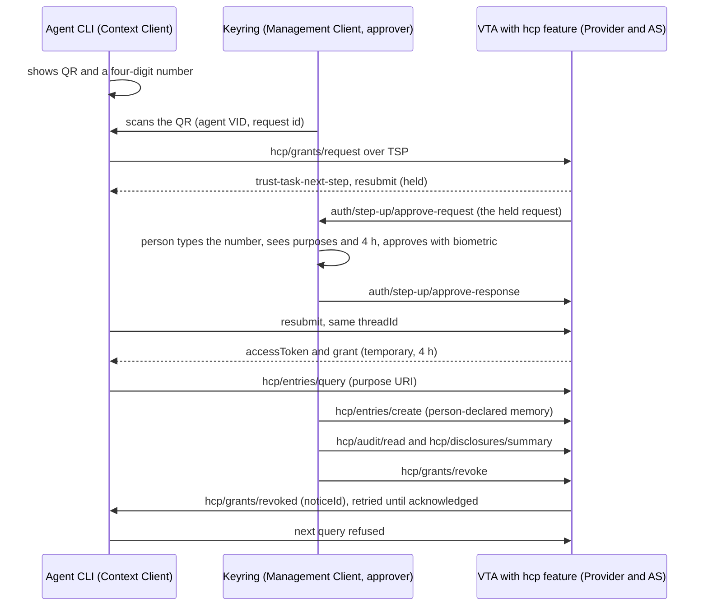

# 2026-11-25 — The HCP lane: Human Context Protocol in the VTA, controlled by Keyring, and a one-week demo (rev 5)

Companion to [`../agent-connect-plan.md`](../agent-connect-plan.md). Not revised afterwards.

## Summary
<!-- plan-part: human -->

> **Human part: for people deciding and reviewing.** What was concluded and what it
> asks for. The findings below are authoritative; if the two disagree, the findings win.

The plan never mentions the Human Context Protocol (HCP), the draft standard for how an AI agent asks a person's context store for what it may use, for how long and why, and how the person sees and stops it. HCP fits this plan closely: pairing is a grant request, memories are context entries, revoke is a grant revocation, and "Answers other people" is a directive. This companion adds HCP as a **lane behind a flag**: the HCP provider is built into the person's VTA, behind a cargo feature `hcp` that is off by default, and Keyring is the person's control panel for it, behind a Keyring flag. That is the one place the lane changes the VTI stack. With both flags off, P0 to P2 run as written, with no change to VTI (finding 2).

The first use of the lane is a **one-week demo**, which the plan's author decided on 2026-11-25. An agent CLI connects by QR and a typed number. The person approves in Keyring and sees the purposes and how long the agent can use what it reads. The agent answers from the person's context. The person adds a memory and the agent uses it. The person opens "What my agent saw", then revokes, and the agent visibly stops. Grants use HCP's 4-hour temporary default. Four tracks run in parallel: A VTI, B the agent CLI, C Keyring screens, D the demo environment. The estimate is about 37 developer days, or about 21 agent-hours including review-and-fix cycles. Human review adds 10 to 21 hours, and about 9 hours of work only a person can do: phones, builds and rehearsal (findings 6 to 8).

Thirteen conflicts between the plan and HCP are resolved in HCP's favour inside the lane. The main ones: a 4-hour temporary grant replaces 7, 30 or 90 days, and persistence is a separate act. Purposes become URIs. The approval screen shows HCP's checklist. Memories the person adds are `person-declared`, so the demo needs no Memory Manager. The revoke notice is retried and its delivery shown. The person gets an audit view (findings 4 and 5). The demo makes **no HCP conformance claim**. A claim needs HCP's HTTP Binding, which follows right after the demo (finding 3). Decisions are needed from the product owner on nine open questions. The main ones: whether the lane later becomes its own plan, which domain the purpose URIs live under, where the VTI branch lives, and who owns each track (finding 10).

*The demo's message flow: what to look at is that the grant is held at the VTA while the person decides in Keyring, and that revoke reaches the agent twice, as a notice and as the refusal of its next request (finding 6).*

<!-- plan-part: precision -->

> **Precision part: for implementers and agents.** Each finding with its evidence,
> the position it supersedes and the plan sections it changes. A bare `§n` means
> the plan's section n.

## Findings and decisions

**Base.** PR 958's head `docs/agent-connect-plan` is at `66acd9e5d`. The author's unpushed `docs/agent-connect-plan-rev4` is at `edc3d692e` and is 32 commits ahead of it, 0 behind (`git rev-list --left-right --count docs/agent-connect-plan...docs/agent-connect-plan-rev4` gives `0 32`). This companion is on `docs/agent-connect-plan-hcp`, branched from `edc3d692e`.

**Sources and commits.**
- HCP: `/srv/dev/code/seas/hcp-spec` at `b790561`, `spec/2.0-draft-3/specification.md`. Below, "HCP 6.1.4" means that file's section 6.1.4, and ":1445" a line in it.
- The `hcp/*` Trust Task suite: local branch `feat/hcp-suite` of `dtgwg-trust-tasks-tf` at `51730da20`. It is unpushed and still being edited, so every suite citation is at that commit, as `specs/hcp/<task>/0.1/spec.md:<line>`. The demos are on `feat/hcp-demos` at `f5f3b2804` (`examples/hcp-demo-ts/SCENARIO.md`).
- VTI: `verifiable-trust-infrastructure` `main` at `18ef6e34e`.
- openvti-starter at `bb8130b` (`pins.json`).
- Working notes, all in `/srv/dev/scratch/`, by bam, 2026-11-25:
  - `2026-11-25-bam-hcp-conformance-and-keyring-958.md` ("the cross-reference"), whose conflicts C1 to C13 and extensions X1 to X13 are used below;
  - `2026-11-25-bam-hcp-vti-implementation-plan.md` ("the VTI plan");
  - `2026-11-25-bam-hcp-vti-plan-review.md` ("the review"), with blockers B1 and B2, findings I1 to I14, and its section 6 "Corrected essentials";
  - `2026-11-25-bam-hcp-questions-for-editors-clean.md` ("editor question n"). None has been sent.

### 1. Why: HCP alignment, and a demo

- **Concluded:** the plan's journeys are HCP operations under other names (finding 4). The plan's author decided on 2026-11-25 to show this in a demo within one week, with HCP **built into VTI**, not run as a standalone provider, and controlled from Keyring.
- **Evidence:**
  - The VTI plan's role mapping puts the HCP Provider and its Authorization Service in the VTA, as a `vta-hcp` crate (its section 2, option A). The review agrees (its section 1, "What stands").
  - The product owner's research names "memory portability", "model switching", "acting for" another person, and standing terms as wider goals ([`2026-11-22-al.md`](./2026-11-22-al.md), finding 1). These line up with HCP export (5.4.1), delegation (17) and directives (6.4).
- **Supersedes:** the cross-reference's decision 8, which recommended a separate plan `agent-connect-hcp-plan.md` and keeping HCP out of this plan. The demo needs this plan's screens and steps, so the lane is proposed here. Whether it later moves to its own plan is open question Q-H1 (finding 10).

### 2. The HCP lane is a flagged extension, and exactly what it changes in VTI

- **Concluded:** plan §1.2's first non-goal, "No change to the VTI stack", stays true of P0 to P2. The HCP lane is the one exception. It is gated twice, and with both gates off nothing differs from the plan as written:
  - **VTI:** a cargo feature `hcp`, off by default, on `vta-service`. Its wire types come from a new crate `vti-specs-hcp`.
  - **Keyring:** a flag, off by default, in the `connected-agents` module.
- **What changes, and where:**

| Repository | Change | Where | Gate |
|---|---|---|---|
| VTI | New crate `vti-specs-hcp`, generated by `trust-tasks-build` from a local registry built from `feat/hcp-suite` | `vti-specs-hcp/` (new), `vti-specs/src/lib.rs` (facade index), workspace `Cargo.toml` | Only compiled under `hcp` |
| VTI | New crate `vta-hcp`: grant store, minimal entry store (new keyspace), per-request grant check, revoked-notice schedule | `vta-hcp/` (new), `vta-keyspaces/src/lib.rs` | `hcp` |
| VTI | Dispatch rows for the demo's `hcp/*` tasks; the operation-budget exemption for `hcp/grants/revoke`; token redaction before retention | `vta-service/src/trust_tasks/{mod.rs,hcp.rs}`, `vti-common/src/idempotency/middleware.rs` (exclusion) | `hcp` |
| VTI | Held `grants/request` approved through the existing step-up approval | `vta-service/src/trust_tasks/step_up.rs` (`mint_pending_step_up`, `auth/step-up/approve-request/0.5`) | `hcp` |
| VTI | The notice sender over the push wrapper | `vta-service/src/messaging/push.rs` (`push_trust_task`), `vti-common/src/trust_task_push.rs` | `hcp` |
| openvti-starter | A VTA image variant built with `hcp` in `FEATURES`, from the VTI branch's ref, pinned beside the main pins | `pins.json`, `scripts/images-build.ts:143` (`FEATURES` build arg) | A separate image tag |
| Keyring (bifold) | HCP client calls and the screens of finding 6 | `bifold/packages/core/src/modules/connected-agents/` | Keyring flag |
| Agent CLI | A new Context Client | open question Q-H4 | none needed |

  The VTI rows follow the VTI plan's phase 0 file list ("Files touched"). The `hcp` feature comes from its "Cross-cutting: images and deployment".
- **What does not change:** the ACL, `vta/memory/*`, rooms, the VDC and the chat. With the lane on, the agent's HCP reads go through the grant, not an ACL `application` entry. The lane's agent has no ACL entry and no VDC in the demo (C12 below).
- **Plan sections touched:** §1.2 (first bullet, now naming the lane), the header's Scope sentence, and §12. §10 is not touched: the lane is our own VTI work, behind a feature, not an ask of VTI. It goes upstream later as a VTI pull request (open question Q-H3).

### 3. Conformance posture: aligned demo, claim after the HTTP Binding

- **Concluded:** the demo is an HCP-aligned pilot and makes **no** `conformsTo` claim. It publishes no HCP discovery document listing an HCP identifier.
- **Evidence:**
  - A claim needs a binding, and only HTTP and MCP exist (HCP 1.5, 18.2, 19.3).
  - Every suite spec forbids claiming the carriage: "a provider **MUST NOT** claim this carriage in its HCP `conformsTo`" (`specs/hcp/entries/query/0.1/spec.md:93`, and the same in each spec). The point is pending editor question 1.
  - The review's B1: First-Party covers only clients whose Client Operator is the Provider Operator (HCP 12.1, :2872).
- **Next, right after the demo:** HCP's HTTP Binding (HCP 9, :2048) as a façade beside the same handlers. That is the route to the First-Party package (HCP 18.2, :3473) for a deployment where one organization runs the VTA, Keyring and the agent. The cross-reference recommends this as rung R1 (its section 2). It is not part of the one-week estimate.
- **Security corrections taken from the review, all in track A:**
  - **B2.** Every `hcp/*` request carries a document proof by `issuer`, verified over the document as received, with `issuer` equal to the grant's `client.id`. This applies on every transport. The demo also refuses `hcp/*` over REST.
  - **I2.** `hcp/grants/revoke` is exempt from the operation budget and the rate limiters. HCP 6.2.1 (:1630): "Revocation MUST NOT be rate limited." The suite repeats it (`specs/hcp/grants/revoke/0.1/spec.md:176`).
  - **Corrected essential 6.** The `accessToken` is stored only as a hash. It is never kept in the accepted-id store, the idempotency cache or the audit.

### 4. Mapping: each plan step and screen to HCP operations and `hcp/*` tasks

"In demo" marks what the one-week demo builds.

| Plan step | HCP operation (section) | `hcp/*` task | In demo |
|---|---|---|---|
| 7.1 Steps 0.1 to 0.3, measure | — | Adds measurements M-H1 to M-H3 (finding 6) | Yes (day 1) |
| 7.2 Step 1, link flow and pairing machine | Grant request and approval (6.1.6, 6.1.7) | `grants/request` (held, then resubmitted) | Yes, as the demo pairing of finding 6 |
| 7.3 Step 4, VDC | Not HCP | none | No |
| 7.4 Step 3, VTA client additions | Management Client operations (1.6) | `grants/revoke`, `entries/create`, `audit/read`, `disclosures/summary`, `directives/set`, plus the step-up approve-response | Yes |
| 7.5 Step 2, pairing carriage | The First-Party "authenticated channel" (12.2), pending editor question 21 | `grants/request`, `trust-task-next-step` | Yes, in place of `claim`/`hello` in the lane |
| 7.6 Step 10, plugin | Context Client: query (5.2.1), use-until (7.6), directives (6.4, 10.5) | `entries/query`, `grants/revoked` (acknowledge) | As the agent CLI (track B) |
| 7.7 Step 5, store, list and connect screens | Grants listed with the Client Operator (3.2.8) | `grants/list` later; the demo lists from Keyring's own record | Yes |
| 7.8 Step 5a, the My Agent tab | — | none | No |
| 7.9 Step 6, one-to-one chat | Not HCP: chat is not the person's context | none | No |
| 7.10 Step 9, revoke | Revoke (6.2.1), propagation (6.2.2), notice (6.2.3), failure (6.2.4) | `grants/revoke`, `grants/revoked` | Yes |
| 7.11 Step 10a, screens on an emulator | — | — | The demo screens only |
| 7.12 Step 11, P0 lab validation | — | — | The demo run on the lab stack |
| 7.13 Step 7, add to a room | Onward disclosure (3.12) | `shares/report` | No |
| 7.14 Step 8, "Answers other people" | Directives (6.4), applied by the host (10.5) | `directives/set` | Yes ("Answers on") |
| 7.15 Step 10b, plugin rooms | Onward disclosure with reports (3.12, 5.2.8) | `shares/report` | No |
| 7.16 Step 12, delete memory | Withdraw (5.2.5) | `entries/withdraw` | No |
| 7.17 Step 13, P1 lab validation | — | — | No |
| 7.18 Step 14, delete what it remembered | Hard delete (5.4.2), governance | `entries/hard-delete` | No |
| 7.19 Step 15, headless daemon | — | none | No |
| 7.20 Step 16, VDC to a third party | Third-party clients need OAuth Interop (13, 18.3) | — | No |
| 7.21 Step 17, cut room access now | Not HCP | none | No |
| 7.22 Step 18, polish and MyTerms | Standing rules (6.3) | `rules/*` | No |
| 7.23 Step 19, credential to memory | Issuer-attested entry with VC evidence (4.2.2, 14) | `entries/create` | No |
| 7.24 Step 20, a second host | Any Context Client | — | No |
| 7.25 Step 21, provider matrix | — | none | No |
| 7.26 Step 22, join by scan | Not HCP | none | No |

**Screens** (the UI/UX canvas, [`canvas/`](./canvas/); file names as in its README):

| Canvas screen | HCP meaning | In demo |
|---|---|---|
| `01-terminal.png` | The Context Client: QR, number, then "held, waiting for approval", answers, "access revoked" | Yes (track B prints it) |
| `02-main.png` | Grant request details: purposes (6.1.5.2) and duration, **4 hours** in place of "Connected for" (C2) | Yes, changed |
| `03-new-memory.png` | `entries/create`, `person-declared` (4.4) | Yes |
| `04-scan.png`, `05-number.png`, `06-wrong-number.png`, `09-expired.png` | Authentication around the grant, not the grant act (6.1.6) | Yes |
| `07-approve.png` | The 6.1.6 checklist (C4) | Yes, changed |
| `08-connected.png` | `grant.issued` | Yes |
| `10-agent-list.png`, `11-agent-list-states.png` | Grant status and use-until | Yes, with the statuses of finding 6 |
| `13-answers-on.png` | `directives/set` (C9) | Yes |
| `14-agent-details.png` | The grant (purposes, expiry) and the "What my agent saw" row | Yes, changed |
| `17-revoke.png` | `grants/revoke`, then the notice's delivery state | Yes, changed |
| New, not in the canvas: "What my agent saw" | `audit/read` (8.3) and `disclosures/summary` (8.6) | Yes (copy in finding 6) |
| `12`, `15`, `16`, `18` to `34` | Rooms, chat, contacts, settings | No |

### 5. Conflicts with HCP, and their resolutions

Each resolution applies **inside the lane**. Outside it, the plan's design stands until the product owner adopts the change for P0 to P2 (open question Q-H2).

| # | Conflict | Resolution in the lane | Evidence |
|---|---|---|---|
| C1 | **The Client Operator.** The agent is Claude Code plus our plugin against the person's VTA. First-Party needs one operator for client and provider | The demo's CLI is run by the organization that runs the demo VTA, so the demo deployment is first-party in fact. Approval shows the Client Operator's **registered** name, never one the request supplies. The self-hosted case stays pending editor question "Client Operator for self-run agent hosts" (the cross-reference, section 2, item 5) | HCP 3.2.8 (:385); `specs/hcp/grants/request/0.1/spec.md:85` |
| C2 | **Grant duration.** The plan offers 7, 30 or 90 days, default 30 (D21, plan §6) | **Temporary, 4 hours**, HCP's default. `expiresIn` is absent, so HCP's default applies. Persistent is never pre-selected and is a separate act after confirming, which the demo does not offer. Tokens stay within 1 h by default and 24 h at most. In P0 to P2, the 7/30/90 choice becomes the persistent-grant act (Q-H2) | HCP 6.1.3 (:1439), 6.1.4 (:1445, :1462-1465), 13.4 (:2929); `specs/hcp/grants/request/0.1/spec.md:127-128` |
| C3 | **Purposes must be URIs.** The plan's `personalisation` and `taskExecution` are VTA tokens | Two purpose URIs under a domain we control, mapped one to one to the VTA purposes. The request names them; where it names none, the provider asks the person to choose. `modelTraining` gets no URI and is never requested | HCP 6.1.5.2 (:1580-1584), A.3 (:3932, :3941); `_shared/0.1/common.schema.json:27-33`; `specs/hcp/grants/request/0.1/spec.md:126` |
| C4 | **The approval checklist.** The approve screen (plan §6) lists access, not HCP's items | The approve screen shows: categories, actions, purposes, the longest copy use (use-until), temporary, expiry, client and Client Operator, and that approving is not signing in. The typed number and the biometric are authentication, kept as they are | HCP 6.1.6 (:1597) |
| C5 | **Use-until without a notice endpoint.** A `did:key` has no service, so every copy is capped at 1 h and no notice can be sent | The CLI's VID advertises a reachable TSP or DIDComm service, through the lab mediator, so the notice is deliverable. Otherwise the 1 h cap applies, and the revoke screen says no notice was sent. Checked as M-H2 | HCP 6.2.3 (:1651), 7.6 (:1866); the review, I1 |
| C6 | **Agent-written memories are `model-inferred`.** A provider that accepts them must conform to Memory Manager | The demo's memory is added **by the person in Keyring**, a `person-declared` entry created by the Management Client. The lane's provider refuses `model-inferred` creates until Memory Manager is built. The obligation binds the provider, not the writer: the suite's `entries/create` names no Memory Manager rule | HCP 4.4 (:953-959), 4.7 (:1009), 15.1 (:3207); `specs/hcp/entries/create/0.1/spec.md:135-136` |
| C7 | **Revoke notice "not relied on"** (plan §3.9 step 3) | `hcp/grants/revoked` with a stable `noticeId` and a fresh document per attempt. Exponential backoff, at least 5 attempts over at least 1 h, nothing after 24 h. "Delivered" means the client's acknowledgement (any attempt's), not mediator handoff. `revocation.notified` is recorded on delivery or abandonment. If abandoned, Keyring says so and gives the last use-until. Revoke is immediate, by grant status (6.2.2), and never rate limited | HCP 6.2.1-6.2.4 (:1630, :1636, :1653, :1661); `specs/hcp/grants/revoked/0.1/spec.md:91, :124, :247, :249`. The fresh document is the suite's departure from HCP 9.9's "same token" (:2484), pending editor question 16 |
| C8 | **Onward disclosure in rooms and "Answers other people"** | Out of the demo: no rooms. In the lane, an agent may use HCP context in a room only under `onwardSharing`, elected as a separate act, with each share reported (`shares/report`, audited as `context.shared`). Otherwise it refuses. Whether a person in a room is "a party operated by a different organization" is pending an editor question | HCP 3.12 (:585-594), 6.1.4 (:1473), 8.1 (:1891); `specs/hcp/grants/request/0.1/spec.md:129` |
| C9 | **"Answers other people" as a directive.** Reply-to-others is not an HCP action | `directives/set` with a custom action URI under our domain (the schema allows `share`, `sign`, `transact` or an absolute URI), effect `deny` (Off) or `permit` (On). The CLI applies it in code, never by putting it in the model's context. HCP's A.3 table has no row for directive actions, although 6.4 allows a URI: a new editor question | HCP 6.4 (:1721-1722, :1733, :1745), 10.5 (:2759); `specs/hcp/directives/set/0.1/payload.schema.json:14, :19` |
| C10 | **Credentials into memory as a text envelope** (VTI-Q47) | Not in the demo. In the lane: an `issuer-attested` entry with VC evidence (HCP 14), which needs the VC Evidence Profile | HCP 4.2.2, 14; `specs/hcp/entries/create/0.1/spec.md:99` |
| C11 | **No person-facing audit.** HCP 18.4 requires one | "What my agent saw": `audit/read` and `disclosures/summary` in Keyring, as Management Client. The agent can never read them | HCP 8.3 (:1987), 8.6 (:2017), 18.4 (:3493-3500); `specs/hcp/audit/read/0.1/spec.md:96`, `specs/hcp/disclosures/summary/0.1/spec.md:97` |
| C12 | **Phasing.** The plan's P0 runs on today's ACL and memory, and `vta-hcp` does not exist | The lane runs beside P0, not instead of it. The demo agent has no ACL entry, VDC or chat. Merging the two connect paths is after the demo | The cross-reference, C12 |
| C13 | **Governance from Keyring over Trust Tasks.** HCP carries governance only on HTTP | Keyring calls `grants/revoke`, `audit/read`, `disclosures/summary`, `directives/set` and `entries/create` over Trust Tasks, marked pending editor question 37. The HTTP Binding (finding 3) is what a claim rests on | HCP 9.1 (:2054); the specs' "Pending HCP confirmation" sections |

### 6. The demo: design, copy, measurements and script

**Demo pairing (replaces `claim`/`hello` of plan §3.2 in the lane only):**
1. The CLI makes a `grants/request` document and shows a QR carrying its VID, the request's `threadId` and the VTA's DID. It also shows a four-digit number, the first four decimal digits of SHA-256 over the request's `threadId` and the CLI's VID.
2. The CLI sends the request over TSP. The VTA holds it with `trust-task-next-step` and `continuation: resubmit`, never an error (`specs/hcp/grants/request/0.1/spec.md:173-178`). The VTA sends the person's approver the held request in an `auth/step-up/approve-request/0.5` (`vta-service/src/trust_tasks/step_up.rs`, `mint_pending_step_up`).
3. Keyring has scanned the QR, so it accepts only a held request with that VID and `threadId`. The person types the number, which Keyring checks against the same hash and never displays (plan §3.2's rule kept). Then Keyring shows the approve screen (C4), and the person approves with the biometric. Keyring answers with `approve-response/0.7`.
4. The CLI resubmits on the same `threadId` and receives `accessToken` and `grant`, with `expiresAt` 4 hours ahead.

Rejected for the demo: building plan §3.2's full pairing carriage (steps 7.2 and 7.5) first. It is about two weeks of the plan's own P0 work, and it authenticates the pairing, not the grant. The demo pairing keeps the number's purpose (no approval by reflex) and puts the grant act where HCP puts it. It is not a product design: the lane adopts plan §3.2 when P0 builds it.

**Measurements on day 1** (added to step 7.1):
- **M-H1.** Can Keyring answer `auth/step-up/approve-request/0.5` as the approver? Not verified: the plan's §7.4 builds `setStepUp` only in P1, and Keyring's approver path was not read for this companion. If Keyring cannot, the demo approves through a Keyring-signed `didSigned` response, built in C1.
- **M-H2.** Does the CLI's VID with a mediator service receive a `grants/revoked` push from the VTA over TSP?
- **M-H3.** Does the push path reach the phone while the app is in the foreground? Background wake is not needed for the demo.

**Copy for the changed and new screens.** The demo screens use these strings. Where the plan's §6 copy is unchanged it is not repeated.
- Connect (`02-main`): "Connected for" is replaced by "For 4 hours". Its helper: "After 4 hours it has to ask again." The purposes list is titled "What it can use them for", one row per purpose with its readable description.
- Approve (`07-approve`): "Connect "<name>"?"; "Run by <Client Operator>."; "It can read <categories> to <purpose descriptions>."; "It can keep what it reads for up to <n> minutes after reading it."; "For 4 hours, until <time>."; "Approving gives access. It is not signing in."; "Only continue if you ran the command in your own terminal just now."; button "Approve".
- Agent list (`10-agent-list`): the statuses "Connected until <time>", "Expired" and "Revoked"; actions "What it saw" and "Revoke".
- New memory (`03-new-memory`): "Add a memory for "<name>""; field "What should it know?"; button "Save". Its helper: "Saved as something you said."
- Answers on (`13-answers-on`): the plan's copy is kept. The switch writes the directive.
- What my agent saw (new screen, from the agent details): title "What "<name>" saw"; a summary line "<n> reads of <categories>, last at <time>. It can use what it read until <time>."; then one row per audit event: "Read <category> for <purpose>, <time>", "Connected", "Revoked", or "Told it was revoked". Empty state: "It hasn't read anything yet." Error state: "We couldn't reach your VTA, so this list may be out of date."
- Revoke (`17-revoke`): "Revoke "<name>"?"; "It stops at once. We'll tell it, and show you when it has heard."; buttons "Revoke" and "Keep". After revoking: "Revoked. Telling "<name>"…", then "Revoked. "<name>" was told at <time>." If abandoned: "Revoked. We couldn't tell "<name>". Anything it read stops being usable at <time>."

The kit mockups for these are work item C8 below. They are not drawn in this companion, so no mockup or sheet changes here.

**Demo script** (lab stack, one phone, one laptop):
1. On the laptop, the CLI runs `connect`. It shows the QR and the number (`01-terminal`).
2. In Keyring, the person taps "Connect an agent", names it, and sees the purposes and "For 4 hours". They scan, type the number, see the approve screen with the Client Operator and purposes, and approve with a fingerprint.
3. The CLI prints "Connected until <time>". The person asks a question and the CLI answers from the context it retrieved, printing the purpose and the use-until of each item.
4. In Keyring, the person adds the memory "I'm vegetarian". The CLI's next answer uses it.
5. In Keyring, the person opens "What my agent saw": two reads, their purposes and times, and the summary line.
6. The person turns "Answers on" on, then off again, and the CLI shows the directive it received.
7. The person revokes. Keyring shows "Telling …", then "was told at <time>". The CLI prints "access revoked (notice <noticeId>)", and its next query is refused.

### 7. The four tracks, work items, dependencies and the week

Owners are placeholders: `<owner-A>` to `<owner-D>`. The developer-day (dd) figures are judgement, and the factor used to turn them into agent-hours is in finding 8.

**Track A: VTI** (`<owner-A>`; integration into existing services unless marked)

| # | Work item | Depends on | dd | Kind |
|---|---|---|---|---|
| A1 | Local registry build of `feat/hcp-suite`, `vti-specs-hcp` pinning the demo's tasks (the VTI plan's section 5 recipe) | suite at a fixed commit | 1.0 | well specified |
| A2 | `vta-hcp`: grant store, entry store (new keyspace, seeded fixtures), the per-request check (status, client VID equal to sender and `issuer`, category, purpose; `scope-denied` without detail) | A1 | 2.5 | integration |
| A3 | `grants/request` held while the person approves, through `mint_pending_step_up`; the resubmit match by `threadId` and `issuer` | A2, M-H1 | 2.0 | integration |
| A4 | `entries/query` (at most 20 results, `ref`s, the minimisation report, use-until, directives in results) and `entries/create` (`person-declared` only) | A2 | 2.0 | integration |
| A5 | `grants/revoke` (immediate; operation-budget exemption) and the `grants/revoked` schedule over `push_trust_task` (C7) | A2, M-H2 | 2.0 | integration |
| A6 | `audit/read` and `disclosures/summary` over the existing audit sink | A2 | 1.5 | integration |
| A7 | `directives/set`, delivered with query results | A4 | 1.0 | integration |
| A8 | Token redaction (accepted-id store, idempotency cache, audit), required `issuer` proof, `hcp/*` refused over REST | A2 | 1.0 | integration |
| A9 | Integration tests in `vta-service/tests/it/`: the happy path, and negatives (another VID's token, a revoked grant, a wrong purpose, a REST attempt, revoke under the rate limit) | A3 to A8 | 1.5 | well specified |

**Track B: the agent CLI** (`<owner-B>`; a port of `examples/hcp-demo-ts` on `feat/hcp-demos`, unless marked)

| # | Work item | Depends on | dd | Kind |
|---|---|---|---|---|
| B1 | CLI with its own VID and a mediator service; QR and number display (`01-terminal`) | — | 1.0 | well specified |
| B2 | `grants/request` with hold and resubmit over TSP | B1; A3 for live runs | 1.0 | well specified |
| B3 | Query and answer from the retrieved context, honouring use-until | B2; A4 | 1.5 | integration |
| B4 | Receive and acknowledge `grants/revoked`, stop, print it | B2; A5 | 1.0 | well specified |
| B5 | Apply the directive in code (C9) | B3; A7 | 0.5 | well specified |
| B6 | Tests against a fake VTA, including a duplicate notice | B1 to B5 | 1.0 | well specified |

**Track C: Keyring, behind the flag** (`<owner-C>`)

| # | Work item | Depends on | dd | Kind |
|---|---|---|---|---|
| C0 | The flag; an HCP client in `connected-agents` with types from `trust-tasks-ts` at the suite commit | A1 (same suite commit) | 1.0 | integration |
| C1 | Scan, number and approve: answering the step-up approval, with the C4 checklist | C0; A3; M-H1 | 3.0 | integration |
| C2 | Agent list and details with grant status and use-until | C0 | 1.5 | integration |
| C3 | New memory (`entries/create`) | C0; A4 | 1.0 | integration |
| C4 | "What my agent saw" (`audit/read`, `disclosures/summary`) | C0; A6 | 2.0 | integration |
| C5 | "Answers on" (`directives/set`) | C0; A7 | 1.0 | integration |
| C6 | Revoke with the live notice state | C0; A5 | 1.5 | integration |
| C7 | jest tests for C1 to C6 (copy, states, a revoked or expired grant) | C1 to C6 | 1.5 | well specified |
| C8 | Kit mockups for the changed and new screens, and the regenerated sheet | copy in finding 6 | 1.0 | well specified |

**Track D: the demo environment** (`<owner-D>`)

| # | Work item | Depends on | dd | Kind |
|---|---|---|---|---|
| D1 | An openvti-starter VTA image built with `hcp` added to `FEATURES` from the VTI branch's ref, under its own tag. The main pin is never touched, and `pins.json` is changed only through its tooling | A2 compiling | 1.0 | integration |
| D2 | Pin and verify that image (`pins:verify`, MODE=local) | D1 | 0.5 | integration |
| D3 | Lab stack with the image, seeded context, the CLI's mediator account | D2; B1 | 1.0 | integration |
| D4 | A runbook for the script in finding 6 | D3 | 0.5 | well specified |

**Order and dependencies.** A1 starts everything in A and C. A2 gates A3 to A8. B and C build against fakes from day 1 and switch to the live VTA when D3 is up. The critical path is A1 → A2 → A3 → C1 → D3 → the first end-to-end run.

**The week** (day 1 is 2026-11-26; shift the days if the start moves):

| Day | A | B | C | D | Gate at end of day |
|---|---|---|---|---|---|
| 1 | A1, start A2 | B1 | C0, C8; M-H1 with A | M-H2, M-H3 on the lab | Pins build; M-H1 answered |
| 2 | A2, A8 | B2 (fake) | C1 (fake), C2 | — | Grant check passes its unit tests |
| 3 | A3, A4 | B3 | C1 live against A3, C3 | D1 | Held request approved from the phone |
| 4 | A5, A6 | B4 | C4, C6 | D2, D3 | Image pinned; revoke notice acknowledged |
| 5 | A7, A9 | B5, B6 | C5, C7 | D4 | First full run of the script |
| 6 | Fixes | Fixes | Fixes; device build | Rehearsal 1 | Script passes twice in a row |
| 7 | Freeze | Freeze | Freeze | Rehearsal 2, demo | Demo |

**Tests.** A9, B6 and C7 are the automated tiers: VTI integration tests, CLI unit tests and jest. Rehearsal on a physical phone is the only proof of the biometric approval and the foreground push (plan §8.4). The kit test and the plan checker cover C8. No plan §8 row changes for P0 to P2.

### 8. Estimates

**Factor (v1).** 1 developer day ≈ 0.5 agent-hours for integration into existing services, and ≈ 0.25 agent-hours for well-specified or reference-port work. Add ~30% for review-and-fix cycles. Human review is listed separately, at ~0.5 to 1 hour per agent-hour.

| Track | dd integration | dd well specified | dd total | Agent-hours before review cycles | Agent-hours with +30% | Human review (h) |
|---|---|---|---|---|---|---|
| A VTI | 12.0 | 2.5 | 14.5 | 6.63 | 8.6 | 4.3-8.6 |
| B CLI | 1.5 | 4.5 | 6.0 | 1.88 | 2.4 | 1.2-2.4 |
| C Keyring | 11.0 | 2.5 | 13.5 | 6.13 | 8.0 | 4.0-8.0 |
| D Environment | 2.5 | 0.5 | 3.0 | 1.38 | 1.8 | 0.9-1.8 |
| **Total** | 27.0 | 10.0 | **37.0** | 16.0 | **20.8** | **10.4-20.8** |

**Human-only work, not in the agent figures** (about 9 hours):
- on-device testing on one iPhone and one Android phone, about 4 h;
- the device builds and installs, about 1 h;
- two rehearsals and the demo, about 3 h;
- answering M-H1 to M-H3 with the person present, about 1 h.

Agent-hours are not wall-clock time. VTA builds are heavy and queue behind other sessions on the shared machine (the `/srv/dev` "Heavy operations" rules), so the schedule in finding 7, not the agent total, is the plan for the week.

### 9. Risks

1. **Device testing.** The biometric approval and the push reaching the phone are proven only on a physical phone (plan §8.4). An emulator run does not show them. *Mitigation:* a device build by day 5, and two rehearsals.
2. **The mediator push to the phone.** M-H2 and M-H3 are unmeasured. Plan §11 Q5 (which mediator each side uses, and how a wake-up crosses) is still open. *Mitigation:* the demo needs foreground delivery only. If M-H3 fails, Keyring polls `disclosures/summary` for the notice state, which `notification` carries (`specs/hcp/disclosures/summary/0.1/spec.md:166-174`).
3. **Keyring build cadence.** A store build needs `main` and the bifold pointer on bifold `main` ([`release-flow-plan.md`](../release-flow-plan.md), "The flow at a glance"). The demo builds instead from the branch on the dev channel (`workflow_dispatch` with a `ref`, an APK and a simulator build), or as a staging preview to the TestFlight internal group. Neither needs Beta App Review. A lane that is still flagged off never reaches a release.
4. **Review load.** About 21 agent-hours produce 10 to 21 hours of human review in one week, across four repositories. *Mitigation:* review A3, A5, A8 and C1 first (security-relevant), and the rest at the day-5 run.
5. **Suite churn.** `feat/hcp-suite` is unpushed and changing. Pin one commit on day 1 for both A1 and C0, and re-pin only by agreement. A VTI branch pinned to an unreleased suite never merges to VTI `main` (the VTI plan, section 5).
6. **The VTI branch's home.** An `hcp` image is built from a VTI ref that is not on upstream `main`. openvti-starter's rules (pins advanced only through its tooling, consumers on ref tags) apply. See Q-H3.
7. **Approval path unknown** (M-H1). If Keyring cannot be the step-up approver by day 1, C1 grows by about 1 to 2 dd.
8. **Holiday week.** 2026-11-26 is a US holiday. If owners are away, the schedule shifts by the days lost.

### 10. Open questions (recommendation first)

| # | Question | Recommendation | Pros | Cons | Owner |
|---|---|---|---|---|---|
| Q-H1 | Does the HCP lane stay in this plan or move to its own `agent-connect-hcp-plan.md`? | **Stay here until the demo, then split** if it grows past the demo | One place for the screens and steps the demo reuses | Two lanes in one plan, a large file | Product owner |
| Q-H2 | Adopt C2 (temporary by default, persistent as its own act), C3 (purpose URIs) and C4 (the checklist) for P0 to P2, not only the lane? | **Yes, after the demo**, replacing D21's 7/30/90 with the persistent-grant act | One approval model; no rework when the lane becomes the default | Changes decided copy and mockups (D21); more prompts | Product owner |
| Q-H3 | Where does the VTI `hcp` branch live? | **A branch on our fork, offered upstream as a draft PR after the demo** | No upstream review on the critical path; the code is visible | The image is built from a non-upstream ref; a later rebase | `<owner-A>` with the VTA team |
| Q-H4 | Where does the agent CLI live? | **In `berkmancenter/vti-agent-connect`** (D39), as the Context Client its plugin later uses | One Context Client implementation; matches D40's reuse | The repository does not exist yet (plan §11 Q1) | `<owner-B>` |
| Q-H5 | Which domain do the purpose URIs and the custom directive action live under? | **A domain the Keyring team controls**, with a published page per URI | Required by A.3 (:3932); stable | Replaced if HCP registers purposes | Product owner |
| Q-H6 | Demo pairing (finding 6) or the plan's §3.2 carriage? | **The demo pairing**, for the demo only | Fits the week; the grant act sits where HCP puts it | Two pairings until P0 lands | Product owner |
| Q-H7 | Show the HTTP Binding at the demo? | **No: right after it**, as the R1 route (finding 3) | Keeps the week's scope | No conformance claim at the demo | Product owner |
| Q-H8 | Send the editor questions before the demo? | **Yes**: questions 1, 16, 21, 24 and 37, plus new ones for the directive action (C9) and room members (C8) | The demo's readings are visible as pending | The answers may change the lane | The plan's author |
| Q-H9 | Who owns each track? | **No recommendation**: it depends on who is available in a holiday week | — | — | Product owner |

**What was checked, and not.**
- Checked, against the commits above: the HCP section numbers and lines, the suite's spec lines (by a separate read of `feat/hcp-suite` at `51730da20`), the VTI file paths named in finding 2 (`step_up.rs`, `push.rs`), openvti-starter's `FEATURES` build argument, and the plan's sections and canvas file names.
- Not verified:
  - Keyring's step-up approver path (M-H1);
  - the push to the CLI and to the phone (M-H2, M-H3);
  - every effort figure (judgement);
  - that the VTA's existing approve-request can carry the held `grants/request` unchanged.

**Absorbed into the plan by this revision:** finding 2 only. That is the lane's existence and its gates, in plan §1.2, the Scope sentence, the status line and §12. Findings 4 to 10 stay proposals, pending the product owner's decisions Q-H1 to Q-H9.
