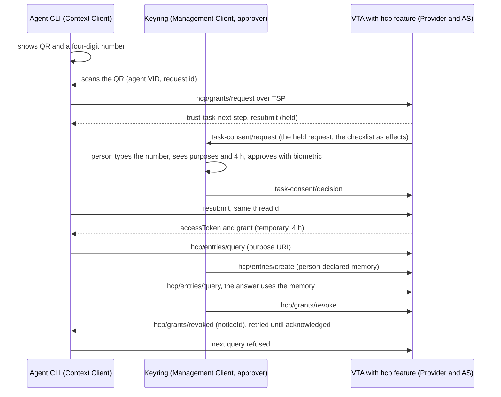

# 2026-11-25 — The HCP lane: Human Context Protocol in the VTA, controlled by Keyring, a one-week demo, and HCP increments inside P0 to P2 (rev 6)

Companion to [`../agent-connect-plan.md`](../agent-connect-plan.md). Not revised afterwards.

## Summary
<!-- plan-part: human -->

> **Human part: for people deciding and reviewing.** What was concluded and what it
> asks for. The findings below are authoritative; if the two disagree, the findings win.

The plan never mentions the Human Context Protocol (HCP), the draft standard for how an AI agent asks a person's context store for what it may use, for how long and why, and how the person sees and stops it. HCP fits this plan closely: pairing is a grant request, memories are context entries, revoke is a grant revocation, and "Answers other people" is a directive. This companion adds HCP as a **lane behind a flag**: the HCP provider is built into the person's VTA, behind a cargo feature `hcp` that is off by default, and Keyring is the person's control panel for it, behind a Keyring flag. That is the one place the lane changes the VTI stack. With both flags off, P0 to P2 run as written, with no change to VTI (finding 2).

HCP no longer runs beside the plan. It now fits inside P0, P1 and P2: each tier gains an **HCP increment** that runs on its own, behind the same two flags. **The demo is P0's HCP increment together with the VTI plan's first milestone, V0.** An agent CLI connects by QR and a typed number. The person approves in Keyring and sees the purposes and "For 4 hours". The agent answers from the person's context. The person adds a memory and the agent uses it. Then the person revokes, Keyring shows when the agent was told, and the agent's next request is refused. After the demo, P0 also takes HCP's grant model on its normal connect path: 4 hours by default, and staying connected is a separate act that is never pre-selected. P1 and P2 each carry the HCP form of what they already do (finding 11).

Two things moved out of the demo week into P1: "What my agent saw" and "Answers on". They belong with P1's "Answers other people", and no P0 step needs them. That moves 5.0 developer days and 2.93 agent-hours. Proposing the purpose vocabulary to the DTG registry adds 1.0 and 0.33. The Day-1 measurements add 0.75 and 0.81. The demo week is now **45.25 developer days, or 24.9 agent-hours** including review-and-fix cycles. Human review adds 12.4 to 24.9 hours, plus about 14 hours of work only a person can do. Agents build all four tracks. The human-only work is done by Brendan and Alberto (findings 7, 8 and 12).

The Day-1 measurements changed how the person approves. Keyring answers the held request as a task-consent approver (`task-consent/request/0.1` and `decision/0.2`), not through step-up, which only lets a caller approve its own request. The phone is reached in the foreground only, so the app is open at approval and Keyring polls for the "was told at" state (finding 12).

The product owner decided all nine questions on 2026-11-25 (finding 10). The purpose IRIs are proposed to the Trust Over IP DTG registry. The editor questions go out with the working demo, not before it. The demo still makes **no HCP conformance claim**: that needs HCP's HTTP Binding, which comes first in P1 (finding 3). This revision also removes machine-specific material, so the companion reads cleanly outside the machine it was written on.

*The P0 demo's message flow: what to look at is that the grant is held at the VTA while the person decides in Keyring, and that revoke reaches the agent twice, as a notice and as the refusal of its next request. Keyring's audit view (`hcp/audit/read`, `hcp/disclosures/summary`) is P1 and is no longer drawn here (findings 6 and 11).*

<!-- plan-part: precision -->

> **Precision part: for implementers and agents.** Each finding with its evidence,
> the position it supersedes and the plan sections it changes. A bare `§n` means
> the plan's section n.

## Findings and decisions

**Base.** PR 958's head `docs/agent-connect-plan` is at `66acd9e5d`. The author's unpushed `docs/agent-connect-plan-rev4` is at `edc3d692e` and is 32 commits ahead of it, 0 behind (`git rev-list --left-right --count docs/agent-connect-plan...docs/agent-connect-plan-rev4` gives `0 32`). This companion is on `docs/agent-connect-plan-hcp`, branched from `edc3d692e`. Rev 6 (findings 11 and 12, and the marks in findings 1 to 10) was written on the same branch at `53f3d4008`.

**Sources and commits.**
- HCP: HCP 2.0-draft-3, `hcp-spec` repository at `b790561`, `spec/2.0-draft-3/specification.md`. Below, "HCP 6.1.4" means that file's section 6.1.4, and ":1445" a line in it.
- The `hcp/*` Trust Task suite: local branch `feat/hcp-suite` of `dtgwg-trust-tasks-tf` at `51730da20`. It is unpushed and still being edited, so every suite citation is at that commit, as `specs/hcp/<task>/0.1/spec.md:<line>`. The demos are on `feat/hcp-demos` at `f5f3b2804` (`examples/hcp-demo-ts/SCENARIO.md`).
- VTI: `verifiable-trust-infrastructure` `main` at `18ef6e34e`.
- openvti-starter at `bb8130b` (`pins.json`).
- Working documents by bam, 2026-11-25, kept outside this repository and cited by name:
  - the conformance and keyring-958 analysis ("the cross-reference"), whose conflicts C1 to C13 and extensions X1 to X13 are used below;
  - the VTI implementation plan ("the VTI plan"): rev 3 for findings 1 to 10, rev 4 for findings 11 and 12, whose milestones, work packages and figures match this companion's;
  - the VTI plan review ("the review"), with blockers B1 and B2, findings I1 to I14, and its section 6 "Corrected essentials";
  - the editor questions ("editor question n"). None has been sent; they go with the working demo (Q-H8);
  - the Day-1 measurements (M-H1 to M-H3, D2, D5, D13), used in finding 12.

### 1. Why: HCP alignment, and a demo

- **Concluded:** the plan's journeys are HCP operations under other names (finding 4). The plan's author decided on 2026-11-25 to show this in a demo within one week, with HCP **built into VTI**, not run as a standalone provider, and controlled from Keyring.
- **Evidence:**
  - The VTI plan's role mapping puts the HCP Provider and its Authorization Service in the VTA, as a `vta-hcp` crate (its section 2, option A). The review agrees (its section 1, "What stands").
  - The product owner's research names "memory portability", "model switching", "acting for" another person, and standing terms as wider goals ([`2026-11-22-al.md`](./2026-11-22-al.md), finding 1). These line up with HCP export (5.4.1), delegation (17) and directives (6.4).
- **Supersedes:** the cross-reference's decision 8, which recommended a separate plan `agent-connect-hcp-plan.md` and keeping HCP out of this plan. The demo needs this plan's screens and steps, so the lane is proposed here. Whether it later moves to its own plan is open question Q-H1 (finding 10). **Decided (rev 6):** it stays here until the demo, then splits if it grows; and the lane is no longer a lane beside the tiers but an HCP increment inside each tier (finding 11).

### 2. The HCP lane is a flagged extension, and exactly what it changes in VTI

- **Concluded:** plan §1.2's first non-goal, "No change to the VTI stack", stays true of P0 to P2. The HCP lane is the one exception. It is gated twice, and with both gates off nothing differs from the plan as written:
  - **VTI:** a cargo feature `hcp`, off by default, on `vta-service`. Its wire types come from a new crate `vti-specs-hcp`.
  - **Keyring:** a flag, off by default, in the `connected-agents` module.
- **What changes, and where:**

| Repository | Change | Where | Gate |
|---|---|---|---|
| VTI | New crate `vti-specs-hcp`, generated by `trust-tasks-build` from a local registry built from `feat/hcp-suite` | `vti-specs-hcp/` (new), `vti-specs/src/lib.rs` (facade index), workspace `Cargo.toml` | Only compiled under `hcp` |
| VTI | New crate `vta-hcp`: grant store, minimal entry store (new keyspace), per-request grant check, revoked-notice schedule | `vta-hcp/` (new), `vta-keyspaces/src/lib.rs` | `hcp` |
| VTI | Dispatch rows for the demo's `hcp/*` tasks; the operation-budget exemption for `hcp/grants/revoke`; token redaction before retention | `vta-service/src/trust_tasks/{mod.rs,hcp.rs}`, `vti-common/src/idempotency/middleware.rs` (exclusion) | `hcp` |
| VTI | ~~Held `grants/request` approved through the existing step-up approval~~ **Withdrawn (rev 6, finding 12):** step-up is self-approve only. The held request is approved through task consent: a producer modelled on `oob_sign_in::remote_approval` mints `task-consent/request/0.1` to Keyring as bound approver, with the 6.1.6 items as VTA-written `effects`, and Keyring answers with `decision/0.2` | ~~`vta-service/src/trust_tasks/step_up.rs` (`mint_pending_step_up`, `auth/step-up/approve-request/0.5`)~~ `vta-service/src/trust_tasks/{consent_request.rs,task_consent.rs,policy_gate.rs}`, `vta-service/src/operations/vault/oob_sign_in.rs` (the template) | `hcp` |
| VTI | The notice sender over the push wrapper | `vta-service/src/messaging/push.rs` (`push_trust_task`), `vti-common/src/trust_task_push.rs` | `hcp` |
| openvti-starter | A VTA image variant built with `hcp` in `FEATURES`, from the VTI branch's ref, pinned beside the main pins | `pins.json`, `scripts/images-build.ts:143` (`FEATURES` build arg) | A separate image tag |
| Keyring (bifold) | HCP client calls and the screens of finding 6 | `bifold/packages/core/src/modules/connected-agents/` | Keyring flag |
| Agent CLI | A new Context Client | open question Q-H4 | none needed |

  The VTI rows follow the VTI plan's phase 0 file list ("Files touched"). The `hcp` feature comes from its "Cross-cutting: images and deployment".
- **What does not change:** the ACL, `vta/memory/*`, rooms, the VDC and the chat. With the lane on, the agent's HCP reads go through the grant, not an ACL `application` entry. The lane's agent has no ACL entry and no VDC in the demo (C12 below).
- **Plan sections touched:** §1.2 (first bullet, now naming the lane), the header's Scope sentence, and §12. §10 is not touched: the lane is our own VTI work, behind a feature, not an ask of VTI. It goes upstream later as a VTI pull request (open question Q-H3).

### 3. Conformance posture: aligned demo, claim after the HTTP Binding

- **Concluded:** the demo is an HCP-aligned pilot and makes **no** `conformsTo` claim. It publishes no HCP discovery document listing an HCP identifier.
- **Evidence:**
  - A claim needs a binding, and only HTTP and MCP exist (HCP 1.5, 18.2, 19.3).
  - Every suite spec forbids claiming the carriage: "a provider **MUST NOT** claim this carriage in its HCP `conformsTo`" (`specs/hcp/entries/query/0.1/spec.md:93`, and the same in each spec). The point is pending editor question 1.
  - The review's B1: First-Party covers only clients whose Client Operator is the Provider Operator (HCP 12.1, :2872).
- **Next, right after the demo:** HCP's HTTP Binding (HCP 9, :2048) as a façade beside the same handlers. That is the route to the First-Party package (HCP 18.2, :3473) for a deployment where one organization runs the VTA, Keyring and the agent. The cross-reference recommends this as rung R1 (its section 2). It is not part of the one-week estimate. **Decided (rev 6, Q-H7):** HTTP parity (the VTI plan's A10) is the first V1 item, in P1's HCP increment; the full HTTP Binding and the First-Party claim are V2, in P2's (finding 11).
- **Security corrections taken from the review, all in track A:**
  - **B2.** Every `hcp/*` request carries a document proof by `issuer`, verified over the document as received, with `issuer` equal to the grant's `client.id`. This applies on every transport. The demo also refuses `hcp/*` over REST.
  - **I2.** `hcp/grants/revoke` is exempt from the operation budget and the rate limiters. HCP 6.2.1 (:1630): "Revocation MUST NOT be rate limited." The suite repeats it (`specs/hcp/grants/revoke/0.1/spec.md:176`).
  - **Corrected essential 6.** The `accessToken` is stored only as a hash. It is never kept in the accepted-id store, the idempotency cache or the audit.

### 4. Mapping: each plan step and screen to HCP operations and `hcp/*` tasks

"In demo" marks what the one-week demo builds.

| Plan step | HCP operation (section) | `hcp/*` task | In demo |
|---|---|---|---|
| 7.1 Steps 0.1 to 0.3, measure | — | Adds measurements M-H1 to M-H3 (finding 6) | Yes (day 1) |
| 7.2 Step 1, link flow and pairing machine | Grant request and approval (6.1.6, 6.1.7) | `grants/request` (held, then resubmitted) | Yes, as the demo pairing of finding 6 |
| 7.3 Step 4, VDC | Not HCP | none | No |
| 7.4 Step 3, VTA client additions | Management Client operations (1.6) | `grants/revoke`, `entries/create`, `audit/read`, `disclosures/summary`, `directives/set`, plus the step-up approve-response | Yes |
| 7.5 Step 2, pairing carriage | The First-Party "authenticated channel" (12.2), pending editor question 21 | `grants/request`, `trust-task-next-step` | Yes, in place of `claim`/`hello` in the lane |
| 7.6 Step 10, plugin | Context Client: query (5.2.1), use-until (7.6), directives (6.4, 10.5) | `entries/query`, `grants/revoked` (acknowledge) | As the agent CLI (track B) |
| 7.7 Step 5, store, list and connect screens | Grants listed with the Client Operator (3.2.8) | `grants/list` later; the demo lists from Keyring's own record | Yes |
| 7.8 Step 5a, the My Agent tab | — | none | No |
| 7.9 Step 6, one-to-one chat | Not HCP: chat is not the person's context | none | No |
| 7.10 Step 9, revoke | Revoke (6.2.1), propagation (6.2.2), notice (6.2.3), failure (6.2.4) | `grants/revoke`, `grants/revoked` | Yes |
| 7.11 Step 10a, screens on an emulator | — | — | The demo screens only |
| 7.12 Step 11, P0 lab validation | — | — | The demo run on the lab stack |
| 7.13 Step 7, add to a room | Onward disclosure (3.12) | `shares/report` | No |
| 7.14 Step 8, "Answers other people" | Directives (6.4), applied by the host (10.5) | `directives/set` | Yes ("Answers on") |
| 7.15 Step 10b, plugin rooms | Onward disclosure with reports (3.12, 5.2.8) | `shares/report` | No |
| 7.16 Step 12, delete memory | Withdraw (5.2.5) | `entries/withdraw` | No |
| 7.17 Step 13, P1 lab validation | — | — | No |
| 7.18 Step 14, delete what it remembered | Hard delete (5.4.2), governance | `entries/hard-delete` | No |
| 7.19 Step 15, headless daemon | — | none | No |
| 7.20 Step 16, VDC to a third party | Third-party clients need OAuth Interop (13, 18.3) | — | No |
| 7.21 Step 17, cut room access now | Not HCP | none | No |
| 7.22 Step 18, polish and MyTerms | Standing rules (6.3) | `rules/*` | No |
| 7.23 Step 19, credential to memory | Issuer-attested entry with VC evidence (4.2.2, 14) | `entries/create` | No |
| 7.24 Step 20, a second host | Any Context Client | — | No |
| 7.25 Step 21, provider matrix | — | none | No |
| 7.26 Step 22, join by scan | Not HCP | none | No |

**Screens** (the UI/UX canvas, [`canvas/`](./canvas/); file names as in its README):

| Canvas screen | HCP meaning | In demo |
|---|---|---|
| `01-terminal.png` | The Context Client: QR, number, then "held, waiting for approval", answers, "access revoked" | Yes (track B prints it) |
| `02-main.png` | Grant request details: purposes (6.1.5.2) and duration, **4 hours** in place of "Connected for" (C2) | Yes, changed |
| `03-new-memory.png` | `entries/create`, `person-declared` (4.4) | Yes |
| `04-scan.png`, `05-number.png`, `06-wrong-number.png`, `09-expired.png` | Authentication around the grant, not the grant act (6.1.6) | Yes |
| `07-approve.png` | The 6.1.6 checklist (C4) | Yes, changed |
| `08-connected.png` | `grant.issued` | Yes |
| `10-agent-list.png`, `11-agent-list-states.png` | Grant status and use-until | Yes, with the statuses of finding 6 |
| `13-answers-on.png` | `directives/set` (C9) | Yes |
| `14-agent-details.png` | The grant (purposes, expiry) and the "What my agent saw" row | Yes, changed |
| `17-revoke.png` | `grants/revoke`, then the notice's delivery state | Yes, changed |
| New, not in the canvas: "What my agent saw" | `audit/read` (8.3) and `disclosures/summary` (8.6) | Yes (copy in finding 6) |
| `12`, `15`, `16`, `18` to `34` | Rooms, chat, contacts, settings | No |

**Superseded in part (rev 6, finding 11).** In both tables above, "Yes" for `directives/set`, "Answers on" (7.14, `13-answers-on.png`), `audit/read` and `disclosures/summary` in Keyring, and "What my agent saw" (the new screen, and its row in `14-agent-details.png`) now reads **P1**: they are in P1's HCP increment, not the demo. The VTA still serves `audit/read` and `disclosures/summary` in the demo (the VTI plan's A6: the audit is fail-closed for every operation, and `disclosures/summary` carries the revoke-notice state Keyring polls, finding 12). Step 7.4's approve-response is now the task-consent decision (finding 12). Steps 7.2 and 7.5 stay as written: the demo pairing is replaced by the plan's §3.2 carriage in P1 (C12 in finding 11).

### 5. Conflicts with HCP, and their resolutions

Each resolution applies **inside the lane**. Outside it, the plan's design stands until the product owner adopts the change for P0 to P2 (open question Q-H2). **Applied (rev 6):** Q-H2 is decided, and C2, C3 and C4 are adopted for the base P0 to P2 path too, as step 7.28 (work package C9) and plan D41 (finding 11). C12 is superseded in part (below).

| # | Conflict | Resolution in the lane | Evidence |
|---|---|---|---|
| C1 | **The Client Operator.** The agent is Claude Code plus our plugin against the person's VTA. First-Party needs one operator for client and provider | The demo's CLI is run by the organization that runs the demo VTA, so the demo deployment is first-party in fact. Approval shows the Client Operator's **registered** name, never one the request supplies. The self-hosted case stays pending editor question "Client Operator for self-run agent hosts" (the cross-reference, section 2, item 5) | HCP 3.2.8 (:385); `specs/hcp/grants/request/0.1/spec.md:85` |
| C2 | **Grant duration.** The plan offers 7, 30 or 90 days, default 30 (D21, plan §6) | **Temporary, 4 hours**, HCP's default. `expiresIn` is absent, so HCP's default applies. Persistent is never pre-selected and is a separate act after confirming, which the demo does not offer. Tokens stay within 1 h by default and 24 h at most. In P0 to P2, the 7/30/90 choice becomes the persistent-grant act (Q-H2). **Applied (rev 6):** on the base path too (plan D41, step 7.28); the demo still offers no persistent act | HCP 6.1.3 (:1439), 6.1.4 (:1445, :1462-1465), 13.4 (:2929); `specs/hcp/grants/request/0.1/spec.md:127-128` |
| C3 | **Purposes must be URIs.** The plan's `personalisation` and `taskExecution` are VTA tokens | Two purpose URIs under a domain we control, mapped one to one to the VTA purposes. The request names them; where it names none, the provider asks the person to choose. `modelTraining` gets no URI and is never requested. **Decided (rev 6, Q-H5):** the IRIs are proposed to the Trust Over IP DTG registry as `https://registry.trustoverip.org/dtg/purpose/<name>/<n>` (status draft, proposed; entries for `personalisation` and `taskExecution`), aligned with the `purposes` term of the DTG credentials context v2; `vocab.asml.berkmancenter.org` is kept only as a named fallback. The demo uses the proposed draft IRIs and switches by configuration if review renames them (work package X5) | HCP 6.1.5.2 (:1580-1584), A.3 (:3932, :3941); `_shared/0.1/common.schema.json:27-33`; `specs/hcp/grants/request/0.1/spec.md:126` |
| C4 | **The approval checklist.** The approve screen (plan §6) lists access, not HCP's items | The approve screen shows: categories, actions, purposes, the longest copy use (use-until), temporary, expiry, client and Client Operator, and that approving is not signing in. The typed number and the biometric are authentication, kept as they are | HCP 6.1.6 (:1597) |
| C5 | **Use-until without a notice endpoint.** A `did:key` has no service, so every copy is capped at 1 h and no notice can be sent | The CLI's VID advertises a reachable TSP or DIDComm service, through the lab mediator, so the notice is deliverable. Otherwise the 1 h cap applies, and the revoke screen says no notice was sent. Checked as M-H2 | HCP 6.2.3 (:1651), 7.6 (:1866); the review, I1 |
| C6 | **Agent-written memories are `model-inferred`.** A provider that accepts them must conform to Memory Manager | The demo's memory is added **by the person in Keyring**, a `person-declared` entry created by the Management Client. The lane's provider refuses `model-inferred` creates until Memory Manager is built. The obligation binds the provider, not the writer: the suite's `entries/create` names no Memory Manager rule | HCP 4.4 (:953-959), 4.7 (:1009), 15.1 (:3207); `specs/hcp/entries/create/0.1/spec.md:135-136` |
| C7 | **Revoke notice "not relied on"** (plan §3.9 step 3) | `hcp/grants/revoked` with a stable `noticeId` and a fresh document per attempt. Exponential backoff, at least 5 attempts over at least 1 h, nothing after 24 h. "Delivered" means the client's acknowledgement (any attempt's), not mediator handoff. `revocation.notified` is recorded on delivery or abandonment. If abandoned, Keyring says so and gives the last use-until. Revoke is immediate, by grant status (6.2.2), and never rate limited | HCP 6.2.1-6.2.4 (:1630, :1636, :1653, :1661); `specs/hcp/grants/revoked/0.1/spec.md:91, :124, :247, :249`. The fresh document is the suite's departure from HCP 9.9's "same token" (:2484), pending editor question 16 |
| C8 | **Onward disclosure in rooms and "Answers other people"** | Out of the demo: no rooms. In the lane, an agent may use HCP context in a room only under `onwardSharing`, elected as a separate act, with each share reported (`shares/report`, audited as `context.shared`). Otherwise it refuses. Whether a person in a room is "a party operated by a different organization" is pending an editor question | HCP 3.12 (:585-594), 6.1.4 (:1473), 8.1 (:1891); `specs/hcp/grants/request/0.1/spec.md:129` |
| C9 | **"Answers other people" as a directive.** Reply-to-others is not an HCP action | `directives/set` with a custom action URI under our domain, now written `<directive-action-iri>`: its registry home is under assessment (a shared `/dtg/` actions vocabulary or its own sibling), editor question N8 (rev 6, Q-H5). The schema allows `share`, `sign`, `transact` or an absolute URI; effect `deny` (Off) or `permit` (On). The CLI applies it in code, never by putting it in the model's context. HCP's A.3 table has no row for directive actions, although 6.4 allows a URI: a new editor question | HCP 6.4 (:1721-1722, :1733, :1745), 10.5 (:2759); `specs/hcp/directives/set/0.1/payload.schema.json:14, :19` |
| C10 | **Credentials into memory as a text envelope** (VTI-Q47) | Not in the demo. In the lane: an `issuer-attested` entry with VC evidence (HCP 14), which needs the VC Evidence Profile | HCP 4.2.2, 14; `specs/hcp/entries/create/0.1/spec.md:99` |
| C11 | **No person-facing audit.** HCP 18.4 requires one | "What my agent saw": `audit/read` and `disclosures/summary` in Keyring, as Management Client. The agent can never read them | HCP 8.3 (:1987), 8.6 (:2017), 18.4 (:3493-3500); `specs/hcp/audit/read/0.1/spec.md:96`, `specs/hcp/disclosures/summary/0.1/spec.md:97` |
| C12 | **Phasing.** The plan's P0 runs on today's ACL and memory, and `vta-hcp` does not exist | The lane runs beside P0, not instead of it. The demo agent has no ACL entry, VDC or chat. Merging the two connect paths is after the demo. **Superseded in part (rev 6, finding 11):** the lane is no longer beside P0 but P0's first runnable increment; the two connect paths still coexist behind the flag, and work package C12 merges them in P1 | The cross-reference, C12 |
| C13 | **Governance from Keyring over Trust Tasks.** HCP carries governance only on HTTP | Keyring calls `grants/revoke`, `audit/read`, `disclosures/summary`, `directives/set` and `entries/create` over Trust Tasks, marked pending editor question 37. The HTTP Binding (finding 3) is what a claim rests on | HCP 9.1 (:2054); the specs' "Pending HCP confirmation" sections |

### 6. The demo: design, copy, measurements and script

**Demo pairing (replaces `claim`/`hello` of plan §3.2 in the lane only):**
1. The CLI makes a `grants/request` document and shows a QR carrying its VID, the request's `threadId` and the VTA's DID. It also shows a four-digit number, the first four decimal digits of SHA-256 over the request's `threadId` and the CLI's VID.
2. The CLI sends the request over TSP. The VTA holds it with `trust-task-next-step` and `continuation: resubmit`, never an error (`specs/hcp/grants/request/0.1/spec.md:173-178`). ~~The VTA sends the person's approver the held request in an `auth/step-up/approve-request/0.5` (`vta-service/src/trust_tasks/step_up.rs`, `mint_pending_step_up`).~~ **Withdrawn (rev 6, finding 12):** step-up lets a caller approve only its own request. The VTA sends Keyring, as bound approver, a VTA-signed `task-consent/request/0.1` over the held request (the CLI's VID as `requester`, the `threadId` in an effect or `ext`), with the 6.1.6 items as VTA-written `effects`.
3. Keyring has scanned the QR, so it accepts only a held request with that VID and `threadId`. The person types the number, which Keyring checks against the same hash and never displays (plan §3.2's rule kept). Then Keyring shows the approve screen (C4), and the person approves with the biometric. ~~Keyring answers with `approve-response/0.7`.~~ Keyring answers with `task-consent/decision/0.2` (rev 6, finding 12), and the VTA admits the resubmit against the single-use grant it then writes.
4. The CLI resubmits on the same `threadId` and receives `accessToken` and `grant`, with `expiresAt` 4 hours ahead.

Rejected for the demo: building plan §3.2's full pairing carriage (steps 7.2 and 7.5) first. It is about two weeks of the plan's own P0 work, and it authenticates the pairing, not the grant. The demo pairing keeps the number's purpose (no approval by reflex) and puts the grant act where HCP puts it. It is not a product design: the lane adopts plan §3.2 when P0 builds it.

**Measurements on day 1** (added to step 7.1):
- **M-H1.** Can Keyring answer `auth/step-up/approve-request/0.5` as the approver? Not verified: the plan's §7.4 builds `setStepUp` only in P1, and Keyring's approver path was not read for this companion. If Keyring cannot, the demo approves through a Keyring-signed `didSigned` response, built in C1. **Answered (rev 6, finding 12):** step-up cannot; task consent can, and the `didSigned` fallback is withdrawn.
- **M-H2.** Does the CLI's VID with a mediator service receive a `grants/revoked` push from the VTA over TSP? **Answered (rev 6):** yes, with a mailbox and an open WebSocket on the VTA's mediator, and a receive loop in the CLI (B4, finding 12).
- **M-H3.** Does the push path reach the phone while the app is in the foreground? Background wake is not needed for the demo. **Answered (rev 6):** foreground only; the notice state comes by polling `disclosures/summary` (finding 12).

**Copy for the changed and new screens.** The demo screens use these strings. Where the plan's §6 copy is unchanged it is not repeated.
- Connect (`02-main`): "Connected for" is replaced by "For 4 hours". Its helper: "After 4 hours it has to ask again." The purposes list is titled "What it can use them for", one row per purpose with its readable description.
- Approve (`07-approve`): "Connect "<name>"?"; "Run by <Client Operator>."; "It can read <categories> to <purpose descriptions>."; "It can keep what it reads for up to <n> minutes after reading it."; "For 4 hours, until <time>."; "Approving gives access. It is not signing in."; "Only continue if you ran the command in your own terminal just now."; button "Approve".
- Agent list (`10-agent-list`): the statuses "Connected until <time>", "Expired" and "Revoked"; actions "What it saw" (P1, rev 6) and "Revoke".
- New memory (`03-new-memory`): "Add a memory for "<name>""; field "What should it know?"; button "Save". Its helper: "Saved as something you said."
- Answers on (`13-answers-on`), **P1 (rev 6, finding 11)**: the plan's copy is kept. The switch writes the directive.
- What my agent saw (new screen, from the agent details), **P1 (rev 6, finding 11)**: title "What "<name>" saw"; a summary line "<n> reads of <categories>, last at <time>. It can use what it read until <time>."; then one row per audit event: "Read <category> for <purpose>, <time>", "Connected", "Revoked", or "Told it was revoked". Empty state: "It hasn't read anything yet." Error state: "We couldn't reach your VTA, so this list may be out of date."
- Revoke (`17-revoke`): "Revoke "<name>"?"; "It stops at once. We'll tell it, and show you when it has heard."; buttons "Revoke" and "Keep". After revoking: "Revoked. Telling "<name>"…", then "Revoked. "<name>" was told at <time>." If abandoned: "Revoked. We couldn't tell "<name>". Anything it read stops being usable at <time>."

The kit mockups for these are work item C8 below. They are not drawn in this companion, so no mockup or sheet changes here.

**Demo script** (lab stack, one phone, one laptop; the demo `agent-connect-p0-hcp` runs steps 1 to 4 and 7, with Keyring open in the foreground at approval, finding 12):
1. On the laptop, the CLI runs `connect`. It shows the QR and the number (`01-terminal`).
2. In Keyring, the person taps "Connect an agent", names it, and sees the purposes and "For 4 hours". They scan, type the number, see the approve screen with the Client Operator and purposes, and approve with a fingerprint.
3. The CLI prints "Connected until <time>". The person asks a question and the CLI answers from the context it retrieved, printing the purpose and the use-until of each item.
4. In Keyring, the person adds the memory "I'm vegetarian". The CLI's next answer uses it.
5. **Moved to P1 (rev 6, finding 11).** In Keyring, the person opens "What my agent saw": two reads, their purposes and times, and the summary line.
6. **Moved to P1 (rev 6, finding 11).** The person turns "Answers on" on, then off again, and the CLI shows the directive it received.
7. The person revokes. Keyring shows "Telling …", then "was told at <time>" (from its poll of `disclosures/summary`, finding 12). The CLI prints "access revoked (notice <noticeId>)", and its next query is refused.

### 7. The four tracks, work items, dependencies and the week

Owners: agents build all four tracks; the human-only work is done by Brendan and Alberto (Q-H9, decided rev 6; rev 5 had placeholders `<owner-A>` to `<owner-D>`). **Rev 6 marks.** The items marked "moved to P1" are in P1's HCP increment (finding 11). Tracks A and D, and the Lane 0 items (the VTI plan's X0 to X7), are estimated in the VTI plan rev 4, whose figures finding 8 uses; this finding's per-item dd for track A are rev 5's and are superseded there. The developer-day (dd) figures are judgement, and the factor used to turn them into agent-hours is in finding 8.

**Track A: VTI** (agents; integration into existing services unless marked)

| # | Work item | Depends on | dd | Kind |
|---|---|---|---|---|
| A1 | Local registry build of `feat/hcp-suite`, `vti-specs-hcp` pinning the demo's tasks (the VTI plan's section 5 recipe) | suite at a fixed commit | 1.0 | well specified |
| A2 | `vta-hcp`: grant store, entry store (new keyspace, seeded fixtures), the per-request check (status, client VID equal to sender and `issuer`, category, purpose; `scope-denied` without detail) | A1 | 2.5 | integration |
| A3 | `grants/request` held while the person approves, ~~through `mint_pending_step_up`~~ through a task-consent producer modelled on `remote_approval` (rev 6, finding 12); the resubmit match by `threadId` and `issuer` | A2, M-H1 | 2.0 | integration |
| A4 | `entries/query` (at most 20 results, `ref`s, the minimisation report, use-until, directives in results) and `entries/create` (`person-declared` only) | A2 | 2.0 | integration |
| A5 | `grants/revoke` (immediate; operation-budget exemption) and the `grants/revoked` schedule over `push_trust_task` (C7) | A2, M-H2 | 2.0 | integration |
| A6 | `audit/read` and `disclosures/summary` over the existing audit sink | A2 | 1.5 | integration |
| A7 | `directives/set`, delivered with query results. **Moved to P1 (rev 6)** | A4 | 1.0 | integration |
| A8 | Token redaction (accepted-id store, idempotency cache, audit), required `issuer` proof, `hcp/*` refused over REST | A2 | 1.0 | integration |
| A9 | Integration tests in `vta-service/tests/it/`: the happy path, and negatives (another VID's token, a revoked grant, a wrong purpose, a REST attempt, revoke under the rate limit) | A3 to A8 | 1.5 | well specified |

**Track B: the agent CLI** (agents; a port of `examples/hcp-demo-ts` on `feat/hcp-demos`, unless marked)

| # | Work item | Depends on | dd | Kind |
|---|---|---|---|---|
| B1 | CLI with its own VID and a mediator service; QR and number display (`01-terminal`) | — | 1.0 | well specified |
| B2 | `grants/request` with hold and resubmit over TSP | B1; A3 for live runs | 1.0 | well specified |
| B3 | Query and answer from the retrieved context, honouring use-until | B2; A4 | 1.5 | integration |
| B4 | Receive and acknowledge `grants/revoked`, stop, print it. **Rev 6:** a mediator receive loop (TSP and DIDComm) over a mailbox on the VTA's mediator, 1.5 dd integration (finding 12) | B2; A5 | ~~1.0~~ 1.5 | ~~well specified~~ integration |
| B5 | Apply the directive in code (C9). **Moved to P1 (rev 6)** | B3; A7 | 0.5 | well specified |
| B6 | Tests against a fake VTA, including a duplicate notice | B1 to B4 (B5 moved to P1) | 1.0 | well specified |

**Track C: Keyring, behind the flag** (agents)

| # | Work item | Depends on | dd | Kind |
|---|---|---|---|---|
| C0 | The flag; an HCP client in `connected-agents` with types from `trust-tasks-ts` at the suite commit | A1 (same suite commit) | 1.0 | integration |
| C1 | Scan, number and approve: answering ~~the step-up approval~~ the task-consent request (rev 6), with the C4 checklist rendered row by row from the effects' `detail` (finding 12). Rev 6: the approver exists, so what remains is the QR match, the `detail` render and the version accept | C0; A3; M-H1 | ~~3.0~~ 2.5 | integration |
| C2 | Agent list and details with grant status and use-until | C0 | 1.5 | integration |
| C3 | New memory (`entries/create`) | C0; A4 | 1.0 | integration |
| C4 | "What my agent saw" (`audit/read`, `disclosures/summary`). **Moved to P1 (rev 6)** | C0; A6 | 2.0 | integration |
| C5 | "Answers on" (`directives/set`). **Moved to P1 (rev 6)** | C0; A7 | 1.0 | integration |
| C6 | Revoke with the live notice state; rev 6: polling `disclosures/summary` is the main path for "was told at" (finding 12) | C0; A5 | 1.5 | integration |
| C7 | jest tests for C1 to C6 (copy, states, a revoked or expired grant). **Rev 6:** the demo part covers C1, C2, C3 and C6 (1.0); the part for C4 and C5 (0.5) moved to P1 | C1 to C6 | ~~1.5~~ 1.0 | well specified |
| C8 | Kit mockups for the changed and new screens, and the regenerated sheet | copy in finding 6 | 1.0 | well specified |

**Track D: the demo environment** (agents)

| # | Work item | Depends on | dd | Kind |
|---|---|---|---|---|
| D1 | An openvti-starter VTA image built with `hcp` added to `FEATURES` from the VTI branch's ref, under its own tag. The main pin is never touched, and `pins.json` is changed only through its tooling | A2 compiling | 1.0 | integration |
| D2 | Pin and verify that image (`pins:verify`, MODE=local) | D1 | 0.5 | integration |
| D3 | Lab stack with the image, seeded context, the CLI's mediator account. Rev 6: in the starter's tunnel mode, with a phone-leg smoke test, CORS, the re-link after a restart and the mediator version skew (finding 12) | D2; B1 | ~~1.0~~ 1.5 | integration |
| D4 | A runbook for the script in finding 6 | D3 | 0.5 | well specified |

**Order and dependencies.** A1 starts everything in A and C. A2 gates A3 to A8. B and C build against fakes from day 1 and switch to the live VTA when D3 is up. The critical path is A1 → A2 → A3 → C1 → D3 → the first end-to-end run.

**The week** (day 1 is 2026-11-26; shift the days if the start moves):

| Day | A | B | C | D | Gate at end of day |
|---|---|---|---|---|---|
| 1 | A1, start A2 | B1 | C0, C8; M-H1 with A | M-H2, M-H3 on the lab | Pins build; M-H1 answered |
| 2 | A2, A8 | B2 (fake) | C1 (fake), C2 | — | Grant check passes its unit tests |
| 3 | A3, A4 | B3 | C1 live against A3, C3 | D1 | Held request approved from the phone |
| 4 | A5, A6 | B4 | C6 | D2, D3 | Image pinned; revoke notice acknowledged |
| 5 | A9 | B6 | C7 | D4 | First full run of the script |
| 6 | Fixes | Fixes | Fixes; device build | Rehearsal 1 | Script passes twice in a row |
| 7 | Freeze | Freeze | Freeze | Rehearsal 2, demo | Demo |

Rev 6: Day 4's C4 and Day 5's A7, B5 and C5 moved to P1. X5 (the registry proposal, finding 11) is a Lane 0 item, scheduled in the VTI plan rev 4. The work packages after the demo (C9 to C16, B7 to B10, D5, D6) are listed by milestone in finding 11.

**Tests.** A9, B6 and C7 are the automated tiers: VTI integration tests, CLI unit tests and jest. Rehearsal on a physical phone is the only proof of the biometric approval and the foreground push (plan §8.4). The kit test and the plan checker cover C8. No plan §8 row changes for P0 to P2.

### 8. Estimates

**Factor (v1).** 1 developer day ≈ 0.5 agent-hours for integration into existing services, and ≈ 0.25 agent-hours for well-specified or reference-port work. Add ~30% for review-and-fix cycles. Human review is listed separately, at ~0.5 to 1 hour per agent-hour.

**Rev 5 figures, superseded by the rev 6 table below** (kept for the reasoning; the VTI plan rev 3 re-estimated track A and added Lane 0, giving 48.5 dd / 26.7 ah for the week, and the companion takes that figure):

| Track | dd integration | dd well specified | dd total | Agent-hours before review cycles | Agent-hours with +30% | Human review (h) |
|---|---|---|---|---|---|---|
| A VTI | 12.0 | 2.5 | 14.5 | 6.63 | 8.6 | 4.3-8.6 |
| B CLI | 1.5 | 4.5 | 6.0 | 1.88 | 2.4 | 1.2-2.4 |
| C Keyring | 11.0 | 2.5 | 13.5 | 6.13 | 8.0 | 4.0-8.0 |
| D Environment | 2.5 | 0.5 | 3.0 | 1.38 | 1.8 | 0.9-1.8 |
| **Total** | 27.0 | 10.0 | **37.0** | 16.0 | **20.8** | **10.4-20.8** |

**Human-only work, not in the agent figures** (about 9 hours):
- on-device testing on one iPhone and one Android phone, about 4 h;
- the device builds and installs, about 1 h;
- two rehearsals and the demo, about 3 h;
- answering M-H1 to M-H3 with the person present, about 1 h.

**Rev 6: per milestone** (factor v1 as above: dd × 0.5 for integration (I) or × 0.25 for well specified (S), × 1.3 for review-and-fix; human review at 0.5 to 1 h per agent-hour, separate; human-only work separate). The VTI plan rev 4 §6 carries the same figures.

| Milestone | Keyring (HCP) dd / ah | CLI and plugin dd / ah | VTI dd / ah | Environment dd / ah | Lane 0 dd / ah | **Total dd / ah** | Human review h |
|---|---|---|---|---|---|---|---|
| P0 demo week (V0) | 9.5 / 5.53 (I 7.5, S 2.0) | 6.0 / 2.93 (I 3.0, S 3.0) | 19.75 / 11.86 (I 16.75, S 3.0) | 3.5 / 2.11 (I 3.0, S 0.5) | 6.5 / 2.44 (I 1.0, S 5.5) | **45.25 / 24.9** | 12.4-24.9 |
| P0 rest (C9, 2.0 I) | 2.0 / 1.3 | — | — | — | — | **2.0 / 1.3** | 0.7-1.3 |
| **P0 total** | 11.5 / 6.83 | 6.0 / 2.93 | 19.75 / 11.86 | 3.5 / 2.11 | 6.5 / 2.44 | **47.25 / 26.2** | 13.1-26.2 |
| P1 / V1 | 10.5 / 6.34 (C4 2 I, C5 1 I, C7-P1 0.5 S, C10 2 I, C11 2 I, C12 2 I, C13 1 S) | 5.0 / 2.76 (B5 0.5 S, B7 2 I, B8 1.5 I, B9 1 S) | 42.0 / 22.55 (A7 1.0 I 0.65; H0 18 / 11.4; H1 23 / 10.5) | 1.0 / 0.65 (D5 I) | 1.0 / 0.33 (X6 S) | **59.5 / 32.6** | 16.3-32.6 |
| P2 / V2 | 5.0 / 2.93 (C14 3 I, C15 1 I, C16 1 S) | 1.0 / 0.65 (B10 I) | 30.0 / 17.6 (H2) | 1.5 / 0.98 (D6 I) | 1.0 / 0.33 (X7 S) | **38.5 / 22.5** | 11.3-22.5 |
| V3 (after P2) | — | — | 166 / 102.7 (H3 40 / 20.8; H4 104 / 67.6; H5 22 / 14.3) | — | — | **166 / 102.7** | 51-103 |
| **All** | | | | | | **311.25 / 184.0** | |

How the demo week is reached: the VTI plan rev 3's 48.5 dd / 26.7 ah, plus the Day-1 measurements' net 0.75 dd / 0.81 ah (49.25 / 27.5, finding 12), less 5.0 dd / 2.93 ah moved to P1 (A7 1.0 I, C4 2.0 I, C5 1.0 I, B5 0.5 S, C7's P1 part 0.5 S), plus X5 1.0 dd S / 0.33 ah = **45.25 dd / 24.9 ah**. The critical path is unchanged at about 30 hours (the moved items, B4 and A5 are not on it); the first full run is at the end of Day 5 and the demo on Day 7.

**Human-only work, rev 6** (by Brendan and Alberto, not in the agent figures): about **14 hours** in the demo week, that is the VTI plan rev 3's about 13 hours, 0.5 h to approve and follow the registry proposal (X5), and 0.5 h for the phone-leg smoke test with the person present (finding 12). Beyond the demo: about 4 h on device per milestone; the conformance sign-offs (V2, H4, H5); H4's external security review and penetration test (10 to 15 days); editor liaison.

**Calendar (judgement).** The P0 demo within one week (Day 1 = 2026-11-26, demo Day 7); V1 about 4 weeks; V2 about 3 weeks; V3 about 3 to 4 months, H4 gated by its security review.

Agent-hours are not wall-clock time. VTA builds are heavy and are serialised, so the week's schedule (finding 7), not the agent total, is the plan.

### 9. Risks

1. **Device testing.** The biometric approval and the push reaching the phone are proven only on a physical phone (plan §8.4). An emulator run does not show them. *Mitigation:* a device build by day 5, and two rehearsals.
2. **The mediator push to the phone.** M-H2 and M-H3 are unmeasured. **Rev 6:** measured on Day 1 (finding 12): foreground only, and the poll below is now the main path, not the mitigation. Plan §11 Q5 (which mediator each side uses, and how a wake-up crosses) is still open. *Mitigation:* the demo needs foreground delivery only. If M-H3 fails, Keyring polls `disclosures/summary` for the notice state, which `notification` carries (`specs/hcp/disclosures/summary/0.1/spec.md:166-174`).
3. **Keyring build cadence.** A store build needs `main` and the bifold pointer on bifold `main` ([`release-flow-plan.md`](../release-flow-plan.md), "The flow at a glance"). The demo builds instead from the branch on the dev channel (`workflow_dispatch` with a `ref`, an APK and a simulator build), or as a staging preview to the TestFlight internal group. Neither needs Beta App Review. A lane that is still flagged off never reaches a release.
4. **Review load.** About 21 agent-hours produce 10 to 21 hours of human review in one week, across four repositories (rev 6: 24.9 agent-hours and 12.4 to 24.9 hours of review). *Mitigation:* review A3, A5, A8 and C1 first (security-relevant), and the rest at the day-5 run.
5. **Suite churn.** `feat/hcp-suite` is unpushed and changing. Pin one commit on day 1 for both A1 and C0, and re-pin only by agreement. A VTI branch pinned to an unreleased suite never merges to VTI `main` (the VTI plan, section 5).
6. **The VTI branch's home.** An `hcp` image is built from a VTI ref that is not on upstream `main`. openvti-starter's rules (pins advanced only through its tooling, consumers on ref tags) apply. See Q-H3.
7. ~~**Approval path unknown** (M-H1). If Keyring cannot be the step-up approver by day 1, C1 grows by about 1 to 2 dd.~~ **Closed (rev 6, finding 12):** M-H1 is answered; the approval path is task consent, which Keyring already implements.
8. **Holiday week.** 2026-11-26 is a US holiday. If owners are away, the schedule shifts by the days lost.

### 10. Open questions (recommendation first): all decided in rev 6

The table is the rev 5 proposal, kept for its pros and cons. The decisions follow it.

| # | Question | Recommendation | Pros | Cons | Owner |
|---|---|---|---|---|---|
| Q-H1 | Does the HCP lane stay in this plan or move to its own `agent-connect-hcp-plan.md`? | **Stay here until the demo, then split** if it grows past the demo | One place for the screens and steps the demo reuses | Two lanes in one plan, a large file | Product owner |
| Q-H2 | Adopt C2 (temporary by default, persistent as its own act), C3 (purpose URIs) and C4 (the checklist) for P0 to P2, not only the lane? | **Yes, after the demo**, replacing D21's 7/30/90 with the persistent-grant act | One approval model; no rework when the lane becomes the default | Changes decided copy and mockups (D21); more prompts | Product owner |
| Q-H3 | Where does the VTI `hcp` branch live? | **A branch on our fork, offered upstream as a draft PR after the demo** | No upstream review on the critical path; the code is visible | The image is built from a non-upstream ref; a later rebase | Product owner, with the VTA team |
| Q-H4 | Where does the agent CLI live? | **In `berkmancenter/vti-agent-connect`** (D39), as the Context Client its plugin later uses | One Context Client implementation; matches D40's reuse | The repository does not exist yet (plan §11 Q1) | Product owner |
| Q-H5 | Which domain do the purpose URIs and the custom directive action live under? | **A domain the Keyring team controls**, with a published page per URI | Required by A.3 (:3932); stable | Replaced if HCP registers purposes | Product owner |
| Q-H6 | Demo pairing (finding 6) or the plan's §3.2 carriage? | **The demo pairing**, for the demo only | Fits the week; the grant act sits where HCP puts it | Two pairings until P0 lands | Product owner |
| Q-H7 | Show the HTTP Binding at the demo? | **No: right after it**, as the R1 route (finding 3) | Keeps the week's scope | No conformance claim at the demo | Product owner |
| Q-H8 | Send the editor questions before the demo? | **Yes**: questions 1, 16, 21, 24 and 37, plus new ones for the directive action (C9) and room members (C8) | The demo's readings are visible as pending | The answers may change the lane | The plan's author |
| Q-H9 | Who owns each track? | **No recommendation**: it depends on who is available in a holiday week | — | — | Product owner |

**Decided (the user, as product owner, 2026-11-25).** Every question above is DECIDED:
- **Q-H1:** stay in this plan until the demo, then split if it grows.
- **Q-H2:** adopt C2, C3 and C4 for P0 to P2; D21's 7/30/90 is replaced (plan D41, step 7.28).
- **Q-H3:** the VTI branch lives on our fork; a draft PR goes upstream after the demo.
- **Q-H4:** the CLI lives in `berkmancenter/vti-agent-connect`, and in a temporary repository until that exists.
- **Q-H5 (amended later the same day):** the purpose IRIs are proposed to the Trust Over IP DTG registry (repository `trustoverip/dtgwg-vsc-registry`, served at `registry.trustoverip.org/dtg`) as `https://registry.trustoverip.org/dtg/purpose/<name>/<n>`, status draft and proposed, a sibling vocabulary of the registry's `/dtg/vsc/` and aligned with the `purposes` term of the DTG credentials context v2. The directive action is written `<directive-action-iri>`; its registry home is under assessment (a shared `/dtg/` actions vocabulary or its own sibling), editor question N8. The first decision of the day, `vocab.asml.berkmancenter.org` with purposes at `https://vocab.asml.berkmancenter.org/hcp/purpose/<name>` and directive actions at `https://vocab.asml.berkmancenter.org/hcp/directive-action/<name>`, one stable dereferenceable page per URI, is kept only as a named fallback. Work package **X5** proposes the vocabulary to the registry (definition format, validation, first draft entries after a reuse check against the Personal Data Portability Protocol codes; two-editor review): 1.0 dd well specified / 0.33 ah, in the demo week. Filing the registry PR is an outward action, done by Brendan and Alberto only with the user's yes; the demo does not wait on review, uses the proposed draft IRIs, and switches by configuration if review renames them (plan D43).
- **Q-H6:** the demo pairing, for the demo only (C12 replaces it in P1).
- **Q-H7:** HTTP right after the demo: A10 HTTP parity is the first V1 item.
- **Q-H8 (changed from the recommendation):** send the editor questions **with the working demo, not before**.
- **Q-H9:** agents build all four tracks; human-only work is done by **Brendan and Alberto**.

Also accepted on 2026-11-25: the VTI-side decisions D1 to D15 and U1 to U6, as recommended (the VTI plan rev 4 §8.1; D15 is decided by the Day-1 measurements as task consent, finding 12). The OAuth architecture is decided as a separate authorization-server sidecar (details in the VTI plan rev 4 §7). No HCP question remains open; plan §11 Q5 (the mediator) stays open as before.

**What was checked, and not.**
- Checked, against the commits above: the HCP section numbers and lines, the suite's spec lines (by a separate read of `feat/hcp-suite` at `51730da20`), the VTI file paths named in finding 2 (`step_up.rs`, `push.rs`), openvti-starter's `FEATURES` build argument, and the plan's sections and canvas file names.
- Not verified:
  - Keyring's step-up approver path (M-H1);
  - the push to the CLI and to the phone (M-H2, M-H3);
  - every effort figure (judgement);
  - that the VTA's existing approve-request can carry the held `grants/request` unchanged.

**Absorbed into the plan by rev 5:** finding 2 only. That is the lane's existence and its gates, in plan §1.2, the Scope sentence, the status line and §12. Findings 4 to 10 stayed proposals, pending the product owner's decisions Q-H1 to Q-H9. **Rev 6:** what plan revision 6 adopts is listed at the end of finding 11.

### 11. Milestones: HCP inside P0, P1 and P2

- **Concluded:** the plan's tiers stay **P0, P1 and P2**, and each gains an **HCP increment** ("P0 HCP increment" and so on). Each increment is a runnable minimum product of its own, behind the same two flags (the VTI cargo feature `hcp`; the Keyring flag in `connected-agents`). With both off, each tier is exactly as before. The VTI plan's milestones are **V0, V1 and V2**, aligned to P0, P1 and P2, and **V3**, after P2, with no Keyring tier. **The demo is the P0 HCP increment together with V0**, demo name `agent-connect-p0-hcp`.
- **The principle used to place work:** an HCP increment carries the HCP form of what its tier already does, plus the minimum HCP needs for that to be true. Nothing changes tier among the plan's existing steps.

| Milestone | Keyring side (the HCP increment) | VTI side | Runnable demo |
|---|---|---|---|
| **P0 / V0 (the demo week)** | Connect by QR and a typed number; the VTA holds `grants/request`; the person approves with the HCP checklist (C4), a temporary 4-hour grant (C2) and purpose IRIs (C3); the agent answers from context (`entries/query`); the person adds a memory (`entries/create`, `person-declared`, the HCP form of P0's "creates memories"); revoke with the live notice state ("Telling…", "was told at") | V0: X0 to X4, X5, A1 to A6, A8, A9, B1 to B4, B6, C0 to C3, C6, C7 (P0 part), C8, D1 to D4. A6 stays in V0: the audit is fail-closed for every operation, and `disclosures/summary` `notification` carries the revoke-notice state | `agent-connect-p0-hcp`: the CLI shows the QR and number; approve in Keyring (purposes, "For 4 hours"); an answer from context; add the memory "I'm vegetarian", and the next answer uses it; revoke, "was told at <time>", the CLI prints the notice, the next query is refused |
| **P0 rest (after the demo)** | **C9:** the HCP grant model (Q-H2) on the base P0 path (the ACL connect): "For 4 hours" temporary by default, persistent as its own act after confirming and never pre-selected, purposes shown by their descriptions, the approve screen showing the C4 checklist; copy below, mockups 01 and 05 regenerated. Replaces D21's 7/30/90 | none | P0's exit (step 11, plan 7.12) gains two rows: the demo script passes on the lab with the flags on; with the flags off, P0 is unchanged |
| **P1 / V1** | Moved from the demo: **C4** "What my agent saw", **C5** "Answers on" (`directives/set`, with P1's "Answers other people", 7.14), **C7 (P1 part)**, their jest. New: **C10** memories on HCP (the memories list by `entries/get`, Delete memory, 7.16, by `entries/withdraw`, edit by `entries/revise`); **C11** rooms with onward sharing (7.13: electing `onwardSharing` as a separate act when adding an agent to a room; shares shown in "What my agent saw"); **C12** the two connect paths merged (the HCP grant over the plan's §3.2 pairing carriage, replacing the demo pairing; the persistent act on the HCP path); **C13** jest for C10 to C12. Plugin: **B5** (moved), **B7** the plugin as Context Client in `vti-agent-connect` (`entries/query`, notices; the CLI's code as a library), **B8** plugin rooms: `shares/report`, the directive applied in the hook (7.15), **B9** tests | **V1 = A7 (moved), H0 and H1.** A10 HTTP parity (in H0) is the first V1 item, right after the demo (Q-H7). H1: `entries/{get,revise,withdraw}`, `grants/{read-own,relinquish}`, `shares/report` (`context.shared`), version history, purpose IRIs, persistent as a separate act, the notice service on the agent's DID, Go interop. **D5** image and lab for rooms. **X6** the V1 merge gate and an independent review | `agent-connect-p1` plus HCP rows: an agent added to a room with onward sharing elected, a share reported and visible in "What my agent saw", the "Answers on" directive applied by the plugin, Delete memory withdrawing entries, the same operation over HTTP parity returning the same result |
| **P2 / V2** | Each separable, with its own exit (P2 has no all-or-nothing exit): **C14** governance screens (the grant list by `grants/list`, MyTerms, 7.22, as `rules/*`, export); **C15** "Also delete what it remembered" (7.18) by `entries/hard-delete`; **C16** jest. **B10** the plugin over the HTTP Binding for the First-Party run | **V2 = H2:** `grants/list`, `rules/*`, `directives/{list,remove}`, `export`, `import`, `entries/{hard-delete,confirm,set-categories,restrict-purposes}`, the full HTTP Binding (HCP 9.5 to 9.9), full discovery, signed checkpoints, the 20.2 test hook on lab builds, a conformance run, the **First-Party claim** on the lab or Farm instance (the VTI plan's D9). **D6** the First-Party deployment and conformance-run environment. **X7** claim paperwork, editor liaison | Per step: `agent-connect-p2-hcp-governance`, `agent-connect-p2-wipe` (HCP hard delete), `agent-connect-p2-first-party` (the conformance run passes, and the claim is published on that instance) |
| **V3 (after P2)** | none; 7.20 (present to a third party) can use H4 once it is built | H3 profiles; **H4** the OAuth authorization-server sidecar (decided, finding 10); H5 MCP Agent Interop. Each a runnable increment of its own | per H phase |

**What moved, compared with PR 958's original P0 to P2:**
- The plan's P0, P1 and P2 definitions, steps and exits are unchanged in scope. Each tier gains an HCP increment, and its exit step gains HCP rows (7.12 for P0, 7.17 for P1; P2 per step). New steps are appended, with no renumbering: **7.27** the P0 HCP increment (the demo), **7.28** P0's grant model on the base path (C9), **7.29** the P1 HCP increment, **7.30** the P2 HCP increment (its sub-items separable). The PR stack becomes 30.
- The lane is no longer "beside P0" (C12 of finding 5 is superseded in part): it is P0's first runnable increment. The two connect paths coexist behind the flag until C12 merges them in P1.
- From the demo week to P1: "What my agent saw" (C4 and its share of C7) and "Answers on" (A7, B5, C5). The demo script loses its steps 5 (what it saw) and 6 (answers on); the copy for those screens stays in finding 6, marked P1.
- D21's expiry part (30 days by default, 7, 30 or 90 offered) is replaced by the HCP grant model (Q-H2): temporary for 4 hours by default; persistent as a separate act, never pre-selected. The rest of D21 stands.
- VTI: H0 to H5 are regrouped: V1 = H0 and H1 (and A7); V2 = H2; V3 = H3, H4 and H5. A10 (HTTP parity) stays first after the demo, in V1; the full HTTP Binding and the First-Party claim stay in V2.

**Rejected:**
- Keeping C4 and C5 in the demo: they belong with P1's "Answers other people" and to no P0 definition, and the user's guidance put them in P1.
- Moving the person-declared memory create to P1: P0 already creates memories, so its HCP form belongs in P0.

**New work packages, by milestone** (dd and kind; the agent-hours are in finding 8). Lane 0 items other than X5 (X0 to X4, X6, X7) are the VTI plan's and are named only.

| # | Milestone | Work package | Depends on | dd | Kind |
|---|---|---|---|---|---|
| X5 | P0 demo (V0, Lane 0) | Propose the purpose vocabulary to the DTG registry (finding 10, Q-H5): definition format, validation, first draft entries after a reuse check against the Personal Data Portability Protocol codes, as a PR to `trustoverip/dtgwg-vsc-registry` filed only with the user's yes; two-editor review. The demo uses the proposed draft IRIs and switches by configuration | — | 1.0 | well specified |
| C9 | P0 rest | The HCP grant model on the base path: the copy below, `expiresAt` 4 hours after approval, the persistent act, the C4 checklist on the base approve screen, mockups 01 and 05 regenerated (plan step 7.28) | C2 to C4 of finding 5; plan 7.7 | 2.0 | integration |
| C10 | P1 | Memories on HCP: the memories list by `entries/get`, Delete memory (7.16) by `entries/withdraw`, edit by `entries/revise` | C3; H1 | 2.0 | integration |
| C11 | P1 | Rooms with onward sharing (7.13): `onwardSharing` elected as a separate act when the agent is added to a room; shares shown in "What my agent saw" | C4; H1 | 2.0 | integration |
| C12 | P1 | The two connect paths merged: the HCP grant over the plan's §3.2 pairing carriage, replacing the demo pairing; the persistent act on the HCP path | C9; plan 7.5 | 2.0 | integration |
| C13 | P1 | jest for C10 to C12 | C10 to C12 | 1.0 | well specified |
| B7 | P1 | The plugin as Context Client in `vti-agent-connect` (`entries/query`, notices), the CLI's code as its library | B3, B4; plan 7.6 | 2.0 | integration |
| B8 | P1 | Plugin rooms: `shares/report`, the directive applied in the hook (7.15) | B7; C11 | 1.5 | integration |
| B9 | P1 | Plugin tests for B7 and B8 | B7, B8 | 1.0 | well specified |
| D5 | P1 | The image and lab for rooms | D3 | 1.0 | integration |
| C14 | P2 | Governance screens: the grant list (`grants/list`), MyTerms (7.22) as `rules/*`, export | H2 | 3.0 | integration |
| C15 | P2 | "Also delete what it remembered" (7.18) by `entries/hard-delete` | C10; H2 | 1.0 | integration |
| C16 | P2 | jest for C14 and C15 | C14, C15 | 1.0 | well specified |
| B10 | P2 | The plugin over the HTTP Binding, for the First-Party run | B7; H2 | 1.0 | integration |
| D6 | P2 | The First-Party deployment and the conformance-run environment | D5; H2 | 1.5 | integration |

The moved packages keep their rev 5 rows in finding 7 (A7, B5, C4, C5 and C7's P1 part), now in P1.

**C9's copy for the base path** (the HCP grant model on the plan's ACL connect). It adapts finding 6's lane copy, which assumes a registered Client Operator and HCP's use-until, to the base path, where the agent is the person's own session against their own VTA. Adapted, and why:
- The lane's "Run by <Client Operator>." becomes "Run by you, from your own terminal.": the base path has no registered Client Operator, the person runs the session, and Keyring states only what it knows, never a name the agent supplies (C1).
- The lane's "It can read <categories> to <purpose descriptions>." becomes two parts: the memories line names the actions ("It will be able to read and change the memories <names>, and no others."), and "It can use them for:" is followed by one row per purpose with its description, so a description needs no grammatical case of its own in three languages.
- The lane's "It can keep what it reads for up to <n> minutes after reading it." is not used: the base path's VTA memory has no use-until, and the plan makes no claim about what the agent does with what it reads (plan §1.2).
- The purpose descriptions are Keyring's: "Personalise its answers for you" (`personalisation`) and "Do the tasks you ask of it" (`taskExecution`), one to one with the VTA purposes and their proposed DTG registry IRIs (C3). `modelTraining` is never requested.

The strings:
- Connect, name step: "Connected for" with 7, 30 or 90 days is replaced by a row "For 4 hours" with the helper "After 4 hours it has to ask again."; above it, "What it can use them for", one row per purpose with its description.
- Approve: "Connect "<name>"?"; "Run by you, from your own terminal."; "It will be able to chat with you."; "It will be able to read and change the memories <names>, and no others." (or "It will have no memory."); "It can use them for:" with the purpose rows (omitted with no memory); "For 4 hours, until <time>."; "It can read a room only after you add it to one." (the P1 form); "Approving gives access. It is not signing in."; "Only continue if you ran the command in your own terminal just now."; button "Approve" (face or fingerprint).
- Done: the agent icon, "<name> is connected.", the mark "AI agent", "Connected until <time>.", the main action "Open chat", and a secondary button "Keep it connected".
- Keep it connected (a sheet, from Done or the agent details, only while the agent is temporary): title "Keep "<name>" connected until you revoke it?"; body "It stays connected after these 4 hours, until you revoke it. Nothing ends it on its own."; buttons "Keep connected" (face or fingerprint) and "Not now".
- Agent list: the status "Expires in <n> days" is replaced by "Connected until <time>"; a persistent agent shows "Connected". "Extend" on a temporary agent opens the Approve screen again and, after the biometric, sets a new 4-hour expiry.

**Why persistence is a separate act, and what it must say.** HCP 2.0-draft-3 6.1.4: "Temporary is the default. Persistent access requires explicit, affirmative action by the Authorizing Principal at authorization time." Its conformance requirement: "The act MUST be distinct from the act by which the Authorizing Principal confirms the grant itself. A single act MUST NOT both authorize access and elect persistence."; "Persistence MUST NOT be pre-selected by any means, including a pre-set control, a pre-filled value, or a default the person must act to decline."; and "Before the act, the Authorizing Principal MUST be told what persistent access means: that it survives the current interaction and remains in effect until they revoke it." (:1445, :1462-1466). HCP 6.1.3 sets the temporary default at 4 hours and the maximum at 24 hours (:1439), and "Persistent grants have no fixed expiry and remain active until revoked" (:1441). The base path follows these rules as product design and claims no HCP conformance: it has no `grant.issued` event, so Keyring records the elected type and its time on the `AgentConnection` record instead.

**Not verified:** whether `acl/update` can remove an entry's `expiresAt`. Plan step 7.28 measures it first; until it can, the persistent act is not offered on the base path.

**Plan sections touched (revision 6):** the status line; the Overview (decisions register, flowchart node, mockup captions, the "How we'll know it works" rows); §1.1; §1.2's first bullet; §3.2 step 6; §3.3 (`expiresAt`, renewal); §3.11 (the record); §5 (D21 amended; D41 the grant model, D42 the HCP increments, D43 the vocabulary); §6 (copy and localization keys); §7.0 (the tier table, "What is in P2", the lanes, the dependency graph, the stack of 30); 7.12 and 7.17 (HCP rows); new steps 7.27 to 7.30; §12 row 6; the mockups 01, 05 and 06 (06's note only) and the sheet. §11 gains no question.

**Effect on the test plan:** the demo's automated tiers are A9, B6 and C7 (the P0 part); step 7.28 adds jest for the base copy, the 4-hour expiry and the persistent act (never pre-selected, distinct from Approve); P1's increment adds C13, B9 and the C7 P1 part; P2's adds C16 and the conformance run. Plan §8's tiers are unchanged.

### 12. The Day-1 measurements, folded in

- **Concluded (from the Day-1 measurements, bam, 2026-11-25):**
  - **M-H1, approval:** `auth/step-up/approve-request/0.5` cannot carry the held request: step-up lets a caller approve only its own request, on both the VTA and the Keyring side. `task-consent/request/0.1` with `decision/0.2` works: the VTA mints a VTA-signed consent request to Keyring as `bound_approver`, from a producer modelled on `oob_sign_in::remote_approval`; Keyring already receives it, checks the owner (biometric or passcode) and signs the decision; the VTA verifies it, writes a single-use grant and admits the resubmit. The 6.1.6 items travel as VTA-written `effects`; Keyring today renders `effects[].summary` only, so C1 adds the structured checklist display over `detail`. This is the VTI plan's D15. The step-up path and its Keyring-signed `didSigned` fallback are withdrawn (findings 2, 6 and 7 marked), and risk 7 is closed.
  - **M-H2, notice to the CLI:** the VTA can deliver `hcp/grants/revoked` to a `did:key` that is not in the ACL, given a mailbox with an open WebSocket on the VTA's mediator. **B4 grows to 1.5 dd integration** (from 1.0 well specified): a receive loop reusing openvti-starter's `pnm-core` `connectMediatorSession` and `packages/tsp-client` `connectTsp` patterns. A5 or A8 must admit the CLI's acknowledgement (+0.25 dd integration, booked on A5).
  - **M-H3, the phone:** foreground only; there is no background wake this week. The demo runbook (D4) keeps the app open at approval. C6 polls `disclosures/summary` as the **main** path for "was told at", no longer a fallback.
  - **D2, Keyring's authentication to the VTA:** Keyring has no VTA session token. As Management Client it authenticates as the administrator DID, with a required document proof and the ACL administrator role. This is recorded as a declared demo divergence; no `auth/authenticate` fallback is built.
  - **D5, reaching the phone:** the lab's local mode cannot work for a phone (loopback only, no mediator). The demo uses the starter's tunnel mode, whose phone leg is untested and needs relinking after a restart; D3 gains a tunnel phone-leg smoke test.
- **Estimates, per item:** A5 +0.25 dd (the acknowledgement's admission); B4 1.0 S to 1.5 I; C1 3.0 to 2.5 dd integration (the task-consent approver exists in Keyring); D3 1.0 to 1.5 dd integration (the tunnel phone leg). Net +0.75 dd / +0.81 ah on the VTI plan rev 3's week (48.5 / 26.7 to 49.25 / 27.5), and about 0.5 h of human time for the phone-leg smoke test. Finding 8's rev 6 table includes them.
- **Supersedes:** finding 2's step-up row, finding 6's pairing steps 2 and 3 and M-H1 to M-H3 as open, finding 7's A3, B4, C1 and C6 descriptions, and risks 2 and 7 of finding 9.
- **Plan sections touched:** none beyond step 7.27's description and acceptance (the approval by task consent, the app open at approval, the poll).

**Absorbed into the plan by revision 6:** findings 10, 11 and 12, as decided: the HCP increments inside each tier (D42, steps 7.27 to 7.30, the exits 7.12 and 7.17), the grant model on the base path (D41, step 7.28, the copy of §6 and mockups 01 and 05), the vocabulary (D43), and the decisions of finding 10 that bear on the plan (the Overview's register). Findings 4 to 7 stay the lane's design, which the plan points to rather than restating.

**Rev 6, the portability scrub.** This revision removed machine-specific material: local checkout and scratch paths, references to a shared machine's operating rules, and build-queue details. Sibling documents are now cited by name and repository or branch.
