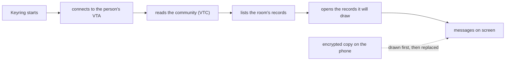

# Data rooms performance — a room that opens at once and stays current

**Status:** Brainstorm. The product owner's requirements are recorded (§3) and nothing is designed or decided; Phase 0 (§7) measures the loading chain before any design is written. Not scheduled.
**Roadmap epic:** none yet.
**Scope:** How fast a data room reaches the screen and how it stays current: the chain from Keyring's start, through the person's VTA, the community and the room, to drawn messages; what the phone keeps, in what order it refreshes, how it hears about new records, and how several identities are loaded. The end state the owner wants is a room that works like a group chat.
**Companions:** [`data-rooms-performance-plan/`](./data-rooms-performance-plan/) — review index in §12
**Parent / related:** [`openvtc-rooms-plan.md`](./openvtc-rooms-plan.md) (Keyring as a member client of rooms), [`rooms-chat-plan.md`](./rooms-chat-plan.md) (the conversation format; its slice F is the upstream new-record signal), [`agent-connect-plan.md`](./agent-connect-plan.md) (an AI agent in a room rides on the room's loading), [`message-protection-plan.md`](./message-protection-plan.md) (the mediator's queue contract)

## Overview
<!-- plan-part: human -->

> **Human part: for people deciding and reviewing.** What this is, what a person
> sees, how we'll know it works, and what is needed from whom. It adds nothing: the
> numbered precision part below is authoritative, and if the two disagree, the
> precision part wins and this part is the bug.

A person opens Keyring and taps a room. Today the room's recent messages come from a small encrypted copy on the phone while the room is re-read from its host, the list of rooms is re-read about every two minutes while the Messages screen is in view, and nothing tells the phone that a new message exists (§2). The owner wants a room that behaves like a group chat: it shows at once, even before the phone has reconnected, refreshes in the background in a sensible order, hears about new messages instead of asking, loads only what is on screen, and handles a person who holds several identities without loading all of them at once (§3). This document records those requirements and what exists; it decides nothing yet (§5).

The chain a room's messages travel today, and the one shortcut that exists: the phone's own copy of recent posts, drawn first and replaced by the host's answer (§2).

**How we'll know it works**

| Claim | Proved by | Runs where | Status |
|---|---|---|---|
| Each hop of the chain (start, VTA, community, room listing, record opens) has a measured time on a phone, cold and warm, for one identity and for several | Phase 0 measurement (§7 step 0.1) | Physical phones, lab | Not run |
| The brainstorm's requirements each map to something that exists, something planned, or a gap (§3) | Phase 0 inventory (§7 step 0.2) | Reading the tree | Not done |

**Where it stands:** a brainstorm with a measurement step in front of it. Blocked on nothing to measure; a design needs the measurements and the owner's answers to §11.

**Open decisions**

| Question | Recommendation | Who decides | By when, or what it blocks |
|---|---|---|---|
| Whether a room may be shown from the phone's copy before the host is reached at all (an offline view), or only until the first listing answers, as today | None yet: it depends on how a refusal is told apart from a failure, measured in Phase 0 (§11 Q1) | Product owner | Blocks the design of §3 item 5 |

**Not doing:** no design in this version; no change to who is the source of truth (the room's host), no archive on the phone, no change to the rooms' trust model or record format (§1.2).

---

<!-- plan-part: precision -->

> **Precision part: for implementers and agents.** Complete, exact and normative:
> implement from this part. Sections are numbered, and a bare `§n` means this
> plan's section n.

## 1. Scope, non-goals and baseline

### 1.1 Scope

The time from Keyring's start to a room's messages on screen, and the time from a new record at the host to its appearance on a member's screen; what the phone keeps between runs and how it is protected and removed; the order in which rooms, communities and identities are refreshed; how the phone learns of a new record; and the loading of a person who holds several identities. The requirements are the product owner's brainstorm of 2026-11-22 (§3), recorded here so that a design can be written against them.

### 1.2 Non-goals and non-claims

- **No design yet.** §3 lists requirements; §5 records no decision. Nothing here is a commitment to build.
- **The host stays the source of truth.** Whatever the phone keeps is a copy drawn sooner, never evidence of anything ([`openvtc-rooms-plan.md`](./openvtc-rooms-plan.md) §2).
- **Not an archive.** Copies on the phone are bounded and disposable.
- **No change to the record format**, to who may read a room, or to the mediator's contract.
- **Not the agent-connect plan's problem.** An AI agent in a room reads through the person's VTA; this plan's speed work does not change what it may read.

### 1.3 Baseline

Measured at Keyring `origin/main` `7856855ed` (2026-11-22), after the fold of keyring-bifold into this repository (#970); paths are under `bifold/packages/core/src/modules/rooms/`. A move of `bifold/packages/*` to `packages/*` is open (#978, #979); after it the same paths read `packages/core/src/modules/rooms/`. Upstream: the rooms specifications and `docs/02-vta/data-rooms.md` in `external/verifiable-trust-infrastructure` at the pin `f7b78e29d`.

## 2. Current state

What the phone does today, from the tree at the baseline:

| Hop or mechanism | What exists | Where |
|---|---|---|
| Rooms list | One poll for the whole app while a Messages screen is in view, at `ROWS_POLL_MS` = 120,000 ms; "Nothing pushes a post to a phone" | `useRoomRows.ts` (lines 6, 66) |
| Rows at start | The Messages rows (room and community names, last activity; no words) kept in one wallet record and shown on a cold start until the first listing replaces them | `rowsAtStart.ts` |
| Kept listings | Each room's last listing (keys, versions, metadata; no words), per service, at most `KEPT_LISTINGS_MAX` = 32 rooms, in memory; forgotten on lock | `keptListings.ts` (line 41) |
| Message cache | The last `MSG_CACHE_POSTS` = 50 drawn posts per room, at most `MSG_CACHE_ROOMS` = 32 rooms, `MSG_CACHE_DAYS` = 7 days, in an encrypted wallet record per (identity, room); shown first, then replaced by the host's listing; wiped on leave, removal, access end, unlink and kill switch; off without biometric unlock | `messageCache.ts` (lines 57 to 60), `useMessageCacheBiometryGuard.ts`, `roomsLeave.ts` |
| Opened records | Decrypted bodies kept in memory, at most `MAX_OPENED_RECORDS` = 500, read in batches of `READ_BATCH_MAX` = 32; dropped on lock | `real/agentRoomsService.ts` (lines 398, 401) |
| Outbox and pending writes | Posts on their way, reactions and edits, in memory only | `useRoomSend.ts`, `pendingRecordWrites.ts` |
| Live path | One WebSocket per DID to the mediator, for the person's own messages; room records are not pushed (above) | `../trust-tasks/module/VtiMediatorTransport.ts` (line 12) |
| Switches around these | `liveDeliverySwitch.ts`, `watchWheneverOpenSwitch.ts`, `partialListingSwitch.ts`, `acceptFromPreviewSwitch.ts`, `offersOnMessagesSwitch.ts` | the module root |

What each switch turns on, and the measured time of each hop, are not recorded here: Phase 0 reads and measures them (§7). A plan for the message cache exists outside this repository and is not linked; its decisions as shipped are the constants above.

## 3. The brainstorm, as requirements

The product owner's list of 2026-11-22, in his order and words (quoted), each followed by a reading of what it asks for. The readings are the recorder's, not decisions; the companion [`2026-11-22-al.md`](./data-rooms-performance-plan/2026-11-22-al.md) carries the list whole.

1. **"Keyring startup → Keyring → VTA connect → VTA → VTC → VTA → Data room."** The chain to measure and shorten: each hop in order, each a round trip through the person's VTA. The design works on the chain, not on one screen.
2. **"No caching yet."** Read as: beyond what §2 lists (recent posts, listings, rows), nothing is cached; in particular the community and the VTA connection are not. To confirm in Phase 0.
3. **"Optimistic."** The screen draws what it expects (a sent post, a known room) before the host confirms it, and corrects afterwards.
4. **"Encrypted."** Everything kept on the phone is encrypted at rest, as the message cache is (§2).
5. **"Removed when leave data room or VTC."** Every copy goes with the access that justified it, as the message cache's wipe triggers do (§2). Extends to anything new this plan keeps.
6. **"Lazy loading of content."** Load what is on screen, then the rest; files and old history on demand.
7. **"Websockets."** Hear about new records over the live connection the phone already holds to the mediator, instead of polling every two minutes. Depends on an upstream signal (§10).
8. **"Identities?? Multiple identities — need to manage and load them intelligently."** A person with several identities (several personas, or a room held as two identities) should not pay for all of them at start; load the one in use first.
9. **"Learn from Signal and Matrix — use best practices, with our VTI philosophy."** Study how those clients keep a conversation current (their sync and queue models), and adopt what fits a design where the host is authoritative and the phone holds no long-term archive.
10. **"You can view VTC and data room content before you're even connected from cached content."** The copy on the phone is shown before any connection, for communities as well as rooms. Today the message cache shows only until the first listing, and comes down if that listing fails; whether to go further is §11 Q1.
11. **"In the background, things are refreshed and updated in a priority order, of what is most likely or recent or important."** A refresh scheduler: the open room first, then recent rooms, then the rest.
12. **"Also consider parallel loading (e.g. adding new messages before seeing any messages deletion)."** Independent reads in parallel, and a stated rule for the order in which their effects are applied (an addition may show before a deletion is known).
13. **"Role of the mediator and its influence."** How much of the chain's time is the mediator (queueing, pickup, the per-sender limits in [`message-protection-plan.md`](./message-protection-plan.md)), and what a live signal would cost there.

**Two early goals**, in the owner's words: "to have something so it's like the Signal Keyring feedback group and work similar to a group chat but within a data room/VTC"; and "to prove that context moves with you, like between VTCs, like a colleague and something else", read as: what a person (or their agent) knows travels with them from one community to another.

## 4. Constraints (cited)

| Constraint | Source |
|---|---|
| The room's host is the source of truth; a member client reads, writes and presents, and holds no room credential or group key | [`openvtc-rooms-plan.md`](./openvtc-rooms-plan.md) §2 |
| "Nothing in the rooms family tells a member there are new records, and `notifications/notify` isn't a per-record signal. Defining one is upstream's call." Until then "rooms keep polling (`useRoomRows.ts`)" | [`rooms-chat-plan.md`](./rooms-chat-plan.md), "Open upstream (slice F)" |
| A room's change signal reaches a member 2 to 6 s late on purpose, against correlation | [`rooms-chat-plan.md`](./rooms-chat-plan.md), "Open upstream (slice F)", the signal's delay (IN-653) |
| An unacknowledged message is charged to its sender; a refusal carries a typed gate and `Retry-After`; the mediator caps undelivered messages per sender | [`message-protection-plan.md`](./message-protection-plan.md) §2, §4 |
| A room is "a writable channel into every member's agent context": what is read is untrusted input, rendered inert | `docs/02-vta/data-rooms.md` §9 (pin `f7b78e29d`) |

## 5. Decisions and rejected alternatives

None taken. Two positions the owner stated on 2026-11-22 stand as direction, not design: follow Signal's and Matrix's practices where they fit the VTI model (§3 item 9), and aim at a group chat inside a room (§3, "Two early goals"). Rejected alternatives: none yet.

## 6. UX: screens, states, copy, accessibility

Not applicable in this version: no screen changes are designed. A design that changes how a room looks while loading (a copy shown, a refresh in progress, a failure) adds this section with its copy and mockups.

## 7. Steps and acceptance criteria

### Phase 0: measure and inventory (no app change)

**0.1 Measure the chain.** On a physical phone against the lab stack (`scripts/openvtc/local-vti-stack/`), with the app's own log: the time of each hop in §3 item 1 (start to VTA connected; VTA to community read; community to room listing; listing to first drawn message; and the two-minute poll's cost), cold and warm, for one identity and for a person with three, with the message cache on and off. *Acceptance:* a table of times per hop, per case, with the commit, the phone and the stack's image versions; the cases are reproducible from a recorded script.

**0.2 Inventory.** For each requirement in §3: what exists (§2), what each rooms switch does (§2), what the mediator contributes (§3 item 13), and which upstream change it needs (§10). Read Signal's and Matrix's published client sync designs and record what fits (§3 item 9). *Acceptance:* a companion with one row per requirement: exists, planned elsewhere, gap; the Signal and Matrix practices listed with a source each and a fit or no-fit reason.

### Phase 1: design

Written after Phase 0, in this plan's §3 to §6, with steps and acceptance criteria added here. Not started.

## 8. Testing

Phase 0 is itself measurement: physical phones for the chain's times (emulators do not show real network or biometric behaviour), the lab for a stack we control (`vti-lab-and-field`: the lab is where a refusal path can be driven, and where fixture deviations are declared). No unit tests are added in Phase 0. A design adds its test plan per claim here, following the tiers in [`CLAUDE.md`](./CLAUDE.md) ("The test plan"). No testing requirements were specified for this plan.

## 9. Security, privacy, migration and rollout

What the phone keeps today is encrypted at rest and removed with the access that justified it (§2). Any new copy this plan introduces keeps both properties (§3 items 4 and 5), is off on phones without biometric unlock as the message cache is, and is removable by the same kill path. Nothing changes until a design is written; there is no migration and no rollout in this version.

## 10. Blocked, and on whom

| # | Needed | Why | Blocks |
|---|---|---|---|
| 1 | An upstream per-record signal that a room has new records (or a mention), deliverable over the phone's existing live connection | Today nothing pushes a room record; the phone polls (§2, §4) | §3 item 7 |
| 2 | The mediator's part of the chain understood (queueing, pickup, limits) | §3 item 13 | the design's order of refresh |

Nothing is blocked on a person; the owner's answers in §11 are needed before Phase 1.

## 11. Open questions

| # | Question | Owner | Recommendation |
|---|---|---|---|
| Q1 | May a room be shown from the phone's copy before the host is reached at all, and for how long, given that a failure and a refusal cannot always be told apart? | Product owner | None yet: Phase 0 measures how often the first listing fails for reasons other than a refusal |
| Q2 | Which identity loads first for a person with several: the last used, the one with the newest activity, or the owner's choice? | Product owner | None yet |
| Q3 | Is the group-chat goal (this plan's §3) met by rooms as they are, or does it need the chat features in [`rooms-chat-plan.md`](./rooms-chat-plan.md) first? | Product owner | None yet |
| Q4 | What does "context moves with you" demonstrate concretely: a person's or an agent's memory across two communities, or a room's content? | Product owner | None yet |

## 12. Reviews

| Rev | Companion |
|---|---|
| 1 | [`data-rooms-performance-plan/2026-11-22-al.md`](./data-rooms-performance-plan/2026-11-22-al.md): the brainstorm as given, the two goals, and the recorder's readings |
