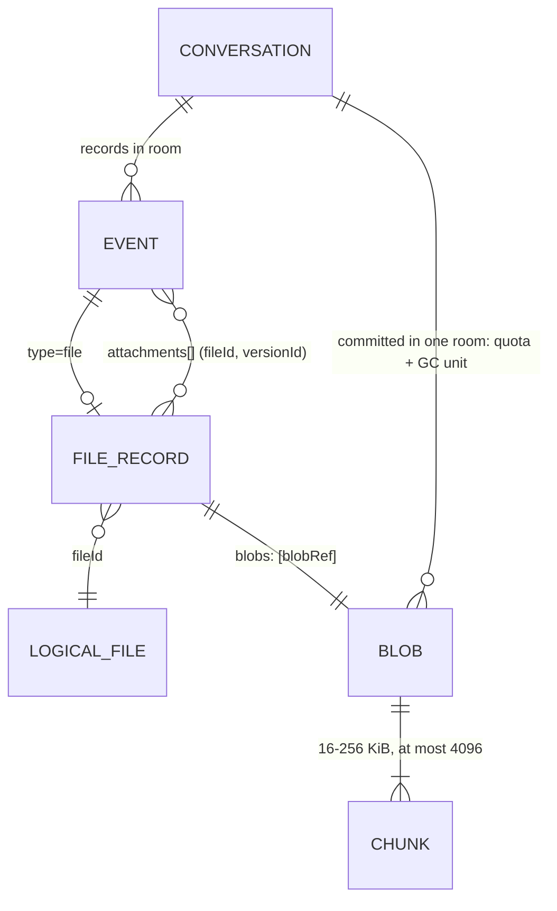

# Group Messaging and Linked File Sharing on Data Rooms — Architecture Plan

**Status:** Draft — architecture subtask. Nothing here is built, and it is not a commitment to implement.
**Scope:** A group messaging service — conversations, threads, edits, reactions, real-time delivery, offline sync — plus **file sharing where files are linked to conversations**: attachments on messages, a per-conversation file library, file-to-thread references, one file reused across conversations, and file versions. Built as an **application profile on top of VTI data rooms**, not beside them.
**Parent:** [`openvtc-rooms-plan.md`](../openvtc-rooms-plan.md) (Keyring as a member client of rooms). Section references to it are marked "plan §". Sibling subtasks it relies on: [`rooms_s3_storage_subtask.md`](./rooms_s3_storage_subtask.md) ("S3 subtask §") and [`rooms_encrypted_spaces_subtask.md`](./rooms_encrypted_spaces_subtask.md) ("ES subtask §").
**Reasoning:** [`2026-10-13-bam.md`](./2026-10-13-bam.md) (re-baselining onto the pin), [`2026-10-26-bam-rebaseline.md`](./2026-10-26-bam-rebaseline.md) (re-baselining onto fc157f76, including the blobs family). Decisions proposed here are marked **(proposed)**; when one is made, record it in a dated companion, not by editing this file.
**Baseline:** VTI `main` at `fc157f76` (2026-10-26; vta-service 0.65.0, vta-sdk 0.73.0), read from `/srv/dev/code/seas/verifiable-trust-infrastructure` and abbreviated `VTI/`. Keyring's pin in `scripts/openvtc/PINS.json` still names an earlier commit (`49f5f1be`) until bumped. Claims about that code carry a path. Everything about the messaging and file layers is design, not measurement. **§5.5 and §8–§9 are written to the upstream `rooms/blobs/*` shape**, and §10.2, §10.3, §12.2, §12.3, §13 and §14 follow it where they touch files. §4.3, §9.2 and §9.5 keep "unlink" wording for library removal and old versions, which now means retracting the record that names the blob (§8.5).

**References** (the `[[…]]` tags follow the plan's header; new ones are added here):

- **[[ROOMS-GUIDE]]** — `VTI/docs/02-vta/data-rooms.md`. Operator guide; §2 is the built/designed line.
- **[[ROOMS-DESIGN]]** — `VTI/docs/05-design-notes/data-rooms.md`. Invariants I1–I5 (§2), visibility ladder (§3.1), credentials (§4), MLS (§5), epoch chain (§5.5), records (§6), hosting and mirrors (§7), audit (§8), lifecycle (§9), open items (§14).
- **[[ROOMS-JOINING]]**, **[[ROOMS-READTHROUGH]]**, **[[ROOMS-VERIFIED]]**, **[[ROOMS-ANCHOR]]** — the sibling design notes in the same directory.
- **[[ROOMS-SEALED]]** — `VTI/vti-rooms/src/sealed.rs`. AEAD binds `roomId | key | version | epoch` (`associated_data`, :328); module doc "Version is bound before it is known" (:19).
- **[[ROOMS-STORAGE]]** — `VTI/vti-rooms/src/storage.rs`. Keyspaces, version assignment (module doc :15–22; `put_record` :437), listing pages (`MAX_PAGE = 500`, :702), the record tree head (`tree_head`, :778).
- **[[ROOM-HOST-DIDCOMM]]** — `VTI/room-host/src/didcomm.rs`. A host reachable at a mediator (`didcomm` feature + `--mediator-did`, both off by default, :21), authorization unchanged by carrier.
- **[[MLS-ATTACH]]** — [draft-sullivan-mls-attachments](https://www.ietf.org/archive/id/draft-sullivan-mls-attachments-01.html), already cited by [[ROOMS-DESIGN]] §5.1 for exporter-derived content keys.
- **[[MIMI]]** — [MIMI protocol](https://datatracker.ietf.org/doc/draft-ietf-mimi-protocol/) and room policy drafts, already "taken" in [[ROOMS-DESIGN]] §11.
- **[[RFC9420]]** — MLS.

---

## 1. Summary

A **conversation is a room**. A **message is a record**. A **file is a set of encrypted chunks in a blob store, described by a sealed manifest record** in the room that owns it. Everything that decides *who may do what* — DIDs, VIC/VMC/VAC chains, MLS, the epoch chain, the VTA oracle, presenter binding, the host trusted for availability only — is reused unchanged.

The service adds two things rooms do not have, and builds on a third that upstream now serves:

1. **A messaging profile** — the record-body schema and key scheme for messages, threads, edits, reactions and read markers. This is a client convention inside sealed bodies, so it needs no host change.
2. **A change feed** — a hint channel that tells members' VTAs a room has advanced, so delivery is not polling. Content never rides it.
3. **A blob layer** — **served upstream**: `rooms/blobs/*`, with `rooms/keys/file-key` for the per-file key and a pluggable `BlobStore` behind the host (§8). Files travel as chunk Trust Task documents, outside the 64 KiB body, authorized by the same room presentations. This profile consumes it and adds no host change.

Two upstream frictions are load-bearing and are called out early because they decide feasibility, not polish:

- **Sealed writes race on the room-wide version counter** ([[ROOMS-SEALED]]): a writer must seal under the version it *expects*, and every concurrent sender in a busy conversation contends for the same next number (§6.3).
- **Rooms were designed for small, slow libraries** ("affordable because rooms are small", [[ROOMS-DESIGN]] §6). A chat room is a high-write, append-heavy log. Listing caps, per-record VTA round-trips and owner-only commits all need checking at chat rates (§12).

---

## 2. Goals and non-goals

### Goals

- **G1. Group conversations on every shipping tier** (`open`, `attributed`), and designed so `private` drops in when its ZK profile ships ([[ROOMS-GUIDE]] §2).
- **G2. Host-neutral and portable.** A conversation moves hosts by re-pointing its room DID (I3) and its files move with it.
- **G3. Host learns no content on sealed tiers**, including file names, types, thumbnails, thread structure and who reacted to what.
- **G4. Files linked to conversations**: attachments, a per-conversation library, file references from threads, reuse of one file across conversations, and versions.
- **G5. Real-time when online, convergent when offline.** Sub-second delivery hints; `sinceVersion` sync that always converges.
- **G6. Human and agent members** share one record model ([[ROOMS-DESIGN]] §6.1): agents read and post through attenuated VACs, and their messages are marked as agent-authored.
- **G7. No key material in the app.** The wallet or web client holds no room credential and no group key (plan §2.2 item 1); see §9.4 for the one bounded exception proposed for file keys.

### Non-goals

- **Multi-primary hosting or CRDT merge** of conversation state. Rooms rejected both ([[ROOMS-DESIGN]] §6, §7.3); a conversation has one write-primary.
- **Voice, video, screen share.** Out of scope; SFrame ([RFC 9605](https://www.rfc-editor.org/info/rfc9605)) over the same MLS exporter is the natural later path.
- **Public broadcast channels with unbounded readership.** A room is an explicit set of DIDs ([[ROOMS-DESIGN]] §3). A broadcast product is a different design.
- **Federation with Matrix, Signal or other networks.** MIMI alignment is a direction, not a deliverable.
- **Deniable messaging.** Rooms want attribution, via in-body signatures (ES subtask §2, "Deniability").
- **Server-side content moderation or scanning on sealed tiers.** The host cannot read; §8.6 says what replaces it.
- **Owner/admin tooling for MLS adds.** Upstream serves it as `rooms/owner/group/{create,add,remove,renew}` on the owner's VTA (plan §2.3, B5); this plan consumes it.

---

## 3. Layering: what is reused, what is added

```
 ┌────────────────────────────────────────────────────────────────────────┐
 │ Clients: Keyring wallet · web console · mobile agent · AI agents       │  no keys
 ├────────────────────────────────────────────────────────────────────────┤
 │ NEW  Messaging client library (profile codec, local store, search idx) │
 ├───────────────────────────────┬────────────────────────────────────────┤
 │ Member's VTA (oracle)         │ NEW  vta: change-feed subscriber,      │
 │ rooms/keys/{seal,open,read,   │      per-room watermark + root memory, │
 │ browse,present,chain,commit}  │      encrypted search index, file-key  │
 │ (exists)                      │      unwrap (§9.4)                     │
 ├───────────────────────────────┴────────────────────────────────────────┤
 │ Transport: TSP > DIDComm > HTTPS, one Trust Task spine (exists)        │
 ├───────────────────────────────┬────────────────────────────────────────┤
 │ Room host (room-host or VTC)  │ NEW  host: change feed fan-out         │
 │ rooms/{create,records,epoch,  │                                        │
 │ owner,blobs}/* (exists)       │                                        │
 ├───────────────────────────────┼────────────────────────────────────────┤
 │ fjall metadata (exists)       │ blob store (exists): local, S3, GCS    │
 └───────────────────────────────┴────────────────────────────────────────┘
 Identity & authority: room DID (did:webvh, witnessed) → VIC/VMC/VAC; MLS group (exists)
```

| Messaging concept | Rooms concept it maps to | Change needed |
|---|---|---|
| Conversation (group chat, DM, channel) | **Room** — one DID per conversation | none |
| Conversation creator / admin | Room **owner** (I1), `admin` VAC | none |
| Participant | Room **member**: VMC + VAC, MLS leaf at their VTA | none |
| Join / invite | VIC → `rooms/keys/{key-package,welcome}` (push-shaped, [[ROOMS-JOINING]]) | consumes upstream; the owner's VTA serves the MLS add (`rooms/owner/group/add`) |
| Post / edit / react permission | VAC `write` | none (see §7.2 for finer verbs) |
| Moderate (delete others', pin) | VAC `curate` | none |
| Message, reaction, edit, read marker | **Record** with opaque key, sealed body | profile only (§5) |
| Message order | Room-wide `version`, host-assigned | none; but §6.3 contention |
| Sync | `sinceVersion` watermark, cursor pages | none |
| Delete message | `curate` → `retracted` tombstone | none |
| History for new joiners | **Epoch chain** (`Chained` retention) | none |
| "Disappearing" history | `FromJoin` retention + `rooms/epoch/prune`; record retention `rooms/records/{prune,retention/set}` | none; the prune verbs exist ([[ROOMS-GUIDE]] §10.4–§10.5) |
| Integrity of history | Signed put acks, Merkle root, traces ([[ROOMS-DESIGN]] §14.7) | none |
| Push notification | — | **new: change feed** (§6.5) |
| File bytes | `rooms/blobs/*` + `rooms/keys/file-key` | none; served upstream (§8) |
| File metadata, key | Record (manifest), sealed | profile only |
| Agent participant | Attenuated, audience-bound VAC via `rooms/keys/present` | none |

**Decision (proposed): one room per conversation.** Threads, the file library and pinned items live *inside* the conversation's room. The alternatives were rejected:

- *One room per thread* multiplies MLS groups, owner commits and credential issuance by thread count, and makes "reply in thread" an admission event.
- *One room per community with conversations as key prefixes* would put every conversation under one membership and one key — the host could not tell them apart (good), but neither could the members' permissions.

A DM is a two-member room. A "space" or "workspace" grouping conversations is a client-side or community (VTC) concept, not a room.

---

## 4. Identity, membership and permissions

Nothing new is invented here; this section states how the messaging product reads the existing model.

### 4.1 Identity

- **People are DIDs**; their **VTA is their MLS leaf** ([[ROOMS-DESIGN]] §5.1). Devices hang off the VTA through the oracle, so multi-device is not an MLS problem.
- **Display names and avatars** are not a host concept. Each member publishes a **profile record** in the room (key derived from their DID under an HMAC the host cannot invert, §5.2), signed by them. Clients may also show a contact's name from the user's own address book. The host never learns a display name on sealed tiers.
- **Agents** are not members. An agent posts under its human's membership through an attenuated VAC, and the in-body signature says it was the agent ([[ROOMS-DESIGN]] §4.3, §6.1). The UI marks agent-authored messages.

### 4.2 Membership lifecycle

```mermaid
sequenceDiagram
    autonumber
    participant O as Owner VTA (room DID key)
    participant H as Room host
    participant J as Joiner VTA
    participant W as Joiner wallet

    O->>J: VIC (rooms/owner/invite) over TSP/DIDComm
    J->>W: show inviter, room, validUntil — consent
    W->>J: accept
    J->>O: KeyPackage (rooms/keys/key-package)
    Note over O: MLS add on the owner's VTA (rooms/owner/group/add, plan B5)
    O->>H: Commit + epoch link (rooms/epoch/mint)
    O->>J: Welcome (rooms/keys/welcome) + VMC + VAC
    J->>H: rooms/epoch/chain → rooms/keys/chain (backfill history)
    J->>H: rooms/records/list sinceVersion=0
    Note over J: member; history readable back to retention floor
```

- **Join is push-shaped and consented** ([[ROOMS-DESIGN]] §4.1). There is no "request to join" until upstream specifies one ([[ROOMS-JOINING]]); invite links are therefore **out-of-band introductions to the owner**, who then pushes a VIC. A messaging UI must not pretend a link joins anyone by itself.
- **Leave / remove** is an MLS remove commit by the owner plus VAC/VMC non-renewal. Removal is forward-only: the removed member keeps what they already read and opens nothing after ([[ROOMS-DESIGN]] §5.5). A removed member with an unexpired VMC can still *present* to the host until it expires (§10.4 there) — so **messaging VMCs and VACs should be short-lived and auto-renewed** (proposed default 7 days, renewed by the owner's VTA on each epoch mint).
- **Missed commits are the classic failure.** A VTA that misses one cannot open anything later and must say "a commit has not been delivered", not "corrupt" (plan R2(c)). The change feed (§6.5) carries commits so this is rarer, and `rooms/epoch/commits` backfills.
- **Owner availability gates membership.** Only the owner commits ([[ROOMS-DESIGN]] §5.1). A group whose owner is offline cannot add anyone. Mitigation: owners run on an always-on VTA (the normal deployment), and a **nominated successor** (§10 there) covers long absence. A multi-admin committer policy is an open question (§15, Q3).

### 4.3 Permissions

| Product action | VAC verb | Notes |
|---|---|---|
| Read messages, list library, download files | `read` | |
| Post, reply, react, edit own, upload, attach, set own read marker | `write` | |
| Retract others' messages, pin, deprecate, unlink files from library | `curate` | human verb by default; not granted to agents |
| Add/remove members, rename conversation, set retention | `admin` + owner | owner is the only MLS committer |

**Decision (proposed): no new VAC verbs in v1.** Finer verbs (`react`-only, `upload`) are tempting but each is an upstream VAC change; revisit if `write` proves too coarse (§15, Q6). "Edit own" and "delete own" are enforced **client-side** by checking the in-body signature of the target — the host cannot see authorship on sealed tiers, so it cannot enforce it, and the protocol does not claim it does. A curator can always retract.

---

## 5. Data model

### 5.1 The conversation room

Created with `rooms/create` as today. Messaging sets:

- `visibility`: `attributed` by default; `open` only where server-side search and host scanning are worth the host reading content.
- `retentionPolicy`: `Chained` (history for joiners) by default; `FromJoin` for "new members see only new messages".
- `retentionDays`: the room's own statement of how long it matters ([[ROOMS-DESIGN]] §9).

A **conversation settings record** (key `cfg`, sealed) holds name, topic, avatar file ref, default notification policy and the profile version. Only `admin` writes it; clients ignore a `cfg` not signed by a current admin.

### 5.2 Record keys

Keys are **opaque on sealed tiers** ([[ROOMS-SEALED]]: "a key reading `decision/acquire-northwind` defeats the encryption"). The profile uses:

| Record kind | Key | Mutability |
|---|---|---|
| Message / reply / system event | `e/<eventId>`, `eventId` = 128-bit random, base32 | create-only |
| Edit, reaction, redaction request | `e/<eventId>` (its own event, referencing a target) | create-only |
| File manifest (one per file version) | `e/<eventId>` | create-only |
| Member profile | `p/<HMAC(K_idx, did)>` | rewrite by owner of the DID |
| Read marker | `r/<HMAC(K_idx, did)>` | rewrite by that member |
| Conversation settings | `cfg` | rewrite by admin |

The `e/`, `p/`, `r/` prefixes leak only the *class* of a record, which the access pattern already reveals. `K_idx` is a per-room index key derived from the MLS exporter with its own label, carried forward across epochs inside the sealed `cfg` record so it is stable (otherwise a member's profile key would change every epoch). If even record class is judged too much, all keys become `e/…` and profiles and markers become events (§15, Q8).

**Decision (proposed): the conversation is an append-only event log.** Everything a user does is a new create-only record; the only rewritable records are the three per-member/per-room singletons above. That fits the create-only sealing rule, makes sync trivial, and leaves the rooms "mutable KV with tombstones" model untouched.

### 5.3 Event body (inside the seal)

One sealed blob per record, all fields together, so ciphertext length does not reveal shape ([[ROOMS-DESIGN]] §6). Canonical JSON, versioned:

```jsonc
{
  "profile": "org.openvtc.msg/1",
  "type": "message",            // message | edit | reaction | redaction | file | system | profile | marker | cfg
  "eventId": "b3k…",            // equals the record key suffix; checked on open
  "author": "did:webvh:…alice", // the member; agent DID in "via" when an agent wrote it
  "via": "did:key:…agent",      // optional, matches the attenuated VAC's audience
  "clientTs": "2026-10-06T09:14:03Z", // untrusted, display only
  "thread": { "root": "b3a…", "inReplyTo": "b3c…" }, // optional
  "content": { "format": "text/markdown", "text": "…", "mentions": ["did:…"] },
  "attachments": [ { "fileId": "f9x…", "versionId": "e/b3m…", "name": "q3.pdf" } ],
  "target": "b3c…",             // for edit / reaction / redaction
  "sig": "z…"                   // author's DID signature over everything above
}
```

- **Signature inside the seal** gives members provable authorship while the host sees nothing ([[ROOMS-DESIGN]] §6). Clients **reject** an event whose `eventId` does not match its record key (relocation inside one room is already blocked by the AEAD; this blocks a member re-posting another's signed body under a new key).
- **Rendering is inert.** Markdown renders without script, remote images or auto-followed links; agents see content fenced as untrusted data (plan §2.2 item 5, [[ROOMS-DESIGN]] F8, R2‑16).
- **Size.** A Trust Task body is capped at 64 KiB on a VTC (plan §5). The profile caps a message body at **32 KiB plaintext** before padding; anything longer becomes a file attachment (`text/markdown` file, rendered inline).
- **Padding.** Sealed bodies pad to buckets (1, 4, 16, 32 KiB), the mitigation [[ROOMS-SEC-V2]] names for length leakage.

### 5.4 Threads, edits, reactions, redactions

- **Thread** = events sharing `thread.root`. The host cannot see thread structure; clients build it locally.
- **Edit** = an `edit` event with `target` and new content. The latest edit *signed by the original author* wins; others are ignored.
- **Reaction** = a `reaction` event; removal is a `redaction` of the reaction event. Aggregated client-side.
- **Delete own message** = a `redaction` event by the author (soft: clients hide), plus, where the author holds `curate`, a `rooms/records/curate` → `retracted` on the original so the host drops the body. Without `curate`, the body persists at the host until a curator retracts it or the epoch is pruned — the UI must say "hidden", not "deleted", in that case.
- **Moderator delete** = `curate` → `retracted` (body gone at the host; key/version/epoch stay, [[ROOMS-GUIDE]]).

### 5.5 File entities



- **Logical file** — a profile-level identifier shared by the versions of one file (§9.5). It is not the upstream `fileId`, which is minted per upload (below).
- **File record** — an ordinary sealed record whose body carries the upstream file manifest: `fileId` (32 random bytes minted by the uploader), `name`, `mediaType`, `size`, the plaintext `digest`, the `epoch` the file key derives from, `segmentSize` and `blobRef` (`data-rooms-files.md` §2.1). This profile adds `versionId` (its own record key), `supersedes`, the logical-file identifier, optional preview and thumbnail sub-manifests, and the uploader signature, all inside the sealed body. The record also carries the cleartext `blobs: [blobRef]` the host needs to keep the blob alive (§2.2 there). Upstream allows one file per record; a message with several attachments references several file records.
- **Blob** — the file's ciphertext at the host's `BlobStore`, named by `blobRef`, the digest of the **ciphertext manifest**. The host knows its size, the room it was committed in, the uploader on `attributed`, and access times — nothing else.
- **Blob row** — host-side `room_blobs:<roomId>:<blobRef>`, with `refs` counting the records that name the blob (`data-rooms-files.md` §5.5). It is the host's unit of authorization, quota and garbage collection (§8.5).

---

## 6. Message flow, ordering and delivery

### 6.1 Send path

```mermaid
sequenceDiagram
    autonumber
    participant C as Client (wallet/web)
    participant V as Sender's VTA
    participant H as Room host (DS)
    participant F as Change feed
    participant M as Other members' VTAs

    C->>V: post(roomId, body, eventId)  [client-generated eventId = idempotency key]
    V->>V: sign body as member, pad
    V->>V: rooms/keys/seal (key=e/eventId, version=N+1, epoch=E)
    V->>H: rooms/records/put  expectedVersion:0, presentation(write)
    alt host assigned N+1
        H-->>V: signed ack {key, version: N+1, epoch}
    else someone else took N+1 (host still accepts, assigns v ≠ N+1)
        H-->>V: signed ack {key, version: v, epoch}
        V->>V: stored record will not open; re-seal at next expected version
        V->>H: rooms/records/put  expectedVersion:v (rewrite, bounded retry)
    end
    H->>F: room advanced to version v
    F-->>M: hint {roomId, headVersion}  (TSP/DIDComm via mediator)
    M->>H: rooms/records/list sinceVersion=watermark → get → open
    V-->>C: sent (version, signed ack)
```

Steps 3–6 already exist as `rooms/keys/seal` then `rooms/records/put` ([[ROOMS-TS]] builds this pair). The host does not compare the sealed version with the one it assigns: `put_record` (`VTI/vti-rooms/src/storage.rs:370`) rejects only on the per-key `expectedVersion` precondition, then stamps `room.next_version` (:451), and the ack is `PutRecordResponse {key, version, epoch}` (`VTI/vti-rooms/src/wire.rs:216`) with no root — the root comes from a separate tree-head read. A lost race is therefore discovered by the writer comparing the acked version with the one it sealed under, not by a host conflict, and it leaves an unopenable record at the lost version until rewritten or retracted. A future `rooms/keys/write` ([[ROOMS-READTHROUGH]] §6) would collapse them into one VTA call, which is what a chat client wants.

### 6.2 Ordering

- **Total order per conversation = host-assigned room `version`.** The host is MLS's Delivery Service and the room's single write-primary ([[ROOMS-DESIGN]] §7.3), so this order is authoritative and identical for every member. `clientTs` is display-only.
- **Causal hints** (`thread.inReplyTo`, `target`) are rendered even if the target arrives later (placeholder until it does).
- **No cross-conversation order.** Each room is its own log.

### 6.3 The version race — the main messaging-specific risk

[[ROOMS-SEALED]] binds the **version** into the AEAD and the host assigns it from a **room-wide** counter. A create-only sealed write therefore produces an openable record only if no one else wrote in between (the host stores it either way, §6.1). In a busy group, N concurrent senders produce up to N−1 conflicts per round, each costing a VTA re-seal and a host round-trip.

Options, in order of preference:

| Option | Change | Effect |
|---|---|---|
| **A. Append-mode AAD** (proposed) | Upstream spec: for `expectedVersion: 0` puts, AAD binds `roomId \| key \| "create" \| epoch` instead of the version. The host-assigned version is attested by the **signed put ack** and the Merkle leaf ([[ROOMS-DESIGN]] §14.7), which already bind it | No contention. Relocation stays impossible because a create-only key cannot be re-written and the leaf commits to `(key, version)` |
| B. Bounded retry | None | Works today; degrades at roughly >5 concurrent senders/second per room. Acceptable for M1 |
| C. Per-sender serialisation via the owner | Owner VTA sequences writes | Kills availability when the owner is offline. Rejected |

**Decision (proposed):** ship M1 with B, raise A upstream in parallel (it is a `dtgwg-trust-tasks-tf` change first, per the VTI workspace rule that specs lead code). Measure conflict rates in M0.

### 6.4 Delivery guarantees

| Property | Guarantee | Mechanism |
|---|---|---|
| Send idempotency | exactly-once **effect** | `eventId` is the record key; `expectedVersion: 0` makes a retried put a conflict ("already exists (create-only requested)", `VTI/vti-rooms/src/storage.rs:384–388`). The conflict carries no record, so the sender reads `e/<eventId>` back and recognises its own signed body |
| Durability on ack | once acked, durable at the primary | signed ack; R2.1 "Remote-First": the client marks *sent* only on the ack, never on local enqueue |
| Delivery to members | at-least-once, eventually | hints are best-effort; `sinceVersion` pull is the source of truth |
| Gap detection | detected, not assumed | versions may **skip** by design ([[ROOMS-STORAGE]] :19–22: the failure "is a *skipped* version rather than a duplicated one"), so contiguity proves nothing. Use the signed tree head's `headVersion` + `recordCount` and Merkle traces ([[ROOMS-DESIGN]] §14.7) |
| Withheld records | detectable as of the last anchor | verified reads + witnessed anchor ([[ROOMS-VERIFIED]], [[ROOMS-ANCHOR]]); the VTA keeps root memory per room |
| Equivocation / fork | detectable at anchors | epoch authenticator + version watermark in the witnessed log ([[ROOMS-DESIGN]] §9). High-assurance conversations anchor per commit |
| Ordering consistency | identical for all members | single primary; mirrors are read-only and never reorder |

The retry rule from the VTI workspace applies: **one retry owner per failure domain**. The VTA's idempotent Trust Task layer owns put retries; the messaging client does not wrap them in its own loop.

### 6.5 Real-time: the change feed (new)

Rooms have no push today. The design note expects the room DID to be "messageable" and to "push epoch and membership changes to members over the existing delivery layer" ([[ROOMS-DESIGN]] §3.2), and `room-host` can already sit at a mediator ([[ROOM-HOST-DIDCOMM]]).

**Decision (proposed): hints, not content.** The host sends `{roomId, headVersion, epoch}` to subscribers. A hint carries no record and no author; a member's VTA pulls with `sinceVersion` and opens. Losing a hint costs latency, never correctness.

```
            ┌──────────── subscribe(roomId, presentation(read), ttl ≤ 24h) ─────────────┐
            │                                                                           ▼
 Member VTA ◄──── hint {roomId, headVersion, epoch} ──── mediator ◄──── Room host change feed
     │                (TSP preferred, DIDComm fallback)                     ▲
     │                                                                      │ on every put / curate / mint
     ├──► push gateway (WakeHandle) ──► phone OS push: "new activity" (no content)
     └──► local client: SSE/WebSocket from the VTA, or app polling the VTA
```

- **Subscriptions are presentations**, expiring (≤ 24 h) and renewed by the VTA. The host keeps the subscriber set in memory and a bounded store; it is **not** a roster (it lists who is listening, which on `attributed` the per-member access log already reveals).
- **`private` tier:** a subscriber list would hand the host the membership. There, hints go **from the room DID's mediator** to an MLS-sealed broadcast address, or members poll on a jittered schedule. Deferred with the tier.
- **Commits ride the same feed** so members apply them promptly (fewer stuck-epoch failures).
- **Typing indicators and presence** are **not** room records and not host traffic. They are optional, ephemeral, MLS-sealed application messages sent VTA-to-VTA over the mediator, dropped if not delivered in seconds. Off by default; they leak activity timing to every member.
- **Mobile:** the VTA wakes devices through the existing push gateway with a content-free notification; the app then asks its VTA. Notification text is rendered on-device after open, never by the push service.

### 6.6 Offline and sync

- **Per room, the VTA keeps:** watermark (highest version seen), last verified root + `headVersion`, applied epoch, and the decrypted event cache (encrypted at rest under the VTA's storage key).
- **Reconnect:** `rooms/records/list sinceVersion=watermark` in pages (≤ 500, [[ROOMS-STORAGE]]), `get` bodies, `open` via `rooms/keys/browse` in batches, verify trace against the anchored root, advance watermark. Tombstones converge deletes.
- **Outbox:** messages composed offline sit in the client outbox with their `eventId`; on reconnect they are sent in order. Because ordering is host-assigned, an offline message lands *after* everything already in the room, and the UI shows it there. That is honest and matches every mainstream chat system.
- **Fresh device:** has no state; it asks the member's VTA, which already has it. Devices never sync from the host directly (plan Q6, leaning VTA-only).
- **Mirrors** (T3) serve reads for far-away members; a member detects a stale mirror by its watermark and falls back to the primary for writes and bootstrap ([[ROOMS-DESIGN]] §7.3, R2‑5).

---

## 7. Conversation types

| Type | Room shape | Topology |
|---|---|---|
| DM | 2 members, both `write`; owner = initiator, successor = the other | T1 or T4 (peers via VRC) |
| Small group | ≤ 50 members, `attributed` | T1 (owner's room host) or T2 (community VTC) |
| Community channel | roster-sized, `attributed` or `open` | T2; T3 with mirrors when cross-community |
| Agent workspace | humans + their agents via attenuated VACs | any |

**Large rooms** stress three things: O(log n) MLS commits (fine), the owner as sole committer (a bottleneck for churn), and per-message VTA seal/open cost (fine — one seal per send, batched opens per sync). §12 lists the measurements.

---

## 8. File storage

### 8.1 Why files cannot be records

The Trust Task body is capped at **64 KiB on a VTC** and 2 MB on `room-host` (plan §5), and the body is inside a signed document. Upstream therefore moves a file's ciphertext as **chunk Trust Task documents** under `rooms/blobs/*`, and keeps the record small: it names the blob (`blobs: [blobRef]`) and seals the manifest (`data-rooms-files.md` §2, §5.1). A byte route outside Trust Tasks, with presigned upload grants as its authority, is not the shape: upstream's rule is "The control plane and the data plane are both Trust Tasks. Then any binding carries them (HTTPS, TSP, DIDComm), and nothing joins `REST_EXCEPTIONS`" (`data-rooms-files.md` §5.1). The one presigned path is the direct-transfer answer of `rooms/blobs/*` 0.2, which the host mints per transfer (§8.2).

### 8.2 The `rooms/blobs/*` task family (served upstream)

Served by both `room-host` and `vtc-service` (`vti-rooms/src/blob_tasks.rs`; `data-rooms-files.md` §5, §12 P5), authorized by a presentation chain issued by the room, bound to the presenter, never a host ACL (I5). A chunk document is authorized by the open transfer a presented begin created.

| Task | Needs | Does |
|---|---|---|
| `rooms/blobs/upload/begin/0.2` | `write` chain; the member's act, signed through their VTA | Takes the ciphertext manifest, checks it against the host's limits and reserves against them, opens an upload bundle. Returns `uploadId`, the `missing` chunk indices and the `uploadKey` named for this upload. On an S3 config through the community's VTA, `directParts` answers `mode: direct` with presigned part targets |
| `rooms/blobs/upload/chunk/0.2` | the open bundle; signed by the `uploadKey`, a `did:key` minted for this one upload | One chunk, idempotent, checked against the manifest digest. The member's VTA never signs over a file's bytes |
| `rooms/blobs/upload/commit/0.2` | the open bundle | Verifies the whole digest (at storage, for a direct upload), hands the blob to the `BlobStore`, returns `blobRef`. `digestMismatch` releases the reservation |
| `rooms/blobs/upload/abort/0.2` | the open bundle | Discards it |
| `rooms/blobs/get/0.1`, `0.2` | `read` chain | `{ roomId, blobRef }` → the manifest and a short-lived `downloadId`; 0.2 with `direct: true` may answer a presigned `GET` instead (not on `private` rooms by default) |
| `rooms/blobs/chunk/0.1` | the `downloadId` | `{ downloadId, index }` → the chunk |
| `rooms/records/put/0.2` | `write` | a record with `blobs: [blobRef]`; refused unless the blob is committed **in this room** |
| `rooms/keys/file-key/0.2` | `roomOpen`, on the member's VTA | `{ roomId, fileId, purpose: "seal" \| "open", epoch? }` → `{ key, epoch }` (§9.4) |
| `vtc/rooms/usage/0.1`, `vtc/rooms/limits/set/0.1` | the community | usage and limits at the room, member and object scopes; they replace a `blobs/usage` task |

Sources: `docs/02-vta/data-rooms.md` (the files and direct-transfer sections), `docs/05-design-notes/data-rooms-files.md` §5.1–§5.2, §4, at fc157f76.

**No `link`, `unlink` or `grant` task exists.** Cross-room linking of one blob is not built and is ruled out by the key derivation (§9.3). Download grants as a separate task are not built; the direct-transfer targets above are the only presigned paths. Upload sessions are `begin`/`chunk`/`commit`/`abort`, not `begin`/`complete`.

### 8.3 Upload: chunking, encryption, resumability

```mermaid
sequenceDiagram
    autonumber
    participant C as Client
    participant V as Uploader's VTA
    participant H as Room host (room-host or VTC)
    participant S as BlobStore (local, S3, GCS)

    C->>C: fileId = 32 random bytes; split plaintext into segments
    C->>V: rooms/keys/file-key/0.2 (roomId, fileId, purpose=seal)
    V-->>C: key, epoch
    C->>C: encrypt segments; build the ciphertext manifest; blobRef = its digest
    C->>V: rooms/blobs/upload/begin/0.2 (member's act, VTA signs)
    V->>H: begin (presents write)
    H-->>C: uploadId, missing[], uploadKey
    loop each missing chunk (resumable)
        C->>H: rooms/blobs/upload/chunk/0.2 (signed by uploadKey)
    end
    C->>H: rooms/blobs/upload/commit/0.2
    H->>S: store the verified blob
    H-->>C: blobRef
    C->>V: rooms/records/put/0.2 (sealed file record, blobs: [blobRef])
```

- **Encryption is per file, client-side, under a key the VTA derives**, not a random key stored in the manifest: `file_key = HKDF-SHA256(storage_key(E), salt = fileId, info = "openvtc/room/file/v1" || roomId || E)` (`data-rooms-files.md` §3.1; `vti-rooms/src/files.rs`). Segments are 16,368 to 262,128 bytes (default 262,128), at most 4,096 per blob, so at most 1 GiB; the manifest records `segmentSize`.
- **The manifest is sealed with the record and inside the author's signature**, so a reader who decrypts a file and checks its digest knows which member put exactly those bytes there (`data-rooms-files.md` §2.1).
- **Resumable:** `begin` with the same manifest answers the `missing` indices; an upload bundle expires with its transfer.
- **Ordering is object-first by construction:** `rooms/records/put` refuses a `blobRef` not committed in the room, so a manifest never points at missing bytes; a crash leaves an orphan blob, which the host sweeps (§8.5).

### 8.4 Content addressing and dedupe

- **`blobRef` is the digest of the ciphertext manifest.** It says nothing about the plaintext, and two uploads of one file get different refs (different `fileId`, different key), so rooms cannot be correlated by shared files (`data-rooms-files.md` §2.2).
- **No convergent encryption.** Deriving the key from the plaintext would let a host confirm "this room holds file X" by encrypting a guess. Upstream's derivation uses a random `fileId`, so dedupe happens nowhere, including `open` rooms. Two people uploading the same PDF store it twice. That is the price of G3.

### 8.5 Quotas, retention and garbage collection

- **Limits are the host's, at three scopes** (object, member in a room, room), each over file count, file size and total size, plus a capacity measure per storage config (`data-rooms-files.md` §6.1). `room-host` takes `--max-file-bytes`, `--room-max-*` and `--member-max-*` (`room-host/src/main.rs:146-161`); a VTC sets them in `[rooms.files]` and `vtc/rooms/limits/set/0.1` and reports `vtc/rooms/usage/0.1`. The host charges the uploader on `attributed` and `open` rooms; on `private` it cannot learn who acted, so room-level limits only.
- **A blob is committed in one room**, so it counts against that room only. There is no cross-room link row.
- **GC is by reference.** `refs` counts the records naming a blob; it falls on a rewrite that drops the blob or on a `retracted` curation, and at zero the blob becomes `orphaned`, then `deleting` and `gone` after a grace window (default 7 days); a room reaching `Reclaimable` orphans all its blobs (`data-rooms-files.md` §5.5–§5.6, design as stated there; the sweeper's behaviour at fc157f76 is not verified here). So bytes never outlive every record naming them, and a sealed record can no longer outlive its bytes while it is live.
- **Deletion vs. bucket versioning:** the S3 subtask §5.3 trap applies; the blob store must hard-delete (lifecycle rules, no retained versions) or "deleted" is a promise. Cryptographic deletion (`rooms/epoch/prune`, which severs the epoch rungs a file key derives from) is the stronger guarantee and does not depend on the bucket.

### 8.6 Malware scanning

The host cannot scan sealed bytes. Options, layered:

1. **Uploader-side scan** in the uploader's client or VTA before sealing (catches accidents, not adversaries).
2. **Downloader-side scan** before a file is opened or handed to an OS app (the real control; the recipient chooses).
3. **Type policy**: manifests carry a declared MIME type and the client sniffs the decrypted bytes; executables and active content are never auto-opened or previewed; archives are not auto-extracted.
4. **`open` rooms**: the host may scan server-side as governance, and record the verdict in a host-signed annotation.
5. **Optional room scanning agent**: a member-like agent with an attenuated `read`(+`write` for verdicts) VAC that scans new files and posts signed verdict events. It sees plaintext, so it is a disclosed member of the room, never a hidden host feature.

### 8.7 Download authorization

```
member → VTA: open file (roomId, record key)
VTA → host: rooms/records/get (via rooms/keys/read) → sealed record → manifest: fileId, epoch, blobRef
VTA → member: rooms/keys/file-key/0.2 (purpose=open, epoch) → file key
member → host: rooms/blobs/get/0.1|0.2 (read chain minted by the VTA) → manifest + downloadId
member → host: rooms/blobs/chunk/0.1 (downloadId, index) → chunk;  verify, decrypt segments, check plaintext digest
```

- **A leaked `downloadId` leaks ciphertext** for its lifetime; the file key is the protection, and it is derived per file by the VTA.
- **A removed member** cannot mint a read chain once their VMC/VAC expire, so cannot `get`; and cannot open later epochs' keys.
- **Blobs are per room.** `room_blobs` is keyed by `(roomId, blobRef)`, so access through room A does not serve a blob through room B.
- With `direct: true` on an S3 config through the community's VTA, `get/0.2` answers a presigned `GET` of the one object (ranged requests allowed, within five minutes); `private` rooms stay proxied unless the host's `[rooms.files] direct_transfer = "all"`, because direct transfer shows the storage provider which address reads which object (`docs/02-vta/data-rooms.md`, direct transfer).

### 8.8 Previews and thumbnails

- **Generated by the uploader's client** (image downscale, first-page PDF render, video poster frame, text excerpt), encrypted as small separate files with their own keys, listed in the manifest's `preview` sub-manifest. The host never renders anything.
- Thumbnails pad to a fixed size bucket so their length does not fingerprint the image.
- Recipients render previews in a sandbox (no scripts, no external fetches) and fall back to a type icon when a preview is missing or fails to decode.

---

## 9. The message ↔ file link model

### 9.1 Links

| Link | Where it lives | Who can see it |
|---|---|---|
| Message → file (attachment) | `attachments[]` in the sealed message event: `(fileId, versionId)` | members |
| Thread → file | the attachment's message carries `thread.root`; or a `file` event itself carries `thread` | members |
| File → conversation (library) | the manifest record exists in that room | members |
| File version chain | `supersedes` in each manifest | members |
| Blob → room | `(roomId, blobRef)` host row, committed in that room only | **host** |
| Same file in two rooms | two uploads, two unrelated blobs (§9.3) | nobody can correlate them |

All semantic links are **inside sealed bodies**. The host sees only which ciphertext chunks belong to which rooms.

### 9.2 Per-conversation file library

The library is a **client-side index** over `file` events in the room, built during sync: latest version per logical file, uploader, size, type, thread, messages that reference it (back-links computed locally from `attachments[]`). Filters: by type, by person, by thread, "shared in this conversation" vs "shared in from another room" (a re-upload carrying `origin`, §9.3). Curators can **pin** (record `curate` → pinned) or **remove from library** (retract the file record, which drops its blob reference). No host-side library API exists on sealed tiers, by design; on `open` rooms the host may index.

### 9.3 Reusing a file across conversations

Reuse is a **re-upload under the target room's key, not a link**. Upstream rules the link out twice: the file key is "Bound to the room and the epoch in `info`. A key released for one room cannot open a blob relocated from another" (`data-rooms-files.md` §3.1), and a record naming a blob "is refused unless that blob is committed **in this room**" (§5.1). No `rooms/blobs/link` exists (§8.2).

- **The flow:** the sharer opens the file in room A (§8.7), uploads the plaintext to room B as a new file (§8.3, a new `fileId` and a new derived key), and posts a new file record in B. No bytes are shared at the host, on one host or two.
- **Cost and benefit:** a full upload, and the host cannot correlate the two rooms by a shared blob (§8.4). The cross-room linkage the earlier link design leaked does not arise.
- **Provenance:** the new record may carry `origin` (source room DID and version). Off by default — it tells room B's members that room A exists.
- **Revocation does not propagate.** Once the plaintext is in room B, room A cannot take it back. The UI must say so on share.

### 9.4 Who decrypts files (the one custody question)

Rooms' rule is that **the app holds no room credential and no group key** (plan §2.2 item 1). Streaming a 2 GB video through the VTA oracle would put every byte on the VTA's path, so upstream releases one file's key instead: `rooms/keys/file-key/0.2` returns `{ key, epoch }` for `(roomId, fileId, purpose, epoch?)` under the `roomOpen` capability, and the client encrypts or decrypts locally (`data-rooms-files.md` §4).

- **The key is derived, per file, and never stored.** The VTA re-derives it on demand from the room's epoch storage key, and "An extension that leaks a `file_key` exposes that file and nothing else. It cannot derive a sibling, because `storage_key` never leaves the VTA" (§3.1). It is neither a room credential nor a group key, so the custody rule holds.
- **A file key never expires** (`data-rooms-files.md` §4: a key leaked from a page stays good for its file), so the client must not persist it. Agents follow the same rule, and only under a VAC that includes `read`.
- This answers Q1 upstream; the fallback VTA-side `rooms/keys/open-file` is not needed.

### 9.5 File versions

- A new version is a new file record with its own upstream `fileId` (so its derived key is its own), a new blob, the profile's logical-file identifier carried over, and `supersedes` = the previous `versionId` **(proposed)**.
- **Message attachments pin a version** (`versionId`), so a message always shows what was actually sent; the UI offers "newer version available".
- The library shows the latest version, with history. Forks (two versions superseding the same parent) are shown as siblings; nobody merges them.
- **Who may version:** the uploader of the logical file, plus curators. Enforced client-side by signature, as with edits (§4.3).
- Old versions' blobs stay while a record names them; "keep last N versions" is a client-driven `curate` retraction of the older records, which drops their blob references, not a host policy.

---

## 10. Encryption and privacy

### 10.1 By tier

| | `open` | `attributed` | `private` (when shipped) |
|---|---|---|---|
| Message bodies, file names, thumbnails, threads, reactions | host reads | sealed | sealed |
| Who posted / downloaded | host sees DID | host sees DID | unlinkable |
| Server-side search | yes | no (client-side, §11) | no |
| Server-side malware scan | yes | no (§8.6) | no |
| Change-feed subscriptions | by DID | by DID | not by DID (§6.5) |
| Per-member quota | yes | yes | room-level only |

### 10.2 What the host still learns on sealed tiers (accepted, stated)

- Message **count, timing and padded size** per room; who posted (on `attributed`).
- **File sizes** (the blob's size, segment count and last-segment length), upload and download timing.
- Subscription set and online patterns (who is listening).
- Read-marker rewrite cadence (who has read up to when), unless markers are disabled.

[[ROOMS-SEC-V2]] accepts metadata leakage of this kind and names padding as the mitigation; this plan adds padding for bodies and thumbnails, ; cross-room linkage does not arise (§9.3).

### 10.3 Key schedule consequences

- **Forward secrecy for members:** removal is forward-only (MLS + epoch chain, [[ROOMS-DESIGN]] §5.5).
- **Post-compromise security for stored content is given up** under `Chained` retention: a compromised current key reaches every retained epoch, and so every retained file key (a file key derives from the epoch's storage key). Same trade rooms already make; conversations that need it choose `FromJoin` + pruning.
- **Disappearing messages** = scheduled pruning of epoch links (`rooms/epoch/prune`) plus `retentionDays` and record retention (`rooms/records/{prune,retention/set}`); the verbs exist at fc157f76 ([[ROOMS-GUIDE]] §10.4–§10.5). Pruning severs the rungs, not the records, and a member who already read keeps what they read.
- **Key custody without a TEE:** the VTA guards MLS state; plain-mode VTAs keep group secrets in the clear on disk (ES subtask §5.2). Messaging inherits that; production deployments should run hardened mode or the enclave.

### 10.4 Untrusted content, both directions

Every message, file name, preview and file body is attacker-controlled input to every member's screen and every member's agent. Render inert; sandbox previews; never auto-open; fence content as data for agents (F8). An agent that can **post** can also be steered by what it reads — agent write VACs should be narrow and short.

---

## 11. Search

- **`open` rooms:** host-side full-text index over cleartext bodies and file names, behind the same `read` presentation. Optional; a host may decline.
- **Sealed rooms:** the **member's VTA** maintains an encrypted local inverted index per room from opened events (it already holds durable per-room state for root memory, [[ROOMS-DESIGN]] §14.9). Clients query their VTA. File **content** search is opt-in: the client extracts text after download and feeds the VTA index.
- **Agents** search through the same VTA index under their attenuated VAC, and results carry provenance (room, author, human or agent).
- **Not adopted:** searchable symmetric encryption at the host. It leaks query and access patterns that the tiers exist to withhold, for a feature members can get locally.

---

## 12. Scaling and failure modes

### 12.1 Expected load vs. rooms' assumptions

| Dimension | Rooms assumption | Chat reality | Action |
|---|---|---|---|
| Writes per room | low | bursts of 10s/second | §6.3 option A; measure in M0 |
| Records per room | small | 10⁵–10⁶ over a year | The Merkle store exists ([[ROOMS-DESIGN]] §14.7), but at fc157f76 `tree_head` is **not** incremental: it scans and hashes every record on each call, deliberately uncached (`VTI/vti-rooms/src/storage.rs:681,778`). Measure `list` paging and `tree_head` cost at 10⁶ (ES subtask P0) |
| Body size | ≤ 64 KiB | mostly < 1 KiB | pad buckets; host stores inline in fjall; S3 Option B for bodies is unnecessary for messages |
| Reads | per-record VTA open | every member opens every message | batch `rooms/keys/browse`; VTA caches plaintext |
| Hosts | one process, in-memory replay guard | HA expected | replay guard must persist / be shared before any multi-instance host (ES subtask §1 "Limits") |

### 12.2 Failure modes

| Failure | Effect | Handling |
|---|---|---|
| Host down | no sends, no syncs; mirrors still serve reads | client outbox; read from mirror; I2 says availability is the host's only job — pick hosts accordingly |
| Mediator / feed down | no hints | members poll their rooms on backoff; correctness unaffected |
| Owner VTA offline | no adds/removes/renewals | successor nomination; long-lived owner VTA; Q3 multi-committer |
| Member misses a commit | cannot open new messages | commits on the feed; `rooms/epoch/commits` backfill; explicit UI message |
| Version contention | send latency, retries | option A upstream; bounded retry meanwhile |
| Blob store down | messages work; files fail | manifests still sync; UI shows "file temporarily unavailable" |
| Upload interrupted | partial session | resumable `begin`; sweeper for orphans |
| Host withholds records | silent gaps | verified reads; VTA root memory; **serve reads, refuse writes** to a caught host ([[ROOMS-DESIGN]] §14.9) |
| Host equivocates / forks | divergent views | witnessed epoch anchoring; compare authenticators |
| Owner key lost, no successor | room frozen read-only | stated at creation (I1, §5.4 there); export before reclamation |
| Quota exceeded | uploads refused | typed error with usage; curators retract old versions |

### 12.3 Host scaling shape

- **Partition by room.** All writes for a room go to its single primary; rooms spread across host instances by `roomId` hash. No cross-room transactions exist.
- **Metadata in fjall, bytes in the blob store** (S3 subtask Option B for record bodies is optional; files are always out of fjall).
- **Feed fan-out** is per room and stateless beyond the subscriber set; one mediator socket per host DID (VTI rule: one websocket per DID).

---

## 13. Observability

- **Host metrics (no content, no DIDs on `private`):** puts/s and conflict rate per room bucket, `list` latency, `tree_head` time, feed fan-out latency (put → hint send), subscriber counts, upload sessions started/completed/abandoned, bytes stored and egressed, GC deletions, quota refusals.
- **Audit:** room actions go through `vti_rooms::audit`, which already decides once which actor a host may record per tier ([[ROOMS-DESIGN]] §8). New actions follow the existing `room.records.put` naming (`VTI/vti-rooms/src/audit.rs:169-180`); the blob operations' action names are not read here. Read events on files are the sensitive ones; they inherit the room's read-event retention.
- **VTA metrics:** per-room watermark lag (host `headVersion` − local watermark), commit lag (anchored epoch − applied epoch), seal retries, open failures by cause (missing commit vs. tampering), verified-read failures.
- **Client:** time-to-first-message after reconnect, send-to-ack latency, end-to-end send-to-render latency measured with **local** timestamps only (no telemetry that reveals who talks to whom).
- **Health flags are not latched** (VTI rule R6.2): "feed connected" must be able to go false again.

---

## 14. Phased rollout

Phases are prefixed **M** to keep them apart from the plan's R-phases and the S3 subtask's S-phases. "Verified" means against the local lab stack (plan §8), not only a unit test. All are local-lab only until rooms have a Farm story.

| Phase | Scope | Depends on | Done when |
|---|---|---|---|
| **M0 Measure** | Load-test `room-host` with a chat-shaped workload: 10⁵ records, 20 concurrent writers; time `list`, `tree_head`, seal conflicts, `browse` throughput. Read upstream intent on `rooms/keys/write` and push | lab stack | a dated companion records conflict rate, latency percentiles and the go/no-go for option B |
| **M1 Text messaging** | Messaging profile v1 on `open` and `attributed` rooms: post, reply/thread, edit, react, retract, read markers; polling sync | plan R1–R3 (read, write, curate); B2–B4 | two lab members exchange 1 000 messages with concurrent sends; both render identical order; an injected-markdown message renders inert; a retried send produces one event |
| **M2 Real-time** | Change feed (hints) over TSP/DIDComm; VTA subscription renewal; push-gateway wake | `room-host --mediator-did`; upstream feed task spec | median put → other member's VTA hint < 1 s on the lab; killing the mediator degrades to polling with no lost messages |
| **M3 Files** | consume `rooms/blobs/*` and `rooms/keys/file-key/0.2` (§8.2): chunked encrypted upload, resumable; download; attachments; against a local blob store and an S3-compatible store | lab host with `[rooms.files]` or `--blob-dir`; the member sprint's file path | a 1 GB file uploads across a killed connection and resumes; a tampered chunk fails to open; a removed member cannot obtain a grant after VAC expiry |
| **M4 Library, reuse, versions** | Client library index; cross-room reuse as a re-upload (§9.3); versions with `supersedes`; quotas; GC | M3 | sharing a file into a second room uploads it under that room's key and the host holds two unrelated blobs; retracting the last record naming a blob lets the sweeper delete the bytes (with bucket versioning off); quota refusal is typed |
| **M5 Previews, search, scanning** | Client-side previews; VTA search index; download-side scan hook; optional scanning agent | M4 | previews of a malicious SVG/PDF execute nothing; search finds messages across rooms through the VTA only |
| **M6 Hardening** | Verified reads on every sync; witnessed anchoring per renewal; disappearing messages via `rooms/epoch/prune`; option A append-mode AAD | anchoring build (a `rooms/owner/anchor/0.1` handler exists; checking is unbuilt) | a host that drops a record is caught and writes are refused with an explanation; a pruned epoch's files cannot be opened by any member |
| **M7 `private` tier** | Unlinkable presentations; feed without a subscriber roster | upstream ZK profile (plan B8) | defined then |

**Ship order rationale:** M1 needs no upstream change at all — it is a profile over tasks that serve today. M3 now needs none either, since `rooms/blobs/*` serves. M2 still needs one spec PR (the change feed), which can go upstream in parallel with M1 work.

---

## 15. Open questions and risks

| # | Question | Kind | Blocks |
|---|---|---|---|
| Q1 | May the VTA release a **per-file key** to the client (§9.4)? **Answered upstream:** `rooms/keys/file-key/0.2` derives and releases one file's key; the group key never leaves the VTA | Resolved by upstream | nothing |
| Q2 | Will upstream accept **append-mode AAD** for create-only sealed puts (§6.3 option A)? | Needs upstream | M6; M1 scale ceiling |
| Q3 | Should more than one admin be able to **commit** (MIMI-style room policy), so membership does not stall on one owner? | Needs upstream; touches I1 | large-room usability |
| Q4 | Is a **host change feed** acceptable upstream, and in which family (`rooms/feed/*` on the host vs. room-DID messaging)? | Needs upstream | M2 |
| Q5 | Is `rooms/blobs/*` acceptable as a top-level rooms family, and is the byte route an acceptable declared REST exception? **Answered upstream:** the family exists, and chunks are Trust Task documents, so there is no byte route | Resolved by upstream | nothing |
| Q6 | Are VAC verbs `read/write/curate/admin` enough, or does messaging need `react`/`upload`? | Product, then upstream | §4.3 |
| Q7 | Cross-room reuse: **link** is not available (§9.3); is a re-upload acceptable for large files, or does the product disable "share to another room" above a size? | Product | M4 |
| Q8 | Are record-class prefixes (`e/`, `p/`, `r/`) an acceptable leak, or must every key look the same? | Privacy | M1 key scheme |
| Q9 | Which conversations need **per-commit anchoring** (high assurance), and who pays for the witness load? | Product / ops | M6 |
| Q10 | Should read markers and typing indicators exist at all on sealed tiers, given what they leak? | Product / privacy | M1, M2 |
| Q11 | Does Keyring want messaging at all (plan Q1 is still open), or is the first client the web console / mobile agent? | Product owner | everything client-side |

**Risks**

- **Upstream dependency concentration.** The feed, append-mode AAD and the `private` profile are upstream and unbuilt; blobs, the prune verbs and the owner MLS add are served. M1 and M3 are free of unbuilt upstream work. Mitigation: raise the M2 spec early and keep M1 useful on its own.
- **Rooms not sized for chat.** If M0 shows `list`/`tree_head`/contention costs that do not scale, the fallback is **one room per conversation segment** (rolling to a new room every N messages, linked by a sealed `continues` record) — workable, but it multiplies credentials and is a product smell.
- **Owner as single point of liveness** for membership changes.
- **Metadata leakage** (§10.2) is real even on sealed tiers; the product must not market `attributed` as "the host knows nothing".
- **Client-enforced rules** (edit-own, version-own) can be bypassed by a malicious member writing records directly; honest clients ignore them, but a buggy client renders them. Test with adversarial records.
- **Doc drift.** [[ROOMS-GUIDE]] already lags the code (plan §2.3). Cited behaviour is verified at `fc157f76`; re-verify against whatever the pin is when M1 starts.

---

## 16. Where the work lives

- **Upstream (VTI + `dtgwg-trust-tasks-tf`):** feed task, append-mode AAD, `rooms/keys/write`. Specs first, code through a `trust-tasks-rs` bump.
- **`room-host` / `vtc-service`:** feed fan-out. Blob sessions, the blob-store backends and the GC sweeper exist upstream (§8).
- **`vta-service`:** feed subscription, per-room watermark and root memory, search index, batched open (`rooms/keys/file-key/0.2` exists).
- **Client library (new, TypeScript, beside [[ROOMS-TS]]):** messaging profile codec, outbox, local store, library index, chunked crypto (wasm), preview generation. Keyring consumes it through the `vti-client` package the PNM/CNM subtask designs (plan §3.1).

This plan edits neither the rooms plan nor its companions.

---

## 17. Sources

- [`openvtc-rooms-plan.md`](../openvtc-rooms-plan.md) — the parent plan.
- [`rooms_s3_storage_subtask.md`](./rooms_s3_storage_subtask.md), [`rooms_encrypted_spaces_subtask.md`](./rooms_encrypted_spaces_subtask.md) — sibling subtasks; [`2026-10-13-bam.md`](./2026-10-13-bam.md) — re-baselining findings.
- VTI (`verifiable-trust-infrastructure`) @ `fc157f76`: `docs/05-design-notes/data-rooms-files.md` (§2–§6), `docs/05-design-notes/data-rooms.md` (§1–§15), `docs/05-design-notes/data-rooms-read-through.md` (§6), `docs/02-vta/data-rooms.md` (§1–§2, files and direct transfer, §10, §12), `vti-rooms/src/{blob_tasks,files,blobs}.rs`, `vti-rooms/src/sealed.rs` (version binding), `vti-rooms/src/storage.rs` (version assignment, put preconditions, paging, tree head), `vti-rooms/src/wire.rs` (put ack), `vti-rooms/src/audit.rs` (action names), `room-host/src/lib.rs` (put handler), `room-host/src/didcomm.rs` (mediator reachability), the workspace's top-level contributor guide (transport preference, retry ownership, Remote-First, spec-first rule).
- [RFC 9420 — MLS](https://www.rfc-editor.org/rfc/rfc9420); [draft-sullivan-mls-attachments](https://www.ietf.org/archive/id/draft-sullivan-mls-attachments-01.html); [RFC 9605 — SFrame](https://www.rfc-editor.org/info/rfc9605); [MIMI](https://datatracker.ietf.org/doc/draft-ietf-mimi-protocol/).
