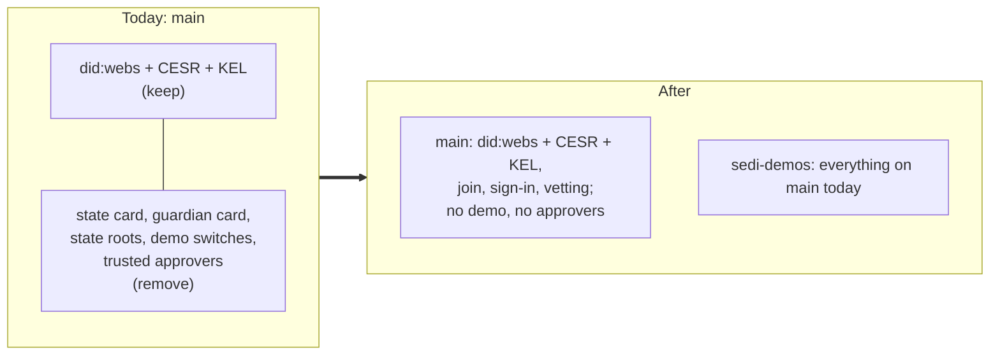

# Moving the SEDI demos off `main`

**Status:** Draft, 2026-11-23. This plan changes no code; nothing is built.
**Reviewers:** Alberto Leon and the product owner.
**Scope:** take every State-Endorsed Digital Identity (SEDI) _demo_ off `main` and onto a `sedi-demos` branch, together with the guardianship flow, the trusted approvers feature ("Who approves") and their Developer options rows, while keeping `did:webs` resolution and everything Keyring needs to join, sign in to and be vetted by a VTC community whose DID is a `did:webs`. **Principle:** everything removed from `main` (the demo, guardianship, trusted approvers, and every one of their Developer options rows, store fields, locale keys and test ids) is preserved on `sedi-demos`, which is cut first (S0); nothing removed is dropped. If `sedi-demos` is archived (R1) it is preserved but unmaintained.
**Companions:** [`sedi-demos-move-plan/`](sedi-demos-move-plan/): the inventory evidence and the reading of the earlier modularity note ([`2026-11-23-bam.md`](sedi-demos-move-plan/2026-11-23-bam.md)); the review that traced what join, sign-in and vetting reach ([`2026-11-23-al.md`](sedi-demos-move-plan/2026-11-23-al.md)); the owner's requirements and the review findings applied ([`2026-11-23-bam-2.md`](sedi-demos-move-plan/2026-11-23-bam-2.md)); review index in §11.
**Related plans:** [`keri-holder-plan.md`](keri-holder-plan.md) (the KERI holder work this keeps room for), [`delegated-batch-issuance-plan.md`](delegated-batch-issuance-plan.md) (the SEDI-motivated plan that assumes the KEL verifier), [`single-codebase-plan.md`](single-codebase-plan.md) (why `bifold/` paths are ordinary paths here).

## Overview

<!-- plan-part: human -->

> **Human part: for people deciding and reviewing.** What this is, what a person
> sees, how we'll know it works, and what is needed from whom. It adds nothing: the
> numbered precision part below is authoritative, and if the two disagree, the
> precision part wins and this part is the bug.

SEDI is Utah's State-Endorsed Digital Identity initiative. In Keyring it is a demo and test lane: a "State Guardian card" (a KERI/ACDC credential a state office issues to a "ward" and a "guardian" approves), checked against trusted "state roots", with a "State card (demo)" pass in Credentials, a state-office screen, and a one-tap "Set up the SEDI demo" in Developer options. It is always bundled and always loaded; only runtime switches, off by default, hide it. (§2)

Two things in the same folder are not demo. The `did:webs` resolver is how Keyring resolves a VTC community's DID for sign-in, and the CESR and KEL code under it is the only KERI verifier in the repository, which the holder-only KERI plan and the delegated batch issuance plan both assume. (§2, §3)

This plan moves the demo to a `sedi-demos` branch and removes it from `main`. The same move takes the guardianship flow and the trusted approvers feature ("Who approves"): neither is supported any longer. Keyring keeps the `did:webs` resolution that community join and sign-in use and the CESR and KEL code that resolution loads, with the one gate that would otherwise leave the verifier dead taken out. The state office's server side is already scaled down, so the demo no longer runs end to end anywhere; the branch is a record. (§3, §4, §5)

A person using Keyring from `main` sees no State card pass, no Guardian card link, no state-office screen, no "Who approves", no "Ask a contact to approve" row on a contact's page, and no SEDI, guardian or trusted-approver rows in Developer options. Joining, signing in to and being vetted by a community, `did:webs` communities included, work as before. "Confirm it's you" stays (§3, D7). Everything that is gone from `main` is on `sedi-demos`.

What join, sign-in and vetting touch today is traced in §2.6: none of them needs the demo, but all three load trusted-approver code through the agent client, and one of them (join) can be blocked by trusted-approver rules a tester already holds on their agent. Removing that code safely is §6, S0b and S2b.

**How we'll know it works**

| Claim                                                                    | Proved by                                                                                                                                                                                                                        | Runs where                   | Status      |
| ------------------------------------------------------------------------ | -------------------------------------------------------------------------------------------------------------------------------------------------------------------------------------------------------------------------------- | ---------------------------- | ----------- |
| Nothing is lost                                                          | `sedi-demos` is cut from `main` at the commit before the removal and pushed (§6, S0)                                                                                                                                             | Git                          | Not started |
| No tester is left with an agent that holds their join behind an approver | Every lab and gate agent's `keyring-trusted-approvers` set is empty before S2b ships (§6, S0b)                                                                                                                                   | Lab agents, by the test lane | Not started |
| Community sign-in over `did:webs` still resolves and verifies            | `WebsDidResolver.test.ts` and the `sedi-vtc` fixture tests pass with the demo gone (§6, S1, S4)                                                                                                                                  | CI                           | Not started |
| Join, sign-in and vetting are unchanged                                  | The `did:webs` tests named in §2.6, a new link-classification test (§6, S2), a new inbound-reply test (§6, S2b), and the full release gate's join, sign-in, named-vetting and hidden-vetting legs on the removal branch (§6, S7) | CI, the gate's device legs   | Not started |
| The verifying resolver is live without a demo flag                       | A test calls `resolveWebs` with no approver flag set and gets a result, not `switchedOff` (§6, S1)                                                                                                                               | CI                           | Not started |
| No demo code remains on `main`                                           | `git grep -iw sedi` and the list in §6 S7 find only the kept paths and docs                                                                                                                                                      | CI, one command              | Not started |
| Nothing else regressed                                                   | Root `yarn lint`, `yarn typecheck`, `yarn test`, and `cd bifold/packages/core && yarn test`                                                                                                                                      | CI                           | Not started |
| `sedi-demos` still builds and its tests pass                             | The same suites on that branch (§6, S7)                                                                                                                                                                                          | CI                           | Not started |
| Keyring can still join the live `sedi-vtc` community after the removal  | A Test build of the exact commit that lands on `main` scans or pastes the community's `did:webs` link, joins and signs in at `/members/`, fresh install and update-in-place (§6, S7b)                                             | Field: a third party's VTC   | Not started |

**Where it stands:** a verified inventory of `main` at `800a44ba` (both companions). Decisions D1 to D7 are taken (§3); D7 and the parking of the KERI holder plan are confirmed (Alberto, 2026-11-23). Nothing is written.

**Open decisions**

| Question                                                               | Recommendation                                                                                                  | Who decides   | By when, or what it blocks              |
| ---------------------------------------------------------------------- | --------------------------------------------------------------------------------------------------------------- | ------------- | --------------------------------------- |
| Does `sedi-demos` stay maintained against `main`, or is it an archive? | Archive (§8, R1). The state office's server side is already scaled down, so nothing can run the demo end to end | Product owner | Before S0; changes how much S8 promises |

**Not doing:** deleting `modules/sedi/cesr`, `guardian/kel.ts` or the `webs/{identifier,document,resolve}.ts` files; writing the KERI holder (that is its own plan, parked by D2); verifying the KEL on community sign-in (today and after this plan, `did:webs` sign-in reads `did.json` only; §8, R9); renaming the `sedi-vtc` DID strings or fixtures; adding a build-time flag or plug-in system to make the demo optional (§3, D5); making the demo a separate package (§3, D5). (§3, §9)

---

<!-- plan-part: precision -->

> **Precision part: for implementers and agents.** Complete, exact and normative:
> implement from this part. Sections are numbered, and a bare `§n` means this
> plan's section n.

## 1. Goal and non-goals

**Goal.** `main` contains no SEDI demo, guardianship or trusted-approver code, switches, screens, strings, test ids or tests, and keeps `did:webs` resolution and the CESR and KEL code it loads. Joining, signing in to and being vetted by a community behave exactly as before, for `did:webs` and `did:webvh` communities alike. A `sedi-demos` branch, cut before any removal, contains all of it as it is on `main` today: every file, Developer options row, store field, locale key and test id that leaves `main` stays there. Keyring can still join and sign in to the live `sedi-vtc` community (S7b).

**Non-goals.**

- Making the demo pluggable on `main`. The seam between trust-tasks and the demo is circular (§2.3), and untangling it for a demo that is leaving would be work for nothing (§3, D5).
- Building the KERI holder or any new KERI feature. The holder plan is parked (D2).
- Changing what ships to testers beyond the absence of the demo, guardianship and trusted approvers. "Confirm it's you" stays (D7).

## 2. Today

Verified at `origin/main` `800a44ba` (details and the paths of every item are in the companion). In this section `C` is `bifold/packages/core/src` and `S` is `C/modules/sedi`.

### 2.1 What `S` holds

| Directory                                                                                  | Contents                                                                                                                                                                                                                                                                           | Class                   |
| ------------------------------------------------------------------------------------------ | ---------------------------------------------------------------------------------------------------------------------------------------------------------------------------------------------------------------------------------------------------------------------------------- | ----------------------- |
| `S/cesr/`                                                                                  | `codes.ts`, `qb64.ts`, `reader.ts`, `signatures.ts`: CESR primitives, no flag or demo imports                                                                                                                                                                                      | Keep                    |
| `S/guardian/kel.ts`                                                                        | KEL replay and verify engine; imports only `cesr` and noble. Used by `webs/resolve.ts`, `identity/keriEvents.ts` and `holder/controller.ts`                                                                                                                                        | Keep                    |
| `S/guardian/chain.ts`                                                                      | ACDC and TEL verification. Generic mechanism, but hard-codes `SEDI_SCHEMAS` (`:25`) and the guardian-specific `wardNamedIn`. Every importer is demo or guardian code (§2.6)                                                                                                        | Demo (D2)               |
| `S/guardian/{index,stateRoots,issue,k0TestCard,k0RevokedTestCard,k0RevokedOmittedCard}.ts` | `verifyGuardian` (gated), K0/K1 state roots with a hard-coded K1 AID, issuance, K0 test cards                                                                                                                                                                                      | Demo                    |
| `S/webs/{identifier,document}.ts`                                                          | `parseWebsDid`, document parsing. `resolve.ts` imports both                                                                                                                                                                                                                        | Keep                    |
| `S/webs/rootKel.ts`                                                                        | The `resolveRootKel` seam; its only consumer is `guardianEvidence.ts:286`                                                                                                                                                                                                          | Demo (D2)               |
| `S/webs/resolve.ts`                                                                        | `getArtifact` (ungated; the one `WebsDidResolver` calls) and `resolveWebs`, which refuses with `switchedOff` unless `isStateVerifiedApproversEnabled()` (`:146`). `resolveWebs` has no caller outside the demo (`rootKel.ts:25`, `designatedAliases.ts:72`, `webs/guardian.ts:46`) | Keep, gate removed (D1) |
| `S/webs/index.ts`                                                                          | Barrel including the demo exports; its only importers are demo files                                                                                                                                                                                                               | Demo                    |
| `S/webs/{demoStateHost,designatedAliases,guardian,lastLive}.ts`                            | K1 host override, K1 aliases, `verifyGuardianWithWebs`, the Who-approves live cache                                                                                                                                                                                                | Demo                    |
| `S/identity/keriEvents.ts`                                                                 | KERI event builders; imports `kel` and `cesr`. Its importers (`issue.ts:16`, `controller.ts:33`, `phoneIdentity.ts:14`) are all demo                                                                                                                                               | Demo (D2)               |
| `S/identity/{phoneIdentity,phoneCodesOn,StateOfficeCodes}.*`                               | Ward identity, the two approver flags ANDed, the state-office screen                                                                                                                                                                                                               | Demo                    |
| `S/holder/controller.ts`                                                                   | A holder KERI controller; imports `kel`, `keriEvents` and `phoneCodesOn` (`:34`, throws at `:67`). Importers: `C/index.ts:410` (a barrel export the app does not use) and demo files                                                                                               | Demo (D2)               |
| `S/holder/*` (all other files)                                                             | State card pass and details, `stateCardFlag`, `useHeldStateCard`, `GuardianCardReceive`, `guardianCardLink`, `receiveGuardianCard`                                                                                                                                                 | Demo                    |

### 2.2 The runtime consumer of the keep set

`C/utils/WebsDidResolver.ts` is the only demo-free file that consumes `modules/sedi` for a product feature. Other kept files also import `S` (`vtiLinks.ts`, `MyAgentStack.tsx`, `ListCredentials.tsx`, `C/index.ts`) but only for demo code, which S2 removes from them. It imports `S/webs/identifier` (`parseWebsDid`) and `S/webs/resolve` (`getArtifact`, `WEBS_LIMITS`, `WebsFetch`) at `:3-4`. It is registered unconditionally in `C/utils/agent.ts:176` and `app/src/utils/bc-agent-modules.ts:222`. `triggerLink.ts` and `oobSignIn.ts` do not import `S`; they reach did:webs only through that resolver. There is no KERI holder code yet, so `cesr` and `guardian/kel.ts` are the only KEL verifier, and `S/webs/README.md` states there is no second one.

### 2.3 Demo code outside `S`

Paths are under `C/modules/trust-tasks/` unless stated.

- **Demo-only files:** `guardianEvidence.ts` (about 1.4k lines), `socialAuthorization.ts`, `developerTestState.ts`, `module/sediDemoSide.ts`, `module/sediKeriRemoteOff.ts` (`SEDI_KERI_REMOTE_OFF.off`, `:12`, hard-coded `false`), `module/stateVerifiedApproversFlag.ts`, `screens/approver/guardianReasonWords.ts`.
- **Call sites in kept files:** `ceremony.ts` (lazy `require` registering the guardian-evidence handler), `approverRole.ts` (lazy `require`), `components/ApproverOfferModal.tsx` (a static import of `guardianEvidence`; the hardest coupling), `screens/VtaTrustedApprovers.tsx` (`demoStateHost`, `StateOfficeEntry`, `guardianEvidence` imports and state-card sections), `module/vtiLinks.ts` (the `guardianCard` kind, `GUARDIAN_CARD_LINK_OFF` at `:475`, the destination map and the throw at `:705`, claiming `keyring://guardian-card` by prefix at `:124`), `approverRoleSpec.ts` (`GUARDIAN_EVIDENCE_MAX_BYTES`, imported by `S`), `index.ts` (re-exports).
- **Elsewhere in core:** `C/navigators/MyAgentStack.tsx` (always registers `GuardianCardReceive` and `StateOfficeCodes`), `C/types/navigators.ts`, `C/screens/ListCredentials.tsx` (lazy `require` of the holder, `useHeldStateCard`, `<StateCardPass>`, empty-list logic), `C/index.ts` (about 20 SEDI exports), the `testids.json` blocks (`GuardianCard*`, `StateCard*`, `StateOffice*`), and the `StateCard`, `GuardianCard`, `StateOffice`, `Approver.SectionStateCard` and `Screens.*` blocks in the en, fr and pt-br locale files.
- **App:** `app/container-imp.ts` (five loads and five setters: `enableStateCard`, `sediDemoSide`, `demoStateHost`, `enableStateVerifiedApprovers`, `enableTrustTestState`; `:398-402`, `:437-451`, `:506-511`), `app/src/store.tsx` (five fields with their actions and storage keys: `EnableStateCard`, `DemoStateHost`, `SediDemoSide`, `EnableStateVerifiedApprovers`, `EnableTrustTestState`; `:49-58`, `:93-94`, `:204-205`), `app/src/screens/Developer.tsx` (the SEDI rows and about 150 lines of handlers; it also reads the umbrella kill at `:1325`, `:1341`), the locale keys `Developer.SediDemo*`, `EnableStateCard`, `HoldK0TestGuardianCard`, `HoldK0RevokedTestCard`, `HoldK0RevokedOmittedCard`, `BecomeK0TestWard`, `Demos`, `DemoStateHost`, `DemoStateHostHint`, `DemoStateHostInvalid`, `PasteDemoStateHost`, `EnableStateVerifiedApprovers` and `EnableTrustTestState` (`app/src/localization/en/index.ts:207-232`, and fr, pt-br), and `e2e/lib/testids.json` and `e2e/lib/testids.app.json` (and the `testids.allow.json` allowlist if it names them). `SetUpSediDemo` and `TurnOffSediDemo` are test ids that tests assert are absent (`DeveloperDemoRowTap.test.tsx:113`, `DeveloperStateVerifiedRows.test.tsx:211`), not locale keys.
- **Tests:** in core, `S/__tests__` (demo and keep mixed, §6 S4), the trust-tasks tests `guardianEvidence`, `socialAuthorization`, `guardianReasonWords`, `demoSides`, `demoWords`, `whoApprovesAtAGlance`, parts of `approverScreens` and `confirmItsYouScreens`, and `sediKeriSwitches.test.ts`; in the app, `stateCardSwitch`, `stateVerifiedApproversSwitch`, `localization/sediDemoState` and the `Developer{DemoResult,DemoRowTap,DemoStateHost,OneTapSaves,PracticeRequest,StateCardRow,StateVerifiedRows,ConfirmItsYouRow}` screen tests. Each is classified in S4 by reading it, not by name.

### 2.4 The umbrella switch is shared

`SEDI_KERI_REMOTE_OFF` is ANDed into `trustedApproversFlag.ts:31`, `stateVerifiedApproversFlag.ts:25`, `confirmItsYouFlag.ts:40`, `holder/stateCardFlag.ts:29` and `developerTestState.ts:78`, is named in a comment in `trustTestStateFlag.ts`, and is read by the app at `Developer.tsx:1325`, `:1341`. Trusted approvers leave with the demo (D6). "Confirm it's you" is not a SEDI feature: it keeps its own `CONFIRM_ITS_YOU_REMOTE_OFF`, so removing the umbrella clause from its flag file leaves it with its own kill and nothing else changes (D7). `resolveWebs` reads only `isStateVerifiedApproversEnabled` (`webs/resolve.ts:15`, `:146`); `trustedApproversFlag` and `stateVerifiedApproversFlag` together gate `phoneCodesOn` and `lastLive`. `trustTestStateFlag.ts` adds the K0 test root and needs both approver switches: it is demo and goes.

### 2.5 Unmerged branches

`origin/feat/sedi-k0-developer-rows` (3 ahead, 53 behind `main`) and `origin/feat/sedi-state-office` (15 ahead, 43 behind; adds `tools/sedi-state-office/`) exist. The old `keyring-bifold` branches named in the earlier note are not remotes of this repository.

### 2.6 What join, sign-in and vetting reach

Traced at `800a44ba` from each journey's entry points (static imports, lazy `require`, navigator registrations, the link dispatch table). Every file is reachable at bundle level through the barrels and hub files; the rows below are the edges each journey brings in itself. Details are in the review companion.

| Journey                                            | Reaches the removal set?                         | Path                                                                                                                                                                                                                                                                       | What the removal must keep                                                                          |
| -------------------------------------------------- | ------------------------------------------------ | -------------------------------------------------------------------------------------------------------------------------------------------------------------------------------------------------------------------------------------------------------------------------- | --------------------------------------------------------------------------------------------------- |
| Join from a link or QR                             | Yes, at runtime                                  | `vtiLinks.ts:126` calls `isGuardianCardLink` on **every** link, before trigger links (`:131`), join links (`:144`) and `did:webs` (`:151`); the `guardianCard` case at `:703-707` and the destination at `:496`                                                            | The classification order and result of every other link kind (S2's link test)                       |
| Join from the community screen, and the join watch | Yes, at runtime                                  | `VtiCommunity.tsx:31`, `vtiJoinWatch.ts:34` → `vtiJoin.ts:22` → `vtaAgent.ts:42-43` → `afterStepDown.ts`, `foreignApproval.ts:21`, `:25`                                                                                                                                   | The agent client's inbound path (S2b)                                                               |
| The join screen                                    | Yes, rendered                                    | `VtiJoin.tsx:51`, `:1056` → `ApproverWaitNote.tsx` (renders nothing while trusted approvers are off)                                                                                                                                                                       | Nothing; the note goes                                                                              |
| Sign-in                                            | Yes, through the agent client                    | `SignIn.tsx:65` → `signInSteps.ts:61` → `vtaAgent.ts:43`; `SignInIdentity.tsx:21` → `communityCardDisplay.ts` → `vtiWalletCards.ts:54` → `vtaAgent.ts:43`                                                                                                                  | `ensureSignInVaultEntry` and the rest of `signInSteps.ts`                                           |
| Named vetting                                      | Yes, through the agent client and the link table | `VtiVetting.tsx:63` → `vtiVetting.ts:90` → `vtaAgent.ts:43`; `VtiVetting.tsx:67` → `vtiLinks.ts:25-27`                                                                                                                                                                     | —                                                                                                   |
| Hidden vetting, applicant and vetter               | Yes, through the agent client                    | `VtiHiddenVetting.tsx:35`, `VtiHiddenVetter.tsx:28` → `communityName.ts:32` → `VtaLink.tsx:42` → `vtaAgent.ts:43`; `hiddenVettingModules.ts:33` → `hiddenVettingAdapter.ts:47` → `vtaAgent.ts:43`                                                                          | —                                                                                                   |
| `did:webs` resolution                              | By import only                                   | `utils/agent.ts:176`, `app/src/utils/bc-agent-modules.ts:222` → `WebsDidResolver.ts:4` → `webs/resolve.ts:15` → `stateVerifiedApproversFlag.ts` → `sediKeriRemoteOff.ts`. The resolver calls only `parseWebsDid` and `getArtifact`; the flag is read only in `resolveWebs` | `identifier.ts`, `document.ts`, `getArtifact`, `cesr/*`, `guardian/kel.ts` (loaded by `resolve.ts`) |
| Navigator hosting join, sign-in and vetting        | Yes, registered                                  | `MyAgentStack.tsx` registers `VtaTrustedApprovers` and `VtaApproverPerson` (`:195-210`), `GuardianCardReceive` (`:244`) and `StateOfficeCodes` (`:250`)                                                                                                                    | Every other screen in the stack                                                                     |

Clean today, and must stay clean: `joinLink.ts`, `triggerLink.ts`, `oobSignIn.ts`, `oobSignInAgent.ts`, `farmSignIn.ts`, `VtiMediatorTransport.ts` (the TSP-only route), `VtaClient.ts`, `hiddenVetting.ts`, `PrivateVettingStart.tsx`, `pcsVetterTasks.ts` and `packages/trust-tasks` (which imports nothing from core).

**The one choke point.** `vtaAgent.ts:42-43` imports `afterStepDown` (`mayApprove`) and `foreignApproval` (`approvedAgentOf`, `sendForeignDecision`, `takeForeignReply`). `takeForeignReply` runs on every inbound agent message (`:3848`) and returns early when it claims one; `approvedAgentOf` (`:3893`) and `sendForeignDecision` (`:3986`) answer requests relayed from another person's agent. Join, sign-in, vetting, agent connect and Bring back all go through this file, so S2b edits it with a test of its own.

**Tests that use a `did:webs` community.** `bifold/packages/core/__tests__/utils/WebsDidResolver.test.ts` (the `sedi-vtc.did.json` fixture; it imports `webs/resolve` only, which stays), and in `TT/__tests__`: `oobSignIn.test.ts:309`, `triggerLink.test.ts:100`, `vtiLinks.test.ts:385`, `vtiJoinWatch.test.ts:17`, `vtiMediatorTspOnlyRoute.test.ts:21`, `communityName.test.ts:171`. None imports a removed file directly; several load one transitively (`resolve.ts` → the state-verified flag; `vtiLinks.ts:25-27`; `vtaAgent` → `foreignApproval`). **No vetting test uses a `did:webs` community** (§8, R10).

### 2.7 Trusted approvers ("Who approves")

**What it does.** A person asks a contact to be their approver; their agent then holds sensitive tasks (joining a community, sharing a credential, adding a device, changing approvers) until that contact's phone approves, and the contact's phone lists and answers requests relayed from the other person's agent. Off by default: `isTrustedApproversEnabled`, a Developer options switch (`app/src/store.tsx:174`), with `TRUSTED_APPROVERS_REMOTE_OFF`.

**The rules live on the agent, not the phone.** The set is the `keyring-trusted-approvers` policy on the person's VTA. It holds `vta/webvh/dids/create/*` (a community join mints a persona: `module/trustedApprovers.ts:41-63`), `acl/grant/*` and `policy/upsert/*`. Once the code is gone, an agent that still holds that set keeps holding those tasks; the approver's phone no longer lists the relayed request (`approvedAgentOf`, `foreignApproval.ts:61-64`, is gone); and the asker cannot delete the set, because writing a policy is itself `policy/upsert`, which is held. A tester with approvers would be unable to join a community. Hence S0b.

| Area                   | Files                                                                                                                                                                                                                                                                                                                                                                                                                                                                                         |
| ---------------------- | --------------------------------------------------------------------------------------------------------------------------------------------------------------------------------------------------------------------------------------------------------------------------------------------------------------------------------------------------------------------------------------------------------------------------------------------------------------------------------------------- |
| Logic                  | `TT/approverRole.ts`, `TT/approverRoleSpec.ts` (whole file), `TT/module/trustedApprovers.ts`, `foreignApproval.ts`, `afterStepDown.ts`, `trustedApproversFlag.ts`, `TT/screens/approverEnforcementCheck.ts`                                                                                                                                                                                                                                                                                           |
| Screens and components | `TT/screens/VtaTrustedApprovers.tsx`, `ApproverAskRow.tsx`, `ApproverWaitNote.tsx`, `approver/ApproverZones.tsx`, `approver/EnforcementCheckCard.tsx`, `TT/components/ApproverOfferModal.tsx`, `DemoPill.tsx`                                                                                                                                                                                                                                                                                 |
| Trust-task handlers    | `ceremony.ts:2101-2129`: `approver/role-offer/0.1` and its response, `role-step-down/0.1`, `role-removed/0.1`                                                                                                                                                                                                                                                                                                                                                                                 |
| Agent client           | `vtaAgent.ts`: imports `:42-54`, `forAgent` `:162` and `:3893-3990`, `takeForeignReply` `:3848`, `approverDid` `:3039`, `acceptAsApprover` `:3050`, `trustedApprovers` `:3062`, `setTrustedApprovers` `:3077`                                                                                                                                                                                                                                                                                 |
| Places that host it    | `VtiJoin.tsx:51`, `:1056`; `VtaCreateAgent.tsx:65`, `:910`; `VtaDevices.tsx:37`, `:186`; `MyAgent.tsx:46`, `:61`, `:470`, `:493`; `VtaAskMe.tsx:37`, `:42`, `:171-181`, `:300-330` (the "Ask me before…" trusted section and its link to Who approves); `RequestsSection.tsx:34-38`, `:126-134`; `VtaAgentHome.tsx:36`, `:1033`; `ContactDetails.tsx:36`, `:39`, `:486-494`; `ApprovalDetails.tsx:19`; `RequestCard.tsx:23`; `waitingRequests.ts:18`, `:33` (feeds the Requests badge)        |
| Navigation and exports | `MyAgentStack.tsx:195-210`; `types/navigators.ts:92`, `:94`, `:203`, `:205`; `RootStack.tsx:16`, `:110`; `TT/index.ts:58-62`, `:177`; `C/index.ts:280`, `:289-291`                                                                                                                                                                                                                                                                                                                            |
| Stored records         | `keyring.approver-role-offer-ask`, `keyring.approver-role-offer-prompt` (`approverRole.ts:64`, `:66`): orphaned, harmless                                                                                                                                                                                                                                                                                                                                                                     |
| App                    | `store.tsx:44-47`, `:92`, `:173-174`, `:203`, `:325-335`; `container-imp.ts:29`, `:397`, `:436-437`, `:489`, `:504`; `Developer.tsx:18`, `:21`, `:132`, `:513-522`, `:1234-1248` and the practice request `:1440-1445`; locale `Developer.EnableTrustedApprovers`                                                                                                                                                                                                                             |
| Strings                | core `Approver` block (about 215 strings) except `Approver.UnnamedContact`, which `Chat.tsx:695`, `:816`, `ContactDetails.tsx:410`, `:491-492`, `RequestCard.tsx:89`, `ApprovalDetails.tsx:59` and `requestWords.ts:123` use and which moves to a shared block; `Screens.VtaTrustedApprovers`, `Screens.VtaApproverPerson`; `AskMe.Trusted{Title,OtherAction,Open,SwitchedOff}`; the nine `Requests.ForAgent*` keys; en, fr and pt-br                                                         |
| Test ids               | 49 core ids from the files above plus `AgentWhoApprovesRow`, `AskMeTrusted*`, `RequestForAgent` (`bifold/packages/core/testids.json` and `e2e/lib/testids.json`); app `ToggleEnableTrustedApprovers`, `DevPracticeRequest`                                                                                                                                                                                                                                                                    |
| Tests                  | delete: `trustedApprovers`, `foreignApproval`, `afterStepDown`, `approverWaitNoteMounted`, `enforcementCheckCard`, `approverScreens`, `whoApprovesAtAGlance`, the app's `trustedApproversSwitch` and `DeveloperPracticeRequest`; edit: `VtaAskMeScreen`, `VtaRequestsScreen`, `requestWords`, `placeholdersFilled`, `vtaOwnAgent`, `consentNotGiven`, `consentWaitClocks`, `RootStackLockShutdown`, `ceremonyRegistry` (also its guardian-evidence block, `:252-300`), the Developer snapshot |

**Kept, not part of the feature:** `VtaClient.relayConsentRequests` (`:1663`, `:2115`, `:2634`), the generic relay of an upstream consent request (VTI-26), which sign-in and "Ask me before" use; `ownerConfirm.ts`; `consentGranted` and `awaitingConsentCode`. **Not this feature, and not to be deleted by name:** `app/src/demo-profiles/approver/*`, the Approver access-request demo chosen by `ACTIVE_DEMO_PROFILE`.

### 2.8 "Confirm it's you"

**What it does.** You ask a contact to prove, with their phone's lock, that a call or message in their name is really them. On by default (`CONFIRM_ITS_YOU_ON_BY_DEFAULT = true`, `TT/module/confirmItsYouFlag.ts`), with its own `CONFIRM_ITS_YOU_REMOTE_OFF`; the app keeps no store field (`store.tsx:207-209` ignores the old key).

It imports nothing from the demo or from trusted approvers; its only SEDI tie is the umbrella clause (`confirmItsYouFlag.ts:19`, `:40`). Nothing in join, sign-in, vetting, rooms, polls, badges or sessions uses it. Its files, if D7 is reversed: `TT/confirmItsYou.ts`, `confirmItsYouSpec.ts`, the flag file, `components/ConfirmItsYouModal.tsx`, `ConfirmWithSheet.tsx`, `screens/ConfirmChatCard.tsx`, `ConfirmItsYouRow.tsx`, `useConfirmChatItems.tsx`, the `person/confirm-request/0.1` handlers (`ceremony.ts:2131-2140`), its hosts in `Chat.tsx`, `messageWake.ts`, `ContactDetails.tsx` (the "Safety" heading `:484-494` holds both its row and the approver row), `RootStack.tsx:17`, `:111`, the `ConfirmItsYou` strings (about 102), 54 test ids plus `ChatConfirmWith`, and the tests `confirmItsYouScreens`, `confirmChatCard`, `confirmSheetJustTheBox`, the app's `confirmItsYouSwitch` and `DeveloperConfirmItsYouRow`.

### 2.9 Developer options (`app/src/screens/Developer.tsx`)

The framework's own Developer screen holds general tools only and is replaced by the app's (`container-imp.ts:329`).

| Row (line)                                                                                                                                                                                                                 | Goes?                                           |
| -------------------------------------------------------------------------------------------------------------------------------------------------------------------------------------------------------------------------- | ----------------------------------------------- |
| Developer mode (`:1084`); the Connection rows (mediator, DIDComm v2, v2 mailbox, live pickup, TSP carriage, shared connect, Show a code; `:1098`)                                                                          | Stays                                           |
| Trusted approvers (`:1234`), under Connection                                                                                                                                                                              | Goes (D6)                                       |
| State-verified approvers (`:1251`); Trust the test state (K0) (`:1267`); Hold K0 Guardian card, Hold revoked card, Hold revoked card without its revocation, I'm the test ward (`:1283-1320`); State card (demo) (`:1325`) | Goes (demo)                                     |
| The "Demos" header (`:1344`) with the Guardian demo and Ward demo switches and result line, Demo state host and Paste (`:1393`), Practice request (`:1440`)                                                                | Goes, header included: nothing is left under it |
| Diagnostics, Agent tools (test), Test data, Over-the-air updates, Credentials and verifier, Test clocks (`:1448` onward)                                                                                                   | Stays                                           |

There is no "Confirm it's you" row any more (`DeveloperConfirmItsYouRow.test.tsx` asserts that).

## 3. Decisions

D1 to D7 were taken on 2026-11-23 (D1 and D3 to D5 by the product owner, D2, D6 and D7 by Alberto; reasoning in the companions). The reasoning behind each is standing rationale: an implementer must not re-open it without the constraint that rules the other option out.

**D1. State-verified approvers are demo-only and are removed; `resolveWebs` loses its gate.**

- Constraint: `resolveWebs` is the verifying did:webs resolver, and its refusal at `S/webs/resolve.ts:146` depends on a flag whose only other users are demo code (`phoneCodesOn`, `lastLive`, `verifyGuardian`). Deleting the flag while keeping the refusal makes the verifier permanently dead; keeping the flag keeps a demo switch on `main`.
- Rejected: _keep the flag and decouple only `resolveWebs`._ It leaves a demo-named switch gating nothing but demo code on `main`.
- Rejected: _rewire the gate to a new `didWebsVerifyEnabled` switch._ A switch for the one path the product depends on is a way to turn community sign-in off by mistake; `getArtifact` is already ungated and the resolver is registered unconditionally.
- Confirmed: state-verified approvers are not a product feature (Alberto, 2026-11-23).
- What stays live: `resolveWebs` has no caller once the demo is gone (§2.1). It is kept, ungated and tested, because it is the code a later "verify the KEL on sign-in" step would call (§8, R9), and it sits in the file whose `getArtifact` the product does call.

**D2. The guardianship flow goes, and with it `guardian/chain.ts`, `holder/controller.ts`, `identity/keriEvents.ts` and `webs/rootKel.ts`.**

- Constraint: Keyring no longer supports the guardianship flow (Alberto, 2026-11-23). Every importer of these four files is demo or guardian code (§2.1, §2.6); none is reached by join, sign-in, vetting or `did:webs` resolution.
- Concretely: they move to `sedi-demos` with the demo. S1 no longer makes `chain.ts` schema-agnostic or decouples `controller.ts`. `cesr/*`, `guardian/kel.ts`, `webs/{identifier,document,resolve}.ts` stay, because `resolve.ts` loads them and `WebsDidResolver` needs `resolve.ts`.
- The KERI holder plan, which would have been their consumer, is parked (Alberto, 2026-11-23). If it resumes, it takes the files from `sedi-demos`, where the `k0-utah-v2` fixtures it cites also live.
- Rejected: _keep both on `main`, made generic first._ It writes and maintains two refactors, and keeps two SEDI-shaped modules on `main`, for a plan that is not being built.

**D3. The two unmerged SEDI branches move to `sedi-demos`.** They are rebased onto `sedi-demos` after the removal lands (§7), not onto `main`.

- Rejected: _abandon them._ They hold work a demo would use (`tools/sedi-state-office/`).

**D4. The `sedi-vtc` DID strings and fixtures stay.** `__tests__/utils/fixtures/sedi-vtc.did.json` is a real VTC `did:webs` document, and the DID string `did:webs:…:sedi-vtc:…` appears in tests of community sign-in, `vtiLinks`, `triggerLink`, `oobSignIn`, `communityName`, `vtiMediatorTspOnlyRoute`, `vtiJoinWatch`, `roomsLogWords` and `agentPollsBackendOwnSession`. Those cover kept code. Renaming is churn with no purpose.

**D5. No plug-in seam.** Breaking the trust-tasks and demo circularity (moving guardian-evidence into `sedi/` behind a registration hook) would make deletion "a folder plus one call". It costs a refactor of `ceremony.ts`, `approverRole.ts`, `vtiLinks.ts`, `VtaTrustedApprovers.tsx` and `ApproverOfferModal.tsx` whose only consumer is code being removed. With D6, three of those five files go whole, which leaves even less for a seam to serve. The branch makes that unnecessary; if a second demo ever needs the seam, build it then.

**D6. Trusted approvers ("Who approves") are removed.**

- Constraint: Keyring no longer supports the feature (Alberto, 2026-11-23). It was built for the SEDI demo's approval story and is off by default.
- Concretely: every file in §2.7's tables goes whole; the places that host it lose only their trusted-approver lines; `vtaAgent.ts` loses the approver methods and the foreign-approval path (S2b). `ceremony.ts` stays: it is the relationship ceremony, the inbound Trust Task router and the built-in task registry; only its approver (`:2101-2129`) and guardian-evidence (`:2142-2157`) registrations and their imports (`:70-73`) go.
- Kept: the upstream consent relay and owner confirmation (§2.7, "Kept"), which sign-in and "Ask me before" use.
- Precondition: no agent we run or a tester uses still holds a `keyring-trusted-approvers` set when the removal ships (S0b), because the removal leaves no way to answer or remove one (§2.7).
- Rejected: _keep the approver's half (listing and answering relayed requests) for a release so held rules can still be answered._ It keeps the most entangled part (`vtaAgent.ts`'s inbound path) for a switch that only testers ever turned on; clearing the sets first (S0b) is cheaper and leaves nothing behind.

**D7. "Confirm it's you" stays, without the SEDI umbrella kill.** Confirmed (Alberto, 2026-11-23).

- Constraint: it is on by default and in testers' hands, and it shares no code with the demo or trusted approvers (§2.8).
- Concretely: only the `SEDI_KERI_REMOTE_OFF` clause is removed from `confirmItsYouFlag.ts`; its own `CONFIRM_ITS_YOU_REMOTE_OFF` stays. The contact page's "Safety" heading stays, holding only its row.
- If reversed: S2c removes every file in §2.8, the "Safety" heading with it, and `sediKeriSwitches.test.ts` is deleted rather than renamed (S4).

## 4. Target

On `main` after S7:

- Everything stripped from `main` is on `sedi-demos`, cut at S0 before any removal: the demo, the guardianship flow, trusted approvers, and every Developer options row, store field, locale key and test id that belonged to them. Removal from `main` is the only change made to those things; none is rewritten or dropped. If `sedi-demos` is archived (R1) that content is preserved but unmaintained, and no one is promised it builds against a later `main`.
- `S` is not a demo module. The kept files live where §5 puts them: `modules/sedi/cesr/*`, `modules/sedi/guardian/kel.ts` and `modules/sedi/webs/{identifier,document,resolve}.ts`, in place. A rename of the folder is a separate follow-up, only if the product owner wants it, so the move stays a pure deletion plus one small refactor commit.
- No code reads or writes `EnableStateCard`, `DemoStateHost`, `SediDemoSide`, `EnableStateVerifiedApprovers`, `EnableTrustTestState` or the trusted-approvers setting; orphaned values in storage, and the approver records in §2.7, are harmless and are not migrated.
- `keyring://guardian-card` is not claimed by `vtiLinks.ts`; see R2. Every other link classifies exactly as before.
- No screen offers to ask a contact to approve, and the Requests list shows only the person's own agent's requests.
- "Confirm it's you" is unchanged, apart from losing the umbrella kill (D7).

## 5. What is kept and what changes in it

| Kept file                                                                                                                                                                   | Change                                                                                                                                                |
| --------------------------------------------------------------------------------------------------------------------------------------------------------------------------- | ----------------------------------------------------------------------------------------------------------------------------------------------------- |
| `S/cesr/*`                                                                                                                                                                  | None                                                                                                                                                  |
| `S/guardian/kel.ts`                                                                                                                                                         | None                                                                                                                                                  |
| `S/webs/{identifier,document}.ts`                                                                                                                                           | None                                                                                                                                                  |
| `S/webs/resolve.ts`                                                                                                                                                         | Remove the `isStateVerifiedApproversEnabled` import (`:15`) and refusal (`:146`)                                                                      |
| `C/utils/WebsDidResolver.ts`                                                                                                                                                | None, unless the folder is renamed (§4)                                                                                                               |
| `C/modules/trust-tasks/module/confirmItsYouFlag.ts`                                                                                                                         | Remove the `SEDI_KERI_REMOTE_OFF` clause; `CONFIRM_ITS_YOU_REMOTE_OFF` stays (D7)                                                                     |
| `C/modules/trust-tasks/module/vtaAgent.ts`                                                                                                                                  | Remove the approver methods and the foreign-approval path (§2.7); every other inbound message is handled as before (S2b)                              |
| `C/modules/trust-tasks/module/vtiLinks.ts`                                                                                                                                  | Remove the `guardianCard` kind, its check at `:126`, its case at `:703-707` and its destination at `:496`; the order of the other checks is unchanged |
| `C/modules/trust-tasks/ceremony.ts`                                                                                                                                         | Remove the imports at `:70-73` and the registrations at `:2101-2129` (approver) and `:2142-2157` (guardian evidence)                                  |
| `C/modules/trust-tasks/waitingRequests.ts`                                                                                                                                  | Drop the trusted-approvers flag and the `forAgent` filter                                                                                             |
| The hosts in §2.7 (`VtiJoin`, `VtaCreateAgent`, `VtaDevices`, `MyAgent`, `VtaAskMe`, `RequestsSection`, `VtaAgentHome`, `ContactDetails`, `ApprovalDetails`, `RequestCard`) | Remove only the trusted-approver lines; `mayApprove` callers behave as if it were always true                                                         |
| `Approver.UnnamedContact` (en, fr, pt-br)                                                                                                                                   | Moves to a shared block before the `Approver` block goes; its seven users are repointed                                                               |

## 6. Steps

All implementation runs as subagents, one branch off `main` per step group. Heavy operations follow the rules of the machine they run on: on a developer's Mac, one heavy suite at a time with few workers, and full suites sent to CI. Commits are conventional, signed and carry `Signed-off-by`.

**S0. Preserve.** Create `sedi-demos` from `origin/main` and push it, before any removal commit exists. Everything the later steps strip from `main` stays on this branch, Developer options rows, store fields, locale keys and test ids included.

- _Done when:_ `git rev-parse origin/sedi-demos` equals the `main` commit the removal branch starts from, and the branch name is recorded in §11 or the companion. Nothing else is changed.
- _Needs:_ a decision on R1 (maintained or archive) so the PR description says which.

**S0b. Empty every trusted-approver set while the code still exists.** The removal leaves no way to answer or delete one (§2.7).

- List every agent we run that has a `keyring-trusted-approvers` policy: the lab and gate agents, and Alberto's own. Ask the testers in the testers' group to turn the feature off and remove their approvers, with their approver's phone answering the removal, before the release that carries S2b.
- Each removal uses the app's own "Who approves" screen, on a build that still has it, so the approver's phone answers it. On a lab agent where that is not possible, the agent's operator deletes the policy; a Farm agent is a lab write and needs Alberto's word.
- _Done when:_ a read of each listed agent's policies shows no `keyring-trusted-approvers` set, recorded with the agent names in the PR (roles only in this plan), and the testers' group has been told.
- _Blocks:_ S2b's release, not S2b's code.

**S1. Decouple while the demo still exists.** One commit, `refactor`: remove the `resolveWebs` gate (D1). `WebsDidResolver.test.ts` imports only `webs/resolve`, which stays, and needs no change.

- _Done when:_ a new test shows `resolveWebs` resolves a fixture (the `webs-k0-root` fixture) with no approver flag set; `websResolver.test.ts` is rewritten so it no longer imports `../guardian` or `webs/index.ts`; the demo still passes its own tests (the move has not started); `cd bifold/packages/core && yarn test` and root `yarn typecheck` pass.
- D2 no longer asks S1 to touch `chain.ts` or `controller.ts`.

**S2. Remove the demo from core.** One commit, `chore`. Delete the demo files in §2.1 and §2.3; remove the call sites: `ceremony.ts` registration, `approverRole.ts` lazy require, the `ApproverOfferModal.tsx` import, the `VtaTrustedApprovers.tsx` state-card sections and imports, the `guardianCard` kind and destination in `vtiLinks.ts`, the two screens in `MyAgentStack.tsx` and `types/navigators.ts`, the `ListCredentials.tsx` pass and its empty-list terms, the `index.ts` exports; remove the `SEDI_KERI_REMOTE_OFF` clause from `confirmItsYouFlag.ts` and from `trustedApproversFlag.ts` (which S2b then deletes whole), and delete the other demo flag files, `trustTestStateFlag.ts` included (§2.4); delete `chain.ts`, `controller.ts`, `keriEvents.ts`, `rootKel.ts` and `webs/index.ts` (D2) and the `C/index.ts:410` export; remove the demo `testids.json` entries and the en, fr and pt-br locale blocks. The same commit edits the app, so it typechecks: `container-imp.ts` (the five demo loads and setters of §2.3), `store.tsx` (the five demo fields with their actions and storage keys), `Developer.tsx` (every demo row §2.9 marks "Goes", their handlers, and the umbrella reads at `:1325`, `:1341`; the "Demos" header and the practice request stay until S2b) and the app locale keys of §2.3. Leave trusted approvers to S2b.

- _New test, written first, on `main` before any deletion:_ a table test of `keyringAgentLinkKind` over one example of every link kind it classifies today (trigger link, join link, `did:webs`, `did:webvh`, agent claim, OOB invitation, plain URL, garbage), recording each result. After S2 the same table passes with only the `keyring://guardian-card` row changed (R2).
- _Done when:_ `git grep -n -E "guardianEvidence|socialAuthorization|developerTestState|sediDemoSide|sediKeriRemoteOff|stateVerifiedApproversFlag|trustTestStateFlag|StateCardPass|GuardianCardReceive|StateOfficeCodes|stateRoots|keriEvents|holder/controller|guardian/chain|rootKel"` under `bifold/` and `app/` finds nothing outside docs; core's `yarn test`, root `yarn typecheck` and root `yarn test` pass (the app no longer imports anything S2 deletes); the link table passes; "Confirm it's you" tests pass unchanged except for the deleted clause.

**S2b. Remove trusted approvers (D6).** One commit, `chore`, after S2 and only on a tree where S0b is under way. It carries the app-side edits for trusted approvers too, so that it typechecks alone.

- Delete every file in §2.7's Logic, Screens and components rows; remove the handlers in `ceremony.ts` (`:2101-2129`) and the imports they need; remove the approver methods and the foreign-approval path from `vtaAgent.ts`; remove the trusted-approver lines from each host in §2.7; drop the flag and `forAgent` filter from `waitingRequests.ts`; remove the screens from `MyAgentStack.tsx`, `RootStack.tsx` and `types/navigators.ts`; remove the exports; move `Approver.UnnamedContact` to a shared block and repoint its users; then remove the `Approver` block, the `Screens.*`, `AskMe.Trusted*` and `Requests.ForAgent*` strings and the core test ids in §2.7. In the app: the trusted-approvers load and setter in `container-imp.ts`, the trusted-approvers field in `store.tsx` with its action and storage key, the Trusted approvers row, the practice request and the now-empty "Demos" header in `Developer.tsx` (§2.9), and `Developer.EnableTrustedApprovers` in three languages.
- _New test, written first, on `main` before the deletion:_ an inbound-reply test of `vtaAgent` (`vtaAgentInbound.test.ts`), in two groups. _Unsolicited message_ (handed on, not listed as an approval, also for a late reply to an ask no longer waiting) passes unchanged after `takeForeignReply` goes (R8). _Reply to an ask the phone made_ is the foreign-approver decision, the only ask whose reply arrives through the inbound path, so it is trusted-approvers code: S2b deletes that group with the feature.
- _Done when:_ `git grep -n -E "approverRole|ApproverOffer|TrustedApprover|trustedApprovers|foreignApproval|afterStepDown|ApproverWaitNote|ApproverAskRow|forAgent|whoApproves|mayApprove"` under `bifold/` and `app/` finds nothing outside docs and `app/src/demo-profiles/approver/*`; the inbound-reply test passes; core's `yarn test`, root `yarn typecheck` and root `yarn test` pass; `VtaClient.relayConsentRequests` and `ownerConfirm.ts` are untouched.

**S2c. Remove "Confirm it's you", only if D7 is reversed.** One commit, `chore`: every file and host line in §2.8, the "Safety" heading, the strings, test ids and tests. _Done when:_ the same checks as S2, with `confirmItsYou|ConfirmWithSheet|ConfirmChatCard|ConfirmItsYou` added to the grep.

**S3. Remove what is left outside the packages.** One commit, `chore`, after S2b. The app's source edits are done in S2 and S2b; this step covers `e2e/` and the checks that the whole is clean: `e2e/lib/testids.json` and `e2e/lib/testids.app.json` (`ToggleEnableTrustedApprovers`, `DevPracticeRequest` and the demo ids) and the comment at `e2e/lib/pages/link.js` that names the guardian card. It also checks every clock row: `E2EClockRows` and `e2eClocks.ts` (`SHORT_CONSENT_WAIT_MS` and `effectiveConsentWaitMs`, `:41`, `:48`) are read by `VtaClient.ts` and `clocks.ts`, so they stay unless reading shows a row serves only approver waits, in which case it moves to `sedi-demos` with the rest; the finding is stated in the PR either way.

- _Done when:_ root `yarn lint`, `yarn typecheck`, `yarn test` pass; no `Developer*` test references a deleted row; the Developer screen shows only the rows §2.9 marks "Stays"; `git grep` of the S2 and S2b patterns under `e2e/` finds nothing outside docs; the clock-row finding is recorded.

**S4. Tests.** Classify each SEDI-named test by reading it. Delete demo tests; keep and fix the paths of the kept ones; rewrite the mixed ones.

- _Keep:_ `cesrReader`, `kelPrefixBinding` (rewritten: it imports `stateVerifiedApproversFlag`, `webs/index`, `guardian/index` and `sediKeriRemoteOff` today), `websResolver` (rewritten, S1), the `webs-k0-root` and `cesr-ts-reads` fixtures with whatever part of `keriTestKit.ts` they need, `WebsDidResolver.test.ts` and `sedi-vtc.did.json`, the link-classification and inbound-reply tests written in S2 and S2b, and every test that only uses the `sedi-vtc` DID string (D4).
- _Delete (they stay on `sedi-demos`):_ `demoStateHost`, `designatedAliases`, `k0TestCard`, `k0RevokedOmittedCard`, `k1Screens`, `k1StateOffice`, `socialIssue`, `expiryParseGuard`, `S/holder/__tests__/*`, `guardianK0`, `holderController`, `keriEvents`, the `k0-utah-v2` fixtures (D2), `guardianEvidence`, `socialAuthorization`, `guardianReasonWords`, `demoSides`, `demoWords`, and the app tests listed in §2.3; and the trusted-approver tests in §2.7's "delete" list.
- _Edit:_ the trusted-approver "edit" list in §2.7; `ceremonyRegistry.test.ts` (its guardian-evidence block `:252-300` and the approver registrations); `confirmItsYouScreens`, `confirmChatCard`, `confirmSheetJustTheBox`, `C/utils/__tests__/messageWakeNavigation` and the app's `DeveloperConfirmItsYouRow` and `DeveloperOneTapSaves`, which load the umbrella kill (`confirmItsYouScreens:25`, `:69`, `:76`) and have no guardian parts.
- _Update, not delete:_ `sediKeriSwitches.test.ts`. With D7 as it stands, drop its umbrella rows and its "Trust the test state (K0)" block, set its floor and export list to "Confirm it's you" only, take `SEDI_KERI_REMOTE_OFF` out of `NOT_SEDI_KERI`, and rename it to a general remote-off guard; `single-codebase-plan.md:302` names it. If D7 is reversed, its scan finds nothing and its floor row fails: delete it (the other kills have their own tests: `sharedConnectRemoteOff`, `tspCarriage`, `createRelationshipInvitationDidCommV2Gate`).
- _Done when:_ each deleted file is justified in the PR by a one-line reason; no kept test imports a deleted module; suite counts are reported before and after.

**S5. Docs.** Update `docs/plans/README.md` (the `delegated-batch-issuance-plan` and `keri-holder-plan` rows, if they describe the demo as present in the app), `delegated-batch-issuance-plan.md` and `keri-holder-plan.md` where they say the SEDI demo is in the app, and `single-codebase-plan.md:302` (the test is renamed, S4). Mark `keri-holder-plan.md` parked, and say in it that its code and the `k0-utah-v2` fixtures it cites are on `sedi-demos` (D2); `keri-holder-plan/2026-11-16-al.md` is a dated companion and is not edited. In `docs/VTI_UPSTREAM_FINDINGS.md`, add one line to each finding in §12 saying what Keyring still exercises after the removal; no finding is renumbered, closed or deleted. Dated companions are not edited.

- _Done when:_ `git grep -n -iw sedi -- docs` lists only intentional motivation text and this plan, and `git grep -n -i "trusted approver" -- docs` lists only this plan, the findings lines and dated companions.

**S6. Branches.** Rebase `origin/feat/sedi-k0-developer-rows` and `origin/feat/sedi-state-office` onto `sedi-demos` (D3), force-pushing only those two feature branches after the product owner agrees to it.

- _Done when:_ both branches build and pass the demo's tests on `sedi-demos`, or a note on each says why not and what remains. Owner of the decision to drop one instead: the product owner.

**S7. Verify.** On the removal branch: root `yarn lint`, `yarn typecheck`, `yarn test`; `cd bifold/packages/core && yarn test`; `git grep -n -iw sedi` and review each hit (kept paths, the `sedi-vtc` strings, docs); a second agent reads each call site named in §2.6 and §2.7 on the diff (R3).

- _Devices:_ a Test build of the removal branch through the full release gate, compared row for row with the last gate on `main`: the join legs (`kk`, `waiting`, `refused`), `signin-ios`, `agents`, `update-android`, `update-ios`, `smoke-android`, `smoke-ios`, `pair-ios`, and `hv` (hidden vetting, applicant and vetter). The named-vetting rows inside them count as the vetting evidence.
- _`did:webs` live:_ the lab's communities are `did:webvh`, so the gate does not exercise a `did:webs` community. S7b does, against the `sedi-vtc` community.
- On `sedi-demos`: the same suites, plus the demo's own tests.
- _Done when:_ every command passes, the gate shows no row that passed on `main` failing on the branch, S7b has passed (or its "unreachable" record is waived), and the PR states the evidence for each claim in the Overview table, including anything not run.

**S7b. Live join to the `sedi-vtc` community.** `https://sedi-vtc.openvti.net/` is a KERI and `did:webs` based VTC that a third party runs, so this is field evidence (the `vti-lab-and-field` skill), not lab evidence. It runs after S7's gate, on a Test build of the exact commit that lands on `main`, on a fresh install and on an update in place from the last store build.

- Scan or paste the community's `did:webs` link; confirm `vtiLinks` classifies it as a join link; confirm the `WebsDidResolver` resolves it; join; sign in at `/members/`.
- Run it twice: once with trusted approvers never set, and once on an agent S0b cleared.
- Record the VTC's image versions and the date. The fixtures are dated 2026-11-17, so a different version is information, not failure.
- If the VTC offers vetting, run it once and record it; that is the only thing that closes R10. If not, R10 stays open.
- _Proves:_ the happy path of resolution, join and sign-in against the real server after the removal, and that removing `takeForeignReply` handling did not break inbound replies. _Does not prove:_ refusal paths, revocation, or KEL verification (R9: sign-in reads `did.json` only).
- _Done when:_ both runs pass on both install paths and the record (build, commit, date, VTC versions, outcome) is in the PR. If the VTC is unreachable, "VTC unreachable" is recorded with the date instead. S7 and S8 are not done until one of the two exists, and the unreachable record blocks merge unless the product owner waives it.

**S8. Merge and hand over.** After S7b. Squash per the repository's `main` rules (signed, conventional). State in the PR body how to run the demo from `sedi-demos`.

- _Done when:_ `main` has the removal commit(s), `sedi-demos` exists on `origin`, and R1's choice is written where the next person will see it.

## 7. Branch handling

`sedi-demos` is cut once (S0) and is the base for the two feature branches (S6). Changes to the demo land there. Changes to kept code land on `main` and are merged into `sedi-demos` only when someone needs the demo to run, since the demo depends on the kept code and a stale demo builds against a stale verifier.

## 8. Risks

- **R1. `sedi-demos` drifts from `main`.** If it is archived it is preserved but unmaintained: it holds everything removed from `main`, and builds only against the `main` commit it was cut from. It has no CI of its own and the kept code under it keeps changing. Recommendation: archive, with a note naming the `main` commit it was cut from and the command to rebase; the cost of a maintained branch is a standing merge chore for a demo with no scheduled use. Decided by the product owner.
- **R2. `keyring://guardian-card` changes behaviour.** With the `vtiLinks.ts:126` prefix claim gone the link falls through to the connection flow and gives a different error. Accepted: the link existed only for the demo, and the state office's server side is already scaled down. The check runs first on every link today, so its removal is guarded by S2's link-classification table: every other kind must classify exactly as before.
- **R3. The circular seam hides a caller.** `ceremony.ts`, `approverRole.ts`, `ApproverOfferModal.tsx` and `VtaTrustedApprovers.tsx` each reach the demo differently (lazy require, static import, direct import), and trusted-approver code is hosted in ten screens (§2.7). S2 and S2b are reviewed by a second agent reading each call site, not by the grep alone; the greps are the floor.
- **R4. `trustedStateRoots()` adds the K0 test root in any `__DEV__` build** (`S/guardian/stateRoots.ts:95-97`). It leaves with the demo; the S7 review checks nothing kept relied on it.
- **R5. The umbrella kill goes away.** A release can no longer turn off "Confirm it's you" with the SEDI constant; it still has `CONFIRM_ITS_YOU_REMOTE_OFF`. Noted so the release checklist is not written against the old switch.
- **R6. Unmerged branches conflict heavily** with any removal (43 and 53 commits behind). Hence D3: they move to the branch, they do not rebase onto `main`.
- **R7. A held trusted-approver rule blocks a join after the removal.** The rule lives on the agent and holds `vta/webvh/dids/create/*`, which a community join uses, and `policy/upsert/*`, which removing the rule uses (§2.7). After S2b nothing on any phone can answer or delete it. Mitigation: S0b empties every set first, and the release notes for the build that carries S2b tell testers to remove their approvers on the build before. Residual: a tester who skips that build needs the agent's operator to delete the policy.
- **R8. The agent client's inbound path changes.** `takeForeignReply` runs on every inbound agent message today (`vtaAgent.ts:3848`) and returns early when it claims one; join, sign-in, vetting, agent connect and Bring back all run through this file. Mitigation: S2b's inbound-reply test, written on `main` first (its unsolicited-message group must pass unchanged; its foreign-decision group goes with the feature), and the full gate in S7.
- **R9. `did:webs` sign-in does not verify the KEL, before or after.** `WebsDidResolver` reads `did.json` through `getArtifact` and hands it to Credo; the verifying `resolveWebs` has no product caller. A `did:webs` community is therefore trusted as far as its web host is, like a `did:web`. This plan neither causes nor fixes that; it keeps `resolveWebs` ungated so that a later change can call it. Recorded so that nobody reads "keeps the KEL verifier" as "sign-in verifies the KEL".
- **R10. Vetting against a `did:webs` community has no test.** Join and sign-in do (§2.6); vetting is proven only against the lab's `did:webvh` communities. Vetting does not reach `modules/sedi` except through `vtiLinks.ts`, so the removal is unlikely to change it, but nothing shows it. S7b runs vetting once against `sedi-vtc` if that community offers it, and only then is R10 closed; if it does not, or the VTC is unreachable, R10 stays open and the PR says so.

## 9. Out of scope, recorded so they are not re-proposed

- Moving the kept files out of `modules/sedi/` (§4): a rename is a separate change.
- A feature flag or compile-time switch that excludes the demo from a build (D5).
- Removing the `keyring://` scheme registration (`AndroidManifest.xml:55`): it serves every deep link, not only the demo's.

## 10. Rollback

S1 is a refactor with its own tests and reverts alone. S2 to S4 are deletions that revert as a unit; `sedi-demos` already holds the code, so a revert is also a merge from it. Orphaned storage keys need no migration either way. A revert of S2b brings trusted approvers back with their switch off; a set S0b emptied stays empty.

## 11. Companions and related plans

| Rev             | Companion                                                                                                                                                                                                                                                                     |
| --------------- | ----------------------------------------------------------------------------------------------------------------------------------------------------------------------------------------------------------------------------------------------------------------------------- |
| 2026-11-23, BAM | [`2026-11-23-bam.md`](sedi-demos-move-plan/2026-11-23-bam.md): the inventory behind §2 against `main` `800a44ba`, and how it differs from the earlier modularity note                                                                                                         |
| 2026-11-23, AL  | [`2026-11-23-al.md`](sedi-demos-move-plan/2026-11-23-al.md): review: the scope of guardianship and trusted approvers (D2, D6, D7), what join, sign-in and vetting reach (§2.6), the corrections to §2.3, the upstream findings touched (§12) |
| 2026-11-23, BAM (second) | [`2026-11-23-bam-2.md`](sedi-demos-move-plan/2026-11-23-bam-2.md): the owner's two requirements (everything removed moves to `sedi-demos`; Keyring joins `sedi-vtc` afterwards), the S2 to S3 ordering fix, and the review findings applied |

## 12. Upstream findings touched

The upstream findings (`docs/VTI_UPSTREAM_FINDINGS.md`) are numbered permanently and are not closed by a client removing a feature. These are the ones whose Keyring side changes; S5 adds one line to each.

| Finding | What it is about                                                                             | Keyring after this plan                                                                                                                                                                                                                                                      |
| ------- | -------------------------------------------------------------------------------------------- | ---------------------------------------------------------------------------------------------------------------------------------------------------------------------------------------------------------------------------------------------------------------------------- |
| VTI-22  | Consent policies are inert unless enforcement is on                                          | Keyring no longer writes trusted-approver policies; "Ask me before" still writes consent policies, so the finding stays relevant                                                                                                                                             |
| VTI-24  | A pushed consent request is queued, not delivered, to an idle approver                       | Still exercised: the approver is now always the person's own phone ("Ask me before", sign-in approval)                                                                                                                                                                       |
| VTI-26  | A consent request is pushed only to a `did:key` approver; others need the requester to relay | Still exercised: `VtaClient.relayConsentRequests` stays (§2.7, "Kept"); only the relay to another person's phone goes                                                                                                                                                        |
| VTI-37  | A consent refusal loses its challenge once the approver set grows                            | Keyring's sets of several approvers came from trusted approvers. S5 checks, by reading `approvalsPolicy.ts` and the "Ask me before" writer, whether a person's own linked devices can still form one; the line says which. The finding stands upstream as written either way |
| VTI-40  | vta-browser-plugin: a consent Approve can be recorded as a Deny                              | Unchanged: the plugin's path is not Keyring's                                                                                                                                                                                                                                |

No finding is about `did:webs`, the SEDI demo or the guardianship flow, so none is closed or made moot by the move. The `did:webs` gaps this plan records (R9, R10) are Keyring's own, not upstream's, and do not belong in the findings file.
