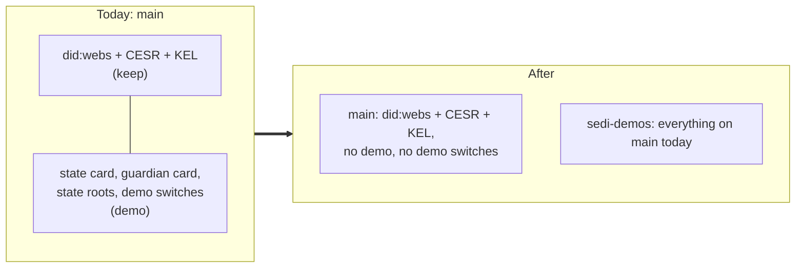

# Moving the SEDI demos off `main`

**Status:** Draft, 2026-11-23. For review by Alberto Leon. This plan changes no code; nothing is built.
**Reviewers:** Alberto Leon and the product owner.
**Scope:** take every State-Endorsed Digital Identity (SEDI) *demo* off `main` and onto a `sedi-demos` branch, while keeping `did:webs` resolution and everything Keyring needs to connect to a KERI-based VTC.
**Companions:** [`sedi-demos-move-plan/`](sedi-demos-move-plan/): the inventory evidence and the reading of the earlier modularity note ([`2026-11-23-bam.md`](sedi-demos-move-plan/2026-11-23-bam.md)); review index in §11.
**Related plans:** [`keri-holder-plan.md`](keri-holder-plan.md) (the KERI holder work this keeps room for), [`delegated-batch-issuance-plan.md`](delegated-batch-issuance-plan.md) (the SEDI-motivated plan that assumes the KEL verifier), [`single-codebase-plan.md`](single-codebase-plan.md) (why `bifold/` paths are ordinary paths here).

## Overview
<!-- plan-part: human -->

> **Human part: for people deciding and reviewing.** What this is, what a person
> sees, how we'll know it works, and what is needed from whom. It adds nothing: the
> numbered precision part below is authoritative, and if the two disagree, the
> precision part wins and this part is the bug.

SEDI is Utah's State-Endorsed Digital Identity initiative. In Keyring it is a demo and test lane: a "State Guardian card" (a KERI/ACDC credential a state office issues to a "ward" and a "guardian" approves), checked against trusted "state roots", with a "State card (demo)" pass in Credentials, a state-office screen, and a one-tap "Set up the SEDI demo" in Developer options. It is always bundled and always loaded; only runtime switches, off by default, hide it. (§2)

Two things in the same folder are not demo. The `did:webs` resolver is how Keyring resolves a VTC community's DID for sign-in, and the CESR and KEL code under it is the only KERI verifier in the repository, which the holder-only KERI plan and the delegated batch issuance plan both assume. (§2, §3)

This plan moves the demo to a `sedi-demos` branch and removes it from `main`, and keeps the `did:webs` and KERI verification code, with the one gate that would otherwise leave the verifier dead taken out. A person using Keyring from `main` sees no State card pass, no Guardian card link, no state-office screen and no SEDI rows in Developer options. Community sign-in over `did:webs` works as before. (§4, §5)

**How we'll know it works**

| Claim | Proved by | Runs where | Status |
|---|---|---|---|
| Nothing is lost | `sedi-demos` is cut from `main` at the commit before the removal and pushed (§6, S0) | Git | Not started |
| Community sign-in over `did:webs` still resolves and verifies | `WebsDidResolver.test.ts` and the `sedi-vtc` fixture tests pass with the demo gone (§6, S1, S4) | CI | Not started |
| The verifying resolver is live without a demo flag | A test calls `resolveWebs` with no approver flag set and gets a result, not `switchedOff` (§6, S1) | CI | Not started |
| No demo code remains on `main` | `git grep -iw sedi` and the list in §6 S7 find only the kept paths and docs | CI, one command | Not started |
| Nothing else regressed | Root `yarn lint`, `yarn typecheck`, `yarn test`, and `cd bifold/packages/core && yarn test` | CI | Not started |
| `sedi-demos` still builds and its tests pass | The same suites on that branch (§6, S7) | CI | Not started |

**Where it stands:** a verified inventory of `main` at `800a44ba` (companion). Decisions D1 to D4 are taken (§3). Nothing is written.

**Open decisions**

| Question | Recommendation | Who decides | By when, or what it blocks |
|---|---|---|---|
| Does `sedi-demos` stay maintained against `main`, or is it an archive? | Archive, rebased only when someone needs to run a demo (§8, R1) | Product owner | Before S0; changes how much S8 promises |
| Do state-verified approvers survive in the product? D1 deletes them as demo-only | Confirm D1 (§3) | Alberto, product owner | Blocks S1 |

**Not doing:** deleting `modules/sedi/cesr`, `guardian/kel.ts`, `webs/*` or `identity/keriEvents.ts`; writing the KERI holder (that is its own plan); renaming the `sedi-vtc` DID strings or fixtures; adding a build-time flag or plug-in system to make the demo optional (§3, D5); making the demo a separate package (§3, D5). (§3, §9)

---

<!-- plan-part: precision -->

> **Precision part: for implementers and agents.** Complete, exact and normative:
> implement from this part. Sections are numbered, and a bare `§n` means this
> plan's section n.

## 1. Goal and non-goals

**Goal.** `main` contains no SEDI demo code, switches, screens, strings, test ids or tests, and keeps `did:webs` resolution and the KERI primitives and verifier. A `sedi-demos` branch contains the demo as it is on `main` today.

**Non-goals.**
- Making the demo pluggable on `main`. The seam between trust-tasks and the demo is circular (§2.3), and untangling it for a demo that is leaving would be work for nothing (§3, D5).
- Building the KERI holder or any new KERI feature. §5 only makes the kept code generic enough that the holder plan can use it.
- Changing what ships to testers beyond the demo's absence.

## 2. Today

Verified at `origin/main` `800a44ba` (details and the paths of every item are in the companion). In this section `C` is `bifold/packages/core/src` and `S` is `C/modules/sedi`.

### 2.1 What `S` holds

| Directory | Contents | Class |
|---|---|---|
| `S/cesr/` | `codes.ts`, `qb64.ts`, `reader.ts`, `signatures.ts`: CESR primitives, no flag or demo imports | Keep |
| `S/guardian/kel.ts` | KEL replay and verify engine; imports only `cesr` and noble. Used by `webs/resolve.ts`, `identity/keriEvents.ts` and `holder/controller.ts` | Keep |
| `S/guardian/chain.ts` | ACDC and TEL verification. Generic mechanism, but hard-codes `SEDI_SCHEMAS` (`:25`) and the guardian-specific `wardNamedIn` | Keep, made schema-agnostic (§5, D2) |
| `S/guardian/{index,stateRoots,issue,k0TestCard,k0RevokedTestCard,k0RevokedOmittedCard}.ts` | `verifyGuardian` (gated), K0/K1 state roots with a hard-coded K1 AID, issuance, K0 test cards | Demo |
| `S/webs/{identifier,document,rootKel}.ts` | `parseWebsDid`, document parsing, the `resolveRootKel` seam | Keep |
| `S/webs/resolve.ts` | `getArtifact` (ungated) and `resolveWebs`, which refuses with `switchedOff` unless `isStateVerifiedApproversEnabled()` (`:146`) | Keep, gate removed (D1) |
| `S/webs/index.ts` | Barrel including the demo exports | Keep, trimmed |
| `S/webs/{demoStateHost,designatedAliases,guardian,lastLive}.ts` | K1 host override, K1 aliases, `verifyGuardianWithWebs`, the Who-approves live cache | Demo |
| `S/identity/keriEvents.ts` | KERI event builders; imports `kel` and `cesr` | Keep |
| `S/identity/{phoneIdentity,phoneCodesOn,StateOfficeCodes}.*` | Ward identity, the two approver flags ANDed, the state-office screen | Demo |
| `S/holder/controller.ts` | A holder KERI controller; imports `kel`, `keriEvents` and `phoneCodesOn` (`:34`, throws at `:67`) | Keep, decoupled from `phoneCodesOn` (D2) |
| `S/holder/*` (all other files) | State card pass and details, `stateCardFlag`, `useHeldStateCard`, `GuardianCardReceive`, `guardianCardLink`, `receiveGuardianCard` | Demo |

### 2.2 The one runtime consumer of the keep set

`C/utils/WebsDidResolver.ts` imports `S/webs/identifier` (`parseWebsDid`) and `S/webs/resolve` (`getArtifact`, `WEBS_LIMITS`, `WebsFetch`) at `:3-4`. It is registered unconditionally in `C/utils/agent.ts:176` and `app/src/utils/bc-agent-modules.ts:222`. `triggerLink.ts` and `oobSignIn.ts` do not import `S`; they reach did:webs only through that resolver. There is no KERI holder code yet, so `cesr` and `guardian/kel.ts` are the only KEL verifier, and `S/webs/README.md` states there is no second one.

### 2.3 Demo code outside `S`

Paths are under `C/modules/trust-tasks/` unless stated.

- **Demo-only files:** `guardianEvidence.ts` (about 1.4k lines), `socialAuthorization.ts`, `developerTestState.ts`, `module/sediDemoSide.ts`, `module/sediKeriRemoteOff.ts` (`SEDI_KERI_REMOTE_OFF.off`, `:12`, hard-coded `false`), `module/stateVerifiedApproversFlag.ts`, `screens/approver/guardianReasonWords.ts`.
- **Call sites in kept files:** `ceremony.ts` (lazy `require` registering the guardian-evidence handler), `approverRole.ts` (lazy `require`), `components/ApproverOfferModal.tsx` (a static import of `guardianEvidence`; the hardest coupling), `screens/VtaTrustedApprovers.tsx` (`demoStateHost`, `StateOfficeEntry`, `guardianEvidence` imports and state-card sections), `module/vtiLinks.ts` (the `guardianCard` kind, `GUARDIAN_CARD_LINK_OFF` at `:475`, the destination map and the throw at `:705`, claiming `keyring://guardian-card` by prefix at `:124`), `approverRoleSpec.ts` (`GUARDIAN_EVIDENCE_MAX_BYTES`, imported by `S`), `index.ts` (re-exports).
- **Elsewhere in core:** `C/navigators/MyAgentStack.tsx` (always registers `GuardianCardReceive` and `StateOfficeCodes`), `C/types/navigators.ts`, `C/screens/ListCredentials.tsx` (lazy `require` of the holder, `useHeldStateCard`, `<StateCardPass>`, empty-list logic), `C/index.ts` (about 20 SEDI exports), the `testids.json` blocks (`GuardianCard*`, `StateCard*`, `StateOffice*`), and the `StateCard`, `GuardianCard`, `StateOffice`, `Approver.SectionStateCard` and `Screens.*` blocks in the en, fr and pt-br locale files.
- **App:** `app/container-imp.ts` (loads `enableStateCard`, `sediDemoSide`, `demoStateHost` into bifold state), `app/src/store.tsx` (three fields; actions `TOGGLE_STATE_CARD`, `SET_DEMO_STATE_HOST`, `SET_SEDI_DEMO_SIDE`; storage keys `EnableStateCard`, `DemoStateHost`, `SediDemoSide`), `app/src/screens/Developer.tsx` (the SEDI rows and about 150 lines of handlers), the `Developer.SediDemo*`, `SetUpSediDemo`, `TurnOffSediDemo`, `EnableStateCard` and `HoldK0TestGuardianCard` locale keys, and `e2e/lib/testids.json` and `e2e/lib/testids.app.json` (and the `testids.allow.json` allowlist if it names them).
- **Tests:** in core, `S/__tests__` (demo and keep mixed, §6 S4), the trust-tasks tests `guardianEvidence`, `socialAuthorization`, `guardianReasonWords`, `demoSides`, `demoWords`, `whoApprovesAtAGlance`, parts of `approverScreens` and `confirmItsYouScreens`, and `sediKeriSwitches.test.ts`; in the app, `stateCardSwitch`, `stateVerifiedApproversSwitch`, `localization/sediDemoState` and the `Developer{DemoResult,DemoRowTap,DemoStateHost,OneTapSaves,PracticeRequest,StateCardRow,StateVerifiedRows,ConfirmItsYouRow}` screen tests. Each is classified in S4 by reading it, not by name.

### 2.4 The umbrella switch is shared

`SEDI_KERI_REMOTE_OFF` is ANDed into `trustedApproversFlag.ts:31`, `stateVerifiedApproversFlag.ts:25`, `confirmItsYouFlag.ts:40`, `holder/stateCardFlag.ts` and `developerTestState.ts:78`, and is named in a comment in `trustTestStateFlag.ts`. Trusted approvers and "Confirm it's you" are not SEDI features: each keeps its own `*_REMOTE_OFF` switch, so removing the umbrella clause from their flag files leaves them with their own kill and nothing else changes. `trustedApproversFlag` and `stateVerifiedApproversFlag` also gate `resolveWebs`, `phoneCodesOn` and `lastLive`.

### 2.5 Unmerged branches

`origin/feat/sedi-k0-developer-rows` (3 ahead, 53 behind `main`) and `origin/feat/sedi-state-office` (15 ahead, 43 behind; adds `tools/sedi-state-office/`) exist. The old `keyring-bifold` branches named in the earlier note are not remotes of this repository.

## 3. Decisions

All taken by the product owner on 2026-11-23; Alberto is asked to confirm in review. The reasoning behind each is standing rationale: an implementer must not re-open it without the constraint that rules the other option out.

**D1. State-verified approvers are demo-only and are removed; `resolveWebs` loses its gate.**
- Constraint: `resolveWebs` is the verifying did:webs resolver, and its refusal at `S/webs/resolve.ts:146` depends on a flag whose only other users are demo code (`phoneCodesOn`, `lastLive`, `verifyGuardian`). Deleting the flag while keeping the refusal makes the verifier permanently dead; keeping the flag keeps a demo switch on `main`.
- Rejected: *keep the flag and decouple only `resolveWebs`.* It leaves a demo-named switch gating nothing but demo code on `main`.
- Rejected: *rewire the gate to a new `didWebsVerifyEnabled` switch.* A switch for the one path the product depends on is a way to turn community sign-in off by mistake; `getArtifact` is already ungated and the resolver is registered unconditionally.
- Conditional: if state-verified approvers are meant to be a product feature, this decision is wrong and the plan stops at S1. Alberto and the product owner confirm before S1.

**D2. `guardian/chain.ts` and `holder/controller.ts` stay on `main`, made generic first.**
- Constraint: `keri-holder-plan.md` needs ACDC and TEL verification and a holder-side KERI controller, and states one verifier (`S/webs/README.md`: "no second KEL verifier").
- Concretely: `SEDI_SCHEMAS` and the guardian-specific `wardNamedIn` move to the demo; `chain.ts` takes the accepted schemas as an argument. `controller.ts` drops `phoneCodesOn` (`:34`, `:67`); its caller in the demo (`socialAuthorization.ts`) checks the switch instead.
- Rejected: *move both to `sedi-demos` and re-extract for the holder plan.* Cheaper now, but the holder plan then re-extracts the same code from a branch, against fixtures (`k0-utah-v2`) it cites, with the SEDI shapes entangled.

**D3. The two unmerged SEDI branches move to `sedi-demos`.** They are rebased onto `sedi-demos` after the removal lands (§7), not onto `main`.
- Rejected: *abandon them.* They hold work a demo would use (`tools/sedi-state-office/`).

**D4. The `sedi-vtc` DID strings and fixtures stay.** `__tests__/utils/fixtures/sedi-vtc.did.json` is a real VTC `did:webs` document, and the DID string `did:webs:…:sedi-vtc:…` appears in tests of community sign-in, `vtiLinks`, `triggerLink`, `oobSignIn`, `communityName`, `vtiMediatorTspOnlyRoute`, `vtiJoinWatch`, `roomsLogWords` and `agentPollsBackendOwnSession`. Those cover kept code. Renaming is churn with no purpose.

**D5. No plug-in seam.** Breaking the trust-tasks and demo circularity (moving guardian-evidence into `sedi/` behind a registration hook) would make deletion "a folder plus one call". It costs a refactor of `ceremony.ts`, `approverRole.ts`, `vtiLinks.ts`, `VtaTrustedApprovers.tsx` and `ApproverOfferModal.tsx` whose only consumer is code being removed. The branch makes that unnecessary; if a second demo ever needs the seam, build it then.

## 4. Target

On `main` after S7:

- `S` is not a demo module. The kept files live where §5 puts them (S1 decides the exact home; the default is to leave them in place under `modules/sedi/{cesr,guardian,webs,identity}` and rename the folder in a separate follow-up only if the product owner wants it, so the move stays a pure deletion plus one decoupling commit).
- No code reads or writes `EnableStateCard`, `DemoStateHost` or `SediDemoSide`; orphaned values in storage are harmless and are not migrated.
- `keyring://guardian-card` is not claimed by `vtiLinks.ts`; see R2.

## 5. What is kept and what changes in it

| Kept file | Change |
|---|---|
| `S/cesr/*` | None |
| `S/guardian/kel.ts` | None |
| `S/guardian/chain.ts` | Accept the schema set as an argument; `SEDI_SCHEMAS` and `wardNamedIn` move to the demo |
| `S/webs/{identifier,document,rootKel}.ts` | None |
| `S/webs/resolve.ts` | Remove the `isStateVerifiedApproversEnabled` import (`:15`) and refusal (`:146`) |
| `S/webs/index.ts` | Drop the `demoStateHost` and `designatedAliases` exports |
| `S/identity/keriEvents.ts` | None |
| `S/holder/controller.ts` | Drop `phoneCodesOn` |
| `C/utils/WebsDidResolver.ts` | None, unless the folder is renamed (§4) |
| `C/modules/trust-tasks/module/{trustedApproversFlag,confirmItsYouFlag}.ts` | Remove the `SEDI_KERI_REMOTE_OFF` clause; their own `*_REMOTE_OFF` stays |

## 6. Steps

All implementation runs as subagents, one branch off `main` per step group. Heavy operations follow the shared-tree rules: check memory, CPU and `vartmp-tidy check` first, run under `nice -n 10`, and set `umask 002`. Commits are conventional, signed and carry `Signed-off-by`.

**S0. Preserve.** Create `sedi-demos` from `origin/main` and push it.
- *Done when:* `git rev-parse origin/sedi-demos` equals the `main` commit the removal branch starts from, and the branch name is recorded in §11 or the companion. Nothing else is changed.
- *Needs:* a decision on R1 (maintained or archive) so the PR description says which.

**S1. Decouple while the demo still exists.** One commit, `refactor`: remove the `resolveWebs` gate (D1); make `chain.ts` schema-agnostic and move `SEDI_SCHEMAS` and `wardNamedIn` to the demo (D2); drop `phoneCodesOn` from `controller.ts` and move the check to its demo caller (D2); trim `S/webs/index.ts`; point `WebsDidResolver.test.ts` at a path that survives.
- *Done when:* a new test shows `resolveWebs` resolves a fixture (the `webs-k0-root` fixture) with no approver flag set; `websResolver.test.ts` is rewritten so it no longer imports `../guardian`; the demo still passes its own tests (the move has not started); `cd bifold/packages/core && yarn test` and root `yarn typecheck` pass.
- *Blocked on:* D1 confirmation (§Overview).

**S2. Remove the demo from core.** One commit, `chore`. Delete the demo files in §2.1 and §2.3; remove the call sites: `ceremony.ts` registration, `approverRole.ts` lazy require, the `ApproverOfferModal.tsx` import, the `VtaTrustedApprovers.tsx` state-card sections and imports, the `guardianCard` kind and destination in `vtiLinks.ts`, the two screens in `MyAgentStack.tsx` and `types/navigators.ts`, the `ListCredentials.tsx` pass and its empty-list terms, the `index.ts` exports; remove the `SEDI_KERI_REMOTE_OFF` clause from `trustedApproversFlag.ts` and `confirmItsYouFlag.ts` and delete the other flag files; decide by reading whether `trustTestStateFlag.ts` (it adds the K0 test root) is demo and goes too, and update its comment if it stays; remove the demo `testids.json` entries and the en, fr and pt-br locale blocks.
- *Done when:* `git grep -n -E "guardianEvidence|socialAuthorization|developerTestState|sediDemoSide|sediKeriRemoteOff|stateVerifiedApproversFlag|StateCardPass|GuardianCardReceive|StateOfficeCodes|stateRoots"` under `bifold/` finds nothing outside docs; core's `yarn test` and root `yarn typecheck` pass; trusted approvers and "Confirm it's you" tests pass unchanged except for the deleted clause.

**S3. Remove the demo from the app.** One commit, `chore`. `container-imp.ts` (the three loads and pushes), `store.tsx` (three fields, three actions, three storage keys), `Developer.tsx` (the SEDI rows and handlers), the `Developer.SediDemo*`, `SetUpSediDemo`, `TurnOffSediDemo`, `EnableStateCard` and `HoldK0TestGuardianCard` locale keys in three languages, `e2e/lib/testids.json`, `e2e/lib/testids.app.json`; the comment at `e2e/lib/pages/link.js` that names the guardian card.
- *Done when:* root `yarn lint`, `yarn typecheck`, `yarn test` pass; no `Developer*` test references a deleted row.

**S4. Tests.** Classify each SEDI-named test by reading it. Delete demo tests; keep and fix the paths of the kept ones; rewrite the mixed ones.
- *Keep:* `cesrReader`, `keriEvents`, `kelPrefixBinding`, `websResolver` (rewritten, S1), the `webs-k0-root`, `cesr-ts-reads` and `k0-utah-v2` fixtures with `keriTestKit.ts` (the keri-holder docs cite the last of these by path), `WebsDidResolver.test.ts` and `sedi-vtc.did.json`, and every test that only uses the `sedi-vtc` DID string (D4).
- *Delete:* `demoStateHost`, `designatedAliases`, `k0TestCard`, `k0RevokedOmittedCard`, `k1Screens`, `k1StateOffice`, `socialIssue`, `expiryParseGuard`, `S/holder/__tests__/*`, `guardianEvidence`, `socialAuthorization`, `guardianReasonWords`, `demoSides`, `demoWords`, `whoApprovesAtAGlance`, and the app tests listed in §2.3.
- *Mixed:* `guardianK0.test.ts` (tests the chain: keep the mechanism cases against a schema argument, move the SEDI-schema cases to the branch), `holderController.test.ts` (keep, without `phoneCodesOn`), `approverScreens` and `confirmItsYouScreens` (remove only the guardian parts).
- *Update, not delete:* `sediKeriSwitches.test.ts`: its list of known switches and the umbrella kill must match what remains. Keep it, because it guards the remaining `*_REMOTE_OFF` switches; `single-codebase-plan.md:302` names it.
- *Done when:* each deleted file is justified in the PR by a one-line reason; no kept test imports a deleted module; suite counts are reported before and after.

**S5. Docs.** Update `docs/plans/README.md` (the `delegated-batch-issuance-plan` and `keri-holder-plan` rows, if they describe the demo as present in the app), `delegated-batch-issuance-plan.md` and `keri-holder-plan.md` where they say the SEDI demo is in the app, and `single-codebase-plan.md:302` only if the test is renamed. If the `k0-utah-v2` fixtures move, repoint `keri-holder-plan/2026-11-16-al.md` (`:66`, `:172`); by default they do not move, so this is a check, not an edit. Dated companions are not edited.
- *Done when:* `git grep -n -iw sedi -- docs` lists only intentional motivation text and this plan.

**S6. Branches.** Rebase `origin/feat/sedi-k0-developer-rows` and `origin/feat/sedi-state-office` onto `sedi-demos` (D3), force-pushing only those two feature branches after the product owner agrees to it.
- *Done when:* both branches build and pass the demo's tests on `sedi-demos`, or a note on each says why not and what remains. Owner of the decision to drop one instead: the product owner.

**S7. Verify.** On the removal branch: root `yarn lint`, `yarn typecheck`, `yarn test`; `cd bifold/packages/core && yarn test`; `git grep -n -iw sedi` and review each hit (kept paths, the `sedi-vtc` strings, docs); one manual community sign-in over `did:webs` against the lab VTC (see the `vti-lab-and-field` skill) or, if it is not available, the `WebsDidResolver` and `oobSignIn` tests named as the evidence. On `sedi-demos`: the same suites, plus the demo's own tests.
- *Done when:* every command passes and the PR states the evidence for each claim in the Overview table, including anything not run.

**S8. Merge and hand over.** Squash per the repository's `main` rules (signed, conventional). State in the PR body how to run the demo from `sedi-demos`.
- *Done when:* `main` has the removal commit(s), `sedi-demos` exists on `origin`, and R1's choice is written where the next person will see it.

## 7. Branch handling

`sedi-demos` is cut once (S0) and is the base for the two feature branches (S6). Changes to the demo land there. Changes to kept code land on `main` and are merged into `sedi-demos` only when someone needs the demo to run, since the demo depends on the kept code and a stale demo builds against a stale verifier.

## 8. Risks

- **R1. `sedi-demos` drifts from `main`.** It has no CI of its own and the kept code under it keeps changing. Recommendation: archive, with a note naming the `main` commit it was cut from and the command to rebase; the cost of a maintained branch is a standing merge chore for a demo with no scheduled use. Decided by the product owner.
- **R2. `keyring://guardian-card` changes behaviour.** With the `vtiLinks.ts:124` prefix claim gone the link falls through to the connection flow and gives a different error. Accepted: the link existed only for the demo. If a state office is still handing the link out, say so before S2.
- **R3. The circular seam hides a caller.** `ceremony.ts`, `approverRole.ts`, `ApproverOfferModal.tsx` and `VtaTrustedApprovers.tsx` each reach the demo differently (lazy require, static import, direct import). S2 is reviewed by a second agent reading each call site, not by the grep alone; the grep in S2 is the floor.
- **R4. `trustedStateRoots()` adds the K0 test root in any `__DEV__` build** (`S/guardian/stateRoots.ts:95-97`). It leaves with the demo; the S7 review checks nothing kept relied on it.
- **R5. The umbrella kill goes away.** A release can no longer turn off trusted approvers and "Confirm it's you" together with one constant; each still has its own `*_REMOTE_OFF`. Noted so the release checklist is not written against the old switch.
- **R6. Unmerged branches conflict heavily** with any removal (43 and 53 commits behind). Hence D3: they move to the branch, they do not rebase onto `main`.

## 9. Out of scope, recorded so they are not re-proposed

- Moving the kept files out of `modules/sedi/` (§4): a rename is a separate change.
- A feature flag or compile-time switch that excludes the demo from a build (D5).
- Removing the `keyring://` scheme registration (`AndroidManifest.xml:55`): it serves every deep link, not only the demo's.

## 10. Rollback

S1 is a refactor with its own tests and reverts alone. S2 to S4 are deletions that revert as a unit; `sedi-demos` already holds the code, so a revert is also a merge from it. Orphaned storage keys need no migration either way.

## 11. Companions and related plans

| Rev | Companion |
|---|---|
| 2026-11-23, BAM | [`2026-11-23-bam.md`](sedi-demos-move-plan/2026-11-23-bam.md): the inventory behind §2 against `main` `800a44ba`, and how it differs from the earlier modularity note |
