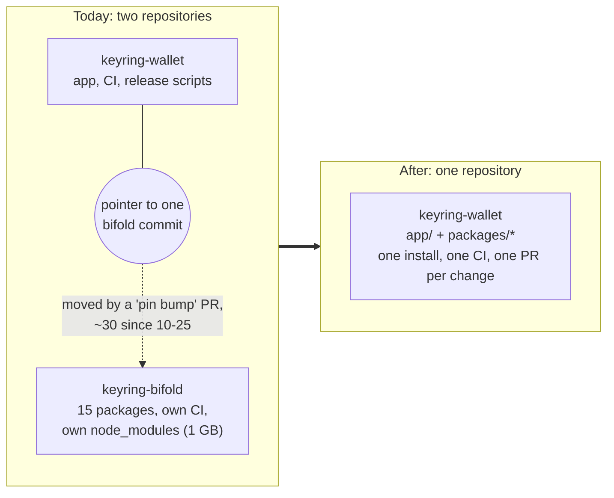
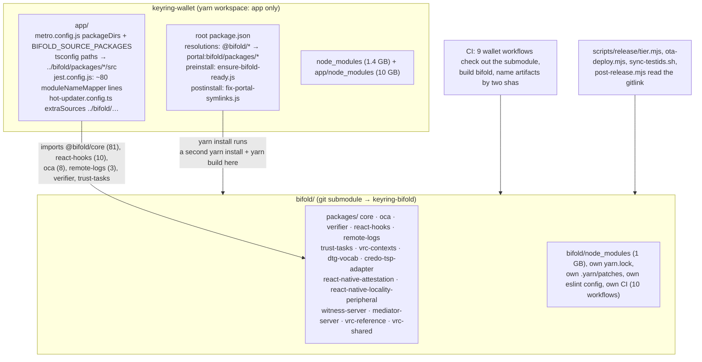
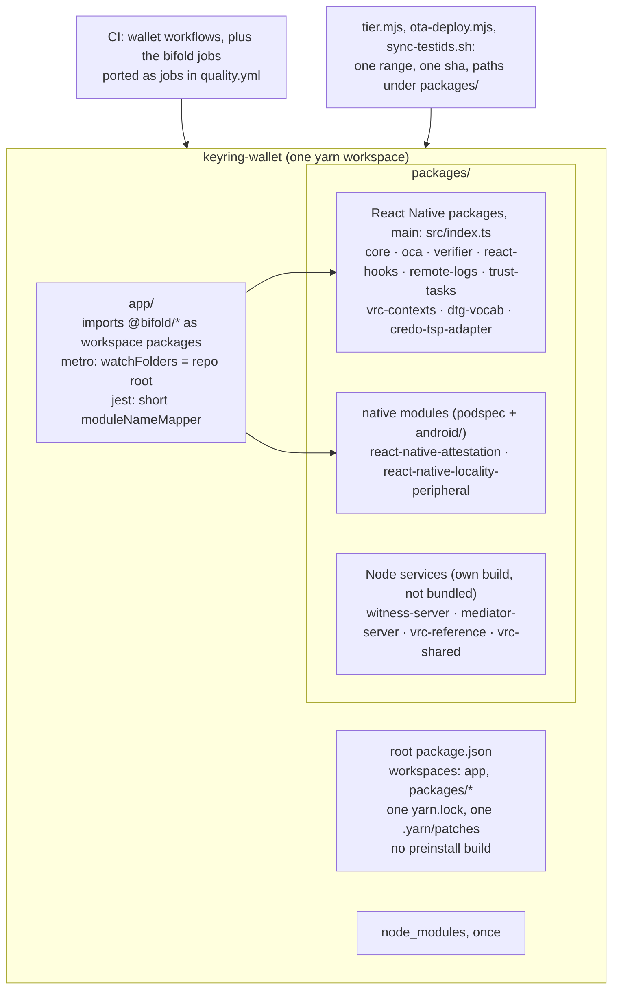
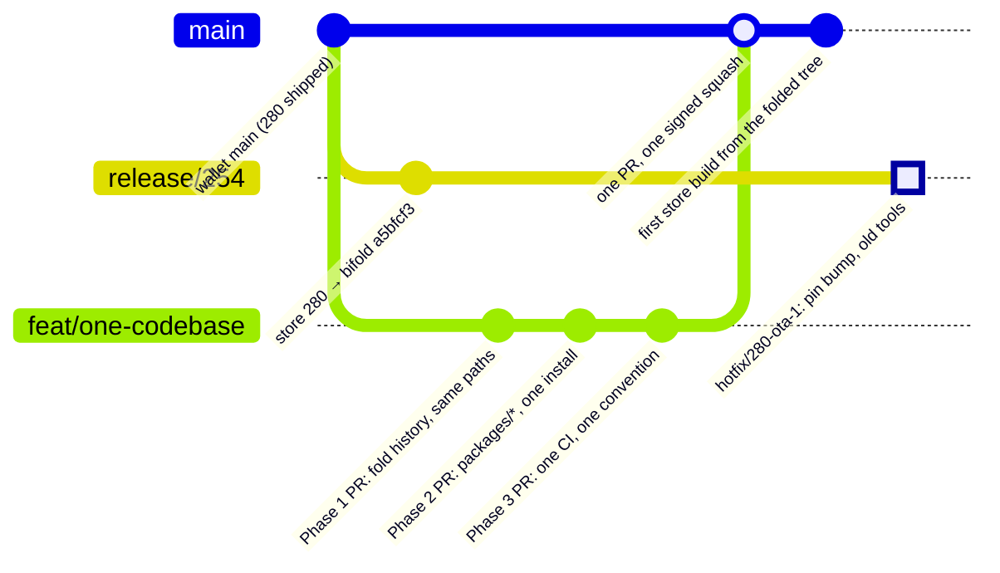

# One codebase: folding bifold into keyring-wallet

**Status:** Accepted 2026-11-20; **Phase 1 and the CI port are on `main` since 2026-11-22** (one squash commit, 7e07bb801, from the integration branch `feat/one-codebase`; companion [`2026-11-22-al.md`](single-codebase-plan/2026-11-22-al.md)). **Phase 2 is built and proven on the integration branch `feat/one-tree`** (2026-11-22 to 23; `2026-11-22-al.md` §8) and waits on the words for `main`; the archive of `keyring-bifold` waits for the first store build from the one tree (this plan's §4, Phase 3).
**Reviewers:** the product owner and a second maintainer.
**Scope:** move the `keyring-bifold` framework into this repository with its history, in two moves, so a change to the app and its framework is one commit and one pull request.
**Companions:** [`single-codebase-plan/`](single-codebase-plan/): the measurements, positions and decisions behind this plan ([`2026-11-20-al.md`](single-codebase-plan/2026-11-20-al.md)), the review of it ([`2026-11-20-bam.md`](single-codebase-plan/2026-11-20-bam.md)), the Phase 0 record and Phase 1's execution ([`2026-11-21-al.md`](single-codebase-plan/2026-11-21-al.md)) and the merge day ([`2026-11-22-al.md`](single-codebase-plan/2026-11-22-al.md)); review index in this plan's §14.
**Related plans:** listed in §14.

## Overview
<!-- plan-part: human -->

> **Human part: for people deciding and reviewing.** What this is, what a person
> sees, how we'll know it works, and what is needed from whom. It adds nothing: the
> numbered precision part below is authoritative, and if the two disagree, the
> precision part wins and this part is the bug.

Keyring is built from two Git repositories that behave like one. `keyring-wallet` holds the app: its screens, theme, release scripts and CI. `keyring-bifold` holds the framework underneath it: fifteen packages, among them the wallet core (190,000 lines), the Trust Tasks module, the witness server and two native modules. It began as a fork of OpenWallet Foundation's Bifold. (§2)

The wallet repository does not contain the framework. It holds a **pointer** to one exact framework commit (a Git submodule), so every framework change needs a second pull request that moves the pointer. That has happened about thirty times since 2026-10-25, roughly once a day. Every release note, OTA cut and test run names two commits instead of one, and the code that keeps the two in step (install scripts, path rewrites, duplicate dependency trees, a 1 GB second `node_modules`) is some of the most fragile we have. (§2)

This plan moves the framework's files and full history into the wallet repository, so there is **one repository, one commit and one pull request** per change. Nothing about what the app does changes. The screens, theme, navigation, agent, notifications and over-the-air (OTA) updates keep working as they do now, because the code is not rewritten; only where it lives and how it is wired changes. (§1, §5.4)

It happens in two moves, so each can be checked on its own. Each is a pull request stacked on the previous one on a single integration branch, and `main` changes once, at the end. (§3, §4)

1. **Same paths, one repository.** The pointer becomes a real folder with the same contents and the same history. If this step breaks something, the cause can only be the install wiring.
2. **One dependency tree.** The packages join the wallet's own workspace, the second install and its 1 GB of duplicates go away, and the paths lose their `bifold/` prefix.

A third phase folds the framework's CI jobs and conventions into the wallet's. Renaming the packages from `@bifold/*` to `@keyring/*` is listed as optional later work and is not decided. Merging the core package into the app is dropped (§4, Phase 4). (§4)



The left side is today's shape, with the pointer that every framework change has to move; the right side is the target. (§2, §3)

One rule of this repository shapes how the first move lands: every commit on `main` must be cryptographically signed, and the framework's 4,344 historical commits are not and cannot be made so. The fold therefore arrives on `main` as one signed commit, and the framework's full history sits beside it in the same repository on a separate branch, where `git blame` and `git log` can still reach it. (§3, D1)

Over-the-air updates need care. A phone on store build 279 or 280 accepts a JavaScript update only if its "native fingerprint" matches the build it has, and the fold may change that fingerprint even though no native code changes. The fold is therefore a store-build boundary: the 279 and 280 OTA lines are retired when the first folded store build is published. (§5.3)

This plan does not rename or rewrite any module, does not change what ships, and does not keep syncing with upstream Bifold as shared Git history; the `keyring-bifold` repository is archived, not deleted. (§1, §8)

**How we'll know it works**

| Claim | Proved by | Runs where | Status |
|---|---|---|---|
| The fold builds and the app behaves as before | Lint, types and formatting; app and package jest (core's 491 suites are the contract); the `scripts/*` tests (§5.1, rungs 1 to 3) | CI | **Passed** for Phase 1 (PRs #960, #966, #968, #971; the framework's full suite in CI) |
| The store configuration builds on both platforms | iOS simulator app and Android APK from `test-builds.yml` (§5.1, rung 4) | CI | **Passed** (run 44954115049) |
| The app works end to end on the folded tree | `e2e:smoke`, `e2e:vrc` and the other suites in rung 5 | Mac mini, emulator and simulator | **smoke and vrc passed** on the final head's build; the other suites run with the nightly on the folded `main` |
| Hardware attestation still works | `e2e:vrc:devices` and the witnessed iOS TSP run on two phones (rung 6; simulators cannot prove it) | Physical phones, attended | Not run for Phase 1 (no native change; the fingerprints are 280's); due before 282 |
| The release gate and OTA delivery work on the folded tree | `gate.sh` nightly (rung 7); a throwaway OTA to a Release APK in `gate-ota.yml` (rung 8) | Mac mini; CI | Nightly: first run on the folded `main` is the next one; OTA rung: before 282 |
| The product owner's phone works with the folded build | A hands-on install (rung 9) | Attended | Due with 282 |
| Release grading is unchanged by the fold | `tier.mjs` grades the sixteen recorded ranges byte-identically, before and after (§4, Phases 1 and 2) | CI and `tier.test.mjs` | **Passed** for Phase 1 (16 of 16, repeated on the merged tree); again at Phase 2 |
| `main` can accept the fold | The signed squash and the one-commit PR, rehearsed on a throwaway repository with a copy of the ruleset (§4, Phase 0) | Throwaway GitHub repository, then `main` | **Done**: 7e07bb801 on `main`, verified |
| A bifold change merged during the fold replays cleanly | `git am` replay of bifold #1163 and #1164, identical by `git patch-id` (§4, Phase 0; §7.1) | Throwaway repository, then the fold branch | **Passed**: the rehearsal, then five real merges (#1169 to #1173), each byte-identical |
| The native fingerprint after the fold is known | the store builds' fingerprint steps on the folded tree against the Phase 0 record (§5.3) | CI | **Passed**: equal to 280's on both platforms, on the fold and on the merged tree |

**Where it stands:** Phase 1 and the CI port are merged (2026-11-22). Phase 2 is built the same day on the integration branch `feat/one-tree` (commit A the move, commit B the wiring: one install, no `bifold/`) and proven on it by 2026-11-23: every CI job green on its final head, smoke and vrc e2e passing on both platforms from that head's Test build (after one crash, found and fixed, that gave the tree its bundle-evaluation check), the module table, the fingerprint outcome and the bundle account in the 2026-11-22 companion §8; the one PR to `main` opens on the review's final word and merges on the product owner's. Store build 281 ships from `release/255` with the submodule structure; the first build from the one-tree `main` is where the 279/280/281 OTA lines retire (§5.3). Open: the framework's inherited formatting debt (§4 Phase 3).

**Open decisions**

| Question | Recommendation | Who decides | By when, or what it blocks |
|---|---|---|---|
| The framework's inherited formatting debt (244 files prettier flags, all unchanged from bifold `main`): one `prettier --write` commit, or an ignore? | One style-only PR, proven by the framework's suite and typecheck rather than by lines, so a later PR touching one of those files is not punished for it (§4, Phase 3) | Product owner | Before many framework PRs land on `main` |
| Should "merge `packages/core` into `app/`" stay in Phase 4? | No: drop it, because core is a separate boundary that the container seam, hot reload, `remote-logs` and the SDK direction use (§4, Phase 4; §3, D6) | Product owner | Not stated; blocks nothing before Phase 4 |
| Rename `@bifold/*` to `@keyring/*`? | None yet; it stays out of Phases 1 to 3 (§3, D3) | Product owner | Phase 4, not scheduled |

**Not doing:** rewriting, re-architecting or renaming any module in Phases 1 to 3; changing what ships; continuing the upstream sync as shared Git history; deleting `keyring-bifold` or rewriting its history; publishing `@bifold/*` to npm; changing the OTA server, signing keys, channels or `hot-updater`. (§1, §9)

---

<!-- plan-part: precision -->

> **Precision part: for implementers and agents.** Complete, exact and normative:
> implement from this part. Sections are numbered, and a bare `§n` means this
> plan's section n.

## 1. Goal and non-goals

**Goal.** One Git repository, `keyring-wallet`, contains everything that today lives in `keyring-wallet` and `keyring-bifold`, with the framework's history preserved, and a change to the app and its framework is one commit on one branch, reviewed in one pull request, tested by one CI run, and released by the existing release and OTA pipeline.

**Non-goals.**
- Rewriting, re-architecting or renaming any module. Phases 1 and 2 move files and wiring only. Screens, theme, navigation, the agent container, Trust Tasks, VRC, notifications and OTA keep their code unchanged (§5.4).
- Changing what ships. The first store build from the folded tree is the same app.
- Continuing the upstream "branch swap" sync with `openwallet-foundation/bifold-wallet` as shared Git history. Upstream changes are ported as patches from here on (§8).
- Rewriting or deleting the `keyring-bifold` repository's history. It is archived, not removed (§6).

---

## 2. Today

Measured on 2026-11-20 at wallet `main` 969963df4, bifold gitlink a5bfcf3b2 (bifold `main` tip that day). Details and counts in the companion.



What the submodule costs today, in the order it hurts:

| Cost | Evidence |
|---|---|
| Two PRs per framework change | ~30 `chore(bifold): pin …` commits on wallet `main` since 2026-10-25 |
| Two dependency trees that must agree | `app/jest.config.js` carries ~80 `moduleNameMapper` lines whose comments say "force Jest to use app's React instead of bifold's"; `metro.config.js` has a singleton list for the same reason |
| Two installs, two lockfiles, two patch sets | `bifold/yarn.lock`, `bifold/.yarn/patches` duplicate most of the root's; `bifold/node_modules` is 1 GB |
| A build step that exists only to satisfy `main:` fields | `ensure-bifold-ready.js` runs `yarn build` in bifold on every install; `app/tsconfig.json` redirects three packages to `src` because the built `.d.ts` lags |
| Every release artifact names two commits | `test-builds.yml` artifact names, `ota-deploy.mjs`, `tier.mjs --range` reading the submodule's own range |
| Shared submodule config that can break every worktree at once | `.git/modules/bifold/config` `core.worktree` incident, 2026-11-14: one bad value stopped every git command in every bifold checkout on the machine |
| Two commit conventions | bifold needs a `Signed-off-by:` trailer last; the wallet does not |
| Two CI systems | bifold: ten workflows (quality with four jest parts and a type-check ratchet, full-tests, targeted-jest, VTI conformance, commit checks, publish, and four housekeeping ones) and two rulesets; wallet: 17 workflows, 9 of which also build bifold |

What is *not* a cost: the code itself is sound, its tests are the contract (491 test files in core alone), and the native modules link correctly. The fold keeps all of it.

---

## 3. Target



Design positions, each a standing rule for the implementer:

- **D1. History is preserved in this repository, and `main` stays signed-only.** Every commit on wallet `main` must be cryptographically signed and verified by GitHub: the repository ruleset "Main" on `main` carries `required_signatures`, `non_fast_forward`, `deletion` and four required status checks ("DCO sign-off and commit signature" from `commit-checks.yml`, "Lint+Format+Types", "Testing", "Workflow files"); `commit-checks.yml` lists **every commit in the pull request** and fails on the first one that is unsigned or lacks a sign-off (root `CLAUDE.md`, "Commit conventions"). `git filter-repo` rewrites every bifold sha and so strips every signature, and the upstream OpenWallet-era commits were never signed. A merge that brings 4,344 unsigned commits onto `main` is refused. So the fold lands on `main` as **one signed squash commit**, and the full bifold history (fork point with upstream `dbfa53ef`) is kept reachable **inside the wallet repository** on an unprotected ref, `history/bifold`, pushed once from the filter-repo'd clone. `git log history/bifold -- bifold/packages/core/src/…` and `git blame history/bifold -- <file>` work in every clone; `git log --follow` from `main` does not cross the squash. A `refs/replace/` graft (`git replace --graft <fold-squash> <fold-squash>^ <integration tip>`) stitches them for anyone who fetches `refs/replace/*`; it is optional and never required by tooling. The graft ref is pushed once after the merge to `main` (`git push origin refs/replace/<fold-squash>`), a second small push under the same word that covers `history/bifold`; a clone then runs `git fetch origin 'refs/replace/*:refs/replace/*'`. This shape was chosen over two alternatives that remain available: changing branch protection for one history-preserving merge (rejected because it needs a protection change for a one-time event), and a squash with the history left only in the archived `keyring-bifold` repository (rejected because every new clone would need to fetch a read-only archive to get blame). A plain history merge is not an option: protection refuses it.
- **D2. Two moves, as stacked PRs into one integration branch, then one PR to `main`.** The integration branch is `feat/one-codebase`, cut from `main`. Phase 1 (same paths), Phase 2 (the move and one install) and Phase 3 (CI and conventions) are each a PR whose base is the previous one's head, reviewed one at a time with GitHub's stacked pull requests, and merged into the integration branch. `main` changes once, by one PR from `feat/one-codebase`, squash-merged as one signed commit (D1), on the product owner's explicit word; the standing merge rules do not apply to it. `main` is therefore never between phases: an OTA cut, a nightly or anyone rebasing onto `main` never meets a half-folded tree. The per-phase separation still holds inside the stack: a failure in Phase 1 can only be install wiring; a failure in Phase 2 can only be paths or hoisting. The integration branch is kept after the merge (not deleted), so the phase boundaries stay reachable even though `main` holds one commit. If GitHub's stacked pull requests are not available to the organisation, the same stack is three ordinary PRs whose bases are retargeted by hand as each merges.
- **D3. The packages keep their names.** `@bifold/core` stays `@bifold/core` through Phase 3. The app has about 100 import sites and core has thousands; renaming is a separate, mechanical PR (§4, Phase 4).
- **D4. React Native packages are bundled from source.** Their `main` and `types` point at `src/index.ts`, as `react-native-locality-peripheral` already does in release builds. Metro and `tsc` already read source in development (`BIFOLD_SOURCE_PACKAGES`, `tsconfig` paths); making it the only mode removes the install-time build, the stale `lib/typescript` declarations, and one whole class of "works in dev, breaks in release" bugs. The Node services keep their own `build`.
- **D5. Old release lines keep the old structure.** `release/253` (store 279), `release/254` (store 280), every `hotfix/*-ota-*` and `test/ota-*` branch, and the bifold commits they pin stay exactly as they are and stay buildable (§6). The fold lands on `main` once, from the integration branch.
- **D6. Nothing moves between `app/` and `packages/core`.** The question of what belongs in the app and what in the framework is real, but it is a different plan. Mixing it in would make the fold's diff unreviewable and would break D2's "only wiring can have failed" property.
- **D7. The cut.** Both cuts are taken at the moment Phase 1 starts: the wallet cut is wallet `main`'s tip then, and the bifold cut is bifold `main`'s tip then (969963df4 and 87805b240 when this was written; both are expected to move before Phase 1, the wallet with the v2 retirement's store-tier change and its pin bump). DIDComm v2 merges that land before Phase 1 starts are simply part of the fold; the replay rule in §7.1 applies only to merges after the cut. The tier fixtures in Phase 0 include `staging-v0.2.0-280..<wallet cut>`, so the range that carries a store-tier change is graded before and after the fold like the OTA ranges.
- **D8. One commit convention.** After the fold the whole repository uses the wallet's: conventional commit messages checked by commitlint, every commit signed and verified, and the configured identity's `Signed-off-by:` as the last line (what `git commit -s` writes), with nothing after it. There is no separate DCO rule for `packages/`; `CONTRIBUTING.md` records the change of posture for the files that came from bifold.
- **D9. The Node services stay in the one workspace.** `witness-server`, `mediator-server`, `vrc-reference` and `vrc-shared` join the root workspace like every other package. They move to a `services/` tree with their own install only if hoisting their dependencies (`@credo-ts/node`, askar-nodejs, express) is shown to pollute the mobile tree.

---

## 4. Phases

Each phase ends with its acceptance criteria met on a Test build and on CI, and is one PR in the stack on `feat/one-codebase` (D2). Phases 1 and 2 are the fold; 3 is cleanup; 4 is optional. When Phase 3's PR has merged into the integration branch and the whole ladder in §5.1 has passed on its tip, one PR takes `feat/one-codebase` to `main`.

### Phase 0. Freeze and prepare

- All other work on the framework is paused except the DIDComm v2 migration (done 2026-11-20). Bifold `main` is frozen to everything but that workstream, and each of its merges after the cut is replayed into the fold branch (§7).
- Record the cut: wallet `main` sha, bifold sha, the current native fingerprint of both platforms from a `test-builds.yml` run of that sha (`scripts/ota/record-fingerprint.sh`), and the sizes of the release JS bundles.
- Store **280 against 279**, read from the staging runs' `ota-fingerprint` artifacts: iOS fingerprints **differ** (one source, `AppDelegate.mm`, #950); Android fingerprints are **identical**. 280 phones never take 279.x bundles regardless, because a store build stamps a build-time `MIN_BUNDLE_ID` (280's is later than 279.8). So a kept 280 line needs its own OTA line from `staging-v0.2.0-280`, and the Android floor rule in §5.3 applies.
- Record `tier.mjs`'s grades for the last real OTA cut ranges (`hotfix/279-ota-1..8`, `-90`, 279→280) and for `staging-v0.2.0-280..<wallet cut>`, as the fixture for Phase 1's "byte-identical grades" criterion. *Recorded in the [companion](single-codebase-plan/2026-11-20-al.md) §2.6 for the first ten: all nine 279 cuts grade `ota-strict`, 279→280 grades `store`; the 280→cut range is graded when the cut is taken.*
- Rehearse D1's mechanics on a throwaway GitHub repository carrying a copy of the "Main" ruleset and `commit-checks.yml`: push the filter-repo'd history to `history/bifold`; open a PR straight from the integration branch and watch the commit check fail (the negative case); open the PR from the one-commit `fold/*` branch (this plan's §4, Phase 3), watch it pass, squash-merge it, and confirm `main` holds one GitHub-verified commit whose `bifold/` tree is the bifold cut's. *Recorded in the [companion](single-codebase-plan/2026-11-20-al.md) §3a at a5bfcf3b2, all four outcomes as predicted; redone at the real cut, which takes a second.*
- Rehearse the replay recipe of §7.1 on the same throwaway repository, whose `bifold/` tree is a5bfcf3b2's. The first two bifold merges after that sha are #1163 (`bdac5e5a0`, wallet-to-wallet DIDComm v2 through one mailbox per phone) and #1164 (`87805b240`), each a single-parent commit. In the bifold clone run `git format-patch -1 <sha> -o <dir>` for each; apply #1163 with the Phase 1 form (`git am -p2 --directory=bifold/packages`); then `git mv bifold/packages packages`, commit, and apply #1164 with the Phase 2 form (`git am -p2 --directory=packages`). *Acceptance:* both apply with no `--3way` and no hand edit; `git patch-id --stable` of each replayed commit equals the original's; every file the two patches touch has the same content as in bifold at `87805b240` (`git show 87805b240:<path>` against the folded path); and the back-port direction works in the same session: one wallet commit that edits a file under `bifold/packages/core` applies to a bifold checkout with `git am -p2`, and the same edit after the move with a plain `git am` (§5.3). The commands and their output go in the companion.
- **Optional experiment: does the path change alone move the fingerprint?** On a scratch branch from the wallet cut, not `feat/one-codebase`, copy `bifold/packages/react-native-attestation` and `bifold/packages/react-native-locality-peripheral` to `packages/` in the working tree (a plain copy; no other change), point the four matching `extraSources` entries in `app/hot-updater.config.ts` at the copies, and record each platform with `scripts/ota/record-fingerprint.sh <ios|android> <out>` (iOS needs `pod install` first; do Android first). Then `node scripts/ota/fingerprint-report.mjs --diff <phase0>/fingerprint.json <out>/fingerprint.json`. Check in `fingerprint.json`'s source list that the new paths appear and the old ones do not. *Result:* identical means the path change alone does not move the fingerprint, so §5.3's store-build boundary is needed only if Phase 2's other changes move it; different, with the sources named, confirms the boundary for the path change. It is optional and changes no decision: retiring the 279/280 lines is already decided (§5.3). Record the outcome in the companion; the scratch branch is not carried forward.
- Make disk room (§11). The fold worktree needs an install (about 12 GB); do it after the nightly finishes, or after the product owner names the stale worktrees to remove.

*Done when:* the cut shas, both fold fingerprints, 280-vs-279, and the ten tier grades are recorded in the companion; the rehearsal and the replay rehearsal passed and are recorded; and the fold branch `feat/one-codebase` exists at the wallet cut sha in its own worktree.

### Phase 1. Same paths, one repository

In a throwaway clone of `keyring-bifold` at the cut sha:

```sh
git filter-repo --to-subdirectory-filter bifold   # every path gains the bifold/ prefix; the tree under bifold/ must equal the cut's tree
```

Push that history, once, to the wallet repository on an unprotected ref (the product owner's word covers this push):

```sh
git push origin <clone>/main:refs/heads/history/bifold   # 4,344 commits, paths already under bifold/
```

In the fold branch (its own worktree):

```sh
git rm --cached bifold && rm -rf bifold && git rm .gitmodules
git commit -S -s -m "chore: drop the bifold gitlink"            # commit first: git merge refuses a dirty index
git fetch origin history/bifold
git merge --allow-unrelated-histories --no-commit origin/history/bifold   # brings the tree in
git commit -S -s -m "chore: fold keyring-bifold <cut sha> into this repository (history on history/bifold)"
git rev-parse HEAD:bifold    # must equal the bifold tree at the cut; the rehearsal's first try silently skipped the merge
```

This commit opens the Phase 1 PR, whose base is `feat/one-codebase`. The integration branch is unprotected, so the Phase 1 PR may merge into it with a merge commit, keeping `history/bifold` as an ancestor there.

Then, as a second commit on the fold branch, the minimum wiring change:

- `scripts/ensure-bifold-ready.js`: stop the submodule init and hooks setup. The nested `yarn install` + `yarn build` in `bifold/` **stays in Phase 1**, so `portal:` resolutions keep resolving to built packages. (D2: nothing else changes.)
- `.github/workflows/*`: remove `submodules: true` and `git submodule update` steps; the `cd bifold && yarn install && yarn build` steps stay for now. `quality.yml` and `test-builds.yml` get `feat/one-codebase` added beside `main` in their `pull_request.branches`, so each stacked PR gets "Lint+Format+Types", "Testing", "Workflow files" and both Test builds. `commit-checks.yml` is **not** widened: a PR into the integration branch legitimately carries the unsigned history. The integration branch itself has no ruleset.
- `.gitignore`: remove the submodule remark; add `bifold/node_modules`, `bifold/packages/*/{lib,build,coverage}` if not already ignored by bifold's own `.gitignore` (which now lives at `bifold/.gitignore` and still applies to that subtree).
- `scripts/release/tier.mjs`: the `bifold@` "pin moved" rule and the submodule-range read (`pinAt`, `bifoldDirOf`) become dead; replace with a plain `git diff --name-only` of the range. Path regexes are unchanged in this phase, and **its grades must stay byte-identical**: the standing rule that lets a plain `ota`-graded fix ship over the air depends on them. The known name-rule defect (an in-memory `.delete()` graded `store`) is not fixed here; it stays its own PR.
- `packages/core`'s testids generator (`bifold/packages/core/scripts/gen-testids.mjs`, run by `yarn testids` in core) and manifest (`bifold/packages/core/testids.json`) stay where they are in this phase. `quality.yml`'s testids step runs `node bifold/packages/core/scripts/gen-testids.mjs --check` and `e2e/scripts/check-testids.mjs` against the tree instead of the pin, and both must report the manifest unchanged.
- `app/scripts/ota-deploy.mjs` (`HEAD:bifold`), `e2e/scripts/sync-testids.sh` (`rev-parse :bifold`), `scripts/ota/post-release.mjs` (fetches bifold history for the changed-screens list), `scripts/ota/ota-carried-check.sh` (follows the pin): each reads the tree directly.
- The gate's change detection reads the gitlink and hard-codes bifold roots: `e2e/gate/changed.mjs` (`rev-parse <rev>:bifold`, `git -C bifold diff <pinA> <pinB>` through `BIFOLD_GIT`, the manifest root `bifold/packages/core/`), `e2e/gate/linkTrigger.mjs` (the same range read), `e2e/gate/repro.mjs` (`bifold/packages/core/…` path rules and the manifest root), their three `.test.mjs` files (fixtures with `bifold/packages/…` paths and a `--pin` argument), `e2e/gate/run-summary.mjs` (an ancestry check through `BIFOLD_GIT` or `./bifold/.git`) and `e2e/gate/ci/ota-ctl.sh` (`BIFOLD_GIT="$PWD/../bifold"`). After the fold `bifold` is a tree and `git -C bifold` resolves to the wallet repository itself, so they read pins and ranges that no longer mean what the code assumes, and their fixture tests, which never run against a folded tree, still pass. Each reads the wallet range only (the `bifold/…` paths arrive in the same diff), the pin and `BIFOLD_GIT` reads are removed, and each test file gains a case whose range crosses the fold commit. The `bifold=` field the gate scripts carry from the build manifest (`CAND_BIFOLD` in `gate.sh`, `lib.sh`, `legs/*`, `gate-ci.yml`) keeps working while the manifest names one; Phase 2 drops it.
- `scripts/ci/js-only.mjs` and its test classify the pin: `classifyWalletPath('bifold')` returns `none` ("submodule pin, judged file by file"), `objectAt(repo, commit, 'bifold')` reads the gitlink and `--bifold-repo` names the second repository; its own comment says an unrecognised path is `native`. After the fold nothing is a pin, and every path under `bifold/` falls to the default unless a rule names it. Rules and tests for `bifold/packages/*/src/**` (`js`) and `bifold/packages/*/{ios,android}/**` and the native modules (`native`) replace the pin rule, and Phase 2 repeats them for `packages/`. `scripts/ci/js-swap.sh` prints `git -C $REPO/bifold rev-parse HEAD` in its `heads` line (the wallet's own HEAD after the fold; use `git rev-parse HEAD:bifold` or drop it); its two library builds stay until Phase 2 (§4, Phase 2).
- Workflow steps that read the pin or the submodule's own repository, beyond `submodules: true`: `test-builds.yml` runs `git -C bifold rev-parse --short=8 HEAD` (artifact names; it prints the wallet's HEAD after the fold, so use `git rev-parse --short=8 HEAD:bifold` until Phase 2 drops the field), hashes `bifold/packages/react-native-attestation/{ios,android}` for its `native` id, and triggers on the path `bifold` (a gitlink path that never changes again; replace it with `bifold/packages/react-native-*/**` and `bifold/packages/*/package.json`); `staging.yaml` fetches `$OLD_PIN` and `$NEW_PIN` into `bifold` for the release notes (the notes then read one range); `post-release.yml` runs `git -C bifold fetch`; `brake-watchdog.yml` runs `git submodule update --init --depth 1 bifold` and builds bifold.
- `CLAUDE.md`: the submodule paragraph, the `Signed-off-by` rule (D8) and the "four entries for a new package" rule.
- `bifold/.githooks/{commit-msg,pre-commit}` and `core.hooksPath`: `ensure-bifold-ready.js` no longer sets the hooks path; the root `.husky` hooks are the only ones, and the files under `bifold/.githooks` go with the other bifold root files in Phase 2.
- `bifold/.github/workflows/*`: deleted with a note in the commit (GitHub reads only the root `.github/`, so they are inert, but they mislead). Their jobs are ported in Phase 3.

*Done when:*
- `yarn install` from a fresh clone works without any `git submodule` command, and `node scripts/verify-bifold-linking.js` passes.
- `yarn lint`, `yarn typecheck`, `yarn test` (app) and `cd bifold/packages/core && yarn test` are green locally and in CI.
- `test-builds.yml` produces an iOS simulator app and an Android APK; `e2e:smoke` and `e2e:vrc` pass against them.
- The native fingerprint of both platforms equals the Phase 0 record (§5.3).
- `tier.mjs` grades the ten Phase 0 fixture ranges byte-identically (`tier.test.mjs` gains them as fixtures).
- The testids manifest check and `e2e/lib/testids.json` sync both pass with the manifest unchanged.
- `node e2e/gate/changed.mjs` and `e2e/gate/linkTrigger.mjs`, given a range that crosses the fold commit and with `BIFOLD_GIT` unset, list the files that range changes (including a `bifold/packages/core/src/…` file), and their tests include that range; `scripts/ci/js-only.mjs` classifies the same files and a `bifold/packages/react-native-attestation/ios/…` file as `js` and `native` respectively; `test-builds.yml` runs a step that names no `git -C bifold`.
- `git log origin/history/bifold -- bifold/packages/core/src/modules/vrc/vrc-manager.ts` shows bifold history from any clone; with the graft fetched, `git log --follow` from `main` crosses the fold.
- Every open bifold PR's patch series applies to the folded tree with the Phase 1 form of §7.1 (`git am -p1 --directory=bifold`) exactly when it applies to bifold `main` with a plain `git am` (the control): bifold's patches name `a/packages/core/…` or `a/.github/…`, and the fold adds one path prefix. Checked on 2026-11-21 for the 23 open non-dependabot PRs: 6 apply on both sides, 17 fail on both (they need a rebase in either world), none differs (companion 2026-11-21 §6).
- The Phase 1 PR merges into `feat/one-codebase` on review clearance; it does not touch `main`.

### Phase 2. One dependency tree, paths without the prefix

A second PR on top of Phase 1, in two commits so renames stay visible to Git:

**Commit A, the move.**
```sh
git mv bifold/packages packages
git mv bifold/eslint-rules eslint-rules            # require-testid rule, used by core's lint
git mv bifold/__mocks__ packages/__mocks__          # shared jest mocks
# bifold/tsconfig-base.json → packages/tsconfig-base.json (the framework's; the root's tsconfig-base.json is the app's, the two differ)
# bifold/{.prettierrc,.prettierignore,.gitignore} → packages/: the framework's style applies by proximity under packages/, so a
# framework file lifted above it (eslint.config.mjs, eslint-rules/, scripts/ci/select-tests*, scripts/tsc-ratchet*) is
# checked with --config packages/.prettierrc named explicitly, or prettier's defaults judge it
# bifold/{README,CONTRIBUTING,PATCH_NOTES,CODE_OF_CONDUCT,CONTRIBUTORS,HISTORICAL_CONTRIBUTORS}.md → docs/bifold-origin/
# bifold/{package.json,yarn.lock,package-lock.json,noop,samples,docs/images,scripts,.githooks} → removed; they are in history
```

Bifold's shared root files (`eslint-rules/`, `__mocks__/`) go to the repository root, since more than one package uses them. Upstream Bifold leftovers (`samples/`, `docs/images`, the unused `package-lock.json`, the upstream workflows) are dropped here rather than kept for a later cleanup; they remain in `history/bifold`.

**Commit B, the wiring.**
- Root `package.json`: `workspaces.packages = ["app", "packages/*"]`; delete every `portal:` resolution; `app/package.json` depends on `@bifold/*` as `workspace:*`. Bifold's root `devDependencies` (eslint, prettier, typescript, ts-node, changesets) merge into the root; drop `@changesets/cli` (no more publishing).
- One `yarn.lock`, one `.yarn/patches`: the root's. Of bifold's fifteen patches six are byte-identical to the root's, five target versions nothing resolves to after the one install (`@credo-ts/*@0.5.19`, `indy-vdr-react-native@0.2.4`), and four differ from a same-named root patch, where the root's is the superset (the did:webs service-type fix in credo-core, the out-of-band-record fix in didcomm, the PEX base-context fix; bifold's extra hunks were `.orig` backups), so the framework gains three fixes and loses nothing live (review of the move, in the 2026-11-22 companion). `yarn install` once.
- RN packages: `main`/`types` → `src/index.ts` (D4); remove their `build`/`compile` scripts, `lib/`, `build/` and `tsconfig.build.json`. Node services keep theirs. `@bifold/oca` gains an `exports` map that serves `./legacy`, and the spelling the framework kept from the days oca was built, `./build/legacy` and `./build/*`, from `src/` (43 import sites in core and 5 in the app keep their spelling; Metro and jest read the map, and tsc, whose resolution ignores `exports`, gets the same three mappings in `app/tsconfig.json` and `packages/core/tsconfig.json`). Metro resolves every package by its `source` main field first (`resolverMainFields`), so the bundle is built from the framework's TypeScript in development and release alike.
- `scripts/ensure-bifold-ready.js` and `scripts/fix-portal-symlinks.js`: deleted. `preinstall` keeps only `husky install`.
- **One copy of each shared runtime in the bundle; two on disk.** `installConfig.hoistingLimits: "workspaces"` comes off every framework package, so their dependencies hoist to the root `node_modules`. The app keeps its own: `app/android/settings.gradle`, `app/android/build.gradle` and `app/ios/Podfile` hardcode `../node_modules` (the app's), and the native build autolinks from there, so the app's dependencies stay under `app/node_modules`. A package both sides depend on is therefore installed twice at the same version (react, react-native, the credo family, askar, class-transformer: the one install records each once in `yarn.lock`), and Metro's `singletonPrefixes` list pins every such request to the app's copy, as it did for the second install before. *Acceptance:* `yarn why react` lists one version; a release bundle's module table (`react-native bundle --sourcemap-output`) names `react`, `react-native` and each native module's JS once, from `app/node_modules`, and no package twice that the pre-move bundle carried once; **and** `scripts/ci/bundle-evaluates.mjs` evaluates the framework's module graph out of that bundle without a throw. Uniqueness is necessary and not sufficient: one copy of the wrong version passes the table and crashes the app, which is how Phase 2's first build got through the table, jest and the review at once. A framework package's own dependency at a version the app does not share keeps its own copy (two in the bundle): the first one-tree Test build crashed because a rule of "the app's copy always wins" handed trust-tasks the app's older `ajv`; `scripts/ci/bundle-evaluates.mjs` evaluates the framework's module graph out of a dev bundle in CI so that class of error fails a pull request, not a device.
- `app/metro.config.js`: `watchFolders` = repo root; `packageDirs`/`BIFOLD_SOURCE_PACKAGES` removed (a workspace package resolves through the root `node_modules` symlink, and its `main` is source). The `singletonPrefixes` list stays: it guards against the few nested copies that remain under `@credo-ts/*` (class-transformer, askar-shared).
- `app/tsconfig.json`: drop the three `@bifold/*` path redirects (a workspace's `types` is its `src/index.ts`); the oca `build/*` mappings above are the only `@bifold` paths left; `@openvtc/trust-tasks` stays at `../node_modules/…`, where the one install hoists it. `packages/core/tsconfig.json` lists both places a dependency can land (the root's `node_modules`, then its own).
- `app/jest.config.js`: drop every `moduleNameMapper` line whose comment cites the second `node_modules`; keep `class-transformer`, `@openvtc/*` (ESM exports map), file/style mocks, `react-i18next`, and the expo mocks (now `<rootDir>/../packages/core/__mocks__/…`). `app/jestSetup.js:54`'s path to `refreshOrchestrator` updates.
- `app/hot-updater.config.ts`: `extraSources` paths `../bifold/packages/…` → `../packages/…`. **This is the fingerprint risk** (§5.3).
- `scripts/release/tier.mjs`: every `bifold\/packages\/` becomes `packages\/`; the `bifold/` dotfile and lockfile rules go; `tier.test.mjs` fixtures follow.
- `e2e/scripts/sync-testids.sh`: reads `packages/core/testids.json`. `quality.yml`'s testids check follows.
- `.github/workflows/*`: no `cd bifold`, no framework build before Metro; one `yarn install --immutable` (the Node-consumed packages are built with `yarn build:packages` where a job loads them). `test-builds.yml`'s `bifold` output, the manifests' `bifold=` line and the `-bf<id>` artifact suffix keep their names and carry the tree id of `packages/` (before: the folded `bifold/` tree's, before that the pin): no consumer changes, and the label still names "the framework at this build".
- `.github/workflows/staging-witness.yaml` and the hosts it deploys to: `bifold/packages/witness-server` → `packages/witness-server` on the server checkout.
- `deploy/*`, `scripts/openvtc/*`, `e2e/gate/*`, `docs/*`: path mentions (67 plan files mention `bifold/packages`; those are history and stay, with one note at the top of `docs/plans/README.md`).
- Paths and build assumptions beyond the files above: `e2e/lib/verifier.js` imports `../../bifold/node_modules/{@credo-ts/*,@openwallet-foundation/askar-nodejs}` and `../../bifold/packages/trust-tasks/build/index.js`; `e2e/lib/witness.js` and `scripts/mediator-lifecycle.js` start `bifold/packages/{witness,mediator}-server`; `scripts/quickstart.sh` tests for `bifold/packages`; `scripts/openvtc/card-verify/check-keyring-card.sh` and `gen-approvals-fixtures.sh` default to `$ROOT/bifold` (`BIFOLD_DIR`); `e2e/scripts/build-testflight-{android,sim}.sh` and `scripts/ci/js-swap.sh` build `trust-tasks` (and `js-swap.sh` builds `core` with `bob build`) before bundling; `.github/workflows/staging.yaml` checks `bifold/packages/react-native-attestation/…` files directly, runs `find bifold/node_modules` and `rm -rf bifold/packages/*/{lib,build}` and builds in `bifold`; `brake-watchdog.yml` and `gate-ota.yml` build in `bifold`; `app/eslint.config.mjs` ignores `'bifold/**/*'`. Comment-only mentions (`app/.env.sample`, `app/declarations.d.ts`, `e2e/run-plain-build-smoke.js`, `e2e/lib/flows.js`) follow the paths. `scripts/verify-bifold-linking.js` checks the `portal:` wiring that no longer exists; it is rewritten to check workspace links or retired, with its uses in Phase 1's criteria and `gate-ota.yml`. `app/container-compose.ts` and `app/container-imp.ts` need no path change: they import `@bifold/core`, `@bifold/verifier` and `@bifold/oca/build/legacy` (covered above).
- **Node consumers of packages that D4 moves to `src/index.ts`.** `witness-server` depends on `@bifold/{credo-tsp-adapter,dtg-vocab,trust-tasks,vrc-contexts,vrc-shared}`, `vrc-reference` on the same family, and `e2e/lib/verifier.js` and the two `build-testflight-*.sh` scripts load or build `trust-tasks`' `build/`; `trust-tasks` is neutral between React Native and Node (§2). A plain Node process cannot import `src/index.ts`, so Phase 2 settles it per package: a package a Node consumer loads keeps a `build` and a `main` that points at it, with Metro's `resolverMainFields` (or an `exports` condition) choosing `src` for the bundle, and the rest move to `src/index.ts`. *Acceptance:* each Node service's `yarn build` and `yarn test`, `e2e/lib/verifier.js` and `scripts/mediator-lifecycle.js` run from the folded tree, and the release bundle names each package once (the hoisting check above).
- **Inter-package ranges.** `@bifold/remote-logs` depends on `@bifold/core` `3.0.16`, and `core` on `@bifold/oca`, `react-hooks`, `react-native-attestation` and `verifier` at `3.0.16`, not `workspace:*`; they resolve to the workspace package only while the versions match. Phase 2 sets them to `workspace:*`. *Acceptance:* `yarn why @bifold/core` and `yarn why @bifold/oca` list the workspace path only.

*Done when:*
- Everything in Phase 1's list, on the new paths.
- `du -sh node_modules app/node_modules` shows no `bifold/node_modules`, and `find . -name yarn.lock -not -path '*/node_modules/*'` finds one file.
- `yarn workspaces list` shows `app` and every package; `yarn test` at the root runs the app's and each package's `test` script (a root script using `yarn workspaces foreach --topological run test`).
- Release bundle sizes for both platforms are within 0.5 % of the Phase 0 record **or every byte of the difference is accounted for** (Phase 2's are 15 % smaller: core had been bundled twice, as `lib/commonjs` and `lib/module`, and 62 dependencies came from both installs; the 2026-11-22 companion §8 has the account, both directions), and the e2e suites in §5.1 pass on Test builds.
- The native fingerprint equals the Phase 0 record **or** the §5.3 rule is in force and recorded. *(Phase 2's move changes it on both platforms, by the two native packages' paths alone; the rule is in force, recorded in the 2026-11-22 companion §8.)*
- `tier.mjs` grades the ten fixture ranges identically after the path rewrite (the fixtures' paths are rewritten `bifold/packages/` → `packages/`, nothing else).
- `node packages/core/scripts/gen-testids.mjs --check` and `e2e/scripts/sync-testids.sh` (now reading `packages/core/testids.json`) pass with the manifest unchanged.
- **The OTA cut tooling works on the folded tree** (§5.3): a rehearsal cut on a `test/ota-*` branch from the integration branch grades, builds and publishes to the throwaway channel in `gate-ota.yml`. A Phase 2 exit criterion, because the first post-fold OTA cannot wait for Phase 3.
- **The nightly gate runs on the folded tree**: the gate's scripts and `gate-ci.yml`, `gate-ota.yml`, `gate-smoke.yml` read paths, not the pin, and one nightly passes from the Mac mini. Until it passes, the nightly stays on `release/253` or `release/254`.
- `git log origin/history/bifold -- bifold/packages/core/src/modules/vrc/vrc-manager.ts` still reaches bifold history; the Phase 2 move is an ordinary rename, so `git log --follow` crosses it back to the Phase 1 merge.
- `git grep -n 'bifold' scripts .github e2e deploy app` lists only intentional hits: `@bifold/*` package names and imports, `AriesBifold` project names, and "bifold" as the framework's name in prose and identifiers (`bifoldContainer`). `git grep -nE '(^|[^@a-zA-Z])bifold/|:bifold|-C bifold|BIFOLD_GIT|CAND_BIFOLD|submodule' scripts .github e2e deploy app` returns nothing except lines recorded as deliberate in the companion (for example a note on the archived repository). On the Phase 1 tree the same grep is the work list for Phase 2; every hit named in Phase 1 and Phase 2 above is in it.
- Phase 1 reached `main` before Phase 2 began, so Phase 2's two PRs (A, the move; B, the wiring) stack on an integration branch cut from `main` (`feat/one-tree`), and one PR carries that branch to `main` once the test ladder (§5.1) has run on its Test builds.

### Phase 3. One CI, one convention, cleanup

- Port bifold's CI, read at bifold `origin/main` on 2026-11-20 (the ten workflows there, by job name), as three wallet workflows that run with `bifold/` as the working directory and keep the framework's job names distinct from the wallet's own ("Lint+Format+Types", "Testing"):
  - `framework.yml` ← `quality.yaml`: "Framework lint and format" (lint and prettier on the framework files a PR changes, the testids and emoji generators' checks, the test selector's tests, every other node test under `bifold/`), "Framework tests part 1/4" to "4/4" (the selected suites in four parts), "Framework tests" (the gate that joins them, the one the ruleset requires), "Framework tests scope · <scope>" and "Type check (ratchet)". Its `pull_request` filter names `main`, `feat/one-codebase` and `fold/**` (a `branches:` filter names the PR's **base**, so a PR stacked on another fold branch gets nothing otherwise; `quality.yml` carries the same three).
  - `framework-full.yml` ← `full-tests.yaml`: "Framework jest part (core 1/4 … other packages)" and "Framework full suite", on a push to `main` that touches `bifold/`, nightly and on dispatch (a dispatch works only once the workflow is on the default branch).
  - `framework-vti-conformance.yml` ← `vti-conformance.yaml`: "VTI SDK accepts Keyring's card and statement"; the prebuilt checkers are this repository's `scripts/openvtc`, so the step that cloned the wallet is gone.
  - `bifold/scripts/ci/select-tests.mjs` diffs with `--relative`, so run from `bifold/` its paths come back relative to that directory as its rules expect, and a wallet-only change selects no framework suite rather than tripping the empty-diff guard.
  - Not ported: `publish.yaml` ("Release", changesets; nothing consumes the packages), `repolinter.yaml`, `scorecard.yaml`, `maintenance.yaml`, `roadmap-pr-status.yaml` (hygiene of a repository being archived), `commit-checks.yaml` (the wallet's own covers every commit), `targeted-jest.yaml` (dispatch-only; `yarn jest <path>` in `bifold/packages/core` does the same), and the codecov upload (neither repository holds a `CODECOV_TOKEN`).
  - The "SEDI/KERI switch guard" is a jest test, not a job: `packages/core/src/modules/trust-tasks/__tests__/sediKeriSwitches.test.ts`; it moves with core and runs in the parts.
- Rulesets. Bifold `main`'s ruleset "Main" requires "DCO sign-off and commit signature", "Linting and formatter", "Testing", "Type check (ratchet)"; after the port, the wallet's "Main" ruleset requires the wallet's equivalents (its current four plus "Type check (ratchet)" or its merged successor). Bifold's second ruleset, **"OTA pins", protects `refs/heads/ota/*` from deletion and force-push**; the same ruleset is created on the wallet for its `ota/*` branches, and the one on the archived repository stays.
- `deps-cache.yml`: one cache key.
- Repository secrets and variables: bifold's `quality.yaml` references `secrets.CODECOV_TOKEN`, but the only repository secret listed on `keyring-bifold` is `ROADMAP_TOKEN` and the wallet lists no codecov secret either, so the token is an organisation or environment secret, or unset; check which before asking the product owner for anything. Neither repository has a `dependabot.yml`; dependabot's bifold PRs were GitHub defaults and simply stop.
- Commit conventions: one `commitlint` config (D8). `commit-checks.yml` (GitHub signature verification) is unchanged.
- `keyring-bifold` stays writable for OTA cuts on the 279/280 lines until the first folded store build is published (§5.3), then is archived (read-only), with its README and description pointing to this repository and this plan. Its open PRs: ready ones merge before the cut if reviewed; drafts older than 30 days close with a pointer to this plan; anything else is re-landed by its author with the `git am` recipe in §7.1. Dependabot PRs are closed.
- `UPGRADE_PROGRESS.md` §2 and §4, `README.md`, `CONTRIBUTING.md`, `RELEASE.md`, `CLAUDE.md`, `e2e/README.md`: say the new shape. `CLAUDE.md` also gains the blame-graft step as one line, `git fetch origin 'refs/replace/*:refs/replace/*'`, which stitches `git blame` and `git log --follow` across the fold in a clone that fetches it (the graft ref is pushed once after the merge; D1). The `openvtc-workspace` and `vti-lab-and-field` skills get one correction each.
- Remaining tooling that assumes a gitlink (the OTA cut tools and the gate scripts are Phase 2 exit criteria): the roadmap comparison script's repository mapping, the roadmap sync's card source, the board's "pin" vocabulary. Each owner fixes their own.

*Done when:* a PR that changes a file in `packages/core` and a file in `app/` gets one CI run that lints, type-checks and tests both, and the gate's nightly run (`gate.sh`) passes on the integration branch's tip from the Mac mini.

**Right before the one PR to `main` opens, the tree check**, and bifold merges freeze from that moment: the fold's `bifold/` subtree must equal bifold `main`'s tree except for the ten workflows the fold dropped. The form is mechanical (`gh pr view --json files` truncates above 3,000 files, so enumeration is by git):

```sh
tip=$(git -C <bifold clone> rev-parse origin/main)
diff <(git -C <bifold clone> ls-tree -r "$tip" | awk '{print $3, $4}' | sort) \
     <(git ls-tree -r <fold head>:bifold | awk '{print $3, $4}' | sort)
# expected: exactly ten "<" lines, all .github/workflows/*.yaml; a ">" line is something the fold has and bifold lacks,
# any other "<" line is a bifold merge not yet replayed (§7.1)
```

And the wallet side, after the last merge of `main` into the integration branch (§7.1: wallet-side changes reach the fold by that merge, never by replay). Its one expected conflict is the `bifold` path: main's gitlink bump against the fold's directory, which git reports as "directory in the way of bifold … moving it to `bifold~origin_main`" plus a modify/delete conflict on that moved entry. Resolution: `git rm --cached bifold~origin_main` (drop the gitlink), and prove that the directory already carries the bumped pin's content with the ls-tree comparison above against that pin (exactly the ten workflows; the plain tree ids differ by those ten files, so `rev-parse <fold>:bifold` is not expected to equal the pin's `^{tree}`). Rehearsed on 2026-11-21 against main 4cbf7e388 (pin 62a982c47): that one conflict, `staging.yaml` auto-merged, `.gitmodules` stayed deleted. Then:

```sh
git diff origin/main feat/one-codebase --stat -- . ':!bifold' ':!.gitmodules'
# expected: only the fold's own wiring files (install script, workflows, scripts, docs, CLAUDE.md, .gitignore); an app/
# file here means a wallet change on main that the merge lost
```

**Then the one PR to `main`.** A PR opened straight from `feat/one-codebase` would list its 4,344 unsigned history commits, and the required check "DCO sign-off and commit signature" fails on the first of them before any squash happens. So the PR to `main` is opened from a **one-commit branch** whose tree is the integration tip's:

```sh
tip=$(git rev-parse feat/one-codebase)
sha=$(git commit-tree -S -p origin/main -m "$(cat fold-message.txt)" "$tip^{tree}")   # message ends with Signed-off-by
git branch fold/one-codebase "$sha" && git push -u origin fold/one-codebase
```

Review clears it by `git rev-parse fold/one-codebase^{tree}` = `git rev-parse feat/one-codebase^{tree}` plus the three stacked PRs' clearances, which the PR description lists. It merges by squash (`--match-head-commit`) on the product owner's word, after the full §5.1 ladder on that tree. The commit message names the bifold sha, `history/bifold`, `feat/one-codebase` and the graft recipe.

### Phase 4. Optional, each its own plan

Listed so they are not forgotten; none is decided.

- Rename `@bifold/*` → `@keyring/*` (mechanical; ~100 app import sites, thousands in core; one `sed`, one PR).
- Merging `packages/core` into `app/` is dropped from Phase 4 (decided 2026-11-20, BAM, on the 2026-11-08 evaluation's evidence). Evidence (measured 2026-11-08): the app uses core only through its public API, with no import into `src/` internals; the seam is the tsyringe container (`app/container-compose.ts`, `app/src/demo-profiles/starter/StarterContainer.ts`) that demo profiles build on; `@bifold/remote-logs` depends on `@bifold/core` (`src/logger.ts`), so core inside the app would make it depend on the app; the `trust-tasks` and `vrc-contexts` suites run under core's jest setup; core's `src` is about 285,000 lines against the app's 20,000. Folding would move about 1,450 files and rewrite every import to save one `portal:` resolution, one `BIFOLD_SOURCE_PACKAGES` entry and one `packageDirs` entry, all of which Phase 2 already removes (D6). Moving `app/src/keyring-theme` and screens the framework does not need out of core is a separate question and stays optional; it depends on the SDK packaging plan's outcome.
- Move the Node services to `services/` with their own install, if their dependencies prove to pollute the mobile tree (D9).

---

## 5. What must keep working, and how we prove it

### 5.1 The test ladder (run at the end of Phase 1 and again after Phase 2)

| Rung | What | Where |
|---|---|---|
| 1 | `yarn lint`, `yarn typecheck`, `yarn prettier` | CI `quality.yml` |
| 2 | App jest (`yarn test`) and every package's `test` script; core's 491 suites are the contract | CI, four parts as today |
| 3 | `scripts/ota/*.test.mjs`, `scripts/release/tier.test.mjs`, `scripts/ci/*.test.mjs` | CI |
| 4 | Test builds: iOS simulator app + Android APK, store configuration | `test-builds.yml` |
| 5 | `e2e:smoke`, `e2e:vrc`, `e2e:vrc:witnessed`, `e2e:vrc:didcomm-v2`, `e2e:vrc:didcomm-v2:tsp`, `e2e:agent:connect`, `e2e:migration` | Mac mini (emulator + simulator) |
| 6 | `e2e:vrc:devices` and `e2e:vrc:witnessed:ios-devices:didcomm-v2:tsp` on two phones (hardware attestation, the one thing simulators cannot prove) | attended |
| 7 | The release gate (`gate.sh`, nightly) against the lab communities | Mac mini |
| 8 | `gate-ota.yml`: a throwaway OTA served to a Release APK built from the folded tree | CI |
| 9 | A hands-on install on the product owner's phone | attended |

Rungs 1 to 4 gate each PR; 5 to 9 gate the store build (§5.3).

**The gate's shape changes with the fold.** Today a bifold PR runs a scoped subset of core's suites, only a push to bifold `main` runs the full suite, and a wallet `main` push runs no jest at all. Once core lives in the wallet, the wallet PR's Testing job runs the full suite (app and every package), split into parts as bifold's CI does today. Whoever ports the workflows must not carry the old scoping rule across.

**Review shape.** Pure moves and edits are separate commits (Phase 1: the history merge, then one wiring commit; Phase 2: commit A moves, commit B wires). A move is cleared by hashing both sides per file (`git show <base>:<old> | shasum` against `git show <head>:<new> | shasum`), so a move that also edits must name its edits in the PR description.

### 5.2 CI and bundling

- Metro: the only behaviour change is that `watchFolders` is the repo root and `@bifold/*` resolve to source in every mode (D4). Hermes bytecode, the RN CLI bundle command and `hot-updater`'s `bare()` build are untouched.
- Node: `engines` stay `>=20.19.2 <21`, Yarn 4.9.2 via corepack. The Node services' builds (`tsc` to `dist/`) are untouched, and their Docker contexts move one directory up.
- Native: `react-native-attestation` and `react-native-locality-peripheral` autolink through the `node_modules/@bifold/*` symlink exactly as the `portal:` symlink does today; `pod install` and Gradle see the same podspec and `build.gradle`. No native source changes.
- Patches: `patch:` protocol patches live in one `.yarn/patches`; `app/patches` (patch-package) is unchanged.

### 5.3 OTA deployments and the transition

A phone accepts an OTA bundle only when its native fingerprint matches (`updateStrategy: 'fingerprint'`). `hot-updater` hashes the files `extraSources` lists, by content and by path. Moving `../bifold/packages/react-native-attestation/ios` to `../packages/react-native-attestation/ios` may change the hash even though no byte of native code changed.

Rule: **the fold is a store-build boundary.**

- Store builds 279 (`release/253`) and 280 (`release/254`) and their OTA lines `hotfix/279-ota-N`, `hotfix/280-ota-N` stay on the old structure. A fix for those users is cut as today: a bifold commit on the bifold repository (still writable until then), a pin bump on the hotfix branch, `tier.mjs` as it is on that branch. The current cut tools serve those lines only.
- The first store build from the folded tree is **281** (or the next number after any Friday build shipped from today's structure in the meantime, §12). Its fingerprint is whatever Phase 2 produces; `ota-fingerprint.yml` records it, and every later OTA targets it and its successors.
- **The 279/280 OTA lines are retired when the first folded store build is published**, and active users are asked to update: the user base is small and the product owner has chosen this over keeping two toolchains alive. Until then, a fix needed on both sides is made on `main` and back-ported onto the bifold repository with `git format-patch -1 <sha> -- <packages path>` from the wallet and `git am`: with Phase 1 paths the patch reads `a/bifold/packages/core/…`, so `git am -p2` and no `--directory`; with Phase 2 paths it reads `a/packages/core/…`, so a plain `git am` (`-p2 --directory=packages` is equivalent). The pathspec keeps hunks outside `packages/` (the app, CI) out of a patch the bifold repository cannot take. The back-port recipe is kept after retirement but is expected never to be used.
- **A post-fold OTA cut is a different thing from today's.** Today a cut is a gitlink-only commit on `hotfix/279-ota-N`, built on the previous cut, and `tier.mjs --range` reads the submodule's own range. From the first folded store build on, a cut is a cherry-pick of real file changes onto its `hotfix/<build>-ota-N` branch, so `tier.mjs` grades a cherry-picked range on a hotfix branch (the base is the last store tag, the tip the cut, as its `a..b` rule already says), and the OTA cut tooling is reworked **before the first post-fold OTA**. That rework is a Phase 2 exit criterion (§4), rehearsed through `gate-ota.yml` on a `test/ota-*` branch. What reads the gitlink today:
  - the cut scripts: the gitlink `update-index`, displacement against the bifold pin, switch reads at `<pin>:packages/core/…`, the bifold signature API, the testids copy into `e2e/lib/testids.json`, and the script that waits for a bifold sha;
  - `scripts/release/tier.mjs` (`BIFOLD_GIT`, 37 references; without the submodule expansion a gitlink grades a false `store`);
  - `ota-publish.yml` and `ota-fingerprint.yml` (`submodules: true`, "Build bifold packages");
  - `scripts/ota/post-release.mjs` and `scripts/ota/ota-carried-check.sh`;
  - the anchor rule: bifold `test/ota-279-2`, `test/ota-279-3` and #1140's branch are pinned by the published 279.2 and 279.3 bundles and stay.
- **The Android floor rule.** 279 and 280 share an Android fingerprint, so the next Android bundle reaches both 279 and 280 phones whichever line it is cut from, because it is newer than both floors. An Android OTA cut from a base without 280's JS would take 280 Android phones back to pre-280 JS. The reworked cut tools therefore check that **the cut's base contains the newest store tag** for that platform. iOS lines are separate (different fingerprints).

Check, in Phase 0 and at the end of each phase: `node scripts/ota/fingerprint-report.mjs --diff <phase0>/fingerprint.json <now>/fingerprint.json` per platform. Identical means the folded build's fingerprint equals the previous store build's and an OTA from the folded tree could, if ever wanted, also reach those phones. Different is expected and acceptable under the rule above; it is recorded in the companion so nobody later tries it.

`tier.mjs` after Phase 2 grades `packages/<rn-package>/src/**` as `ota` and `packages/{react-native-attestation,react-native-locality-peripheral}/**` and `packages/*/{ios,android}/**` as `store`, as it does for the `bifold/` paths today. The `none` rule for `witness-server|mediator-server|vrc-reference|vrc-shared` keeps the Node services out of the tier.

### 5.4 Screens, theme, layout, navigation, notifications

No file under `app/src`, `packages/core/src` or any other `src/` changes in Phases 1 to 3, apart from import paths that name a file by its `bifold/` location (there are two: `app/jestSetup.js:54` and `app/__mocks__/@bifold/remote-logs.ts`'s neighbours, both test-only). The theme (`app/src/keyring-theme`), navigation (`@react-navigation/*` versions resolve from the one tree), push (`app/src/push`, `@react-native-firebase/messaging`, the gateway in `deploy/keyring-messaging`), and the VtiMediatorTransport family are therefore unchanged by construction. The proof is rungs 5 and 9 of §5.1, and the bundle-size check: a hoisting change that silently swapped a dependency version would show as a size change and as an e2e failure.

One real risk here: **duplicate versions resolving differently after hoisting.** Today the app's `jest.config.js` pins ~40 packages to the app's copy because the bifold tree had a second copy. After Phase 2 there is one tree, but `yarn` may hoist a different version of, say, `react-native-gesture-handler` if `packages/core`'s range and `app`'s range disagree. Mitigation: before merging Phase 2, `yarn why` on every package that `app/jest.config.js` pinned, and `yarn dedupe`; align ranges in `packages/*/package.json` to the app's exact versions where they differ. Measured on 2026-11-20, only `react` differs for real (app `19.1.0`, core `~19.1.4`; the root resolution pins `19.1.0`); the companion lists the rest.

### 5.5 Tests migrate with their packages

Each package's jest config, mocks and `__tests__` move with it (`git mv`). `packages/core/jest.config.js` keeps its `moduleNameMapper` for `@bifold/oca` → `../oca/src`, now one directory shallower; its `class-transformer` and `askar-shared` singleton mappings point at the root `node_modules` with one fewer `..`. The app's jest run and core's jest run stay separate projects (different `setupFiles`), both run by the root `yarn test`.

---

## 6. The old repository and the old release lines

- Branches that survive every cleanup: wallet `ota/f35e8f1d-1`, `feat/web-interaction-scheme`, `feat/v2-accept-tsp-default`, `fix/wallet-folder-excluded-on-first-launch`; bifold `feat/join-link-vcalm-oob`, `feat/message-cache-on-for-279-2`, `test/ota-279-2`, `test/ota-279-3`, `feat/polls-vote-behind`; and every `hotfix/*`, `release/*`, `ota/*` and `test/ota-*` ref in both repositories.
- `keyring-bifold` stays writable for the 279/280 OTA lines until the first folded store build is published, then is archived (read-only). Its history is never rewritten: 116 `hotfix/*`, `test/ota-*` and `release/*` refs in the wallet point at bifold shas that must stay fetchable while their bundles are served.
- The wallet's old branches keep their gitlinks. Checking out `release/254` still needs `git submodule update --init`, as it does today. Nothing in this plan edits an old branch.
- Local clones and worktrees of the old shape: after the merge to `main`, a `git pull` leaves a stale `bifold/` directory that is now a tracked folder in a modified state. The recipe is `git submodule deinit -f bifold; rm -rf .git/modules/bifold; git checkout main`, once per clone.
- **The shared tree on this machine.** `brendan` and `dev` share the checkouts under `/srv/dev`, in group `devshare`, and every worktree of a clone shares one `.git/modules/bifold`. `rm -rf .git/modules/bifold` fails on a directory the other user created, and it removes the submodule's objects for every worktree of that clone, including worktrees of `release/253`, `release/254` and `hotfix/*`, which still need it (D5); do it only in a clone with no such worktree. Run the repair in `/srv/dev/CLAUDE.md` ("File permissions": `chgrp -R devshare`, `chmod -R g+rwX`, setgid on directories) on what the other user left first, use `umask 002`, and let each user run the recipe in the clone they own; check beforehand with `find <clone> ! -user "$(id -un)"`. No `sudo`.
- **Tags and cross-repository references.** The 11 tags in `keyring-bifold` (among them `build-260-bifold`) and the bifold shas that old pins, gate evidence and `docs/` cite stay in the archived repository; `history/bifold` carries `main` only, not tags, and nothing rewrites those citations. Twelve of bifold's last 4,000 commits say `Refs berkmancenter/keyring-wallet#N` (for example #853); after the fold those point into the same repository, which is correct. Bifold's own `(#NNNN)` suffixes (up to #1164) were numbers in `keyring-bifold`; on GitHub, in the history on `history/bifold`, they link to this repository's issue or PR of the same number, so they are wrong links now and wrong targets once wallet numbers reach them. The fold commit message and `docs/bifold-origin/` say so once; no tooling reads those numbers.
- **Clone size.** `history/bifold` adds 4,344 commits to every full clone (bifold's packs are 152 MB; the 2026-11-08 estimate of the growth was about 131 MB). CI's `actions/checkout` (depth 1) is unaffected. A clone that does not want the history uses `git clone --single-branch` or a fetch refspec that leaves out `refs/heads/history/*`.



---

## 7. The parallel DIDComm v2 workstream

The DIDComm v2 migration (the Affinidi mediator as the wallet-to-wallet mailbox, the VRC exchange, TSP, the witness, and every direction already covered by the existing proofs) proceeds **at the same time, in its own worktrees, with neither stream waiting on the other.** The caution in `mediator-migration-plan.md`'s staged order (M1 before M2 before M4) is relaxed: the user base is small and active users can upgrade, so there are no backwards-compatibility steps for old builds, only tests that prove the new path. The proof obligations are not relaxed.

The fold also runs in its own worktree on the integration branch, so that neither stream interrupts the other; the consolidation is §7.1's cut-over step, at the one merge to `main`.

### 7.1 How the two streams meet

```mermaid
sequenceDiagram
  participant V2 as DIDComm v2 work (own worktree, today's layout)
  participant BF as keyring-bifold main (frozen to others)
  participant F as integration branch feat/one-codebase
  participant M as wallet main
  V2->>BF: merges a core PR (as today)
  BF-->>F: replay same day: git format-patch | git am -p1 --directory=bifold
  V2->>M: merges a wallet-side PR (as today)
  M-->>F: ordinary merge of main into the integration branch
  F->>M: one PR, after Phase 3: squash, one signed commit
  Note over V2,M: cut-over: the v2 work rebases its worktree once on the folded main and keeps going in packages/core; no more replay
```

Rules:
- Until the integration branch merges to `main`, the v2 work proceeds as today: bifold PRs into bifold `main`, wallet PRs into wallet `main`. The integration branch replays every bifold merge the same day (`git format-patch <last-replayed>..main` in the bifold clone; **`git am -p1 --directory=bifold` during Phase 1**, which carries every path including bifold root files such as `.github/…`; `-p2 --directory=bifold/packages` gives the same result only for a patch confined to `packages/`; and `git am -p2 --directory=packages` after the Phase 2 move, where a plain `git am` is equivalent). Bifold's patches name `a/packages/core/…`; `-p<n>` strips the first n path components and `--directory` is then prefixed, so the Phase 1 form strips `a/` and writes `bifold/…`, and the Phase 2 form strips `a/packages/` and writes `packages/…`. Do not use `-p3` (it strips `core/` as well) or `--directory=packages` without `-p2` (it writes `packages/packages/…`). Check with `git apply --check` and the same flags first, one patch at a time (a series is checked by applying it, since each patch expects the previous one). The replay log lives in the companion.
- When the integration branch merges to `main`, the v2 work rebases once onto `main` and from then on edits `packages/core` directly. The old worktree is removed after that rebase is proven by its own tests.
- Neither stream's PRs are reviewed as a condition of the other's. The integration branch never carries v2 behaviour changes of its own; a replayed patch is identical to the bifold commit by `git patch-id --stable` once the path prefix is normalised: `git patch-id` hashes the paths too, so in the Phase 1 layout the ids agree only after `sed 's#bifold/packages/#packages/#'` on the replay (or the reverse on the original), and in the Phase 2 layout they agree as they are (rehearsed, companion 2026-11-21 §3). The blob check is the stronger one and is layout-free: every file the patch touches has the same hash as `git show <bifold sha>:<path>`.
- Expect **deletions**, not only additions, in `trust-tasks/`: the v2 work builds wallet-to-wallet on the existing `VtiMediatorSession` family and retires `v2Routing`'s Coordinate Mediation 2.0 path and the `pickUpNow 'v4'` branch (the Affinidi mediator has no CM 2.0). `git am` handles deletions; a replay that conflicts with a Phase 2 rename is resolved by replaying before the move or with the Phase 2 form after it, never by hand-merging content.
- The v2 stream's e2e suites (`e2e:vrc:didcomm-v2*`, `:tsp`, the Affinidi mailbox leg from `mediator-migration-plan.md` M2) are also the fold's rung 5, so one Test build from the folded tree proves both.

### 7.2 Open bifold PRs at the cut

Twenty PRs were open in `keyring-bifold` on 2026-11-20 (list in the companion). Ready ones merge before the cut if reviewed; drafts older than 30 days close with a pointer to this plan; anything else is re-landed by its author against the folded wallet with the `git am` recipe above. Dependabot PRs are closed.

---

## 8. What this ends, and what replaces it

- **The "branch swap" upstream strategy** (`UPGRADE_PROGRESS.md` §2): bifold as a same-repo fork with shared history, so upstream commits could be cherry-picked. After the fold, an upstream `bifold-wallet` change is ported with `git format-patch` from the upstream clone and `git am -p2 --directory=packages` here (upstream's paths are `a/packages/core/…`; `--directory=packages` alone would write `packages/packages/…`); the fork point `dbfa53ef` is recorded in the companion for `git range-diff`. Upstream has moved to React 19 / RN 0.81 / expo 54 and we have followed; the remaining delta is ours (VRC, Trust Tasks, witness, attestation), so the shared-history benefit is now small. The SDK packaging plan's assumption of publishable `@bifold/*` packages from a separate repository is superseded in that respect.
- **Two commit conventions**: one (D8).
- **The pin-bump PR**: gone. The release notes, `tier.mjs --range`, the testids resync and the Test build names each read one sha.

---

## 9. Out of scope, recorded so they are not re-proposed by accident

- Renaming `@bifold/*` (Phase 4).
- Splitting `app/` from `packages/core` differently (Phase 4, needs its own plan).
- Publishing `@bifold/*` to npm; nothing consumes them outside this repository.
- Changing the OTA server, signing keys, channels or `hot-updater` version.
- Any change to the Node services' behaviour or deployment other than their path on the host.

## 10. Rollback

- **Before the merge to `main`:** nothing to roll back; `main` is untouched and the integration branch can be abandoned.
- **After the merge to `main`:** `main` holds one squash commit, so `git revert <fold-squash>` restores the submodule shape in one signed commit (the gitlink, `.gitmodules`, the `portal:` resolutions and both install scripts come back as they were; `bifold/` disappears from the tree). `history/bifold` and the integration branch stay, and the revert is itself revertible. Clones that ran the one-line recipe in §6 need `git submodule update --init` again. A revert is the response to a defect found in the first days after the merge that cannot be fixed forward within a day; a defect found after the first folded store build is fixed forward, because reverting then would re-split a tree that phones already run.
- **Of a single stacked PR inside the integration branch:** an ordinary revert on the integration branch, before the final PR is opened.

---

## 11. Disk and machines

- MacBook: about 25 GB free; the nightly needs 14 GB free at 06:00Z and its legs usually end late morning UTC. A fold worktree with its install needs about 12 GB, so the install waits for the nightly to finish, or for stale worktrees to be removed. About 170 worktrees exist across `~/keyring-worktrees`, `~/.keyring-gate`, `~/.keyring-fleet/gate` and `~/Documents`; removal needs the product owner's word per the standing rules.
- Mac mini: about 13 GB free; used for rungs 5 and 7. The fold worktree's install may live there instead if the MacBook cannot make room.
- After Phase 2, every future worktree saves 1 GB (no `bifold/node_modules`) and one install.
- **The first install of the folded tree is a heavy operation** on the shared host, so `/srv/dev/CLAUDE.md` ("Heavy operations") applies: check `free -h`, the load average against `nproc` and `vartmp-tidy check` first, wait a bounded interval and re-check if the machine is under strain, run it as `nice -n 10 yarn install` with `umask 002`, and point `TMPDIR` at `/var/tmp/<name>`. The macOS machines above follow their own limits.

## 12. Timeline, as an estimate

The product owner wants a store build every Friday, and on 2026-11-21 set the fold's date: **the fold is on `main` by Monday 2026-11-23** (companion 2026-11-21 §5). The order that makes it fit:

- Saturday 2026-11-21: Phase 1 (the fold at the same paths and its wiring) as the first stacked PR; local rungs 1 to 3.
- Sunday 2026-11-22: the CI port, reduced to the jobs that keep the framework's tests running (lint and format, core jest, the type-check ratchet, VTI conformance, the nightly full suite) as the second stacked PR; Test builds on both platforms, rungs 4 to 7 against them; both PRs cleared and merged into the integration branch.
- Monday 2026-11-23: store build 281 is cut from `main` **before** the fold merges (release/255, today's structure, its OTA line with today's tools, D5); then the last replays, bifold `main` frozen from the moment the one-commit PR opens, the one PR to `main` on the product owner's word.
- Friday 2026-11-27: the first store build from the folded tree, 282, where the 279, 280 and 281 OTA lines retire (§5.3, read with those numbers).
- **Phase 2 (the move to `packages/` and one dependency tree) comes after 2026-11-27**, as its own stacked PR into a new integration branch and its own store-build boundary (283 or later). Phase 3's remaining cleanup follows it. The optional Phase 0 fingerprint experiment is skipped; no decision depends on it.

What the compression costs: half of the submodule's cost (the nested install and build step) stays until Phase 2; the first folded Test build's `native=` id differs from every earlier one (companion `2026-11-21-al.md` §4.1), so no JS-only swap crosses the fold; and the ported core checks run on `main` from Monday but are required only once the "Main" ruleset is edited, which is the product owner's word. If a Phase 1 defect shows before Friday, 282 can still be cut from release/255's structure (this plan's §10).

## 13. Blocked, and open decisions

Blocked, and on whom:
- Done on 2026-11-22 on the product owner's word: the one PR to `main` (7e07bb801), the "Main" ruleset's two new required checks ("Framework tests", "Type check (ratchet)"), the `refs/replace` graft push (`refs/replace/7e07bb80…` → `3956222fe`). He named no worktrees to remove. The archive of `keyring-bifold` and the closing of its open drafts wait for store build 282, because 281's OTA line runs on `release/255` with the submodule structure until then.
- Store build 281 (release/255, today's structure) must be cut from `main` before the fold merges; its sequencing with the mailbox work is the release coordination's, not this plan's (§12).
- The throwaway rehearsal repository's deletion needs a `gh` scope the Mac's token lacks, so it is the product owner's click (companion 2026-11-20 §3a).
- Conditional: GitHub's stacked pull requests may not be available to the organisation; the same stack is then PRs retargeted by hand (D2).

Open decisions, recommendation first:
- **Whether Phase 4 keeps "merge `packages/core` into `app/`".** Recommendation: no, drop it (Phase 4 gives the evidence). Cost of keeping it listed: a later reader re-proposes a large, low-value change. Product owner; blocks nothing before Phase 4.
- **Rename `@bifold/*` to `@keyring/*`.** No recommendation yet; it stays out of Phases 1 to 3 (D3), and the diff is one `sed` and one PR. Product owner; Phase 4.
- **The framework's inherited formatting debt.** Prettier flags 244 framework files that are byte-identical to bifold `main` (bifold's own CI checked only changed files on PRs and warned repo-wide on `main`); after the fold any PR touching one of them meets a formatting red it did not cause. Recommendation: one style-only `prettier --write` PR over them, proven by the framework's suite and typecheck, rather than an ignore that hides the debt; cost: one noisy commit in blame. Product owner; before many framework PRs land.

## 14. Companions and related plans

Related plans: [`release-cadence-and-testing-strategy.md`](release-cadence-and-testing-strategy.md) (OTA tiers and the gate), [`versioning-and-releases-plan.md`](versioning-and-releases-plan.md), [`mediator-migration-plan.md`](mediator-migration-plan.md) and [`openvtc-integration-plan/didcomm_v2_subtask.md`](openvtc-integration-plan/didcomm_v2_subtask.md) (the parallel workstream, this plan's §7), and [`reference-app-sdk-packaging.md`](reference-app-sdk-packaging.md) (superseded in part, this plan's §8). `UPGRADE_PROGRESS.md` §2 records the "branch swap" bifold strategy this plan ends.

| Rev | Companion |
|---|---|
| 2026-11-20, AL | [`2026-11-20-al.md`](single-codebase-plan/2026-11-20-al.md): the measurements this plan rests on, the positions it rejects, the decisions taken and the rehearsal record |
| 2026-11-20, BAM | [`2026-11-20-bam.md`](single-codebase-plan/2026-11-20-bam.md): review of the plan: structure, the `git am` recipes, dates, the missed `bifold` references, and coverage against the 2026-11-08 evaluation |
| 2026-11-21, AL | [`2026-11-21-al.md`](single-codebase-plan/2026-11-21-al.md): the Phase 0 record (cut, fingerprints, tier fixtures, the replay rehearsal and its patch-id nuance), two tooling findings, the Monday 2026-11-23 target and what moves past Friday 2026-11-27 |
| 2026-11-22, AL | [`2026-11-22-al.md`](single-codebase-plan/2026-11-22-al.md): the merge day: what is on `main`, the proofs on the final tree, the four review findings fixed before the merge, the e2e harness gap, what is open after the merge, the product owner's words, lessons |
