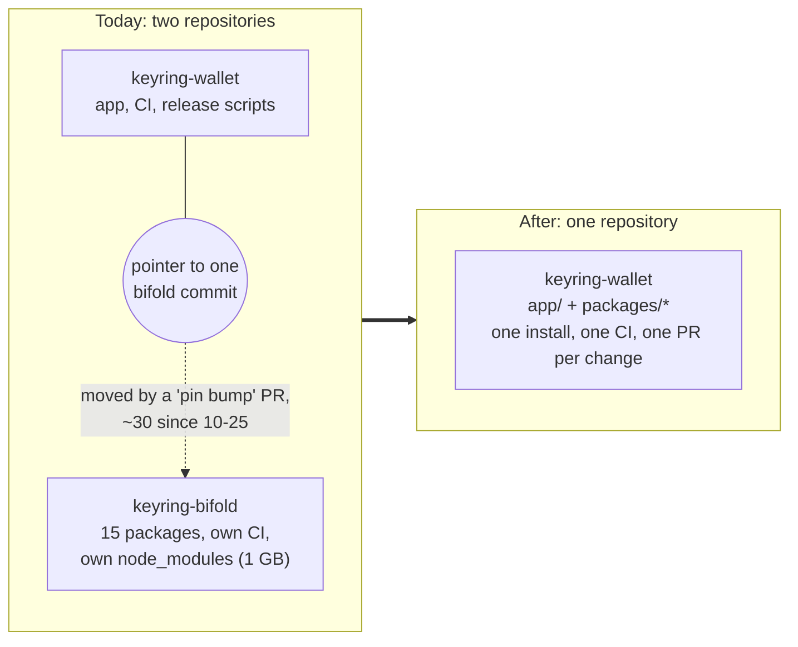
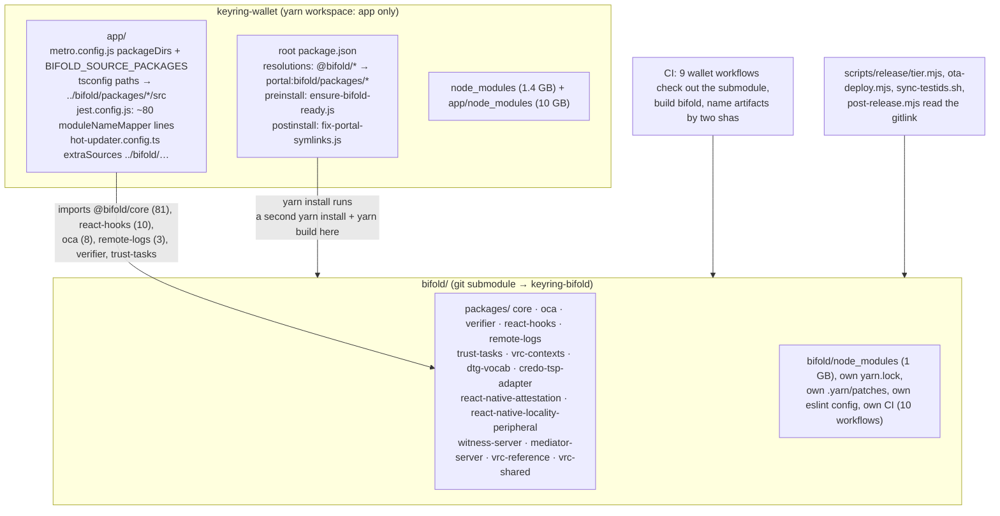
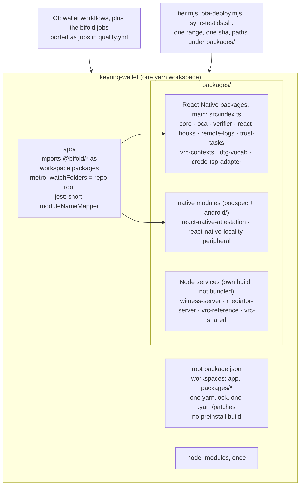
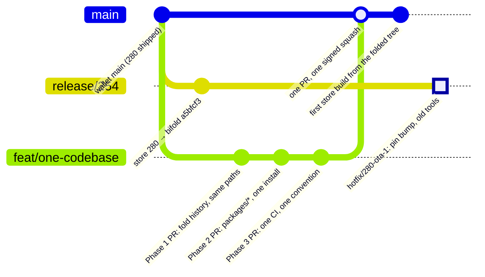

# One codebase: folding bifold into keyring-wallet

**Status:** Accepted 2026-11-21, top priority alongside the DIDComm v2 migration, which runs in parallel (§8). Phase 0 is under way; nothing is merged.
**Reviewers:** the product owner and a second maintainer.
**Reasoning:** [`single-codebase-plan/2026-11-20-al.md`](single-codebase-plan/2026-11-20-al.md): the measurements this plan rests on, the positions it rejects, the decisions taken and the rehearsal record.
**Related plans:** [`release-cadence-and-testing-strategy.md`](release-cadence-and-testing-strategy.md) (OTA tiers and the gate), [`versioning-and-releases-plan.md`](versioning-and-releases-plan.md), [`mediator-migration-plan.md`](mediator-migration-plan.md) and [`openvtc-integration-plan/didcomm_v2_subtask.md`](openvtc-integration-plan/didcomm_v2_subtask.md) (the parallel workstream), [`reference-app-sdk-packaging.md`](reference-app-sdk-packaging.md) (superseded in part, §9). `UPGRADE_PROGRESS.md` §2 records the "branch swap" bifold strategy this plan ends.

---

## 1. For a reader new to the codebase

Keyring today is two Git repositories that pretend to be one.

- **keyring-wallet** holds the app: its screens, theme, release scripts and CI.
- **keyring-bifold** holds the framework the app is built on: fifteen packages, among them the wallet core (190,000 lines), the Trust Tasks module, the witness server and two native modules. It began as a fork of OpenWallet Foundation's Bifold.

The wallet repository does not contain the framework. It contains a **pointer** to one exact commit of it (a Git submodule). Every time the framework changes, somebody has to open a second pull request in the wallet that moves the pointer. Since 2026-10-25 that has happened about thirty times, roughly once a day. Every release note, every OTA cut and every test run has to name two commits instead of one, and the tooling that keeps the two in step (install scripts, path rewrites, duplicate dependency trees, a 1 GB second `node_modules`) is some of the most fragile code we have.

This plan moves the framework's files and their full history into the wallet repository, so there is **one repository, one commit, one pull request** per change. Nothing about what the app does changes. The screens, the theme, navigation, the agent, notifications and over-the-air updates all keep working exactly as they do now, because the code itself is not rewritten; only where it lives and how it is wired together changes.

It happens in two moves so that each one can be checked on its own, each a pull request stacked on the previous one on a single integration branch, and `main` changes once at the end:

1. **Same paths, one repository.** The pointer becomes a real folder with the same contents and the same history. Nothing else moves. If this step breaks something, the cause can only be the install wiring.
2. **One dependency tree.** The packages join the wallet's own workspace, the second install and its 1 GB of duplicates go away, and the paths lose their `bifold/` prefix.

A third phase folds the framework's CI jobs and conventions into the wallet's. Optional later work (renaming the packages from `@bifold/*` to `@keyring/*`, or merging the core package into the app) is listed but not decided.

One rule of this repository shapes how the first move lands: every commit on `main` must be cryptographically signed. The framework's 4,341 historical commits are not, and cannot be made so after the fact. So the fold arrives on `main` as one signed commit, and the framework's full history is kept beside it in the same repository on a separate branch, where `git blame` and `git log` can still reach it.

The other thing that needs care is **over-the-air updates**. A phone on store build 279 or 280 only accepts a JavaScript update whose "native fingerprint" matches the build it has. The fold may change that fingerprint even though no native code changes, so the fold is treated as a store-build boundary (§6.3).



---

## 2. Goal and non-goals

**Goal.** One Git repository, `keyring-wallet`, contains everything that today lives in `keyring-wallet` and `keyring-bifold`, with the framework's history preserved, and a change to the app and its framework is one commit on one branch, reviewed in one pull request, tested by one CI run, and released by the existing release and OTA pipeline.

**Non-goals.**
- Rewriting, re-architecting or renaming any module. Phases 1 and 2 move files and wiring only. Screens, theme, navigation, the agent container, Trust Tasks, VRC, notifications and OTA keep their code unchanged (§6.4).
- Changing what ships. The first store build from the folded tree is the same app.
- Continuing the upstream "branch swap" sync with `openwallet-foundation/bifold-wallet` as shared Git history. Upstream changes are ported as patches from here on (§9).
- Rewriting or deleting the `keyring-bifold` repository's history. It is archived, not removed (§7).

---

## 3. Today

Measured on 2026-11-20 at wallet `main` 969963df4, bifold gitlink a5bfcf3b2 (bifold `main` tip that day). Details and counts in the companion.



What the submodule costs today, in the order it hurts:

| Cost | Evidence |
|---|---|
| Two PRs per framework change | ~30 `chore(bifold): pin …` commits on wallet `main` since 2026-10-25 |
| Two dependency trees that must agree | `app/jest.config.js` carries ~80 `moduleNameMapper` lines whose comments say "force Jest to use app's React instead of bifold's"; `metro.config.js` has a singleton list for the same reason |
| Two installs, two lockfiles, two patch sets | `bifold/yarn.lock`, `bifold/.yarn/patches` duplicate most of the root's; `bifold/node_modules` is 1 GB |
| A build step that exists only to satisfy `main:` fields | `ensure-bifold-ready.js` runs `yarn build` in bifold on every install; `app/tsconfig.json` redirects three packages to `src` because the built `.d.ts` lags |
| Every release artifact names two commits | `test-builds.yml` artifact names, `ota-deploy.mjs`, `tier.mjs --range` reading the submodule's own range |
| Shared submodule config that can break every worktree at once | `.git/modules/bifold/config` `core.worktree` incident, 2026-11-14: one bad value stopped every git command in every bifold checkout on the machine |
| Two commit conventions | bifold needs a `Signed-off-by:` trailer last; the wallet does not |
| Two CI systems | bifold: ten workflows (quality with four jest parts and a type-check ratchet, full-tests, targeted-jest, VTI conformance, commit checks, publish, and four housekeeping ones) and two rulesets; wallet: 17 workflows, 9 of which also build bifold |

What is *not* a cost: the code itself is sound, its tests are the contract (491 test files in core alone), and the native modules link correctly. The fold keeps all of it.

---

## 4. Target



Design positions, each a standing rule for the implementer:

- **D1. History is preserved in this repository, and `main` stays signed-only.** Every commit on wallet `main` must be cryptographically signed and verified by GitHub: the repository ruleset "Main" on `main` carries `required_signatures`, `non_fast_forward`, `deletion` and four required status checks ("DCO sign-off and commit signature" from `commit-checks.yml`, "Lint+Format+Types", "Testing", "Workflow files"); `commit-checks.yml` lists **every commit in the pull request** and fails on the first one that is unsigned or lacks a sign-off (root `CLAUDE.md`, "Commit conventions"). `git filter-repo` rewrites every bifold sha and so strips every signature, and the upstream OpenWallet-era commits were never signed. A merge that brings 4,341 unsigned commits onto `main` is refused. So the fold lands on `main` as **one signed squash commit**, and the full bifold history (fork point with upstream `dbfa53ef`) is kept reachable **inside the wallet repository** on an unprotected ref, `history/bifold`, pushed once from the filter-repo'd clone. `git log history/bifold -- bifold/packages/core/src/…` and `git blame history/bifold -- <file>` work in every clone; `git log --follow` from `main` does not cross the squash. A `refs/replace/` graft (`git replace --graft <fold-squash> <fold-squash>^ <integration tip>`) stitches them for anyone who fetches `refs/replace/*`; it is optional and never required by tooling. This shape was chosen over two alternatives that remain available: changing branch protection for one history-preserving merge (rejected because it needs a protection change for a one-time event), and a squash with the history left only in the archived `keyring-bifold` repository (rejected because every new clone would need to fetch a read-only archive to get blame). A plain history merge is not an option: protection refuses it.
- **D2. Two moves, as stacked PRs into one integration branch, then one PR to `main`.** The integration branch is `feat/one-codebase`, cut from `main`. Phase 1 (same paths), Phase 2 (the move and one install) and Phase 3 (CI and conventions) are each a PR whose base is the previous one's head, reviewed one at a time with GitHub's stacked pull requests, and merged into the integration branch. `main` changes once, by one PR from `feat/one-codebase`, squash-merged as one signed commit (D1), on the product owner's explicit word; the standing merge rules do not apply to it. `main` is therefore never between phases: an OTA cut, a nightly or anyone rebasing onto `main` never meets a half-folded tree. The per-phase separation still holds inside the stack: a failure in Phase 1 can only be install wiring; a failure in Phase 2 can only be paths or hoisting. The integration branch is kept after the merge (not deleted), so the phase boundaries stay reachable even though `main` holds one commit. If GitHub's stacked pull requests are not available to the organisation, the same stack is three ordinary PRs whose bases are retargeted by hand as each merges.
- **D3. The packages keep their names.** `@bifold/core` stays `@bifold/core` through Phase 3. The app has about 100 import sites and core has thousands; renaming is a separate, mechanical PR (§5, Phase 4).
- **D4. React Native packages are bundled from source.** Their `main` and `types` point at `src/index.ts`, as `react-native-locality-peripheral` already does in release builds. Metro and `tsc` already read source in development (`BIFOLD_SOURCE_PACKAGES`, `tsconfig` paths); making it the only mode removes the install-time build, the stale `lib/typescript` declarations, and one whole class of "works in dev, breaks in release" bugs. The Node services keep their own `build`.
- **D5. Old release lines keep the old structure.** `release/253` (store 279), `release/254` (store 280), every `hotfix/*-ota-*` and `test/ota-*` branch, and the bifold commits they pin stay exactly as they are and stay buildable (§7). The fold lands on `main` once, from the integration branch.
- **D6. Nothing moves between `app/` and `packages/core`.** The question of what belongs in the app and what in the framework is real, but it is a different plan. Mixing it in would make the fold's diff unreviewable and would break D2's "only wiring can have failed" property.
- **D7. The cut.** Both cuts are taken at the moment Phase 1 starts: the wallet cut is wallet `main`'s tip then, and the bifold cut is bifold `main`'s tip then (969963df4 and 87805b240 when this was written; both are expected to move before Phase 1, the wallet with the v2 retirement's store-tier change and its pin bump). DIDComm v2 merges that land before Phase 1 starts are simply part of the fold; the replay rule in §8.1 applies only to merges after the cut. The tier fixtures in Phase 0 include `staging-v0.2.0-280..<wallet cut>`, so the range that carries a store-tier change is graded before and after the fold like the OTA ranges.
- **D8. One commit convention.** After the fold the whole repository uses the wallet's: conventional commit messages checked by commitlint, every commit signed and verified, and the configured identity's `Signed-off-by:` as the last line (what `git commit -s` writes), with nothing after it. There is no separate DCO rule for `packages/`; `CONTRIBUTING.md` records the change of posture for the files that came from bifold.
- **D9. The Node services stay in the one workspace.** `witness-server`, `mediator-server`, `vrc-reference` and `vrc-shared` join the root workspace like every other package. They move to a `services/` tree with their own install only if hoisting their dependencies (`@credo-ts/node`, askar-nodejs, express) is shown to pollute the mobile tree.

---

## 5. Phases

Each phase ends with its acceptance criteria met on a Test build and on CI, and is one PR in the stack on `feat/one-codebase` (D2). Phases 1 and 2 are the fold; 3 is cleanup; 4 is optional. When Phase 3's PR has merged into the integration branch and the whole ladder in §6.1 has passed on its tip, one PR takes `feat/one-codebase` to `main`.

### Phase 0. Freeze and prepare

- All other work on the framework is paused except the DIDComm v2 migration (done 2026-11-20). Bifold `main` is frozen to everything but that workstream, and each of its merges after the cut is replayed into the fold branch (§8).
- Record the cut: wallet `main` sha, bifold sha, the current native fingerprint of both platforms from a `test-builds.yml` run of that sha (`scripts/ota/record-fingerprint.sh`), and the sizes of the release JS bundles.
- Store **280 against 279**, read from the staging runs' `ota-fingerprint` artifacts: iOS fingerprints **differ** (one source, `AppDelegate.mm`, #950); Android fingerprints are **identical**. 280 phones never take 279.x bundles regardless, because a store build stamps a build-time `MIN_BUNDLE_ID` (280's is later than 279.8). So a kept 280 line needs its own OTA line from `staging-v0.2.0-280`, and the Android floor rule in §6.3 applies.
- Record `tier.mjs`'s grades for the last real OTA cut ranges (`hotfix/279-ota-1..8`, `-90`, 279→280) and for `staging-v0.2.0-280..<wallet cut>`, as the fixture for Phase 1's "byte-identical grades" criterion. *Done 2026-11-21 for the first ten: all nine 279 cuts grade `ota-strict`, 279→280 grades `store`; the 280→cut range is graded when the cut is taken.*
- Rehearse D1's mechanics on a throwaway GitHub repository carrying a copy of the "Main" ruleset and `commit-checks.yml`: push the filter-repo'd history to `history/bifold`; open a PR straight from the integration branch and watch the commit check fail (the negative case); open the PR from the one-commit `fold/*` branch (§5, Phase 3), watch it pass, squash-merge it, and confirm `main` holds one GitHub-verified commit whose `bifold/` tree is the bifold cut's. *Done 2026-11-21 at a5bfcf3b2, all four outcomes as predicted (companion §3a); redone at the real cut, which takes a second.*
- Make disk room (§11). The fold worktree needs an install (about 12 GB); do it after the nightly finishes, or after the product owner names the stale worktrees to remove.

*Done when:* the cut shas, both fold fingerprints, 280-vs-279, and the ten tier grades are recorded in the companion; the rehearsal passed; and the fold branch `feat/one-codebase` exists at the wallet cut sha in its own worktree.

### Phase 1. Same paths, one repository

In a throwaway clone of `keyring-bifold` at the cut sha:

```sh
git filter-repo --to-subdirectory-filter bifold   # every path gains the bifold/ prefix; the tree under bifold/ must equal the cut's tree
```

Push that history, once, to the wallet repository on an unprotected ref (the product owner's word covers this push):

```sh
git push origin <clone>/main:refs/heads/history/bifold   # 4,341 commits, paths already under bifold/
```

In the fold branch (its own worktree):

```sh
git rm --cached bifold && rm -rf bifold && git rm .gitmodules
git commit -S -s -m "chore: drop the bifold gitlink"            # commit first: git merge refuses a dirty index
git fetch origin history/bifold
git merge --allow-unrelated-histories --no-commit origin/history/bifold   # brings the tree in
git commit -S -s -m "chore: fold keyring-bifold <cut sha> into this repository (history on history/bifold)"
git rev-parse HEAD:bifold    # must equal the bifold tree at the cut; the rehearsal's first try silently skipped the merge
```

This commit opens the Phase 1 PR, whose base is `feat/one-codebase`. The integration branch is unprotected, so the Phase 1 PR may merge into it with a merge commit, keeping `history/bifold` as an ancestor there.

Then, as a second commit on the fold branch, the minimum wiring change:

- `scripts/ensure-bifold-ready.js`: stop the submodule init and hooks setup. The nested `yarn install` + `yarn build` in `bifold/` **stays in Phase 1**, so `portal:` resolutions keep resolving to built packages. (D2: nothing else changes.)
- `.github/workflows/*`: remove `submodules: true` and `git submodule update` steps; the `cd bifold && yarn install && yarn build` steps stay for now. `quality.yml` and `test-builds.yml` get `feat/one-codebase` added beside `main` in their `pull_request.branches`, so each stacked PR gets "Lint+Format+Types", "Testing", "Workflow files" and both Test builds. `commit-checks.yml` is **not** widened: a PR into the integration branch legitimately carries the unsigned history. The integration branch itself has no ruleset.
- `.gitignore`: remove the submodule remark; add `bifold/node_modules`, `bifold/packages/*/{lib,build,coverage}` if not already ignored by bifold's own `.gitignore` (which now lives at `bifold/.gitignore` and still applies to that subtree).
- `scripts/release/tier.mjs`: the `bifold@` "pin moved" rule and the submodule-range read (`pinAt`, `bifoldDirOf`) become dead; replace with a plain `git diff --name-only` of the range. Path regexes are unchanged in this phase, and **its grades must stay byte-identical**: the standing rule that lets a plain `ota`-graded fix ship over the air depends on them. The known name-rule defect (an in-memory `.delete()` graded `store`) is not fixed here; it stays its own PR.
- `packages/core`'s testids generator (`bifold/packages/core/scripts/gen-testids.mjs`, run by `yarn testids` in core) and manifest (`bifold/packages/core/testids.json`) stay where they are in this phase. `quality.yml`'s testids step runs `node bifold/packages/core/scripts/gen-testids.mjs --check` and `e2e/scripts/check-testids.mjs` against the tree instead of the pin, and both must report the manifest unchanged.
- `app/scripts/ota-deploy.mjs` (`HEAD:bifold`), `e2e/scripts/sync-testids.sh` (`rev-parse :bifold`), `scripts/ota/post-release.mjs` (fetches bifold history for the changed-screens list), `scripts/ota/ota-carried-check.sh` (follows the pin): each reads the tree directly.
- `CLAUDE.md`: the submodule paragraph, the `Signed-off-by` rule (D8) and the "four entries for a new package" rule.
- `bifold/.github/workflows/*`: deleted with a note in the commit (GitHub reads only the root `.github/`, so they are inert, but they mislead). Their jobs are ported in Phase 3.

*Done when:*
- `yarn install` from a fresh clone works without any `git submodule` command, and `node scripts/verify-bifold-linking.js` passes.
- `yarn lint`, `yarn typecheck`, `yarn test` (app) and `cd bifold/packages/core && yarn test` are green locally and in CI.
- `test-builds.yml` produces an iOS simulator app and an Android APK; `e2e:smoke` and `e2e:vrc` pass against them.
- The native fingerprint of both platforms equals the Phase 0 record (§6.3).
- `tier.mjs` grades the ten Phase 0 fixture ranges byte-identically (`tier.test.mjs` gains them as fixtures).
- The testids manifest check and `e2e/lib/testids.json` sync both pass with the manifest unchanged.
- `git log origin/history/bifold -- bifold/packages/core/src/modules/vrc/vrc-manager.ts` shows bifold history from any clone; with the graft fetched, `git log --follow` from `main` crosses the fold.
- Every open bifold PR's patch still applies with `git am` unchanged (the paths did not move).
- The Phase 1 PR merges into `feat/one-codebase` on review clearance; it does not touch `main`.

### Phase 2. One dependency tree, paths without the prefix

A second PR on top of Phase 1, in two commits so renames stay visible to Git:

**Commit A, the move.**
```sh
git mv bifold/packages packages
git mv bifold/eslint-rules eslint-rules            # require-testid rule, used by core's lint
git mv bifold/__mocks__ packages/__mocks__          # shared jest mocks
# bifold/tsconfig-base.json is merged into the root tsconfig-base.json (the app already extends one)
# bifold/{README,CONTRIBUTING,PATCH_NOTES,CODE_OF_CONDUCT,CONTRIBUTORS,HISTORICAL_CONTRIBUTORS}.md → docs/bifold-origin/
# bifold/{package.json,yarn.lock,package-lock.json,noop,samples,docs/images,scripts} → removed; they are in history
```

Bifold's shared root files (`eslint-rules/`, `__mocks__/`) go to the repository root, since more than one package uses them. Upstream Bifold leftovers (`samples/`, `docs/images`, the unused `package-lock.json`, the upstream workflows) are dropped here rather than kept for a later cleanup; they remain in `history/bifold`.

**Commit B, the wiring.**
- Root `package.json`: `workspaces.packages = ["app", "packages/*"]`; delete every `portal:` resolution; `app/package.json` depends on `@bifold/*` as `workspace:*`. Bifold's root `devDependencies` (eslint, prettier, typescript, ts-node, changesets) merge into the root; drop `@changesets/cli` (no more publishing).
- One `yarn.lock`, one `.yarn/patches` (bifold's duplicates are byte-identical to the root's for credo, pex, expo-secure-environment, askar-shared; the companion lists the diff). `yarn install` once.
- RN packages: `main`/`types` → `src/index.ts` (D4); remove their `build`/`compile` scripts, `lib/`, `build/` and `tsconfig.build.json`. Node services keep theirs. `@bifold/oca` has no `exports` field and the app imports `@bifold/oca/build/legacy` from five files; that path becomes `@bifold/oca/legacy` (an `exports` entry or a `legacy.ts` re-export at the package root).
- `scripts/ensure-bifold-ready.js` and `scripts/fix-portal-symlinks.js`: deleted. `preinstall` keeps only `husky install`.
- **One copy of each shared runtime.** Today `app/package.json` and `packages/core/package.json` both set `installConfig.hoistingLimits: "workspaces"`, which nests each workspace's dependencies under its own `node_modules`; with core inside the root workspace that would put a second `react`, `react-native` and every native module under `packages/core/node_modules`, next to the app's copies (today there are three `react` directories on disk). Phase 2 removes `hoistingLimits` from the React Native packages so their dependencies hoist to the root, and keeps the app's only if Metro's existing singleton list (`singletonPrefixes` in `metro.config.js`) is shown to cover every native-backed and React package; the simpler outcome, one root `node_modules` for everything, is preferred. *Acceptance:* `find . -path '*/node_modules/react/package.json' -not -path '*/node_modules/*/node_modules/*'` finds exactly one file outside the nesting under `@credo-ts/*`, the same for `react-native` and for each of the native modules' peers, and a release bundle's module list (`react-native bundle --verbose`, or the Metro `--sourcemap-output` module table) names each of them once.
- `app/metro.config.js`: `watchFolders` = repo root; `packageDirs`/`BIFOLD_SOURCE_PACKAGES` removed (a workspace package resolves through the root `node_modules` symlink, and its `main` is source). The `singletonPrefixes` list stays: it guards against the few nested copies that remain under `@credo-ts/*` (class-transformer, askar-shared).
- `app/tsconfig.json`: drop the three `@bifold/*` path redirects; `@openvtc/trust-tasks` paths move to `node_modules/…`.
- `app/jest.config.js`: drop every `moduleNameMapper` line whose comment cites the second `node_modules`; keep `class-transformer`, `@openvtc/*` (ESM exports map), file/style mocks, `react-i18next`, and the expo mocks (now `<rootDir>/../packages/core/__mocks__/…`). `app/jestSetup.js:54`'s path to `refreshOrchestrator` updates.
- `app/hot-updater.config.ts`: `extraSources` paths `../bifold/packages/…` → `../packages/…`. **This is the fingerprint risk** (§6.3).
- `scripts/release/tier.mjs`: every `bifold\/packages\/` becomes `packages\/`; the `bifold/` dotfile and lockfile rules go; `tier.test.mjs` fixtures follow.
- `e2e/scripts/sync-testids.sh`: reads `packages/core/testids.json`. `quality.yml`'s testids check follows.
- `.github/workflows/*`: no `cd bifold`; one `yarn install --immutable`; `test-builds.yml` artifact names drop the bifold sha (and every consumer of that name: `scripts/ci/download-artifact.mjs`, gate scripts, `post-release.mjs`, `strict-proof.mjs`).
- `.github/workflows/staging-witness.yaml` and the hosts it deploys to: `bifold/packages/witness-server` → `packages/witness-server` on the server checkout.
- `deploy/*`, `scripts/openvtc/*`, `e2e/gate/*`, `docs/*`: path mentions (67 plan files mention `bifold/packages`; those are history and stay, with one note at the top of `docs/plans/README.md`).

*Done when:*
- Everything in Phase 1's list, on the new paths.
- `du -sh node_modules app/node_modules` shows no `bifold/node_modules`, and `find . -name yarn.lock -not -path '*/node_modules/*'` finds one file.
- `yarn workspaces list` shows `app` and every package; `yarn test` at the root runs the app's and each package's `test` script (a root script using `yarn workspaces foreach --topological run test`).
- Release bundle sizes for both platforms are within 0.5 % of the Phase 0 record, and the e2e suites in §6.1 pass on Test builds.
- The native fingerprint equals the Phase 0 record **or** the §6.3 rule is in force and recorded.
- `tier.mjs` grades the ten fixture ranges identically after the path rewrite (the fixtures' paths are rewritten `bifold/packages/` → `packages/`, nothing else).
- `node packages/core/scripts/gen-testids.mjs --check` and `e2e/scripts/sync-testids.sh` (now reading `packages/core/testids.json`) pass with the manifest unchanged.
- **The OTA cut tooling works on the folded tree** (§6.3): a rehearsal cut on a `test/ota-*` branch from the integration branch grades, builds and publishes to the throwaway channel in `gate-ota.yml`. A Phase 2 exit criterion, because the first post-fold OTA cannot wait for Phase 3.
- **The nightly gate runs on the folded tree**: the gate's scripts and `gate-ci.yml`, `gate-ota.yml`, `gate-smoke.yml` read paths, not the pin, and one nightly passes from the Mac mini. Until it passes, the nightly stays on `release/253` or `release/254`.
- `git log origin/history/bifold -- bifold/packages/core/src/modules/vrc/vrc-manager.ts` still reaches bifold history; the Phase 2 move is an ordinary rename, so `git log --follow` crosses it back to the Phase 1 merge.
- The Phase 2 PR merges into `feat/one-codebase` on review clearance; it does not touch `main`.

### Phase 3. One CI, one convention, cleanup

- Port bifold's CI, read at bifold `origin/main` on 2026-11-21 (the ten workflows there, by job name):
  - `quality.yaml`: "Linting and formatter" (lint and prettier on changed files, the testids extractor test, `gen-testids.mjs --check`), "Testing part 1/4" to "4/4" (core's jest in four parts), "Testing" (the gate that joins them), "Testing scope · <scope>" (the scoped-subset logic, which **does not** carry over: §6.1), and "Type check (ratchet)". Into the wallet's `quality.yml` as jobs; the wallet's own "Lint+Format+Types" and "Testing" absorb or sit beside them, and the ruleset's required checks are renamed to match.
  - `full-tests.yaml` ("Jest part (N)", "Full suite"; push to main, schedule, dispatch): the unscoped run that review waits on. Becomes the wallet PR's Testing job (every PR, full suite) plus the scheduled run.
  - `targeted-jest.yaml` ("Targeted jest", dispatch): ported as is.
  - `vti-conformance.yaml` ("VTI SDK accepts Keyring's card and statement"): ported as a job; it already checks out the wallet to build `card-verify`, now it runs in place.
  - `commit-checks.yaml`: the wallet has the same job; one copy.
  - Dropped: `publish.yaml` ("Release", changesets; nothing consumes the packages), `repolinter.yaml`, `scorecard.yaml`, `maintenance.yaml` ("Issue and PR"), `roadmap-pr-status.yaml` (the wallet has its own). Coverage upload stays if its token exists (below).
  - The "SEDI/KERI switch guard" is a jest test, not a job: `packages/core/src/modules/trust-tasks/__tests__/sediKeriSwitches.test.ts`; it moves with core and runs in the parts.
- Rulesets. Bifold `main`'s ruleset "Main" requires "DCO sign-off and commit signature", "Linting and formatter", "Testing", "Type check (ratchet)"; after the port, the wallet's "Main" ruleset requires the wallet's equivalents (its current four plus "Type check (ratchet)" or its merged successor). Bifold's second ruleset, **"OTA pins", protects `refs/heads/ota/*` from deletion and force-push**; the same ruleset is created on the wallet for its `ota/*` branches, and the one on the archived repository stays.
- `deps-cache.yml`: one cache key.
- Repository secrets and variables: bifold's `quality.yaml` references `secrets.CODECOV_TOKEN`, but the only repository secret listed on `keyring-bifold` is `ROADMAP_TOKEN` and the wallet lists no codecov secret either, so the token is an organisation or environment secret, or unset; check which before asking the product owner for anything. Neither repository has a `dependabot.yml`; dependabot's bifold PRs were GitHub defaults and simply stop.
- Commit conventions: one `commitlint` config (D8). `commit-checks.yml` (GitHub signature verification) is unchanged.
- `keyring-bifold` stays writable for OTA cuts on the 279/280 lines until the first folded store build is published (§6.3), then is archived (read-only). Its open PRs: ready ones merge before the cut if reviewed; drafts older than 30 days close with a pointer to this plan; anything else is re-landed by its author with the `git am` recipe in §8.1. Dependabot PRs are closed.
- `UPGRADE_PROGRESS.md` §2 and §4, `README.md`, `CONTRIBUTING.md`, `RELEASE.md`, `CLAUDE.md`, `e2e/README.md`: say the new shape. The `openvtc-workspace` and `vti-lab-and-field` skills get one correction each.
- Remaining tooling that assumes a gitlink (the OTA cut tools and the gate scripts are Phase 2 exit criteria): the roadmap comparison script's repository mapping, the roadmap sync's card source, the board's "pin" vocabulary. Each owner fixes their own.

*Done when:* a PR that changes a file in `packages/core` and a file in `app/` gets one CI run that lints, type-checks and tests both, and the gate's nightly run (`gate.sh`) passes on the integration branch's tip from the Mac mini.

**Then the one PR to `main`.** A PR opened straight from `feat/one-codebase` would list its 4,341 unsigned history commits, and the required check "DCO sign-off and commit signature" fails on the first of them before any squash happens. So the PR to `main` is opened from a **one-commit branch** whose tree is the integration tip's:

```sh
tip=$(git rev-parse feat/one-codebase)
sha=$(git commit-tree -S -p origin/main -m "$(cat fold-message.txt)" "$tip^{tree}")   # message ends with Signed-off-by
git branch fold/one-codebase "$sha" && git push -u origin fold/one-codebase
```

Review clears it by `git rev-parse fold/one-codebase^{tree}` = `git rev-parse feat/one-codebase^{tree}` plus the three stacked PRs' clearances, which the PR description lists. It merges by squash (`--match-head-commit`) on the product owner's word, after the full §6.1 ladder on that tree. The commit message names the bifold sha, `history/bifold`, `feat/one-codebase` and the graft recipe.

### Phase 4. Optional, each its own plan

Listed so they are not forgotten; none is decided.

- Rename `@bifold/*` → `@keyring/*` (mechanical; ~100 app import sites, thousands in core; one `sed`, one PR).
- Merge `packages/core` and `app/` into one package, or move `app/src/keyring-theme` and screens the framework does not need out of core. Depends on the SDK packaging plan's outcome.
- Move the Node services to `services/` with their own install, if their dependencies prove to pollute the mobile tree (D9).

---

## 6. What must keep working, and how we prove it

### 6.1 The test ladder (run at the end of Phase 1 and again after Phase 2)

| Rung | What | Where |
|---|---|---|
| 1 | `yarn lint`, `yarn typecheck`, `yarn prettier` | CI `quality.yml` |
| 2 | App jest (`yarn test`) and every package's `test` script; core's 491 suites are the contract | CI, four parts as today |
| 3 | `scripts/ota/*.test.mjs`, `scripts/release/tier.test.mjs`, `scripts/ci/*.test.mjs` | CI |
| 4 | Test builds: iOS simulator app + Android APK, store configuration | `test-builds.yml` |
| 5 | `e2e:smoke`, `e2e:vrc`, `e2e:vrc:witnessed`, `e2e:vrc:didcomm-v2`, `e2e:vrc:didcomm-v2:tsp`, `e2e:agent:connect`, `e2e:migration` | Mac mini (emulator + simulator) |
| 6 | `e2e:vrc:devices` and `e2e:vrc:witnessed:ios-devices:didcomm-v2:tsp` on two phones (hardware attestation, the one thing simulators cannot prove) | attended |
| 7 | The release gate (`gate.sh`, nightly) against the lab communities | Mac mini |
| 8 | `gate-ota.yml`: a throwaway OTA served to a Release APK built from the folded tree | CI |
| 9 | A hands-on install on the product owner's phone | attended |

Rungs 1 to 4 gate each PR; 5 to 9 gate the store build (§6.3).

**The gate's shape changes with the fold.** Today a bifold PR runs a scoped subset of core's suites, only a push to bifold `main` runs the full suite, and a wallet `main` push runs no jest at all. Once core lives in the wallet, the wallet PR's Testing job runs the full suite (app and every package), split into parts as bifold's CI does today. Whoever ports the workflows must not carry the old scoping rule across.

**Review shape.** Pure moves and edits are separate commits (Phase 1: the history merge, then one wiring commit; Phase 2: commit A moves, commit B wires). A move is cleared by hashing both sides per file (`git show <base>:<old> | shasum` against `git show <head>:<new> | shasum`), so a move that also edits must name its edits in the PR description.

### 6.2 CI and bundling

- Metro: the only behaviour change is that `watchFolders` is the repo root and `@bifold/*` resolve to source in every mode (D4). Hermes bytecode, the RN CLI bundle command and `hot-updater`'s `bare()` build are untouched.
- Node: `engines` stay `>=20.19.2 <21`, Yarn 4.9.2 via corepack. The Node services' builds (`tsc` to `dist/`) are untouched, and their Docker contexts move one directory up.
- Native: `react-native-attestation` and `react-native-locality-peripheral` autolink through the `node_modules/@bifold/*` symlink exactly as the `portal:` symlink does today; `pod install` and Gradle see the same podspec and `build.gradle`. No native source changes.
- Patches: `patch:` protocol patches live in one `.yarn/patches`; `app/patches` (patch-package) is unchanged.

### 6.3 OTA deployments and the transition

A phone accepts an OTA bundle only when its native fingerprint matches (`updateStrategy: 'fingerprint'`). `hot-updater` hashes the files `extraSources` lists, by content and by path. Moving `../bifold/packages/react-native-attestation/ios` to `../packages/react-native-attestation/ios` may change the hash even though no byte of native code changed.

Rule: **the fold is a store-build boundary.**

- Store builds 279 (`release/253`) and 280 (`release/254`) and their OTA lines `hotfix/279-ota-N`, `hotfix/280-ota-N` stay on the old structure. A fix for those users is cut as today: a bifold commit on the bifold repository (still writable until then), a pin bump on the hotfix branch, `tier.mjs` as it is on that branch. The current cut tools serve those lines only.
- The first store build from the folded tree is **281** (or the next number after any Friday build shipped from today's structure in the meantime, §11a). Its fingerprint is whatever Phase 2 produces; `ota-fingerprint.yml` records it, and every later OTA targets it and its successors.
- **The 279/280 OTA lines are retired when the first folded store build is published**, and active users are asked to update: the user base is small and the product owner has chosen this over keeping two toolchains alive. Until then, a fix needed on both sides is made on `main` and back-ported with `git format-patch` + `git am -p3 --directory=bifold/packages` (Phase 1 paths) or `-p2 --directory=packages` (Phase 2 paths) onto the bifold repository. The back-port recipe is kept after retirement but is expected never to be used.
- **A post-fold OTA cut is a different thing from today's.** Today a cut is a gitlink-only commit on `hotfix/279-ota-N`, built on the previous cut, and `tier.mjs --range` reads the submodule's own range. From the first folded store build on, a cut is a cherry-pick of real file changes onto its `hotfix/<build>-ota-N` branch, so `tier.mjs` grades a cherry-picked range on a hotfix branch (the base is the last store tag, the tip the cut, as its `a..b` rule already says), and the OTA cut tooling is reworked **before the first post-fold OTA**. That rework is a Phase 2 exit criterion (§5), rehearsed through `gate-ota.yml` on a `test/ota-*` branch. What reads the gitlink today:
  - the cut scripts: the gitlink `update-index`, displacement against the bifold pin, switch reads at `<pin>:packages/core/…`, the bifold signature API, the testids copy into `e2e/lib/testids.json`, and the script that waits for a bifold sha;
  - `scripts/release/tier.mjs` (`BIFOLD_GIT`, 37 references; without the submodule expansion a gitlink grades a false `store`);
  - `ota-publish.yml` and `ota-fingerprint.yml` (`submodules: true`, "Build bifold packages");
  - `scripts/ota/post-release.mjs` and `scripts/ota/ota-carried-check.sh`;
  - the anchor rule: bifold `test/ota-279-2`, `test/ota-279-3` and #1140's branch are pinned by the published 279.2 and 279.3 bundles and stay.
- **The Android floor rule.** 279 and 280 share an Android fingerprint, so the next Android bundle reaches both 279 and 280 phones whichever line it is cut from, because it is newer than both floors. An Android OTA cut from a base without 280's JS would take 280 Android phones back to pre-280 JS. The reworked cut tools therefore check that **the cut's base contains the newest store tag** for that platform. iOS lines are separate (different fingerprints).

Check, in Phase 0 and at the end of each phase: `node scripts/ota/fingerprint-report.mjs --diff <phase0>/fingerprint.json <now>/fingerprint.json` per platform. Identical means the folded build's fingerprint equals the previous store build's and an OTA from the folded tree could, if ever wanted, also reach those phones. Different is expected and acceptable under the rule above; it is recorded in the companion so nobody later tries it.

`tier.mjs` after Phase 2 grades `packages/<rn-package>/src/**` as `ota` and `packages/{react-native-attestation,react-native-locality-peripheral}/**` and `packages/*/{ios,android}/**` as `store`, as it does for the `bifold/` paths today. The `none` rule for `witness-server|mediator-server|vrc-reference|vrc-shared` keeps the Node services out of the tier.

### 6.4 Screens, theme, layout, navigation, notifications

No file under `app/src`, `packages/core/src` or any other `src/` changes in Phases 1 to 3, apart from import paths that name a file by its `bifold/` location (there are two: `app/jestSetup.js:54` and `app/__mocks__/@bifold/remote-logs.ts`'s neighbours, both test-only). The theme (`app/src/keyring-theme`), navigation (`@react-navigation/*` versions resolve from the one tree), push (`app/src/push`, `@react-native-firebase/messaging`, the gateway in `deploy/keyring-messaging`), and the VtiMediatorTransport family are therefore unchanged by construction. The proof is rungs 5 and 9 of §6.1, and the bundle-size check: a hoisting change that silently swapped a dependency version would show as a size change and as an e2e failure.

One real risk here: **duplicate versions resolving differently after hoisting.** Today the app's `jest.config.js` pins ~40 packages to the app's copy because the bifold tree had a second copy. After Phase 2 there is one tree, but `yarn` may hoist a different version of, say, `react-native-gesture-handler` if `packages/core`'s range and `app`'s range disagree. Mitigation: before merging Phase 2, `yarn why` on every package that `app/jest.config.js` pinned, and `yarn dedupe`; align ranges in `packages/*/package.json` to the app's exact versions where they differ. Measured on 2026-11-20, only `react` differs for real (app `19.1.0`, core `~19.1.4`; the root resolution pins `19.1.0`); the companion lists the rest.

### 6.5 Tests migrate with their packages

Each package's jest config, mocks and `__tests__` move with it (`git mv`). `packages/core/jest.config.js` keeps its `moduleNameMapper` for `@bifold/oca` → `../oca/src`, now one directory shallower; its `class-transformer` and `askar-shared` singleton mappings point at the root `node_modules` with one fewer `..`. The app's jest run and core's jest run stay separate projects (different `setupFiles`), both run by the root `yarn test`.

---

## 7. The old repository and the old release lines

- Branches that survive every cleanup: wallet `ota/f35e8f1d-1`, `feat/web-interaction-scheme`, `feat/v2-accept-tsp-default`, `fix/wallet-folder-excluded-on-first-launch`; bifold `feat/join-link-vcalm-oob`, `feat/message-cache-on-for-279-2`, `test/ota-279-2`, `test/ota-279-3`, `feat/polls-vote-behind`; and every `hotfix/*`, `release/*`, `ota/*` and `test/ota-*` ref in both repositories.
- `keyring-bifold` stays writable for the 279/280 OTA lines until the first folded store build is published, then is archived (read-only). Its history is never rewritten: 116 `hotfix/*`, `test/ota-*` and `release/*` refs in the wallet point at bifold shas that must stay fetchable while their bundles are served.
- The wallet's old branches keep their gitlinks. Checking out `release/254` still needs `git submodule update --init`, as it does today. Nothing in this plan edits an old branch.
- Local clones and worktrees of the old shape: after the merge to `main`, a `git pull` leaves a stale `bifold/` directory that is now a tracked folder in a modified state. The recipe is `git submodule deinit -f bifold; rm -rf .git/modules/bifold; git checkout main`, once per clone.



---

## 8. The parallel DIDComm v2 workstream

The DIDComm v2 migration (the Affinidi mediator as the wallet-to-wallet mailbox, the VRC exchange, TSP, the witness, and every direction already covered by the existing proofs) proceeds **at the same time, in its own worktrees, with neither stream waiting on the other.** The caution in `mediator-migration-plan.md`'s staged order (M1 before M2 before M4) is relaxed: the user base is small and active users can upgrade, so there are no backwards-compatibility steps for old builds, only tests that prove the new path. The proof obligations are not relaxed.

The fold also runs in its own worktree on the integration branch, so that neither stream interrupts the other; the consolidation is §8.1's cut-over step, at the one merge to `main`.

### 8.1 How the two streams meet

```mermaid
sequenceDiagram
  participant V2 as DIDComm v2 work (own worktree, today's layout)
  participant BF as keyring-bifold main (frozen to others)
  participant F as integration branch feat/one-codebase
  participant M as wallet main
  V2->>BF: merges a core PR (as today)
  BF-->>F: replay same day: git format-patch | git am -p3 --directory=bifold/packages
  V2->>M: merges a wallet-side PR (as today)
  M-->>F: ordinary merge of main into the integration branch
  F->>M: one PR, after Phase 3: squash, one signed commit
  Note over V2,M: cut-over: the v2 work rebases its worktree once on the folded main and keeps going in packages/core; no more replay
```

Rules:
- Until the integration branch merges to `main`, the v2 work proceeds as today: bifold PRs into bifold `main`, wallet PRs into wallet `main`. The integration branch replays every bifold merge the same day (`git format-patch <last-replayed>..main` in the bifold clone; `git am -p3 --directory=bifold/packages` during Phase 1, `-p2 --directory=packages` after the Phase 2 move; `-p` strips `a/packages/` or `a/bifold/packages/`; check with `git apply --check` first). The replay log lives in the companion.
- When the integration branch merges to `main`, the v2 work rebases once onto `main` and from then on edits `packages/core` directly. The old worktree is removed after that rebase is proven by its own tests.
- Neither stream's PRs are reviewed as a condition of the other's. The integration branch never carries v2 behaviour changes of its own; a replayed patch is identical to the bifold commit by `git patch-id`.
- Expect **deletions**, not only additions, in `trust-tasks/`: the v2 work builds wallet-to-wallet on the existing `VtiMediatorSession` family and retires `v2Routing`'s Coordinate Mediation 2.0 path and the `pickUpNow 'v4'` branch (the Affinidi mediator has no CM 2.0). `git am` handles deletions; a replay that conflicts with a Phase 2 rename is resolved by replaying before the move or by `-p2 --directory=packages` after it, never by hand-merging content.
- The v2 stream's e2e suites (`e2e:vrc:didcomm-v2*`, `:tsp`, the Affinidi mailbox leg from `mediator-migration-plan.md` M2) are also the fold's rung 5, so one Test build from the folded tree proves both.

### 8.2 Open bifold PRs at the cut

Twenty PRs were open in `keyring-bifold` on 2026-11-20 (list in the companion). Ready ones merge before the cut if reviewed; drafts older than 30 days close with a pointer to this plan; anything else is re-landed by its author against the folded wallet with the `git am` recipe above. Dependabot PRs are closed.

---

## 9. What this ends, and what replaces it

- **The "branch swap" upstream strategy** (`UPGRADE_PROGRESS.md` §2): bifold as a same-repo fork with shared history, so upstream commits could be cherry-picked. After the fold, an upstream `bifold-wallet` change is ported with `git format-patch` from the upstream clone and `git am --directory=packages` here; the fork point `dbfa53ef` is recorded in the companion for `git range-diff`. Upstream has moved to React 19 / RN 0.81 / expo 54 and we have followed; the remaining delta is ours (VRC, Trust Tasks, witness, attestation), so the shared-history benefit is now small. The SDK packaging plan's assumption of publishable `@bifold/*` packages from a separate repository is superseded in that respect.
- **Two commit conventions**: one (D8).
- **The pin-bump PR**: gone. The release notes, `tier.mjs --range`, the testids resync and the Test build names each read one sha.

---

## 10. Out of scope, recorded so they are not re-proposed by accident

- Renaming `@bifold/*` (Phase 4).
- Splitting `app/` from `packages/core` differently (Phase 4, needs its own plan).
- Publishing `@bifold/*` to npm; nothing consumes them outside this repository.
- Changing the OTA server, signing keys, channels or `hot-updater` version.
- Any change to the Node services' behaviour or deployment other than their path on the host.

## 10a. Rollback

- **Before the merge to `main`:** nothing to roll back; `main` is untouched and the integration branch can be abandoned.
- **After the merge to `main`:** `main` holds one squash commit, so `git revert <fold-squash>` restores the submodule shape in one signed commit (the gitlink, `.gitmodules`, the `portal:` resolutions and both install scripts come back as they were; `bifold/` disappears from the tree). `history/bifold` and the integration branch stay, and the revert is itself revertible. Clones that ran the one-line recipe in §7 need `git submodule update --init` again. A revert is the response to a defect found in the first days after the merge that cannot be fixed forward within a day; a defect found after the first folded store build is fixed forward, because reverting then would re-split a tree that phones already run.
- **Of a single stacked PR inside the integration branch:** an ordinary revert on the integration branch, before the final PR is opened.

---

## 11. Disk and machines

- MacBook: about 25 GB free; the nightly needs 14 GB free at 06:00Z and its legs usually end late morning UTC. A fold worktree with its install needs about 12 GB, so the install waits for the nightly to finish, or for stale worktrees to be removed. About 170 worktrees exist across `~/keyring-worktrees`, `~/.keyring-gate`, `~/.keyring-fleet/gate` and `~/Documents`; removal needs the product owner's word per the standing rules.
- Mac mini: about 13 GB free; used for rungs 5 and 7. The fold worktree's install may live there instead if the MacBook cannot make room.
- After Phase 2, every future worktree saves 1 GB (no `bifold/node_modules`) and one install.

## 11a. Timeline, as an estimate

The product owner wants a store build every Friday. Counting from the plan's acceptance on 2026-11-21: Phase 0 completes over the weekend; the Phase 1 PR is expected around 2026-11-24 and the Phase 2 PR around 2026-11-27, because Phase 2 waits on an install slot, on the OTA cut-tool rework and on the nightly passing on the folded tree; Phase 3 and the full §6.1 ladder take the week of 2026-11-30. **The one PR to `main` is not expected before Friday 2026-11-27.** So that Friday's store build comes from today's structure, or is skipped, which is the product owner's call that week; the first store build from the folded tree is targeted for Friday 2026-12-04. If 11-27 ships from today's structure, its number is 281 and the folded build becomes 282; §6.3's rule is then read with those numbers. This is an estimate, not a commitment.
